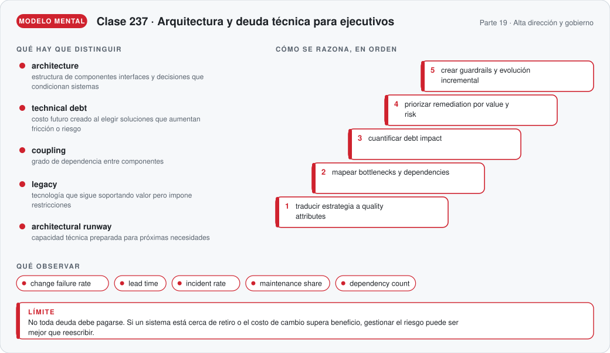

# Clase 237 — Arquitectura y deuda técnica para ejecutivos

<!-- nav:inicio -->
> **Parte 19 · Tecnología, datos, IA y transformación digital para ejecutivos** — clase 9 de 12 · [índice de la parte](../../README.md) · [temario](../../../../SYLLABUS.md)
<!-- nav:fin -->

**Parte:** 19 — Tecnología, datos, IA y transformación digital para ejecutivos  
**Nivel:** Etapa 5 — CEO → Transformador digital  
**Duración sugerida:** 150–180 minutos · **Estándar:** deep-class-v2

## 🎯 Propósito

Cada cierto tiempo, el área de tecnología pide dinero para «pagar deuda técnica» o «rediseñar la arquitectura», y el comité de dirección no sabe qué responder. La petición suena razonable, el lenguaje es técnico y el riesgo de negarla parece alto; pero tampoco hay forma de comparar esa petición con otras inversiones. Si el ejecutivo aprueba por confianza, financia proyectos largos sin resultados visibles; si rechaza por escepticismo, deja que los sistemas se degraden hasta que un incidente grave lo obligue a invertir en la peor situación. La arquitectura y la deuda técnica son, en realidad, asuntos de negocio: determinan **qué tan rápido puede cambiar la empresa, qué tan seguras y confiables son sus operaciones y cuánto cuesta cada cambio**. Y pueden traducirse a un lenguaje que el comité entienda: tiempo, riesgo y dinero.

La clase ofrece ese lenguaje. Se apoya en la propuesta de Parnas sobre cómo dividir los sistemas en módulos para que los cambios sean contenibles, en la metáfora de la deuda técnica de Cunningham, en Henderson y Clark sobre arquitectura e innovación, en la visión de Kleppmann sobre sistemas fiables, escalables y mantenibles, y en Skelton y Pais sobre la relación entre la estructura de los equipos y la de los sistemas. Al terminar sabrás traducir la estrategia a atributos de calidad, identificar cuellos de botella y dependencias, cuantificar el efecto de la deuda, priorizar la remediación según valor y decidir cuándo no pagar la deuda.

## 📚 Resultados de aprendizaje

Al finalizar podrás:

1. **Traducir** la estrategia a atributos de calidad que la arquitectura debe sostener.
2. **Identificar** cuellos de botella y dependencias entre sistemas y equipos.
3. **Cuantificar** el efecto de la deuda técnica en tiempo, riesgo y costo.
4. **Priorizar** la remediación según valor y horizonte de vida del sistema.
5. **Decidir** cuándo conviene no pagar la deuda y administrar el riesgo.

## 🧭 Agenda

| Tramo | Qué se hace |
|---|---|
| 0–20 min | Recuperación: ¿cuánto tarda en tu empresa un cambio «simple» en el sistema principal y por qué? |
| 20–60 min | Atributos de calidad, módulos, deuda, medición, priorización y retiro. |
| 60–105 min | Ejemplo trabajado: remediar, estabilizar o retirar un sistema según su horizonte. |
| 105–150 min | Caso ejecutivo y práctica. |
| 150–175 min | Límites y entregable. |

## 🧩 Conceptos centrales

| Concepto | Definición | Cómo se reconoce |
|---|---|---|
| **Arquitectura** | Estructura de componentes de un sistema y sus relaciones. | Qué se conecta con qué y cómo. |
| **Atributo de calidad** | Propiedad que el sistema debe tener: velocidad, seguridad, escala, costo. | Se traduce de la estrategia. |
| **Modularidad** | División en partes con límites claros. | Un cambio afecta pocos componentes. |
| **Deuda técnica** | Costo futuro de decisiones de diseño que aceleraron el corto plazo. | Cambios lentos y riesgosos. |
| **Acoplamiento** | Grado de dependencia entre componentes o equipos. | Un cambio obliga a coordinar con muchos. |
| **Costo de cambio** | Tiempo y esfuerzo de modificar el sistema. | Medido en días por cambio. |

## 🧠 Modelo mental

**Cómo leer el diagrama.** Una escalera de cuatro niveles. **Atributos de calidad**: velocidad, seguridad, escala y costo que importan al negocio. **Dependencias y cuellos de botella**: dónde se acoplan los sistemas y los equipos. **Impacto de la deuda**: cuánto cuesta en tiempo, riesgo y dinero. **Remediación por valor**: pagar la que más frena y aceptar el resto. La nota advierte que no toda deuda debe pagarse: si un sistema está por retirarse o el costo de cambiar supera el beneficio, administrar el riesgo puede ser mejor que reescribir; el pie, que la deuda técnica se mide por su efecto en el negocio, no por la opinión sobre el código.

## 📖 Desarrollo

### 1. La arquitectura y la estrategia

La arquitectura de un sistema no es un dibujo: es el conjunto de decisiones que determina qué cambios son fáciles y cuáles difíciles. Si la estrategia exige lanzar ofertas en días, la arquitectura debe permitirlo; si exige operar con alta disponibilidad o proteger datos sensibles, debe diseñarse para eso. El ejecutivo traduce la estrategia a **atributos de calidad** medibles: **velocidad de cambio** (cuánto tarda llevar una idea a producción), **confiabilidad** (disponibilidad, tiempo de recuperación), **seguridad**, **escalabilidad** (capacidad de crecer sin rediseñar), **costo de operación** y **capacidad de integración**. Kleppmann describe que los sistemas de datos deben ser **fiables, escalables y mantenibles**, y que las decisiones de diseño tienen consecuencias a largo plazo en la facilidad de evolución. Henderson y Clark muestran que cambiar la **arquitectura** (cómo se conectan los componentes) es mucho más difícil que mejorar los componentes, y que las organizaciones tienden a reproducir sus estructuras previas.

### 2. Modularidad: contener el cambio

Parnas propuso en 1972 un criterio que sigue vigente: dividir un sistema en **módulos** según las decisiones de diseño que probablemente cambien, de modo que cada módulo **oculte** una decisión y los cambios queden contenidos. Un sistema modular permite que un equipo cambie una parte sin afectar a las demás; uno **acoplado** obliga a coordinar y probar todo cada vez que se modifica algo. Para el ejecutivo, la pregunta es sencilla: **¿cuántas personas y equipos hay que coordinar para hacer un cambio típico?** Si la respuesta es «muchos», hay acoplamiento, y cada nueva funcionalidad cuesta más y tarda más que la anterior. Skelton y Pais agregan que la estructura de equipos y la de sistemas se influyen mutuamente: equipos con responsabilidades claras sobre componentes con límites claros reducen la coordinación.

### 3. Deuda técnica: qué es y qué no es

Cunningham propuso la metáfora de la **deuda técnica**: lanzar con un diseño imperfecto es como pedir un préstamo, útil para ganar velocidad, a condición de **pagar** luego con refactorización; si no se paga, los **intereses** se acumulan como lentitud y riesgo en cada cambio. No toda imperfección es deuda: puede ser una **decisión consciente** (lanzar un prototipo para aprender) o un **error** de ingeniería. La deuda aparece también por **cambios de contexto** (un diseño razonable que dejó de serlo cuando el negocio creció), por **falta de mantenimiento** (versiones obsoletas, dependencias sin actualizar) y por **conocimiento perdido** (nadie entiende el sistema). El comité debe distinguir **deuda deliberada y gestionada** (con plan) de **deuda inadvertida** (que se descubre al fallar).

### 4. Cuantificar el impacto

La deuda técnica se vuelve un tema del comité cuando se **cuantifica** en lenguaje de negocio. Tres dimensiones. **Tiempo**: porcentaje del esfuerzo del equipo que se va en **retrabajo, corrección de errores y coordinación** en vez de nuevas funcionalidades; tiempo medio de cambio (de la idea a producción) y su tendencia. **Riesgo**: número y costo de incidentes, tiempo de recuperación, exposición de seguridad por componentes obsoletos, dependencia de personas clave. **Costo**: gasto en mantener frente al gasto en mejorar, licencias de sistemas antiguos, costo de oportunidad de proyectos que no se pueden hacer. Con estos datos, el directorio puede comparar la **remediación** con otras inversiones. Las estimaciones son aproximadas; el objetivo es llevar la conversación de la opinión a los números.

### 5. Priorizar la remediación por valor

No se paga toda la deuda. Se **prioriza** la que más frena a las capacidades críticas (clase 229): la que ocurre en los sistemas que cambian con frecuencia (donde el interés se paga más veces), la que causa los incidentes más costosos y la que bloquea iniciativas estratégicas. Se considera el **horizonte de vida** del sistema: remediar un sistema que se va a retirar en dos años rara vez conviene; para uno que durará ocho años, casi siempre. También se evalúan **alternativas de menor costo**: estabilización parcial, aislamiento de componentes críticos, reglas de prevención de nueva deuda (estándares, revisiones, pruebas automatizadas) y envolver el sistema antiguo con interfaces para reemplazarlo de a poco. Un criterio práctico: invertir donde el **ahorro anual** en tiempo, incidentes y riesgo, durante el horizonte de vida, supera con holgura el costo de la remediación.

### 6. Reescribir, remediar, aislar o retirar

Ante un sistema problemático hay cuatro caminos. **Remediar** (mejorar el diseño existente por partes, con pruebas): útil si el sistema es central y el diseño es recuperable. **Reescribir** (reemplazar por un sistema nuevo): arriesgado y lento; solo se justifica si la arquitectura impide los atributos de calidad requeridos. **Aislar o estrangular** (rodear el sistema antiguo con interfaces y reemplazarlo gradualmente): reduce el riesgo del «gran cambio». **Retirar** (dejar de usarlo): cuando ya no aporta valor (clase 236). Las reescrituras completas tienen un historial de sobrecostos y atrasos; se prefieren cambios **incrementales** con valor temprano. Y se acepta que, en algunos casos, **administrar el riesgo** (monitoreo, respaldos, conocimiento documentado) es mejor que cambiar.

### 7. Gobierno: prevenir nueva deuda

Pagar la deuda sin cambiar las causas produce deuda nueva. Se establecen **mecanismos de prevención**: estándares de diseño y de calidad, revisiones, pruebas automatizadas, un **presupuesto de capacidad** (por ejemplo, 15 a 20 % del esfuerzo de los equipos a mejoras estructurales), **métricas** de salud técnica (tiempo de cambio, incidentes, cobertura de pruebas, versiones obsoletas) en el tablero de dirección, y **decisiones conscientes** de endeudamiento (registrar cuándo se toma un atajo, con fecha de pago). El **incentivo** importa: si los equipos solo se miden por entregar funcionalidades, acumularán deuda. El comité pregunta por la salud técnica con la misma regularidad con que pregunta por las ventas.

## 📚 Lectura comparada

| Obra | Qué aporta | Qué no resuelve | Pregunta para contrastar |
|---|---|---|---|
| Parnas | Dividir en módulos según las decisiones que cambiarán. | Texto de 1972; hay que adaptarlo a sistemas actuales. | ¿Cuántos equipos coordinamos por cambio? |
| Cunningham | Deuda técnica como préstamo con intereses. | Metáfora; hay que medirla. | ¿Qué atajo tomamos y cuándo lo pagamos? |
| Henderson y Clark | Arquitectura frente a componentes en la innovación. | No es específico de software. | ¿Qué conexión frena el cambio? |
| Kleppmann | Fiabilidad, escalabilidad y mantenibilidad de sistemas de datos. | Técnico; requiere traducción. | ¿Qué tan fácil es evolucionar este sistema? |
| Skelton y Pais | Estructura de equipos y de sistemas se influyen. | Enfoque de organización de tecnología. | ¿Hay equipos con límites claros? |

## 🧮 Ejemplo trabajado

**Situación (hipotética).** El sistema principal de una empresa es mantenido por 40 ingenieros con un costo de 48 millones de pesos por persona al año (1.920 millones). Un diagnóstico muestra que el **35 %** del esfuerzo se va en retrabajo y coordinación causados por deuda técnica, y que el sistema sufre **8 incidentes** al año con un costo medio de 60 millones cada uno.

**Impacto anual de la deuda.**

| Concepto | Cálculo | Millones |
|---|---|---|
| Esfuerzo perdido | 35 % × 1.920 | 672 |
| Incidentes | 8 × 60 | 480 |
| **Total** | | **1.152** |

**Tres alternativas.**

- **Remediar** (1.800 millones): reduce el esfuerzo perdido de 35 % a 15 % (ahorro de 0,20 × 1.920 = 384) y los incidentes de 8 a 3 (ahorro de 5 × 60 = 300): beneficio de **684 millones al año**, con la mitad en el primer año (342) por la curva de implantación.
- **Estabilizar** (250 millones): monitoreo, pruebas y aislamiento de los módulos más frágiles; reduce los incidentes a la mitad (ahorro de 240 al año).
- **Retirar y reemplazar** por un producto estándar (clase 236): no se evalúa aquí.

**Resultado neto según el horizonte de vida del sistema.**

| Años de vida restante | Remediar: beneficio acumulado − 1.800 | Estabilizar: 240 × años − 250 |
|---|---|---|
| 2 | 342 + 684 − 1.800 = **−774** | 480 − 250 = **+230** |
| 3 | 342 + 684 + 684 − 1.800 = **−90** | 720 − 250 = **+470** |
| 4 | 2.394 − 1.800 = **+594** | 960 − 250 = **+710** |
| 5 | 3.078 − 1.800 = **+1.278** | 1.200 − 250 = **+950** |
| 8 | 5.130 − 1.800 = **+3.330** | 1.920 − 250 = **+1.670** |

**Lectura.** Si el sistema se va a retirar en dos o tres años, remediar pierde dinero; estabilizar es mejor. Con cuatro años de vida, la estabilización todavía supera a la remediación (710 frente a 594); a partir de unos 4,3 años, remediar es mejor; con ocho años, la diferencia es de 1.660 millones a favor de remediar. La decisión depende del **horizonte**, que es una decisión estratégica del comité.

**Decisión.** La empresa decide mantener el sistema al menos ocho años (es central para la operación) y **remediar por etapas**: primera etapa de 700 millones sobre los módulos que concentran el 70 % de los incidentes y de los cambios; las etapas posteriores se liberan si en seis meses el esfuerzo perdido baja de 35 % a menos de 28 % y los incidentes a menos de 6. Se establece un **presupuesto de capacidad** de 15 % del esfuerzo para evitar nueva deuda y una **métrica** mensual de tiempo de cambio.

**Indicadores.** Tiempo medio de cambio (de 38 a 15 días); incidentes al año (de 8 a 3); porcentaje de esfuerzo en retrabajo (de 35 % a 15 %); versiones obsoletas críticas (de 41 a 0); equipos necesarios para un cambio típico (de 5 a 2).

**Cuidados.** Las estimaciones de esfuerzo perdido y de incidentes son aproximadas; las decisiones sobre proveedores y sistemas se verifican con los contratos y la seguridad vigente; las cifras son ilustrativas.

**Qué muestra.** (1) La deuda se tradujo a pesos. (2) El horizonte de vida cambió la mejor alternativa. (3) Se liberó el capital por etapas con criterios de salida.

## 🔀 Comparación y límites

**Arquitectura frente a deuda técnica.** La arquitectura define la estructura y las posibilidades; la deuda técnica es el costo acumulado de desviaciones del diseño o de atajos. Una buena arquitectura reduce la deuda futura, pero no la elimina.

**Límites.** No toda deuda debe pagarse. Medir el esfuerzo perdido y los incidentes tiene incertidumbre. Las reescrituras completas son riesgosas. Los beneficios de la remediación no siempre se materializan como se estiman. Las cifras del ejemplo son ilustrativas.

## 🪜 De profesional a owner

| Nivel | Cómo participa |
|---|---|
| **Profesional** | Registra los atajos que toma y propone mejoras. |
| **Jefe / Team Lead** | Reserva capacidad para reducir deuda y mide la salud técnica. |
| **Gerente** | Traduce la deuda a efecto de negocio y la prioriza. |
| **CEO / Director** | Decide horizonte de vida, financia por etapas y exige métricas. |
| **Founder / Owner** | Equilibra velocidad hoy con capacidad de cambiar mañana. |

## 🏢 Caso ejecutivo

Una empresa de servicios financieros con 1.700 personas y un núcleo de sistemas de 18 años tiene 90 ingenieros en tecnología (costo de 4.300 millones al año). Hechos: un cambio simple en tarifas toma 11 semanas y requiere coordinar a seis equipos; hubo 17 incidentes en el año (costo medio de 45 millones y uno de 400 millones con sanción del regulador); el 52 % del tiempo de los equipos se va en retrabajo, pruebas manuales y coordinación; hay 63 componentes con versiones sin soporte, algunos con vulnerabilidades conocidas; dos ingenieros con 20 años de antigüedad son los únicos que conocen módulos críticos; el costo de los sistemas antiguos es de 3.100 millones al año en licencias. El área de tecnología propone una reescritura completa de 14.000 millones en cuatro años; el área de negocio quiere congelar el sistema y construir encima; el director de riesgos advierte la exposición; el regulador pide un plan.

Entrega un **plan de arquitectura y deuda técnica** que contenga: (a) los atributos de calidad que exige la estrategia y el estado actual; (b) el mapa de dependencias y cuellos de botella con el costo de cambio; (c) la cuantificación de la deuda en tiempo, riesgo y costo; (d) la comparación de remediar, estabilizar, aislar, reescribir y retirar según el horizonte de vida; (e) la priorización, el financiamiento por etapas con criterios de liberación y la prevención de nueva deuda; (f) las métricas de salud técnica y las verificaciones regulatorias, de seguridad y contractuales pendientes.

## 🧪 Práctica

1. Traduce la estrategia de tu empresa a cinco atributos de calidad medibles.
2. Cuenta cuántos equipos se coordinan en un cambio típico de un sistema principal.
3. Estima el porcentaje de esfuerzo perdido y el costo de los incidentes de un sistema.
4. Compara remediar y estabilizar un sistema con tres horizontes de vida.
5. Define cinco métricas de salud técnica para el tablero de dirección.

## ⚠️ Errores frecuentes

| Error | Por qué ocurre | Cómo corregirlo |
|---|---|---|
| Aprobar por confianza | No hay lenguaje común | Cuantificar tiempo, riesgo y costo. |
| Rechazar por escepticismo | Se ve como gasto técnico | Evaluar el interés que se paga cada año. |
| Reescribir todo | Atractivo de empezar de cero | Cambios incrementales con valor temprano. |
| Pagar deuda de un sistema que se retira | No se define el horizonte | Decidir el horizonte antes. |
| No prevenir nueva deuda | Incentivos solo de entrega | Presupuesto de capacidad y estándares. |
| Depender de pocas personas | Conocimiento no documentado | Documentar y distribuir el conocimiento. |

## ❓ Preguntas de comprobación

1. ¿Qué es un atributo de calidad y cómo se relaciona con la estrategia?
2. ¿Qué propone Parnas sobre la modularidad?
3. ¿Qué es la deuda técnica y qué tipos hay?
4. ¿Cómo se cuantifica su impacto?
5. ¿Por qué el horizonte de vida cambia la decisión?
6. ¿Qué caminos hay ante un sistema problemático?
7. ¿Cómo se previene la deuda nueva?

Claves de respuesta

1. Una propiedad medible que el sistema debe tener (velocidad de cambio, confiabilidad, seguridad, escala, costo); se deriva de lo que la estrategia exige.
2. Dividir el sistema en módulos según las decisiones que probablemente cambien, de modo que cada módulo oculte una decisión y los cambios queden contenidos.
3. El costo futuro de decisiones que aceleraron el corto plazo; puede ser deliberada y gestionada o inadvertida, por contexto cambiado, falta de mantenimiento o conocimiento perdido.
4. En tiempo (esfuerzo perdido y tiempo de cambio), riesgo (incidentes y exposición) y costo (mantener frente a mejorar).
5. Porque los beneficios de la remediación se acumulan con los años; si el sistema se retira pronto, no se recupera la inversión.
6. Remediar, reescribir, aislar o estrangular, retirar o administrar el riesgo.
7. Con estándares, revisiones, pruebas automatizadas, presupuesto de capacidad, métricas de salud técnica e incentivos que no premien solo la entrega.

## 📥 Entregable

Guarda en `portfolio/237-arquitectura-y-deuda-tecnica-para-ejecutivos/`:

- `leadership-decision-brief.md` (plantilla [Leadership Decision Brief](../../../../templates/leadership-decision-brief.md)) con el plan del caso ejecutivo;
- `risk-register.md` (plantilla [Risk register](../../../../templates/risk-register.md)) con los riesgos técnicos y su tratamiento;
- `decision-journal.md` con las estimaciones de deuda, el horizonte de vida y los criterios de liberación por etapas.

## 📗 Fuentes y verificación

- D. L. Parnas — *On the criteria to be used in decomposing systems into modules* (Communications of the ACM, 1972). **Uso en esta clase:** modularidad según las decisiones que probablemente cambien. Lectura selectiva sobre **arquitectura y deuda técnica para ejecutivos**. **Localizador:** [DOI 10.1145/361598.361623](https://doi.org/10.1145/361598.361623).
- Ward Cunningham — *The WyCash portfolio management system* (OOPSLA '92 Addendum, 1992). **Uso en esta clase:** deuda técnica como préstamo con intereses. Lectura selectiva sobre **arquitectura y deuda técnica para ejecutivos**. **Localizador:** [DOI 10.1145/157709.157715](https://doi.org/10.1145/157709.157715).
- Rebecca M. Henderson & Kim B. Clark — *Architectural Innovation: The Reconfiguration of Existing Product Technologies and the Failure of Established Firms* (Administrative Science Quarterly, 1990). **Uso en esta clase:** arquitectura frente a componentes en la innovación. Lectura selectiva sobre **arquitectura y deuda técnica para ejecutivos**. **Localizador:** [DOI 10.2307/2393549](https://doi.org/10.2307/2393549).
- Martin Kleppmann — *Designing Data-Intensive Applications* (O'Reilly publications, 2017). **Uso en esta clase:** fiabilidad, escalabilidad y mantenibilidad de sistemas de datos. Lectura selectiva sobre **arquitectura y deuda técnica para ejecutivos**. **Localizador:** [ISBN-13 9789352135240](https://openlibrary.org/isbn/9789352135240).
- Matthew Skelton & Manuel Pais — *Team Topologies* (IT Revolution Press, 2019). **Uso en esta clase:** relación entre la estructura de equipos y la de sistemas. Lectura selectiva sobre **arquitectura y deuda técnica para ejecutivos**. **Localizador:** [ISBN-13 9781942788812](https://openlibrary.org/isbn/9781942788812).

> **Regla de fuentes para Arquitectura y deuda técnica para ejecutivos:** las obras anteriores estructuran las perspectivas de esta materia; cualquier norma, ley o estándar vivo mencionado debe comprobarse nuevamente en su fuente primaria vigente, incluidas las exigencias regulatorias sobre sistemas críticos y seguridad. Los ejemplos y casos son hipotéticos, con cifras ilustrativas. El desarrollo es original y no reproduce capítulos protegidos.

<!-- pie:inicio -->
---

| Anterior | Índice | Siguiente |
|---|---|---|
| [← 236 · Build, buy, partner o retire](../236-build-buy-partner-o-retire/README.md) | [Parte 19](../../README.md) · [Programa](../../../../SYLLABUS.md) | [238 · Métricas de entrega tecnológica →](../238-metricas-de-entrega-tecnologica/README.md) |
<!-- pie:fin -->
