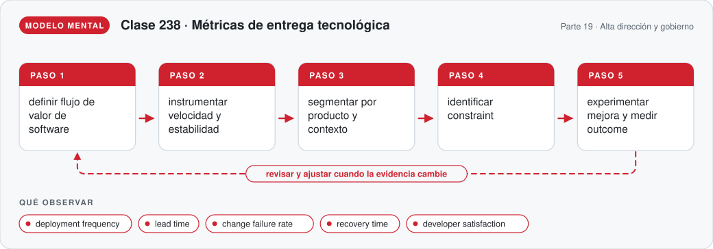

# Clase 238 — Métricas de entrega tecnológica

<!-- nav:inicio -->
> **Parte 19 · Tecnología, datos, IA y transformación digital para ejecutivos** — clase 10 de 12 · [índice de la parte](../../README.md) · [temario](../../../../SYLLABUS.md)
<!-- nav:fin -->

**Parte:** 19 — Tecnología, datos, IA y transformación digital para ejecutivos  
**Nivel:** Etapa 5 — CEO → Transformador digital  
**Duración sugerida:** 150–180 minutos · **Estándar:** deep-class-v2

## 🎯 Propósito

Un ejecutivo que no viene de tecnología tiene una dificultad real: no sabe si un equipo de software es rápido o lento, estable o frágil, mejora o empeora. Las respuestas que recibe suelen ser de dos tipos igualmente inútiles: «estamos haciendo lo que podemos» o un conjunto de métricas internas (puntos de historia, líneas de código, horas, tickets cerrados) que miden actividad y no resultados, y que además se prestan a manipulación. Existe, sin embargo, un pequeño conjunto de métricas de **entrega** de software, respaldado por investigación, que permite al comité de dirección saber **con qué rapidez y con qué estabilidad** la organización lleva ideas a producción: la frecuencia de despliegue, el tiempo de entrega de cambios, la tasa de fallas en los cambios y el tiempo de restauración del servicio. Son señales del **sistema**, no cuotas de las personas, y bien interpretadas indican dónde está la restricción principal.

La clase presenta esas métricas, su lectura y sus límites. Se apoya en la investigación de Forsgren, Humble y Kim (*Accelerate*), que vinculó prácticas de entrega con desempeño organizacional; en el libro de ingeniería de confiabilidad de Beyer y colaboradores sobre objetivos de nivel de servicio y aprendizaje de incidentes; en Skelton y Pais sobre la organización de equipos y el flujo; en Ries sobre aprendizaje validado; y en el análisis de Jensen sobre cómo las metas mal diseñadas inducen conductas de manipulación. Al terminar sabrás definir el flujo de valor de software, instrumentar velocidad y estabilidad, interpretar los resultados por producto y contexto y evitar su mal uso.

## 📚 Resultados de aprendizaje

Al finalizar podrás:

1. **Definir** el flujo de valor del software desde la idea hasta el cliente.
2. **Instrumentar** las métricas de velocidad y de estabilidad de la entrega.
3. **Segmentar** e interpretar las métricas por producto y por contexto.
4. **Identificar** la restricción principal del flujo y su costo.
5. **Evitar** el uso de las métricas como cuotas individuales y su manipulación.

## 🧭 Agenda

| Tramo | Qué se hace |
|---|---|
| 0–20 min | Recuperación: ¿cuánto tarda en tu empresa llevar un cambio pequeño desde la aprobación hasta que lo usa un cliente? |
| 20–60 min | Las cuatro métricas, flujo de valor, restricciones, contexto, confiabilidad y mal uso. |
| 60–105 min | Ejemplo trabajado: dos equipos, el desglose del tiempo de entrega y el costo de la demora. |
| 105–150 min | Caso ejecutivo y práctica. |
| 150–175 min | Límites y entregable. |

## 🧩 Conceptos centrales

| Concepto | Definición | Cómo se reconoce |
|---|---|---|
| **Frecuencia de despliegue** | Con qué frecuencia se lleva software a producción. | Despliegues por día, semana o mes. |
| **Tiempo de entrega de cambios** | Tiempo entre que un cambio está listo y funciona en producción. | Días u horas. |
| **Tasa de fallas en cambios** | Porcentaje de cambios que causan fallas o exigen corrección. | Cambios con incidente. |
| **Tiempo de restauración** | Tiempo para recuperar el servicio tras una falla. | Horas o minutos. |
| **Flujo de valor** | Secuencia de pasos desde la idea hasta el cliente. | Tiempos de trabajo y de espera. |
| **Restricción** | Paso que limita el flujo completo. | Colas y esperas largas. |

## 🧠 Modelo mental

**Cómo leer el diagrama.** Tres columnas. **Velocidad**: frecuencia de despliegue, tiempo desde el cambio hasta producción, por producto y contexto. **Estabilidad**: tasa de fallas en los cambios, tiempo para restaurar el servicio, con calidad y seguridad. **Cómo leerlas**: como señales del sistema y no como cuotas personales, junto con resultados de clientes y de negocio, buscando la restricción principal. La nota advierte que las métricas no deben convertirse en una cuota individual: cuando una medida se vuelve meta, se manipula; el pie, que las comparaciones entre equipos exigen mismos contextos y definiciones.

## 📖 Desarrollo

### 1. Qué mide el desempeño de la entrega

Forsgren, Humble y Kim estudiaron durante años a miles de organizaciones y encontraron que la capacidad de entregar software tiene un efecto medible sobre el desempeño de la organización (rentabilidad, participación de mercado, satisfacción). Identificaron cuatro métricas que, juntas, caracterizan el desempeño de la entrega: **frecuencia de despliegue** y **tiempo de entrega de cambios** (velocidad), y **tasa de fallas en los cambios** y **tiempo de restauración del servicio** (estabilidad). Una conclusión importante de su investigación es que **velocidad y estabilidad no son un dilema**: los equipos de mejor desempeño son más rápidos **y** más estables, porque entregan cambios pequeños, frecuentes y automatizados, con mejores pruebas y recuperación. Esto contradice la creencia de que «más rápido significa más riesgoso».

### 2. Definir el flujo de valor de software

Antes de medir, se define el **flujo de valor**: desde que una idea se aprueba (o un cambio se solicita) hasta que el cliente la usa. Los pasos típicos: análisis, desarrollo, revisión de código, pruebas, aprobación de salida, despliegue, verificación en producción. Para cada paso se mide el tiempo de **trabajo activo** y el de **espera**. Ries propone un ciclo **construir–medir–aprender** y un énfasis en el aprendizaje validado: la velocidad solo vale si permite aprender más rápido qué valoran los clientes. Casi siempre se descubre que el tiempo de espera domina: el cambio pasa semanas en colas de revisión, de pruebas manuales o de aprobaciones. La métrica de tiempo de entrega no cuenta cuánto trabajan los ingenieros sino cuánto **espera** el valor.

### 3. Instrumentar sin burocracia

Las métricas se **extraen de los sistemas** (repositorios, herramientas de integración y despliegue, registros de incidentes) y no se piden a las personas que las reporten, porque los reportes manuales se distorsionan y cuestan tiempo. Se definen con claridad: qué es un «despliegue», cuándo un cambio «falla» (genera un incidente, requiere reversión o corrección urgente), cuándo comienza y termina el «tiempo de entrega». Se **segmentan** por producto o sistema y por tipo de cambio, porque promediar una aplicación móvil con un sistema bancario central no tiene sentido. Se muestran **tendencias** y distribuciones (no solo promedios): una mediana de 3 días con casos de 40 días indica un problema en las colas largas.

### 4. Leer las métricas: señales, no veredictos

Las métricas de entrega se interpretan como **señales del sistema**. Un tiempo de entrega largo pregunta: ¿dónde se espera?, ¿hay aprobaciones innecesarias?, ¿las pruebas son manuales?, ¿los cambios son demasiado grandes? Una tasa de fallas alta pregunta: ¿se prueba lo suficiente?, ¿los ambientes de prueba se parecen a producción?, ¿se despliegan cambios muy grandes? Un tiempo de restauración largo pregunta: ¿hay monitoreo?, ¿se puede revertir rápido?, ¿hay claridad de roles en incidentes? Skelton y Pais señalan que la **estructura de los equipos** y la **carga cognitiva** influyen en el flujo: equipos con responsabilidad de extremo a extremo y plataformas internas que reducen fricción tienden a mejorar las métricas. Se compara cada equipo consigo mismo en el tiempo y con su contexto, antes que con otros.

### 5. Confiabilidad y aprendizaje de incidentes

Beyer y colaboradores, en el libro de ingeniería de confiabilidad de sitios, proponen definir **objetivos de nivel de servicio** (por ejemplo, 99,9 % de disponibilidad) y un **presupuesto de error**: el margen que se puede «gastar» en cambios arriesgados sin incumplir el objetivo. Cuando el presupuesto se agota, se frena la entrega de funcionalidades y se invierte en estabilidad. También enseñan a hacer **revisiones sin culpas** de los incidentes: buscar causas del sistema, no culpables, y convertir lo aprendido en mejoras. Estas prácticas conectan las métricas con **decisiones**: ¿cuánta velocidad podemos permitirnos?, ¿dónde invertir en confiabilidad? La seguridad psicológica (clase 174) es una condición: si los incidentes se castigan, se ocultan.

### 6. El mal uso: cuotas individuales y manipulación

Cuando una métrica se convierte en meta o en una cuota individual, tiende a manipularse. Jensen analizó cómo las metas de presupuesto mal diseñadas llevan a las personas a mentir, manipular o actuar en contra del interés de la empresa. Aplicado a la entrega: si se mide a cada ingeniero por **número de despliegues**, se dividirán cambios sin valor; si se castiga la **tasa de fallas**, se ocultarán fallas o se evitará desplegar; si se exige **reducir el tiempo de restauración** sin cambios de proceso, se reclasificarán incidentes. Por eso las métricas de entrega se usan para **conversar sobre el sistema** y mejorar el flujo, no para evaluar personas ni para comparar equipos de contextos distintos. Se acompañan con indicadores de **calidad, seguridad, resultados de clientes y de negocio**.

### 7. Del dato a la decisión

Una vez medida la entrega, el ejecutivo pregunta: ¿cuál es la **restricción principal** del flujo y cuánto cuesta?, ¿qué inversión (automatización de pruebas, plataforma, reorganización, reducción de aprobaciones) la reduce con mejor retorno?, ¿qué efecto tiene en los resultados de negocio (tiempo de lanzamiento, retención, ingresos)? Se calcula el **costo de la demora**: cada día que un cambio espera, el valor que genera se retrasa. Se fijan **metas de mejora por producto** y se revisan trimestralmente, no semanalmente. Y se conecta con la deuda técnica (clase 237) y con la arquitectura: un tiempo de entrega que crece suele ser el síntoma de acoplamiento. Lo importante no es el valor absoluto de las métricas, sino la **dirección** y la **causa**.

## 📚 Lectura comparada

| Obra | Qué aporta | Qué no resuelve | Pregunta para contrastar |
|---|---|---|---|
| Forsgren, Humble y Kim | Cuatro métricas de entrega y su vínculo con el desempeño. | Estudio de encuestas; hay que adaptarlo. | ¿Qué dicen nuestras métricas de nuestro flujo? |
| Beyer y otros | Objetivos de nivel de servicio, presupuesto de error y revisiones sin culpas. | Orientado a grandes sistemas. | ¿Cuánta velocidad permite nuestra confiabilidad? |
| Skelton y Pais | Equipos, carga cognitiva y flujo. | Enfoque organizacional. | ¿Cómo están organizados los equipos para el flujo? |
| Ries | Ciclo construir–medir–aprender y aprendizaje validado. | Orientado a startups. | ¿Qué aprendemos con cada entrega? |
| Jensen | Cómo las metas mal diseñadas inducen manipulación. | Contexto presupuestario. | ¿Qué conducta induce esta métrica? |

## 🧮 Ejemplo trabajado

**Situación (hipotética).** Una empresa mide dos equipos de producto.

| Métrica | Equipo A | Equipo B |
|---|---|---|
| Frecuencia de despliegue | 12 por mes | 1 por mes |
| Tiempo de entrega de cambios | 3 días | 30 días |
| Tasa de fallas en los cambios | 8 % | 20 % |
| Tiempo de restauración | 2 horas | 18 horas |

**Costo de las fallas por cada 100 cambios.** Con un costo de interrupción de 4 millones de pesos por hora: Equipo A: 8 fallas × (2 h × 4) = 8 × 8 = 64 millones. Equipo B: 20 fallas × (18 h × 4) = 20 × 72 = 1.440 millones. El equipo B no solo es más lento: cada cien cambios le cuesta 22 veces más en interrupciones (1.440 ÷ 64 = 22,5).

**Desglose del tiempo de entrega del equipo B (30 días).**

| Paso | Días | Tipo |
|---|---|---|
| Desarrollo | 2 | Trabajo |
| Espera de revisión de código | 9 | Espera |
| Pruebas manuales y espera de ambiente | 10 | Espera y trabajo |
| Aprobación de salida (comité semanal) | 6 | Espera |
| Despliegue manual en ventana | 3 | Espera y trabajo |
| **Total** | **30** | |

El trabajo activo es una parte pequeña; la **restricción** son las esperas de revisión, de pruebas y de aprobación (25 de 30 días).

**Intervenciones.** (1) Cambios más pequeños y revisión en 24 horas (de 9 a 3 días); (2) pruebas automatizadas que sustituyen parte de las manuales (de 10 a 6 días); (3) aprobación automática para cambios de bajo riesgo con controles (de 6 a 1 día). Nuevo total: 2 + 3 + 6 + 1 + 3 = **15 días**.

**Costo de la demora.** El equipo B entrega 80 cambios con valor al año; cada uno genera en promedio 60 millones de pesos anuales una vez en producción (0,164 millones por día). Adelantar 15 días: 80 × 15 × 0,164 ≈ **197 millones** de valor que antes se perdía por espera. La inversión estimada en automatización y reorganización es de 240 millones; recuperación en unos 14 meses (240 ÷ 197 × 12), sin contar la reducción de fallas.

**Uso inadecuado.** Un jefe propone «subir los despliegues por ingeniero» como meta del bono. En tres meses, el equipo B anuncia 6 despliegues al mes (una mejora de 600 %), pero dividiendo cambios sin valor y sin cambiar el tiempo de entrega; la tasa de fallas sube a 24 %. Se retira la meta personal; las métricas se discuten en la revisión trimestral del flujo.

**Indicadores a 12 meses (hipotéticos).** Equipo B: despliegues de 1 a 6 por mes; tiempo de entrega de 30 a 14 días; fallas de 20 % a 11 %; restauración de 18 a 5 horas. Acompañados de satisfacción de clientes y tiempo de lanzamiento de productos.

**Cuidados.** Los costos y valores son estimaciones; las comparaciones entre equipos requieren contextos similares; las prácticas que afecten a personas (evaluación, incentivos) se revisan con asesoría laboral; las cifras son ilustrativas.

**Qué muestra.** (1) Velocidad y estabilidad se midieron juntas. (2) El desglose reveló la restricción. (3) La métrica mal usada se manipuló y se corrigió.

## 🔀 Comparación y límites

**Métricas de entrega frente a productividad individual.** Miden el sistema de entrega, no el desempeño de personas. Usarlas para evaluar individuos las distorsiona.

**Límites.** No capturan el valor entregado a los clientes, la calidad del producto ni la satisfacción; deben acompañarse de resultados de negocio. Los contextos (tipo de sistema, regulación) cambian lo que es razonable. Las definiciones deben ser consistentes. Los estudios son de encuestas y de ciertos tipos de organizaciones. Las cifras del ejemplo son ilustrativas.

## 🪜 De profesional a owner

| Nivel | Cómo participa |
|---|---|
| **Profesional** | Entrega cambios pequeños y mantiene la calidad de las pruebas. |
| **Jefe / Team Lead** | Observa el flujo y elimina esperas de su equipo. |
| **Gerente** | Mide la entrega por producto y prioriza la restricción. |
| **CEO / Director** | Usa las métricas para decidir inversiones y evita convertirlas en cuotas. |
| **Founder / Owner** | Entiende que la velocidad de aprendizaje es una ventaja competitiva. |

## 🏢 Caso ejecutivo

Una empresa de comercio electrónico con 600 personas y un área de tecnología de 140 ingenieros en 11 equipos recibe cada trimestre un informe con «puntos de historia entregados», «tickets cerrados» y «horas trabajadas», que muestran cumplimiento de 94 %. Sin embargo, lanzar una promoción toma ocho semanas; en el último trimestre hubo 14 incidentes graves (el principal duró 11 horas y costó 520 millones); hay dos equipos con 2 despliegues al mes y tres con 20; los ingenieros dicen que esperan semanas por revisiones y aprobaciones; el director de tecnología propone medir «despliegues por ingeniero» y vincular un bono; el gerente comercial reclama que «tecnología es lenta»; el CEO quiere saber si debe invertir en una plataforma de automatización de 1.900 millones o en contratar más ingenieros. Los equipos advierten que si se les mide por despliegues, «los inflarán».

Entrega un **diseño de métricas de entrega** que contenga: (a) el flujo de valor y el desglose de tiempos para dos equipos; (b) la definición operativa de las cuatro métricas y cómo se extraerán; (c) la lectura por producto y contexto y la restricción principal; (d) el cálculo del costo de la demora y de las fallas, y la comparación de las dos inversiones; (e) el rechazo razonado de la propuesta de bono por despliegues y un sistema alternativo de uso de las métricas; (f) las verificaciones laborales y de incentivos pendientes.

## 🧪 Práctica

1. Dibuja el flujo de valor de un cambio en tu empresa con tiempos de trabajo y de espera.
2. Calcula las cuatro métricas de un equipo con datos de tres meses.
3. Identifica la restricción principal y estima el costo de la demora en pesos.
4. Redacta tres intervenciones y su efecto esperado en el tiempo de entrega.
5. Explica por qué una métrica de entrega no debe ser una meta individual y propone una alternativa.

## ⚠️ Errores frecuentes

| Error | Por qué ocurre | Cómo corregirlo |
|---|---|---|
| Medir actividad | Es fácil de contar | Medir flujo y resultados. |
| Usar métricas como cuotas | Se busca control | Señales del sistema y conversación. |
| Comparar equipos distintos | Se quiere un ranking | Comparar cada equipo consigo mismo y con su contexto. |
| Promediar todo | Se quiere un número | Segmentar por producto y ver distribuciones. |
| Ignorar la estabilidad | Se persigue velocidad | Medir fallas y restauración junto con velocidad. |
| Reportes manuales | No hay instrumentación | Extraer de los sistemas. |

## ❓ Preguntas de comprobación

1. ¿Cuáles son las cuatro métricas de entrega y qué miden?
2. ¿Por qué velocidad y estabilidad no son un dilema?
3. ¿Cómo se encuentra la restricción de un flujo de entrega?
4. ¿Por qué se segmentan las métricas?
5. ¿Qué es un objetivo de nivel de servicio y un presupuesto de error?
6. ¿Por qué una métrica puede ser manipulada?
7. ¿Qué decisiones informan estas métricas?

Claves de respuesta

1. Frecuencia de despliegue y tiempo de entrega (velocidad), tasa de fallas en cambios y tiempo de restauración (estabilidad).
2. Porque los equipos con mejor desempeño son más rápidos y más estables: entregan cambios pequeños, frecuentes y automatizados, con buenas pruebas y recuperación.
3. Desglosando el tiempo de entrega por pasos, con trabajo y espera, y buscando el paso con mayor espera.
4. Porque promediar sistemas muy distintos oculta información y las comparaciones requieren mismos contextos.
5. Un compromiso de nivel de servicio (por ejemplo, 99,9 %) y el margen de error que se puede gastar; si se agota, se prioriza la estabilidad.
6. Porque cuando una métrica se vuelve meta o cuota, las personas optimizan la métrica y no el resultado.
7. Dónde invertir (automatización, plataforma, estructura de equipos), cuánta velocidad se puede permitir y cómo reducir el costo de la demora.

## 📥 Entregable

Guarda en `portfolio/238-metricas-de-entrega-tecnologica/`:

- `leadership-decision-brief.md` (plantilla [Leadership Decision Brief](../../../../templates/leadership-decision-brief.md)) con el diseño del caso ejecutivo;
- `ceo-dashboard.md` (plantilla [CEO dashboard](../../../../templates/ceo-dashboard.md)) con el tablero de métricas de entrega por producto;
- `decision-journal.md` con el flujo de valor, la restricción, el costo de la demora y la decisión sobre la inversión.

## 📗 Fuentes y verificación

- Nicole Forsgren, Jez Humble & Gene Kim — *Accelerate* (IT Revolution Press, 2018). **Uso en esta clase:** cuatro métricas de entrega y su vínculo con el desempeño. Lectura selectiva sobre **métricas de entrega tecnológica**. **Localizador:** [ISBN-13 9781942788379](https://openlibrary.org/isbn/9781942788379).
- Betsy Beyer, Chris Jones, Jennifer Petoff & Niall Richard Murphy — *Site Reliability Engineering* (O'Reilly Media, 2016). **Uso en esta clase:** objetivos de nivel de servicio, presupuesto de error y revisiones sin culpas. Lectura selectiva sobre **métricas de entrega tecnológica**. **Localizador:** [ISBN-13 9781491929124](https://openlibrary.org/isbn/9781491929124).
- Matthew Skelton & Manuel Pais — *Team Topologies* (IT Revolution Press, 2019). **Uso en esta clase:** equipos, carga cognitiva y flujo. Lectura selectiva sobre **métricas de entrega tecnológica**. **Localizador:** [ISBN-13 9781942788812](https://openlibrary.org/isbn/9781942788812).
- Eric Ries — *The Lean Startup* (Crown Business, 2011). **Uso en esta clase:** ciclo construir–medir–aprender y aprendizaje validado. Lectura selectiva sobre **métricas de entrega tecnológica**. **Localizador:** [ISBN-13 9780307887894](https://openlibrary.org/isbn/9780307887894).
- Michael C. Jensen — *Paying People to Lie: the Truth about the Budgeting Process* (European Financial Management, 2003). **Uso en esta clase:** cómo las metas mal diseñadas inducen manipulación. Lectura selectiva sobre **métricas de entrega tecnológica**. **Localizador:** [DOI 10.1111/1468-036x.00226](https://doi.org/10.1111/1468-036x.00226).

> **Regla de fuentes para Métricas de entrega tecnológica:** las obras anteriores estructuran las perspectivas de esta materia; cualquier norma, ley o estándar vivo mencionado debe comprobarse nuevamente en su fuente primaria vigente, incluidas las normas laborales sobre evaluación e incentivos. Los ejemplos y casos son hipotéticos, con cifras ilustrativas. El desarrollo es original y no reproduce capítulos protegidos.

<!-- pie:inicio -->
---

| Anterior | Índice | Siguiente |
|---|---|---|
| [← 237 · Arquitectura y deuda técnica para ejecutivos](../237-arquitectura-y-deuda-tecnica-para-ejecutivos/README.md) | [Parte 19](../../README.md) · [Programa](../../../../SYLLABUS.md) | [239 · Cambio laboral provocado por IA →](../239-cambio-laboral-provocado-por-ia/README.md) |
<!-- pie:fin -->
