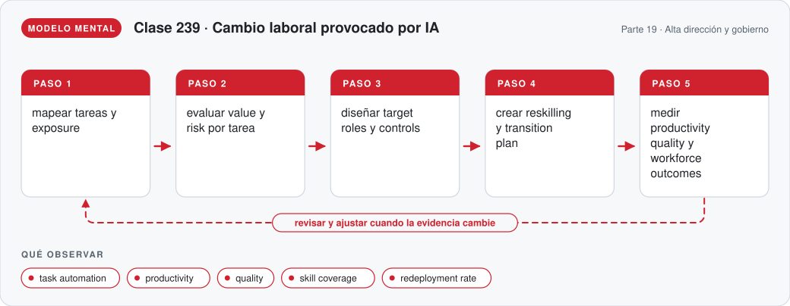

# Clase 239 — Cambio laboral provocado por IA

<!-- nav:inicio -->
> **Parte 19 · Tecnología, datos, IA y transformación digital para ejecutivos** — clase 11 de 12 · [índice de la parte](../../README.md) · [temario](../../../../SYLLABUS.md)
<!-- nav:fin -->

**Parte:** 19 — Tecnología, datos, IA y transformación digital para ejecutivos  
**Nivel:** Etapa 5 — CEO → Transformador digital  
**Duración sugerida:** 150–180 minutos · **Estándar:** deep-class-v2

## 🎯 Propósito

Pocas conversaciones en una empresa son tan cargadas como la que trata del efecto de la inteligencia artificial sobre el trabajo. Los empleados temen perder su empleo; los gerentes quieren aprovechar la tecnología sin generar pánico; los sindicatos piden información; los consultores prometen ahorros de 30 % o 40 %; los titulares de prensa anuncian el fin de ciertas profesiones; y los datos disponibles son estimaciones de **exposición potencial**, no pronósticos de despidos. En ese ruido, los ejecutivos suelen cometer dos errores: **minimizar** el cambio («esto no nos afecta») o **dramatizarlo** («hay que reducir un tercio de la dotación»). Una gestión responsable del cambio laboral por IA parte de un análisis de **tareas**, no de cargos; distingue la **exposición** a la IA de la **sustitución**; evalúa valor y riesgo por tarea; rediseña roles con controles; prepara a las personas con reentrenamiento y plazos; y mide los resultados reales, cumpliendo siempre las obligaciones laborales.

La clase se apoya en el análisis de Autor, Levy y Murnane sobre el contenido de habilidades del cambio tecnológico, en la revisión de Autor sobre automatización y empleo, en el modelo de tareas de Acemoglu y Restrepo, en la estimación de exposición de las tareas laborales a los modelos de lenguaje de Eloundou y colaboradores y en el análisis de Brynjolfsson y McAfee sobre la segunda era de las máquinas. Al terminar sabrás mapear tareas y exposición, evaluar valor y riesgo, diseñar roles objetivo, planificar el reentrenamiento y la transición y medir efectos en productividad, calidad y personas.

## 📚 Resultados de aprendizaje

Al finalizar podrás:

1. **Mapear** las tareas de un área y su exposición a la IA.
2. **Distinguir** exposición, productividad realizable y sustitución.
3. **Evaluar** valor y riesgo por tarea y decidir el tratamiento.
4. **Diseñar** roles objetivo, controles y un plan de reentrenamiento y transición.
5. **Medir** el efecto real y comunicar con honestidad y obligaciones cumplidas.

## 🧭 Agenda

| Tramo | Qué se hace |
|---|---|
| 0–20 min | Recuperación: ¿qué tareas de tu cargo podría hacer hoy un asistente de IA y cuáles no, y qué te tranquiliza o te preocupa? |
| 20–60 min | Exposición, tareas, valor y riesgo, roles, reentrenamiento, transición y medición. |
| 60–105 min | Ejemplo trabajado: un centro de atención de 120 personas, capacidad liberada y plan sin despidos. |
| 105–150 min | Caso ejecutivo y práctica. |
| 150–175 min | Límites y entregable. |

## 🧩 Conceptos centrales

| Concepto | Definición | Cómo se reconoce |
|---|---|---|
| **Exposición de tareas** | Parte del trabajo que la IA podría asistir o hacer. | Se estima por tarea. |
| **Productividad realizable** | Mejora efectiva del trabajo tras considerar adopción y calidad. | Menor que la exposición. |
| **Desplazamiento de tareas** | Tareas que dejan de hacer las personas. | Rutinarias y codificables. |
| **Creación de tareas** | Nuevas actividades humanas que surgen. | Supervisión, calidad, relación. |
| **Cambio de habilidades** | Variación de las capacidades demandadas. | Análisis de datos, criterio, uso de herramientas. |
| **Transición laboral** | Plan para las personas cuyo trabajo cambia. | Reentrenamiento, traslados, plazos. |

## 🧠 Modelo mental

**Cómo leer el diagrama.** Una cadena de cinco pasos con retorno. **Tareas y exposición**: qué tareas se ven afectadas. **Valor y riesgo**: qué conviene cambiar y con qué cuidado. **Roles y controles**: cómo queda el trabajo y la supervisión. **Reentrenar y transitar**: capacidades nuevas y plan para las personas. **Medir**: efecto en productividad, calidad y personas. La flecha indica que lo medido ajusta el plan. La nota afirma que las proyecciones laborales cambian con rapidez y dependen del sector, por lo que no se usan porcentajes globales para decisiones individuales; el pie, que los cambios que afectan cargos y funciones se verifican con asesoría y normas vigentes.

## 📖 Desarrollo

### 1. Qué sabemos y qué no sabemos

Autor, Levy y Murnane mostraron que las tecnologías computacionales sustituyen **tareas rutinarias** y complementan las no rutinarias; Autor recordó que, históricamente, la automatización no ha eliminado el trabajo en conjunto, pero sí ha cambiado la composición de las tareas y de las ocupaciones, con costos de ajuste desiguales. Eloundou y colaboradores estimaron la **exposición** de las ocupaciones a los modelos de lenguaje: la proporción de tareas en las que la tecnología podría reducir significativamente el tiempo de ejecución. Su estudio **no predice despidos**; mide un **potencial técnico**, que depende de la adopción, de la calidad, de la regulación, de los costos y de las decisiones de las empresas. Para un ejecutivo, la lección es prudente: las cifras de exposición sirven para **ordenar la conversación**, no para decidir sobre personas concretas ni para fijar metas de reducción.

### 2. Descomponer el trabajo en tareas

Se parte de un **inventario de tareas** por rol: qué hace cada persona, cuánto tiempo, con qué reglas y con qué herramientas. Para cada tarea se estima la **exposición** (¿puede un asistente de IA hacer parte significativa?), la **calidad** actual de la tecnología para esa tarea, el **riesgo** de errores y la **sensibilidad** (datos personales, decisiones sobre personas). Brynjolfsson y McAfee observan que las empresas obtienen mayores beneficios cuando **rediseñan procesos y roles** y no solo introducen herramientas. El inventario se construye **con quienes hacen el trabajo**, no solo con consultores: ellos conocen las excepciones, los atajos y el conocimiento tácito que la documentación no recoge, y su participación reduce la resistencia.

### 3. Exposición, productividad realizable y sustitución

Tres conceptos que se confunden. La **exposición** es el porcentaje de tareas o de tiempo en que la tecnología podría ayudar. La **productividad realizable** es la parte de esa exposición que efectivamente se captura tras considerar la adopción por las personas, la calidad de los resultados, la necesidad de revisión y los costos de implementación; suele ser **menor** que la exposición. La **sustitución** es el efecto sobre el empleo, y depende de lo que la empresa **decida hacer con la capacidad liberada**: absorber crecimiento, mejorar la calidad, reducir contratistas, no reemplazar vacantes, redistribuir personas o reducir dotación. Acemoglu y Restrepo enfatizan que el resultado depende del equilibrio entre **desplazamiento** y **creación de nuevas tareas** en que las personas tienen ventaja; las decisiones de diseño de la empresa influyen en ese equilibrio.

### 4. Valor y riesgo por tarea

Cada tarea candidata se evalúa en **valor** (tiempo ahorrado, calidad, velocidad, experiencia de cliente) y en **riesgo**: errores con consecuencias para clientes o empleados, sesgos, filtración de datos, dependencia de proveedores, aceptación social, cumplimiento (clase 188). Las tareas de **alto valor y bajo riesgo** son las primeras. Las de **alto riesgo** (decisiones sobre personas, finanzas o salud) exigen supervisión humana efectiva y pruebas; algunas se mantienen en manos de personas. No se usa la capacidad técnica como justificación para eliminar el juicio donde el daño potencial es material. Se registran los **supuestos** (porcentaje de adopción, calidad esperada) y se revisan con datos reales de los pilotos.

### 5. Diseñar roles objetivo y controles

Los roles cambian: menos tiempo en tareas rutinarias y más en **excepciones**, **casos complejos**, **análisis**, **relación con clientes**, **calidad** y **supervisión de sistemas**. Se diseñan **roles objetivo** con sus capacidades, responsabilidades, indicadores y niveles de decisión, y los **controles** necesarios: revisión humana de salidas críticas, trazabilidad de decisiones asistidas, políticas de uso de datos, protocolos ante errores. Se revisan **incentivos y métricas**: si se mide a las personas por velocidad por tarea, no usarán la IA para trabajos de mayor calidad. Y se define la **gobernanza**: quién aprueba nuevos usos, cómo se reportan problemas y cómo participan los trabajadores y sus representantes cuando corresponde.

### 6. Reentrenar y planificar la transición

Un plan de transición responsable incluye: **comunicación temprana y honesta** (qué se sabe, qué no, qué decisiones están tomadas y cuáles no); **participación** de las personas y de sus representantes; **reentrenamiento** con tiempo y recursos (uso de herramientas, criterio, análisis, nuevas funciones), no solo cursos genéricos; **movilidad interna** con criterios transparentes; **ritmo realista** que permita aprender; y, solo cuando sea inevitable y conforme a la ley, **medidas de reducción** con apoyo. La capacidad liberada se usa de forma planificada: absorber crecimiento, mejorar calidad, no reemplazar vacantes por rotación natural. Las obligaciones legales laborales (cambios de funciones, capacitación, información a trabajadores, término de la relación laboral) se verifican con asesoría y en las normas vigentes.

### 7. Medir y ajustar

Se miden efectos en **productividad** (tiempo por caso, volumen atendido), **calidad** (errores, retrabajo, satisfacción de clientes), **personas** (rotación, clima, uso de las herramientas, percepción de equidad, carga de trabajo) y **economía** (costos de herramientas, reentrenamiento y gestión del cambio frente a beneficios realizados). Se comparan con la línea base y con la hipótesis, y se ajusta el plan. Se monitorean también **efectos no previstos**: pérdida de conocimiento tácito, dependencia de la herramienta, desigualdad entre quienes se adaptan más rápido y quienes no, brechas entre generaciones, estrés. Los resultados se comunican con transparencia. La IA es una tecnología en evolución: el plan se revisa cada seis meses con datos reales.

## 📚 Lectura comparada

| Obra | Qué aporta | Qué no resuelve | Pregunta para contrastar |
|---|---|---|---|
| Autor, Levy y Murnane | Tareas rutinarias y no rutinarias y su relación con la tecnología. | Estudio de una época anterior a la IA actual. | ¿Qué tareas son rutinarias hoy? |
| Autor (2015) | Complementariedad, empleo y costos de ajuste. | Visión agregada. | ¿Qué tareas complementa la tecnología? |
| Acemoglu y Restrepo | Desplazamiento y creación de tareas. | Modelo económico. | ¿Qué tareas nuevas crearemos? |
| Eloundou y otros | Exposición potencial de ocupaciones a modelos de lenguaje. | No es un pronóstico de empleo. | ¿Qué parte de la exposición es realizable? |
| Brynjolfsson y McAfee | Rediseño organizacional con tecnologías digitales. | Visión general. | ¿Qué proceso rediseñamos? |

## 🧮 Ejemplo trabajado

**Situación (hipotética).** Un centro de atención al cliente tiene 120 agentes. El inventario de tareas, hecho con los agentes y sus supervisores, muestra esta distribución del tiempo y la exposición estimada a un asistente de IA.

| Tarea | % del tiempo | Exposición (parte automatizable o asistible) | Aporte a la exposición |
|---|---|---|---|
| Consultas informativas (saldos, horarios, estado) | 25 % | 70 % | 17,5 % |
| Resolución de casos con reglas y excepciones | 30 % | 35 % | 10,5 % |
| Empatía, negociación y escalamiento | 20 % | 10 % | 2,0 % |
| Registro, notas y tareas administrativas | 25 % | 80 % | 20,0 % |
| **Total** | **100 %** | | **50,0 %** |

La **exposición** promedio es 50 % del tiempo.

**Productividad realizable.** Tras considerar adopción, calidad y revisión, se estima que se captura el 55 % de la exposición: 0,50 × 0,55 = **27,5 %** del tiempo. Capacidad liberada: 0,275 × 120 = **33 personas equivalentes**.

**Demanda y rotación.** La demanda de atención crece 10 % al año: se necesitan 12 personas equivalentes adicionales. La rotación natural es de 18 % anual: 21,6 personas se van cada año.

**Uso planificado de la capacidad.** 12 personas equivalentes absorben el crecimiento sin contratar; 21 personas equivalentes (≈ 21,6) no se reemplazan al irse por rotación natural. Suma: 33. **No hay despidos.**

**Reentrenamiento y nuevos roles.** 20 personas se reentrenan para roles de calidad, análisis de casos complejos, supervisión de las respuestas de la IA y atención a clientes de alto valor; costo de 3,5 millones por persona: 70 millones. Los agentes participan en el diseño de los flujos y en la definición de criterios de excepción.

**Economía (primer año).**

| Concepto | Millones |
|---|---|
| Beneficio: 33 personas equivalentes × 22 millones de costo anual | 726 |
| Herramientas y licencias | −130 |
| Reentrenamiento | −70 |
| Gestión del cambio y comunicación | −40 |
| **Beneficio neto** | **486** |

**Controles.** Revisión humana de las respuestas en temas financieros o de reclamos; trazabilidad de las respuestas asistidas; prohibición de ingresar datos sensibles en herramientas no aprobadas; canal para reportar errores del asistente; muestreo de calidad semanal.

**Indicadores a 12 meses (hipotéticos).** Productividad realizada: 24 % (frente a 27,5 % estimado; se ajusta); satisfacción del cliente: de 78 a 82 puntos; rotación: baja de 18 % a 14 % (por mejores condiciones de trabajo); clima: sube 6 puntos; el 80 % de los agentes usa el asistente semanalmente; 17 de 20 personas reentrenadas ocupan los nuevos roles.

**Comunicación.** Se informa desde el inicio qué se hará (no se reemplazarán vacantes por rotación natural, no hay plan de despidos asociado a esta iniciativa), qué no se sabe y qué se revisará cada seis meses.

**Cuidados.** Los cambios de funciones, la capacitación y cualquier decisión de reducción de personal se verifican con asesoría laboral y las normas vigentes; los porcentajes de exposición son estimaciones; las cifras son ilustrativas.

**Qué muestra.** (1) Se distinguió exposición de productividad realizable. (2) La capacidad se usó con un plan que protegió el empleo. (3) Se midió el resultado real y se ajustó.

## 🔀 Comparación y límites

**Exposición frente a pronóstico.** Los estudios de exposición miden el potencial técnico; el efecto sobre el empleo depende de decisiones de empresas, de la regulación, de los costos y de la adopción.

**Límites.** Las predicciones laborales cambian con rapidez y dependen del sector; no se usan porcentajes globales para decisiones individuales. Los beneficios dependen de la adopción y la calidad reales. Los efectos sobre personas deben cumplir obligaciones laborales. La tecnología evoluciona y el plan se revisa. Las cifras del ejemplo son ilustrativas.

## 🪜 De profesional a owner

| Nivel | Cómo participa |
|---|---|
| **Profesional** | Aprende a usar las herramientas y aporta su conocimiento del trabajo. |
| **Jefe / Team Lead** | Rediseña las tareas con su equipo y acompaña la transición. |
| **Gerente** | Planifica el uso de la capacidad liberada y mide los efectos. |
| **CEO / Director** | Fija principios, decide el uso de la capacidad y cumple las obligaciones. |
| **Founder / Owner** | Equilibra productividad, lealtad de las personas y reputación. |

## 🏢 Caso ejecutivo

Una aseguradora con 1.900 personas introduce un asistente de IA en su área de siniestros (260 personas, entre liquidadores, analistas y personal administrativo). Un consultor presentó un informe que dice que «el 60 % de las tareas es automatizable» y recomienda reducir 90 posiciones en 12 meses. El piloto muestra una reducción de 30 % en el tiempo de redacción de informes, pero también tres errores graves en la interpretación de coberturas, que un liquidador detectó por casualidad. Hay 45 personas con más de 15 años de antigüedad en roles administrativos; los liquidadores más jóvenes usan la herramienta con entusiasmo, y los mayores desconfían; un sindicato pidió información y el regulador anunció que revisará las decisiones automatizadas en reclamos. La rotación del área es de 12 %; la demanda crece 6 % al año; el director de personas quiere un plan «responsable» y el CEO, «resultados en seis meses».

Entrega un **plan de gestión del cambio laboral por IA** que contenga: (a) el inventario de tareas con exposición, calidad y riesgo, y la diferencia entre exposición y productividad realizable; (b) la evaluación de valor y riesgo por tarea y el tratamiento (automatizar, asistir, conservar); (c) los roles objetivo, los controles y la supervisión humana en las decisiones sobre coberturas; (d) el cálculo de la capacidad liberada y su uso con distintas alternativas, y el análisis de la recomendación de 90 reducciones; (e) el plan de reentrenamiento, comunicación y participación; (f) los indicadores, la revisión semestral y las verificaciones laborales, regulatorias y legales pendientes.

## 🧪 Práctica

1. Haz el inventario de tareas de un rol con porcentaje de tiempo y exposición a la IA.
2. Calcula la exposición y la productividad realizable con un supuesto de captura.
3. Estima el uso de la capacidad liberada entre crecimiento, rotación y otras opciones.
4. Diseña un rol objetivo con controles y supervisión humana.
5. Redacta un mensaje de comunicación a un equipo sobre qué se sabe y qué no.

## ⚠️ Errores frecuentes

| Error | Por qué ocurre | Cómo corregirlo |
|---|---|---|
| Decidir con porcentajes globales | Informes genéricos | Mapear tareas reales con quienes las hacen. |
| Confundir exposición con sustitución | Se asume que lo posible se hará | Productividad realizable y decisiones sobre la capacidad. |
| Ignorar el riesgo | Se ve el ahorro | Evaluar valor y riesgo por tarea. |
| Comunicar tarde o a medias | Temor a la reacción | Comunicación temprana y honesta. |
| Reentrenar con cursos genéricos | Es lo más fácil | Reentrenamiento para roles concretos. |
| No medir | Se confía en la estimación | Línea base, indicadores y revisión semestral. |

## ❓ Preguntas de comprobación

1. ¿Qué mide la exposición de tareas y qué no mide?
2. ¿Qué diferencia hay entre exposición, productividad realizable y sustitución?
3. ¿Cómo se evalúa el valor y el riesgo de una tarea?
4. ¿Qué incluye el diseño de roles objetivo?
5. ¿Qué formas hay de usar la capacidad liberada?
6. ¿Qué incluye una transición responsable?
7. ¿Qué se mide después del cambio?

Claves de respuesta

1. Mide la parte de las tareas en que la IA podría reducir significativamente el tiempo; no mide despidos ni predice el efecto sobre el empleo.
2. La exposición es el potencial técnico; la productividad realizable es lo capturado tras adopción, calidad y costos; la sustitución depende de lo que la empresa decide hacer con la capacidad.
3. Valor (tiempo, calidad, experiencia) frente a riesgo (errores, sesgo, datos, dependencia, cumplimiento); las tareas de alto valor y bajo riesgo van primero.
4. Capacidades, responsabilidades, indicadores, niveles de decisión, controles, incentivos y gobernanza.
5. Absorber crecimiento, mejorar calidad, reducir contratistas, no reemplazar vacantes por rotación, redistribuir personas con reentrenamiento y, solo si es inevitable y conforme a la ley, reducir dotación.
6. Comunicación temprana y honesta, participación, reentrenamiento, movilidad con criterios transparentes, ritmo realista y verificación laboral.
7. Productividad, calidad, personas (rotación, clima, uso, equidad) y economía, frente a la línea base y con efectos no previstos.

## 📥 Entregable

Guarda en `portfolio/239-cambio-laboral-provocado-por-ia/`:

- `risk-governance-brief.md` (plantilla [Risk Governance Brief](../../../../templates/risk-governance-brief.md)) con el plan del caso ejecutivo;
- `people-decision-brief.md` (plantilla [People decision brief](../../../../templates/people-decision-brief.md)) con el plan de reentrenamiento y transición;
- `decision-journal.md` con el inventario de tareas, los supuestos y las verificaciones laborales pendientes.

## 📗 Fuentes y verificación

- David H. Autor, Frank Levy & Richard J. Murnane — *The Skill Content of Recent Technological Change: An Empirical Exploration* (The Quarterly Journal of Economics, 2003). **Uso en esta clase:** tareas rutinarias y no rutinarias frente a la tecnología. Lectura selectiva sobre **cambio laboral provocado por ia**. **Localizador:** [DOI 10.1162/003355303322552801](https://doi.org/10.1162/003355303322552801).
- David H. Autor — *Why Are There Still So Many Jobs? The History and Future of Workplace Automation* (Journal of Economic Perspectives, 2015). **Uso en esta clase:** complementariedad, empleo y costos de ajuste. Lectura selectiva sobre **cambio laboral provocado por ia**. **Localizador:** [DOI 10.1257/jep.29.3.3](https://doi.org/10.1257/jep.29.3.3).
- Daron Acemoglu & Pascual Restrepo — *Tasks, Automation, and the Rise in U.S. Wage Inequality* (Econometrica, 2022). **Uso en esta clase:** desplazamiento y creación de tareas. Lectura selectiva sobre **cambio laboral provocado por ia**. **Localizador:** [DOI 10.3982/ECTA19815](https://doi.org/10.3982/ECTA19815).
- Tyna Eloundou et al. — *GPTs are GPTs: Labor market impact potential of LLMs* (Science, 2024). **Uso en esta clase:** exposición potencial de ocupaciones a modelos de lenguaje. Lectura selectiva sobre **cambio laboral provocado por ia**. **Localizador:** [DOI 10.1126/science.adj0998](https://doi.org/10.1126/science.adj0998).
- Erik Brynjolfsson & Andrew McAfee — *The Second Machine Age* (W. W. Norton, 2014). **Uso en esta clase:** rediseño organizacional con tecnologías digitales. Lectura selectiva sobre **cambio laboral provocado por ia**. **Localizador:** [ISBN-13 9780393350647](https://openlibrary.org/isbn/9780393350647).

> **Regla de fuentes para Cambio laboral provocado por IA:** las obras anteriores estructuran las perspectivas de esta materia; cualquier norma, ley o estándar vivo mencionado debe comprobarse nuevamente en su fuente primaria vigente, incluidas las normas laborales, de decisiones automatizadas y de protección de datos. Los ejemplos y casos son hipotéticos, con cifras ilustrativas. El desarrollo es original y no reproduce capítulos protegidos.

<!-- pie:inicio -->
---

| Anterior | Índice | Siguiente |
|---|---|---|
| [← 238 · Métricas de entrega tecnológica](../238-metricas-de-entrega-tecnologica/README.md) | [Parte 19](../../README.md) · [Programa](../../../../SYLLABUS.md) | [240 · Capstone: transformation board →](../240-capstone-transformation-board/README.md) |
<!-- pie:fin -->
