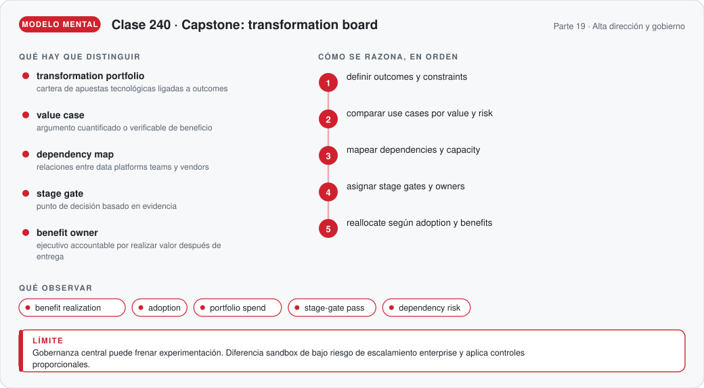

# Clase 240 — Capstone: transformation board

<!-- nav:inicio -->
> **Parte 19 · Tecnología, datos, IA y transformación digital para ejecutivos** — clase 12 de 12 · [índice de la parte](../../README.md) · [temario](../../../../SYLLABUS.md)
<!-- nav:fin -->

**Parte:** 19 — Tecnología, datos, IA y transformación digital para ejecutivos  
**Nivel:** Etapa 5 — CEO → Transformador digital  
**Duración sugerida:** 150–180 minutos · **Estándar:** deep-class-v2

## 🎯 Propósito

Esta clase integra la parte 19. Las clases anteriores trataron la tecnología como capacidad (229), la estrategia digital (230), la economía de la nube (231), los datos como activo (232), el portafolio de IA (233), el rediseño del trabajo (234), la ciberseguridad vista desde el directorio (235), la decisión entre construir, comprar, aliarse o retirar (236), la arquitectura y la deuda técnica (237), las métricas de entrega (238) y el cambio laboral por IA (239). En una empresa real, estas decisiones no llegan separadas: una iniciativa de IA necesita datos, que dependen de un sistema con deuda técnica, que se ejecuta con un equipo que también es necesario para el autoservicio de clientes, y todo ello debe financiarse con el mismo presupuesto y gobernarse con los mismos riesgos. El **tablero de transformación** (*transformation board*) es la instancia en que la dirección decide, con una sola mirada, qué se hace, en qué orden, con qué dueños, con qué capital y capacidad, con qué controles y con qué evidencia de que funciona.

El trabajo del capstone es un **paquete de decisión del tablero**: resultados y restricciones, comparación de iniciativas por valor y riesgo, dependencias y capacidad, puertas de decisión con dueños y un tablero de medición. Se apoya en Westerman y colaboradores sobre cómo lideran las empresas su transformación digital, en Iansiti y Lakhani sobre negocios con datos y algoritmos, en Davenport y Mittal sobre IA a escala, en el marco de gestión de riesgos de IA del NIST y en Forsgren y colaboradores sobre medición de la entrega. Al terminar tendrás un documento que podrías presentar a un comité de dirección y a un directorio.

## 📚 Resultados de aprendizaje

Al finalizar podrás:

1. **Definir** los resultados de negocio y las restricciones de la transformación.
2. **Comparar** iniciativas por valor, riesgo y viabilidad dentro de un portafolio.
3. **Mapear** dependencias y capacidad para secuenciar las iniciativas.
4. **Asignar** capital y capacidad con puertas de decisión y dueños.
5. **Diseñar** el tablero de medición y diferenciar el espacio de pruebas del escalamiento.

## 🧭 Agenda

| Tramo | Qué se hace |
|---|---|
| 0–20 min | Recuperación: ¿qué iniciativa de tecnología de tu empresa depende de otra que aún no está lista y quién lo ve? |
| 20–60 min | Resultados y restricciones, portafolio, dependencias, capacidad, gobierno y medición. |
| 60–105 min | Ejemplo trabajado: ocho iniciativas, 60 personas de capacidad y 9.000 millones de presupuesto. |
| 105–150 min | Caso ejecutivo y práctica. |
| 150–175 min | Límites y entregable. |

## 🧩 Conceptos centrales

| Concepto | Definición | Cómo se reconoce |
|---|---|---|
| **Tablero de transformación** | Instancia de dirección que prioriza y gobierna las iniciativas de transformación. | Decisiones, dueños, puertas, medición. |
| **Portafolio de iniciativas** | Conjunto de proyectos con distinto riesgo y horizonte. | Valor, riesgo, capital y capacidad. |
| **Dependencia** | Relación por la que una iniciativa necesita el resultado de otra. | Secuencia y prerrequisitos. |
| **Capacidad de entrega** | Personas y tiempo disponibles para ejecutar. | Ingenieros, analistas, usuarios clave. |
| **Espacio de pruebas (*sandbox*)** | Entorno de bajo riesgo para experimentar con controles ligeros. | Límite de datos y de impacto. |
| **Puerta de decisión (*stage gate*)** | Punto en que se libera capital según resultados. | Criterio de continuar, ajustar o detener. |

## 🧠 Modelo mental

**Cómo leer el diagrama.** Una cadena de cinco pasos con retorno. **Resultados y restricciones**: qué se logra y qué no se puede violar. **Comparar casos**: valor, riesgo y viabilidad. **Dependencias y capacidad**: qué depende de qué y quién puede hacerlo. **Puertas y dueños**: liberar capital por hitos. **Medición**: valor logrado frente a lo prometido. La flecha indica que la medición reordena el portafolio. La nota afirma que una gobernanza central puede frenar la experimentación y que se separa el espacio de pruebas de bajo riesgo del escalamiento, con controles proporcionales; el pie, que la regulación de datos, IA y ciberseguridad se verifica en fuentes oficiales.

## 📖 Desarrollo

### 1. Resultados y restricciones antes de las iniciativas

Westerman y colaboradores mostraron que lo que distingue a las empresas que logran una transformación digital es la combinación de **visión de negocio** y **capacidad de gestión del cambio**: saben qué resultado buscan y gobiernan la ejecución. Por eso el tablero comienza por los **resultados de negocio** de los próximos 24 meses (crecimiento, margen, retención, tiempo de lanzamiento, riesgo) y por las **restricciones duras**: presupuesto, capacidad de entrega, apetito de riesgo cibernético y de IA, obligaciones legales, capacidad de absorber cambio de las personas. Estas restricciones se prueban en el escenario adverso (como en la clase 228): si el EBITDA cae 20 %, ¿se mantiene el compromiso? Sin resultados ni restricciones, las iniciativas compiten por entusiasmo.

### 2. Comparar iniciativas con un formato común

Cada iniciativa se presenta con un **formato uniforme**: resultado de negocio, línea base y meta, valor realizable (en caja, no en horas, clase 233), capital y costo de operación, capacidad requerida (personas, perfiles), riesgos (de ejecución, de seguridad, de datos, de IA y de personas), dependencias, dueño de negocio, hitos y criterios de éxito y de parada. Se ordenan por **valor esperado por peso invertido** y **por unidad de capacidad escasa** (ingeniería, datos), porque la restricción relevante suele ser el **talento**, no el dinero. Se aplican los criterios de las clases anteriores: capacidad de negocio (229), economía unitaria (230 y 231), calidad de datos (232), viabilidad y riesgo de IA (233), efecto en el trabajo (234 y 239), seguridad (235), opción construir o comprar (236) y deuda técnica (237).

### 3. Dependencias y secuencia

Las iniciativas de transformación se **habilitan unas a otras**. Un producto de datos de cliente único (clase 232) es prerrequisito de la personalización, del autoservicio y de los modelos de IA; un sistema con deuda técnica elevada limita cualquier cambio; la ciberseguridad condiciona la nube y la IA. El tablero construye un **mapa de dependencias** y define una **secuencia**: primero los habilitadores, luego las iniciativas que dependen de ellos. Se identifican las **rutas críticas** y se evita el error clásico de lanzar proyectos paralelos que dependen de un mismo equipo o dato que aún no existe. Iansiti y Lakhani muestran que las empresas que operan con datos y algoritmos construyen **plataformas comunes** que luego muchas aplicaciones reutilizan; esa lógica de plataforma se aplica a la planificación.

### 4. Capacidad: el cuello de botella real

La mayoría de los portafolios de transformación fracasa por **sobrecarga**: más proyectos que personas. El tablero calcula la **capacidad disponible** (ingenieros, analistas de datos, líderes de negocio, usuarios clave) y la compara con la **demanda** de las iniciativas, por perfil y por período. Se considera una **reserva** para operación y mantenimiento (clase 237), para incidentes y para licencias, vacaciones y rotación. Cuando la demanda supera la capacidad, se **secuencia** (se desplazan iniciativas), se **amplía** (contratar, aliarse, comprar, clase 236) o se **prioriza** (se renuncia a algunas). Forsgren y colaboradores muestran que los equipos con **cambios pequeños, frecuentes y automatizados** tienen mejor desempeño; el tablero protege esa capacidad en lugar de cargar a los equipos con trabajo en paralelo.

### 5. Gobernar con proporcionalidad: sandbox y escala

Una gobernanza central rígida puede frenar la experimentación, y una laxa produce riesgos. El tablero aplica una **gobernanza proporcional**: un **espacio de pruebas** donde los equipos pueden experimentar con IA y datos con reglas ligeras (datos no sensibles, impacto limitado, aprobación simple, un presupuesto acotado) y **controles reforzados** para escalar a producción empresarial (revisión de seguridad, privacidad, sesgo, trazabilidad, supervisión humana, cumplimiento). El marco de gestión de riesgos de IA del NIST propone mapear el contexto, medir y gestionar riesgos de forma proporcional al impacto; esa proporcionalidad determina qué casos pueden moverse rápido y cuáles requieren más evidencia. Se evitan los extremos: prohibir todo o aprobar todo.

### 6. Puertas de decisión, dueños y financiamiento por etapas

Cada iniciativa tiene un **dueño de negocio** (que responde por el resultado) y un **líder de entrega**. El capital se libera por **etapas**: se compromete lo necesario para la primera fase y se condiciona el resto a resultados y a la situación financiera (clase 228). Las **puertas de decisión** tienen criterios explícitos: adopción mínima, calidad de datos, reducción de costo, ausencia de incidentes graves, cumplimiento. Cuando una iniciativa no pasa la puerta, se **ajusta** o se **detiene** y su capacidad se reasigna: la tasa de reasignación es una señal de salud del portafolio. Se registra lo que **no** se hará y por qué. Y se define qué ocurre con los sistemas antiguos: cada iniciativa que reemplaza algo incluye el **retiro** (clase 236).

### 7. Medir: el tablero de la transformación

El tablero de medición incluye: **resultados de negocio** (ingresos, margen, retención, tiempo de lanzamiento), **valor realizado frente a prometido** por iniciativa, **avance** (hitos y gasto), **capacidad** (utilización, cuellos de botella), **salud técnica** y de entrega (clase 238), **calidad de datos** (clase 232), **riesgo** (ciberseguridad, IA, cumplimiento, personas), **adopción** y **clima** (clase 239). Se revisa **mensualmente** por el comité y **trimestralmente** por el directorio. Se hace una **revisión posterior** a los 12 y 24 meses (clase 228). El tablero decide, no solo informa: cada reunión termina con decisiones sobre qué continuar, ajustar, detener o acelerar, y con acciones que tienen dueño y fecha.

## 📚 Lectura comparada

| Obra | Qué aporta | Qué no resuelve | Pregunta para contrastar |
|---|---|---|---|
| Westerman, Bonnet y McAfee | Visión de negocio y gestión del cambio en la transformación digital. | Marco descriptivo. | ¿Qué resultado y qué capacidad de gestión tenemos? |
| Iansiti y Lakhani | Plataformas comunes y operación basada en datos. | Casos muy digitales. | ¿Qué habilitadores reutilizan las iniciativas? |
| Davenport y Mittal | IA a escala y salida del purgatorio de pilotos. | Empresas grandes. | ¿Cómo pasamos de piloto a producción? |
| NIST AI RMF | Gestión de riesgos de IA proporcional al contexto. | Voluntario y genérico. | ¿Qué casos van al sandbox y cuáles a control reforzado? |
| Forsgren y otros | Métricas de entrega y prácticas que mejoran el flujo. | Estudio de encuestas. | ¿Protegemos la capacidad de entrega? |

## 🧮 Ejemplo trabajado

**Situación (hipotética).** El tablero de transformación de una empresa de distribución dispone de 9.000 millones de pesos y de 60 personas equivalentes de capacidad de entrega, de las cuales reserva 6 (10 %) para un espacio de pruebas. Debe decidir sobre ocho iniciativas, con su valor presente neto esperado (VAN).

**Iniciativas.**

| # | Iniciativa | Capital | VAN esperado | Personas | VAN por capital | VAN por persona | Dependencia |
|---|---|---|---|---|---|---|---|
| T1 | Integración y reglas de reposición | 1.500 | 2.200 | 12 | 1,47 | 183 | — |
| T2 | Gestión de costos de nube | 300 | 600 | 3 | 2,00 | 200 | — |
| T3 | Producto de datos «cliente único» | 450 | 700 | 8 | 1,56 | 88 | — |
| T4 | Autoservicio digital de pedidos | 2.800 | 3.100 | 18 | 1,11 | 172 | T3 |
| T5 | Asistente de IA en atención | 700 | 150 | 6 | 0,21 | 25 | T3 |
| T6 | Antifraude con IA | 1.200 | 600 | 9 | 0,50 | 67 | T3 |
| T7 | Remediación del sistema central | 1.800 | 2.900 | 14 | 1,61 | 207 | — |
| T8 | Ciberseguridad (respaldos, accesos, proveedores) | 300 | 700 | 5 | 2,33 | 140 | — |
| | **Total** | **9.050** | | **75** | | | |

La suma de capital (9.050) y de personas (75) supera lo disponible (9.000 y 54 personas para iniciativas estructuradas).

**Selección.** (1) **T8** es una restricción dura (ciberseguridad: 300; 5 personas). (2) Se ordena el resto por VAN por capital: T2 (2,00), T7 (1,61), T3 (1,56), T1 (1,47), T4 (1,11). T6 (0,50) y T5 (0,21) quedan fuera de la estructura, pero pasan a explorarse en el **espacio de pruebas** con presupuesto y personas limitados. (3) T3 se prioriza también por ser **habilitador** de T4, T5 y T6.

**Capital de las iniciativas seleccionadas.** T8 300 + T2 300 + T3 450 + T7 1.800 + T1 1.500 + T4 2.800 = **7.150**; VAN esperado: 700 + 600 + 700 + 2.900 + 2.200 + 3.100 = **10.200** (1,43 por peso).

**Secuencia y capacidad.**

| Ola | Iniciativas | Personas | Capital |
|---|---|---|---|
| Ola 1 (meses 0 a 9) | T8 (5), T2 (3), T3 (8), T7 fase 1 (14), T1 (12) | 42 | 300 + 300 + 450 + 900 + 1.500 = 3.450 |
| Espacio de pruebas | Pilotos de T5 y T6 | 6 | 600 |
| Ola 2 (desde el mes 9, condicionada) | T4 (18), T7 fase 2 (14 se mantiene) | 42 − 15 (terminan T1 y T2) + 18 = 45 | 900 + 2.800 = 3.700 |

Demanda máxima: ola 1, 42 + 6 = 48; ola 2, 45 + 6 = 51; ambas dentro de las 60 personas (con reserva de 9 para operación e incidentes). Capital comprometido: 3.450 + 600 + 3.700 = 7.750; reserva de 1.250 millones.

**Puertas.** T4 se libera en el mes 9 si: T3 está en producción con duplicados bajo 1,5 %, el EBITDA del primer semestre es al menos 95 % del presupuesto, y no hay incidentes de seguridad graves abiertos. T7 fase 2 se libera si el esfuerzo perdido por deuda baja de 35 % a menos de 28 %. Los pilotos del espacio de pruebas pasan a escala solo con evaluación de impacto (privacidad, sesgo, supervisión humana, clase 188).

**Gobernanza proporcional.** T5 (asistente de atención) es de bajo impacto: puede operar en el sandbox con datos no sensibles; T6 (antifraude) es de alto impacto sobre clientes: exige supervisión humana, pruebas de sesgo y trazabilidad antes de escalar.

**Tablero y metas a 12 meses (hipotéticas).** Tasa de cumplimiento de pedidos de 91 % a 95 %; costo unitario de nube bajo 115 pesos por usuario; duplicados de clientes de 8 % a 1,2 %; tiempo de cambio del sistema central de 38 a 15 días; autenticación multifactor al 100 %; adopción digital de pedidos de 25 %; VAN realizado frente a esperado al menos del 70 %.

**Decisión del tablero.** Aprobar las seis iniciativas con las olas y las puertas descritas; el espacio de pruebas con 600 millones y 6 personas; no financiar T5 y T6 a escala ahora; revisar mensualmente y reasignar capacidad si una iniciativa no pasa su puerta.

**Cuidados.** Las estimaciones de valor y de capacidad son hipótesis; los contratos, la protección de datos, las decisiones automatizadas y las condiciones laborales se verifican en la normativa vigente y con asesoría; las cifras son ilustrativas.

**Qué muestra.** (1) La capacidad, no solo el dinero, fue la restricción. (2) Las dependencias definieron la secuencia. (3) El sandbox y las puertas permitieron experimentar sin comprometer el escalamiento.

## 🔀 Comparación y límites

**Tablero de transformación frente a oficina de proyectos.** La oficina de proyectos controla plazos y gasto; el tablero decide qué iniciativas se hacen, en qué orden y con qué evidencia continúan.

**Límites.** Una gobernanza central puede frenar la experimentación; se separa el sandbox de bajo riesgo del escalamiento con controles proporcionales. Las estimaciones de valor y de capacidad son inciertas. Las dependencias cambian. Las cifras del ejemplo son ilustrativas y no corresponden a ninguna empresa real.

## 🪜 De profesional a owner

| Nivel | Cómo participa en la transformación |
|---|---|
| **Profesional** | Ejecuta con calidad y aporta aprendizajes. |
| **Jefe / Team Lead** | Protege la capacidad de su equipo y reporta dependencias. |
| **Gerente** | Es dueño de una iniciativa con resultado medido. |
| **CEO / Director** | Preside el tablero, decide prioridades y exige evidencia. |
| **Founder / Owner** | Equilibra la ambición de transformar con la capacidad real y el riesgo. |

## 🏢 Caso ejecutivo

Un grupo de servicios de salud con 5.200 personas, ventas de 300.000 millones de pesos y un presupuesto de transformación de 14.000 millones tiene 17 iniciativas en marcha o propuestas: historia clínica electrónica unificada (4.500), plataforma de agendamiento y telemedicina (2.600), datos de pacientes («paciente único», 900), asistente de IA para documentación clínica (1.100), predicción de inasistencias (500), automatización de facturación (1.400), migración a la nube (2.800), ciberseguridad (1.200), remediación de un sistema de laboratorio (1.600), un portal para aseguradoras (900), y otras siete menores. La capacidad total de tecnología es de 140 personas, con una demanda estimada de 230. Hay dependencias cruzadas: casi todo requiere el «paciente único». Un incidente reciente de ciberseguridad costó 640 millones; el regulador pidió información sobre uso de IA en documentación clínica; los clínicos temen que la IA aumente su carga administrativa; el directorio exige «un solo plan» y el CEO quiere «avanzar con todo». Los equipos están agotados y la rotación de ingenieros es de 22 %.

Entrega un **paquete de decisión del tablero de transformación** que contenga: (a) los resultados de negocio a 24 meses y las restricciones duras; (b) la comparación de las 17 iniciativas por valor, riesgo, capital y capacidad, con las que se detienen o posponen; (c) el mapa de dependencias y la secuencia por olas con la capacidad por perfil; (d) la gobernanza proporcional, el espacio de pruebas y las puertas con criterios y dueños; (e) el tablero de medición con indicadores de negocio, entrega, datos, riesgo y personas; (f) los efectos sobre el trabajo clínico y administrativo, los controles de IA y las verificaciones legales, regulatorias y laborales pendientes.

## 🧪 Práctica

1. Lista diez iniciativas de tecnología de una empresa con capital, personas y valor, y calcula VAN por capital y por persona.
2. Dibuja el mapa de dependencias y marca la ruta crítica.
3. Arma un plan por olas que respete la capacidad por perfil y una reserva para operación.
4. Diseña dos puertas de decisión con criterios medibles y un dueño.
5. Define los diez indicadores del tablero y las decisiones que cada uno informa.

## ⚠️ Errores frecuentes

| Error | Por qué ocurre | Cómo corregirlo |
|---|---|---|
| Portafolio por entusiasmo | No hay criterios comunes | Formato uniforme y valor esperado. |
| Ignorar la capacidad | Se mira el dinero | Capacidad por perfil, con reserva. |
| Proyectos paralelos con dependencias | No se mapean | Secuencia por habilitadores. |
| Gobernanza rígida o laxa | Se busca un único modelo | Gobernanza proporcional: sandbox y escalamiento. |
| Capital liberado de una vez | Se quiere avanzar | Etapas y puertas. |
| Medir avance y no valor | Es lo fácil | Valor realizado frente a prometido. |

## ❓ Preguntas de comprobación

1. ¿Por qué se parte de resultados y restricciones?
2. ¿Por qué se ordena también por capacidad y no solo por capital?
3. ¿Cómo influyen las dependencias en la secuencia?
4. ¿Qué es la gobernanza proporcional y cómo se aplica?
5. ¿Qué es una puerta de decisión y quién la gobierna?
6. ¿Qué incluye el tablero de medición?
7. ¿Qué límites tiene un tablero centralizado?

Claves de respuesta

1. Porque sin resultados ni restricciones las iniciativas compiten por entusiasmo y no se puede priorizar ni probar la viabilidad.
2. Porque la restricción escasa suele ser el talento de ingeniería y datos, no el dinero.
3. Los habilitadores van primero; las iniciativas que dependen de ellos se secuencian después y se evitan proyectos paralelos sobre un mismo prerrequisito.
4. Controles proporcionales al impacto: sandbox ligero para experimentar con bajo riesgo y controles reforzados para escalar a producción.
5. Un punto en que se libera capital según criterios medibles; lo gobierna el tablero con un dueño de negocio por iniciativa.
6. Resultados de negocio, valor realizado frente a prometido, avance, capacidad, salud técnica y de entrega, calidad de datos, riesgo, adopción y clima.
7. Puede frenar la experimentación; se mitiga separando el sandbox del escalamiento y aplicando controles proporcionales.

## 📥 Entregable

Guarda en `portfolio/240-capstone-transformation-board/`:

- `board-or-executive-memo.md` (plantilla [Board or executive memo](../../../../templates/board-or-executive-memo.md)) con el paquete de decisión del caso ejecutivo;
- `ceo-dashboard.md` (plantilla [CEO dashboard](../../../../templates/ceo-dashboard.md)) con el tablero de medición de la transformación;
- `strategy-memo.md` (plantilla [Strategy memo](../../../../templates/strategy-memo.md)) con la secuencia por olas y las dependencias;
- `decision-journal.md` con las puertas, el espacio de pruebas y las verificaciones legales y laborales pendientes.

## 📗 Fuentes y verificación

- George Westerman, Didier Bonnet & Andrew McAfee — *Leading Digital* (Harvard Business Review Press, 2014). **Uso en esta clase:** visión de negocio y gestión del cambio en la transformación digital. Lectura selectiva sobre **capstone: transformation board**. **Localizador:** [ISBN-13 9781625272478](https://openlibrary.org/isbn/9781625272478).
- Marco Iansiti & Karim R. Lakhani — *Competing in the Age of AI* (Harvard Business Review Press, 2020). **Uso en esta clase:** plataformas comunes y operación basada en datos. Lectura selectiva sobre **capstone: transformation board**. **Localizador:** [ISBN-13 9781633697621](https://openlibrary.org/isbn/9781633697621).
- Thomas H. Davenport & Nitin Mittal — *All-In on AI* (Harvard Business Review Press, 2022). **Uso en esta clase:** IA a escala y salida del purgatorio de pilotos. Lectura selectiva sobre **capstone: transformation board**. **Localizador:** [ISBN-13 9781647824693](https://openlibrary.org/isbn/9781647824693).
- NIST — *AI Risk Management Framework (AI RMF 1.0)*. **Uso en esta clase:** gestión de riesgos de IA proporcional al contexto. **Fuente primaria:** <https://www.nist.gov/itl/ai-risk-management-framework>.
- Nicole Forsgren, Jez Humble & Gene Kim — *Accelerate* (IT Revolution Press, 2018). **Uso en esta clase:** métricas de entrega y prácticas que mejoran el flujo. Lectura selectiva sobre **capstone: transformation board**. **Localizador:** [ISBN-13 9781942788379](https://openlibrary.org/isbn/9781942788379).

> **Regla de fuentes para el Capstone del transformation board:** las obras anteriores estructuran las perspectivas de esta materia; cualquier norma, ley o estándar vivo mencionado debe comprobarse nuevamente en su fuente primaria vigente, incluidas las normas de protección de datos, de IA, de ciberseguridad y laborales. Los ejemplos y casos son hipotéticos, con cifras ilustrativas. El desarrollo es original y no reproduce capítulos protegidos.

<!-- pie:inicio -->
---

| Anterior | Índice | Siguiente |
|---|---|---|
| [← 239 · Cambio laboral provocado por IA](../239-cambio-laboral-provocado-por-ia/README.md) | [Parte 19](../../README.md) · [Programa](../../../../SYLLABUS.md) | [241 · Founder versus freelance versus empresario →](../../../20-founder-venture-creation/classes/241-founder-versus-freelance-versus-empresario/README.md) |
<!-- pie:fin -->
