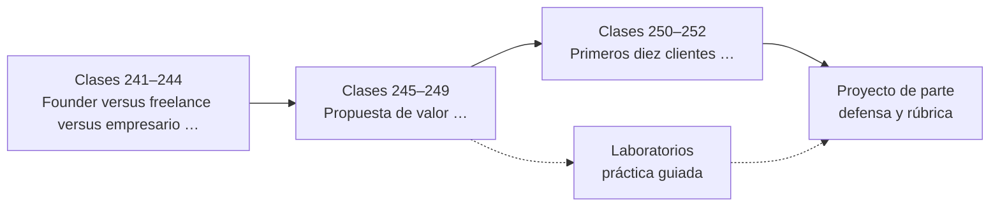

# Parte 20 — Founder y creación de empresas

<!-- parte:inicio -->

> ← [Parte 19 — Tecnología, datos, IA y transformación digital para ejecutivos](../19-technology-data-ai-digital-transformation/README.md) · [Temario](../../SYLLABUS.md) · [Parte 21 — Founder Track Chile: formalización y operación](../21-chile-founder-track/README.md) →

*De un problema real a una oferta con disposición a pagar demostrada*

**Etapa:** 6 — Fundador, propietario e independencia  
**Duración:** 12 clases · 30 horas  
**Resultado de salida:** Transformar un problema real en una oferta validada y obtener evidencia de disposición a pagar.

⚫ [Ver las 6 etapas](../../SYLLABUS.md) · 12 clases (241–252) · 4 laboratorios · [proyecto de parte](project.md)

## 🎯 De qué trata esta parte

Fundar es decidir con riesgo propio. La mayoría de las empresas nuevas fracasa por construir antes de validar. Esta parte reemplaza la idea brillante por una oferta probada con clientes que pagan.

El eje es **evidencia de pago**: hipótesis, discovery, validación, MVP, pricing y primeros diez clientes. Incluye el acuerdo entre cofundadores, que pocos tratan a tiempo.

## 🧱 Con qué hay que llegar

| Parte | Qué aporta |
|---|---|
| [10 — Ventas, desarrollo comercial y negociación](../10-sales-commercial-negotiation/README.md) | Venta y negociación. |
| [11 — Marketing, cliente y crecimiento](../11-marketing-customers-growth/README.md) | Mercado y cliente. |
| [12 — Producto e innovación](../12-product-innovation/README.md) | Discovery y MVP. |
| [09 — Finanzas y contabilidad para gerentes](../09-managerial-finance-accounting/README.md) | Economía unitaria. |

Cada clase supone la anterior: el orden importa, y saltarse una deja sin base a las que vienen después.

## 📚 Resultados de la parte

Al terminar esta parte podrás:

1. **Elegir** entre fundar, ser independiente o emprender.
2. **Encontrar** problemas valiosos y formular hipótesis de cliente.
3. **Validar** antes de construir y probar un MVP.
4. **Fijar** precio temprano y conseguir los primeros clientes.
5. **Acordar** equity y reglas entre cofundadores.

## 🗺️ Mapa de la parte

## 🧭 Cómo se encadenan las 12 clases

Las clases **241 a 244** definen la oportunidad: el rol, los problemas, el discovery y las hipótesis.

Las clases **245 a 249** la prueban: propuesta de valor, modelo, validación, MVP y precio.

Las clases **250 a 252** la lanzan: primeros clientes, cofundadores y el capstone de launch readiness.

## 📘 Las 12 clases

| # | Clase | Qué se trabaja | Entregable | Min |
|---:|---|---|---|---:|
| 241 | [Founder versus freelance versus empresario](classes/241-founder-versus-freelance-versus-empresario/README.md) | Freelance, Empresario, Founder | [founder-owner-decision-brief](../../templates/founder-owner-decision-brief.md) | 150 |
| 242 | [Encontrar problemas valiosos](classes/242-encontrar-problemas-valiosos/README.md) | Problema valioso, Trabajo por hacer (*job to be done*), Dolor | [founder-owner-decision-brief](../../templates/founder-owner-decision-brief.md) | 150 |
| 243 | [Customer discovery](classes/243-customer-discovery/README.md) | Descubrimiento de clientes, Episodio reciente, Comprador | [product-evidence-brief](../../templates/product-evidence-brief.md) | 150 |
| 244 | [Hipótesis de cliente y problema](classes/244-hipotesis-de-cliente-y-problema/README.md) | Hipótesis de cliente, Hipótesis de problema, Refutable | [commercial-decision-brief](../../templates/commercial-decision-brief.md) | 150 |
| 245 | [Propuesta de valor](classes/245-propuesta-de-valor/README.md) | Propuesta de valor, Trabajo por hacer, Dolor y ganancia | [modelo-financiero-y-memo-de-decision](../../templates/modelo-financiero-y-memo-de-decision.md) | 150 |
| 246 | [Modelo de negocio](classes/246-modelo-de-negocio/README.md) | Modelo de negocio, Eslabón más riesgoso, Economía por cliente | [strategy-memo](../../templates/strategy-memo.md) | 150 |
| 247 | [Validación antes de construir](classes/247-validacion-antes-de-construir/README.md) | Validación, Escalera de compromiso, Criterio previo | [founder-owner-decision-brief](../../templates/founder-owner-decision-brief.md) | 150 |
| 248 | [MVP y concierge tests](classes/248-mvp-y-concierge-tests/README.md) | MVP, Concierge test, Mago de Oz | [product-evidence-brief](../../templates/product-evidence-brief.md) | 150 |
| 249 | [Pricing temprano](classes/249-pricing-temprano/README.md) | Precio basado en valor, Precio piso, Precio techo | [commercial-decision-brief](../../templates/commercial-decision-brief.md) | 150 |
| 250 | [Primeros diez clientes](classes/250-primeros-diez-clientes/README.md) | Perfil de cliente ideal, Embudo, Calificación | [commercial-decision-brief](../../templates/commercial-decision-brief.md) | 150 |
| 251 | [Cofundadores, equity y acuerdos](classes/251-cofundadores-equity-y-acuerdos/README.md) | Equity, Vesting, Cliff | [founder-owner-decision-brief](../../templates/founder-owner-decision-brief.md) | 150 |
| 252 | [Capstone: launch readiness](classes/252-capstone-launch-readiness/README.md) | Launch readiness, Go / no-go, Riesgo bloqueante | [founder-owner-decision-brief](../../templates/founder-owner-decision-brief.md) | 150 |

## ⚠️ Riesgos característicos

- Construir antes de validar.
- Tomar el elogio por intención de compra.
- Fijar precio por costo y no por valor.
- Postergar el acuerdo entre cofundadores.

## 🔤 Glosario de la parte

72 conceptos definidos en las clases, con la definición operacional que usa cada una.

| Concepto | Definición operacional |
|---|---|
| **Activo acumulable** | Recurso que crece con el tiempo y no depende de horas. |
| **Acuerdo de socios** | Contrato que regula decisiones, transferencias y salida. |
| **Alternativa actual** | Lo que el cliente hace hoy, incluido no hacer nada. |
| **Ancla** | Referencia que influye en la percepción del precio. |
| **Aprendizaje validado** | Conocimiento confirmado con datos de clientes. |
| **Calificación** | Verificar que el prospecto tiene problema, presupuesto y decisor. |
| **Cliente a medida** | Cliente cuyas exigencias desvían el producto. |
| **Cliff** | Período inicial tras el cual se adquiere el primer tramo. |
| **Comprador** | Quien decide y paga. |
| **Concierge test** | Servicio entregado a mano, sin tecnología, a pocos clientes. |
| **Contribución** | Precio menos costo variable por cliente. |
| **Cortesía** | Tendencia a dar respuestas agradables que no comprometen. |
| **Costo de adquisición (CAC)** | Costo de conseguir un cliente nuevo. |
| **Costo de lo manual** | Tiempo y dinero por cliente de la entrega manual. |
| **Criterio de detención** | Condición que obliga a parar o ajustar. |
| **Criterio previo** | Umbral de éxito fijado antes de ver los datos. |
| **Descubrimiento de clientes** | Investigación para entender problemas, contexto y comportamiento antes de construir. |
| **Dilución** | Reducción del porcentaje al emitirse nuevas participaciones. |
| **Dolor** | Costo de no resolver el problema, en tiempo, dinero o riesgo. |
| **Dolor y ganancia** | Obstáculos y resultados deseados por el cliente. |
| **Economía por cliente** | Ingresos y costos asociados a un cliente. |
| **Embudo** | Etapas desde el contacto hasta el cliente que paga. |
| **Empresario** | Dueño de un negocio con clientes, equipo y procesos. |
| **Episodio reciente** | Situación concreta vivida por la persona hace poco. |
| **Equity** | Participación en la propiedad de la empresa. |
| **Escalera de compromiso** | Orden de pruebas según lo que se le exige al cliente. |
| **Eslabón más riesgoso** | Hipótesis cuya falsedad invalida el modelo. |
| **Evidencia fuerte** | Hechos, compromisos y datos, no opiniones. |
| **Experimento barato** | Prueba de bajo costo para aprender antes de comprometerse. |
| **Experimento de precio** | Prueba controlada de distintos precios. |
| **Falso positivo** | Señal que parece validar y no lo hace. |
| **Founder** | Creador de una empresa diseñada para crecer de forma repetible. |
| **Frecuencia** | Cuán a menudo ocurre el problema. |
| **Freelance** | Persona que vende su trabajo por proyecto o por hora. |
| **Go / no-go** | Decisión de lanzar o no, con condiciones. |
| **Hipótesis de cliente** | Creencia sobre quién es el cliente y en qué contexto actúa. |
| **Hipótesis de problema** | Creencia sobre lo que intenta lograr y qué se lo impide. |
| **Launch readiness** | Grado de preparación para lanzar con riesgos conocidos. |
| **Lista de verificación** | Lista breve de pasos críticos que no deben omitirse. |
| **Mago de Oz** | Interfaz que parece automática pero se opera a mano. |
| **Mecanismo** | Cómo el producto produce la mejora prometida. |
| **Modelo de negocio** | Forma en que una empresa crea, entrega y captura valor. |
| **MVP** | Versión mínima que permite aprender una hipótesis con clientes. |
| **Perfil de cliente ideal** | Descripción de quien más valor obtiene y más fácil compra. |
| **Pista de caja (runway)** | Meses que la caja alcanza al ritmo de gasto actual. |
| **Pivote** | Cambio estructurado de una hipótesis fundamental. |
| **Precio basado en valor** | Precio fijado según el valor que el cliente obtiene. |
| **Precio piso** | Mínimo que cubre costos variables y de adquisición. |
| **Precio techo** | Máximo que el cliente aceptaría. |
| **Presupuesto** | Capacidad y disposición de pagar por resolverlo. |
| **Primeros adoptantes** | Clientes que toleran un producto incompleto por un beneficio mayor. |
| **Problema valioso** | Dificultad que duele, es frecuente y tiene presupuesto. |
| **Producto-mercado** | Estado en que el producto satisface a un mercado. |
| **Propuesta de valor** | Razón concreta por la que un cliente elegiría tu solución frente a su alternativa. |
| **Prueba (*proof*)** | Evidencia que respalda la promesa. |
| **Prueba de demanda** | Experimento que mide interés real sin producto terminado. |
| **Punto de equilibrio** | Nivel de clientes en que ingresos cubren costos. |
| **Refutable** | Formulada de modo que algún resultado la contradiga. |
| **Restricción de liquidez** | Limitación de capital propio para emprender. |
| **Riesgo bloqueante** | Riesgo que, si ocurre, impide operar o destruye el valor. |
| **Roles** | Responsabilidades claras de cada cofundador. |
| **Sesgo de accesibilidad** | Elegir lo que está cerca y no lo que es más valioso. |
| **Severidad** | Intensidad del problema y de sus consecuencias. |
| **Supuesto crítico** | Creencia cuya falsedad invalida el negocio. |
| **Trabajo por hacer** | Progreso que el cliente intenta lograr en una situación. |
| **Trabajo por hacer (*job to be done*)** | Progreso que una persona intenta lograr en una situación. |
| **Umbral previo** | Resultado mínimo definido antes de probar. |
| **Usuario** | Quien usa la solución. |
| **Validación** | Reunir evidencia de que una hipótesis crítica se sostiene. |
| **Valor de vida del cliente (LTV)** | Contribución total esperada de un cliente. |
| **Venta del fundador** | Ventas hechas por quien conoce el producto y el problema. |
| **Vesting** | Adquisición gradual del derecho a la participación. |

## 📦 Qué queda como evidencia

- Una validación con evidencia de pago.
- Un MVP con criterios de éxito.
- Un acuerdo de cofundadores.
- El capstone: launch readiness.

## 🔗 Cómo se conecta

La parte 21 formaliza la empresa en Chile y la 22 la escala. Para el ciclo completo de creación de empresa existe un programa hermano, referenciado en los documentos.

## 🧪 Cómo se trabaja

Son **12 clases de 150 minutos** —30 horas— con **4 laboratorios** y un proyecto integrador. Cada clase trae su propósito, sus conceptos, un caso, práctica, errores frecuentes, preguntas de comprobación, entregable y fuentes, y se evalúa con su `assessment.md`. Los laboratorios se resuelven con datos propios o sintéticos, nunca con datos reales de terceros, y la parte se cierra con el proyecto y su defensa. Las reglas de recorrido están en [la guía de navegación](../../docs/NAVIGATION.md).

<!-- parte:fin -->

## Laboratorios

- [Lab 01 — Problem interview](labs/lab-01.md)
- [Lab 02 — Business model canvas](labs/lab-02.md)
- [Lab 03 — Pre-sale experiment](labs/lab-03.md)
- [Lab 04 — Founder agreement workshop](labs/lab-04.md)

## Proyecto de parte

Validar una oportunidad con evidencia real y producir un launch readiness review.

## Bibliografía rectora

- Eric Ries — *The Lean Startup* (Emprendimiento)
- Steve Blank — *The Four Steps to the Epiphany* (Customer development)
- Alexander Osterwalder & Yves Pigneur — *Business Model Generation* (Modelos de negocio)
- Bill Aulet — *Disciplined Entrepreneurship* (Emprendimiento)
- Noam Wasserman — *The Founder's Dilemmas* (Founders)

## Criterio de aprobación

80/100 y entrega del proyecto integrador.
