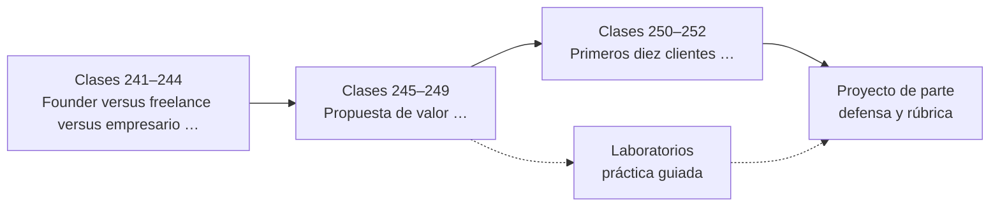

# Parte 20 — Founder y creación de empresas

<!-- parte:inicio -->

> ← [Parte 19 — Tecnología, datos, IA y transformación digital para ejecutivos](../19-technology-data-ai-digital-transformation/README.md) · [Temario](../../SYLLABUS.md) · [Parte 21 — Founder Track Chile: formalización y operación](../21-chile-founder-track/README.md) →

*De un problema real a una oferta con disposición a pagar demostrada*

**Etapa:** 6 — Fundador, propietario e independencia  
**Duración:** 12 clases · 30 horas  
**Resultado de salida:** Transformar un problema real en una oferta validada y obtener evidencia de disposición a pagar.

⚫ [Ver las 6 etapas](../../SYLLABUS.md) · 12 clases (241–252) · 4 laboratorios · [proyecto de parte](project.md)

## 🎯 De qué trata esta parte

Fundar es decidir con riesgo propio. La mayoría de las empresas nuevas fracasa por construir antes de validar. Esta parte reemplaza la idea brillante por una oferta probada con clientes que pagan.

El eje es **evidencia de pago**: hipótesis, discovery, validación, MVP, pricing y primeros diez clientes. Incluye el acuerdo entre cofundadores, que pocos tratan a tiempo.

## 🧱 Con qué hay que llegar

| Parte | Qué aporta |
|---|---|
| [10 — Ventas, desarrollo comercial y negociación](../10-sales-commercial-negotiation/README.md) | Venta y negociación. |
| [11 — Marketing, cliente y crecimiento](../11-marketing-customers-growth/README.md) | Mercado y cliente. |
| [12 — Producto e innovación](../12-product-innovation/README.md) | Discovery y MVP. |
| [09 — Finanzas y contabilidad para gerentes](../09-managerial-finance-accounting/README.md) | Economía unitaria. |

Cada clase supone la anterior: el orden importa, y saltarse una deja sin base a las que vienen después.

## 📚 Resultados de la parte

Al terminar esta parte podrás:

1. **Elegir** entre fundar, ser independiente o emprender.
2. **Encontrar** problemas valiosos y formular hipótesis de cliente.
3. **Validar** antes de construir y probar un MVP.
4. **Fijar** precio temprano y conseguir los primeros clientes.
5. **Acordar** equity y reglas entre cofundadores.

## 🗺️ Mapa de la parte

## 🧭 Cómo se encadenan las 12 clases

Las clases **241 a 244** definen la oportunidad: el rol, los problemas, el discovery y las hipótesis.

Las clases **245 a 249** la prueban: propuesta de valor, modelo, validación, MVP y precio.

Las clases **250 a 252** la lanzan: primeros clientes, cofundadores y el capstone de launch readiness.

## 📘 Las 12 clases

| # | Clase | Qué se trabaja | Entregable | Min |
|---:|---|---|---|---:|
| 241 | [Founder versus freelance versus empresario](classes/241-founder-versus-freelance-versus-empresario/README.md) | freelancer, founder, business owner | [founder-owner-decision-brief](../../templates/founder-owner-decision-brief.md) | 150 |
| 242 | [Encontrar problemas valiosos](classes/242-encontrar-problemas-valiosos/README.md) | problem value, frequency, urgency | [founder-owner-decision-brief](../../templates/founder-owner-decision-brief.md) | 150 |
| 243 | [Customer discovery](classes/243-customer-discovery/README.md) | buyer, user, trigger | [product-evidence-brief](../../templates/product-evidence-brief.md) | 150 |
| 244 | [Hipótesis de cliente y problema](classes/244-hipotesis-de-cliente-y-problema/README.md) | customer hypothesis, problem hypothesis, falsifiability | [commercial-decision-brief](../../templates/commercial-decision-brief.md) | 150 |
| 245 | [Propuesta de valor](classes/245-propuesta-de-valor/README.md) | value proposition, gain, pain reliever | [modelo-financiero-y-memo-de-decision](../../templates/modelo-financiero-y-memo-de-decision.md) | 150 |
| 246 | [Modelo de negocio](classes/246-modelo-de-negocio/README.md) | business model, channel, revenue stream | [strategy-memo](../../templates/strategy-memo.md) | 150 |
| 247 | [Validación antes de construir](classes/247-validacion-antes-de-construir/README.md) | demand test, pre-sale, smoke test | [founder-owner-decision-brief](../../templates/founder-owner-decision-brief.md) | 150 |
| 248 | [MVP y concierge tests](classes/248-mvp-y-concierge-tests/README.md) | concierge MVP, Wizard of Oz, manual-first | [product-evidence-brief](../../templates/product-evidence-brief.md) | 150 |
| 249 | [Pricing temprano](classes/249-pricing-temprano/README.md) | price, value metric, willingness to pay | [commercial-decision-brief](../../templates/commercial-decision-brief.md) | 150 |
| 250 | [Primeros diez clientes](classes/250-primeros-diez-clientes/README.md) | founder-led sales, ideal customer profile, design partner | [commercial-decision-brief](../../templates/commercial-decision-brief.md) | 150 |
| 251 | [Cofundadores, equity y acuerdos](classes/251-cofundadores-equity-y-acuerdos/README.md) | cofounder agreement, vesting, cliff | [founder-owner-decision-brief](../../templates/founder-owner-decision-brief.md) | 150 |
| 252 | [Capstone: launch readiness](classes/252-capstone-launch-readiness/README.md) | launch readiness, go-no-go criterion, operational readiness | [founder-owner-decision-brief](../../templates/founder-owner-decision-brief.md) | 150 |

## ⚠️ Riesgos característicos

- Construir antes de validar.
- Tomar el elogio por intención de compra.
- Fijar precio por costo y no por valor.
- Postergar el acuerdo entre cofundadores.

## 🔤 Glosario de la parte

59 conceptos definidos en las clases, con la definición operacional que usa cada una.

| Concepto | Definición operacional |
|---|---|
| **access** | capacidad real de llegar y aprender de clientes potenciales. |
| **assumption map** | mapa de supuestos por importancia e incertidumbre. |
| **automation candidate** | tarea repetible y estable apta para automatizar. |
| **budget** | recursos disponibles o reasignables para solución. |
| **business model** | arquitectura de creación entrega y captura de valor. |
| **business owner** | propietario de un sistema empresarial que puede operar con otros líderes. |
| **buyer** | persona o función que autoriza gasto. |
| **buying process** | pasos y actores que llevan a decisión. |
| **channel** | medio para llegar vender y entregar. |
| **cliff** | periodo inicial antes de adquirir primera porción. |
| **cofounder agreement** | acuerdo sobre roles ownership decisiones y contingencias. |
| **commitment** | acción costosa que revela intención más fuerte que una opinión. |
| **concierge** | entrega manual del valor para aprender workflow. |
| **concierge MVP** | servicio manual que entrega valor prometido a pocos clientes. |
| **customer hypothesis** | afirmación falsable sobre segmento que tiene un patrón relevante. |
| **deadlock** | empate que impide decisión en ownership o control. |
| **demand test** | experimento para observar interés o compromiso del mercado. |
| **design partner** | cliente temprano que colabora estrechamente a cambio de acceso o condiciones. |
| **differentiator** | atributo o mecanismo relevante que separa de alternativas. |
| **discount** | reducción deliberada que debe tener propósito y límite. |
| **early adopter** | subgrupo con dolor y urgencia suficientes para probar antes. |
| **falsifiability** | posibilidad de observar evidencia que contradiga afirmación. |
| **founder** | persona que crea y asume riesgo inicial de una nueva empresa. |
| **founder-led sales** | venta directa liderada por fundadores durante etapa de aprendizaje. |
| **freelancer** | persona que vende servicios profesionales directamente. |
| **frequency** | cuán a menudo ocurre. |
| **gain** | resultado positivo que el cliente valora. |
| **go-no-go criterion** | condición explícita para lanzar o detener. |
| **ideal customer profile** | descripción de cuentas con mayor probabilidad de valor y fit. |
| **IP assignment** | cesión de propiedad intelectual a la compañía. |
| **key resource** | activo necesario para operar propuesta. |
| **launch cohort** | grupo inicial controlado de clientes. |
| **launch readiness** | grado de preparación para exponer oferta a mercado real. |
| **manual-first** | estrategia de aprendizaje que pospone automatización. |
| **operational readiness** | capacidad de entregar soportar y recuperar. |
| **pain reliever** | mecanismo que reduce una fricción material. |
| **pre-sale** | compromiso de compra antes de producto final. |
| **price** | intercambio monetario exigido por la oferta. |
| **price sensitivity** | cambio de demanda frente a cambios de precio. |
| **problem hypothesis** | afirmación falsable sobre problema y consecuencia. |
| **problem value** | impacto económico funcional o emocional de un problema para un cliente. |
| **proof** | prueba o evidencia que hace creíble la promesa. |
| **referenceability** | disposición del cliente a recomendar o validar. |
| **repeatable motion** | secuencia comercial que puede ser ejecutada por otra persona. |
| **revenue stream** | fuente y mecanismo de ingreso. |
| **rollback plan** | forma de revertir o limitar impacto si falla. |
| **scalability** | capacidad de crecer output o ingresos sin crecimiento proporcional de esfuerzo. |
| **self-employment** | trabajo por cuenta propia donde ingreso depende fuertemente del trabajo personal. |
| **service blueprint** | mapa frontstage y backstage del servicio. |
| **smoke test** | señalización de oferta para medir reacción sin construir todo. |
| **trigger** | evento que activa búsqueda o compra. |
| **unit economics** | ingresos y costos atribuibles a una unidad de cliente o venta. |
| **urgency** | velocidad con que el cliente necesita resolver. |
| **user** | persona que usa o experimenta la solución. |
| **value metric** | unidad según la cual precio escala con valor o uso. |
| **value proposition** | promesa específica de valor para un segmento. |
| **vesting** | adquisición gradual de equity vinculada a permanencia. |
| **willingness to pay** | disposición revelada o declarada a intercambiar dinero por valor. |
| **Wizard of Oz** | interfaz que aparenta automatización mientras procesos internos son manuales. |

## 📦 Qué queda como evidencia

- Una validación con evidencia de pago.
- Un MVP con criterios de éxito.
- Un acuerdo de cofundadores.
- El capstone: launch readiness.

## 🔗 Cómo se conecta

La parte 21 formaliza la empresa en Chile y la 22 la escala. Para el ciclo completo de creación de empresa existe un programa hermano, referenciado en los documentos.

## 🧪 Cómo se trabaja

Son **12 clases de 150 minutos** —30 horas— con **4 laboratorios** y un proyecto integrador. Cada clase trae su propósito, sus conceptos, un caso, práctica, errores frecuentes, preguntas de comprobación, entregable y fuentes, y se evalúa con su `assessment.md`. Los laboratorios se resuelven con datos propios o sintéticos, nunca con datos reales de terceros, y la parte se cierra con el proyecto y su defensa. Las reglas de recorrido están en [la guía de navegación](../../docs/NAVIGATION.md).

<!-- parte:fin -->

## Laboratorios

- [Lab 01 — Problem interview](labs/lab-01.md)
- [Lab 02 — Business model canvas](labs/lab-02.md)
- [Lab 03 — Pre-sale experiment](labs/lab-03.md)
- [Lab 04 — Founder agreement workshop](labs/lab-04.md)

## Proyecto de parte

Validar una oportunidad con evidencia real y producir un launch readiness review.

## Bibliografía rectora

- Eric Ries — *The Lean Startup* (Emprendimiento)
- Steve Blank — *The Four Steps to the Epiphany* (Customer development)
- Alexander Osterwalder & Yves Pigneur — *Business Model Generation* (Modelos de negocio)
- Bill Aulet — *Disciplined Entrepreneurship* (Emprendimiento)
- Noam Wasserman — *The Founder's Dilemmas* (Founders)

## Criterio de aprobación

80/100 y entrega del proyecto integrador.
