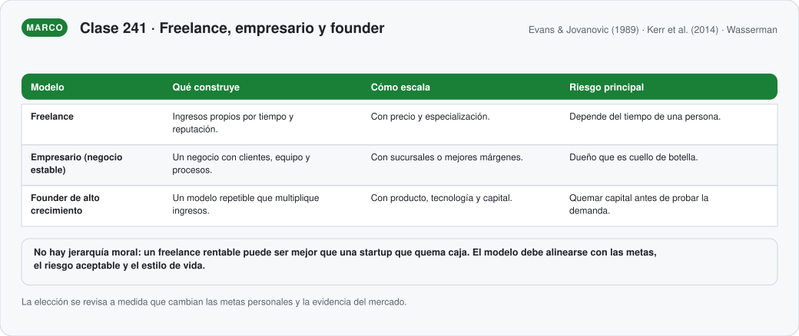

# Clase 241 — Founder versus freelance versus empresario

<!-- nav:inicio -->
> **Parte 20 · Founder y creación de empresas** — clase 1 de 12 · [índice de la parte](../../README.md) · [temario](../../../../SYLLABUS.md)
<!-- nav:fin -->

**Parte:** 20 — Founder y creación de empresas  
**Nivel:** Etapa 6 — Founder  
**Duración sugerida:** 150–180 minutos · **Estándar:** deep-class-v2

## 🎯 Propósito

«Quiero emprender» es una frase que esconde decisiones muy distintas. Un diseñador que cobra por proyecto, la dueña de una panadería con tres empleados y el fundador de una empresa de software que busca capital para crecer diez veces en cinco años dicen lo mismo, pero viven trabajos diferentes, asumen riesgos diferentes y buscan resultados diferentes. Confundirlos es una fuente frecuente de frustración: quien quería estabilidad e independencia se embarca en una startup que consume su tiempo y sus ahorros; quien quería construir algo grande se queda en un trabajo independiente que depende de sus propias horas y nunca escala. Antes de elegir qué empresa crear, conviene elegir **qué clase de camino** se está dispuesto a recorrer y para qué.

La clase compara tres modelos (freelance, empresario de un negocio estable y *founder* de un emprendimiento de alto crecimiento) con criterios de objetivo personal y económico, dependencia del tiempo, activos acumulables, riesgo y capital necesario. Se apoya en el modelo de decisión de entrada al emprendimiento de Evans y Jovanovic y su énfasis en las restricciones de liquidez, en el enfoque de Kerr, Nanda y Rhodes-Kropf sobre el emprendimiento como experimentación, en la lógica de *effectuation* de Sarasvathy, en el análisis de Gerber sobre por qué muchos negocios dependen del dueño y en los dilemas de los fundadores de Wasserman. Al terminar sabrás definir tus metas, mapear tu dependencia de tiempo, identificar qué activos se acumulan en cada modelo y elegir con criterio, sin jerarquías morales.

## 📚 Resultados de aprendizaje

Al finalizar podrás:

1. **Distinguir** freelance, empresario y founder por su lógica económica.
2. **Definir** tus metas personales, económicas y de riesgo antes de elegir.
3. **Mapear** la dependencia de tu tiempo y los activos que se acumulan.
4. **Comparar** modelos con una matriz ponderada y una prueba de sensibilidad.
5. **Diseñar** un primer experimento barato para aprender antes de comprometerte.

## 🧭 Agenda

| Tramo | Qué se hace |
|---|---|
| 0–20 min | Recuperación: ¿qué quieres lograr en cinco años con tu trabajo y cuánto riesgo estás dispuesto a asumir? |
| 20–60 min | Metas, modelos, tiempo, activos, riesgo, capital y primeros experimentos. |
| 60–105 min | Ejemplo trabajado: tres opciones y una matriz con dos juegos de pesos. |
| 105–150 min | Caso ejecutivo y práctica. |
| 150–175 min | Límites y entregable. |

## 🧩 Conceptos centrales

| Concepto | Definición | Cómo se reconoce |
|---|---|---|
| **Freelance** | Persona que vende su trabajo por proyecto o por hora. | Ingreso ligado a sus horas. |
| **Empresario** | Dueño de un negocio con clientes, equipo y procesos. | Ingresos del negocio y del dueño. |
| **Founder** | Creador de una empresa diseñada para crecer de forma repetible. | Busca un modelo escalable y, a menudo, capital. |
| **Activo acumulable** | Recurso que crece con el tiempo y no depende de horas. | Marca, clientes recurrentes, producto, equipo. |
| **Restricción de liquidez** | Limitación de capital propio para emprender. | Ahorros, deuda, acceso a financiamiento. |
| **Experimento barato** | Prueba de bajo costo para aprender antes de comprometerse. | Piloto, preventa, prueba con pocos clientes. |

## 🧠 Modelo mental

**Cómo leer el diagrama.** Una tabla con tres modelos. **Freelance**: construye ingresos propios por tiempo y reputación; escala con precio y especialización; su riesgo es depender del tiempo de una sola persona. **Empresario de un negocio estable**: construye un negocio con clientes, equipo y procesos; escala con sucursales o mejores márgenes; su riesgo es que el dueño sea el cuello de botella. **Founder de alto crecimiento**: construye un modelo repetible que multiplica ingresos; escala con producto, tecnología y capital; su riesgo es quemar capital antes de probar la demanda. La nota afirma que no hay jerarquía moral entre ellos.

## 📖 Desarrollo

### 1. Empezar por el objetivo, no por la idea

Muchas personas parten de una idea («una aplicación para…») sin haber definido qué quieren de su vida laboral. Se recomienda partir de preguntas personales: ¿qué nivel de ingresos necesito y en cuánto tiempo?, ¿cuánta incertidumbre puedo tolerar?, ¿cuánto tiempo y capital puedo comprometer sin dañar a mi familia?, ¿qué valoro más: autonomía, estabilidad, impacto, riqueza o aprendizaje?, ¿qué tan cómodo estoy con jefes, inversionistas y socios? Estas respuestas **filtran** los modelos. Evans y Jovanovic mostraron que la decisión de emprender depende de la **capacidad** de la persona y de sus **restricciones de liquidez**: quien dispone de poco capital propio enfrenta límites para iniciar proyectos intensivos en capital, aunque tenga talento. Conocer las restricciones evita elegir un camino que se quedará sin recursos antes de probarse.

### 2. Freelance: vender tiempo y reputación

El *freelance* vende su conocimiento por proyecto o por hora. Sus ventajas: **barrera de entrada baja**, ingresos desde el primer cliente, autonomía y aprendizaje rápido. Sus límites: el ingreso está **acotado por las horas** que puede trabajar y por la tarifa que el mercado paga; hay **riesgo de concentración** (pocos clientes grandes) y de **volatilidad**; los activos que acumula (reputación, red, portafolio) son valiosos, pero no se pueden vender fácilmente. Para crecer, el freelance puede **subir su tarifa**, **especializarse**, **empaquetar** servicios con alcance y precio fijo, **productizar** parte del trabajo o **construir un equipo**, y entonces su modelo se acerca al de empresario. Un freelance rentable y satisfecho no es un emprendedor «frustrado»: es una elección legítima.

### 3. Empresario: un negocio con vida propia

El **empresario** es dueño de un negocio con clientes, empleados, procesos y, con suerte, utilidades que no dependen de su presencia constante. Gerber, en *The E-Myth Revisited*, sostiene que muchos pequeños negocios fracasan porque su dueño es un **técnico** que abre un negocio para hacer su oficio, pero no lo **diseña como un sistema**: todo depende de él. La alternativa es pensar en el negocio como un **producto** que se puede operar sin el dueño: procesos documentados, personas capacitadas, indicadores. El empresario puede acumular activos reales (marca, clientes recurrentes, locales, equipo) y vender el negocio o escalarlo, a un ritmo moderado y con capital propio o crédito. Su riesgo es que **el dueño sea el cuello de botella** y que el negocio se estanque.

### 4. Founder: diseñar un modelo repetible y escalable

El *founder* en el sentido de la clase es quien crea una empresa con la intención de buscar un **modelo de negocio repetible y escalable**: que pueda multiplicar ingresos sin multiplicar costos en la misma proporción, a menudo con tecnología, y que, para lograrlo, suele necesitar **capital externo**. Kerr, Nanda y Rhodes-Kropf describen el emprendimiento como **experimentación**: la mayoría de las ideas fallan, el aprendizaje es el producto, y la clave económica es probar muchas cosas con costos bajos y escalar las que funcionan. Para el founder, el riesgo principal es **gastar capital antes de probar la demanda**; el potencial, un resultado desproporcionado si el modelo funciona. Wasserman recuerda que las decisiones tempranas sobre socios, propiedad y capital son difíciles de revertir y que los fundadores enfrentan dilemas entre riqueza y control (clase 251).

### 5. Dependencia del tiempo y activos acumulables

Una pregunta clave es: **¿cuánto de mi ingreso depende de mi tiempo?** En el freelance, casi todo; en el empresario, parte; en el founder, idealmente poco al cabo de unos años, aunque al comienzo el fundador trabaja más que nadie. La pregunta complementaria es: **¿qué activos acumulo mientras trabajo?** Un freelance acumula reputación y relaciones; un empresario, clientes recurrentes, procesos y marca; un founder, producto, datos, tecnología, equipo y, si hay inversión, participación en una empresa de valor creciente. Un modelo en el que todo lo que se construye desaparece cuando se deja de trabajar es un **empleo bien pagado**; uno en el que se construyen activos que siguen produciendo es un **negocio**. Ambos son válidos, pero distintos.

### 6. Riesgo, capital y estilo de vida

Cada modelo tiene un perfil de riesgo y capital. El freelance arriesga poco capital y tiempo de búsqueda de clientes; el empresario arriesga capital de inversión y compromisos con empleados y proveedores; el founder arriesga capital propio o ajeno y años de trabajo con alta probabilidad de fracaso, a cambio de un retorno potencialmente grande. Hay que ver también el **estilo de vida**: horarios, estrés, estabilidad, vida familiar, tolerancia a la incertidumbre, deseo de liderar equipos. Las **obligaciones** (deuda, personas a cargo) limitan la capacidad de asumir riesgo. Sarasvathy describe a los emprendedores expertos como personas que parten de **los medios que tienen** (quiénes son, qué saben, a quiénes conocen) y de la **pérdida asumible**, en lugar de fijar una meta y buscar los recursos; es un buen criterio para empezar con lo que hay.

### 7. Decidir con una matriz y experimentar barato

Una forma práctica de decidir es una **matriz ponderada**: se listan los criterios (ingresos estables, acumulación de patrimonio, autonomía, riesgo, escalabilidad, aprendizaje), se ponderan según las metas personales y se califica cada modelo. Luego se hace una **prueba de sensibilidad**: si los pesos cambian, ¿la elección cambia? Si cambia con facilidad, la decisión es frágil y conviene recoger más información. La mejor respuesta suele ser un **experimento barato**: un proyecto freelance para probar un servicio, una preventa, una prueba con cinco clientes; así se aprende sobre demanda, sobre uno mismo y sobre el trabajo, sin comprometer ahorros ni carrera. Se fija de antemano qué evidencia haría avanzar, ajustar o detener.

## 📚 Lectura comparada

| Obra | Qué aporta | Qué no resuelve | Pregunta para contrastar |
|---|---|---|---|
| Evans y Jovanovic | Decisión de emprender y restricciones de liquidez. | Modelo económico estilizado. | ¿Qué capital propio tengo y cuánto puedo perder? |
| Kerr, Nanda y Rhodes-Kropf | Emprendimiento como experimentación con opciones. | No guía la elección personal. | ¿Qué experimento barato puedo hacer primero? |
| Sarasvathy | *Effectuation*: partir de los medios y la pérdida asumible. | Estudio de emprendedores expertos. | ¿Con qué medios cuento hoy? |
| Gerber | El negocio como sistema y no como extensión del dueño. | Enfoque en pequeños negocios. | ¿Funciona sin mí? |
| Wasserman | Dilemas de riqueza y control de los fundadores. | Evidencia de ciertos mercados. | ¿Qué decisión temprana es difícil de revertir? |

## 🧮 Ejemplo trabajado

**Situación (hipotética).** Una diseñadora con seis años de experiencia, ahorros de 18 millones de pesos y dos hijos pequeños piensa en tres caminos: seguir como *freelance*, abrir una agencia pequeña o crear una empresa de software para diseñadores que busque financiamiento.

**Economía básica del *freelance*.** Cobra 45.000 pesos por hora y factura 100 horas al mes: 4,5 millones al mes, 54 millones al año. Si sube su tarifa 20 %: 54.000 pesos la hora, 5,4 millones al mes (64,8 millones al año) con las mismas horas. Con paquetes de precio fijo de 1,2 millones por proyecto de 20 horas (60.000 pesos la hora gracias a plantillas y a un proceso mejor), cinco proyectos al mes dan 6 millones con las mismas 100 horas. El ingreso está limitado por las horas y por su capacidad de captar clientes.

**Matriz ponderada (calificaciones de 1 a 5).**

| Criterio | Freelance | Agencia pequeña | Startup de software |
|---|---|---|---|
| Ingresos estables en 2 años | 5 | 3 | 1 |
| Acumulación de patrimonio | 2 | 4 | 5 |
| Autonomía | 4 | 3 | 3 |
| Riesgo (5 = bajo) | 4 | 3 | 1 |
| Escalabilidad | 1 | 3 | 5 |

**Primer juego de pesos (estabilidad familiar):** ingresos 30 %, patrimonio 25 %, autonomía 15 %, riesgo 20 %, escalabilidad 10 %.

- Freelance: 0,30×5 + 0,25×2 + 0,15×4 + 0,20×4 + 0,10×1 = 1,50 + 0,50 + 0,60 + 0,80 + 0,10 = **3,50**
- Agencia: 0,90 + 1,00 + 0,45 + 0,60 + 0,30 = **3,25**
- Startup: 0,30 + 1,25 + 0,45 + 0,20 + 0,50 = **2,70**

**Segundo juego de pesos (ambición de construir):** ingresos 10 %, patrimonio 35 %, autonomía 15 %, riesgo 10 %, escalabilidad 30 %.

- Freelance: 0,50 + 0,70 + 0,60 + 0,40 + 0,30 = **2,50**
- Agencia: 0,30 + 1,40 + 0,45 + 0,30 + 0,90 = **3,35**
- Startup: 0,10 + 1,75 + 0,45 + 0,10 + 1,50 = **3,90**

**Lectura.** La elección **cambia por completo** según las metas: con estabilidad como prioridad gana el *freelance*; con ambición de construir, la startup. La decisión es sensible a las metas personales, no a la idea.

**Capital en riesgo.** Con ahorros de 18 millones y gastos familiares de 1,6 millones al mes, la diseñadora tiene 11 meses de reserva sin ingresos. Una startup que no genera ingresos en ese plazo es inviable sin capital externo; por eso se decide un **camino escalonado**.

**Experimento barato (90 días).** Mantener el *freelance* a 60 horas al mes (2,7 millones) y dedicar 40 horas al mes a validar una herramienta para diseñadores: entrevistar a 20 colegas, ofrecer una preventa de 30 licencias a 120.000 pesos cada una (3,6 millones si se venden todas) y registrar el compromiso real. Reglas: avanzar si al menos 12 de 30 licencias se pagan por adelantado (40 %); ajustar si se venden entre 5 y 11; detener si menos de 5. La pérdida máxima es el tiempo y unos 600.000 pesos.

**Resultado hipotético.** Se pagan 14 licencias: 1,68 millones; se avanza a una versión mínima con financiamiento propio y el *freelance* como base de ingresos, con una nueva revisión a los seis meses.

**Cuidados.** Las decisiones sobre dedicación, ahorros y socios afectan a la familia y se hablan con las personas implicadas; los aspectos tributarios, de seguridad social y legales de cada modelo se verifican con asesoría y en fuentes oficiales; las cifras son ilustrativas.

**Qué muestra.** (1) Las metas decidieron la elección. (2) La prueba de sensibilidad mostró la fragilidad. (3) El experimento limitó la pérdida y generó evidencia.

## 🔀 Comparación y límites

**Founder frente a empresario.** El founder busca un modelo escalable y suele necesitar capital externo; el empresario construye un negocio estable con crecimiento moderado. Ninguno es superior: responden a metas distintas.

**Límites.** No existe jerarquía moral: un *freelance* rentable puede ser mejor que una startup de alto consumo de caja. La estadística de éxito de los emprendimientos es incierta y depende del contexto. Las matrices ponderadas son subjetivas. Las decisiones personales dependen de obligaciones y de apoyo. Las cifras del ejemplo son ilustrativas.

## 🪜 De profesional a owner

| Nivel | Cómo se relaciona con el emprendimiento |
|---|---|
| **Profesional** | Aprende un oficio y construye reputación y red. |
| **Jefe / Team Lead** | Aprende a liderar y a ver el negocio completo. |
| **Gerente** | Aprende de finanzas, ventas y decisiones de capital. |
| **CEO / Director** | Aprende a gobernar un negocio con riesgo y capital ajeno. |
| **Founder / Owner** | Elige un modelo, asume el riesgo y construye activos propios. |

## 🏢 Caso ejecutivo

Un ingeniero de 34 años, jefe de proyectos en una empresa de tecnología con un salario de 4,2 millones de pesos al mes, ahorros de 24 millones y una hipoteca de 650.000 pesos mensuales, evalúa tres caminos: (a) ofrecer consultoría independiente a las empresas que ya conoce (potencial de 6 millones al mes, con contratos intermitentes); (b) abrir con un socio una empresa de mantenimiento industrial con una inversión inicial de 45 millones (créditos de 25 millones) y márgenes de 18 %; (c) fundar una empresa de software para gestión de activos industriales, que requiere dos años de desarrollo y capital externo de 400 millones. Su pareja está embarazada; él disfruta liderar equipos pero no vender; tiene una oferta interna de ascenso a gerente con 5,6 millones al mes. Un mentor le dice «si no te lanzas ahora, te arrepentirás»; otro, «con tu situación, no lo hagas». Un amigo de la universidad propone ser su cofundador en la opción (c).

Entrega un **memo de decisión de founder** que contenga: (a) las metas personales, económicas y de riesgo, con la capacidad de pérdida en pesos y en meses de reserva; (b) la comparación de las cuatro alternativas (incluido el ascenso) por dependencia de tiempo, activos acumulables, riesgo y capital; (c) la matriz ponderada con dos juegos de pesos y la lectura de la sensibilidad; (d) el diseño de un experimento barato de 90 días con criterios de avance, ajuste y detención; (e) los aspectos familiares, tributarios, de seguridad social y legales a verificar; (f) la decisión recomendada y su fecha de revisión.

## 🧪 Práctica

1. Escribe tus metas de cinco años en ingresos, patrimonio, autonomía y riesgo, con números.
2. Calcula cuántos meses de reserva tienes si no hubiera ingresos y cuánto puedes perder sin dañar tu vida.
3. Califica tres modelos en cinco criterios con dos juegos de pesos y observa si la elección cambia.
4. Diseña un experimento de 90 días con una pérdida máxima definida.
5. Lista tres activos que acumularías en cada modelo y cuáles dependen de tu tiempo.

## ⚠️ Errores frecuentes

| Error | Por qué ocurre | Cómo corregirlo |
|---|---|---|
| Partir de la idea y no de las metas | Entusiasmo por una oportunidad | Definir metas y riesgo antes. |
| Creer que un modelo es superior | Jerarquías sociales | Alinear el modelo con las metas. |
| Ignorar la liquidez | Se subestiman los gastos | Calcular meses de reserva y pérdida asumible. |
| Comprometerse sin experimentar | Se quiere «dar el salto» | Experimento barato con criterios. |
| Negocio que depende del dueño | Falta de sistema | Diseñar procesos y delegar. |
| Decidir solo | Se evita la conversación | Involucrar a la familia y a asesores. |

## ❓ Preguntas de comprobación

1. ¿Qué distingue a un *freelance*, un empresario y un *founder*?
2. ¿Por qué se parte de las metas y no de la idea?
3. ¿Qué es la dependencia del tiempo y por qué importa?
4. ¿Qué activos se acumulan en cada modelo?
5. ¿Qué significa emprender como experimentación?
6. ¿Para qué sirve una prueba de sensibilidad en la matriz?
7. ¿Qué características tiene un buen experimento barato?

Claves de respuesta

1. El freelance vende tiempo y reputación; el empresario dirige un negocio con equipo y procesos; el founder diseña un modelo repetible y escalable, a menudo con capital externo.
2. Porque las metas y el riesgo asumible filtran qué modelos tienen sentido y evitan elegir un camino que no se alinea con la vida que se quiere.
3. Es cuánto de los ingresos depende de las propias horas; determina el límite del crecimiento y la vulnerabilidad.
4. Freelance: reputación y red; empresario: clientes recurrentes, procesos, marca y equipo; founder: producto, datos, tecnología, equipo y participación en la empresa.
5. Probar muchas ideas con costos bajos, aprender de cada una y escalar las que funcionan.
6. Para ver si la elección cambia con otras prioridades; si cambia con facilidad, la decisión es frágil y requiere más información.
7. Costo y pérdida máxima acotados, evidencia de compromiso real, criterios previos de avanzar, ajustar o detener, y plazo definido.

## 📥 Entregable

Guarda en `portfolio/241-founder-versus-freelance-versus-empresario/`:

- `founder-owner-decision-brief.md` (plantilla [Founder owner decision brief](../../../../templates/founder-owner-decision-brief.md)) con el memo del caso ejecutivo;
- `cash-runway.md` (plantilla [Cash runway](../../../../templates/cash-runway.md)) con la reserva personal y la pérdida asumible;
- `decision-journal.md` con las metas, la matriz, el experimento y las verificaciones pendientes.

## 📗 Fuentes y verificación

- David S. Evans & Boyan Jovanovic — *An Estimated Model of Entrepreneurial Choice under Liquidity Constraints* (Journal of Political Economy, 1989). **Uso en esta clase:** decisión de emprender y restricciones de liquidez. Lectura selectiva sobre **founder versus freelance versus empresario**. **Localizador:** [DOI 10.1086/261629](https://doi.org/10.1086/261629).
- William R. Kerr, Ramana Nanda & Matthew Rhodes-Kropf — *Entrepreneurship as Experimentation* (Journal of Economic Perspectives, 2014). **Uso en esta clase:** emprendimiento como experimentación con opciones. Lectura selectiva sobre **founder versus freelance versus empresario**. **Localizador:** [DOI 10.1257/jep.28.3.25](https://doi.org/10.1257/jep.28.3.25).
- Saras D. Sarasvathy — *Causation and Effectuation: Toward a Theoretical Shift from Economic Inevitability to Entrepreneurial Contingency* (The Academy of Management Review, 2001). **Uso en esta clase:** effectuation: partir de los medios y la pérdida asumible. Lectura selectiva sobre **founder versus freelance versus empresario**. **Localizador:** [DOI 10.2307/259121](https://doi.org/10.2307/259121).
- Michael E. Gerber — *The E-Myth Revisited* (HarperAudio, 1995). **Uso en esta clase:** el negocio como sistema y no como extensión del dueño. Lectura selectiva sobre **founder versus freelance versus empresario**. **Localizador:** [ISBN-13 9780060574901](https://openlibrary.org/isbn/9780060574901).
- Noam Wasserman — *The Founder's Dilemmas* (Princeton University Press, 2012). **Uso en esta clase:** dilemas de riqueza y control de los fundadores. Lectura selectiva sobre **founder versus freelance versus empresario**. **Localizador:** [ISBN-13 9780691149134](https://openlibrary.org/isbn/9780691149134).

> **Regla de fuentes para Founder versus freelance versus empresario:** las obras anteriores estructuran las perspectivas de esta materia; cualquier norma, ley o estándar vivo mencionado debe comprobarse nuevamente en su fuente primaria vigente, incluidas las normas tributarias, de seguridad social y de sociedades aplicables a cada modelo. Los ejemplos y casos son hipotéticos, con cifras ilustrativas. El desarrollo es original y no reproduce capítulos protegidos.

<!-- pie:inicio -->
---

| Anterior | Índice | Siguiente |
|---|---|---|
| [← 240 · Capstone: transformation board](../../../19-technology-data-ai-digital-transformation/classes/240-capstone-transformation-board/README.md) | [Parte 20](../../README.md) · [Programa](../../../../SYLLABUS.md) | [242 · Encontrar problemas valiosos →](../242-encontrar-problemas-valiosos/README.md) |
<!-- pie:fin -->
