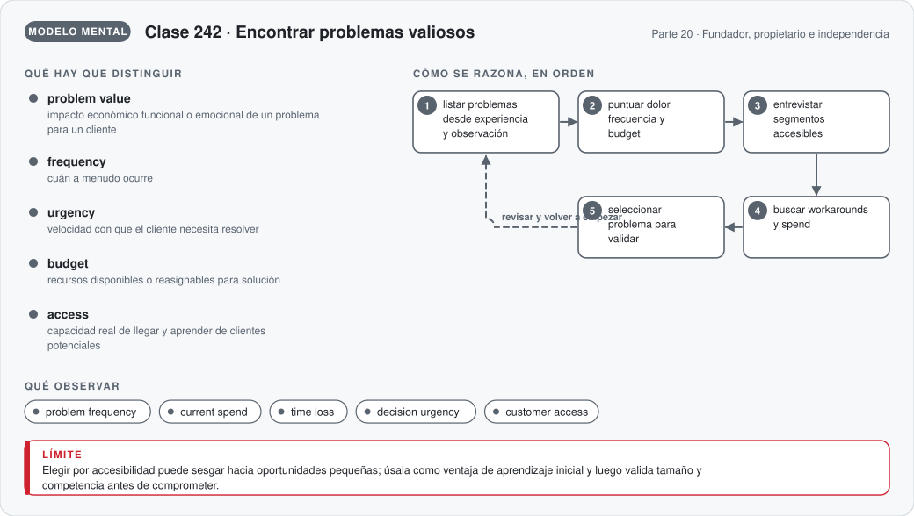

# Clase 242 — Encontrar problemas valiosos

<!-- nav:inicio -->
> **Parte 20 · Founder y creación de empresas** — clase 2 de 12 · [índice de la parte](../../README.md) · [temario](../../../../SYLLABUS.md)
<!-- nav:fin -->

**Parte:** 20 — Founder y creación de empresas  
**Nivel:** Etapa 6 — Founder  
**Duración sugerida:** 150–180 minutos · **Estándar:** deep-class-v2

## 🎯 Propósito

La mayoría de los emprendimientos no fracasa por mala ejecución sino por resolver un problema que nadie estaba dispuesto a pagar por resolver. Se construye una solución elegante a una molestia menor, se lanza con entusiasmo y se descubre, meses después, que los clientes potenciales aplauden pero no compran. La causa casi siempre está en el origen: el fundador se enamoró de una **idea** antes de entender un **problema**. Un problema valioso se reconoce por cuatro rasgos: duele de verdad, ocurre con frecuencia, alguien tiene presupuesto para resolverlo y hay un grupo de personas accesibles que lo viven y que se pueden encontrar. Descubrirlo es un trabajo de observación y de conversación antes de ser un trabajo de ingeniería.

La clase propone un método para listar problemas desde la experiencia y la observación, puntuarlos por dolor, frecuencia y presupuesto, entrevistar a segmentos accesibles, contrastarlos con el tamaño y la competencia y elegir uno para validar. Se apoya en Blank sobre el descubrimiento de clientes, en Aulet sobre la selección de un mercado inicial, en el enfoque de «trabajos por hacer» de Christensen y colaboradores, en los hábitos de descubrimiento continuo de Torres y en el análisis de producto de Olsen. Al terminar sabrás generar una lista de problemas, puntuarlos con criterios explícitos, identificar el sesgo de accesibilidad y elegir con evidencia el problema que merece los próximos meses de tu vida.

## 📚 Resultados de aprendizaje

Al finalizar podrás:

1. **Distinguir** un problema valioso de una molestia o de una idea.
2. **Generar** una lista de problemas desde la experiencia y la observación.
3. **Puntuar** problemas por dolor, frecuencia, presupuesto, accesibilidad y tamaño.
4. **Detectar** el sesgo de accesibilidad y estimar el tamaño del mercado de abajo hacia arriba.
5. **Elegir** un problema y definir cómo se validará.

## 🧭 Agenda

| Tramo | Qué se hace |
|---|---|
| 0–20 min | Recuperación: ¿qué problema has visto repetirse en tu trabajo y a quién le duele más? |
| 20–60 min | Qué es un problema valioso, fuentes, puntuación, entrevistas, tamaño y elección. |
| 60–105 min | Ejemplo trabajado: ocho problemas de logística puntuados y verificados. |
| 105–150 min | Caso ejecutivo y práctica. |
| 150–175 min | Límites y entregable. |

## 🧩 Conceptos centrales

| Concepto | Definición | Cómo se reconoce |
|---|---|---|
| **Problema valioso** | Dificultad que duele, es frecuente y tiene presupuesto. | Hay quien paga por resolverla. |
| **Trabajo por hacer (*job to be done*)** | Progreso que una persona intenta lograr en una situación. | «Cuando…, quiero…, para…». |
| **Dolor** | Costo de no resolver el problema, en tiempo, dinero o riesgo. | Se cuantifica o se describe con ejemplos. |
| **Frecuencia** | Cuán a menudo ocurre el problema. | Diaria, semanal, mensual. |
| **Presupuesto** | Capacidad y disposición de pagar por resolverlo. | Gasto actual en alternativas. |
| **Sesgo de accesibilidad** | Elegir lo que está cerca y no lo que es más valioso. | Se elige por conocidos, no por mercado. |

## 🧠 Modelo mental

**Cómo leer el diagrama.** Un cuadrante con la frecuencia en el eje horizontal (poco frecuente o frecuente) y el dolor en el vertical (poco o muy doloroso). **Muy doloroso y frecuente**: problema prioritario, que se investiga a fondo y se valida el pago. **Muy doloroso pero poco frecuente**: nicho de alto valor, que puede pagar bien si el segmento es alcanzable. **Frecuente pero poco doloroso**: molestia frecuente, donde la pregunta es si alguien pagaría. **Poco doloroso y poco frecuente**: se descarta. La nota advierte que elegir por accesibilidad puede llevar a oportunidades pequeñas; el pie, que un problema es valioso si alguien tiene presupuesto y urgencia.

## 📖 Desarrollo

### 1. Problema frente a idea

Una **idea** es una solución imaginada («una aplicación que haga X»); un **problema** es una dificultad vivida por alguien («los transportistas pierden tres horas a la semana conciliando facturas»). Blank insiste en que los emprendedores deben **salir del edificio** para entender a los clientes antes de definir el producto: lo que se sabe en un escritorio son hipótesis. Partir de un problema tiene ventajas prácticas: se puede **verificar** (¿existe, a quién le ocurre, cuánto cuesta?), admite **varias soluciones** y obliga a pensar en el cliente. Partir de una idea suele producir una búsqueda de confirmación. La regla: **enamorarse del problema, no de la solución**, y mantener la solución flexible hasta tener evidencia.

### 2. Dónde encontrar problemas

Las fuentes más fértiles son: la **experiencia propia** (problemas vividos en el trabajo o en la vida, con ventaja de conocimiento y credibilidad); la **observación** (cómo trabajan realmente las personas, qué rodeos hacen, qué planillas paralelas mantienen); las **conversaciones** con personas de un sector («¿qué es lo más molesto de tu semana?»); las **quejas** repetidas (reseñas, foros, correos de soporte); los **parches** (soluciones improvisadas con planillas y mensajes que indican una necesidad insatisfecha); y los **cambios** (nueva regulación, tecnología o conducta que crean problemas nuevos). Christensen y colaboradores proponen mirar el **trabajo por hacer**: qué progreso quiere lograr una persona en una situación concreta; ese marco ayuda a distinguir lo que alguien hace de lo que realmente intenta conseguir.

### 3. Puntuar con criterios explícitos

Para no elegir por entusiasmo, se arma una **matriz** con criterios y pesos: **dolor** (cuánto cuesta el problema), **frecuencia**, **presupuesto** (¿hay gasto actual en alternativas?), **accesibilidad** (¿puedo llegar a estas personas?) y **tamaño** (¿cuántos son?). Aulet recomienda elegir un **mercado inicial** acotado, donde el fundador pueda conseguir clientes de referencia y construir ventaja antes de expandirse. Los pesos reflejan la etapa y las metas (clase 241): quien busca un negocio estable pondera más el presupuesto y la accesibilidad; quien busca un modelo escalable, el tamaño. La puntuación es una **hipótesis** que se contrasta con conversaciones; se registra la evidencia que respalda cada nota.

### 4. Entrevistar antes de decidir

Con una lista corta (tres a cinco problemas), se realizan **conversaciones** con personas que viven el problema (clase 243). El objetivo no es vender una idea sino entender: ¿cómo lo resuelven hoy?, ¿cuánto tiempo o dinero pierden?, ¿qué han intentado?, ¿qué pasaría si no se resolviera? Torres propone un hábito de **descubrimiento continuo**: conversaciones frecuentes y pequeñas, desde el inicio, para alimentar las decisiones. Se buscan **patrones** entre entrevistas (cuántos describen el mismo dolor, con qué intensidad, con qué gasto) y se compara con las notas iniciales: los problemas que parecían muy valiosos en la matriz pueden desinflarse en la conversación, y viceversa.

### 5. El sesgo de accesibilidad

Elegir por **accesibilidad** (los clientes que conozco, el sector en que trabajo) es una ventaja para aprender rápido, pero un riesgo si conduce a una **oportunidad pequeña**: ¿hay suficientes clientes como los que conozco? ¿Pagarán lo suficiente? ¿Hay competidores bien ubicados? Se usa la accesibilidad como **punto de partida** y luego se valida el **tamaño** con un cálculo de abajo hacia arriba (número de clientes alcanzables × precio realista × frecuencia) y se examina la **competencia** (incluida la «no acción»). Se pregunta con honestidad si el problema, aun resuelto, sostiene el modelo de negocio que se quiere (freelance, negocio estable o empresa escalable, clase 241).

### 6. Evidencia de presupuesto: ¿quién paga hoy?

El mejor indicador de un problema valioso es que **alguien ya está gastando** para resolverlo, aunque sea mal: contratando a una persona, usando un software inadecuado, pagando multas por no resolverlo o perdiendo ventas. Si nadie gasta tiempo ni dinero, es probable que el problema no duela lo suficiente. Se distinguen el **usuario** (quien sufre el problema), el **comprador** (quien decide y paga) y el **influenciador**; a veces el que sufre no tiene presupuesto (clase 243). También se examinan las **alternativas actuales** (incluida la planilla y el correo): el competidor más frecuente es el hábito. Un problema con alternativas satisfactorias, o sin consecuencias por no resolverse, es una oportunidad débil.

### 7. Elegir y prepararse para validar

La decisión no es definitiva: se elige un problema para **validarlo** con el siguiente paso (hipótesis de cliente y de problema, clase 244, y pruebas de demanda, clase 247). Se escribe: el segmento, el problema, la consecuencia, la alternativa actual, la evidencia disponible, lo que faltaría saber y qué evidencia haría **continuar, cambiar o descartar**. Se asigna un **plazo** (por ejemplo, 30 días) y un **costo máximo**. Kerr, Nanda y Rhodes-Kropf describen el emprendimiento como experimentación: la ventaja está en probar varias oportunidades con bajo costo. Si el problema elegido no resiste la validación, la lista permite volver a otro candidato sin empezar de cero.

## 📚 Lectura comparada

| Obra | Qué aporta | Qué no resuelve | Pregunta para contrastar |
|---|---|---|---|
| Blank | Salir a descubrir clientes antes de construir. | Enfoque de startups tecnológicas. | ¿Qué hipótesis tengo que aún no he salido a probar? |
| Aulet | Elegir un mercado inicial acotado y alcanzable. | Método con muchas etapas. | ¿Cuál es mi mercado inicial? |
| Christensen y otros | Trabajos por hacer: el progreso que busca la persona. | Marco conceptual. | ¿Qué progreso intenta lograr? |
| Torres | Hábitos de descubrimiento continuo con clientes. | Orientado a equipos de producto. | ¿Con cuántos clientes hablo cada semana? |
| Olsen | Ajuste entre producto y mercado a partir de necesidades. | Enfoque de producto. | ¿Qué necesidad no satisfecha existe? |

## 🧮 Ejemplo trabajado

**Situación (hipotética).** Un ex jefe de operaciones de una empresa de transporte quiere emprender en logística. Lista ocho problemas y los califica de 1 a 5 con estos pesos: dolor 35 %, frecuencia 20 %, presupuesto 25 %, accesibilidad 10 % y tamaño 10 %.

| # | Problema | Dolor | Frecuencia | Presupuesto | Accesibilidad | Tamaño | Puntaje |
|---|---|---|---|---|---|---|---|
| P1 | Programar rutas y turnos | 4 | 5 | 3 | 5 | 3 | 3,95 |
| P2 | Conciliar facturas con guías de despacho | 5 | 3 | 5 | 4 | 4 | 4,40 |
| P3 | Documentación de conductores | 3 | 5 | 2 | 4 | 2 | 3,15 |
| P4 | Control de combustible | 3 | 4 | 3 | 3 | 3 | 3,20 |
| P5 | Prueba de entrega para clientes | 4 | 5 | 4 | 3 | 4 | 4,10 |
| P6 | Gestión de devoluciones | 2 | 2 | 2 | 3 | 2 | 2,10 |
| P7 | Reclamos por daños | 5 | 2 | 4 | 3 | 3 | 3,75 |
| P8 | Optimización de rutas | 4 | 4 | 3 | 2 | 5 | 3,65 |

(Cálculo de P2: 0,35×5 + 0,20×3 + 0,25×5 + 0,10×4 + 0,10×4 = 1,75 + 0,60 + 1,25 + 0,40 + 0,40 = 4,40. P5: 1,40 + 1,00 + 1,00 + 0,30 + 0,40 = 4,10. P1: 1,40 + 1,00 + 0,75 + 0,50 + 0,30 = 3,95.)

**Candidatos.** P2 (4,40), P5 (4,10) y P1 (3,95).

**Conversaciones.** Doce entrevistas con dueños y jefes de operaciones de transportistas medianos.

| Problema | Describen el dolor con ejemplos | Pierden al menos 3 horas por semana | Gastan hoy en alternativas |
|---|---|---|---|
| P2 conciliación | 9 de 12 | 8 de 12 | 7 de 12 (contratan un asistente o usan un servicio) |
| P5 prueba de entrega | 7 de 12 | 4 de 12 | 3 de 12 |
| P1 programación | 8 de 12 | 6 de 12 | 4 de 12 |

La conciliación (P2) confirma su lugar: el 67 % pierde tres horas o más (8 ÷ 12) y el 58 % ya gasta dinero (7 ÷ 12).

**Estimación del tamaño (de abajo hacia arriba).** En el país hay unos 2.400 transportistas medianos; el 35 % tiene más de 10 camiones: 840. Con un precio de 90.000 pesos al mes: 840 × 90.000 × 12 = **907,2 millones de pesos al año** de ingresos potenciales con el segmento accesible. Si el objetivo fuese una empresa de alto crecimiento (metas de 1.500 millones o más), el mercado inicial es insuficiente y habría que ampliar el segmento o el precio; si fuese un negocio estable, 907 millones es muy atractivo.

**Control del sesgo de accesibilidad.** El fundador conoce a 15 transportistas, lo que le da acceso rápido; pero se verifica con entrevistas a 6 empresas fuera de su red (de las 12): el patrón se repite (4 de 6 pierden más de 3 horas).

**Competencia.** Existen dos servicios de conciliación genéricos y un módulo de un sistema de gestión; 5 de 12 usan planillas y asistentes. La alternativa principal es el hábito.

**Decisión.** Elegir **P2 (conciliación de facturas y guías)** para validar en 30 días con un costo máximo de 400.000 pesos; escribir las hipótesis (clase 244); dejar P5 como alternativa si la validación falla; y definir qué evidencia haría descartar P2 (menos de 4 de 10 nuevas entrevistas con gasto actual o rechazo a pagar 90.000 al mes).

**Cuidados.** Las puntuaciones son subjetivas y se sustentan en la evidencia de las entrevistas; el tamaño depende de supuestos de precio y de segmentación; los datos de entrevistados se tratan con confidencialidad y conforme a la ley; las cifras son ilustrativas.

**Qué muestra.** (1) La matriz ordenó las alternativas. (2) Las entrevistas confirmaron o corrigieron las notas. (3) El tamaño de abajo hacia arriba y la prueba fuera de la red controlaron los sesgos.

## 🔀 Comparación y límites

**Problema valioso frente a oportunidad de mercado.** Un problema valioso es condición necesaria, no suficiente: también se necesitan un mercado alcanzable, un modelo de negocio y la capacidad de ejecutarlo.

**Límites.** Elegir por accesibilidad puede sesgar hacia oportunidades pequeñas: se usa como ventaja de aprendizaje inicial y luego se valida el tamaño y la competencia. Las puntuaciones son juicios. Las entrevistas con pocas personas no son una muestra estadística. El tamaño de mercado depende de supuestos. Las cifras del ejemplo son ilustrativas.

## 🪜 De profesional a owner

| Nivel | Cómo se relaciona con los problemas |
|---|---|
| **Profesional** | Observa los rodeos y las quejas del trabajo diario. |
| **Jefe / Team Lead** | Reúne problemas de su equipo con costos estimados. |
| **Gerente** | Prioriza problemas por valor y presupuesto. |
| **CEO / Director** | Decide en qué problemas invertir capital y atención. |
| **Founder / Owner** | Elige un problema, lo valida y construye un negocio a su alrededor. |

## 🏢 Caso ejecutivo

Una ex gerente de recursos humanos de una cadena de supermercados quiere emprender y anota diez problemas que vivió o vio: la gestión de turnos y reemplazos de 3.200 trabajadores en 85 tiendas, la inducción de nuevos empleados (rotación de 38 %), la gestión de licencias médicas, la liquidación de remuneraciones, la comunicación con trabajadores sin correo, la medición de clima, el control de asistencia, la gestión de horas extra, el cumplimiento de normas de seguridad y la capacitación. Tiene contactos en 12 empresas del retail. Por conversación informal, los jefes de tienda dicen que «los turnos son un dolor de cabeza» y que pierden unas 6 horas a la semana armándolos y corrigiéndolos; los gerentes de personas dicen que la inducción «se hace como se puede». Una consultora ya vende un software de turnos de 4.800 pesos por trabajador al mes. Su pareja dice que «mejor haz algo de moda como inteligencia artificial».

Entrega un **memo de elección de problema** que contenga: (a) la lista de problemas con segmento, consecuencia y alternativa actual; (b) la matriz de puntuación con criterios, pesos y evidencia; (c) el plan de entrevistas, incluidas personas fuera de su red; (d) el tamaño de mercado de abajo hacia arriba y el análisis de competencia; (e) la decisión del problema a validar, con plazo, costo máximo y criterios para continuar, cambiar o descartar; (f) los sesgos detectados y las verificaciones legales y de protección de datos pendientes.

## 🧪 Práctica

1. Escribe diez problemas que hayas vivido u observado, con quién los sufre y cuánto cuestan.
2. Puntúalos con cinco criterios y pesos explícitos, y elige tres.
3. Redacta las preguntas de una entrevista de 20 minutos para el problema elegido.
4. Estima el tamaño del mercado de abajo hacia arriba con tres supuestos.
5. Define qué evidencia te haría descartar el problema.

## ⚠️ Errores frecuentes

| Error | Por qué ocurre | Cómo corregirlo |
|---|---|---|
| Enamorarse de la solución | Se parte de una idea | Describir el problema y su costo. |
| Elegir por accesibilidad | Es lo más fácil | Validar tamaño y competencia. |
| Confiar en la matriz | Las notas parecen datos | Contrastar con entrevistas. |
| Entrevistar solo a conocidos | Es cómodo | Incluir personas fuera de la red. |
| Ignorar quién paga | Se mira a quien sufre | Distinguir usuario y comprador. |
| No definir cuándo descartar | Apego a la elección | Criterios de salida por escrito. |

## ❓ Preguntas de comprobación

1. ¿En qué se diferencia un problema de una idea?
2. ¿Qué rasgos tiene un problema valioso?
3. ¿Cómo se puntúan los problemas y cómo se contrastan las notas?
4. ¿Qué es el sesgo de accesibilidad y cómo se controla?
5. ¿Por qué importa saber si alguien ya gasta para resolverlo?
6. ¿Cómo se estima el tamaño de abajo hacia arriba?
7. ¿Qué se escribe al elegir un problema para validar?

Claves de respuesta

1. La idea es una solución imaginada; el problema es una dificultad vivida por alguien, que se puede verificar.
2. Duele, ocurre con frecuencia, tiene presupuesto y las personas que lo viven son alcanzables.
3. Con una matriz de criterios y pesos explícitos que se contrasta con conversaciones y evidencia.
4. Elegir lo cercano en lugar de lo más valioso; se controla validando tamaño y competencia y entrevistando fuera de la red.
5. Porque el gasto actual es la mejor señal de presupuesto y de dolor real.
6. Número de clientes alcanzables por precio realista por frecuencia, con supuestos explícitos.
7. Segmento, problema, consecuencia, alternativa actual, evidencia, lo que falta saber, plazo, costo máximo y criterios de continuar, cambiar o descartar.

## 📥 Entregable

Guarda en `portfolio/242-encontrar-problemas-valiosos/`:

- `founder-owner-decision-brief.md` (plantilla [Founder owner decision brief](../../../../templates/founder-owner-decision-brief.md)) con el memo del caso ejecutivo;
- `venture-validation.md` (plantilla [Venture validation](../../../../templates/venture-validation.md)) con la matriz de problemas y la evidencia de las entrevistas;
- `decision-journal.md` con los sesgos detectados, el tamaño de mercado y los criterios de descarte.

## 📗 Fuentes y verificación

- Steve Blank — *The Four Steps to the Epiphany* ([Steve Blank?], 2013). **Uso en esta clase:** salir a descubrir clientes antes de construir. Lectura selectiva sobre **encontrar problemas valiosos**. **Localizador:** [ISBN-13 9780989200509](https://openlibrary.org/isbn/9780989200509).
- Bill Aulet — *Disciplined Entrepreneurship* (John Wiley & Sons, Incorporated, 2013). **Uso en esta clase:** elegir un mercado inicial acotado y alcanzable. Lectura selectiva sobre **encontrar problemas valiosos**. **Localizador:** [ISBN-13 9781299848641](https://openlibrary.org/isbn/9781299848641).
- Clayton M. Christensen et al. — *Competing Against Luck* (HarperBusiness, 2016). **Uso en esta clase:** trabajos por hacer y el progreso que busca la persona. Lectura selectiva sobre **encontrar problemas valiosos**. **Localizador:** [ISBN-13 9780062435613](https://openlibrary.org/isbn/9780062435613).
- Teresa Torres — *Continuous Discovery Habits* (Product Talk LLC, 2021). **Uso en esta clase:** hábitos de descubrimiento continuo con clientes. Lectura selectiva sobre **encontrar problemas valiosos**. **Localizador:** [ISBN-13 9781736633304](https://openlibrary.org/isbn/9781736633304).
- Dan Olsen — *The Lean Product Playbook* (Wiley, 2015). **Uso en esta clase:** ajuste entre producto y mercado a partir de necesidades. Lectura selectiva sobre **encontrar problemas valiosos**. **Localizador:** [ISBN-13 9781118960875](https://openlibrary.org/isbn/9781118960875).

> **Regla de fuentes para Encontrar problemas valiosos:** las obras anteriores estructuran las perspectivas de esta materia; cualquier norma, ley o estándar vivo mencionado debe comprobarse nuevamente en su fuente primaria vigente, incluidas las normas de protección de datos de las personas entrevistadas. Los ejemplos y casos son hipotéticos, con cifras ilustrativas. El desarrollo es original y no reproduce capítulos protegidos.

<!-- pie:inicio -->
---

| Anterior | Índice | Siguiente |
|---|---|---|
| [← 241 · Founder versus freelance versus empresario](../241-founder-versus-freelance-versus-empresario/README.md) | [Parte 20](../../README.md) · [Programa](../../../../SYLLABUS.md) | [243 · Customer discovery →](../243-customer-discovery/README.md) |
<!-- pie:fin -->
