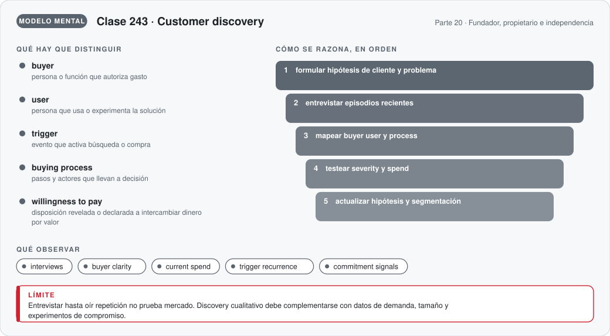

# Clase 243 — Customer discovery

<!-- nav:inicio -->
> **Parte 20 · Founder y creación de empresas** — clase 3 de 12 · [índice de la parte](../../README.md) · [temario](../../../../SYLLABUS.md)
<!-- nav:fin -->

**Parte:** 20 — Founder y creación de empresas  
**Nivel:** Etapa 6 — Founder  
**Duración sugerida:** 150–180 minutos · **Estándar:** deep-class-v2

## 🎯 Propósito

Casi todos los fundadores hacen entrevistas con clientes potenciales, y casi todos salen de ellas con la misma conclusión: «les encantó». Es una conclusión peligrosa, porque se construye sobre cortesía. Las personas responden con amabilidad a quien les cuenta una idea con entusiasmo: dicen que sería útil, que lo usarían, que conocen a alguien a quien le interesaría. Nada de eso cuesta nada, nada de eso predice una compra. El **descubrimiento de clientes** (*customer discovery*) bien hecho es lo contrario de una venta: es una investigación para entender **qué hacen realmente las personas**, qué problemas enfrentan, qué han intentado, cuánto les cuesta y qué gastan hoy, con preguntas que no inducen la respuesta y que se centran en **episodios recientes y concretos**, no en opiniones ni en intenciones futuras.

La clase presenta un método para formular hipótesis de cliente y problema, entrevistar sobre episodios reales, distinguir comprador, usuario y proceso de compra, medir severidad y alternativas, y tomar decisiones con criterios previos. Se apoya en Blank, que formuló el descubrimiento de clientes como la primera etapa de un emprendimiento, en Fitzpatrick (*The Mom Test*), que enseña a hacer preguntas que producen verdad en lugar de cortesía, en Torres sobre hábitos de descubrimiento continuo, en el marco de los trabajos por hacer de Christensen y colaboradores y en las preguntas de situación y problema de Rackham. Al terminar sabrás preparar, conducir y analizar entrevistas, registrar evidencia por categorías y decidir con reglas claras si el problema merece continuar.

## 📚 Resultados de aprendizaje

Al finalizar podrás:

1. **Formular** hipótesis de cliente y de problema que se puedan refutar.
2. **Conducir** entrevistas sobre episodios recientes sin inducir respuestas.
3. **Distinguir** comprador, usuario e influenciador, y mapear el proceso de compra.
4. **Registrar y analizar** la evidencia por tipo y por fuerza.
5. **Decidir** con criterios previos si continuar, cambiar de segmento o descartar.

## 🧭 Agenda

| Tramo | Qué se hace |
|---|---|
| 0–20 min | Recuperación: ¿qué te dijo la última persona que entrevistaste y qué de eso fue un hecho y qué una cortesía? |
| 20–60 min | Hipótesis, preguntas, episodios, comprador y usuario, severidad, análisis y decisión. |
| 60–105 min | Ejemplo trabajado: 15 entrevistas, evidencia clasificada y regla de decisión. |
| 105–150 min | Caso ejecutivo y práctica. |
| 150–175 min | Límites y entregable. |

## 🧩 Conceptos centrales

| Concepto | Definición | Cómo se reconoce |
|---|---|---|
| **Descubrimiento de clientes** | Investigación para entender problemas, contexto y comportamiento antes de construir. | Entrevistas, observación, datos. |
| **Episodio reciente** | Situación concreta vivida por la persona hace poco. | «La última vez que…». |
| **Comprador** | Quien decide y paga. | Tiene presupuesto y autoridad. |
| **Usuario** | Quien usa la solución. | Sufre el problema en su trabajo. |
| **Severidad** | Intensidad del problema y de sus consecuencias. | Costo, frecuencia y urgencia. |
| **Evidencia fuerte** | Hechos, compromisos y datos, no opiniones. | Gasto actual, tiempo, documentos. |

## 🧠 Modelo mental

**Cómo leer el diagrama.** Una cadena de cinco pasos con retorno. **Hipótesis**: qué creemos del cliente y del problema. **Episodios recientes**: qué hicieron la última vez, no qué harían. **Comprador y usuario**: quién usa, quién decide y quién paga. **Severidad y alternativas**: cuánto duele y qué usan hoy. **Decidir**: continuar, cambiar de segmento o descartar. La flecha indica que lo aprendido reescribe la hipótesis. La nota advierte que entrevistar hasta oír repetición no prueba el mercado y que el descubrimiento cualitativo se complementa con datos de demanda y experimentos de compromiso; el pie, que las opiniones y los halagos no son evidencia.

## 📖 Desarrollo

### 1. Qué es el descubrimiento y qué no es

Blank describe el descubrimiento de clientes como la primera etapa del desarrollo de clientes: antes de construir, se **formulan hipótesis** sobre quién es el cliente, qué problema tiene y cómo lo resuelve, y se **salen a probar** con conversaciones y observación. No es una encuesta (que pregunta lo que se cree que importa), ni una demostración (que presenta lo que ya se decidió), ni una venta (que busca un sí). Es una **investigación** cuyo éxito se mide por lo que se aprende, incluido que la hipótesis estaba equivocada. Una entrevista en la que el fundador habla más del 20 % del tiempo probablemente es una venta disfrazada. El objetivo es entender la **realidad** del cliente, no obtener su aprobación.

### 2. Preguntas que producen verdad

Fitzpatrick formula tres reglas para conversaciones que no engañan: hablar de **la vida del cliente** y no de tu idea; preguntar por **hechos pasados** y no por opiniones o intenciones futuras; y **hablar menos y escuchar más**. Los tres errores típicos son los **halagos** («me encanta tu idea»), las **generalidades** («siempre me pasa») y las **hipótesis** («creo que lo usaría»). Preguntas útiles: «¿Cuándo fue la última vez que te pasó?», «¿Qué hiciste?», «¿Cuánto tiempo te tomó?», «¿Qué más intentaste?», «¿Cuánto te costó?», «¿Por qué no lo resolviste antes?», «¿Con quién más hablas de esto?». Preguntas que conviene evitar: «¿Te gustaría una herramienta que…?», «¿Pagarías por…?», «¿Cuánto pagarías?». Rackham agrega la distinción entre preguntas de **situación**, de **problema**, de **implicancia** y de **necesidad de solución**, útil para profundizar en las consecuencias del problema.

### 3. Episodios recientes: el material más confiable

La memoria de lo que una persona haría en el futuro es poco confiable; la de lo que **hizo hace poco** es más precisa. Por eso se pide narrar episodios: «Cuéntame la última vez que cerraste el mes y conciliaste las facturas: ¿qué pasó primero?, ¿con qué herramientas?, ¿qué salió mal?, ¿cuánto tardaste?». Christensen y colaboradores sostienen que las personas «contratan» productos para hacer un **trabajo** en una situación específica; los episodios revelan la situación, la motivación, las alternativas y los obstáculos. Se pide, siempre que sea posible, **ver** (una pantalla, un documento, una planilla) y **cuantificar** (horas, montos, frecuencias). Se registran las citas literales y los datos, y se separan de las interpretaciones del entrevistador.

### 4. Comprador, usuario y proceso de compra

Una trampa frecuente es entrevistar solo al **usuario** (quien sufre el problema), que suele entusiasmarse pero no tiene presupuesto. Hay que identificar a todos los roles: **usuario** (quien usa), **comprador** (quien decide y paga), **influenciador** (quien opina o veta, como tecnología o legal) y a veces un **bloqueador**. Se mapea el **proceso de compra**: quién lo inicia, qué criterios usa, qué aprobaciones requiere, cuánto tarda, qué presupuesto existe y qué alternativas evalúa. La conversación con el comprador cambia: interesa el **costo del problema** para la organización, el **retorno** esperado y el **riesgo** de cambiar. Torres recomienda conversar con frecuencia con ambos roles para entender no solo el dolor, sino el contexto de decisión.

### 5. Severidad y alternativas

Se evalúa qué tan **severo** es el problema: ¿cuánto tiempo o dinero cuesta?, ¿con qué frecuencia?, ¿qué ocurre si no se resuelve?, ¿es urgente o puede esperar? Un problema severo suele mostrar **conductas**: la persona ya buscó soluciones, ya gastó tiempo o dinero, usa parches creativos. Si no hay conductas, el problema probablemente no es lo bastante importante. Se registran las **alternativas actuales**, incluida la de no hacer nada, y por qué no satisfacen. Blank advierte que el principal competidor de una startup suele ser el **statu quo**. Se puntúa cada entrevista con criterios predefinidos (por ejemplo, severidad de 1 a 5, con evidencia que la sustente) para evitar que el entusiasmo del fundador infle la interpretación.

### 6. Registrar, analizar y contar con honestidad

Se mantiene un **registro** estructurado de cada entrevista: perfil, rol, fecha, episodios, cuantificaciones, alternativas, citas, compromisos y señales de alerta. Se codifica la evidencia por **fuerza**: hechos y conductas (fuerte), compromisos (muy fuerte), opiniones (débil), halagos y hipótesis (ruido). Se buscan **patrones** entre entrevistas, no anécdotas llamativas. Se cuenta **honestamente**: cuántas personas describieron el problema sin que se les guiara, cuántas gastan hoy, cuántas cumplieron un compromiso pequeño. Y se evita el error de **entrevistar hasta oír repetición** y concluir que existe un mercado: la repetición de un dolor entre personas accesibles no prueba que haya suficientes clientes que paguen; se necesita **tamaño** (clase 242) y pruebas de **demanda** (clase 247).

### 7. Decidir con criterios previos

Antes de empezar se fijan los **criterios de decisión**: por ejemplo, «continuar si al menos 8 de 15 describen el problema con un episodio concreto en los últimos tres meses, al menos 5 gastan hoy tiempo o dinero para resolverlo y al menos 4 aceptan un compromiso pequeño (datos, introducción, piloto)». Las decisiones posibles son: **continuar** con la misma hipótesis y pasar a validar la solución; **cambiar** (de segmento, problema o propuesta) con lo aprendido; o **descartar** y volver a la lista. Falsar una hipótesis no es un fracaso: es información barata. Se documenta qué se esperaba, qué se encontró y qué se decide. Y se mantiene un **ritmo** de conversación con clientes durante todo el desarrollo, no solo al comienzo.

## 📚 Lectura comparada

| Obra | Qué aporta | Qué no resuelve | Pregunta para contrastar |
|---|---|---|---|
| Blank | Descubrimiento de clientes como etapa previa a construir. | Marco de startups tecnológicas. | ¿Qué hipótesis voy a probar? |
| Fitzpatrick | Preguntas que producen hechos y evitan cortesías. | No da criterios de mercado. | ¿Qué hecho aprendí, no qué opinión? |
| Torres | Descubrimiento continuo y mapas de oportunidades. | Orientado a equipos de producto. | ¿Con quién hablé esta semana? |
| Christensen y otros | Trabajos por hacer y situaciones de compra. | Marco conceptual. | ¿Qué progreso intenta lograr? |
| Rackham | Preguntas de situación, problema, implicancia y necesidad. | Diseñado para ventas complejas. | ¿Qué consecuencia tiene el problema? |

## 🧮 Ejemplo trabajado

**Situación (hipotética).** Un fundador explora un servicio para conciliar facturas y guías de despacho en empresas de transporte (problema elegido en la clase 242). Formula la hipótesis: «Los jefes de operaciones de transportistas con más de 10 camiones pierden al menos tres horas por semana conciliando guías con facturas, ya gastan en resolverlo y pagarían por una solución».

**Criterios de decisión fijados antes.** Continuar si: (a) al menos 8 de 15 describen un episodio concreto de los últimos tres meses; (b) al menos 5 gastan hoy en resolverlo; (c) al menos 4 aceptan un compromiso pequeño (entregar una muestra de datos o presentar al comprador).

**Entrevistas.** 15 conversaciones de 40 minutos con usuarios (jefes de operaciones y administrativos) y compradores (dueños y gerentes).

| Indicador | Resultado |
|---|---|
| Episodio concreto en los últimos tres meses | 11 de 15 (73 %) |
| Describieron el problema **sin que se les guiara** | 9 de 15 (60 %) |
| Pierden 3 horas o más por semana | 9 de 15 (60 %) |
| Gastan hoy (asistente, software o servicio externo) | 7 de 15 (47 %) |
| Aceptaron entregar una muestra de datos | 5 de 15 (33 %) |
| Presentaron al comprador | 2 de 15 (13 %) |
| Pagaron algo por adelantado | 0 de 15 |

**Roles identificados.** El **usuario** (administrativo o jefe de operaciones) sufre el problema; el **comprador** es el dueño o el gerente general, que decide por criterios de costo y de riesgo; el **influenciador** es quien administra el sistema contable y teme las integraciones. En 8 de las 15 empresas, quien siente el dolor no es quien decide el gasto.

**Cuantificación.** De los 9 que pierden tres horas o más, el promedio es de 5,5 horas por semana; a un costo hora de 6.000 pesos (administrativo con cargas) equivale a 5,5 × 52 × 6.000 = 1,72 millones al año por empresa, más errores de facturación que según 4 empresas costaron entre 0,8 y 3 millones en el último año.

**Severidad.** Puntuación de 1 a 5 con evidencia: 4 o más en 8 de 15 (53 %).

**Evaluación contra los criterios.** (a) 11 de 15 ≥ 8 ✓; (b) 7 de 15 ≥ 5 ✓; (c) 5 de 15 ≥ 4 ✓. Se **continúa**, con matices: el costo anual por empresa (1,72 millones) frente a un precio posible de 90.000 al mes (1,08 millones al año) da un ahorro bruto de 37 % (1,72 − 1,08 = 0,64 ÷ 1,72), apenas atractivo; la brecha entre usuario y comprador exige un mensaje al comprador centrado en errores y riesgo.

**Alertas.** Nadie pagó por adelantado; solo 2 de 15 presentaron al comprador; el 40 % dijo «lo resolvemos con la planilla». La evidencia de compromiso es débil: se pasa a una prueba de demanda con compromiso real (clase 247).

**Decisión.** Continuar con una hipótesis ajustada: el comprador es el dueño o gerente; el mensaje se centra en reducir errores de facturación y en el tiempo; la siguiente etapa es una preventa o un piloto pagado con 5 empresas.

**Cuidados.** Los datos de entrevistados y de sus empresas se tratan con confidencialidad y conforme a la normativa de protección de datos; las entrevistas no se usan para vender; las cifras son ilustrativas.

**Qué muestra.** (1) Las preguntas se centraron en episodios y hechos. (2) La evidencia se codificó por fuerza. (3) Los criterios previos permitieron decidir sin autoengaño.

## 🔀 Comparación y límites

**Descubrimiento frente a investigación de mercado.** La investigación de mercado mide opiniones y tamaños con muestras; el descubrimiento busca entender comportamientos y problemas con pocas conversaciones profundas. Se complementan.

**Límites.** Entrevistar hasta oír repetición no prueba mercado: el descubrimiento cualitativo debe complementarse con datos de demanda, tamaño y experimentos de compromiso. Las muestras pequeñas y accesibles sesgan. Los entrevistados pueden recordar mal o querer agradar. Las cifras del ejemplo son ilustrativas.

## 🪜 De profesional a owner

| Nivel | Cómo practica el descubrimiento |
|---|---|
| **Profesional** | Escucha a clientes y compañeros sin defender la solución. |
| **Jefe / Team Lead** | Conversa con usuarios de su proceso para encontrar fricciones. |
| **Gerente** | Mantiene conversaciones regulares con clientes clave. |
| **CEO / Director** | Se acerca al cliente con preguntas abiertas y decide con evidencia. |
| **Founder / Owner** | Dedica tiempo semanal a hablar con clientes y a cuestionar sus hipótesis. |

## 🏢 Caso ejecutivo

Una fundadora quiere crear un servicio de planificación de turnos para clínicas veterinarias y realiza 20 entrevistas con dueños y administrativos. Salió con estas impresiones: 17 dijeron que «sería muy útil»; 12 preguntaron cuánto costaría; 4 dijeron que «ya lo tienen resuelto» con una planilla; 3 dijeron que lo usarían «seguro». Al revisar sus notas, ve que en 14 entrevistas ella describió su producto en los primeros diez minutos; que en 6 le preguntó «¿pagarías 25.000 pesos al mes?» y 5 dijeron que sí; que solo 5 relataron un episodio concreto de problema con turnos en el último mes; que los usuarios (asistentes) quieren el servicio, pero los compradores (veterinarios dueños) piensan que «el problema no es tan grave»; y que ninguno ha gastado en una solución. Su cofundador quiere avanzar a construir porque «el 85 % dijo que sí».

Entrega un **informe de descubrimiento** que contenga: (a) las hipótesis de cliente y de problema reescritas de forma refutable; (b) el análisis de las 20 entrevistas con la evidencia clasificada por fuerza y los errores de método detectados; (c) el mapa de comprador, usuario e influenciador y el proceso de compra; (d) la severidad y las alternativas actuales con cuantificación; (e) los criterios de decisión fijados y la decisión recomendada (continuar, cambiar o descartar); (f) el plan para las siguientes 10 conversaciones con preguntas mejoradas y las verificaciones de confidencialidad.

## 🧪 Práctica

1. Reescribe tres preguntas de una entrevista que inducen respuestas en preguntas sobre hechos pasados.
2. Prepara una guía de entrevista de 30 minutos centrada en episodios recientes.
3. Codifica las notas de una entrevista por fuerza de evidencia.
4. Mapea usuario, comprador e influenciador de un producto y su proceso de compra.
5. Fija tres criterios de decisión antes de hacer diez entrevistas.

## ⚠️ Errores frecuentes

| Error | Por qué ocurre | Cómo corregirlo |
|---|---|---|
| Presentar la idea primero | Entusiasmo | Hablar de la vida del cliente. |
| Preguntar intenciones | Es lo que más se quiere saber | Preguntar por hechos pasados. |
| Contar halagos como evidencia | Se busca validación | Codificar por fuerza. |
| Entrevistar solo al usuario | Es el más accesible | Entrevistar también al comprador. |
| No fijar criterios de decisión | Se interpreta después | Criterios previos por escrito. |
| Parar de hablar con clientes | Se pasa a construir | Mantener un ritmo semanal. |

## ❓ Preguntas de comprobación

1. ¿Qué diferencia hay entre una entrevista de descubrimiento y una venta?
2. ¿Qué tres reglas ayudan a obtener hechos y no cortesías?
3. ¿Por qué se piden episodios recientes?
4. ¿Qué roles hay en una compra y por qué importan?
5. ¿Cómo se codifica la evidencia por fuerza?
6. ¿Por qué entrevistar hasta oír repetición no prueba un mercado?
7. ¿Qué incluye una decisión con criterios previos?

Claves de respuesta

1. El descubrimiento busca entender la realidad del cliente y refutar hipótesis; la venta busca un sí.
2. Hablar de la vida del cliente y no de la idea, preguntar por hechos pasados y no por opiniones o intenciones, y hablar menos y escuchar más.
3. Porque la memoria de lo que hicieron es más precisa y revela situación, alternativas y obstáculos.
4. Usuario, comprador, influenciador y bloqueador; quien sufre el problema no siempre decide ni paga.
5. Hechos y conductas fuertes, compromisos muy fuertes, opiniones débiles y halagos o hipótesis como ruido.
6. Porque la repetición entre personas accesibles no demuestra tamaño ni disposición a pagar; se necesitan datos y pruebas de compromiso.
7. Umbrales fijados antes, resultados observados, decisión (continuar, cambiar o descartar) y su razón documentada.

## 📥 Entregable

Guarda en `portfolio/243-customer-discovery/`:

- `product-evidence-brief.md` (plantilla [Product evidence brief](../../../../templates/product-evidence-brief.md)) con el informe del caso ejecutivo;
- `venture-validation.md` (plantilla [Venture validation](../../../../templates/venture-validation.md)) con el registro de entrevistas y la evidencia por fuerza;
- `decision-journal.md` con los criterios de decisión, la decisión y las verificaciones de confidencialidad.

## 📗 Fuentes y verificación

- Steve Blank — *The Four Steps to the Epiphany* ([Steve Blank?], 2013). **Uso en esta clase:** descubrimiento de clientes como etapa previa a construir. Lectura selectiva sobre **customer discovery**. **Localizador:** [ISBN-13 9780989200509](https://openlibrary.org/isbn/9780989200509).
- Rob Fitzpatrick — *The Mom Test* (CreateSpace, 2014). **Uso en esta clase:** preguntas que producen hechos y evitan cortesías. Lectura selectiva sobre **customer discovery**. **Localizador:** [ISBN-13 9781492180746](https://openlibrary.org/isbn/9781492180746).
- Teresa Torres — *Continuous Discovery Habits* (Product Talk LLC, 2021). **Uso en esta clase:** descubrimiento continuo y mapas de oportunidades. Lectura selectiva sobre **customer discovery**. **Localizador:** [ISBN-13 9781736633304](https://openlibrary.org/isbn/9781736633304).
- Clayton M. Christensen et al. — *Competing Against Luck* (HarperBusiness, 2016). **Uso en esta clase:** trabajos por hacer y situaciones de compra. Lectura selectiva sobre **customer discovery**. **Localizador:** [ISBN-13 9780062435613](https://openlibrary.org/isbn/9780062435613).
- Neil Rackham — *SPIN Selling* (Highbridge Audio, 1998). **Uso en esta clase:** preguntas de situación, problema, implicancia y necesidad. Lectura selectiva sobre **customer discovery**. **Localizador:** [ISBN-13 9781565112605](https://openlibrary.org/isbn/9781565112605).

> **Regla de fuentes para Customer discovery:** las obras anteriores estructuran las perspectivas de esta materia; cualquier norma, ley o estándar vivo mencionado debe comprobarse nuevamente en su fuente primaria vigente, incluidas las normas de protección de datos de las personas entrevistadas. Los ejemplos y casos son hipotéticos, con cifras ilustrativas. El desarrollo es original y no reproduce capítulos protegidos.

<!-- pie:inicio -->
---

| Anterior | Índice | Siguiente |
|---|---|---|
| [← 242 · Encontrar problemas valiosos](../242-encontrar-problemas-valiosos/README.md) | [Parte 20](../../README.md) · [Programa](../../../../SYLLABUS.md) | [244 · Hipótesis de cliente y problema →](../244-hipotesis-de-cliente-y-problema/README.md) |
<!-- pie:fin -->
