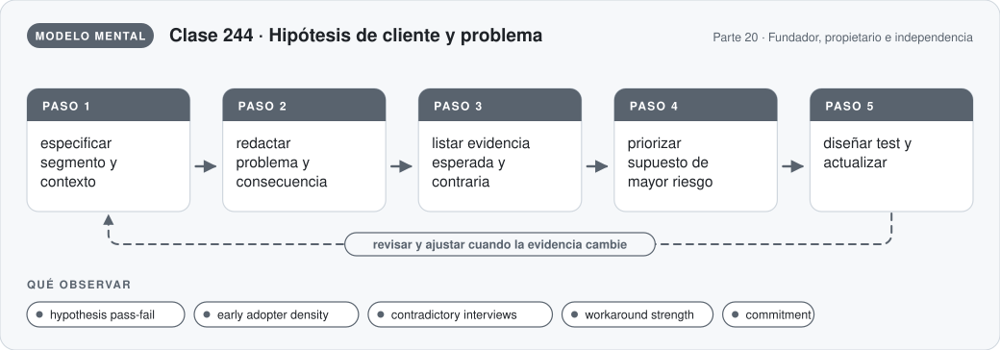

# Clase 244 — Hipótesis de cliente y problema

<!-- nav:inicio -->
> **Parte 20 · Founder y creación de empresas** — clase 4 de 12 · [índice de la parte](../../README.md) · [temario](../../../../SYLLABUS.md)
<!-- nav:fin -->

**Parte:** 20 — Founder y creación de empresas  
**Nivel:** Etapa 6 — Founder  
**Duración sugerida:** 150–180 minutos · **Estándar:** deep-class-v2

## 🎯 Propósito

Un emprendimiento naciente es, en esencia, un conjunto de creencias sin comprobar: que existe un grupo de personas con un problema, que ese problema duele lo suficiente, que hoy se resuelve mal, que ellas pagarían por una solución mejor, que se las puede alcanzar a un costo razonable y que el fundador puede entregar lo prometido. Cada una de esas creencias puede ser falsa, y bastaría una para que todo el proyecto fracase. La diferencia entre un fundador que aprende rápido y uno que gasta años y ahorros está en **cómo trata esas creencias**: el segundo las defiende como verdades; el primero las **formula como hipótesis**, decide qué evidencia las confirmaría o las refutaría, las **ordena por riesgo** y las prueba empezando por las que, si fallan, lo destruyen todo.

La clase enseña a escribir hipótesis de cliente y de problema de forma **refutable**, a listar la evidencia esperada y la contraria, a priorizar los supuestos por impacto e incertidumbre, a diseñar pruebas con umbrales previos y a decidir tras los resultados: continuar, pivotar o descartar. Se apoya en Blank sobre el desarrollo de clientes como método científico, en Bland y Osterwalder sobre cómo probar ideas de negocio, en Ries sobre aprendizaje validado, en Kerr, Nanda y Rhodes-Kropf sobre el emprendimiento como experimentación y en Osterwalder y Pigneur sobre el modelo de negocio como conjunto de hipótesis. Al terminar sabrás transformar una idea en hipótesis verificables y en un plan de pruebas con reglas de decisión.

## 📚 Resultados de aprendizaje

Al finalizar podrás:

1. **Distinguir** la hipótesis de cliente de la de problema y escribirlas de forma refutable.
2. **Listar** la evidencia esperada y la contraria para cada hipótesis.
3. **Priorizar** los supuestos por impacto e incertidumbre.
4. **Diseñar** pruebas con umbrales previos y evaluar su capacidad de discriminar.
5. **Decidir** si continuar, pivotar o descartar con base en los resultados.

## 🧭 Agenda

| Tramo | Qué se hace |
|---|---|
| 0–20 min | Recuperación: ¿qué creencia sobre tus clientes sería la más grave si resultara falsa y cómo la sabrías? |
| 20–60 min | Hipótesis, formulación, evidencia, priorización, pruebas, umbrales y decisión. |
| 60–105 min | Ejemplo trabajado: seis supuestos, el más riesgoso y la capacidad de una prueba de 20 contactos. |
| 105–150 min | Caso ejecutivo y práctica. |
| 150–175 min | Límites y entregable. |

## 🧩 Conceptos centrales

| Concepto | Definición | Cómo se reconoce |
|---|---|---|
| **Hipótesis de cliente** | Creencia sobre quién es el cliente y en qué contexto actúa. | Segmento definido y alcanzable. |
| **Hipótesis de problema** | Creencia sobre lo que intenta lograr y qué se lo impide. | Problema, consecuencia y alternativa. |
| **Refutable** | Formulada de modo que algún resultado la contradiga. | Tiene un umbral y un criterio de error. |
| **Supuesto crítico** | Creencia cuya falsedad invalida el negocio. | Alto impacto y alta incertidumbre. |
| **Pivote** | Cambio estructurado de una hipótesis fundamental. | Otro segmento, problema o propuesta. |
| **Umbral previo** | Resultado mínimo definido antes de probar. | «Al menos 3 de 20». |

## 🧠 Modelo mental

**Cómo leer el diagrama.** Una tabla con cuatro elementos de la hipótesis. **Segmento**: quién es y en qué contexto actúa; a favor, se les encuentra y responden; en contra, no existen o no son alcanzables. **Problema**: qué intentan lograr y qué se los impide; a favor, lo describen con detalle y ejemplos; en contra, solo lo mencionan si se les pregunta. **Consecuencia**: qué pierden si no se resuelve; a favor, cuantifican tiempo, dinero o riesgo; en contra, dicen que no es tan grave. **Alternativa actual**: cómo lo resuelven hoy; a favor, gastan tiempo o dinero; en contra, no hacen nada y no les importa. La nota afirma que una hipótesis útil dice qué evidencia la contradiría; el pie, que se priorizan las que destruirían el negocio.

## 📖 Desarrollo

### 1. El emprendimiento como conjunto de hipótesis

Blank propuso tratar el desarrollo de una empresa nueva como un proceso de **descubrimiento**: una startup es una organización temporal que busca un modelo de negocio repetible, y mientras lo busca, todo lo que cree es una **hipótesis**. Osterwalder y Pigneur describen el modelo de negocio con nueve bloques; cada bloque es, al inicio, una apuesta. Ries denomina **aprendizaje validado** al progreso medido por la evidencia sobre lo que funciona y lo que no, en lugar de por el trabajo realizado. Esta perspectiva cambia el rol del fundador: en lugar de ejecutar un plan, **diseña experimentos** que reduzcan la incertidumbre. Kerr, Nanda y Rhodes-Kropf destacan que el valor del emprendimiento proviene de poder **probar** varias hipótesis a bajo costo y continuar solo con las que resisten.

### 2. Hipótesis de cliente: quién y en qué contexto

Una hipótesis de cliente identifica a un **segmento** con precisión suficiente para encontrarlo: no «pequeñas empresas», sino «dueños de talleres mecánicos de 3 a 10 empleados en Santiago que cotizan repuestos por teléfono». Incluye el **contexto** (cuándo, dónde y con qué herramientas trabajan), el **rol** (usuario, comprador) y la **forma de alcanzarlos**. Una hipótesis demasiado amplia («todas las empresas») es irrefutable e inútil; una demasiado estrecha («el taller de mi primo») no es un mercado. Se redacta de modo que se pueda **verificar con personas reales**: ¿existen?, ¿puedo hablar con ellos?, ¿cuántos hay? La respuesta más frecuente de una validación temprana no es «sí» o «no», sino «no son quienes pensaba».

### 3. Hipótesis de problema: qué logran y qué se lo impide

La hipótesis de problema describe, en palabras del cliente, **qué intenta lograr** (el trabajo por hacer), **qué se lo impide**, **cómo lo resuelve hoy** y **qué le cuesta** el problema. Se escribe con una estructura que permite refutarla: «Los dueños de talleres mecánicos de 3 a 10 empleados pierden al menos 4 horas semanales cotizando repuestos por teléfono con tres o más proveedores, lo que les cuesta ventas por demora; hoy lo resuelven con llamadas y mensajes y no han adoptado ninguna herramienta». Cada parte puede ser falsa. Un error frecuente es escribir hipótesis que ya contienen la **solución** («necesitan una plataforma de cotización»): eso encierra la búsqueda y confunde el problema con la idea.

### 4. Evidencia esperada y evidencia contraria

Para cada hipótesis se escribe: **qué veríamos si es verdadera** y **qué veríamos si es falsa**. Si es verdadera, los clientes describirán episodios concretos sin que se les guíe, cuantificarán el costo, habrán intentado soluciones y gastarán en ellas. Si es falsa, minimizarán el problema, no habrán hecho nada, no sabrán cuantificarlo o mencionarán otros problemas más importantes. Esta lista cumple tres funciones: obliga a **definir qué contaría como refutación**; protege del **sesgo de confirmación** (ver solo lo que apoya la hipótesis); y permite diseñar las preguntas y las pruebas. Una hipótesis sin evidencia contraria definida es una creencia disfrazada.

### 5. Priorizar: impacto e incertidumbre

No todas las hipótesis merecen la misma atención. Bland y Osterwalder proponen ordenar los supuestos según su **importancia** (qué tan grave sería que fueran falsos) y la **evidencia disponible** (cuánto se sabe). Las hipótesis de **alto impacto y poca evidencia** son las más riesgosas y se prueban primero: típicamente, que **existe el problema**, que **el cliente paga** y que **se puede llegar a él a un costo razonable**. Las de bajo impacto o con mucha evidencia se posponen. Un método simple: puntuar cada supuesto de 1 a 5 en impacto y en incertidumbre y multiplicar; se prueban primero los de mayor puntaje. Así se evita gastar tiempo en lo que no importa, como el color de la marca, mientras se ignora lo que decide la vida del negocio.

### 6. Diseñar pruebas con umbrales previos

Una prueba tiene: **la hipótesis**, **el método** (entrevistas, encuesta con compromiso, página de preventa, prueba con clientes), **la muestra**, **la métrica**, **el umbral** de éxito y de fracaso fijado antes y **el plazo**. Con muestras pequeñas, hay que entender su **capacidad de discriminar**: con 20 contactos y un umbral de «al menos 3 aceptan», se distingue bien una tasa verdadera de 20 % (79 % de probabilidad de alcanzarlo) de una de 5 % (7,5 %), pero se confunde con facilidad una de 10 % (32 %). Se evita **cambiar el umbral después** de ver los resultados. Se diseña la prueba más **barata y rápida** que pueda discriminar; muchas veces no hace falta construir nada. Y se prevén las **amenazas** (sesgo de la muestra, presión social, compromiso débil).

### 7. Decidir: continuar, pivotar o descartar

Tras la prueba se compara con el umbral y se decide: si se **confirma**, se avanza a la siguiente hipótesis (valor, precio, canal); si se **refuta**, se pregunta **qué se aprendió** y se elige entre **pivotar** (cambiar segmento, problema, propuesta o canal, usando lo aprendido) o **descartar** y volver a la lista de problemas (clase 242). Falsar una hipótesis no invalida todo el emprendimiento: permite pivotar y evita el apego a la formulación inicial. Se registra la decisión, la evidencia y la nueva hipótesis. Ries advierte contra los **pivotes perpetuos** sin evidencia: cada cambio debe estar justificado por lo aprendido, no por impaciencia. Y se mantiene un **registro de hipótesis** con su estado (sin probar, confirmada, refutada) que permite ver el progreso real.

## 📚 Lectura comparada

| Obra | Qué aporta | Qué no resuelve | Pregunta para contrastar |
|---|---|---|---|
| Blank | Startup como búsqueda de un modelo repetible y el descubrimiento de clientes. | Marco de startups tecnológicas. | ¿Qué creo que no he probado? |
| Bland y Osterwalder | Priorizar supuestos y diseñar pruebas de bajo costo. | Catálogo de experimentos. | ¿Qué supuesto es más riesgoso? |
| Ries | Aprendizaje validado y pivotes con evidencia. | Orientado a productos digitales. | ¿Qué aprendí, no qué hice? |
| Kerr, Nanda y Rhodes-Kropf | Emprendimiento como experimentación con opciones. | Perspectiva económica. | ¿Cuánto cuesta probar esto? |
| Osterwalder y Pigneur | Modelo de negocio como bloques de hipótesis. | No dice cómo probar cada uno. | ¿Qué bloque es una apuesta? |

## 🧮 Ejemplo trabajado

**Situación (hipotética).** Un fundador quiere crear una plataforma para que talleres mecánicos pequeños cotizen repuestos con varios proveedores. Escribe seis supuestos y los puntúa de 1 a 5 en impacto (qué tan grave sería que fuera falso) y en incertidumbre (cuán poca evidencia tiene).

| # | Supuesto | Impacto | Incertidumbre | Riesgo (I × U) |
|---|---|---|---|---|
| S1 | Los dueños de talleres de 3 a 10 empleados existen en número suficiente y son alcanzables | 5 | 2 | 10 |
| S2 | Pierden al menos 4 horas semanales cotizando por teléfono | 5 | 4 | 20 |
| S3 | Esa pérdida les cuesta ventas o dinero relevante | 4 | 4 | 16 |
| S4 | Pagarían una suscripción de 25.000 pesos al mes por resolverlo | 5 | 5 | 25 |
| S5 | Los proveedores se integrarán y mantendrán precios actualizados | 5 | 4 | 20 |
| S6 | Se puede llegar a ellos con un costo de adquisición menor de 60.000 pesos | 4 | 5 | 20 |

**Prioridad.** S4 (25), luego S2, S5 y S6 (20), S3 (16) y S1 (10). Se prueban primero S4 y S2, que se pueden verificar sin construir.

**Hipótesis de problema (refutable).** «Los dueños de talleres mecánicos de 3 a 10 empleados en Santiago pierden al menos 4 horas semanales cotizando repuestos con tres o más proveedores por teléfono; el 50 % lo ha intentado resolver con alguna herramienta o contrata ayuda; y al menos el 15 % aceptaría una prueba pagada».

**Evidencia esperada si es verdadera.** Relatos concretos de la última cotización; horas estimadas por semana de 4 o más; gasto actual (asistente, mensajes, descuentos que pierden); disposición a comprometerse. **Evidencia contraria.** «Cotizo rápido y no me molesta»; «mi proveedor me da el mejor precio siempre»; ninguna acción previa; negativa a comprometerse.

**Diseño de la prueba de S4.** Contactar a 20 dueños elegidos al azar de una lista de 200 y ofrecerles un servicio manual pagado (cotización por mensajería de WhatsApp) a 25.000 pesos al mes durante tres meses. Umbral: **al menos 3 de 20 aceptan pagar**.

**Capacidad de la prueba (probabilidad de alcanzar al menos 3 de 20 según la tasa verdadera).**

| Tasa verdadera de aceptación | Probabilidad de ≥ 3 de 20 | Probabilidad de ≥ 4 de 20 |
|---|---|---|
| 5 % | 7,5 % | 1,6 % |
| 10 % | 32,3 % | 13,3 % |
| 20 % | 79,4 % | 58,9 % |
| 30 % | 96,5 % | 89,3 % |

**Lectura.** Con el umbral de 3, si la tasa real es 20 % o más, se detecta casi siempre (79 % a 96 %); si es 5 %, casi nunca se confunde (7,5 %). El caso intermedio (10 %) es ambiguo (32 %). Con un umbral de 4 se reduce el error de falso positivo pero se pierde sensibilidad. Si se necesita mayor certeza, se amplía la muestra: con 30 contactos y umbral de 5, las probabilidades son 1,6 %, 17,5 %, 74,5 % y 97 %.

**Resultado hipotético.** 2 de 20 aceptan. Menos que el umbral: la hipótesis del precio y la disposición **no se confirma**. Se analizan las razones: 11 dicen que «el proveedor ya me da el precio» (valor limitado), 4 que 25.000 es mucho, 3 que no confían en cambiar su hábito. Se **pivota**: en lugar de talleres pequeños, se explora a talleres de flotas de empresas (con volumen y presupuesto), con una nueva hipótesis y una nueva prueba; S2 y S5 se verifican en ese segmento.

**Registro de hipótesis.** S4: refutada para talleres pequeños; S2: parcialmente confirmada (en 14 de 20 entrevistados); S1: confirmada; S5, S6: sin probar.

**Cuidados.** Las pruebas con personas se hacen con transparencia y sin comprometer entregas que no se puedan cumplir; los datos de contacto se tratan conforme a la normativa de protección de datos; las cifras son ilustrativas.

**Qué muestra.** (1) Los supuestos se ordenaron por riesgo. (2) La prueba tuvo umbral previo y capacidad conocida. (3) El resultado negativo llevó a un pivote con evidencia.

## 🔀 Comparación y límites

**Hipótesis frente a plan de negocios.** El plan de negocios describe lo que se hará suponiendo que las hipótesis son ciertas; el enfoque de hipótesis las trata como incertidumbres a reducir.

**Límites.** Falsar una hipótesis no invalida todo el emprendimiento: permite pivotar el segmento, el problema o la propuesta, y evita el apego a la formulación inicial. Las muestras pequeñas dan evidencia imperfecta. Los umbrales son juicios. Un pivote sin evidencia es solo impaciencia. Las cifras del ejemplo son ilustrativas.

## 🪜 De profesional a owner

| Nivel | Cómo trabaja con hipótesis |
|---|---|
| **Profesional** | Distingue lo que sabe de lo que supone. |
| **Jefe / Team Lead** | Propone mejoras como experimentos con medición. |
| **Gerente** | Prueba las apuestas de su área con umbrales previos. |
| **CEO / Director** | Pide evidencia antes de asignar capital a una apuesta. |
| **Founder / Owner** | Convierte su visión en hipótesis y las prueba con rapidez y honestidad. |

## 🏢 Caso ejecutivo

Una fundadora quiere crear un servicio de contabilidad simplificada para pequeños comercios de barrio (almacenes, ferreterías, peluquerías). Su idea: una aplicación en que el comerciante fotografía sus boletas y recibe un balance mensual por 18.000 pesos al mes. Sus creencias: «Los comerciantes no entienden su contabilidad», «les importa saber cuánto ganan», «hoy pagan a un contador entre 25.000 y 60.000 pesos mensuales», «usan el teléfono para todo», «los contadores son lentos y caros», «los recomendará la comunidad». Habla con 8 comerciantes amigos que le dicen que «sería genial». Su cofundador ya empezó a programar la aplicación. Ningún comerciante ha pagado nada; dos dijeron que ya tienen contador a bajo costo; uno dijo que «lo importante es no tener problemas con el SII». La fundadora quiere lanzar en tres meses.

Entrega un **plan de hipótesis y pruebas** que contenga: (a) la reescritura de las creencias como hipótesis de cliente y de problema refutables; (b) la evidencia esperada y la contraria para cada una; (c) la priorización de supuestos por impacto e incertidumbre; (d) el diseño de dos pruebas con muestra, métrica, umbral previo y capacidad de discriminar; (e) las reglas de decisión (continuar, pivotar o descartar) y el registro de hipótesis; (f) los cuidados éticos de las pruebas y las verificaciones tributarias y legales pendientes.

## 🧪 Práctica

1. Escribe cinco supuestos de una idea tuya y puntúalos por impacto e incertidumbre.
2. Redacta una hipótesis de problema con segmento, consecuencia y alternativa, de forma refutable.
3. Escribe qué evidencia la apoyaría y cuál la contradiría.
4. Diseña una prueba con umbral previo y calcula su capacidad de discriminar entre dos tasas.
5. Define qué decidirías con cada posible resultado de la prueba.

## ⚠️ Errores frecuentes

| Error | Por qué ocurre | Cómo corregirlo |
|---|---|---|
| Hipótesis irrefutables | Son vagas | Segmento, umbral y criterio de error explícitos. |
| Incluir la solución en el problema | Se parte de la idea | Redactar el problema en palabras del cliente. |
| Probar lo fácil | Es cómodo | Priorizar por impacto e incertidumbre. |
| Cambiar el umbral después | Sesgo de confirmación | Fijar umbrales antes. |
| Pivotar sin evidencia | Impaciencia | Justificar cada cambio con lo aprendido. |
| No llevar registro | Se confía en la memoria | Registro de hipótesis y estado. |

## ❓ Preguntas de comprobación

1. ¿Qué diferencia hay entre hipótesis de cliente y de problema?
2. ¿Qué hace refutable a una hipótesis?
3. ¿Qué funciones cumple listar evidencia esperada y contraria?
4. ¿Cómo se priorizan los supuestos?
5. ¿Qué elementos tiene una prueba bien diseñada?
6. ¿Qué es la capacidad de una prueba para discriminar?
7. ¿Qué se decide tras refutar una hipótesis?

Claves de respuesta

1. La de cliente define quién es y en qué contexto actúa; la de problema, qué intenta lograr, qué se lo impide, cómo lo resuelve y qué le cuesta.
2. Que defina un umbral y un resultado que la contradiría.
3. Define qué cuenta como refutación, protege del sesgo de confirmación y guía las preguntas y pruebas.
4. Por impacto (gravedad si es falsa) e incertidumbre (poca evidencia); se prueban primero los de mayor puntaje.
5. Hipótesis, método, muestra, métrica, umbral previo, plazo y amenazas consideradas.
6. La probabilidad de que el resultado supere el umbral según la tasa verdadera; indica si distingue bien entre tasas distintas.
7. Se pregunta qué se aprendió y se elige entre pivotar con evidencia o descartar y volver a la lista.

## 📥 Entregable

Guarda en `portfolio/244-hipotesis-de-cliente-y-problema/`:

- `commercial-decision-brief.md` (plantilla [Commercial decision brief](../../../../templates/commercial-decision-brief.md)) con el plan del caso ejecutivo;
- `venture-validation.md` (plantilla [Venture validation](../../../../templates/venture-validation.md)) con el registro de hipótesis, evidencia y pruebas;
- `decision-journal.md` con los umbrales, los resultados y las decisiones.

## 📗 Fuentes y verificación

- Steve Blank — *The Four Steps to the Epiphany* ([Steve Blank?], 2013). **Uso en esta clase:** la startup como búsqueda de un modelo repetible. Lectura selectiva sobre **hipótesis de cliente y problema**. **Localizador:** [ISBN-13 9780989200509](https://openlibrary.org/isbn/9780989200509).
- David J. Bland & Alexander Osterwalder — *Testing Business Ideas* (Wiley, 2019). **Uso en esta clase:** priorizar supuestos y diseñar pruebas de bajo costo. Lectura selectiva sobre **hipótesis de cliente y problema**. **Localizador:** [ISBN-13 9781119551447](https://openlibrary.org/isbn/9781119551447).
- Eric Ries — *The Lean Startup* (Crown Business, 2011). **Uso en esta clase:** aprendizaje validado y pivotes con evidencia. Lectura selectiva sobre **hipótesis de cliente y problema**. **Localizador:** [ISBN-13 9780307887894](https://openlibrary.org/isbn/9780307887894).
- William R. Kerr, Ramana Nanda & Matthew Rhodes-Kropf — *Entrepreneurship as Experimentation* (Journal of Economic Perspectives, 2014). **Uso en esta clase:** emprendimiento como experimentación con opciones. Lectura selectiva sobre **hipótesis de cliente y problema**. **Localizador:** [DOI 10.1257/jep.28.3.25](https://doi.org/10.1257/jep.28.3.25).
- Alexander Osterwalder & Yves Pigneur — *Business Model Generation* (Wiley , 2010). **Uso en esta clase:** modelo de negocio como bloques de hipótesis. Lectura selectiva sobre **hipótesis de cliente y problema**. **Localizador:** [ISBN-13 9780470876411](https://openlibrary.org/isbn/9780470876411).

> **Regla de fuentes para Hipótesis de cliente y problema:** las obras anteriores estructuran las perspectivas de esta materia; cualquier norma, ley o estándar vivo mencionado debe comprobarse nuevamente en su fuente primaria vigente, incluidas las normas de protección de datos y las obligaciones tributarias del emprendimiento. Los ejemplos y casos son hipotéticos, con cifras ilustrativas. El desarrollo es original y no reproduce capítulos protegidos.

<!-- pie:inicio -->
---

| Anterior | Índice | Siguiente |
|---|---|---|
| [← 243 · Customer discovery](../243-customer-discovery/README.md) | [Parte 20](../../README.md) · [Programa](../../../../SYLLABUS.md) | [245 · Propuesta de valor →](../245-propuesta-de-valor/README.md) |
<!-- pie:fin -->
