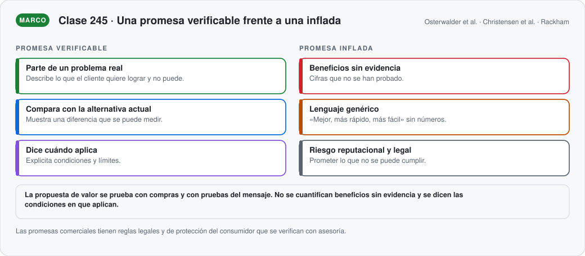

# Clase 245 — Propuesta de valor

<!-- nav:inicio -->
> **Parte 20 · Founder y creación de empresas** — clase 5 de 12 · [índice de la parte](../../README.md) · [temario](../../../../SYLLABUS.md)
<!-- nav:fin -->

**Parte:** 20 — Founder y creación de empresas  
**Nivel:** Etapa 6 — Founder  
**Duración sugerida:** 150–180 minutos · **Estándar:** deep-class-v2

## 🎯 Propósito

Cuando se le pide a un fundador que explique su producto, suele describir **qué es**: «una plataforma que concilia facturas con guías de despacho». Pero un cliente no compra lo que algo *es*, sino lo que le permite *lograr*: dejar de perder tres horas a la semana, evitar un error que le cuesta un cliente, cerrar el mes sin angustia. La **propuesta de valor** es la respuesta clara a una pregunta que el cliente se hace en silencio: «¿por qué debería dejar lo que hago hoy y pagar por esto?». Una buena propuesta parte de un trabajo o dolor real del cliente, lo compara con la alternativa actual, explica el **mecanismo** por el que el producto produce una mejora y la respalda con una **prueba** creíble. Una mala propuesta enumera características, promete resultados que no puede cumplir y usa un lenguaje genérico que cualquier competidor podría repetir.

La clase enseña a priorizar un trabajo o dolor, mapear las alternativas actuales, diseñar el beneficio y su mecanismo, probar el mensaje y la evidencia y cuantificar el valor con prudencia. Se apoya en el diseño de propuestas de valor de Osterwalder y colaboradores, en la teoría de los trabajos por hacer de Christensen y colaboradores, en la venta consultiva de Rackham, en el análisis de Moore sobre cómo cruzar el abismo entre los primeros adoptantes y la mayoría y en el enfoque de ajuste entre producto y mercado de Olsen. Al terminar sabrás escribir una propuesta que un cliente pueda evaluar, cuantificarla sin exagerar y probarla con acciones y no solo con opiniones.

## 📚 Resultados de aprendizaje

Al finalizar podrás:

1. **Priorizar** el trabajo o dolor del cliente que justifica una propuesta.
2. **Mapear** las alternativas actuales y lo que las hace insatisfactorias.
3. **Diseñar** el beneficio, el mecanismo y la prueba que lo respalda.
4. **Probar** el mensaje con un diseño que distinga diferencias reales.
5. **Cuantificar** el valor con supuestos explícitos y condiciones de aplicación.

## 🧭 Agenda

| Tramo | Qué se hace |
|---|---|
| 0–20 min | Recuperación: ¿cómo explicarías en una frase qué cambia en la vida de tu cliente y qué lo sostiene? |
| 20–60 min | Trabajo y dolor, alternativas, beneficio, mecanismo, prueba, mensaje y cuantificación. |
| 60–105 min | Ejemplo trabajado: valor por cliente, razón valor-precio y prueba de tres mensajes. |
| 105–150 min | Caso ejecutivo y práctica. |
| 150–175 min | Límites y entregable. |

## 🧩 Conceptos centrales

| Concepto | Definición | Cómo se reconoce |
|---|---|---|
| **Propuesta de valor** | Razón concreta por la que un cliente elegiría tu solución frente a su alternativa. | Trabajo, mejora, mecanismo y prueba. |
| **Trabajo por hacer** | Progreso que el cliente intenta lograr en una situación. | «Quiero… para poder…». |
| **Dolor y ganancia** | Obstáculos y resultados deseados por el cliente. | Se describen con sus palabras. |
| **Alternativa actual** | Lo que el cliente hace hoy, incluido no hacer nada. | Planilla, un proveedor, un hábito. |
| **Mecanismo** | Cómo el producto produce la mejora prometida. | Explica el «porqué funciona». |
| **Prueba (*proof*)** | Evidencia que respalda la promesa. | Datos, casos, garantías, demostración. |

## 🧠 Modelo mental

**Cómo leer el diagrama.** Dos paneles. A la izquierda, la **promesa verificable**: parte de un problema real (describe lo que el cliente quiere lograr y no puede), compara con la alternativa actual (muestra una diferencia medible) y dice cuándo aplica (explicita condiciones y límites). A la derecha, la **promesa inflada**: beneficios sin evidencia (cifras no probadas), lenguaje genérico («mejor, más rápido, más fácil» sin números) y riesgo reputacional y legal (prometer lo que no se puede cumplir). La nota explica que la propuesta se prueba con compras y con pruebas del mensaje, y que no se cuantifican beneficios sin evidencia; el pie, que las promesas comerciales tienen reglas legales y de protección del consumidor.

## 📖 Desarrollo

### 1. Partir del trabajo y del dolor del cliente

Christensen y colaboradores sostienen que los clientes «contratan» un producto para hacer un **trabajo** en una situación concreta, y que entender ese trabajo (sus dimensiones funcional, emocional y social) permite diseñar ofertas que realmente importan. Osterwalder y colaboradores estructuran el análisis del cliente en tres partes: los **trabajos** que intenta realizar, los **dolores** (obstáculos, riesgos, costos, emociones negativas) y las **ganancias** (resultados esperados, beneficios deseados). La propuesta de valor se diseña para **aliviar los dolores más intensos** y **crear las ganancias más importantes**, no todas. Se priorizan con evidencia de las entrevistas (clase 243): ¿qué dolor es más severo y más frecuente?, ¿qué ganancia genera conductas?, ¿qué trabajo se hace peor con las soluciones actuales?

### 2. Las alternativas actuales

El competidor más frecuente de una propuesta nueva no es otra startup, sino **la alternativa actual**: la planilla, el asistente, la llamada, el proveedor de siempre, o no hacer nada. Se mapea cada alternativa con sus **ventajas** (por qué la gente la usa), sus **fallas** (por qué no satisface) y su **costo total** (dinero, tiempo, riesgo). Rackham, en su enfoque de venta consultiva, enseña que los clientes compran cuando perciben que el **costo de su problema** es mayor que el **costo de la solución** y que ven la diferencia con claridad. Para un cliente, cambiar tiene un costo (aprendizaje, riesgo, tiempo), por lo que la propuesta debe ser **mucho mejor**, no ligeramente mejor, que lo actual. Moore advierte que los primeros adoptantes toleran imperfecciones por una mejora grande; la mayoría pide una solución completa y confiable.

### 3. Diseñar el beneficio y su mecanismo

Una propuesta eficaz tiene cuatro componentes: el **cliente** (a quién), el **problema o trabajo** (qué dolor o progreso), el **beneficio** (qué cambia, medido) y el **mecanismo** (cómo se produce). Un enunciado útil: «Para [segmento] que [trabajo/dolor], [producto] [beneficio medible] a diferencia de [alternativa] porque [mecanismo]». Por ejemplo: «Para transportistas medianos que pierden más de tres horas semanales conciliando guías y facturas, nuestro servicio reduce ese trabajo a menos de 30 minutos y detecta diferencias antes de facturar, a diferencia de la planilla, porque lee los documentos y los cruza automáticamente». El **mecanismo** convierte una afirmación en algo creíble: explica por qué funciona y permite al cliente evaluar su verosimilitud.

### 4. La prueba y las condiciones

Una promesa sin prueba es una opinión. La **prueba** puede ser: **datos** (resultados de pilotos, medidas antes y después), **casos** de clientes similares, **demostraciones** en vivo con los datos del cliente, **garantías** (devolución, período de prueba), **certificaciones** o **referencias**. Se aplican los mismos principios de honestidad: no se afirman cifras que no se han medido; se indican las **condiciones de aplicación** («aplica si los documentos están digitalizados y el cliente tiene más de 50 facturas al mes»); se reconocen los **límites**. Una promesa demasiado agresiva crea riesgo reputacional (clientes decepcionados) y legal (publicidad engañosa), cuyos criterios se verifican con asesoría y con la normativa de protección del consumidor y de publicidad aplicable.

### 5. Probar el mensaje y entender qué se mide

El mensaje se prueba mostrándolo a personas reales y observando **conductas**: respuestas a un correo, clics hacia una página con una propuesta, solicitudes de demostración, preventas. Se comparan **versiones** del mensaje (ahorro de tiempo, reducción de errores, ahorro de dinero). Con muestras pequeñas, hay que entender el **ruido**: una diferencia de 11 respuestas frente a 6 en 300 contactos cada una **no es estadísticamente distinguible** de una casualidad. Se recomienda definir de antemano el tamaño de la prueba, la métrica y el criterio de decisión; no declarar ganador por una diferencia pequeña; y repetir o ampliar la prueba cuando sea importante. Kohavi y colaboradores advierten que los experimentos mal interpretados llevan a decisiones erróneas; la humildad estadística es parte del método.

### 6. Cuantificar el valor con prudencia

Un buen caso de valor cuantifica el beneficio para el cliente con **supuestos explícitos**: horas ahorradas × costo hora; errores evitados × costo del error; ventas ganadas × margen; riesgos reducidos × costo esperado. Se compara con el **precio** y con los **costos de cambio** del cliente (implementación, capacitación, riesgo). Una regla práctica: el valor percibido debería ser **varias veces** el precio (por ejemplo, 3 veces) para que la compra sea fácil. Se hace un análisis de **sensibilidad**: si los beneficios fueran 40 % menores, ¿sigue valiendo la pena? Se evita la tentación de inflar cifras: un cliente que mide y descubre que el resultado es la mitad de lo prometido no renueva ni recomienda. Y se separa el valor **que el cliente reconoce** del que solo imagina el fundador.

### 7. De la propuesta al producto y al mensaje

La propuesta orienta el **producto** (qué se construye primero), el **mensaje** (qué se dice y a quién), el **precio** (clase 249) y el **canal** (dónde se encuentra al cliente). Olsen propone buscar el **ajuste entre producto y mercado** identificando las necesidades no satisfechas y diseñando el producto para satisfacerlas mejor que las alternativas. La propuesta se **revisa** con cada aprendizaje: si los clientes valoran otra cosa de la que se pensó, se ajusta. Y se mantiene **consistente** en todo lo que la empresa comunica (sitio, ventas, contratos): las promesas contradictorias generan desconfianza. Una propuesta que no se puede explicar en una frase, sin siglas, probablemente aún no está clara para su autor.

## 📚 Lectura comparada

| Obra | Qué aporta | Qué no resuelve | Pregunta para contrastar |
|---|---|---|---|
| Osterwalder y otros | Trabajos, dolores y ganancias; ajuste entre propuesta y cliente. | Lista de preguntas más que método estadístico. | ¿Qué dolor es el más severo? |
| Christensen y otros | Trabajos por hacer y dimensiones emocionales y sociales. | Marco conceptual. | ¿Qué trabajo contrata el cliente? |
| Rackham | Venta basada en problemas, implicancias y necesidades. | Diseñado para ventas complejas. | ¿Cuánto cuesta el problema para el cliente? |
| Moore | Primeros adoptantes frente a mayoría pragmática. | Enfoque de tecnología. | ¿Qué necesita el cliente para confiar? |
| Olsen | Ajuste entre producto y mercado. | Orientado a producto. | ¿Qué necesidad no cubre la alternativa? |

## 🧮 Ejemplo trabajado

**Situación (hipotética).** Un servicio de conciliación de guías de despacho y facturas para transportistas medianos tiene esta propuesta: «reduce el trabajo de conciliación de 5,5 horas semanales a menos de 30 minutos y detecta diferencias antes de facturar».

**Valor por cliente (por año).**

| Componente | Cálculo | Millones de pesos |
|---|---|---|
| Horas ahorradas | (5,5 − 0,5) horas × 52 semanas × 6.000 pesos la hora | 1,56 |
| Errores evitados | Costo anual de errores de facturación 1,4 millones × 60 % de reducción | 0,84 |
| **Valor anual** | | **2,40** |

**Precio.** 90.000 pesos al mes: 1,08 millones al año. **Razón valor-precio:** 2,40 ÷ 1,08 = **2,2 veces**.

**Costos de cambio del cliente.** Integración y capacitación de 8 horas (48.000 pesos) más el riesgo percibido; con ello el valor neto del primer año es 2,40 − 1,08 − 0,05 = 1,27 millones.

**Sensibilidad.** Si los beneficios son 40 % menores: 2,40 × 0,60 = 1,44 millones; razón valor-precio de 1,33 veces: sigue siendo positiva, pero menos convincente (el objetivo es 3 veces). Se concluye que el precio de 90.000 es razonable, pero el mensaje debe apoyarse en pruebas de pilotos con datos reales; si el valor real cayera bajo 1,1 millones, el precio no se sostiene.

**Condiciones de aplicación.** El servicio aplica a empresas con más de 100 guías al mes, con documentos digitalizados o escaneables y que emitan facturas con regularidad. No aplica a quienes facturan menos de 30 guías al mes.

**Prueba del mensaje.** Se envían tres mensajes a 300 contactos cada uno (900 en total) con una solicitud de demostración de 15 minutos.

| Mensaje | Idea central | Solicitudes de demostración | Tasa |
|---|---|---|---|
| A | Ahorra 5 horas por semana | 6 | 2,0 % |
| B | Detecta errores antes de facturar | 11 | 3,7 % |
| C | Te ahorra 2,4 millones al año | 8 | 2,7 % |

**Lectura estadística.** La diferencia entre B y A es de 5 solicitudes (3,7 % frente a 2,0 %), con un valor z ≈ 1,23 y una probabilidad de azar de alrededor de 22 %: **no es concluyente**. B frente a C: z ≈ 0,70 (p ≈ 48 %). Con estas muestras no se puede declarar un ganador. Decisión: usar B como mensaje principal por tener la tasa más alta y una explicación plausible (el cliente teme los errores), pero **repetir la prueba con 1.000 contactos por mensaje** antes de concluir, y seguir con las conversaciones para entender qué pesa más.

**Medida de éxito de la propuesta.** No solo solicitudes de demostración: demostraciones realizadas, pilotos pagados y conversión a clientes; la meta es que el 25 % de las demostraciones termine en un piloto pagado.

**Cuidados.** No se afirman ahorros no medidos; se informan las condiciones; las promesas comerciales y la publicidad se revisan con la normativa de protección del consumidor y con asesoría; las cifras son ilustrativas.

**Qué muestra.** (1) El valor se cuantificó con supuestos explícitos y sensibilidad. (2) El mensaje se probó, pero la muestra no bastaba para concluir. (3) Se definieron condiciones y una medida de éxito basada en conductas.

## 🔀 Comparación y límites

**Propuesta de valor frente a eslogan.** El eslogan atrae atención; la propuesta de valor explica qué cambia, comparado con qué, por qué funciona y bajo qué condiciones. Un buen eslogan resume una propuesta que ya existe.

**Límites.** Una promesa demasiado agresiva puede crear riesgo reputacional o legal: no se cuantifican beneficios sin evidencia y se explicitan las condiciones. Las pruebas de mensajes con muestras pequeñas son ruidosas. El valor percibido varía entre clientes. Las cifras del ejemplo son ilustrativas.

## 🪜 De profesional a owner

| Nivel | Cómo se relaciona con la propuesta de valor |
|---|---|
| **Profesional** | Entiende qué problema del cliente resuelve su trabajo. |
| **Jefe / Team Lead** | Traduce la propuesta a prioridades del equipo. |
| **Gerente** | Mide el valor entregado y lo comunica con evidencia. |
| **CEO / Director** | Mantiene la coherencia de la propuesta en toda la empresa. |
| **Founder / Owner** | Define, prueba y defiende una propuesta que los clientes reconozcan. |

## 🏢 Caso ejecutivo

Un fundador desarrolla una aplicación de «gestión inteligente de inventario» para ferreterías pequeñas. Su sitio dice: «La herramienta más fácil, rápida y potente para tu ferretería. Aumenta tus ventas hasta un 40 %». Las características: lector de códigos, alertas de stock bajo, reportes, recomendaciones de compra. Un piloto con 6 ferreterías mostró: ahorro de 3 horas semanales en recuento (a 5.500 pesos la hora), reducción del 35 % en quiebres de stock en 4 de las 6, ningún aumento verificable de ventas en las otras 2, y problemas de lectura de códigos en productos sin etiqueta (30 % del inventario). El precio previsto es 35.000 pesos al mes; la competencia ofrece planillas gratuitas y un sistema más completo a 60.000. Los ferreteros dicen que «les gustaría, pero no tienen tiempo de cargar el inventario»; un cliente dejó de usarla a los dos meses. La cifra de «40 %» proviene de un caso aislado. Un asesor sugiere cambiar a «inteligencia artificial para ferreterías».

Entrega una **propuesta de valor probada** que contenga: (a) el trabajo, los dolores y las ganancias priorizados con la evidencia del piloto; (b) el mapa de alternativas actuales con sus ventajas, fallas y costo total; (c) el enunciado de la propuesta con beneficio medible, mecanismo y prueba, y la corrección de las promesas no sustentadas; (d) la cuantificación del valor con supuestos, razón valor-precio y sensibilidad; (e) el diseño de la prueba de mensajes con tamaño, métrica, criterio de decisión y lectura estadística; (f) las condiciones de aplicación, los cuidados legales de la publicidad y las verificaciones pendientes.

## 🧪 Práctica

1. Escribe el trabajo, tres dolores y tres ganancias de tu cliente, ordenados por severidad.
2. Describe las tres alternativas actuales con su costo total.
3. Redacta tu propuesta en una frase con segmento, beneficio medible, alternativa y mecanismo.
4. Calcula el valor anual para un cliente, la razón valor-precio y la sensibilidad con beneficios 40 % menores.
5. Diseña una prueba de dos mensajes y decide qué tamaño de muestra necesitarías para concluir.

## ⚠️ Errores frecuentes

| Error | Por qué ocurre | Cómo corregirlo |
|---|---|---|
| Listar características | Se describe el producto | Describir el trabajo y el beneficio medible. |
| Prometer cifras sin medir | Se quiere impactar | Citar solo lo medido y sus condiciones. |
| Ignorar la alternativa actual | Se compara con competidores | Mapear el statu quo y su costo. |
| Declarar un ganador con diferencias pequeñas | Se desconoce el ruido | Tamaño de muestra y criterio previo. |
| Mensaje genérico | Se evita comprometerse | Segmento, número y mecanismo. |
| Mensajes inconsistentes | Cada canal dice algo distinto | Una propuesta coherente en toda la empresa. |

## ❓ Preguntas de comprobación

1. ¿Qué componentes tiene una propuesta de valor sólida?
2. ¿Por qué la alternativa actual es el competidor principal?
3. ¿Qué papel cumple el mecanismo?
4. ¿Qué tipos de prueba respaldan una promesa?
5. ¿Por qué una diferencia pequeña en una prueba de mensajes puede no ser concluyente?
6. ¿Cómo se cuantifica el valor con prudencia?
7. ¿Qué riesgos tiene una promesa agresiva?

Claves de respuesta

1. Cliente, trabajo o dolor, beneficio medible, mecanismo y prueba, con condiciones de aplicación.
2. Porque el cliente compara con lo que hace hoy, incluido no hacer nada, y cambiar tiene un costo.
3. Explica por qué el producto produce la mejora y hace creíble la promesa.
4. Datos de pilotos, casos, demostraciones, garantías, certificaciones y referencias.
5. Porque con muestras pequeñas el azar puede producir diferencias similares; hay que fijar tamaño, métrica y criterio y repetir si es necesario.
6. Con supuestos explícitos (horas, errores, ventas, riesgos), comparación con el precio y los costos de cambio, y análisis de sensibilidad.
7. Riesgo reputacional por decepcionar y legal por publicidad engañosa; se evita cuantificar sin evidencia y se explicitan condiciones.

## 📥 Entregable

Guarda en `portfolio/245-propuesta-de-valor/`:

- `modelo-financiero-y-memo-de-decision.md` (plantilla [Modelo financiero y memo de decisión](../../../../templates/modelo-financiero-y-memo-de-decision.md)) con el cálculo de valor y la razón valor-precio del caso ejecutivo;
- `product-evidence-brief.md` (plantilla [Product evidence brief](../../../../templates/product-evidence-brief.md)) con la evidencia del piloto y la prueba de mensajes;
- `decision-journal.md` con la propuesta, las condiciones y las verificaciones legales pendientes.

## 📗 Fuentes y verificación

- Alexander Osterwalder et al. — *Value Proposition Design* (John Wiley & Sons, Incorporated, 2014). **Uso en esta clase:** trabajos, dolores y ganancias del cliente. Lectura selectiva sobre **propuesta de valor**. **Localizador:** [ISBN-13 9781118968062](https://openlibrary.org/isbn/9781118968062).
- Clayton M. Christensen et al. — *Competing Against Luck* (HarperBusiness, 2016). **Uso en esta clase:** trabajos por hacer y sus dimensiones. Lectura selectiva sobre **propuesta de valor**. **Localizador:** [ISBN-13 9780062435613](https://openlibrary.org/isbn/9780062435613).
- Neil Rackham — *SPIN Selling* (Highbridge Audio, 1998). **Uso en esta clase:** venta basada en problemas, implicancias y necesidades. Lectura selectiva sobre **propuesta de valor**. **Localizador:** [ISBN-13 9781565112605](https://openlibrary.org/isbn/9781565112605).
- Geoffrey A. Moore — *Crossing the Chasm* (HarperBusiness, 1995). **Uso en esta clase:** primeros adoptantes frente a la mayoría pragmática. Lectura selectiva sobre **propuesta de valor**. **Localizador:** [ISBN-13 9780887307171](https://openlibrary.org/isbn/9780887307171).
- Dan Olsen — *The Lean Product Playbook* (Wiley, 2015). **Uso en esta clase:** ajuste entre producto y mercado. Lectura selectiva sobre **propuesta de valor**. **Localizador:** [ISBN-13 9781118960875](https://openlibrary.org/isbn/9781118960875).

> **Regla de fuentes para Propuesta de valor:** las obras anteriores estructuran las perspectivas de esta materia; cualquier norma, ley o estándar vivo mencionado debe comprobarse nuevamente en su fuente primaria vigente, incluidas las normas de publicidad y de protección del consumidor. Los ejemplos y casos son hipotéticos, con cifras ilustrativas. El desarrollo es original y no reproduce capítulos protegidos.

<!-- pie:inicio -->
---

| Anterior | Índice | Siguiente |
|---|---|---|
| [← 244 · Hipótesis de cliente y problema](../244-hipotesis-de-cliente-y-problema/README.md) | [Parte 20](../../README.md) · [Programa](../../../../SYLLABUS.md) | [246 · Modelo de negocio →](../246-modelo-de-negocio/README.md) |
<!-- pie:fin -->
