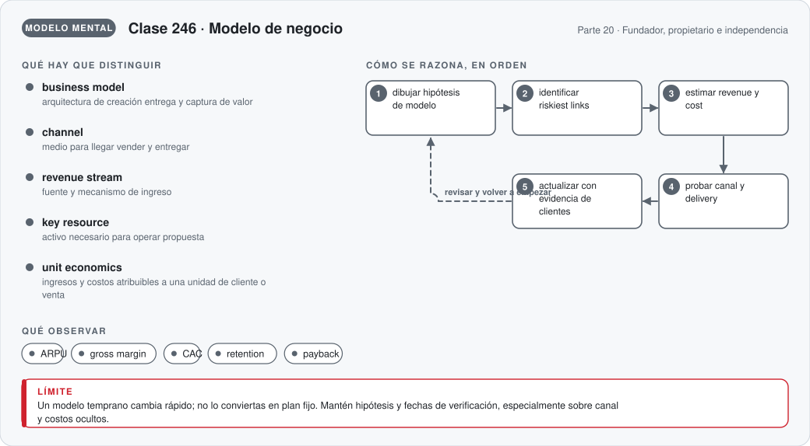

# Clase 246 — Modelo de negocio

<!-- nav:inicio -->
> **Parte 20 · Founder y creación de empresas** — clase 6 de 12 · [índice de la parte](../../README.md) · [temario](../../../../SYLLABUS.md)
<!-- nav:fin -->

**Parte:** 20 — Founder y creación de empresas  
**Nivel:** Etapa 6 — Founder  
**Duración sugerida:** 150–180 minutos · **Estándar:** deep-class-v2

## 🎯 Propósito

Un modelo de negocio responde a una pregunta que el producto no contesta: **¿cómo gana dinero esta empresa de manera repetible?** Una idea excelente, con clientes entusiasmados, puede ser un mal negocio si cuesta más conseguir un cliente que lo que ese cliente deja, si el servicio exige tanto trabajo manual que cada venta destruye margen, si el canal de ventas no escala o si nadie con presupuesto está dispuesto a pagar. Los fundadores suelen dibujar un lienzo de negocio con nueve bloques que parece completo y es, en realidad, una lista de **hipótesis**: de quién es el cliente, cuánto vale para él, cómo lo alcanzamos, cuánto nos cuesta atenderlo, cuánto tiempo se queda. La utilidad del modelo no está en el dibujo sino en **identificar cuáles eslabones son más riesgosos y probarlos primero**.

La clase presenta el modelo de negocio como una **cadena de hipótesis con números**: quién paga y por qué, cómo se entrega el servicio y cuánto cuesta y deja cada cliente. Se apoya en Osterwalder y Pigneur sobre los bloques de un modelo, en Blank sobre la búsqueda de un modelo repetible y escalable, en Aulet sobre los pasos para definir un mercado y un modelo, en Maurya sobre la adaptación del lienzo a una página de hipótesis y en Ries sobre el aprendizaje validado. Al terminar sabrás dibujar un modelo inicial, localizar los eslabones más riesgosos, estimar ingresos y costos con supuestos explícitos, probar el canal y la entrega y actualizar el modelo con evidencia.

## 📚 Resultados de aprendizaje

Al finalizar podrás:

1. **Distinguir** modelo de negocio, canal y producto.
2. **Dibujar** un modelo inicial como un conjunto de hipótesis.
3. **Identificar** los eslabones más riesgosos y diseñar pruebas.
4. **Estimar** ingresos, costos y economía por cliente con supuestos explícitos.
5. **Actualizar** el modelo con evidencia sin convertirlo en un plan fijo.

## 🧭 Agenda

| Tramo | Qué se hace |
|---|---|
| 0–20 min | Recuperación: ¿quién paga en tu negocio, por qué y cuánto cuesta conseguirlo? |
| 20–60 min | Bloques, hipótesis, eslabones riesgosos, economía por cliente, canal y delivery, actualización. |
| 60–105 min | Ejemplo trabajado: economía por cliente, punto de equilibrio y sensibilidad. |
| 105–150 min | Caso ejecutivo y práctica. |
| 150–175 min | Límites y entregable. |

## 🧩 Conceptos centrales

| Concepto | Definición | Cómo se reconoce |
|---|---|---|
| **Modelo de negocio** | Forma en que una empresa crea, entrega y captura valor. | Cliente, propuesta, canal, ingresos, costos. |
| **Eslabón más riesgoso** | Hipótesis cuya falsedad invalida el modelo. | Alta incertidumbre e impacto. |
| **Economía por cliente** | Ingresos y costos asociados a un cliente. | Margen de contribución, costo de adquisición, vida útil. |
| **Costo de adquisición (CAC)** | Costo de conseguir un cliente nuevo. | Marketing y ventas por cliente. |
| **Valor de vida del cliente (LTV)** | Contribución total esperada de un cliente. | Margen mensual × permanencia. |
| **Punto de equilibrio** | Nivel de clientes en que ingresos cubren costos. | Costos fijos ÷ contribución por cliente. |

## 🧠 Modelo mental

**Cómo leer el diagrama.** Tres columnas. **Quién paga y por qué**: segmento, problema y propuesta, quién decide y quién paga, y cuánto vale resolverlo. **Cómo se entrega**: canal para llegar al cliente, cómo se produce y se presta el servicio y qué se hace a mano al comienzo. **Cuánto cuesta y deja**: costo de adquirir y servir, margen por cliente, y costos ocultos con su verificación. La nota afirma que un modelo temprano cambia rápido y no debe convertirse en un plan fijo; el pie, que se prueba primero el eslabón más riesgoso, el que invalida el resto si falla.

## 📖 Desarrollo

### 1. Qué es un modelo de negocio y qué no es

Osterwalder y Pigneur describen un modelo de negocio como la manera en que una organización **crea, entrega y captura valor**, y proponen nueve bloques: segmentos de clientes, propuesta de valor, canales, relación con clientes, fuentes de ingresos, recursos clave, actividades clave, socios clave y estructura de costos. Es una herramienta útil para **comunicar y discutir**. Pero hay tres confusiones frecuentes: el **producto** no es el modelo (un mismo producto puede venderse con modelos muy distintos); el **canal** (cómo se llega al cliente) es solo un bloque; y un lienzo lleno no es un negocio validado. Blank recuerda que una startup busca un **modelo repetible y escalable**; mientras no lo encuentre, todo en el lienzo es una hipótesis que debe contrastarse con clientes reales.

### 2. Dibujar el modelo como hipótesis

Se parte de una versión **rápida e imperfecta**: en una hoja, el fundador completa cada bloque con lo que cree hoy y marca, con color o con un signo de interrogación, lo que **no ha verificado**. Maurya propone un formato de una página (el «lienzo ágil») que prioriza problema, segmento, propuesta, solución, canales, ingresos, costos, métricas y ventaja diferencial. Lo importante es la **honestidad**: ¿esto lo sé o lo supongo? Luego se redactan las hipótesis críticas con números: «El 30 % de los talleres contactados acepta una demostración», «El costo de conseguir un cliente es menor de 300.000 pesos», «El servicio consume menos de 2 horas mensuales de soporte por cliente». Cada hipótesis tendrá un umbral y una fecha de verificación.

### 3. Identificar los eslabones más riesgosos

Un modelo de negocio es una **cadena**: si un eslabón se rompe, el resto no importa. Los eslabones más riesgosos suelen ser: que **exista un comprador con presupuesto**, que **pague el precio previsto**, que se pueda **alcanzar** a un costo razonable, que el servicio se pueda **entregar** con un costo que deje margen, que el cliente **se quede** el tiempo necesario y que el **mercado** sea suficiente. Se puntúan por impacto e incertidumbre (clase 244) y se prueba primero el que más preocupa. Aulet insiste en construir el modelo con **evidencia de clientes**, calculando la **vida útil del cliente** y el **costo de adquirirlo** con datos reales, no con promedios de otras industrias. Una regla práctica: probar la **demanda** antes de optimizar los costos.

### 4. La economía por cliente

El núcleo numérico del modelo es la **economía por cliente**. **Ingreso mensual** (precio); **costos variables** por cliente (producción, soporte, hosting, comisiones de pago); **margen de contribución** (ingreso menos costos variables); **costo de adquisición** (CAC: marketing y ventas por cliente nuevo, incluyendo el tiempo del fundador valorado); **costo de implementación** (incorporación); **permanencia** (por ejemplo, 1 ÷ tasa de cancelación mensual); y **valor de vida** (contribución mensual × permanencia). De ahí salen: el **período de recuperación** del CAC (meses), la **relación valor de vida / costo de adquisición** y el **punto de equilibrio** (costos fijos ÷ contribución por cliente). Los **costos ocultos** (soporte manual, correcciones, cobranza, impuestos, comisiones) suelen aparecer tarde y alterar el resultado, por eso se buscan desde el inicio.

### 5. Canal y entrega: probar cómo se llega y cómo se presta

Un modelo puede ser atractivo en teoría y fracasar en el **canal**: el cliente existe, pero no se lo puede alcanzar de forma rentable. Se prueba el canal con experimentos pequeños (correos y llamadas, publicidad, alianzas, ferias, referidos), midiendo el **embudo**: contactos, respuestas, demostraciones, pilotos, ventas. Se calcula el **costo por cada etapa** y el costo total de adquisición. En la **entrega**, se examina cómo se produce el servicio: ¿qué se hace a mano?, ¿cuánto tiempo toma?, ¿qué se puede automatizar? (clase 248). Blank sugiere que muchas startups confunden un canal que funciona con unos cuantos clientes cercanos con un canal **escalable**; hay que probarlo con personas fuera de la propia red.

### 6. Estimar y estresar con sensibilidad

Se hace una **proyección simple** con supuestos explícitos: número de clientes por mes, precio, costos, cancelaciones. Luego se hace un **análisis de sensibilidad**: ¿qué pasa si la cancelación es del doble?, ¿si el costo de adquisición sube 50 %?, ¿si el precio es 20 % menor? Se identifican los **supuestos que más mueven** el resultado, que coinciden con los eslabones más riesgosos. Ries sugiere elegir las **métricas que importan** (accionables) y no las «de vanidad». Se calcula también la **caja** necesaria hasta el punto de equilibrio para saber cuánto tiempo y capital se necesita (clase 222). Si el modelo solo funciona en un escenario muy optimista, es frágil y se rediseña (precio, segmento, canal, entrega).

### 7. Actualizar sin convertirlo en un plan fijo

Un modelo temprano cambia rápido; no se convierte en un plan rígido. Se mantiene una **versión vigente** con las hipótesis y su estado (sin probar, apoyada, refutada), con **fechas de verificación** (por ejemplo, cada 30 días) y se actualiza con cada aprendizaje. Los cambios importantes (segmento, precio, canal, tipo de ingreso) son **pivotes** que deben estar justificados por evidencia. Se evita el error de creer que cada ajuste es un fracaso: es el trabajo central de esta etapa. Y se cuida de no confundir **actividad** con **progreso**: lo que cuenta es cuántas hipótesis críticas se han reducido con datos. Cuando la economía por cliente es positiva con supuestos conservadores y el canal es repetible, el modelo está listo para escalar (y para pensar en capital).

## 📚 Lectura comparada

| Obra | Qué aporta | Qué no resuelve | Pregunta para contrastar |
|---|---|---|---|
| Osterwalder y Pigneur | Nueve bloques para describir y discutir un modelo. | No dice si el modelo es rentable. | ¿Qué bloque es una hipótesis sin verificar? |
| Blank | Búsqueda de un modelo repetible y escalable. | Orientado a startups tecnológicas. | ¿Mi canal funciona fuera de mi red? |
| Aulet | Evidencia de clientes para calcular vida útil y costo de adquirirlos. | Proceso extenso. | ¿Qué datos reales tengo del cliente? |
| Maurya | Lienzo de una página y priorización de riesgos. | Marco para startups. | ¿Cuál es el riesgo mayor de este modelo? |
| Ries | Métricas accionables y aprendizaje validado. | Orientado a productos digitales. | ¿Qué métrica cambia mis decisiones? |

## 🧮 Ejemplo trabajado

**Situación (hipotética).** Un servicio de conciliación para empresas de transporte tiene este modelo inicial.

**Ingresos y costos variables por cliente al mes.**

| Concepto | Pesos |
|---|---|
| Precio de la suscripción | 90.000 |
| Alojamiento y procesamiento | 6.000 |
| Comisión de pago (2,5 %) | 2.250 |
| Soporte y correcciones (promedio) | 12.000 |
| **Margen de contribución mensual** | **69.750** (77,5 %) |

**Costos por cliente nuevo.** Incorporación (8 horas del equipo a 7.500 pesos la hora): 60.000; costo de adquisición (CAC) supuesto: 240.000 pesos. Total: 300.000.

**Recuperación.** 300.000 ÷ 69.750 ≈ **4,3 meses**.

**Valor de vida.** Con una cancelación mensual de 5 %, la permanencia esperada es 1 ÷ 0,05 = 20 meses; valor de vida = 69.750 × 20 = 1.395.000 pesos. Relación valor de vida / costo total de adquisición: 1.395.000 ÷ 300.000 = **4,65**.

**Punto de equilibrio.** Costos fijos mensuales (equipo mínimo, herramientas, contabilidad): 6,5 millones. Clientes necesarios: 6.500.000 ÷ 69.750 = 93,2 → **94 clientes**.

**Prueba del canal.** Un experimento con correos y llamadas a 400 empresas arroja:

| Etapa | Conversión | Resultado |
|---|---|---|
| Contactos → respuesta y demostración | 25 % | 100 |
| Demostración → piloto | 30 % | 30 |
| Piloto → cliente de pago | 60 % | 18 |

De 400 contactos se obtienen 18 clientes (4,5 %). El costo del experimento fue de 7,2 millones (tiempo del fundador, herramientas y llamadas): **CAC real = 7.200.000 ÷ 18 = 400.000 pesos**, mayor que el supuesto de 240.000.

**Economía actualizada.** Costo total por cliente nuevo: 400.000 + 60.000 = 460.000; recuperación: 460.000 ÷ 69.750 ≈ 6,6 meses; relación valor de vida / costo: 1.395.000 ÷ 460.000 = **3,0**. Todavía es positiva, pero más ajustada de lo que se pensó.

**Sensibilidad.**

| Escenario | Valor de vida | Costo total por cliente | Relación |
|---|---|---|---|
| Base actualizado (cancelación 5 %, CAC 400.000) | 1.395.000 | 460.000 | 3,0 |
| Cancelación de 8 % (permanencia de 12,5 meses) | 871.875 | 460.000 | 1,9 |
| CAC de 600.000 | 1.395.000 | 660.000 | 2,1 |
| Ambos | 871.875 | 660.000 | 1,3 |

**Lectura.** El modelo es sensible a la **cancelación** y al **costo de adquisición**; en el peor caso (relación de 1,3) apenas cubre costos. Los eslabones más riesgosos son la permanencia y el canal. Se priorizan dos pruebas: medir la cancelación con los primeros 18 clientes durante 3 meses, y probar un segundo canal (alianza con asociaciones de transportistas) que podría bajar el CAC a 250.000.

**Costos ocultos verificados.** Tiempo de soporte de 14 horas mensuales (el doble de lo previsto) para 18 clientes: se agrega al modelo; se evalúa automatizar la incorporación.

**Decisión.** Continuar con una versión del modelo con precio de 90.000, un segundo canal de prueba y metas de cancelación bajo 5 % y CAC bajo 300.000 en 90 días; revisión de hipótesis cada 30 días; no contratar más personal hasta confirmar la permanencia.

**Cuidados.** Los supuestos de cancelación y costos se verifican con datos reales; las obligaciones tributarias y de facturación del servicio se consultan con asesoría y fuentes oficiales; las cifras son ilustrativas.

**Qué muestra.** (1) La economía por cliente se calculó con supuestos explícitos. (2) El experimento de canal corrigió el costo de adquisición. (3) La sensibilidad identificó los eslabones más riesgosos.

## 🔀 Comparación y límites

**Modelo de negocio frente a plan de negocios.** El modelo describe cómo se crea y captura valor y se actualiza con evidencia; el plan de negocios es un documento más extenso con proyecciones que suele envejecer rápido.

**Límites.** Un modelo temprano cambia rápido: no lo conviertas en un plan fijo; mantén hipótesis y fechas de verificación, especialmente sobre canal y costos ocultos. Las proyecciones con pocos clientes son inestables. Los promedios de la industria pueden no aplicar. Las cifras del ejemplo son ilustrativas.

## 🪜 De profesional a owner

| Nivel | Cómo se relaciona con el modelo |
|---|---|
| **Profesional** | Entiende cómo su trabajo afecta los ingresos y costos. |
| **Jefe / Team Lead** | Conoce el costo de servir a los clientes de su área. |
| **Gerente** | Mide la economía por cliente y por canal. |
| **CEO / Director** | Decide el modelo y el momento de escalar. |
| **Founder / Owner** | Prueba el modelo con clientes reales y ajusta con evidencia. |

## 🏢 Caso ejecutivo

Una fundadora tiene un servicio de «cajas de alimentos saludables» para oficinas: por 38.000 pesos semanales por persona, entrega fruta, frutos secos y colaciones. Datos de los primeros 90 días: 12 oficinas con 180 personas en total; costo de los productos y empaque, 21.000 pesos por persona por semana; despacho, 4.500 por persona; comisiones de pago, 2 %; una persona dedica 25 horas semanales a coordinar pedidos y reclamos (a 6.000 pesos la hora); cancelaciones: 3 oficinas en 3 meses; el costo de conseguir las 12 oficinas fue de 5,4 millones (ferias, visitas y degustaciones, más su tiempo); el 40 % de las personas no consume todo y pide ajustes; los costos fijos son de 4,2 millones al mes (local, vehículo y sueldos). Un inversionista le pregunta cuántas oficinas necesita para llegar al equilibrio y cuál es su ventaja. Ella supone un crecimiento de 8 oficinas por mes.

Entrega un **memo de modelo de negocio** que contenga: (a) el modelo como hipótesis con las verificadas y las no verificadas; (b) la economía por persona y por oficina, con margen de contribución, CAC, permanencia y valor de vida; (c) el punto de equilibrio y la sensibilidad a cancelación, costo de productos y CAC; (d) los eslabones más riesgosos y las pruebas con umbral y fecha; (e) el análisis del canal y de la entrega, con los costos ocultos y las opciones de automatización o simplificación; (f) la decisión de qué probar en 90 días y las verificaciones sanitarias, tributarias y legales pendientes.

## 🧪 Práctica

1. Dibuja tu modelo en una página y marca las hipótesis no verificadas.
2. Calcula margen de contribución, CAC, permanencia y valor de vida de un cliente.
3. Estima el punto de equilibrio y qué clientes necesitas.
4. Haz una sensibilidad con tres variables y señala las críticas.
5. Diseña una prueba de canal con embudo, umbrales y fecha.

## ⚠️ Errores frecuentes

| Error | Por qué ocurre | Cómo corregirlo |
|---|---|---|
| Confundir producto con modelo | Se piensa en lo que se construye | Describir cómo se captura valor. |
| Lienzo sin números | Es más fácil dibujar | Cada bloque con hipótesis y umbral. |
| Costos ocultos tardíos | No se miden | Registrar soporte, correcciones y cobranza desde el inicio. |
| Canal que no escala | Se usan contactos cercanos | Probar fuera de la red. |
| Optimizar costos sin demanda | Se persigue eficiencia | Probar demanda primero. |
| Plan rígido | Se teme cambiar | Versión vigente con fechas de verificación. |

## ❓ Preguntas de comprobación

1. ¿Qué diferencia hay entre modelo de negocio, producto y canal?
2. ¿Cómo se identifican los eslabones más riesgosos?
3. ¿Qué incluye la economía por cliente?
4. ¿Cómo se calcula el punto de equilibrio?
5. ¿Por qué se prueba el canal con personas fuera de la red?
6. ¿Para qué sirve la sensibilidad?
7. ¿Cuándo está un modelo listo para escalar?

Claves de respuesta

1. El modelo es cómo se crea y captura valor; el producto es lo que se ofrece; el canal es cómo se llega al cliente.
2. Puntuando cada hipótesis por impacto e incertidumbre y priorizando las que invalidarían el modelo si fallan.
3. Precio, costos variables, margen de contribución, costo de adquisición, incorporación, permanencia y valor de vida.
4. Costos fijos divididos por la contribución por cliente.
5. Porque un canal que funciona con conocidos puede no escalar.
6. Para ver qué supuestos mueven más el resultado y qué tan frágil es el modelo.
7. Cuando la economía por cliente es positiva con supuestos conservadores y el canal es repetible con evidencia.

## 📥 Entregable

Guarda en `portfolio/246-modelo-de-negocio/`:

- `strategy-memo.md` (plantilla [Strategy memo](../../../../templates/strategy-memo.md)) con el memo del caso ejecutivo;
- `modelo-financiero-y-memo-de-decision.md` (plantilla [Modelo financiero y memo de decisión](../../../../templates/modelo-financiero-y-memo-de-decision.md)) con la economía por cliente y la sensibilidad;
- `decision-journal.md` con las hipótesis, las pruebas y los costos ocultos.

## 📗 Fuentes y verificación

- Alexander Osterwalder & Yves Pigneur — *Business Model Generation* (Wiley , 2010). **Uso en esta clase:** nueve bloques para describir y discutir un modelo de negocio. **Localizador:** [ISBN-13 9780470876411](https://openlibrary.org/isbn/9780470876411).
- Steve Blank — *The Four Steps to the Epiphany* ([Steve Blank?], 2013). **Uso en esta clase:** búsqueda de un modelo repetible y escalable. Lectura selectiva sobre **modelo de negocio**. **Localizador:** [ISBN-13 9780989200509](https://openlibrary.org/isbn/9780989200509).
- Bill Aulet — *Disciplined Entrepreneurship* (John Wiley & Sons, Incorporated, 2013). **Uso en esta clase:** evidencia de clientes para calcular vida útil y costo de adquisición. Lectura selectiva sobre **modelo de negocio**. **Localizador:** [ISBN-13 9781299848641](https://openlibrary.org/isbn/9781299848641).
- Ash Maurya — *Running Lean* (O'Reilly Media, 2012). **Uso en esta clase:** lienzo de una página y priorización de riesgos. Lectura selectiva sobre **modelo de negocio**. **Localizador:** [ISBN-13 9781449305178](https://openlibrary.org/isbn/9781449305178).
- Eric Ries — *The Lean Startup* (Crown Business, 2011). **Uso en esta clase:** métricas accionables y aprendizaje validado. Lectura selectiva sobre **modelo de negocio**. **Localizador:** [ISBN-13 9780307887894](https://openlibrary.org/isbn/9780307887894).

> **Regla de fuentes para Modelo de negocio:** las obras anteriores estructuran las perspectivas de esta materia; cualquier norma, ley o estándar vivo mencionado debe comprobarse nuevamente en su fuente primaria vigente, incluidas las obligaciones tributarias, sanitarias y legales del negocio. Los ejemplos y casos son hipotéticos, con cifras ilustrativas. El desarrollo es original y no reproduce capítulos protegidos.

<!-- pie:inicio -->
---

| Anterior | Índice | Siguiente |
|---|---|---|
| [← 245 · Propuesta de valor](../245-propuesta-de-valor/README.md) | [Parte 20](../../README.md) · [Programa](../../../../SYLLABUS.md) | [247 · Validación antes de construir →](../247-validacion-antes-de-construir/README.md) |
<!-- pie:fin -->
