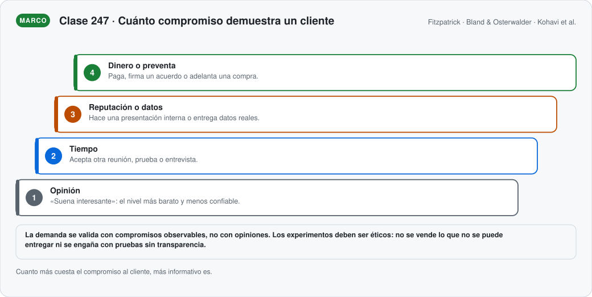

# Clase 247 — Validación antes de construir

<!-- nav:inicio -->
> **Parte 20 · Founder y creación de empresas** — clase 7 de 12 · [índice de la parte](../../README.md) · [temario](../../../../SYLLABUS.md)
<!-- nav:fin -->

**Parte:** 20 — Founder y creación de empresas  
**Nivel:** Etapa 6 — Founder  
**Duración sugerida:** 150–180 minutos · **Estándar:** deep-class-v2

## 🎯 Propósito

Construir es caro y, sobre todo, **tentador**: escribir código, diseñar el local o fabricar un prototipo da sensación de avance, mientras que salir a pedirle a un desconocido que pague por algo que todavía no existe da vergüenza. Por eso muchos fundadores dedican meses a producir algo que nadie había pedido. La validación antes de construir invierte el orden: se busca la **evidencia más barata y más rápida** de que existe un problema real, un comprador con presupuesto y disposición a actuar, y solo entonces se invierte en construir. Pero «validar» es una palabra resbaladiza: una persona amable que dice «me encanta la idea» no valida nada; una persona que **adelanta dinero, firma una carta de intención con condiciones claras o dedica su tiempo a un piloto** sí aporta evidencia.

La clase presenta la validación como una **escalera de compromiso**: cada peldaño exige más del cliente que el anterior (opinión, tiempo, datos, reputación, dinero), y el fundador sube solo cuando el peldaño actual se sostiene con datos. Se apoya en Ries sobre el aprendizaje validado y el producto mínimo viable, en Fitzpatrick sobre cómo obtener información real sin que la gente mienta por cortesía, en Bland sobre pruebas rápidas de hipótesis, en Blank sobre salir del edificio y en Maurya sobre la priorización de riesgos. Al terminar sabrás clasificar la evidencia por su fuerza, diseñar la prueba más barata para cada hipótesis, fijar criterios de éxito antes de mirar los resultados y decidir con disciplina si seguir, ajustar o detener.

## 📚 Resultados de aprendizaje

Al finalizar podrás:

1. **Distinguir** opinión, comportamiento y compromiso como tipos de evidencia.
2. **Ordenar** pruebas desde la más barata hasta la más costosa.
3. **Fijar** criterios de éxito y fracaso antes de ejecutar una prueba.
4. **Diseñar** una prueba de demanda sin construir el producto.
5. **Decidir** seguir, ajustar o detener con base en la evidencia reunida.

## 🧭 Agenda

| Tramo | Qué se hace |
|---|---|
| 0–20 min | Recuperación: ¿qué has construido sin que nadie te lo pidiera? |
| 20–60 min | Escalera de compromiso, criterios previos, pruebas de demanda, sesgos, decisión. |
| 60–105 min | Ejemplo trabajado: prueba de pre-venta con criterios previos y lectura de resultados. |
| 105–150 min | Caso ejecutivo y práctica. |
| 150–175 min | Límites y entregable. |

## 🧩 Conceptos centrales

| Concepto | Definición | Cómo se reconoce |
|---|---|---|
| **Validación** | Reunir evidencia de que una hipótesis crítica se sostiene. | Prueba con criterio previo y resultado medido. |
| **Escalera de compromiso** | Orden de pruebas según lo que se le exige al cliente. | Opinión, tiempo, datos, reputación, dinero. |
| **Criterio previo** | Umbral de éxito fijado antes de ver los datos. | «Si menos de 5 de 40 pagan, se detiene». |
| **Prueba de demanda** | Experimento que mide interés real sin producto terminado. | Página de captación, pre-venta, carta de intención. |
| **Cortesía** | Tendencia a dar respuestas agradables que no comprometen. | «Me encantaría» sin ninguna acción. |
| **Falso positivo** | Señal que parece validar y no lo hace. | Interés de amigos, curiosos o la propia red. |

## 🧠 Modelo mental

**Cómo leer el diagrama.** Una escalera de abajo hacia arriba. **Opinión**: entrevistas y encuestas; es lo más barato y lo menos fiable porque la cortesía contamina. **Tiempo**: el cliente dedica una hora, acepta una demostración o responde un cuestionario largo. **Datos y acceso**: entrega información, conecta su sistema o abre una prueba piloto. **Reputación**: presenta al fundador a un colega o firma una carta de intención. **Dinero**: pre-venta, anticipo o contrato; es la evidencia más fuerte. La nota afirma que un peldaño se sube solo cuando el anterior se sostiene con datos; el pie, que el criterio de éxito se fija antes de mirar el resultado.

## 📖 Desarrollo

### 1. Qué cuenta como validación y qué no

Fitzpatrick sostiene que las conversaciones con clientes están llenas de **cumplidos, ideas vagas y promesas** que no sirven como evidencia. Sirve lo que el cliente **hace** o **entrega**: dedica tiempo, comparte datos, presenta a otra persona, paga o firma. Una clasificación práctica: **opinión** (lo que dice), **comportamiento** (lo que ya hace, como soluciones que usa hoy o dinero que ya gasta) y **compromiso** (lo que está dispuesto a perder para que esto exista). A mayor compromiso, más fuerte la evidencia. Validar no es convencerse de que la idea es buena; es **intentar refutarla** con la prueba más barata posible y observar si resiste.

### 2. La escalera de compromiso

Se ordenan las pruebas por lo que le cuestan al cliente. En el primer peldaño están las **entrevistas** sobre el problema (clase 243); luego, las pruebas que piden **tiempo** (una demostración de una hora, un cuestionario de diagnóstico); después las que piden **acceso o datos** (un piloto con sus archivos reales); luego las que comprometen su **reputación** (presentar a un colega, firmar una carta de intención con condiciones claras); y arriba, el **dinero** (pre-venta, anticipo, contrato). La regla es **no subir antes de que el peldaño actual muestre señal**, y tampoco quedarse abajo indefinidamente: si tras 30 entrevistas nadie da tiempo ni datos, no hace falta construir nada, hace falta cambiar de problema o de segmento.

### 3. Criterios de éxito antes de mirar los resultados

El sesgo más difícil de evitar es **interpretar los datos a favor de la idea**. Para controlarlo, antes de ejecutar la prueba se escribe: la **hipótesis**, el **umbral de éxito**, el **umbral de fracaso** y la **decisión asociada** a cada resultado. Por ejemplo: «Si de 40 empresas contactadas al menos 5 pagan un anticipo, se construye la primera versión; si pagan 2 o menos, se cambia el segmento; entre 3 y 4, se repite la prueba con otro mensaje». Ries habla de **métricas accionables**: aquellas que cambian lo que haces; una cifra que no puede llevar a una decisión distinta no sirve como criterio. Bland propone fijar también el **plazo** y el **tamaño de muestra mínimo** para no decidir con tres respuestas.

### 4. Pruebas de demanda sin producto

Hay formas baratas de medir demanda real. **Página de captación** con propuesta de valor, precio y botón de reserva, enviada a un segmento concreto: mide interés a cambio de un dato de contacto o un anticipo. **Pre-venta** con entrega futura: se explica qué se entregará y cuándo, y se pide un pago o una reserva reembolsable. **Carta de intención** con condiciones: indica volumen, precio y plazo, y la reputación del firmante aumenta su peso. **Piloto pagado** limitado: el cliente paga por una versión manual (clase 248). **Prueba del «humo»**: anuncio o correo con la oferta para medir clics, aclarando después que el producto aún no existe. Estas pruebas deben cumplir con reglas de **honestidad**: no se vende lo que no se puede entregar ni se cobra sin informar claramente el estado del producto y las condiciones de devolución (consulta fuentes oficiales de consumo y asesoría).

### 5. Los falsos positivos

Muchas «validaciones» son falsas. **Amigos y familiares** compran por cariño. **Curiosos** hacen clic por entretenimiento. **Usuarios sin presupuesto** (estudiantes, entusiastas) aman el producto pero no pagan. **Compradores sin autoridad** apoyan la idea y no pueden decidir. **Gratis** es un precio especial: una prueba gratuita mide curiosidad, no disposición a pagar. Y el **efecto de la propia red**: lo que funciona entre conocidos puede no funcionar con extraños (clase 246). Para reducirlos, se prueba con un **segmento definido y ajeno**, se pide un compromiso proporcional y se registra de dónde vino cada señal. Un buen indicador es que el cliente **tome una acción costosa sin que el fundador lo presione**.

### 6. Priorizar qué validar primero

No todo se valida a la vez. Maurya recomienda atacar primero el **riesgo mayor**: ¿existe el problema?, ¿hay un comprador con presupuesto?, ¿se puede alcanzar?, ¿se puede entregar con margen? Se puntúan las hipótesis por **impacto y evidencia disponible** (clase 244) y se diseñan pruebas en orden. Una estrategia útil: **una prueba por hipótesis**, con un responsable, un umbral y una fecha. Si una prueba invalida la hipótesis central, se detiene el resto y se reformula. Blank insiste en que la validación es un proceso de **salir del edificio** y volver con datos, no un trámite de gabinete; el cuaderno de aprendizaje registra qué se creía, qué se probó y qué se concluyó.

### 7. Decidir: seguir, ajustar o detener

Al cerrar una prueba hay tres decisiones. **Seguir**: el umbral de éxito se cumplió; se avanza al siguiente peldaño o se construye la versión mínima (clase 248). **Ajustar**: el resultado es ambiguo o muestra una señal en un subsegmento; se cambia mensaje, segmento o precio y se repite. **Detener**: el umbral de fracaso se cumplió; se documenta el aprendizaje y se cambia el problema o se cierra el proyecto. Detener a tiempo **no es fracasar**; es proteger caja, tiempo y reputación. Kerr y sus coautores (clase 241) muestran que los fundadores subestiman con frecuencia el costo de persistir; una regla escrita antes de comenzar ayuda a decidir sin que el entusiasmo lo distorsione. El registro de decisiones deja constancia y evita repetir errores.

## 📚 Lectura comparada

| Obra | Qué aporta | Qué no resuelve | Pregunta para contrastar |
|---|---|---|---|
| Ries | Aprendizaje validado, producto mínimo y métricas accionables. | Orientado a productos digitales. | ¿Qué métrica cambia mi decisión? |
| Fitzpatrick | Cómo obtener evidencia real evitando la cortesía. | Se centra en conversaciones. | ¿Qué compromiso real obtuve? |
| Bland | Pruebas rápidas de hipótesis con criterios previos. | Marco para ciclos cortos. | ¿Qué umbral fijé antes de empezar? |
| Blank | Salir del edificio y validar con clientes reales. | Requiere disciplina de campo. | ¿Hablé con extraños o con conocidos? |
| Maurya | Priorizar el riesgo mayor y probarlo primero. | Marco de una página. | ¿Cuál es mi riesgo más grande? |

## 🧮 Ejemplo trabajado

**Situación (hipotética).** Un fundador propone una herramienta de pedidos automáticos para panaderías de barrio. Antes de construir, fija una prueba de pre-venta.

**Hipótesis.** Los dueños de panaderías con 3 a 10 empleados pagan 25.000 pesos mensuales por un sistema que registra pedidos de restaurantes y calcula la producción del día.

**Criterios previos (escritos antes de ejecutar).**

| Resultado (de 60 panaderías contactadas) | Decisión |
|---|---|
| 6 o más anticipos de 25.000 pesos | Construir la primera versión |
| 3 a 5 anticipos | Ajustar mensaje o segmento y repetir |
| 2 o menos | Detener y cambiar de problema |

El umbral de éxito de 6 sobre 60 es 10 %.

**Ejecución.** Visita o llamada a 60 panaderías de tres comunas, con una demostración en pantalla de una maqueta y una oferta de anticipo de un mes, con devolución completa si no se entrega en 60 días.

**Resultados.**

| Etapa | Cantidad | Conversión |
|---|---|---|
| Contactadas | 60 | — |
| Aceptaron demostración | 27 | 45 % |
| Dijeron «me interesa» | 15 | 25 % de los 60 |
| Pagaron anticipo | 4 | 6,7 % de los 60 |

4 anticipos equivalen a 100.000 pesos, y 4 ÷ 60 = 6,7 %. Según el criterio previo, es la zona de **ajustar** (3 a 5), no de construir.

**Lectura.** Hubo 15 interesados y solo 4 pagaron. Se revisan los 11 que no pagaron: 7 dijeron que decide el contador o un socio ausente, 3 que ya usan una planilla y 1 que prefería pagar por pedido. Una señal clara: el **comprador** no estaba presente en la conversación.

**Ajuste.** Se repite la prueba con un segundo grupo de 40 panaderías, pidiendo que asista quien decide e incluyendo una opción de pago por pedido (300 pesos cada uno). Criterio nuevo: 4 anticipos o más de 40 (10 %).

**Segunda ronda.** Resultado: 32 aceptan demostración, 9 dicen que sí, 5 pagan anticipo (12,5 %). Supera el umbral. Además, 3 de los 5 eligen la opción por pedido.

**Decisión.** Construir una primera versión con cobro **por pedido** y un piloto con los 9 interesados, con metas de uso semanal. Los anticipos se registran como pasivo hasta la entrega. Se pospone la contratación.

**Cuidados.** Se informa claramente que el producto aún no existe y las condiciones de devolución; las obligaciones tributarias y de consumo se consultan con asesoría y fuentes oficiales; las cifras son ilustrativas.

**Qué muestra.** (1) El criterio previo evitó leer un 6,7 % como éxito. (2) El análisis de los que no pagaron reveló que faltaba el decisor. (3) El ajuste produjo una señal más fuerte y un modelo de cobro distinto.

## 🔀 Comparación y límites

**Validación frente a venta.** Validar busca refutar o confirmar una hipótesis con la prueba más barata; vender busca cerrar clientes con una oferta estable. Se parecen en el gesto, no en el propósito.

**Límites.** Las pruebas sin producto no miden retención ni calidad de entrega. Un resultado positivo con una muestra pequeña es frágil. Algunas industrias (salud, finanzas, alimentos) tienen requisitos regulatorios que impiden ofrecer sin cumplirlos. Una pre-venta debe ser honesta y reembolsable. Las cifras del ejemplo son ilustrativas.

## 🪜 De profesional a owner

| Nivel | Cómo se relaciona con la validación |
|---|---|
| **Profesional** | Aporta datos de clientes y pruebas cuando se le pide. |
| **Jefe / Team Lead** | Pide evidencia antes de aprobar un desarrollo. |
| **Gerente** | Exige criterios previos y revisa resultados. |
| **CEO / Director** | Decide con qué evidencia se invierte o se detiene. |
| **Founder / Owner** | Valida con su propio dinero y tiempo, y se detiene a tiempo. |

## 🏢 Caso ejecutivo

Un fundador quiere lanzar una plataforma de reservas de canchas de pádel para recintos pequeños. Lleva tres meses desarrollando; ha gastado 9 millones de pesos. Antes de lanzar hace una encuesta a 80 jugadores y 70 responden que usarían la aplicación; 12 amigos la prueban y la califican con 4,6 sobre 5. Habló con 10 dueños de recintos: 8 dijeron «muy buena idea», 2 pidieron una reunión y ninguno firmó nada. Un recinto grande ya usa una planilla y un cuaderno; otro, un sistema de una cadena. Los recintos cobran en efectivo en un 60 %. Su socio quiere gastar 6 millones más en publicidad para captar jugadores.

Entrega un **memo de validación** que contenga: (a) la clasificación de la evidencia actual en opinión, comportamiento y compromiso, con su fuerza real; (b) los falsos positivos probables; (c) el peldaño de la escalera en que está y la próxima prueba; (d) la prueba con criterios de éxito y fracaso, tamaño de muestra y plazo; (e) la decisión de seguir, ajustar o detener según los resultados posibles; (f) qué hacer con los 6 millones y las verificaciones legales y tributarias pendientes.

## 🧪 Práctica

1. Clasifica tu evidencia actual en opinión, comportamiento y compromiso.
2. Ubica tu proyecto en la escalera y define la prueba del siguiente peldaño.
3. Escribe criterios de éxito, ajuste y fracaso antes de ejecutarla.
4. Lista tres falsos positivos probables y cómo los descartarás.
5. Diseña una prueba de demanda sin producto con plazo y muestra.

## ⚠️ Errores frecuentes

| Error | Por qué ocurre | Cómo corregirlo |
|---|---|---|
| Contar cumplidos como validación | La cortesía es agradable | Exigir compromiso proporcional. |
| Fijar el umbral después | Se interpreta a favor | Escribirlo antes de ejecutar. |
| Probar solo con amigos | Es fácil | Segmento definido y ajeno. |
| Ofrecer gratis y concluir demanda | Se mide curiosidad | Pedir pago o reserva reembolsable. |
| Construir antes de la prueba | Da sensación de avance | Probar demanda con maqueta. |
| No detener | Costo hundido | Regla de detención escrita. |

## ❓ Preguntas de comprobación

1. ¿Qué diferencia hay entre opinión, comportamiento y compromiso?
2. ¿Qué es la escalera de compromiso?
3. ¿Por qué se fijan criterios antes de ejecutar la prueba?
4. ¿Qué pruebas de demanda existen sin producto?
5. ¿Qué es un falso positivo y cómo se reduce?
6. ¿Cómo se prioriza qué validar primero?
7. ¿Cuándo corresponde detener?

Claves de respuesta

1. Opinión es lo que el cliente dice; comportamiento, lo que ya hace; compromiso, lo que está dispuesto a perder.
2. Un orden de pruebas según lo que exigen al cliente: tiempo, datos, reputación y dinero.
3. Para evitar interpretar los datos a favor de la idea.
4. Página de captación, pre-venta, carta de intención, piloto pagado y prueba del humo, con honestidad.
5. Una señal que parece validar y no lo hace; se reduce con segmentos ajenos y compromiso proporcional.
6. Atacando primero el riesgo mayor según impacto y evidencia disponible.
7. Cuando se cumple el umbral de fracaso fijado de antemano.

## 📥 Entregable

Guarda en `portfolio/247-validacion-antes-de-construir/`:

- `founder-owner-decision-brief.md` (plantilla [Founder owner decision brief](../../../../templates/founder-owner-decision-brief.md)) con el memo del caso ejecutivo;
- `venture-validation.md` (plantilla [Venture validation](../../../../templates/venture-validation.md)) con la prueba y sus criterios;
- `decision-journal.md` con la decisión de seguir, ajustar o detener.

## 📗 Fuentes y verificación

- Eric Ries — *The Lean Startup* (Crown Business, 2011). **Uso en esta clase:** aprendizaje validado, producto mínimo viable y métricas accionables. Lectura selectiva sobre **validación antes de construir**. **Localizador:** [ISBN-13 9780307887894](https://openlibrary.org/isbn/9780307887894).
- Rob Fitzpatrick — *The Mom Test* (CreateSpace, 2014). **Uso en esta clase:** evidencia real sin cortesía, compromiso frente a opinión. Lectura selectiva sobre **validación antes de construir**. **Localizador:** [ISBN-13 9781492180746](https://openlibrary.org/isbn/9781492180746).
- David J. Bland & Alexander Osterwalder — *Testing Business Ideas* (Wiley, 2019). **Uso en esta clase:** pruebas rápidas de hipótesis con criterios previos. Lectura selectiva sobre **validación antes de construir**. **Localizador:** [ISBN-13 9781119551447](https://openlibrary.org/isbn/9781119551447).
- Steve Blank — *The Four Steps to the Epiphany* ([Steve Blank?], 2013). **Uso en esta clase:** salir del edificio y validar con clientes reales. Lectura selectiva sobre **validación antes de construir**. **Localizador:** [ISBN-13 9780989200509](https://openlibrary.org/isbn/9780989200509).
- Ash Maurya — *Running Lean* (O'Reilly Media, 2012). **Uso en esta clase:** priorización del riesgo mayor y pruebas en orden. Lectura selectiva sobre **validación antes de construir**. **Localizador:** [ISBN-13 9781449305178](https://openlibrary.org/isbn/9781449305178).

> **Regla de fuentes para Validación antes de construir:** las obras anteriores estructuran las perspectivas de esta materia; cualquier norma, ley o estándar vivo mencionado debe comprobarse nuevamente en su fuente primaria vigente, incluidas las normas de protección al consumidor y tributarias. Los ejemplos y casos son hipotéticos, con cifras ilustrativas. El desarrollo es original y no reproduce capítulos protegidos.

<!-- pie:inicio -->
---

| Anterior | Índice | Siguiente |
|---|---|---|
| [← 246 · Modelo de negocio](../246-modelo-de-negocio/README.md) | [Parte 20](../../README.md) · [Programa](../../../../SYLLABUS.md) | [248 · MVP y concierge tests →](../248-mvp-y-concierge-tests/README.md) |
<!-- pie:fin -->
