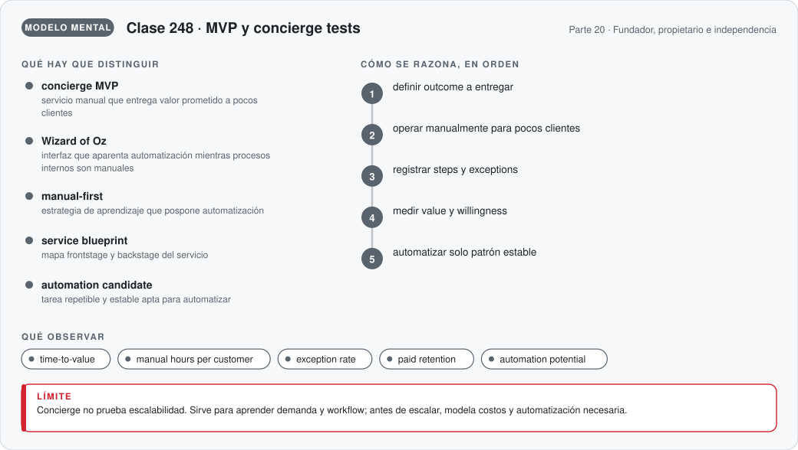

# Clase 248 — MVP y concierge tests

<!-- nav:inicio -->
> **Parte 20 · Founder y creación de empresas** — clase 8 de 12 · [índice de la parte](../../README.md) · [temario](../../../../SYLLABUS.md)
<!-- nav:fin -->

**Parte:** 20 — Founder y creación de empresas  
**Nivel:** Etapa 6 — Founder  
**Duración sugerida:** 150–180 minutos · **Estándar:** deep-class-v2

## 🎯 Propósito

Un producto mínimo viable (MVP) no es una versión mala del producto final ni un prototipo apurado: es **la forma más pequeña de una cosa que permite aprender algo específico con clientes reales**. Muchos fundadores entienden «mínimo» como «incompleto» y lanzan algo que no resuelve el problema, o entienden «viable» como «completo» y tardan un año. La confusión tiene un costo: se aprende tarde, se gasta caja en funciones que nadie usa y, cuando llegan los primeros clientes, el producto ya tiene una forma que cuesta cambiar. Un **concierge test** va más lejos: el fundador entrega el servicio **a mano**, sin tecnología, a unos pocos clientes, para aprender qué necesitan realmente antes de automatizar nada.

La clase presenta el MVP como una **cadena de decisiones**: qué hipótesis se quiere aprender, cuál es la versión más pequeña que la prueba, cómo se entrega a mano al principio, qué se mide, cuándo se automatiza y cuándo se descarta. Se apoya en Ries sobre el aprendizaje validado y el MVP, en Blank sobre el desarrollo de clientes, en Olsen sobre el ajuste producto-mercado, en Torres sobre el descubrimiento continuo y en Maurya sobre la priorización de riesgos. Al terminar sabrás elegir el tipo de MVP adecuado, diseñar un concierge test con criterios de éxito, medir lo que importa, decidir qué automatizar primero y reconocer cuándo el MVP ya no enseña nada nuevo.

## 📚 Resultados de aprendizaje

Al finalizar podrás:

1. **Definir** un MVP por la hipótesis que prueba y no por sus funciones.
2. **Distinguir** concierge, mago de Oz, prototipo y producto parcial.
3. **Diseñar** un concierge test con alcance, medidas y criterios.
4. **Decidir** qué se automatiza y cuándo, según el costo de lo manual.
5. **Reconocer** cuándo el MVP deja de aportar aprendizaje y se debe cambiar.

## 🧭 Agenda

| Tramo | Qué se hace |
|---|---|
| 0–20 min | Recuperación: ¿qué hipótesis prueba lo que estás construyendo? |
| 20–60 min | Tipos de MVP, concierge, alcance, medidas, automatización, salida. |
| 60–105 min | Ejemplo trabajado: concierge de 8 semanas con costo por cliente y decisión de automatizar. |
| 105–150 min | Caso ejecutivo y práctica. |
| 150–175 min | Límites y entregable. |

## 🧩 Conceptos centrales

| Concepto | Definición | Cómo se reconoce |
|---|---|---|
| **MVP** | Versión mínima que permite aprender una hipótesis con clientes. | Hipótesis explícita y medida asociada. |
| **Concierge test** | Servicio entregado a mano, sin tecnología, a pocos clientes. | El fundador hace el trabajo y observa. |
| **Mago de Oz** | Interfaz que parece automática pero se opera a mano. | El cliente cree usar un sistema. |
| **Aprendizaje validado** | Conocimiento confirmado con datos de clientes. | Cambia una decisión. |
| **Costo de lo manual** | Tiempo y dinero por cliente de la entrega manual. | Horas por cliente × costo hora. |
| **Producto-mercado** | Estado en que el producto satisface a un mercado. | Retención y recomendación espontáneas. |

## 🧠 Modelo mental

**Cómo leer el diagrama.** Una cadena de izquierda a derecha. **Hipótesis**: qué se quiere aprender, escrito como afirmación que puede ser falsa. **Versión mínima**: lo más pequeño que permite probarla, sin funciones accesorias. **Entrega a mano**: el fundador presta el servicio manualmente a pocos clientes para ver el valor y los fallos. **Medida**: qué dato dirá si funcionó (uso, repetición, pago, tiempo ahorrado). **Decisión**: automatizar lo que se repite y duele, ajustar lo que no aporta o descartar. La nota afirma que mínimo no es incompleto: debe resolver el problema para unos pocos; el pie, que se automatiza solo lo que ya demostró valor.

## 📖 Desarrollo

### 1. Qué es un MVP y qué no es

Ries define el MVP como la versión de un producto que permite **recoger la máxima cantidad de aprendizaje validado sobre los clientes con el menor esfuerzo**. Tres aclaraciones. Primero, «mínimo» se mide por la hipótesis, no por el número de funciones: si la hipótesis es «los clientes pagan por recibir el informe semanal», el MVP es el informe, no la plataforma. Segundo, «viable» significa que resuelve de verdad el problema a unos pocos clientes; un producto que no cumple su promesa no enseña nada sobre el valor. Tercero, un MVP no es un prototipo para impresionar a inversionistas ni una versión «beta» sin propósito: tiene **una pregunta, una medida y una fecha**. Si no puedes decir qué aprenderás, aún no tienes un MVP.

### 2. Los tipos de MVP

Hay varias formas, de menor a mayor costo. La **página de captación** o el video de demostración miden interés. El **concierge** entrega el servicio a mano y enseña qué valoran y qué fricciones aparecen. El **mago de Oz** presenta una interfaz que parece automática mientras personas operan por detrás: permite probar la experiencia sin construir el motor. El **producto parcial** implementa solo la función central, a veces con herramientas ya hechas (planillas, formularios, mensajería, pagos de terceros). La **pre-venta** con entrega posterior pone dinero en juego (clase 247). Se elige el más barato que pruebe la hipótesis crítica; construir código propio es casi siempre la última opción, no la primera.

### 3. El concierge test

En un concierge test, el fundador **es** el producto: investiga, prepara, entrega y da seguimiento a mano, a entre 5 y 15 clientes. Las ventajas: se aprende qué necesita realmente cada cliente, qué partes del proceso tienen valor y cuáles son accesorias, y se observan las objeciones en tiempo real. Es costoso por cliente, pero barato en total comparado con construir lo equivocado. Se diseña con: **alcance** (qué se promete y qué no), **duración** (por ejemplo, 8 semanas), **precio** (idealmente pagado, aunque sea reducido), **registro** (horas dedicadas, pasos, problemas) y **criterios de éxito** (repetición, pago, recomendación). Torres recomienda mantener un hábito de descubrimiento continuo: lo que se aprende en el concierge alimenta decisiones semanales, no un informe final.

### 4. Alcance y honestidad

Un MVP debe ser **honesto**. Si el servicio se presta a mano, no se afirma que es automático; si es una versión limitada, se dice. La transparencia protege la confianza y, en algunos sectores, es una obligación legal (consumo, datos personales, salud, finanzas): se consultan fuentes oficiales y asesoría antes de ofrecer. También se delimita el alcance: pocos clientes, un segmento, una función, un plazo. Un error común es **prometer de más** para cerrar ventas y luego no poder entregar, o aceptar a cualquier cliente y diluir lo que se aprende. Se seleccionan clientes que **tengan el problema, presupuesto y disposición a dar retroalimentación**, y se acuerda por escrito qué reciben, qué dan a cambio y cómo se detiene la prueba.

### 5. Medir lo que importa

Olsen propone buscar el **ajuste producto-mercado** observando señales de valor: uso repetido, retención, recomendación espontánea y disposición a pagar o a lamentar perder el producto. En un MVP se eligen pocas medidas, y que sean **accionables**: ¿cuántos clientes repiten?, ¿cuánto tiempo ahorran?, ¿cuántos pagan la segunda vez?, ¿cuántas horas me cuesta cada cliente? Se evitan las **medidas de vanidad** (visitas, descargas). Se complementan con **observación cualitativa**: qué hicieron, qué pidieron fuera del alcance, dónde se confundieron. Se fija un umbral antes de comenzar (clase 247), por ejemplo «al menos 6 de 10 clientes renuevan al mes siguiente». Sin umbral, todo resultado parece alentador.

### 6. Cuándo automatizar y qué

La automatización es una decisión económica. Se calcula el **costo de lo manual** por cliente (horas × costo hora) y se compara con el costo de automatizar y con el ahorro esperado. Se automatiza primero lo que **se repite**, **consume más tiempo**, **no requiere criterio humano** y **ya demostró valor**. Se deja manual lo que aún cambia o lo que el cliente valora precisamente por ser personal. Un error frecuente es automatizar demasiado pronto un proceso que luego se modifica. Blank sugiere avanzar con el producto solo en la medida en que el cliente confirma su valor; Ries, aprender antes de escalar. Una regla práctica: automatizar cuando el mismo paso se hizo a mano **más de 20 veces** con el mismo patrón y el ahorro cubre el costo en menos de 6 meses.

### 7. Cuándo el MVP deja de enseñar

Un MVP cumple su función cuando responde la pregunta. Después de eso hay tres caminos. **Escalar**: la hipótesis se confirmó con umbral y se invierte en producto, canal y equipo. **Ajustar** (pivotar): el aprendizaje muestra otro segmento, otro problema o otro modelo. **Cerrar**: no hay evidencia suficiente tras varias iteraciones. Una señal de alarma es **iterar sin cambiar la pregunta**: agregar funciones para retener a un cliente que no ve valor. Otra es **confundir el interés de los primeros adoptantes** con el de un mercado más amplio (Moore, clase 245: el abismo entre ambos). Se registra el aprendizaje en un cuaderno con fecha, hipótesis, resultado y decisión, para que el equipo y los inversionistas vean la lógica de lo que se hizo.

## 📚 Lectura comparada

| Obra | Qué aporta | Qué no resuelve | Pregunta para contrastar |
|---|---|---|---|
| Ries | MVP y aprendizaje validado. | Puede interpretarse como «lanzar rápido». | ¿Qué hipótesis prueba mi MVP? |
| Blank | Desarrollo de clientes y salida del edificio. | Exige trabajo de campo continuo. | ¿Qué confirmó el cliente con hechos? |
| Olsen | Ajuste producto-mercado y medidas de valor. | Enfoque en productos digitales. | ¿Quién lamentaría perder mi producto? |
| Torres | Descubrimiento continuo y decisiones semanales. | Requiere equipo con hábito. | ¿Qué aprendí esta semana? |
| Maurya | Priorizar el riesgo mayor en cada experimento. | Marco de una página. | ¿Qué riesgo reduce este MVP? |

## 🧮 Ejemplo trabajado

**Situación (hipotética).** Una fundadora quiere crear un servicio de «planificación de turnos» para clínicas dentales pequeñas. En lugar de desarrollar un software, hace un concierge test de 8 semanas con 6 clínicas.

**Hipótesis.** Las clínicas con 4 a 8 profesionales pagan 120.000 pesos mensuales por tener los turnos planificados cada semana sin conflictos, y al menos 4 de 6 renuevan.

**Entrega manual.** Cada lunes, la fundadora recibe las disponibilidades por mensaje, arma los turnos en una planilla, resuelve conflictos y envía el plan; durante la semana corrige cambios.

**Registro de horas (promedio por clínica).**

| Actividad semanal | Horas |
|---|---|
| Recoger disponibilidades | 0,5 |
| Armar y revisar el plan | 1,5 |
| Cambios y consultas | 1,0 |
| **Total** | **3,0 horas por semana** |

Las 8 semanas son 24 horas por clínica. Costo de la hora de la fundadora, valorada en 9.000 pesos: 27.000 pesos por semana y **216.000 pesos por clínica** en el período.

**Ingreso.** 120.000 pesos mensuales; en 8 semanas (casi 2 meses) se cobra 240.000 por clínica. Margen sobre el tiempo: 240.000 − 216.000 = **24.000 pesos** por clínica, es decir 10 % del ingreso. El servicio manual apenas se paga.

**Resultados.**

| Medida | Valor |
|---|---|
| Clínicas que pagaron el primer mes | 6 de 6 |
| Clínicas que renuevan al tercer mes | 5 de 6 (83 %) |
| Conflictos de turnos antes del servicio (promedio mensual) | 11 |
| Conflictos durante el servicio | 2 |
| Reducción de conflictos | 82 % (9 de 11) |

La hipótesis de valor se **confirma** (5 de 6 ≥ 4 de 6).

**Qué automatizar.** Del tiempo semanal, 1,5 horas (armar el plan) son repetitivas y siguen reglas claras: se puede automatizar. Recoger disponibilidades (0,5) es automatizable con un formulario. Los cambios y consultas (1,0) requieren criterio y siguen siendo manuales por ahora. Si se automatizan 2,0 de 3,0 horas, el tiempo manual baja a 1,0 hora semanal, es decir 4 horas por mes: 36.000 pesos mensuales frente al ingreso de 120.000, con margen de **84.000 pesos (70 %)**.

**Costo de automatizar.** El desarrollo cuesta 6 millones. El ahorro por clínica es de 2,0 horas × 4 semanas × 9.000 = 72.000 pesos al mes; con 10 clínicas, 720.000 al mes. Recuperación: 6.000.000 ÷ 720.000 ≈ **8,3 meses**. Con 20 clínicas, 4,2 meses. Se decide esperar a tener 12 clínicas pagando (recuperación de 6,9 meses) y avanzar primero con el formulario de disponibilidades, de bajo costo.

**Decisión.** Escalar el concierge a 12 clínicas durante 90 días, automatizar solo el formulario, mantener manual el armado, y revisar la decisión al llegar a 12 clientes con renovación sobre 70 %. Las obligaciones sobre datos de pacientes y de los profesionales se consultan con asesoría y fuentes oficiales.

**Qué muestra.** (1) El concierge probó valor antes de programar. (2) El registro de horas mostró que lo manual aún no era rentable. (3) La decisión de automatizar se basó en recuperación y volumen.

## 🔀 Comparación y límites

**MVP frente a prototipo.** El prototipo muestra cómo se vería o funcionaría algo; el MVP se entrega a clientes reales para aprender sobre valor. Un prototipo puede ser parte de un MVP, no reemplazarlo.

**Límites.** Un concierge no escala y puede subestimar costos si el fundador no valora su tiempo. Los primeros clientes pueden no representar al mercado. Algunos productos (dispositivos médicos, hardware, servicios financieros) no pueden probarse con versiones mínimas sin cumplir requisitos. Las cifras del ejemplo son ilustrativas.

## 🪜 De profesional a owner

| Nivel | Cómo se relaciona con el MVP |
|---|---|
| **Profesional** | Construye y entrega lo que se le pide. |
| **Jefe / Team Lead** | Reduce alcance a lo que prueba la hipótesis. |
| **Gerente** | Mide uso, costo y valor antes de ampliar. |
| **CEO / Director** | Decide cuándo escalar, ajustar o cerrar. |
| **Founder / Owner** | Entrega a mano, aprende y automatiza lo que duele. |

## 🏢 Caso ejecutivo

Una fundadora quiere crear un servicio de entrega semanal de comida preparada para adultos mayores que viven solos. Gastó 14 millones en una aplicación con selección de menús, seguimiento de repartidores y pagos. Tiene 9 clientes y 5 han dejado de usar la aplicación; los demás piden que alguien los llame para pedir. Cada cliente paga 48.000 pesos por semana por 5 almuerzos; el costo de ingredientes y cocina es de 26.000 y el de reparto, 6.500. Una voluntaria llama a cada cliente dos veces por semana (30 minutos en total) y la fundadora dedica 6 horas semanales a coordinar con familiares, valoradas en 7.000 pesos la hora. Una hija de un cliente dice que lo importante es saber que su madre comió. Un inversionista ofrece 20 millones si demuestra 50 clientes en 4 meses.

Entrega un **memo de MVP** que contenga: (a) la hipótesis que realmente se debería probar; (b) el MVP mínimo y el concierge que la probaría, con alcance, duración y criterios; (c) la economía por cliente del servicio manual con las cifras del caso; (d) qué medir y qué descartar de lo construido; (e) qué automatizar, cuándo y con qué recuperación; (f) la decisión sobre el inversionista y las verificaciones sanitarias, de datos y legales pendientes.

## 🧪 Práctica

1. Escribe la hipótesis que prueba tu producto actual.
2. Define el MVP más barato que la pruebe y su plazo.
3. Diseña un concierge con 5 clientes, registro de horas y umbral.
4. Calcula el costo manual por cliente y el margen.
5. Decide qué automatizar según repetición y recuperación.

## ⚠️ Errores frecuentes

| Error | Por qué ocurre | Cómo corregirlo |
|---|---|---|
| MVP sin hipótesis | Se busca «lanzar» | Una pregunta, una medida, una fecha. |
| Mínimo = incompleto | Se confunde precio y calidad | Debe resolver el problema a pocos. |
| Automatizar demasiado pronto | Se quiere escala | Esperar patrón repetido y ahorro. |
| No registrar horas | Se subestima el costo | Registrar cada actividad. |
| Medir vanidad | Es fácil | Medir uso, repetición y pago. |
| Prometer de más | Se quiere cerrar ventas | Alcance honesto y por escrito. |

## ❓ Preguntas de comprobación

1. ¿Cómo se define un MVP?
2. ¿Qué diferencia hay entre concierge y mago de Oz?
3. ¿Qué incluye el diseño de un concierge test?
4. ¿Qué medidas importan en un MVP?
5. ¿Cuándo conviene automatizar?
6. ¿Cómo se calcula el costo de lo manual?
7. ¿Cuándo deja el MVP de enseñar?

Claves de respuesta

1. Como la versión mínima que permite aprender una hipótesis con clientes reales.
2. En el concierge el cliente sabe que el servicio es manual; en el mago de Oz parece automático.
3. Alcance, duración, precio, registro de horas y criterios de éxito.
4. Medidas accionables: uso repetido, pago, retención y costo por cliente.
5. Cuando un paso se repite, consume tiempo, no exige criterio y ya demostró valor.
6. Horas por cliente multiplicadas por el costo de la hora.
7. Cuando responde la pregunta o se itera sin cambiar la pregunta.

## 📥 Entregable

Guarda en `portfolio/248-mvp-y-concierge-tests/`:

- `product-evidence-brief.md` (plantilla [Product evidence brief](../../../../templates/product-evidence-brief.md)) con el memo del caso ejecutivo;
- `venture-validation.md` (plantilla [Venture validation](../../../../templates/venture-validation.md)) con el diseño del concierge y sus criterios;
- `decision-journal.md` con la decisión de automatizar o no.

## 📗 Fuentes y verificación

- Eric Ries — *The Lean Startup* (Crown Business, 2011). **Uso en esta clase:** MVP y aprendizaje validado. Lectura selectiva sobre **mvp y concierge tests**. **Localizador:** [ISBN-13 9780307887894](https://openlibrary.org/isbn/9780307887894).
- Steve Blank — *The Four Steps to the Epiphany* ([Steve Blank?], 2013). **Uso en esta clase:** desarrollo de clientes y salida del edificio. Lectura selectiva sobre **mvp y concierge tests**. **Localizador:** [ISBN-13 9780989200509](https://openlibrary.org/isbn/9780989200509).
- Dan Olsen — *The Lean Product Playbook* (Wiley, 2015). **Uso en esta clase:** ajuste producto-mercado y medidas de valor. Lectura selectiva sobre **mvp y concierge tests**. **Localizador:** [ISBN-13 9781118960875](https://openlibrary.org/isbn/9781118960875).
- Teresa Torres — *Continuous Discovery Habits* (Product Talk LLC, 2021). **Uso en esta clase:** descubrimiento continuo y decisiones semanales. Lectura selectiva sobre **mvp y concierge tests**. **Localizador:** [ISBN-13 9781736633304](https://openlibrary.org/isbn/9781736633304).
- Ash Maurya — *Running Lean* (O'Reilly Media, 2012). **Uso en esta clase:** priorización del riesgo mayor en cada experimento. Lectura selectiva sobre **mvp y concierge tests**. **Localizador:** [ISBN-13 9781449305178](https://openlibrary.org/isbn/9781449305178).

> **Regla de fuentes para MVP y concierge tests:** las obras anteriores estructuran las perspectivas de esta materia; cualquier norma, ley o estándar vivo mencionado debe comprobarse nuevamente en su fuente primaria vigente, incluidas las normas sanitarias, de consumo y de datos personales. Los ejemplos y casos son hipotéticos, con cifras ilustrativas. El desarrollo es original y no reproduce capítulos protegidos.

<!-- pie:inicio -->
---

| Anterior | Índice | Siguiente |
|---|---|---|
| [← 247 · Validación antes de construir](../247-validacion-antes-de-construir/README.md) | [Parte 20](../../README.md) · [Programa](../../../../SYLLABUS.md) | [249 · Pricing temprano →](../249-pricing-temprano/README.md) |
<!-- pie:fin -->
