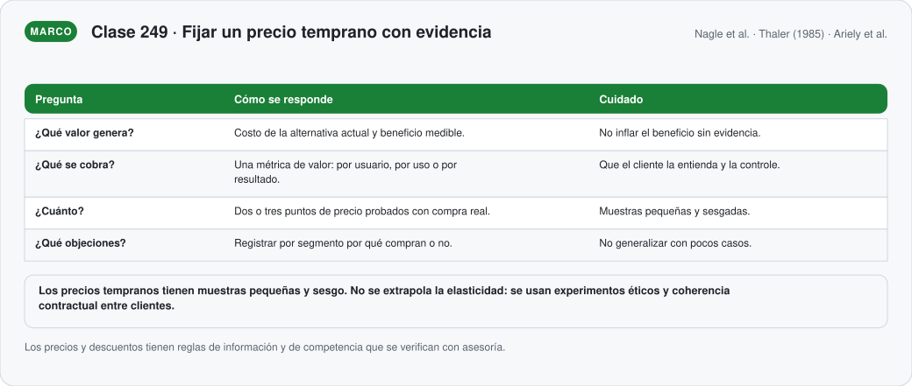

# Clase 249 — Pricing temprano

<!-- nav:inicio -->
> **Parte 20 · Founder y creación de empresas** — clase 9 de 12 · [índice de la parte](../../README.md) · [temario](../../../../SYLLABUS.md)
<!-- nav:fin -->

**Parte:** 20 — Founder y creación de empresas  
**Nivel:** Etapa 6 — Founder  
**Duración sugerida:** 150–180 minutos · **Estándar:** deep-class-v2

## 🎯 Propósito

El precio es la decisión comercial más poderosa y la que más se improvisa. Muchos fundadores fijan el precio sumando costos y agregando un margen, o copiando al competidor más barato, o eligiendo una cifra que «no asuste». El resultado es doble: precios demasiado bajos que no cubren el costo de adquirir y servir, y que además comunican que el producto vale poco; o precios arbitrarios que nadie ha probado. Un precio es, al mismo tiempo, **una señal de valor**, **una decisión de segmento** (quién compra y quién no), **un ingreso** y **una hipótesis** que se prueba con clientes. En una etapa temprana no se busca el precio perfecto: se busca uno **defendible, probado y revisable**.

La clase presenta el pricing temprano como una **tabla de decisión**: el valor que el cliente recibe, el costo de servirlo, el precio de las alternativas, la sensibilidad del segmento y la estructura de cobro (por usuario, por uso, plana, por niveles). Se apoya en Nagle sobre la estrategia y las tácticas de precios basadas en valor, en Thaler sobre la contabilidad mental de los compradores, en Ariely sobre cómo el contexto influye en la percepción de precios, en Kohavi sobre la experimentación controlada y en Skok sobre la economía unitaria de los negocios recurrentes. Al terminar sabrás estimar el rango de precio, diseñar pruebas pequeñas de precio, elegir una estructura de cobro, comunicar el precio y revisarlo sin dañar la confianza.

## 📚 Resultados de aprendizaje

Al finalizar podrás:

1. **Estimar** un rango de precio a partir del valor para el cliente, el costo y las alternativas.
2. **Elegir** una estructura de cobro coherente con el valor y el uso.
3. **Diseñar** una prueba de precio pequeña con criterios previos.
4. **Calcular** el efecto del precio en volumen y en contribución.
5. **Comunicar** y revisar precios sin dañar la relación con los clientes.

## 🧭 Agenda

| Tramo | Qué se hace |
|---|---|
| 0–20 min | Recuperación: ¿cómo fijaste tu precio actual y con qué evidencia? |
| 20–60 min | Valor, costo, alternativas, estructura de cobro, pruebas, comunicación, revisión. |
| 60–105 min | Ejemplo trabajado: prueba de tres precios con contribución y valor percibido. |
| 105–150 min | Caso ejecutivo y práctica. |
| 150–175 min | Límites y entregable. |

## 🧩 Conceptos centrales

| Concepto | Definición | Cómo se reconoce |
|---|---|---|
| **Precio basado en valor** | Precio fijado según el valor que el cliente obtiene. | Se calcula el beneficio y se cobra una parte. |
| **Precio piso** | Mínimo que cubre costos variables y de adquisición. | Costo de servir más margen mínimo. |
| **Precio techo** | Máximo que el cliente aceptaría. | Valor total para el cliente. |
| **Ancla** | Referencia que influye en la percepción del precio. | Plan caro que hace ver razonable el intermedio. |
| **Contribución** | Precio menos costo variable por cliente. | Dinero que queda para costos fijos. |
| **Experimento de precio** | Prueba controlada de distintos precios. | Grupos comparables con precios distintos. |

## 🧠 Modelo mental

**Cómo leer el diagrama.** Una tabla con filas de factores y columnas de qué mirar y qué decide. **Valor para el cliente**: cuánto ahorra o gana; fija el techo. **Costo de servir**: variable y de adquisición; fija el piso. **Alternativas**: lo que el cliente usa hoy, incluyendo hacer nada o hacerlo a mano; fija la referencia. **Sensibilidad del segmento**: quién compra y cómo reacciona a cambios. **Estructura de cobro**: por usuario, uso, plana o por niveles; alinea el cobro con el valor. La nota afirma que el precio es una hipótesis que se prueba; el pie, que el rango va entre el piso y el techo y se decide con datos.

## 📖 Desarrollo

### 1. El precio como decisión de valor, no de costo

Nagle plantea que los precios eficaces se fijan según el **valor que el cliente percibe** y no según el costo del vendedor: el costo marca el piso, el valor marca el techo, y el precio se ubica entre ambos según la competencia, el segmento y la estrategia. Un precio que solo suma costos deja dinero sobre la mesa cuando el valor es alto y expulsa al cliente cuando es bajo. Para estimar el valor se pregunta: ¿cuánto dinero ahorra el cliente?, ¿cuánto gana de más?, ¿qué riesgo evita?, ¿cuánto tiempo recupera? El **valor económico para el cliente** se compara con su mejor alternativa: lo que paga hoy, lo que le costaría hacerlo internamente y lo que perdería si no hace nada. Ese diferencial es el espacio de negociación.

### 2. Piso, techo y referencias

El **piso** es la suma de lo que cuesta atender al cliente (variables) más una fracción del costo de adquirirlo, de modo que la contribución cubra el esfuerzo de ventas en un plazo razonable (clase 246). El **techo** es el valor total para el cliente; en la práctica se cobra una fracción, a menudo entre un cuarto y un tercio del beneficio cuantificable, porque el cliente debe sentir que gana más de lo que paga. Entre ambos están las **referencias**: precios de competidores, de sustitutos y de lo que el cliente gasta hoy. Se tabulan con cuidado, porque una comparación con productos distintos puede engañar. Un precio muy inferior al de las alternativas puede **señalar baja calidad**; uno muy superior exige una diferencia demostrable.

### 3. Estructura de cobro

El **cómo** se cobra pesa tanto como el cuánto. Opciones: **cuota plana** (simple, predecible; deja valor sobre la mesa con clientes grandes), **por usuario** (crece con el equipo; puede desalentar la adopción), **por uso** (alinea cobro y valor; ingresos variables), **por niveles** (segmenta por disposición a pagar), **por resultado** (alinea incentivos; exige medir bien), o **mixta** (base más uso). Se elige la métrica de cobro que **crece cuando crece el valor para el cliente** y que es fácil de entender y medir. Thaler explica que los compradores usan **contabilidad mental**: pagar un monto fijo mensual se percibe distinto a pagar muchas pequeñas compras, aunque sumen igual; la estructura influye en cómo se vive el gasto.

### 4. Contexto, anclas y niveles

Ariely muestra que los compradores no tienen un precio absoluto en la cabeza: juzgan por **comparación**. Un plan alto hace parecer razonable el intermedio, y una opción claramente inferior empuja hacia la elegida. Por eso muchos productos ofrecen **tres niveles**: básico, recomendado y completo. Se diseñan con cuidado: cada nivel debe tener una **razón clara** para existir y no ser una trampa. Dos advertencias. La primera: las anclas funcionan, pero las manipulaciones engañosas dañan la confianza y pueden ser ilegales (publicidad y consumo: consulta fuentes oficiales). La segunda: en ventas entre empresas, los compradores comparan con presupuestos internos y procesos de aprobación, de modo que un precio bajo cierto umbral puede evitar comités y acelerar la compra.

### 5. Probar precios con experimentos pequeños

No se necesita una gran muestra para aprender. Un esquema: se ofrecen **tres precios** a grupos comparables de clientes similares, sin que sepan de los otros; se registran **conversión** (cuántos compran) y **contribución** (precio menos costo variable por comprador) por grupo. Kohavi enseña que la experimentación controlada exige **asignación aleatoria**, **criterios previos** y cuidado con la **significancia**: con muestras pequeñas, diferencias grandes aparentes pueden ser ruido. Por eso se complementa con entrevistas sobre el valor y con la pregunta de **precios que cuestan demasiado o parecen demasiado baratos**. En etapa temprana se busca una dirección, no una certeza; se repite con más datos al crecer.

### 6. Comunicar y negociar

El precio se comunica con el **valor**: lo que el cliente gana, lo que incluye y cómo se compara con su alternativa. Se evitan descuentos improvisados que enseñan al cliente a negociar y erosionan el valor. Si se da un descuento, se cambia por algo: **compromiso de plazo, pago anticipado, testimonio o volumen**. Los **primeros clientes** a veces reciben un precio de lanzamiento: se informa que es temporal y hasta cuándo, y se registra. En ventas complejas, se prepara una **tabla de concesiones** definiendo qué se puede ceder y a cambio de qué. Skok recuerda que en negocios recurrentes un descuento permanente se arrastra durante toda la vida del cliente, así que se pesa contra el valor de vida (clase 246).

### 7. Revisar el precio sin dañar la confianza

El precio se revisa periódicamente: al lanzar, tras 90 días, cuando cambia el costo o el valor, o cuando una prueba lo sugiere. Se sube con **aviso**, **justificación de valor** y, si corresponde, **protección** a clientes actuales por un plazo; se baja solo si la evidencia muestra que el precio impide el crecimiento. Los cambios de precio también tienen **efectos legales y contractuales** (cláusulas de reajuste, avisos mínimos, publicidad): se consultan con asesoría y fuentes oficiales. Un error es mantener un precio de lanzamiento demasiado tiempo porque «nadie se quejó»; la falta de reclamos no prueba que el precio sea el correcto, a veces prueba que es **demasiado bajo**. Se lleva un registro de precios, pruebas y decisiones.

## 📚 Lectura comparada

| Obra | Qué aporta | Qué no resuelve | Pregunta para contrastar |
|---|---|---|---|
| Nagle | Precio basado en valor, piso, techo y segmentación. | Requiere estimar el valor del cliente. | ¿Cuánto vale esto para quien lo compra? |
| Thaler | Contabilidad mental y percepción del gasto. | No fija cifras. | ¿Cómo vive el cliente este cobro? |
| Ariely | Influencia del contexto y de las anclas. | No es guía de diseño de precios. | ¿Con qué se compara mi precio? |
| Kohavi | Experimentación controlada y significancia. | Requiere muestras y disciplina. | ¿La diferencia es señal o ruido? |
| Skok | Economía unitaria en negocios recurrentes. | Enfocado en suscripciones. | ¿Cuánto tarda en recuperarse la adquisición? |

## 🧮 Ejemplo trabajado

**Situación (hipotética).** Un software para clínicas veterinarias pequeñas registra fichas y recordatorios. Costo variable por cliente: 14.000 pesos al mes (alojamiento, mensajería y soporte). Los clientes dicen que el sistema les ahorra el tiempo de una persona a medio tiempo en recordatorios y cobros.

**Valor para el cliente.** Ahorro estimado: 12 horas al mes × 10.000 pesos la hora = 120.000 pesos; más 30.000 en citas recuperadas por recordatorios. **Valor total: 150.000 pesos al mes.**

**Piso y techo.** Piso: costo variable 14.000 + una fracción del costo de adquisición. Techo: 150.000. Una fracción de un tercio del valor da **50.000**; un cuarto da 37.500. El rango razonable inicial es de 30.000 a 50.000.

**Alternativas.** Una planilla (gratis, con trabajo manual) y un competidor que cobra 55.000 con más funciones y sin recordatorios por mensajería.

**Prueba de tres precios.** Se ofrece el mismo plan a tres grupos de 30 clínicas comparables, seleccionadas al azar de una lista de 90, sin que se conozcan los demás precios.

| Precio mensual | Compradores (de 30) | Conversión | Ingreso mensual | Contribución mensual (precio − 14.000) |
|---|---|---|---|---|
| 29.000 | 12 | 40,0 % | 348.000 | 15.000 × 12 = 180.000 |
| 39.000 | 9 | 30,0 % | 351.000 | 25.000 × 9 = 225.000 |
| 49.000 | 5 | 16,7 % | 245.000 | 35.000 × 5 = 175.000 |

**Lectura.** El precio de 39.000 entrega la mayor contribución (225.000), 25 % más que con 29.000 (225.000 ÷ 180.000 = 1,25) y 28,6 % más que con 49.000 (225.000 ÷ 175.000 ≈ 1,29). Aun así, la diferencia entre 12 y 9 compradores, con 30 por grupo, **no es concluyente**: las conversiones de 40 % y 30 % tienen un error de unos 16 a 18 puntos porcentuales en cada grupo (aprox. 1,96 × √(p(1−p)/30)), de modo que los intervalos se solapan. La señal sí es fuerte en un punto: a 49.000 la conversión cae a 16,7 %.

**Relación con el valor.** 39.000 ÷ 150.000 = 26 % del valor total; el cliente recibe 74 %.

**Estructura de cobro.** Se evalúa cobrar por veterinario: las clínicas con 1 profesional pagarían 39.000 y las de 3, 117.000. Entre los compradores, 6 de 9 tienen un solo profesional. Se decide un plan de **tres niveles**: básico (1 profesional, 39.000), clínica (hasta 3, 79.000) y completo (hasta 6, con reportes, 119.000). El nivel intermedio, con un costo variable de 22.000, deja 57.000 de contribución.

**Descuento.** A los 10 primeros clientes se ofrece 29.000 por 6 meses a cambio de un testimonio y de pagar el semestre por adelantado (174.000). Cuesta 10.000 mensuales por cliente respecto de 39.000; se registra como inversión de adquisición y se revisa en 6 meses.

**Decisión.** Lanzar con 39.000 y tres niveles, repetir la prueba con 60 clínicas por grupo en 90 días, y vigilar la conversión por nivel. Se revisarán las cláusulas de reajuste y la facturación con asesoría y fuentes oficiales.

**Cuidados.** Las cifras son ilustrativas; los intervalos son aproximados y la prueba es pequeña.

**Qué muestra.** (1) El valor fijó un techo con evidencia. (2) La prueba mostró la contribución, no solo la conversión. (3) Se reconoció que la muestra es pequeña y se planificó una repetición.

## 🔀 Comparación y límites

**Precio frente a descuento.** El precio comunica y captura valor de manera estable; el descuento es una concesión puntual que debe cambiarse por algo. Un descuento permanente es un precio más bajo no declarado.

**Límites.** Las pruebas de precio con muestras pequeñas son orientativas. Los clientes pueden comparar entre sí y descubrir las diferencias; hay riesgos de reputación y, según la jurisdicción, normas de consumo y de libre competencia que se deben consultar en fuentes oficiales. El valor percibido cambia con el segmento. Las cifras del ejemplo son ilustrativas.

## 🪜 De profesional a owner

| Nivel | Cómo se relaciona con el precio |
|---|---|
| **Profesional** | Conoce el precio y su justificación ante el cliente. |
| **Jefe / Team Lead** | Entiende cómo el costo de servir afecta el margen. |
| **Gerente** | Gestiona descuentos y estructura de cobro por segmento. |
| **CEO / Director** | Decide el posicionamiento y la política de precios. |
| **Founder / Owner** | Prueba, comunica y revisa el precio con evidencia. |

## 🏢 Caso ejecutivo

Un fundador vende un servicio de limpieza de oficinas con control de calidad por fotografías. Fijó 280.000 pesos mensuales por oficina de 100 metros cuadrados, sumando costos (190.000) y un margen de 47 %. Tiene 14 clientes. Una oficina de abogados le dice que pagaría 450.000 por incluir limpieza profunda de alfombras y reportes semanales; un cliente pequeño pide 220.000. El competidor principal cobra 250.000 sin control por fotos. Los clientes que más reclaman son los que pagan menos. Un cliente evitó una multa sanitaria gracias a las fotografías y el fundador estima que el servicio le ahorró 600.000. El costo de incorporar a un cliente nuevo es de 150.000 y la cancelación mensual es de 4 %. Su socio propone bajar a 240.000 para ganar volumen.

Entrega un **memo de precio** que contenga: (a) el valor para el cliente, el piso, el techo y las referencias; (b) la estructura de cobro y los niveles propuestos; (c) la prueba de precio con criterios, muestra y lectura de significancia; (d) el efecto de la propuesta del socio sobre contribución y recuperación del costo de adquisición; (e) la política de descuentos y de revisión de precios; (f) las verificaciones contractuales, tributarias y de consumo pendientes.

## 🧪 Práctica

1. Estima el valor total para tu cliente y su mejor alternativa.
2. Calcula tu piso y define un rango entre piso y techo.
3. Elige una estructura de cobro y justifica la métrica.
4. Diseña una prueba de tres precios con grupos comparables.
5. Escribe tu política de descuentos y de revisión.

## ⚠️ Errores frecuentes

| Error | Por qué ocurre | Cómo corregirlo |
|---|---|---|
| Costo más margen | Es simple | Partir del valor para el cliente. |
| Precio bajo para no asustar | Se teme el rechazo | Probar con evidencia. |
| Descuentos sin contraprestación | Se quiere cerrar | Cambiar por plazo, pago o testimonio. |
| Concluir con muestra pequeña | Se busca certeza | Reconocer el ruido y repetir. |
| No revisar | «Nadie se quejó» | Fechas de revisión y registro. |
| Estructura que no crece con el valor | Se copia al mercado | Elegir métrica ligada al valor. |

## ❓ Preguntas de comprobación

1. ¿Qué fija el piso y qué fija el techo del precio?
2. ¿Qué es la contribución y por qué importa?
3. ¿Qué criterios sigue una buena estructura de cobro?
4. ¿Por qué se ofrecen tres niveles?
5. ¿Cómo se diseña una prueba de precios?
6. ¿Cómo se evita que un descuento erosione el valor?
7. ¿Cuándo se revisa un precio?

Claves de respuesta

1. El costo de servir y adquirir fija el piso; el valor total para el cliente fija el techo.
2. Precio menos costo variable por cliente; es lo que cubre costos fijos y utilidad.
3. Que el cobro crezca con el valor, sea fácil de entender y se pueda medir.
4. Porque las comparaciones guían la percepción y los niveles segmentan la disposición a pagar.
5. Con grupos comparables y asignación aleatoria, criterios previos y lectura de conversión y contribución.
6. Cambiándolo por plazo, pago anticipado, volumen o testimonio.
7. Al lanzar, a los 90 días, cuando cambian costos o valor, o cuando una prueba lo sugiere.

## 📥 Entregable

Guarda en `portfolio/249-pricing-temprano/`:

- `commercial-decision-brief.md` (plantilla [Commercial decision brief](../../../../templates/commercial-decision-brief.md)) con el memo del caso ejecutivo;
- `modelo-financiero-y-memo-de-decision.md` (plantilla [Modelo financiero y memo de decisión](../../../../templates/modelo-financiero-y-memo-de-decision.md)) con la contribución por precio;
- `decision-journal.md` con la prueba de precio y la política de descuentos.

## 📗 Fuentes y verificación

- Thomas T. Nagle, John E. Hogan & Joseph Zale — *The Strategy and Tactics of Pricing* (Taylor & Francis Group, 1987). **Uso en esta clase:** precio basado en valor, piso, techo y segmentación. Lectura selectiva sobre **pricing temprano**. **Localizador:** [ISBN-13 9781315266220](https://openlibrary.org/isbn/9781315266220).
- Richard Thaler — *Mental Accounting and Consumer Choice* (Marketing Science, 1985). **Uso en esta clase:** contabilidad mental y percepción del gasto. Lectura selectiva sobre **pricing temprano**. **Localizador:** [DOI 10.1287/mksc.4.3.199](https://doi.org/10.1287/mksc.4.3.199).
- Dan Ariely, George Loewenstein & Drazen Prelec — *Coherent Arbitrariness: Stable Demand Curves Without Stable Preferences* (The Quarterly Journal of Economics, 2003). **Uso en esta clase:** influencia del contexto y de las anclas en el precio. Lectura selectiva sobre **pricing temprano**. **Localizador:** [DOI 10.1162/00335530360535153](https://doi.org/10.1162/00335530360535153).
- Ron Kohavi, Diane Tang & Ya Xu — *Trustworthy Online Controlled Experiments* (Cambridge University Press, 2020). **Uso en esta clase:** experimentación controlada y lectura de significancia. Lectura selectiva sobre **pricing temprano**. **Localizador:** [ISBN-13 9781108724265](https://openlibrary.org/isbn/9781108724265).
- David Skok — *SaaS Metrics resources* (For Entrepreneurs (Matrix Partners)). **Uso en esta clase:** economía unitaria en negocios recurrentes. **Fuente primaria:** <https://www.forentrepreneurs.com/saas-metrics-2/>.

> **Regla de fuentes para Pricing temprano:** las obras anteriores estructuran las perspectivas de esta materia; cualquier norma, ley o estándar vivo mencionado debe comprobarse nuevamente en su fuente primaria vigente, incluidas las normas de consumo, libre competencia y tributarias. Los ejemplos y casos son hipotéticos, con cifras ilustrativas. El desarrollo es original y no reproduce capítulos protegidos.

<!-- pie:inicio -->
---

| Anterior | Índice | Siguiente |
|---|---|---|
| [← 248 · MVP y concierge tests](../248-mvp-y-concierge-tests/README.md) | [Parte 20](../../README.md) · [Programa](../../../../SYLLABUS.md) | [250 · Primeros diez clientes →](../250-primeros-diez-clientes/README.md) |
<!-- pie:fin -->
