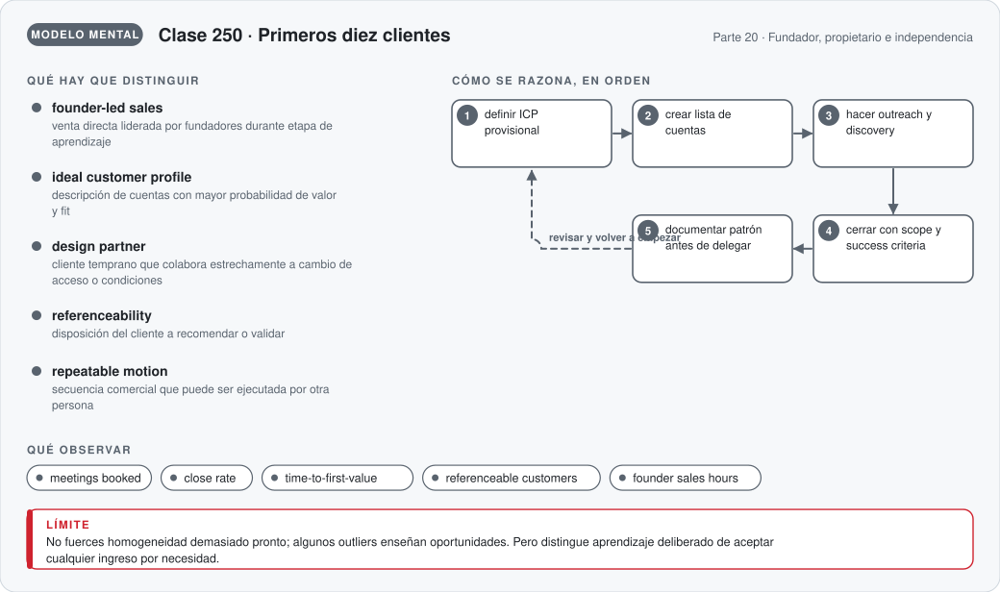

# Clase 250 — Primeros diez clientes

<!-- nav:inicio -->
> **Parte 20 · Founder y creación de empresas** — clase 10 de 12 · [índice de la parte](../../README.md) · [temario](../../../../SYLLABUS.md)
<!-- nav:fin -->

**Parte:** 20 — Founder y creación de empresas  
**Nivel:** Etapa 6 — Founder  
**Duración sugerida:** 150–180 minutos · **Estándar:** deep-class-v2

## 🎯 Propósito

Los primeros diez clientes no son un mercado: son **la evidencia más cara y más valiosa** que tendrá un fundador. Se consiguen con esfuerzo personal, sin canales que escalen, a menudo con precios de lanzamiento y mucha atención a medida. Por eso se cometen dos errores opuestos. El primero es tratarlos como «ventas pequeñas» y no aprender de ellos: se cierran, se atienden y no se registra qué los convenció, qué casi los hizo irse ni qué pidieron. El segundo es **convertir a esos diez en el molde del producto**: construir para el cliente más ruidoso, aceptar encargos a medida que no se repetirán y terminar con una consultoría disfrazada de empresa de producto. Los primeros diez enseñan quién compra, por qué, cómo se llega a ellos y qué los hace quedarse.

La clase presenta el proceso como una **cadena comercial**: elegir un perfil de cliente ideal, construir una lista, contactar con un mensaje claro, conversar y calificar, cerrar con condiciones explícitas, incorporar y aprender, y decidir qué se repite. Se apoya en Ross sobre ventas predecibles, en Rackham sobre la venta basada en preguntas, en Dixon sobre la venta que desafía la forma de pensar del cliente, en Skok sobre métricas del embudo y en Moore sobre cruzar el abismo desde los primeros adoptantes. Al terminar sabrás definir tu perfil de cliente ideal, armar una lista y un mensaje, llevar el embudo con cifras, cerrar con condiciones claras, incorporar a cada cliente aprendiendo de él y decidir cuándo pasar de ventas del fundador a un proceso repetible.

## 📚 Resultados de aprendizaje

Al finalizar podrás:

1. **Definir** un perfil de cliente ideal con criterios observables.
2. **Construir** una lista y un mensaje de contacto verificables.
3. **Conducir** conversaciones de venta basadas en preguntas y calificación.
4. **Cerrar** con condiciones, alcance y expectativas explícitas.
5. **Aprender** de cada cliente para decidir qué se repite y qué se rechaza.

## 🧭 Agenda

| Tramo | Qué se hace |
|---|---|
| 0–20 min | Recuperación: ¿cómo conseguiste o conseguirías a tu próximo cliente y por qué lo harían? |
| 20–60 min | Perfil ideal, lista, mensaje, conversación, cierre, incorporación, patrón. |
| 60–105 min | Ejemplo trabajado: embudo para los diez primeros con costo por cliente. |
| 105–150 min | Caso ejecutivo y práctica. |
| 150–175 min | Límites y entregable. |

## 🧩 Conceptos centrales

| Concepto | Definición | Cómo se reconoce |
|---|---|---|
| **Perfil de cliente ideal** | Descripción de quien más valor obtiene y más fácil compra. | Tamaño, sector, problema, urgencia, decisor. |
| **Embudo** | Etapas desde el contacto hasta el cliente que paga. | Contactos, respuestas, reuniones, propuestas, cierres. |
| **Calificación** | Verificar que el prospecto tiene problema, presupuesto y decisor. | Preguntas antes de proponer. |
| **Primeros adoptantes** | Clientes que toleran un producto incompleto por un beneficio mayor. | Dolor intenso, soluciones caseras. |
| **Cliente a medida** | Cliente cuyas exigencias desvían el producto. | Pide funciones que nadie más pide. |
| **Venta del fundador** | Ventas hechas por quien conoce el producto y el problema. | Aprendizaje directo y proceso aún no repetible. |

## 🧠 Modelo mental

**Cómo leer el diagrama.** Una cadena de izquierda a derecha. **Perfil ideal**: a quién vender primero, con criterios observables. **Lista**: nombres reales con dato de contacto y motivo para hablarles. **Mensaje**: una propuesta breve centrada en su problema. **Conversación**: preguntas, calificación y propuesta. **Cierre**: alcance, precio, plazo y expectativas por escrito. **Incorporación**: arranque, seguimiento y aprendizaje. **Patrón**: qué se repite en quienes compran y se quedan. La nota afirma que cada cliente es una fuente de aprendizaje antes que de ingreso; el pie, que se decide qué repetir y qué rechazar.

## 📖 Desarrollo

### 1. Elegir un perfil de cliente ideal

Moore recomienda comenzar por **un nicho concreto** donde el producto resuelva un problema urgente de manera casi completa, en vez de intentar vender a «todas las empresas». El perfil de cliente ideal se define con **criterios observables** y no con adjetivos: sector, tamaño (empleados, ingresos), tecnología que usa, problema que enfrenta, urgencia (qué lo obliga a actuar este trimestre), quién decide y quién paga, y señales de que ya gasta en alternativas. Se escribe una descripción de una página y se revisa con los clientes que compran. Un perfil estrecho **parece limitar** pero concentra el mensaje, reduce el costo de adquisición y facilita las referencias dentro del mismo nicho. Los primeros diez deberían parecerse entre sí más de lo que cómodamente se admitiría.

### 2. Construir la lista

Con el perfil, se arma una lista de **nombres reales**: empresa, persona, cargo, dato de contacto y motivo de relevancia («acaba de abrir una sucursal», «publicó una oferta de empleo para este cargo»). Ross sostiene que las ventas predecibles parten de **un proceso con roles y métricas**, pero en la etapa de los diez primeros el fundador mismo recorre la lista. Las fuentes: la red propia (con cuidado, pues contamina la evidencia, clase 247), referencias de entrevistas anteriores, comunidades del sector, ferias, directorios públicos, redes profesionales. Se respetan las normas sobre **datos personales y comunicaciones comerciales** (consentimiento, derecho a excluirse); se consultan fuentes oficiales y asesoría. Una lista de 100 nombres bien elegidos vale más que 1.000 sin criterio.

### 3. El mensaje de contacto

El primer mensaje debe ser **breve, específico y centrado en el cliente**: un problema que reconoce, una pista de que el fundador lo entiende y una petición pequeña («¿15 minutos para ver si le sirve?»). Se evitan listas de funciones, adjetivos y presentaciones largas. Dixon plantea que los vendedores más eficaces **aportan una perspectiva nueva** sobre el negocio del cliente: un dato o una observación que cambia cómo ve su problema, y luego conectan con la solución. Se prueban dos o tres variantes con grupos pequeños y se mide la tasa de respuesta. Una regla útil: si el mensaje podría enviarse a cualquier empresa sin cambiar nada, es demasiado genérico. Se responde con rapidez y se hace seguimiento educado, sin acosar.

### 4. Conversar y calificar con preguntas

Rackham, tras estudiar miles de visitas de ventas, concluye que en ventas complejas el éxito se asocia con **preguntar bien**: situación (cómo trabaja hoy), problema (qué le duele), implicación (qué cuesta ese problema) y necesidad de solución (qué valor tendría resolverlo). Se escucha más de lo que se habla. La **calificación** verifica cinco puntos: existe el problema, tiene un costo, hay presupuesto, hay un decisor presente y hay una razón para actuar ahora. Si faltan, se registra y no se insiste con una propuesta. Se evita la demostración temprana de todas las funciones; se muestra solo lo que responde a lo conversado. Después de cada reunión se anotan: lo que dijo, lo que pidió, las objeciones y el siguiente paso con fecha.

### 5. Cerrar con condiciones claras

Un cierre sano deja por escrito: **alcance** (qué se entrega y qué no), **precio y forma de pago**, **plazo**, **responsabilidades del cliente** (datos, personas, tiempos), **criterios de éxito** y **cómo se termina** la relación. Los primeros clientes suelen recibir condiciones de lanzamiento (precio reducido a cambio de retroalimentación, testimonio o referencias); se explicitan y se limitan en el tiempo. Se rechazan encargos que **desvían** el producto: un cliente que paga bien por una función que ningún otro necesita no es un buen cliente temprano. Las cláusulas contractuales, tributarias y de datos se revisan con asesoría y fuentes oficiales; un contrato mal hecho cuesta más que la venta.

### 6. Incorporar y aprender

La incorporación es parte de la venta: si el cliente no obtiene un primer resultado en pocos días, la probabilidad de cancelar sube. Se define un **primer valor** (la primera cosa que el cliente logra) y un plan de 30 días con reuniones de seguimiento. Se registra para cada cliente: por qué compró, qué alternativa usaba, qué le costó decidir, qué uso hace, qué le falta, qué pidió y qué pagó. Torres y Blank (clases 243 y 248) enseñan que el descubrimiento continúa tras la venta; los clientes iniciales son la mejor fuente de datos. Un cuaderno por cliente y una **revisión mensual** de patrones evitan que el aprendizaje se pierda en la memoria del fundador.

### 7. De diez clientes a un proceso repetible

Tras diez clientes se revisa el patrón: ¿se parecen?, ¿qué los llevó a comprar?, ¿qué canal funcionó?, ¿cuánto costó cada uno?, ¿cuántos se quedan? Skok recomienda seguir el **embudo con tasas por etapa** y el **costo de adquisición**; si el fundador consigue clientes solo con esfuerzo personal y no hay un canal que se pueda delegar, aún no hay un proceso. Moore advierte el **abismo** entre los primeros adoptantes y el mercado mayoritario: lo que convenció a los primeros (visión, tolerancia) puede no convencer a los siguientes (que quieren una solución completa y referencias). Se documenta el proceso (perfil, mensaje, preguntas, propuesta, cierre) para entrenar a otro vendedor solo cuando los resultados se repiten.

## 📚 Lectura comparada

| Obra | Qué aporta | Qué no resuelve | Pregunta para contrastar |
|---|---|---|---|
| Moore | Nicho inicial y cruce del abismo. | Marco de tecnología emergente. | ¿Mi nicho es lo bastante estrecho? |
| Ross | Ventas predecibles con roles y métricas. | Pensado para etapas posteriores. | ¿Qué parte es repetible hoy? |
| Rackham | Venta consultiva basada en preguntas. | Estudio de ventas complejas. | ¿Qué preguntas hice antes de proponer? |
| Dixon | Aportar una perspectiva que cambie la visión del cliente. | Exige conocimiento profundo del sector. | ¿Qué le enseñé que no sabía? |
| Skok | Embudo con tasas y costo de adquisición. | Enfocado en negocios recurrentes. | ¿Cuánto me cuesta cada cliente? |

## 🧮 Ejemplo trabajado

**Situación (hipotética).** Una fundadora vende un servicio de control de inventario con alertas para ferreterías medianas. Su meta: diez clientes en 120 días.

**Perfil ideal.** Ferreterías con 4 a 12 empleados, dos o más sucursales, que hoy usan planillas, con un dueño que decide. Lista inicial: 120 ferreterías en tres comunas.

**Embudo observado en 12 semanas.**

| Etapa | Cantidad | Conversión desde la etapa anterior |
|---|---|---|
| Contactos enviados | 120 | — |
| Respuestas | 30 | 25 % |
| Reuniones | 21 | 70 % |
| Propuestas | 14 | 66,7 % |
| Clientes | 7 | 50 % |

De 120 contactos a 7 clientes: 5,8 % (7 ÷ 120). Con esa tasa, para 10 clientes se necesitan 10 ÷ 0,0583 ≈ **172 contactos**.

**Costo de adquisición.** Se registra el tiempo total de la fundadora: 180 horas en 12 semanas, valoradas a 9.000 pesos = 1.620.000; más 380.000 en herramientas, transporte y materiales. Total 2.000.000. **CAC = 2.000.000 ÷ 7 ≈ 285.714 pesos.**

**Economía por cliente.** Precio: 55.000 pesos mensuales; costo variable: 11.000; contribución: 44.000. Recuperación: 285.714 ÷ 44.000 ≈ **6,5 meses**. Si se cancela 5 % mensual (permanencia de 20 meses), el valor de vida es 44.000 × 20 = 880.000, relación 880.000 ÷ 285.714 ≈ 3,1.

**Patrón de los siete.** 5 de 7 tienen dos sucursales; 5 de 7 mencionaron una pérdida por quiebres de stock en el último año; 6 de 7 decidieron en la misma reunión en que estaba el dueño. Los 7 que no compraron (de 14 propuestas): 4 no tenían decisor presente, 2 usaban un sistema de un proveedor, 1 dijo que no tenía urgencia. Los dos que pidieron integraciones a medida fueron rechazados: el costo de desarrollo (3 millones) superaba su contribución de un año (528.000).

**Ajuste.** Se calificará con una pregunta inicial: «¿quién decide y puede estar en la reunión?». Se priorizan ferreterías con dos o más sucursales y quiebres recientes. Esa regla busca subir la conversión de propuesta a cliente de 50 % a 60 %.

**Proyección a diez.** Con las tasas observadas hacen falta unos 172 contactos; ya se enviaron 120, y quedan 52 más. Tiempo estimado: 5 semanas adicionales. Con 10 clientes la contribución mensual será 440.000 pesos, aún lejos de cubrir un equipo; la meta del período es aprender, no cubrir costos.

**Decisión.** Completar los diez clientes con el perfil ajustado, rechazar encargos a medida, documentar el proceso en una página y recién entonces evaluar si un segundo canal (alianza con distribuidores) puede bajar el CAC de 285.714 a menos de 200.000. Las obligaciones de datos, facturación y contratos se consultan con asesoría y fuentes oficiales.

**Cuidados.** Las tasas provienen de una muestra pequeña; son una orientación. Las cifras son ilustrativas.

**Qué muestra.** (1) El embudo permitió proyectar el esfuerzo. (2) El patrón de los siete afinó el perfil. (3) Rechazar el encargo a medida protegió el producto y la economía.

## 🔀 Comparación y límites

**Venta del fundador frente a proceso comercial.** La primera busca aprender y cerrar los primeros clientes con atención personal; el segundo busca repetir resultados con otras personas, medidas y herramientas. Se pasa de uno a otro cuando los resultados se repiten.

**Límites.** Con diez clientes, las estadísticas son frágiles. Los primeros adoptantes no representan al mercado. El perfil estrecho puede limitar el crecimiento si el nicho es pequeño. Las normas de comunicaciones comerciales y datos personales varían y se deben consultar en fuentes oficiales. Las cifras son ilustrativas.

## 🪜 De profesional a owner

| Nivel | Cómo se relaciona con los primeros clientes |
|---|---|
| **Profesional** | Atiende y registra lo que piden los clientes. |
| **Jefe / Team Lead** | Entiende el perfil y el proceso de incorporación. |
| **Gerente** | Gestiona el embudo y la tasa por etapa. |
| **CEO / Director** | Decide el nicho y cuándo escalar el proceso. |
| **Founder / Owner** | Vende, atiende y aprende de cada uno de los primeros diez. |

## 🏢 Caso ejecutivo

Un fundador ofrece un servicio de mantenimiento preventivo de ascensores para edificios residenciales de tamaño medio. Tras cuatro meses tiene 5 clientes: dos administradores profesionales, dos comités de edificio y una inmobiliaria. Precio: 190.000 pesos mensuales por ascensor; costo variable: 120.000. Contactó 90 administradores: 18 respondieron, 12 tuvieron reunión, 8 recibieron propuesta y 5 compraron. Dedicó 220 horas (a 8.000 pesos la hora) y gastó 420.000 en traslados y materiales. Los dos administradores profesionales administran 14 edificios y 22 edificios; los comités compraron más lento (seis semanas contra dos) y reclaman más. La inmobiliaria pidió un contrato con penalizaciones que el fundador no puede cumplir con su equipo actual. Un administrador con 22 edificios pide un precio de 150.000 por ascensor para llevar todos.

Entrega un **memo de primeros clientes** que contenga: (a) el perfil de cliente ideal revisado con los datos del caso; (b) el embudo, las tasas por etapa y el costo de adquisición; (c) el patrón de quienes compraron y de quienes no; (d) la decisión sobre la inmobiliaria y sobre el descuento del administrador, con la contribución resultante; (e) el plan para llegar a diez clientes con proyección de contactos y tiempo; (f) las verificaciones contractuales, de seguridad y legales pendientes.

## 🧪 Práctica

1. Escribe tu perfil de cliente ideal con criterios observables.
2. Arma una lista de 30 nombres reales con motivo de contacto.
3. Redacta dos variantes de mensaje y define cómo medirás la respuesta.
4. Diseña cinco preguntas de calificación para tu primera reunión.
5. Calcula tasas por etapa y CAC de tus primeras ventas.

## ⚠️ Errores frecuentes

| Error | Por qué ocurre | Cómo corregirlo |
|---|---|---|
| Vender a todos | Se teme perder ventas | Un nicho concreto primero. |
| Mensaje genérico | Es más rápido | Aportar algo específico del cliente. |
| Proponer sin calificar | Entusiasmo | Verificar problema, presupuesto y decisor. |
| Aceptar encargos a medida | Se necesita ingreso | Rechazar los que desvían el producto. |
| No registrar | Se confía en la memoria | Cuaderno por cliente y revisión mensual. |
| Contratar vendedores demasiado pronto | Se quiere escala | Documentar un proceso que ya se repite. |

## ❓ Preguntas de comprobación

1. ¿Qué hace útil un perfil de cliente ideal?
2. ¿Qué debe contener un mensaje de contacto?
3. ¿Qué verifica la calificación?
4. ¿Qué debe quedar por escrito en el cierre?
5. ¿Qué se registra de cada cliente?
6. ¿Por qué conviene rechazar ciertos encargos?
7. ¿Cuándo se pasa de la venta del fundador a un proceso?

Claves de respuesta

1. Que concentra el mensaje y el esfuerzo en quien más valor obtiene, con criterios observables.
2. Un problema que el cliente reconoce, una perspectiva específica y una petición pequeña.
3. Problema, costo, presupuesto, decisor presente y razón para actuar ahora.
4. Alcance, precio y pago, plazo, responsabilidades, criterios de éxito y forma de terminar.
5. Por qué compró, alternativa previa, uso, carencias, pedidos y pago.
6. Porque desvían el producto y su costo supera la contribución.
7. Cuando los resultados se repiten y el proceso está documentado.

## 📥 Entregable

Guarda en `portfolio/250-primeros-diez-clientes/`:

- `commercial-decision-brief.md` (plantilla [Commercial decision brief](../../../../templates/commercial-decision-brief.md)) con el memo del caso ejecutivo;
- `product-evidence-brief.md` (plantilla [Product evidence brief](../../../../templates/product-evidence-brief.md)) con el patrón de los clientes;
- `decision-journal.md` con la decisión sobre encargos a medida y descuentos.

## 📗 Fuentes y verificación

- Geoffrey A. Moore — *Crossing the Chasm* (HarperBusiness, 1995). **Uso en esta clase:** nicho inicial y abismo entre primeros adoptantes y mercado mayoritario. Lectura selectiva sobre **primeros diez clientes**. **Localizador:** [ISBN-13 9780887307171](https://openlibrary.org/isbn/9780887307171).
- Aaron Ross & Marylou Tyler — *Predictable Revenue* (Pebblestorm, 2020). **Uso en esta clase:** ventas predecibles con proceso, roles y métricas. Lectura selectiva sobre **primeros diez clientes**. **Localizador:** [ISBN-13 9780984380244](https://openlibrary.org/isbn/9780984380244).
- Neil Rackham — *SPIN Selling* (Highbridge Audio, 1998). **Uso en esta clase:** venta consultiva basada en preguntas de situación, problema, implicación y necesidad. Lectura selectiva sobre **primeros diez clientes**. **Localizador:** [ISBN-13 9781565112605](https://openlibrary.org/isbn/9781565112605).
- Matthew Dixon & Brent Adamson — *The Challenger Sale* (Portfolio/Penguin, 2011). **Uso en esta clase:** aportar una perspectiva que cambie la visión del cliente. Lectura selectiva sobre **primeros diez clientes**. **Localizador:** [ISBN-13 9781591844358](https://openlibrary.org/isbn/9781591844358).
- David Skok — *SaaS Metrics resources* (For Entrepreneurs (Matrix Partners)). **Uso en esta clase:** embudo con tasas por etapa y costo de adquisición. **Fuente primaria:** <https://www.forentrepreneurs.com/saas-metrics-2/>.

> **Regla de fuentes para Primeros diez clientes:** las obras anteriores estructuran las perspectivas de esta materia; cualquier norma, ley o estándar vivo mencionado debe comprobarse nuevamente en su fuente primaria vigente, incluidas las normas de datos personales, comunicaciones comerciales y contratos. Los ejemplos y casos son hipotéticos, con cifras ilustrativas. El desarrollo es original y no reproduce capítulos protegidos.

<!-- pie:inicio -->
---

| Anterior | Índice | Siguiente |
|---|---|---|
| [← 249 · Pricing temprano](../249-pricing-temprano/README.md) | [Parte 20](../../README.md) · [Programa](../../../../SYLLABUS.md) | [251 · Cofundadores, equity y acuerdos →](../251-cofundadores-equity-y-acuerdos/README.md) |
<!-- pie:fin -->
