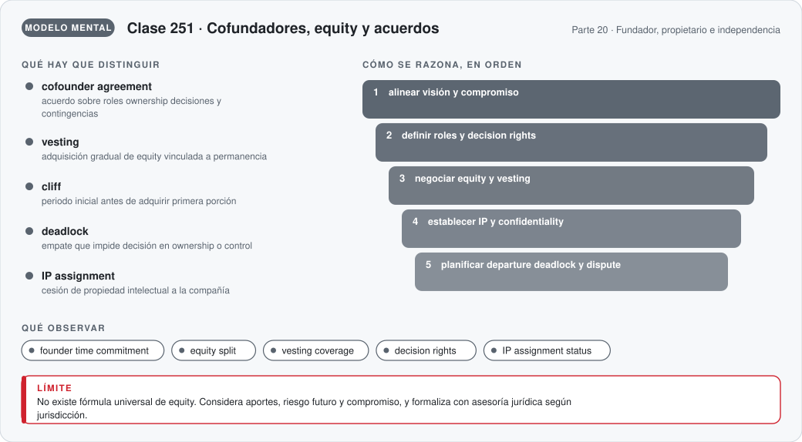

# Clase 251 — Cofundadores, equity y acuerdos

<!-- nav:inicio -->
> **Parte 20 · Founder y creación de empresas** — clase 11 de 12 · [índice de la parte](../../README.md) · [temario](../../../../SYLLABUS.md)
<!-- nav:fin -->

**Parte:** 20 — Founder y creación de empresas  
**Nivel:** Etapa 6 — Founder  
**Duración sugerida:** 150–180 minutos · **Estándar:** deep-class-v2

## 🎯 Propósito

La decisión más difícil de revertir en una empresa nueva no es el producto ni el precio: es **con quién se funda y cómo se reparte la propiedad**. Una mala división de la sociedad se arrastra durante años, afecta las rondas de inversión, desmotiva a quien aporta más de lo que recibe y, cuando un cofundador se va, puede dejar a la empresa con una persona que ya no trabaja pero conserva una parte grande. Los conflictos entre cofundadores figuran entre las causas más citadas del fracaso de empresas nuevas, y casi siempre se anuncian temprano: roles confusos, expectativas distintas de dedicación, ausencia de reglas para salir. Hablar de dinero, de poder y de salida con alguien a quien se aprecia es incómodo, y por eso se posterga hasta que el costo es alto.

La clase presenta la relación entre cofundadores como un **sistema de tres columnas**: **quién** (complementariedad, confianza y compromiso), **cuánto** (reparto de propiedad, adquisición gradual y dilución) y **cómo** (acuerdos de gobierno, decisiones, salida y resolución de conflictos). Se apoya en Wasserman sobre el dilema entre riqueza y control y las decisiones tempranas del fundador, en Hellmann y Wasserman sobre cómo se dividen las partes en la práctica, en Ruef y coautores sobre la formación de equipos fundadores, en Feld sobre términos de inversión y relaciones con inversionistas y en Katzenbach sobre qué hace que un grupo sea un equipo. Al terminar sabrás evaluar a un posible cofundador, proponer un reparto con criterios, entender adquisición gradual (vesting) y dilución, redactar los puntos de un acuerdo y preparar una salida ordenada. Las normas societarias se consultan en fuentes oficiales y con asesoría; aquí no se interpretan.

## 📚 Resultados de aprendizaje

Al finalizar podrás:

1. **Evaluar** la complementariedad, el compromiso y la confianza de un posible cofundador.
2. **Proponer** un reparto de propiedad con criterios explícitos y no con una división automática.
3. **Calcular** el efecto de adquisición gradual, salida y dilución sobre cada participación.
4. **Listar** los puntos que debe cubrir un acuerdo entre socios, para revisarlos con asesoría.
5. **Preparar** una salida ordenada y un mecanismo de resolución de conflictos.

## 🧭 Agenda

| Tramo | Qué se hace |
|---|---|
| 0–20 min | Recuperación: ¿con quién fundarías y qué no te atreves a decirle? |
| 20–60 min | Selección, reparto, adquisición gradual, dilución, acuerdos, gobierno y salida. |
| 60–105 min | Ejemplo trabajado: reparto, vesting, salida y dilución con cifras. |
| 105–150 min | Caso ejecutivo y práctica. |
| 150–175 min | Límites y entregable. |

## 🧩 Conceptos centrales

| Concepto | Definición | Cómo se reconoce |
|---|---|---|
| **Equity** | Participación en la propiedad de la empresa. | Porcentaje de acciones o derechos sociales. |
| **Vesting** | Adquisición gradual del derecho a la participación. | Plazo total y período inicial sin derechos. |
| **Cliff** | Período inicial tras el cual se adquiere el primer tramo. | Un año sin derechos, luego un tramo. |
| **Dilución** | Reducción del porcentaje al emitirse nuevas participaciones. | Ronda de inversión o bolsa de opciones. |
| **Acuerdo de socios** | Contrato que regula decisiones, transferencias y salida. | Derechos, deberes y reglas de salida. |
| **Roles** | Responsabilidades claras de cada cofundador. | Quién decide qué. |

## 🧠 Modelo mental

**Cómo leer el diagrama.** Tres columnas. **Quién**: habilidades complementarias, historia de trabajo conjunto, compromiso de tiempo y confianza. **Cuánto**: reparto según aportes y riesgos, adquisición gradual con un período inicial y dilución futura. **Cómo**: roles y decisiones, acuerdo escrito, salida ordenada y mecanismo para resolver desacuerdos. La nota afirma que se habla de dinero, poder y salida antes de necesitarlo; el pie, que el acuerdo se revisa con asesoría legal y fuentes oficiales vigentes.

## 📖 Desarrollo

### 1. Elegir con quién fundar

Ruef, Aldrich y Carter estudiaron cómo se forman los equipos fundadores y encontraron que muchos se constituyen entre **personas con vínculos previos** (amistad, familia, trabajo conjunto), lo que facilita la confianza pero reduce la diversidad de habilidades. Wasserman muestra que las decisiones tempranas sobre **quién entra** tienen consecuencias duraderas sobre el control y el rendimiento. Criterios para evaluar: **complementariedad** (¿qué sabe esta persona que yo no sé?), **historia** (¿hemos trabajado juntos bajo presión?), **compromiso** (¿tiempo completo o parcial, y por cuánto?), **valores y expectativas** (ambición, tolerancia al riesgo, horizonte), **situación personal** (ingresos, dependientes, cuánto tiempo puede sostenerse sin sueldo) y **confianza** para decir cosas incómodas. Un periodo de **trabajo conjunto previo** (un proyecto de dos o tres meses) revela más que cualquier conversación.

### 2. Cómo repartir: criterios, no una regla automática

Hellmann y Wasserman observan que muchos equipos reparten de forma **pareja** por comodidad, aunque los aportes y riesgos sean distintos; otros reparten pronto y no revisan. No hay una fórmula correcta, pero sí **criterios** que pueden ponerse sobre la mesa: **idea y trabajo previo**, **dedicación** (tiempo completo o parcial), **capital aportado**, **habilidad crítica** para el éxito, **riesgo personal asumido** (renunciar a un empleo), **red y credibilidad** y **rol futuro** (quien será CEO). Se asigna un peso a cada criterio, se puntúa a cada persona y se discute el resultado. Un reparto pareja es defendible si los aportes son similares y se quiere preservar la cohesión; lo importante es que sea una **decisión consciente**. Wasserman recuerda además que el reparto interactúa con el **control**: el que tiene más participación pesa más en las decisiones.

### 3. Adquisición gradual (vesting) y período inicial

El reparto debe depender del **tiempo de permanencia y del trabajo realizado**, no solo de la firma. La práctica común: un plazo total (por ejemplo, 4 años) con **adquisición mensual** tras un período inicial (cliff) de un año. Si un cofundador se va antes del período inicial, no conserva nada de lo no adquirido; si se va a los 18 meses, conserva lo adquirido hasta entonces. Esto protege a quienes se quedan y evita que una persona que abandona al mes seis conserve una parte grande. A veces se reconoce **trabajo previo** con un tramo ya adquirido. Los detalles (aceleración ante venta de la empresa, tratamiento de la salida por causa justificada o no, recompra de lo adquirido) se discuten con asesoría legal y fuentes oficiales; Feld describe prácticas habituales en los términos de inversión, y los inversionistas suelen exigir adquisición gradual a los fundadores.

### 4. Dilución y bolsa de opciones

Cada ronda de inversión y cada emisión para empleados **diluye** a los fundadores: su porcentaje baja, aunque el valor total de lo que poseen pueda subir. Se calcula con la regla: nuevo porcentaje = porcentaje anterior × (1 − porcentaje nuevo emitido). Por ejemplo, si una ronda entrega 20 % a inversionistas y se reserva una bolsa de opciones del 10 % posterior a la ronda, los fundadores conservan el 70 % en conjunto. Feld explica por qué conviene entender estas cifras antes de negociar: el tamaño de la bolsa y el momento en que se crea afectan quién absorbe la dilución. Los cofundadores deben **modelar escenarios** (una, dos y tres rondas) y asegurarse de que, tras la dilución, el reparto siga motivando a todos. Una participación demasiado pequeña desanima; una demasiado concentrada hace que los demás se sientan empleados.

### 5. El acuerdo entre socios

El acuerdo escrito convierte conversaciones en reglas. Puntos habituales que se consultan con asesoría y fuentes oficiales: **roles y dedicación**; **reparto y adquisición gradual**; **decisiones** (qué requiere unanimidad o mayoría); **salarios y retiros**; **propiedad intelectual** (que lo desarrollado para la empresa pertenezca a la empresa); **no competencia y confidencialidad** (con las limitaciones que la ley permita); **transferencia de participaciones** (derechos de preferencia, restricciones a vender a terceros); **ingreso de nuevos socios**; **muerte, invalidez o salida**; **valoración para recompra**; **resolución de conflictos** (mediación y arbitraje). Un acuerdo hecho cuando todos se llevan bien es más justo que uno redactado en medio de una pelea. La plantilla del equipo (carta de equipo) complementa el contrato con normas de convivencia y comunicación.

### 6. Gobierno, roles y decisiones

Katzenbach distingue un **grupo de trabajo** de un **equipo real**: el segundo tiene un propósito común, metas de desempeño, un enfoque compartido, habilidades complementarias y **responsabilidad mutua**. En una empresa nueva, esto exige definir **quién decide qué**. Una práctica útil: un cofundador es responsable final de cada área (producto, ventas, finanzas), y las decisiones que cambian el rumbo (precio, financiamiento, contratación clave, venta de la empresa) se toman según una regla acordada. Los **desempates** se pactan con antelación (un tercero de confianza, un consejo asesor). Se fijan **revisiones periódicas** del rendimiento de cada uno y de la relación (cada trimestre, con una conversación estructurada). Evitar el CEO «rotativo» y las decisiones por desgaste: la ambigüedad se paga después.

### 7. Salida ordenada y conflictos

La salida de un cofundador es probable en algún momento. Se acuerdan de antemano: qué ocurre con lo adquirido, **cómo se valora** para una recompra, plazos y forma de pago, y qué obligaciones persisten (confidencialidad, no competencia dentro de los límites legales, traspaso de conocimiento). Se distingue entre una **salida amistosa** (cambio de vida) y una **salida por incumplimiento**, con tratamientos distintos. Para los **desacuerdos**, se pactan escalas: conversación directa, mediador, y si es necesario, procedimiento formal. La empresa debe poder **seguir operando** durante un conflicto: acceso a cuentas, claves, propiedad intelectual y contratos. Wasserman subraya que estas decisiones tienen efectos en el control y la riqueza de los fundadores; se toman con información, tiempo y asesoría, no bajo presión.

## 📚 Lectura comparada

| Obra | Qué aporta | Qué no resuelve | Pregunta para contrastar |
|---|---|---|---|
| Wasserman | Dilema riqueza-control y decisiones tempranas del fundador. | No es un manual de contratos. | ¿Qué cedo en control al ceder participación? |
| Hellmann y Wasserman | Cómo reparten los equipos en la práctica. | Datos de ciertos contextos. | ¿Mi reparto es una decisión o una comodidad? |
| Ruef, Aldrich y Carter | Cómo se forman los equipos fundadores. | Descriptivo, no prescriptivo. | ¿Fundo con quien conozco o con quien complementa? |
| Feld | Términos de inversión y relación con inversionistas. | Enfoque de capital de riesgo. | ¿Cómo se diluye cada uno en las rondas? |
| Katzenbach | Qué distingue a un equipo de un grupo. | No fija reparto de propiedad. | ¿Tenemos responsabilidad mutua? |

## 🧮 Ejemplo trabajado

**Situación (hipotética).** Tres personas fundan una empresa de software para gestión de talleres mecánicos: Ana (producto y tecnología, tiempo completo desde el inicio), Beto (ventas, tiempo completo desde el mes 3) y Carla (finanzas y operaciones, medio tiempo durante el primer año).

**Reparto por criterios.** Se asignan pesos y puntajes de 0 a 10.

| Criterio | Peso | Ana | Beto | Carla |
|---|---|---|---|---|
| Idea y trabajo previo | 20 % | 9 | 3 | 2 |
| Dedicación | 25 % | 10 | 8 | 4 |
| Habilidad crítica | 25 % | 9 | 8 | 6 |
| Riesgo asumido (renuncia, ahorros) | 15 % | 9 | 7 | 3 |
| Capital aportado | 5 % | 5 | 5 | 10 |
| Red y credibilidad | 10 % | 4 | 9 | 7 |

**Puntaje ponderado.**

- Ana: 0,20×9 + 0,25×10 + 0,25×9 + 0,15×9 + 0,05×5 + 0,10×4 = 1,80 + 2,50 + 2,25 + 1,35 + 0,25 + 0,40 = **8,55**.
- Beto: 0,60 + 2,00 + 2,00 + 1,05 + 0,25 + 0,90 = **6,80**.
- Carla: 0,40 + 1,00 + 1,50 + 0,45 + 0,50 + 0,70 = **4,55**.

Total: 8,55 + 6,80 + 4,55 = 19,90. Participaciones: Ana 8,55 ÷ 19,90 = 43,0 %; Beto 6,80 ÷ 19,90 = 34,2 %; Carla 4,55 ÷ 19,90 = 22,9 %. Tras discusión se redondea a **Ana 42 %, Beto 35 %, Carla 23 %** (suma 100 %).

**Adquisición gradual.** Plazo de 48 meses con período inicial de 12 meses; adquisición mensual después (un 25 % al cumplir el mes 12 y luego 1/48 por mes).

**Salida de Beto en el mes 18.** Derechos adquiridos: 18 ÷ 48 = 37,5 % de su 35 %, es decir **13,125 %** de la empresa; el resto, 21,875 %, vuelve a la empresa (por recompra o reasignación, según lo acordado con asesoría). Si hubiera salido en el mes 10, habría conservado **0 %**.

**Dilución.** Una ronda semilla entrega 20 % a inversionistas y se reserva una bolsa de opciones del 10 % (ambos posteriores a la ronda). Los fundadores quedan con 70 % en conjunto, repartido en proporción a lo que tenían:

- Ana: 42 % × 0,70 = **29,4 %**.
- Beto: 35 % × 0,70 = **24,5 %**.
- Carla: 23 % × 0,70 = **16,1 %**.

Suma: 29,4 + 24,5 + 16,1 = 70,0 %.

**Lectura.** Con una segunda ronda que entregue otro 15 %, los fundadores quedarían con 70 % × 0,85 = 59,5 % (Ana 25,0 %, Beto 20,8 %, Carla 13,7 %, aproximadamente). El reparto sigue siendo motivador si el valor de la empresa crece; se acuerda revisar roles y participación si Carla pasa a tiempo completo (un tramo adicional del 3 % condicionado a hitos).

**Acuerdos.** Se documentan: roles (Ana CEO y producto, Beto ventas, Carla finanzas), decisiones por mayoría de participación con vetos en venta de la empresa y endeudamiento, propiedad intelectual de la empresa, recompra a valor justo determinado por un tercero, mediación previa a cualquier acción formal. Todo se revisa con asesoría y las fuentes oficiales vigentes.

**Cuidados.** Las cifras son ilustrativas; los porcentajes, plazos y cláusulas reales dependen de la negociación y de la normativa.

**Qué muestra.** (1) El reparto surgió de criterios discutidos. (2) El vesting cambió el resultado de una salida temprana. (3) La dilución se modeló antes de la ronda.

## 🔀 Comparación y límites

**Cofundador frente a primer empleado.** El cofundador comparte riesgo, decisiones y propiedad; el primer empleado recibe sueldo y, en general, una pequeña participación o bolsa de opciones. Confundirlos produce reparto excesivo o descontento.

**Límites.** Ninguna fórmula elimina la necesidad de confianza. Los puntajes son subjetivos y sirven para ordenar la conversación. Las normas societarias, tributarias y laborales cambian por jurisdicción y no se interpretan aquí: se consultan en fuentes oficiales y con asesoría. Las cifras del ejemplo son ilustrativas.

## 🪜 De profesional a owner

| Nivel | Cómo se relaciona con cofundadores y equity |
|---|---|
| **Profesional** | Recibe opciones o participación como parte de su compensación. |
| **Jefe / Team Lead** | Conoce el efecto de la participación sobre la motivación del equipo. |
| **Gerente** | Participa en esquemas de incentivos de largo plazo. |
| **CEO / Director** | Gestiona la relación con socios y con el directorio. |
| **Founder / Owner** | Elige socios, reparte propiedad y fija reglas de salida. |

## 🏢 Caso ejecutivo

Dos amigos, Diego y Elena, fundaron hace un año una empresa de logística de última milla con 50 % cada uno, sin acuerdo escrito. Diego trabaja a tiempo completo y puso 12 millones de pesos; Elena trabaja medio tiempo y puso 3 millones, pero aportó los contactos con los primeros clientes, que representan 70 % de las ventas. Elena quiere irse a otra empresa en tres meses y conservar su 50 %. Un inversionista ofrece 60 millones por el 20 % de la empresa, con una bolsa de opciones del 10 % posterior a la ronda y exige adquisición gradual a los fundadores. Diego propone que Elena se quede con 20 %. Los clientes de Elena han dicho que les importa su relación con ella.

Entrega un **memo de equity y acuerdos** que contenga: (a) el análisis de aportes de cada uno con criterios y pesos; (b) un reparto propuesto con su justificación y alternativas; (c) el efecto de adquisición gradual con un plazo de 48 meses y período inicial de 12 sobre la salida de Elena; (d) la dilución con la oferta del inversionista; (e) los puntos del acuerdo de socios y los mecanismos de salida y de solución de conflictos; (f) las verificaciones societarias, tributarias y contractuales pendientes con asesoría.

## 🧪 Práctica

1. Evalúa a tu posible cofundador con los seis criterios de selección.
2. Puntúa los aportes de cada socio con pesos y compara con tu reparto actual.
3. Calcula derechos adquiridos si alguien se va en los meses 10, 18 y 30.
4. Modela la dilución en dos rondas y revisa si el reparto sigue motivando.
5. Redacta los diez puntos que llevarías a asesoría para un acuerdo de socios.

## ⚠️ Errores frecuentes

| Error | Por qué ocurre | Cómo corregirlo |
|---|---|---|
| Reparto pareja por comodidad | Evita una conversación incómoda | Usar criterios y decidirlo conscientemente. |
| Sin adquisición gradual | Confianza entre amigos | Plazo y período inicial acordados. |
| Sin acuerdo escrito | «Nos llevamos bien» | Redactarlo ahora, con asesoría. |
| Ignorar la dilución | Se mira solo el hoy | Modelar rondas y bolsa de opciones. |
| Roles difusos | Se decide sobre la marcha | Responsable final por área. |
| Salida sin reglas | Se supone que no ocurrirá | Pactar valoración, plazos y obligaciones. |

## ❓ Preguntas de comprobación

1. ¿Qué criterios sirven para evaluar a un cofundador?
2. ¿Por qué se reparte con criterios y no de forma automática?
3. ¿Qué es la adquisición gradual y qué protege?
4. ¿Cómo se calcula la dilución de una ronda?
5. ¿Qué puntos cubre un acuerdo entre socios?
6. ¿Qué distingue a un equipo de un grupo de trabajo?
7. ¿Qué debe acordarse sobre la salida de un cofundador?

Claves de respuesta

1. Complementariedad, historia de trabajo, compromiso, valores, situación personal y confianza.
2. Porque los aportes y riesgos difieren y la decisión debe ser consciente y defendible.
3. Derechos que se obtienen con el tiempo; protege a quienes se quedan frente a salidas tempranas.
4. Multiplicando el porcentaje anterior por uno menos el porcentaje emitido.
5. Roles, reparto, decisiones, propiedad intelectual, transferencias, salida y resolución de conflictos.
6. Propósito común, metas, enfoque compartido, habilidades complementarias y responsabilidad mutua.
7. Qué ocurre con lo adquirido, cómo se valora, plazos de pago y obligaciones que persisten.

## 📥 Entregable

Guarda en `portfolio/251-cofundadores-equity-y-acuerdos/`:

- `founder-owner-decision-brief.md` (plantilla [Founder owner decision brief](../../../../templates/founder-owner-decision-brief.md)) con el memo del caso ejecutivo;
- `team-charter.md` (plantilla [Team charter](../../../../templates/team-charter.md)) con roles, decisiones y normas del equipo;
- `decision-journal.md` con el reparto, la adquisición gradual y los puntos para asesoría.

## 📗 Fuentes y verificación

- Noam Wasserman — *The Founder's Dilemmas* (Princeton University Press, 2012). **Uso en esta clase:** dilema riqueza-control y decisiones tempranas del fundador. Lectura selectiva sobre **cofundadores, equity y acuerdos**. **Localizador:** [ISBN-13 9780691149134](https://openlibrary.org/isbn/9780691149134).
- Thomas Hellmann & Noam Wasserman — *The First Deal: The Division of Founder Equity in New Ventures* (Management Science, 2017). **Uso en esta clase:** cómo reparten la propiedad los equipos fundadores en la práctica. Lectura selectiva sobre **cofundadores, equity y acuerdos**. **Localizador:** [DOI 10.1287/mnsc.2016.2474](https://doi.org/10.1287/mnsc.2016.2474).
- Martin Ruef, Howard E. Aldrich & Nancy M. Carter — *The Structure of Founding Teams: Homophily, Strong Ties, and Isolation among U.S. Entrepreneurs* (American Sociological Review, 2003). **Uso en esta clase:** formación de equipos fundadores y vínculos previos. Lectura selectiva sobre **cofundadores, equity y acuerdos**. **Localizador:** [DOI 10.1177/000312240306800202](https://doi.org/10.1177/000312240306800202).
- Brad Feld & Jason Mendelson — *Venture Deals* (Wiley, 2011). **Uso en esta clase:** términos de inversión, dilución y relación con inversionistas. Lectura selectiva sobre **cofundadores, equity y acuerdos**. **Localizador:** [ISBN-13 9781118443613](https://openlibrary.org/isbn/9781118443613).
- Jon R. Katzenbach & Douglas K. Smith — *The Wisdom of Teams* (McGraw-Hill, 2005). **Uso en esta clase:** qué distingue a un equipo de un grupo de trabajo. Lectura selectiva sobre **cofundadores, equity y acuerdos**. **Localizador:** [ISBN-13 9780077111687](https://openlibrary.org/isbn/9780077111687).

> **Regla de fuentes para Cofundadores, equity y acuerdos:** las obras anteriores estructuran las perspectivas de esta materia; cualquier norma, ley o estándar vivo mencionado debe comprobarse nuevamente en su fuente primaria vigente, incluidas las normas societarias, tributarias y laborales, que no se interpretan aquí y requieren asesoría. Los ejemplos y casos son hipotéticos, con cifras ilustrativas. El desarrollo es original y no reproduce capítulos protegidos.

<!-- pie:inicio -->
---

| Anterior | Índice | Siguiente |
|---|---|---|
| [← 250 · Primeros diez clientes](../250-primeros-diez-clientes/README.md) | [Parte 20](../../README.md) · [Programa](../../../../SYLLABUS.md) | [252 · Capstone: launch readiness →](../252-capstone-launch-readiness/README.md) |
<!-- pie:fin -->
