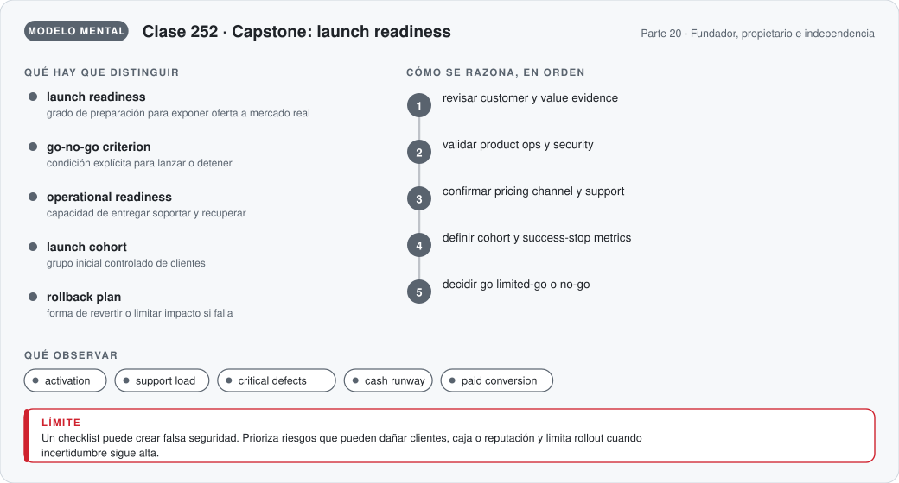

# Clase 252 — Capstone: launch readiness

<!-- nav:inicio -->
> **Parte 20 · Founder y creación de empresas** — clase 12 de 12 · [índice de la parte](../../README.md) · [temario](../../../../SYLLABUS.md)
<!-- nav:fin -->

**Parte:** 20 — Founder y creación de empresas  
**Nivel:** Etapa 6 — Founder  
**Duración sugerida:** 150–180 minutos · **Estándar:** deep-class-v2

## 🎯 Propósito

Lanzar una empresa o un producto es una decisión con **fecha, costo y reputación**. Un lanzamiento prematuro quema caja, marca y la atención de los primeros clientes; uno demasiado tardío acumula costos sin aprender. La pregunta correcta no es «¿está listo el producto?» sino **«¿qué evidencia tenemos, qué riesgos quedan abiertos y qué pasa si nos equivocamos?»**. Un fundador entusiasta tiende a sobrestimar la preparación; uno cauteloso, a postergar indefinidamente. Una evaluación de preparación para el lanzamiento (launch readiness) pone ambas tendencias a prueba con criterios escritos, evidencia y un responsable por cada riesgo.

Esta clase integra la parte 20 en una **decisión de go / no-go**: se cruzan dos ejes, **fuerza de la evidencia** (qué sabemos de clientes, precio, entrega y economía) y **preparación operativa** (equipo, caja, procesos, acuerdos, aspectos legales y de cumplimiento), y se ubica el proyecto en un cuadrante que sugiere una acción: lanzar, preparar, probar más o replantear. Se apoya en Aulet sobre los pasos de un emprendimiento con disciplina, en Ries sobre aprendizaje validado, en Gawande sobre listas de verificación para tareas complejas, en Wasserman sobre decisiones tempranas del fundador y en Christensen y coautores sobre el trabajo que el cliente contrata. Al terminar sabrás reunir la evidencia de las clases anteriores, puntuar la preparación, identificar los riesgos que bloquean, definir condiciones de lanzamiento y criterios de detención, y presentar la decisión con honestidad.

## 📚 Resultados de aprendizaje

Al finalizar podrás:

1. **Integrar** la evidencia de problema, cliente, propuesta, modelo, validación, MVP, precio y primeros clientes.
2. **Puntuar** la fuerza de la evidencia y la preparación operativa con criterios explícitos.
3. **Ubicar** el proyecto en un cuadrante y derivar una acción.
4. **Definir** condiciones de lanzamiento, métricas de las primeras semanas y criterios de detención.
5. **Presentar** una decisión de go / no-go con riesgos, caja y plan de contingencia.

## 🧭 Agenda

| Tramo | Qué se hace |
|---|---|
| 0–20 min | Recuperación: ¿qué evidencia tienes de cada eslabón de tu empresa? |
| 20–60 min | Evidencia, preparación, cuadrante, lista de verificación, caja, condiciones, decisión. |
| 60–105 min | Ejemplo trabajado: puntuación, cuadrante, caja y condiciones de lanzamiento. |
| 105–150 min | Caso ejecutivo y práctica. |
| 150–175 min | Límites y entregable. |

## 🧩 Conceptos centrales

| Concepto | Definición | Cómo se reconoce |
|---|---|---|
| **Launch readiness** | Grado de preparación para lanzar con riesgos conocidos. | Evidencia, operación y caja evaluadas. |
| **Go / no-go** | Decisión de lanzar o no, con condiciones. | Criterios escritos y responsable. |
| **Riesgo bloqueante** | Riesgo que, si ocurre, impide operar o destruye el valor. | Caja, cumplimiento, entrega, acuerdos. |
| **Lista de verificación** | Lista breve de pasos críticos que no deben omitirse. | Puntos concretos con responsable. |
| **Pista de caja (runway)** | Meses que la caja alcanza al ritmo de gasto actual. | Caja ÷ gasto neto mensual. |
| **Criterio de detención** | Condición que obliga a parar o ajustar. | Umbral escrito antes del lanzamiento. |

## 🧠 Modelo mental

**Cómo leer el diagrama.** Dos ejes. El horizontal mide la **fuerza de la evidencia** (de lo supuesto a lo comprobado con clientes que pagan); el vertical, la **preparación operativa** (equipo, caja, procesos, acuerdos y cumplimiento). Cuatro cuadrantes: evidencia alta y preparación alta, **lanzar** con condiciones; evidencia alta y preparación baja, **preparar** antes de abrir; evidencia baja y preparación alta, **probar más** (hay capacidad, falta demanda comprobada); evidencia baja y preparación baja, **replantear**. La nota afirma que ninguna evaluación elimina el riesgo, solo lo hace visible; el pie, que la decisión lleva criterios de detención escritos de antemano.

## 📖 Desarrollo

### 1. Reunir la evidencia del recorrido

La evaluación comienza con un **inventario de evidencia** por eslabón, tomado de las clases anteriores: **problema** (¿cuántas conversaciones confirman un dolor real y costoso?, clases 242–244), **propuesta de valor** (¿qué mensaje fue probado y con qué resultado?, 245), **modelo de negocio** (economía por cliente con supuestos y sensibilidad, 246), **validación** (¿qué compromisos reales se obtuvieron?, 247), **MVP** (¿qué se aprendió entregando a mano?, 248), **precio** (¿qué prueba respalda el precio?, 249) y **primeros clientes** (¿cuántos, con qué patrón y a qué costo?, 250). Para cada eslabón se anota la **evidencia** (hechos), la **fuerza** (opinión, comportamiento o compromiso) y los **vacíos**. Ries propone que el criterio sea el aprendizaje validado: una afirmación que no se probó con clientes se trata como hipótesis, aunque suene convincente.

### 2. Puntuar la fuerza de la evidencia

Se asigna una puntuación de 0 a 5 a cada eslabón: **0** sin evidencia, **1** opinión propia, **2** opinión de terceros, **3** comportamiento observado, **4** compromiso (tiempo, datos, reputación) y **5** dinero repetido. Se ponderan los eslabones según su criticidad para el negocio (por ejemplo, problema y primeros clientes pesan más que el pulido de la marca). Aulet recomienda pasos disciplinados: segmentar el mercado, definir un cliente específico, estimar el tamaño del mercado accesible y el costo de adquisición con datos y no con promedios. El puntaje no es una verdad matemática: sirve para **ordenar la conversación** y revelar dónde hay solo entusiasmo. Dos revisores independientes puntúan por separado y luego se comparan; las diferencias muestran sesgos.

### 3. Puntuar la preparación operativa

La preparación operativa abarca: **equipo** (roles cubiertos, acuerdo de socios, clase 251), **caja** (meses de pista con el gasto previsto), **entrega** (¿se puede atender al volumen esperado sin romper calidad?), **procesos** (facturación, cobranza, soporte, registro de decisiones), **cumplimiento** (constitución, tributario, laboral, sanitario, protección de datos y consumo según el rubro, consultados en fuentes oficiales y con asesoría), **riesgos de reputación** (qué pasa si el servicio falla) y **plan de contingencia** (qué se hace si las ventas son la mitad o los costos el doble). También se puntúa de 0 a 5 con ponderaciones. Gawande muestra, a partir de la aviación y la cirugía, que las **listas de verificación** reducen errores en tareas complejas, no por falta de competencia sino porque los pasos críticos se olvidan bajo presión; por eso la preparación se expresa en una lista corta, con responsables y fechas.

### 4. El cuadrante y la acción

Con ambas puntuaciones se ubica el proyecto. **Evidencia alta y preparación alta**: lanzar, con condiciones y métricas de seguimiento. **Evidencia alta y preparación baja**: hay demanda comprobada pero no capacidad; se prepara (equipo, caja, procesos, cumplimiento) antes de abrir, con una fecha. **Evidencia baja y preparación alta**: se tiene la infraestructura pero no la demanda; se invierte en pruebas (clases 247–250) y no en más estructura. **Evidencia baja y preparación baja**: se replantea el problema, el segmento o el modelo. El cuadrante es una **conversación guiada**, no un veredicto automático; los umbrales (por ejemplo, 3,5 sobre 5) se fijan antes de puntuar. Christensen y coautores recuerdan que el cliente «contrata» un producto para un trabajo concreto: la evidencia fuerte es la que muestra que ese trabajo existe y que el cliente paga por resolverlo.

### 5. Caja, pista y escenarios

La caja decide cuánto se puede equivocar el fundador. Se calcula la **pista (runway)**: caja disponible dividida por el gasto neto mensual (gastos menos ingresos). Se proyectan **tres escenarios**: base (ventas según lo observado), pesimista (ventas a la mitad y costos 20 % mayores) y optimista. Se identifica el **punto sin retorno**: el mes en que, si no se alcanzan ciertos hitos, ya no hay caja para ajustar o reunir capital (clase 222). Una regla sana es no lanzar con menos de **seis meses de pista en el escenario pesimista**, o tener una fuente de financiamiento acordada. Se incluyen los costos que suelen olvidarse: impuestos, comisiones de pago, soporte, devoluciones y el sueldo de los fundadores, aunque sea reducido.

### 6. Condiciones de lanzamiento y criterios de detención

Un go / no-go bien formulado es un **go condicionado**: lanzar si se cumplen ciertas condiciones, con un responsable y una fecha para cada una (por ejemplo, firmar el acuerdo de socios, completar el trámite de constitución con asesoría, tener contratado el soporte, probar el cobro con tarjeta). Se definen **métricas de las primeras semanas** (clientes activos, uso, conversión, tiempo de atención, reclamos) con **umbrales de alerta** y **criterios de detención o ajuste** escritos de antemano: «si en 60 días no hay 8 clientes de pago, se revisa el canal; si la caja en el escenario base baja de 4 meses, se frena la contratación». Se acuerda un ritmo de revisión (semanal al comienzo) y quién puede ordenar una pausa. Wasserman advierte que las decisiones tempranas del fundador condicionan el rumbo; dejar por escrito cómo se decide ayuda a no improvisar bajo presión.

### 7. Presentar la decisión con honestidad

La presentación a socios, inversionistas o un comité debe mostrar: **qué se sabe y qué no**, el cuadrante con su puntuación, los riesgos bloqueantes con su plan, la caja en tres escenarios, las condiciones y los criterios de detención. Se evita ocultar los puntos débiles: ocultarlos no los elimina y destruye la confianza. También se distingue entre **riesgo aceptable** (puede ocurrir y se sabe cómo reaccionar) y **riesgo bloqueante** (si ocurre, no hay reacción posible). Se incluye una página con «lo que haría cambiar mi decisión». Quien presenta debe estar preparado para escuchar un «no todavía»: postergar con un plan claro es una decisión válida. Se registra en el diario de decisiones para revisar, a los 90 días, si la evaluación fue acertada y qué sesgos aparecieron.

## 📚 Lectura comparada

| Obra | Qué aporta | Qué no resuelve | Pregunta para contrastar |
|---|---|---|---|
| Aulet | Pasos disciplinados para crear un emprendimiento con datos. | Proceso extenso. | ¿Qué datos reales respaldan cada paso? |
| Ries | Aprendizaje validado y métricas accionables. | Orientado a productos digitales. | ¿Qué hipótesis sigue sin probarse? |
| Gawande | Listas de verificación para tareas complejas. | No define qué incluir. | ¿Qué paso crítico se olvida bajo presión? |
| Wasserman | Decisiones tempranas del fundador y sus consecuencias. | No evalúa un lanzamiento concreto. | ¿Qué decisión de hoy condiciona el control mañana? |
| Christensen y coautores | El cliente contrata un producto para un trabajo. | No mide preparación operativa. | ¿Qué trabajo contrata realmente mi cliente? |

## 🧮 Ejemplo trabajado

**Situación (hipotética).** Un equipo de tres fundadores prepara el lanzamiento de un servicio de **gestión de turnos para clínicas dentales** (continuación del caso de la clase 248). Quieren decidir si abren el servicio al público en 30 días.

**Evidencia por eslabón (0 a 5) y ponderación.**

| Eslabón | Peso | Puntaje | Respaldo |
|---|---|---|---|
| Problema | 20 % | 4 | 25 entrevistas, 18 con costo declarado |
| Propuesta de valor | 10 % | 3 | prueba de mensajes con respuesta moderada |
| Modelo de negocio | 15 % | 3 | economía por cliente positiva en el escenario base |
| Validación | 15 % | 4 | 6 anticipos de 25 propuestas |
| MVP / concierge | 15 % | 4 | 5 de 6 renuevan a los 3 meses |
| Precio | 10 % | 3 | prueba pequeña de tres precios |
| Primeros clientes | 15 % | 3 | 7 clientes de pago, CAC superior al supuesto |

**Puntaje de evidencia.** 0,20×4 + 0,10×3 + 0,15×3 + 0,15×4 + 0,15×4 + 0,10×3 + 0,15×3 = 0,80 + 0,30 + 0,45 + 0,60 + 0,60 + 0,30 + 0,45 = **3,50**.

**Preparación operativa (0 a 5) y ponderación.**

| Área | Peso | Puntaje | Respaldo |
|---|---|---|---|
| Equipo y acuerdo de socios | 20 % | 2 | roles claros, acuerdo escrito aún no firmado |
| Caja y pista | 25 % | 3 | ver cálculo abajo |
| Entrega y capacidad | 20 % | 3 | 12 clínicas atendibles a mano; más requiere automatizar |
| Procesos (facturación, soporte, cobranza) | 15 % | 3 | funcionan, con manualidad |
| Cumplimiento (constitución, datos, tributario) | 15 % | 2 | consultas hechas, trámites pendientes |
| Contingencia | 5 % | 2 | sin plan escrito |

**Puntaje de preparación.** 0,20×2 + 0,25×3 + 0,20×3 + 0,15×3 + 0,15×2 + 0,05×2 = 0,40 + 0,75 + 0,60 + 0,45 + 0,30 + 0,10 = **2,60**.

**Cuadrante.** Umbral fijado de antemano: 3,5. Evidencia 3,50 (en el límite, alta); preparación 2,60 (baja). Cuadrante **«preparar»**: la demanda está razonablemente comprobada, pero la operación no está lista.

**Caja y pista.** Caja disponible: 38 millones. Gasto mensual: 7,5 millones (sueldos reducidos, herramientas, soporte). Ingresos por 7 clientes: 7 × 120.000 = 840.000 mensuales, con costo variable de 7 × 20.000 = 140.000; contribución 700.000. Gasto neto = 7.500.000 − 700.000 = **6.800.000**. Pista base: 38.000.000 ÷ 6.800.000 ≈ **5,6 meses**.

**Escenario pesimista.** Ingresos a la mitad (contribución 350.000) y gastos 20 % mayores (9.000.000): gasto neto 8.650.000; pista = 38.000.000 ÷ 8.650.000 ≈ **4,4 meses**, menor que los seis meses exigidos como regla.

**Escenario optimista.** 15 clientes (contribución 1.500.000) con gasto de 8.000.000: gasto neto 6.500.000; pista ≈ 5,8 meses. Incluso con el escenario optimista, la pista es corta; la clave es el ritmo de nuevos clientes.

**Decisión: preparar y lanzar con condiciones en 60 días.**

| Condición | Responsable | Fecha |
|---|---|---|
| Firmar el acuerdo de socios con asesoría | Los tres | Semana 3 |
| Completar constitución y trámites tributarios y de datos con asesoría | Carla | Semana 6 |
| Plan de contingencia escrito | Ana | Semana 4 |
| Reunir 20 millones adicionales (aporte de socios o préstamo) para llevar la pista pesimista sobre 6 meses | Beto | Semana 8 |
| Formulario de disponibilidades automatizado | Ana | Semana 6 |

Con 20 millones adicionales, caja de 58 millones: pista pesimista = 58.000.000 ÷ 8.650.000 ≈ 6,7 meses.

**Criterios de detención.** Si a los 60 días del lanzamiento no hay al menos 12 clientes de pago, se revisa el canal; si la renovación baja de 70 %, se pausa la adquisición; si la pista en el escenario base baja de 4 meses, se frena todo gasto no esencial.

**Cuidados.** Los puntajes son una guía y las cifras son ilustrativas; los trámites reales dependen de la normativa vigente consultada en fuentes oficiales.

**Qué muestra.** (1) El puntaje separó evidencia de preparación. (2) El cuadrante cambió la pregunta de «¿lanzamos?» a «¿qué falta para lanzar?». (3) La caja en tres escenarios fijó una condición concreta.

## 🔀 Comparación y límites

**Launch readiness frente a plan de negocios.** El plan describe cómo se espera que funcione la empresa; la evaluación de preparación contrasta lo comprobado con lo supuesto y decide condiciones y detenciones. Se complementan, pero no se reemplazan.

**Límites.** Los puntajes son subjetivos; dos revisores pueden diferir y ese desacuerdo es información. La evidencia pasada no garantiza resultados. Algunos rubros (salud, finanzas, alimentos) exigen autorizaciones previas al lanzamiento que no se interpretan aquí y se consultan en fuentes oficiales. Las cifras del ejemplo son ilustrativas.

## 🪜 De profesional a owner

| Nivel | Cómo se relaciona con el lanzamiento |
|---|---|
| **Profesional** | Cumple su parte de la lista de verificación. |
| **Jefe / Team Lead** | Reporta riesgos de entrega y capacidad. |
| **Gerente** | Conduce la preparación y las métricas iniciales. |
| **CEO / Director** | Decide el go / no-go y los criterios de detención. |
| **Founder / Owner** | Pone caja, nombre y reputación; decide con honestidad. |

## 🏢 Caso ejecutivo

Una fundadora quiere lanzar en 45 días una plataforma de cursos de cocina en vivo para personas mayores. Datos: 14 entrevistas confirman interés, pero solo 3 personas pagaron una clase de prueba de 8.000 pesos; en un piloto de 4 sesiones asistieron 18 personas, 11 repitieron y 5 pidieron grabaciones; el precio previsto es de 22.000 pesos mensuales por 4 clases; el costo por clase (profesora, plataforma y soporte) es de 90.000 pesos y la profesora no tiene contrato; la fundadora tiene 21 millones de caja y gasta 3,2 millones mensuales sin contar su sueldo; un socio le ofrece 10 millones por 25 % y quiere lanzar de inmediato; no ha consultado trámites, protección de datos ni condiciones de pago; las clases en vivo con plataforma de terceros han tenido dos caídas.

Entrega un **memo de launch readiness** que contenga: (a) el inventario de evidencia por eslabón con puntajes y respaldo; (b) la puntuación de preparación operativa; (c) el cuadrante y la acción derivada, con los umbrales fijados antes; (d) la pista de caja en tres escenarios y la economía por clase con las cifras del caso; (e) las condiciones de lanzamiento con responsable y fecha, y los criterios de detención; (f) la evaluación de la oferta del socio y las verificaciones legales, tributarias y de datos pendientes.

## 🧪 Práctica

1. Haz el inventario de evidencia de tu proyecto con puntajes de 0 a 5.
2. Puntúa la preparación operativa y ubícate en el cuadrante.
3. Calcula la pista de caja en los escenarios base, pesimista y optimista.
4. Escribe una lista de verificación de diez puntos con responsables y fechas.
5. Define tres criterios de detención y redáctalos antes de lanzar.

## ⚠️ Errores frecuentes

| Error | Por qué ocurre | Cómo corregirlo |
|---|---|---|
| Lanzar por entusiasmo | Se sobrestima la preparación | Puntuar con criterios y un segundo revisor. |
| Confundir producto listo con negocio listo | Se mira solo lo técnico | Evaluar evidencia y operación por separado. |
| Caja sin escenarios | Se asume el caso base | Proyectar pesimista y optimista. |
| Sin criterios de detención | Se teme el fracaso | Escribirlos antes de lanzar. |
| Ocultar debilidades | Se busca aprobación | Presentar lo que no se sabe. |
| Omitir cumplimiento | Se lo ve como trámite | Consultar fuentes oficiales y asesoría. |

## ❓ Preguntas de comprobación

1. ¿Qué dos ejes componen el cuadrante de preparación?
2. ¿Qué acción corresponde a evidencia alta y preparación baja?
3. ¿Cómo se calcula la pista de caja?
4. ¿Por qué se proyectan tres escenarios?
5. ¿Qué es un go condicionado?
6. ¿Para qué sirve una lista de verificación?
7. ¿Qué debe mostrar una presentación honesta de la decisión?

Claves de respuesta

1. Fuerza de la evidencia y preparación operativa.
2. Preparar antes de abrir: equipo, caja, procesos y cumplimiento, con fecha.
3. Caja disponible dividida por el gasto neto mensual.
4. Porque el caso base puede no ocurrir y hay que saber cuánto margen existe.
5. Un lanzamiento sujeto a condiciones con responsable y fecha.
6. Para evitar que se omitan pasos críticos bajo presión.
7. Qué se sabe y qué no, riesgos bloqueantes, caja en escenarios, condiciones y criterios de detención.

## 📥 Entregable

Guarda en `portfolio/252-capstone-launch-readiness/`:

- `founder-owner-decision-brief.md` (plantilla [Founder owner decision brief](../../../../templates/founder-owner-decision-brief.md)) con el memo del caso ejecutivo;
- `venture-validation.md` (plantilla [Venture validation](../../../../templates/venture-validation.md)) con el inventario de evidencia y el cuadrante;
- `cash-runway.md` (plantilla [Cash runway](../../../../templates/cash-runway.md)) con la pista de caja en tres escenarios;
- `decision-journal.md` con las condiciones de lanzamiento y los criterios de detención.

## 📗 Fuentes y verificación

- Bill Aulet — *Disciplined Entrepreneurship* (John Wiley & Sons, Incorporated, 2013). **Uso en esta clase:** pasos disciplinados para crear un emprendimiento con datos. Lectura selectiva sobre **capstone: launch readiness**. **Localizador:** [ISBN-13 9781299848641](https://openlibrary.org/isbn/9781299848641).
- Eric Ries — *The Lean Startup* (Crown Business, 2011). **Uso en esta clase:** aprendizaje validado y métricas accionables. Lectura selectiva sobre **capstone: launch readiness**. **Localizador:** [ISBN-13 9780307887894](https://openlibrary.org/isbn/9780307887894).
- Atul Gawande — *The Checklist Manifesto* (Penguin Random House, 2014). **Uso en esta clase:** listas de verificación para tareas complejas. Lectura selectiva sobre **capstone: launch readiness**. **Localizador:** [ISBN-13 9780143423225](https://openlibrary.org/isbn/9780143423225).
- Noam Wasserman — *The Founder's Dilemmas* (Princeton University Press, 2012). **Uso en esta clase:** decisiones tempranas del fundador y sus consecuencias. Lectura selectiva sobre **capstone: launch readiness**. **Localizador:** [ISBN-13 9780691149134](https://openlibrary.org/isbn/9780691149134).
- Clayton M. Christensen et al. — *Competing Against Luck* (HarperBusiness, 2016). **Uso en esta clase:** el cliente contrata un producto para un trabajo. Lectura selectiva sobre **capstone: launch readiness**. **Localizador:** [ISBN-13 9780062435613](https://openlibrary.org/isbn/9780062435613).

> **Regla de fuentes para Capstone: launch readiness:** las obras anteriores estructuran las perspectivas de esta materia; cualquier norma, ley o estándar vivo mencionado debe comprobarse nuevamente en su fuente primaria vigente, incluidas las normas de constitución, tributarias, de datos personales y sectoriales. Los ejemplos y casos son hipotéticos, con cifras ilustrativas. El desarrollo es original y no reproduce capítulos protegidos.

<!-- pie:inicio -->
---

| Anterior | Índice | Siguiente |
|---|---|---|
| [← 251 · Cofundadores, equity y acuerdos](../251-cofundadores-equity-y-acuerdos/README.md) | [Parte 20](../../README.md) · [Programa](../../../../SYLLABUS.md) | [253 · Mapa del ciclo empresarial en Chile →](../../../21-chile-founder-track/classes/253-mapa-del-ciclo-empresarial-en-chile/README.md) |
<!-- pie:fin -->
