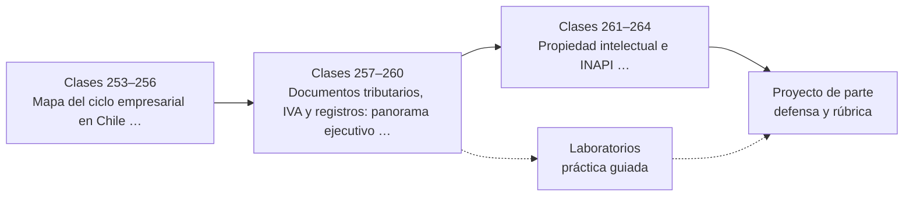

# Parte 21 — Founder Track Chile: formalización y operación

<!-- parte:inicio -->

> ← [Parte 20 — Founder y creación de empresas](../20-founder-venture-creation/README.md) · [Temario](../../SYLLABUS.md) · [Parte 22 — Escalamiento, propiedad y portafolio empresarial](../22-scaling-business-ownership/README.md) →

*Formalizar y operar una empresa en Chile sabiendo cuándo pedir apoyo*

**Etapa:** 6 — Fundador, propietario e independencia  
**Duración:** 12 clases · 30 horas  
**Resultado de salida:** Comprender el ciclo real de formalización y operación de una empresa chilena, sabiendo cuándo intervenir especialistas.

⚫ [Ver las 6 etapas](../../SYLLABUS.md) · 12 clases (253–264) · 4 laboratorios · [proyecto de parte](project.md)

## 🎯 De qué trata esta parte

Operar una empresa implica obligaciones tributarias, laborales, contables y sectoriales. Esta parte da el mapa para entender qué se debe, a quién y cuándo, y reconocer cuándo corresponde un especialista.

El eje es **qué decisión dispara qué obligación**. Todo el material normativo se presenta con su fecha de verificación y debe revalidarse en la fuente oficial. No es asesoría legal ni tributaria.

## 🧱 Con qué hay que llegar

| Parte | Qué aporta |
|---|---|
| [20 — Founder y creación de empresas](../20-founder-venture-creation/README.md) | Una oferta validada que formalizar. |
| [15 — Riesgo, legal, compliance, ciberseguridad e IA](../15-risk-legal-compliance-cyber-ai-governance/README.md) | Alfabetización legal y contratos. |

Cada clase supone la anterior: el orden importa, y saltarse una deja sin base a las que vienen después.

## 📚 Resultados de la parte

Al terminar esta parte podrás:

1. **Ubicar** el ciclo empresarial en Chile y sus hitos.
2. **Comparar** persona natural y jurídica y los tipos societarios.
3. **Entender** inicio de actividades, documentos tributarios y registros.
4. **Ordenar** contabilidad, tesorería, pagos y control documental.
5. **Reconocer** obligaciones laborales, de propiedad intelectual y permisos.

## 🗺️ Mapa de la parte

## 🧭 Cómo se encadenan las 12 clases

Las clases **253 a 256** cubren la constitución: ciclo, forma jurídica, tipos societarios e inicio de actividades.

Las clases **257 a 260** cubren la operación: documentos tributarios, contabilidad, pagos y obligaciones laborales.

Las clases **261 a 264** cubren la protección y el ecosistema: propiedad intelectual, permisos, apoyo público y el capstone de cumplimiento.

## 📘 Las 12 clases

| # | Clase | Qué se trabaja | Entregable | Min |
|---:|---|---|---|---:|
| 253 | [Mapa del ciclo empresarial en Chile](classes/253-mapa-del-ciclo-empresarial-en-chile/README.md) | Formalización, Constitución, Inicio de actividades | [risk-governance-brief](../../templates/risk-governance-brief.md) | 150 |
| 254 | [Persona natural y persona jurídica: decisiones iniciales](classes/254-persona-natural-y-persona-juridica-decisiones-iniciales/README.md) | Persona natural, Persona jurídica, Exposición | [risk-governance-brief](../../templates/risk-governance-brief.md) | 150 |
| 255 | [RES y tipos societarios: panorama](classes/255-res-y-tipos-societarios-panorama/README.md) | RES, Tipo societario, Estatutos | [founder-owner-decision-brief](../../templates/founder-owner-decision-brief.md) | 150 |
| 256 | [Inicio de actividades y ciclo tributario en SII](classes/256-inicio-de-actividades-y-ciclo-tributario-en-sii/README.md) | Inicio de actividades, Giro, Domicilio | [founder-owner-decision-brief](../../templates/founder-owner-decision-brief.md) | 150 |
| 257 | [Documentos tributarios, IVA y registros: panorama ejecutivo](classes/257-documentos-tributarios-iva-y-registros-panorama-ejecutivo/README.md) | Documento tributario, Documento electrónico, IVA | [founder-owner-decision-brief](../../templates/founder-owner-decision-brief.md) | 150 |
| 258 | [Contabilidad, tesorería y control documental](classes/258-contabilidad-tesoreria-y-control-documental/README.md) | Contabilidad, Tesorería, Control documental | [risk-governance-brief](../../templates/risk-governance-brief.md) | 150 |
| 259 | [Cuenta bancaria, pagos y medios de cobro](classes/259-cuenta-bancaria-pagos-y-medios-de-cobro/README.md) | Cuenta empresarial, Medio de cobro, Adquirencia | [risk-governance-brief](../../templates/risk-governance-brief.md) | 150 |
| 260 | [Contratación, honorarios y obligaciones laborales: panorama](classes/260-contratacion-honorarios-y-obligaciones-laborales-panorama/README.md) | Relación laboral, Contrato individual de trabajo, Prestación de servicios a honorarios | [founder-owner-decision-brief](../../templates/founder-owner-decision-brief.md) | 150 |
| 261 | [Propiedad intelectual e INAPI](classes/261-propiedad-intelectual-e-inapi/README.md) | Marca, Patente, Derecho de autor | [founder-owner-decision-brief](../../templates/founder-owner-decision-brief.md) | 150 |
| 262 | [Patentes, permisos y obligaciones sectoriales](classes/262-patentes-permisos-y-obligaciones-sectoriales/README.md) | Patente municipal, Permiso sectorial, Registro sectorial | [risk-governance-brief](../../templates/risk-governance-brief.md) | 150 |
| 263 | [ChileCompra, Sercotec, Corfo y ecosistema público](classes/263-chilecompra-sercotec-corfo-y-ecosistema-publico/README.md) | Mercado Público, Convocatoria, Elegibilidad | [founder-owner-decision-brief](../../templates/founder-owner-decision-brief.md) | 150 |
| 264 | [Capstone: empresa operable y checklist de cumplimiento](classes/264-capstone-empresa-operable-y-checklist-de-cumplimiento/README.md) | Empresa operable, Checklist de cumplimiento, Brecha abierta | [founder-owner-decision-brief](../../templates/founder-owner-decision-brief.md) | 150 |

## ⚠️ Riesgos característicos

- Decidir la forma jurídica sin considerar tributación y responsabilidad.
- Operar sin control documental.
- Contratar sin conocer las obligaciones laborales.
- Usar una norma sin revisar si sigue vigente.

## 🔤 Glosario de la parte

69 conceptos definidos en las clases, con la definición operacional que usa cada una.

| Concepto | Definición operacional |
|---|---|
| **Adquirencia** | Servicio que procesa pagos con tarjeta y liquida al comercio. |
| **Autoridad competente** | Organismo que decide sobre un permiso. |
| **Brecha abierta** | Punto sin evidencia o vencido. |
| **Calendario de obligaciones** | Plazos recurrentes laborales, tributarios y societarios. |
| **Capital** | Aportes de los socios al patrimonio. |
| **Cesión** | Traspaso de derechos de un creador a la empresa. |
| **Checklist de cumplimiento** | Lista verificable de obligaciones y evidencias. |
| **Ciclo tributario** | Obligaciones recurrentes de documentos, registros y declaraciones. |
| **Cobertura de plazos** | Proporción de obligaciones recurrentes con calendario. |
| **Cofinanciamiento** | Parte del costo que aporta quien recibe el apoyo. |
| **Colchón de caja** | Saldo mínimo para absorber retrasos y sorpresas. |
| **Completitud documental** | Proporción de puntos con evidencia vigente. |
| **Conciliación** | Comprobar que documentos, registros y banco coinciden. |
| **Constitución** | Creación de una persona jurídica según el tipo elegido. |
| **Contabilidad** | Registro ordenado y respaldado de lo ocurrido. |
| **Contracargo** | Devolución de un pago a solicitud del titular de la tarjeta. |
| **Contrato individual de trabajo** | Acuerdo escrito que regula la relación. |
| **Contribuyente** | Persona o entidad con obligaciones tributarias. |
| **Control documental** | Soporte localizable de cada operación y decisión. |
| **Convocatoria** | Llamado con bases para postular a apoyos o subsidios. |
| **Costo de cumplimiento** | Costo recurrente de administrar y cumplir. |
| **Cotizaciones y seguros** | Aportes previsionales y de seguridad social asociados al trabajo. |
| **Cuenta empresarial** | Cuenta bancaria a nombre de la empresa. |
| **Derecho de autor** | Protección de obras originales, incluido el software. |
| **Documento electrónico** | Documento emitido y recibido por medios electrónicos autorizados. |
| **Documento tributario** | Documento que respalda una operación según reglas del SII. |
| **Domicilio** | Lugar declarado para efectos tributarios y de operación. |
| **Débito y crédito fiscal** | Lo que se cobra en ventas y lo que se paga en compras, según corresponda. |
| **Elegibilidad** | Condiciones que debe cumplir quien postula. |
| **Empresa operable** | Entidad que puede funcionar y cumplir de manera sostenida. |
| **Estatutos** | Reglas internas de la sociedad. |
| **Evidencia de estado** | Documento o consulta que prueba el estado actual. |
| **Evidencia previa** | Documento que prueba el permiso antes de operar. |
| **Exposición** | Pérdida posible por deudas, reclamos o incumplimientos. |
| **Formalización** | Conjunto de pasos para operar legal y tributariamente. |
| **Garantía personal** | Obligación asumida por una persona además de la empresa. |
| **Giro** | Actividad económica declarada. |
| **Inicio de actividades** | Declaración ante el SII para operar como contribuyente. |
| **IVA** | Impuesto que grava ciertas ventas y servicios, con mecánica de débito y crédito. |
| **Jornada** | Tiempo de trabajo que la normativa regula. |
| **Liquidación** | Transferencia de lo cobrado a la cuenta del comercio. |
| **Marca** | Signo que distingue productos o servicios en el mercado. |
| **Medio de cobro** | Canal por el que el cliente paga. |
| **Mercado Público** | Plataforma de compras del Estado administrada por ChileCompra. |
| **Objeto** | Actividad que la sociedad declara. |
| **Obligación recurrente** | Deber periódico para mantener la autorización. |
| **Pacto de socios** | Acuerdo adicional sobre decisiones y salida. |
| **Patente** | Protección de invenciones que cumplan los requisitos que fije la ley. |
| **Patente municipal** | Autorización local para ejercer una actividad en un lugar. |
| **Permiso** | Autorización de una autoridad para ejercer una actividad. |
| **Permiso sectorial** | Autorización de un organismo según el rubro. |
| **Persona jurídica** | Entidad distinta de sus dueños, con RUT propio. |
| **Persona natural** | Individuo que opera con su propio RUT y patrimonio. |
| **Prestación de servicios a honorarios** | Servicio independiente sin relación laboral. |
| **Prevención de riesgos** | Obligaciones de seguridad y salud en el trabajo. |
| **Registro sectorial** | Inscripción exigida a ciertas actividades. |
| **Relación laboral** | Vínculo de trabajo con dirección y remuneración. |
| **Rendición** | Reporte de uso y resultados que exige el programa. |
| **RES** | Portal oficial para constituir y registrar ciertas sociedades. |
| **Revisión previa (due diligence)** | Examen que hace un tercero antes de contratar o invertir. |
| **Ruta crítica** | Secuencia de pasos que determina el plazo total. |
| **Secreto empresarial** | Información valiosa que se mantiene reservada. |
| **Segregación de accesos** | Separar quién prepara, aprueba y ejecuta. |
| **Segregación de funciones** | Separar quien solicita, quien aprueba y quien ejecuta. |
| **Soporte** | Respaldo que conserva la empresa para cada operación. |
| **Tasa de adjudicación** | Proporción de ofertas ganadas sobre las presentadas. |
| **Tesorería** | Gestión de cobros, pagos y caja en el tiempo. |
| **Tipo societario** | Forma jurídica con reglas propias sobre dueños, control y administración. |
| **Titularidad** | A nombre de quién están contratos, cuentas y activos. |

## 📦 Qué queda como evidencia

- Un mapa de obligaciones con su fuente oficial y fecha.
- Un calendario de cumplimiento.
- Una lista de verificación de operación.
- El capstone: empresa operable.

## 🔗 Cómo se conecta

Alimenta la parte 22 (controles para crecer). Para el detalle de constitución y operación en Chile existe el programa hermano de creación de empresas.

## 🧪 Cómo se trabaja

Son **12 clases de 150 minutos** —30 horas— con **4 laboratorios** y un proyecto integrador. Cada clase trae su propósito, sus conceptos, un caso, práctica, errores frecuentes, preguntas de comprobación, entregable y fuentes, y se evalúa con su `assessment.md`. Los laboratorios se resuelven con datos propios o sintéticos, nunca con datos reales de terceros, y la parte se cierra con el proyecto y su defensa. Las reglas de recorrido están en [la guía de navegación](../../docs/NAVIGATION.md).

<!-- parte:fin -->

## Laboratorios

- [Lab 01 — Entity decision memo](labs/lab-01.md)
- [Lab 02 — Tax lifecycle map](labs/lab-02.md)
- [Lab 03 — Calendario de compliance laboral y empresarial](labs/lab-03.md)
- [Lab 04 — Chile launch dossier](labs/lab-04.md)

## Proyecto de parte

Construir el dossier operativo de una empresa chilena y una matriz de obligaciones con fuente oficial.

## Bibliografía rectora

- Servicio de Impuestos Internos (Chile) — *Guías, normativa y servicios oficiales* (Chile / Tributación)
- Registro de Empresas y Sociedades (Chile) — *Portal y documentación oficial* (Chile / Sociedades)
- Dirección del Trabajo (Chile) — *Normativa y orientación oficial* (Chile / Laboral)
- BCN LeyChile — *Código del Trabajo y legislación laboral vigente* (Chile / Laboral)
- SUSESO — *Seguridad y salud en el trabajo* (Chile / Seguridad social)
- Superintendencia de Pensiones — *Cotizaciones y reforma previsional* (Chile / Previsión)
- INAPI (Chile) — *Propiedad industrial y orientación oficial* (Chile / PI)
- Sercotec (Chile) — *Programas, capacitación y Centros de Desarrollo de Negocios* (Chile / Emprendimiento)

## Criterio de aprobación

80/100 y entrega del proyecto integrador.

## ⚖️ Especialización legal-laboral

La clase 260 se profundiza con [Derecho laboral y obligaciones del empleador — Chile](../../docs/CHILE_LABOR_EMPLOYMENT_LAW.md), una matriz estructurada de normas y plantillas de auditoría. El objetivo es formar criterio de empleador y capacidad de escalamiento, no sustituir asesoría jurídica.
