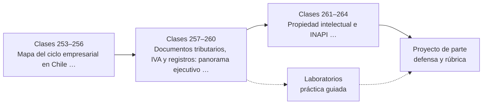

# Parte 21 — Founder Track Chile: formalización y operación

<!-- parte:inicio -->

> ← [Parte 20 — Founder y creación de empresas](../20-founder-venture-creation/README.md) · [Temario](../../SYLLABUS.md) · [Parte 22 — Escalamiento, propiedad y portafolio empresarial](../22-scaling-business-ownership/README.md) →

*Formalizar y operar una empresa en Chile sabiendo cuándo pedir apoyo*

**Etapa:** 6 — Fundador, propietario e independencia  
**Duración:** 12 clases · 30 horas  
**Resultado de salida:** Comprender el ciclo real de formalización y operación de una empresa chilena, sabiendo cuándo intervenir especialistas.

⚫ [Ver las 6 etapas](../../SYLLABUS.md) · 12 clases (253–264) · 4 laboratorios · [proyecto de parte](project.md)

## 🎯 De qué trata esta parte

Operar una empresa implica obligaciones tributarias, laborales, contables y sectoriales. Esta parte da el mapa para entender qué se debe, a quién y cuándo, y reconocer cuándo corresponde un especialista.

El eje es **qué decisión dispara qué obligación**. Todo el material normativo se presenta con su fecha de verificación y debe revalidarse en la fuente oficial. No es asesoría legal ni tributaria.

## 🧱 Con qué hay que llegar

| Parte | Qué aporta |
|---|---|
| [20 — Founder y creación de empresas](../20-founder-venture-creation/README.md) | Una oferta validada que formalizar. |
| [15 — Riesgo, legal, compliance, ciberseguridad e IA](../15-risk-legal-compliance-cyber-ai-governance/README.md) | Alfabetización legal y contratos. |

Cada clase supone la anterior: el orden importa, y saltarse una deja sin base a las que vienen después.

## 📚 Resultados de la parte

Al terminar esta parte podrás:

1. **Ubicar** el ciclo empresarial en Chile y sus hitos.
2. **Comparar** persona natural y jurídica y los tipos societarios.
3. **Entender** inicio de actividades, documentos tributarios y registros.
4. **Ordenar** contabilidad, tesorería, pagos y control documental.
5. **Reconocer** obligaciones laborales, de propiedad intelectual y permisos.

## 🗺️ Mapa de la parte

## 🧭 Cómo se encadenan las 12 clases

Las clases **253 a 256** cubren la constitución: ciclo, forma jurídica, tipos societarios e inicio de actividades.

Las clases **257 a 260** cubren la operación: documentos tributarios, contabilidad, pagos y obligaciones laborales.

Las clases **261 a 264** cubren la protección y el ecosistema: propiedad intelectual, permisos, apoyo público y el capstone de cumplimiento.

## 📘 Las 12 clases

| # | Clase | Qué se trabaja | Entregable | Min |
|---:|---|---|---|---:|
| 253 | [Mapa del ciclo empresarial en Chile](classes/253-mapa-del-ciclo-empresarial-en-chile/README.md) | formalization, RES, SII | [risk-governance-brief](../../templates/risk-governance-brief.md) | 150 |
| 254 | [Persona natural y persona jurídica: decisiones iniciales](classes/254-persona-natural-y-persona-juridica-decisiones-iniciales/README.md) | persona natural, persona jurídica, limited liability | [risk-governance-brief](../../templates/risk-governance-brief.md) | 150 |
| 255 | [RES y tipos societarios: panorama](classes/255-res-y-tipos-societarios-panorama/README.md) | SpA, EIRL, Ltda. | [founder-owner-decision-brief](../../templates/founder-owner-decision-brief.md) | 150 |
| 256 | [Inicio de actividades y ciclo tributario en SII](classes/256-inicio-de-actividades-y-ciclo-tributario-en-sii/README.md) | inicio de actividades, giro, domicilio tributario | [founder-owner-decision-brief](../../templates/founder-owner-decision-brief.md) | 150 |
| 257 | [Documentos tributarios, IVA y registros: panorama ejecutivo](classes/257-documentos-tributarios-iva-y-registros-panorama-ejecutivo/README.md) | DTE, IVA, debit tax | [founder-owner-decision-brief](../../templates/founder-owner-decision-brief.md) | 150 |
| 258 | [Contabilidad, tesorería y control documental](classes/258-contabilidad-tesoreria-y-control-documental/README.md) | bookkeeping, treasury, reconciliation | [risk-governance-brief](../../templates/risk-governance-brief.md) | 150 |
| 259 | [Cuenta bancaria, pagos y medios de cobro](classes/259-cuenta-bancaria-pagos-y-medios-de-cobro/README.md) | business bank account, merchant acquiring, settlement | [risk-governance-brief](../../templates/risk-governance-brief.md) | 150 |
| 260 | [Contratación, honorarios y obligaciones laborales: panorama](classes/260-contratacion-honorarios-y-obligaciones-laborales-panorama/README.md) | contrato indefinido, plazo fijo, obra o faena | [founder-owner-decision-brief](../../templates/founder-owner-decision-brief.md) | 150 |
| 261 | [Propiedad intelectual e INAPI](classes/261-propiedad-intelectual-e-inapi/README.md) | trademark, patent, copyright | [founder-owner-decision-brief](../../templates/founder-owner-decision-brief.md) | 150 |
| 262 | [Patentes, permisos y obligaciones sectoriales](classes/262-patentes-permisos-y-obligaciones-sectoriales/README.md) | municipal patent, sector permit, sanitary authorization | [risk-governance-brief](../../templates/risk-governance-brief.md) | 150 |
| 263 | [ChileCompra, Sercotec, Corfo y ecosistema público](classes/263-chilecompra-sercotec-corfo-y-ecosistema-publico/README.md) | Mercado Público, ChileCompra, Sercotec | [founder-owner-decision-brief](../../templates/founder-owner-decision-brief.md) | 150 |
| 264 | [Capstone: empresa operable y checklist de cumplimiento](classes/264-capstone-empresa-operable-y-checklist-de-cumplimiento/README.md) | operability, compliance checklist, compliance calendar | [founder-owner-decision-brief](../../templates/founder-owner-decision-brief.md) | 150 |

## ⚠️ Riesgos característicos

- Decidir la forma jurídica sin considerar tributación y responsabilidad.
- Operar sin control documental.
- Contratar sin conocer las obligaciones laborales.
- Usar una norma sin revisar si sigue vigente.

## 🔤 Glosario de la parte

59 conceptos definidos en las clases, con la definición operacional que usa cada una.

| Concepto | Definición operacional |
|---|---|
| **bookkeeping** | registro sistemático de transacciones. |
| **business bank account** | cuenta usada por entidad para separar y gestionar flujos. |
| **carpeta tributaria** | conjunto de antecedentes tributarios consultables para determinados fines. |
| **chargeback** | reverso o disputa de una transacción según reglas del medio. |
| **ChileCompra** | institución que administra y desarrolla sistema de compras públicas. |
| **compliance calendar** | calendario de obligaciones recurrentes y responsables. |
| **compliance checklist** | lista de obligaciones con evidencia y owner. |
| **contrato indefinido** | relación laboral sin fecha de término predeterminada. |
| **copyright** | derechos sobre obras originales conforme a ley aplicable. |
| **Corfo** | agencia de desarrollo productivo con programas e instrumentos. |
| **credit tax** | IVA soportado que puede ser imputable bajo requisitos. |
| **debit tax** | IVA generado en determinadas ventas o servicios. |
| **domicilio tributario** | dirección asociada al contribuyente para fines tributarios. |
| **DTE** | documento tributario electrónico emitido conforme a reglas SII. |
| **due diligence pack** | carpeta estructurada de documentos y evidencias empresariales. |
| **EIRL** | empresa individual de responsabilidad limitada con un titular. |
| **formalization** | proceso de operar bajo estructuras y registros exigidos por la normativa. |
| **giro** | actividad económica declarada ante SII. |
| **governance** | reglas sobre decisiones representación y ownership. |
| **honorarios** | prestación independiente que no debe encubrir subordinación y dependencia. |
| **inicio de actividades** | declaración ante SII del comienzo de actividades susceptibles de generar obligaciones tributarias. |
| **IP assignment** | acuerdo que transfiere derechos de propiedad intelectual. |
| **IVA** | impuesto al valor agregado aplicable según hechos y normativa. |
| **legal representative** | persona con facultades para representar a la entidad. |
| **limited liability** | limitación de responsabilidad patrimonial cuando la forma y conducta lo permiten. |
| **Ltda.** | sociedad de responsabilidad limitada con estructura y reglas propias. |
| **Mercado Público** | plataforma asociada al sistema de compras públicas chileno. |
| **merchant acquiring** | servicio que procesa pagos con tarjetas u otros medios. |
| **month-end close** | proceso periódico para cerrar y revisar información financiera. |
| **municipal patent** | autorización o tributo municipal asociado al ejercicio de actividades según normativa. |
| **municipal permit** | autorización local que puede corresponder según actividad. |
| **obra o faena** | contrato ligado a obra o servicio específico conforme al Código del Trabajo. |
| **operability** | capacidad legal tributaria y operacional de ejecutar el modelo. |
| **patent** | derecho sobre invención que cumple requisitos legales. |
| **payment approval** | control que autoriza desembolsos. |
| **permit dependency** | relación donde iniciar operación depende de autorización previa. |
| **persona jurídica** | entidad distinta de sus miembros reconocida por ley. |
| **persona natural** | individuo que realiza actividad económica en nombre propio. |
| **plazo fijo** | contrato laboral con término pactado sujeto a límites legales. |
| **professional escalation** | definición de cuándo intervenir abogado contador prevencionista u otro especialista. |
| **public funding** | recursos sujetos a bases elegibilidad rendición y obligaciones. |
| **reconciliation** | comparación de registros independientes para detectar diferencias. |
| **renewal** | renovación periódica de un permiso o registro. |
| **RES** | Registro de Empresas y Sociedades para constitución y actos disponibles en Chile. |
| **RUT** | identificador tributario usado en Chile. |
| **sanitary authorization** | permiso sanitario cuando la actividad lo requiere. |
| **sector permit** | autorización específica de una autoridad por tipo de actividad. |
| **separate patrimony** | separación entre bienes de la entidad y propietarios. |
| **Sercotec** | servicio de apoyo a emprendedores y mipymes con instrumentos y centros. |
| **settlement** | abono final de fondos procesados. |
| **SII** | Servicio de Impuestos Internos responsable del ciclo tributario. |
| **SpA** | sociedad por acciones con flexibilidad de ownership y administración según estatutos. |
| **statute** | estatuto social que define objeto capital administración y reglas. |
| **subordinación y dependencia** | hechos que caracterizan relación laboral según criterios legales. |
| **supporting document** | evidencia que respalda una transacción. |
| **tax register** | registro electrónico o contable asociado a operaciones tributarias. |
| **trade secret** | información valiosa mantenida confidencial bajo medidas razonables. |
| **trademark** | signo que distingue productos o servicios y puede registrarse. |
| **treasury** | gestión de caja pagos cobros y liquidez. |

## 📦 Qué queda como evidencia

- Un mapa de obligaciones con su fuente oficial y fecha.
- Un calendario de cumplimiento.
- Una lista de verificación de operación.
- El capstone: empresa operable.

## 🔗 Cómo se conecta

Alimenta la parte 22 (controles para crecer). Para el detalle de constitución y operación en Chile existe el programa hermano de creación de empresas.

## 🧪 Cómo se trabaja

Son **12 clases de 150 minutos** —30 horas— con **4 laboratorios** y un proyecto integrador. Cada clase trae su propósito, sus conceptos, un caso, práctica, errores frecuentes, preguntas de comprobación, entregable y fuentes, y se evalúa con su `assessment.md`. Los laboratorios se resuelven con datos propios o sintéticos, nunca con datos reales de terceros, y la parte se cierra con el proyecto y su defensa. Las reglas de recorrido están en [la guía de navegación](../../docs/NAVIGATION.md).

<!-- parte:fin -->

## Laboratorios

- [Lab 01 — Entity decision memo](labs/lab-01.md)
- [Lab 02 — Tax lifecycle map](labs/lab-02.md)
- [Lab 03 — Calendario de compliance laboral y empresarial](labs/lab-03.md)
- [Lab 04 — Chile launch dossier](labs/lab-04.md)

## Proyecto de parte

Construir el dossier operativo de una empresa chilena y una matriz de obligaciones con fuente oficial.

## Bibliografía rectora

- Servicio de Impuestos Internos (Chile) — *Guías, normativa y servicios oficiales* (Chile / Tributación)
- Registro de Empresas y Sociedades (Chile) — *Portal y documentación oficial* (Chile / Sociedades)
- Dirección del Trabajo (Chile) — *Normativa y orientación oficial* (Chile / Laboral)
- BCN LeyChile — *Código del Trabajo y legislación laboral vigente* (Chile / Laboral)
- SUSESO — *Seguridad y salud en el trabajo* (Chile / Seguridad social)
- Superintendencia de Pensiones — *Cotizaciones y reforma previsional* (Chile / Previsión)
- INAPI (Chile) — *Propiedad industrial y orientación oficial* (Chile / PI)
- Sercotec (Chile) — *Programas, capacitación y Centros de Desarrollo de Negocios* (Chile / Emprendimiento)

## Criterio de aprobación

80/100 y entrega del proyecto integrador.

## ⚖️ Especialización legal-laboral

La clase 260 se profundiza con [Derecho laboral y obligaciones del empleador — Chile](../../docs/CHILE_LABOR_EMPLOYMENT_LAW.md), una matriz estructurada de normas y plantillas de auditoría. El objetivo es formar criterio de empleador y capacidad de escalamiento, no sustituir asesoría jurídica.
