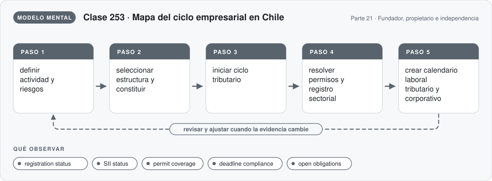

# Clase 253 — Mapa del ciclo empresarial en Chile

<!-- nav:inicio -->
> **Parte 21 · Founder Track Chile: formalización y operación** — clase 1 de 12 · [índice de la parte](../../README.md) · [temario](../../../../SYLLABUS.md)
<!-- nav:fin -->

**Parte:** 21 — Founder Track Chile: formalización y operación  
**Nivel:** Etapa 6 — Founder en Chile  
**Duración sugerida:** 150–180 minutos · **Estándar:** deep-class-v2

## 🎯 Propósito

Formalizar un negocio en Chile no es un trámite único sino una **secuencia de decisiones y registros que dependen unos de otros**: qué actividad se desarrollará y dónde, bajo qué forma jurídica, con qué inicio de actividades ante el Servicio de Impuestos Internos (SII), con qué permisos del municipio y de organismos sectoriales, y con qué calendario de obligaciones laborales, tributarias y societarias. Los fundadores primerizos suelen tratarla como una lista de papeles; los que operan bien la tratan como **un mapa de dependencias**: qué paso habilita a cuál, qué evidencia deja cada uno, quién es responsable y cuándo hay que volver a verificarlo.

La clase construye ese mapa y deja claro un límite: **este programa no es asesoría legal ni tributaria**. Los requisitos cambian por actividad, comuna y fecha, y las normas se leen en la fuente oficial vigente. Lo que se enseña es la secuencia, las preguntas correctas y los criterios para saber cuándo pedir apoyo profesional. Las fuentes de referencia son los portales oficiales del SII, del Registro de Empresas y Sociedades (RES), de la Dirección del Trabajo, de Previsión Social y del seguro de cesantía, junto con Drucker sobre gestión de organizaciones. Al terminar sabrás dibujar el ciclo de tu empresa, identificar los pasos críticos, estimar el tiempo hasta operar con una ruta crítica y preparar un calendario de verificación.

## 📚 Resultados de aprendizaje

Al finalizar podrás:

1. **Distinguir** formalización, constitución, inicio de actividades, permiso y obligación recurrente.
2. **Dibujar** el mapa de dependencias de una empresa chilena según su actividad.
3. **Estimar** el tiempo hasta poder operar mediante una ruta crítica con supuestos explícitos.
4. **Identificar** qué autoridad oficial verifica cada paso y cómo se registra la evidencia.
5. **Decidir** cuándo corresponde pedir apoyo contable, legal o sectorial.

## 🧭 Agenda

| Tramo | Qué se hace |
|---|---|
| 0–20 min | Recuperación: ¿qué pasos de la formalización conoces y cuáles supones? |
| 20–60 min | Actividad y riesgos, estructura, inicio de actividades, permisos, calendario y verificación. |
| 60–105 min | Ejemplo trabajado: ruta crítica de apertura de un café con costos y plazos supuestos. |
| 105–150 min | Caso ejecutivo y práctica. |
| 150–175 min | Límites y entregable. |

## 🧩 Conceptos centrales

| Concepto | Definición | Cómo se reconoce |
|---|---|---|
| **Formalización** | Conjunto de pasos para operar legal y tributariamente. | Registro, inicio de actividades, permisos. |
| **Constitución** | Creación de una persona jurídica según el tipo elegido. | Inscripción en el RES. |
| **Inicio de actividades** | Declaración ante el SII para operar como contribuyente. | Estado y giro registrados. |
| **Permiso** | Autorización de una autoridad para ejercer una actividad. | Resolución, patente u otro documento. |
| **Ruta crítica** | Secuencia de pasos que determina el plazo total. | Pasos sin holgura. |
| **Calendario de obligaciones** | Plazos recurrentes laborales, tributarios y societarios. | Fecha, responsable y evidencia. |

## 🧠 Modelo mental

**Cómo leer el diagrama.** Una cadena de cinco pasos. **Actividad y riesgos**: qué se hará, dónde y con qué exposición. **Estructura y constitución**: elegir la forma jurídica y registrarla. **Inicio y ciclo tributario**: alta ante el SII y calendario. **Permisos y registros**: autoridades según actividad y lugar. **Calendario de obligaciones**: laborales, tributarias y corporativas. La flecha de retorno indica que cada cambio del negocio reabre el mapa. La nota recuerda que el orden y los requisitos dependen de la actividad, la comuna y la fecha; el pie, que cada paso se cierra con evidencia, fecha de verificación y responsable.

## 📖 Desarrollo

### 1. Qué es formalizar y qué no es

Formalizar es **poner la actividad económica dentro del marco legal y tributario que le corresponde**. No se reduce a «sacar el RUT» ni a «crear la sociedad». El SII explica en su material educativo (SII Educa y el Portal Emprendedor) que el inicio de actividades es el paso por el cual una persona o entidad se registra como contribuyente para realizar su actividad; el Registro de Empresas y Sociedades, por su parte, es el portal oficial para constituir y registrar ciertos tipos de sociedades; y la Dirección del Trabajo y las entidades de previsión regulan la relación con quienes trabajan en la empresa. Son pasos distintos con autoridades distintas, y una empresa puede estar cumplida en uno y deficiente en otro. Por eso el primer producto de esta clase es una **tabla de estados**: qué está hecho, qué está pendiente, qué está desactualizado y qué se desconoce.

### 2. Actividad y riesgos: el punto de partida

Todo el mapa depende de **qué hará exactamente la empresa**: qué vende, a quién, con qué personas, en qué local o canal, con qué insumos y con qué datos. De esa descripción salen los permisos (¿se manipulan alimentos?, ¿se atiende público en un local?, ¿se importan productos?, ¿se tratan datos personales?), las obligaciones laborales (¿habrá trabajadores o honorarios?) y los riesgos que justifican una estructura jurídica u otra (¿hay deudas, socios, inversión, responsabilidad frente a terceros?). Drucker insiste en que una organización se gestiona a partir de **su propósito y sus resultados**; en este contexto, ese propósito se concreta en una descripción de actividad lo bastante precisa para que cada autoridad pueda decir qué exige. Una descripción vaga («emprendimiento de servicios») produce un mapa vago.

### 3. Estructura y constitución

Con la actividad y los riesgos claros, se decide si se opera como persona natural o a través de una persona jurídica y, en este último caso, qué tipo (clases 254 y 255). El RES es la fuente oficial para conocer los tipos de empresa que pueden constituirse por ese medio y los documentos del proceso; la Ley N.º 20.659 y sus normas vinculadas, que se consultan en su texto vigente en la Biblioteca del Congreso Nacional (LeyChile), son el marco legal asociado. Lo que enseña esta clase no es el contenido de esas normas sino **la lógica de dependencia**: la constitución produce una entidad con su propio RUT, y a partir de ahí se pueden dar los pasos tributarios y comerciales a nombre de la empresa. Hacer contratos o abrir cuentas antes de que la entidad exista suele generar problemas de titularidad que luego cuesta ordenar.

### 4. Inicio de actividades y ciclo tributario

El **inicio de actividades** declara ante el SII la actividad que se realizará (giro), el domicilio y otros antecedentes, y habilita para emitir documentos tributarios y cumplir obligaciones. El SII publica el paso a paso, las ayudas y los requisitos vigentes; ahí se verifica qué antecedentes se exigen en el caso concreto. A partir del inicio se configura el **ciclo tributario**: qué documentos se emiten y reciben, qué registros se llevan, qué declaraciones y pagos periódicos corresponden y en qué plazos (clases 256 y 257). Una confusión frecuente es creer que el inicio de actividades resuelve los permisos del municipio o las obligaciones laborales: no lo hace. Es un paso necesario y, para muchas actividades, previo a otros, pero **no suficiente**.

### 5. Permisos y registros sectoriales

Cada actividad tiene **autoridades competentes** distintas: la municipalidad (patente comercial y condiciones del local, según la comuna), organismos sanitarios, de seguridad, ambientales, de comercio exterior, financieros u otros, según el rubro. No existe un listado único. ChileAtiende y la municipalidad correspondiente orientan sobre trámites; los portales sectoriales fijan los requisitos propios. La regla práctica es **identificar la autoridad antes de invertir**: arrendar un local o comprar equipamiento antes de saber si se puede operar en ese lugar es una de las decisiones más caras y menos reversibles de un emprendimiento (clase 262). Para cada permiso se registra la autoridad, el documento obtenido, la fecha, el vencimiento y quién lo renueva.

### 6. Calendario laboral, tributario y corporativo

Una vez que la empresa opera, el trabajo se vuelve **recurrente**. El calendario reúne: obligaciones tributarias (declaraciones, pagos, registros), laborales (contratos, remuneraciones, cotizaciones, seguridad y salud, que se consultan en la Dirección del Trabajo, la Subsecretaría de Previsión Social y el seguro de cesantía), societarias (actualizaciones, libros, decisiones de los socios), de permisos (renovaciones) y contractuales (vencimientos de arriendos, seguros y contratos con clientes). Cada entrada lleva: **qué**, **quién**, **fecha**, **fuente oficial**, **evidencia** y **fecha de última verificación**. Un calendario sin fuente ni fecha de verificación envejece sin que nadie lo note.

### 7. La ruta crítica y cuándo pedir apoyo

Los pasos se encadenan: algunos no pueden empezar hasta que otro termine, y otros pueden avanzar en paralelo. La **ruta crítica** es la secuencia más larga: determina el plazo mínimo para poder operar, y cualquier retraso en ella retrasa todo. Identificarla permite saber dónde conviene gastar esfuerzo o dinero (por ejemplo, empezar pronto el trámite que más demora). Además de planificar, el mapa sirve para **decidir cuándo apoyarse en especialistas**: un contador para el ciclo tributario y la contabilidad, un abogado para la estructura societaria, los contratos y los permisos complejos, un especialista laboral para la contratación, un agente de propiedad industrial para marcas y patentes. Pedir ayuda en los puntos donde un error es caro es parte de la competencia del founder, no una debilidad. Y todo lo que se aprenda aquí se **revalida en la fuente oficial** antes de actuar.

## 📚 Lectura comparada

| Fuente | Qué aporta | Qué no resuelve | Pregunta para contrastar |
|---|---|---|---|
| SII (Portal Emprendedor, SII Educa) | Pasos oficiales del inicio de actividades y obligaciones. | No decide la estructura ni los permisos. | ¿Qué antecedentes exige hoy para mi caso? |
| Registro de Empresas y Sociedades | Constitución y registro de tipos societarios. | No cubre permisos ni tributación. | ¿Qué tipo se puede constituir por este medio? |
| Dirección del Trabajo y Previsión Social | Obligaciones laborales y de seguridad. | No resuelve casos individuales. | ¿Qué cambia si contrato a la primera persona? |
| Seguro de cesantía (AFC) | Información oficial del seguro y su operación. | No es guía de contratación. | ¿Qué obligación se activa al contratar? |
| Drucker | Gestionar por propósito y resultados. | No contiene normativa chilena. | ¿Mi actividad está descrita con precisión? |

## 🧮 Ejemplo trabajado

**Situación (hipotética).** Una fundadora quiere abrir un café con cocina simple en un local arrendado, con dos trabajadores a medio tiempo y venta con tarjeta. Quiere estimar cuándo podrá abrir y cuánto costará la espera. Todos los plazos son **supuestos para el ejercicio**; los reales dependen de la comuna, de la actividad y de la fecha, y se verifican con las autoridades.

**Pasos, dependencias y duraciones supuestas (días corridos).**

| Paso | Depende de | Duración |
|---|---|---|
| A. Describir actividad, riesgos y local | — | 3 |
| B. Decidir estructura y constituir | A | 5 |
| C. Inicio de actividades en el SII | B | 3 |
| D. Permisos del local (según municipalidad y sector) | C | 20 |
| E. Cuenta bancaria y medio de cobro | C | 7 |
| F. Contratos de trabajo y registro de obligaciones | C | 4 |
| G. Equipamiento, instalación y capacitación | A | 15 |
| H. Apertura | D, E, F, G | 0 |

**Cálculo de fechas (inicio = día 0).**

- A termina el día 3.
- B: 3 → 8. C: 8 → 11.
- D: 11 → 31. E: 11 → 18. F: 11 → 15.
- G: 3 → 18 (corre en paralelo con B y C).
- H puede ocurrir cuando todos terminan: máximo(31, 18, 15, 18) = **día 31**.

**Ruta crítica.** A → B → C → D → H, con 3 + 5 + 3 + 20 = **31 días**. Las demás tienen holgura: E tiene 31 − 18 = 13 días; F, 16; G, 13.

**Costo de la espera.** El arriendo del local es de 900.000 pesos al mes desde el día 0 (supuesto), y el sueldo pre-apertura de una persona clave es de 600.000 al mes. Costo diario ≈ (900.000 + 600.000) ÷ 30 = **50.000 pesos**. Los 31 días cuestan 1.550.000 pesos antes de vender.

**Efecto de un retraso.** Si el permiso D tarda 35 días en lugar de 20, la apertura pasa al día 46 y el costo de espera sube a 46 × 50.000 = 2.300.000: **750.000 pesos adicionales** (15 días × 50.000). Un retraso en G de 10 días (de 15 a 25) no mueve la apertura (termina el día 28, antes del 31), pero consume holgura: queda 3 días.

**Decisión.** La fundadora prioriza la consulta anticipada a la municipalidad sobre el permiso (la ruta crítica), firma el arriendo solo cuando conozca los requisitos de su local, y mantiene G en paralelo. Registra, para cada paso, la autoridad, la fuente oficial, la fecha de verificación y el responsable.

**Cuidados.** No se asumen plazos ni costos de trámites como válidos para otros casos. Las obligaciones tributarias, laborales y sanitarias se confirman en los portales oficiales y con asesoría.

**Qué muestra.** (1) El mapa de dependencias permite calcular la ruta crítica. (2) Un retraso en la ruta crítica tiene costo diario; uno fuera de ella consume holgura. (3) La prioridad es verificar con la autoridad antes de comprometer dinero.

## 🔀 Comparación y límites

**Mapa del ciclo frente a lista de trámites.** La lista enumera papeles; el mapa muestra dependencias, evidencias, responsables y fechas de verificación, y permite estimar plazos y priorizar.

**Límites.** Los plazos y costos del ejemplo son supuestos. Los requisitos cambian por actividad, comuna y fecha. Esta clase no reemplaza la revisión oficial ni la asesoría contable o legal para un caso real. Normas como la jornada de trabajo, la Ley Karin o el DS 44 se verifican en la fuente vigente.

## 🪜 De profesional a owner

| Nivel | Cómo se relaciona con el ciclo empresarial |
|---|---|
| **Profesional** | Cumple las obligaciones que le corresponden como trabajador o proveedor. |
| **Jefe / Team Lead** | Conoce los permisos y registros que afectan a su área. |
| **Gerente** | Responde por el cumplimiento y el calendario de su unidad. |
| **CEO / Director** | Decide la estructura y vigila que existan controles. |
| **Founder / Owner** | Construye el mapa, verifica con fuentes oficiales y responde por todo el ciclo. |

## 🏢 Caso ejecutivo

Un fundador quiere abrir un pequeño taller de reparación de bicicletas eléctricas con venta de repuestos. Ha firmado un arriendo de 750.000 pesos mensuales en un local de una comuna que no consultó; piensa trabajar con un mecánico a honorarios y atender a clientes desde la semana siguiente. Todavía no ha decidido si operará como persona natural o con una sociedad; tiene un socio capitalista interesado que aportaría 6 millones. Planea vender repuestos importados por internet, guardar datos de clientes en una planilla y emitir boletas a medida que venda. Un amigo le dijo que «con el inicio de actividades basta». No tiene calendario ni contador.

Entrega un **informe de gobierno y riesgos del ciclo empresarial** que contenga: (a) la descripción precisa de la actividad y sus riesgos; (b) el mapa de dependencias con estados (hecho, pendiente, desconocido); (c) la ruta crítica con plazos supuestos y el costo diario de espera; (d) las preguntas que debe hacer a cada autoridad y la fuente oficial de cada una; (e) qué decisiones requieren asesoría y por qué; (f) el calendario inicial de verificación con responsable y fecha.

## 🧪 Práctica

1. Describe tu actividad en cinco líneas con lugar, personas, insumos y datos.
2. Dibuja el mapa de pasos con dependencias y marca los desconocidos.
3. Calcula la ruta crítica con tus plazos supuestos y el costo diario de espera.
4. Para cada paso, anota la autoridad, la fuente oficial y la evidencia que dejará.
5. Define qué asesoría necesitas y qué pregunta le harás a cada profesional.

## ⚠️ Errores frecuentes

| Error | Por qué ocurre | Cómo corregirlo |
|---|---|---|
| Creer que el RUT o el inicio de actividades lo resuelve todo | Se confunden pasos con autoridades distintas | Mapa por autoridad y por paso. |
| Arrendar antes de consultar permisos | Entusiasmo y urgencia | Verificar con la autoridad antes de comprometer dinero. |
| Calendario sin fuente | Se anotan fechas de memoria | Registrar fuente y fecha de verificación. |
| Operar con documentos a nombre de la persona y no de la empresa | Se empieza antes de constituir | Alinear la titularidad desde el comienzo. |
| Ignorar obligaciones laborales | Se piensa en «ayudantes» informales | Clasificar los hechos y consultar a la DT. |
| Tratar los plazos como fijos | Se copian de otro caso | Estimar con supuestos y revisar. |

## ❓ Preguntas de comprobación

1. ¿Qué diferencia hay entre constituir una sociedad y hacer el inicio de actividades?
2. ¿Por qué la descripción de la actividad es el punto de partida?
3. ¿Qué es la ruta crítica y para qué sirve?
4. ¿Qué entradas debe tener cada fila del calendario de obligaciones?
5. ¿Por qué no existe un listado único de permisos?
6. ¿Cuándo conviene pedir apoyo profesional?
7. ¿Qué límite tiene este programa respecto de la asesoría?

Claves de respuesta

1. Constituir crea la persona jurídica; el inicio de actividades registra a la entidad como contribuyente ante el SII para su actividad.
2. Porque de ella dependen los permisos, las obligaciones laborales y los riesgos que justifican la estructura.
3. Es la secuencia más larga de pasos dependientes; determina el plazo mínimo y dónde concentrar esfuerzo.
4. Qué, quién, fecha, fuente oficial, evidencia y fecha de última verificación.
5. Porque los requisitos cambian por actividad, comuna y sector.
6. En los puntos donde un error es caro o irreversible: estructura, tributario, laboral, permisos complejos y propiedad industrial.
7. No es asesoría legal ni tributaria; enseña secuencia y preguntas, y exige verificar en la fuente oficial vigente.

## 📥 Entregable

Guarda en `portfolio/253-mapa-del-ciclo-empresarial-en-chile/`:

- `risk-governance-brief.md` (plantilla [Risk governance brief](../../../../templates/risk-governance-brief.md)) con el informe del caso ejecutivo;
- `decision-journal.md` con las decisiones, las fuentes consultadas y las fechas de verificación.

## 📗 Fuentes y verificación

- Servicio de Impuestos Internos (Chile) — *Guías, normativa y servicios oficiales*. **Uso en esta clase:** pasos oficiales del inicio de actividades y obligaciones tributarias. **Fuente primaria:** <https://www.sii.cl/>.
- Registro de Empresas y Sociedades (Chile) — *Portal y documentación oficial*. **Uso en esta clase:** constitución y registro de sociedades según el portal oficial. **Fuente primaria:** <https://www.registrodeempresasysociedades.cl/>.
- Dirección del Trabajo (Chile) — *Normativa y orientación oficial*. **Uso en esta clase:** orientación oficial sobre obligaciones laborales. **Fuente primaria:** <https://www.dt.gob.cl/>.
- Subsecretaría de Previsión Social (Chile) — *Seguridad y Salud Laboral / Decreto Supremo N°44*. **Uso en esta clase:** seguridad y salud laboral y su implementación. **Fuente primaria:** <https://previsionsocial.gob.cl/ds44/>.
- AFC Chile — *Seguro de Cesantía: información y operación oficial*. **Uso en esta clase:** información oficial del seguro de cesantía y su operación. **Fuente primaria:** <https://www.afc.cl/>.
- Peter F. Drucker — *Management: Tasks, Responsibilities, Practices* (Harper & Row, 1974). **Uso en esta clase:** gestión por propósito y resultados. Lectura selectiva sobre **mapa del ciclo empresarial en chile**. **Localizador:** [ISBN-13 9780060110925](https://openlibrary.org/isbn/9780060110925).

> **Regla de fuentes para Mapa del ciclo empresarial en Chile:** las obras y portales anteriores estructuran las perspectivas de esta materia; cualquier norma, ley, trámite o plazo mencionado debe comprobarse nuevamente en su fuente primaria oficial vigente, y este programa no reemplaza asesoría legal, tributaria ni contable. Los ejemplos y casos son hipotéticos, con cifras y plazos ilustrativos. El desarrollo es original y no reproduce material protegido.

<!-- pie:inicio -->
---

| Anterior | Índice | Siguiente |
|---|---|---|
| [← 252 · Capstone: launch readiness](../../../20-founder-venture-creation/classes/252-capstone-launch-readiness/README.md) | [Parte 21](../../README.md) · [Programa](../../../../SYLLABUS.md) | [254 · Persona natural y persona jurídica: decisiones iniciales →](../254-persona-natural-y-persona-juridica-decisiones-iniciales/README.md) |
<!-- pie:fin -->
