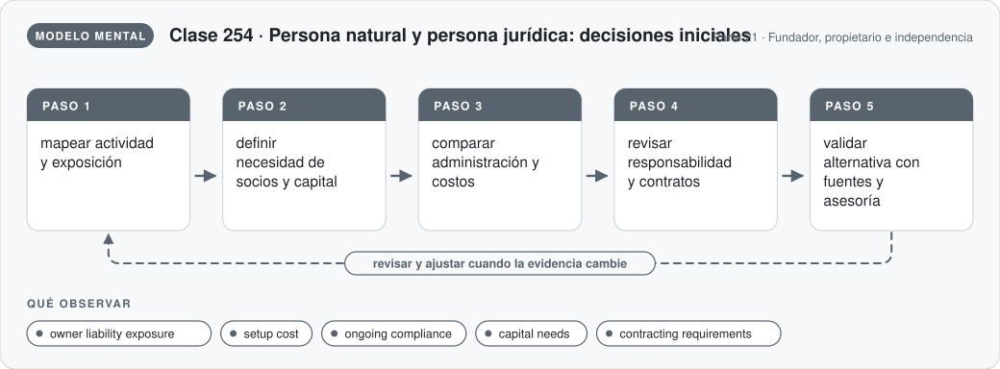

# Clase 254 — Persona natural y persona jurídica: decisiones iniciales

<!-- nav:inicio -->
> **Parte 21 · Founder Track Chile: formalización y operación** — clase 2 de 12 · [índice de la parte](../../README.md) · [temario](../../../../SYLLABUS.md)
<!-- nav:fin -->

**Parte:** 21 — Founder Track Chile: formalización y operación  
**Nivel:** Etapa 6 — Founder en Chile  
**Duración sugerida:** 150–180 minutos · **Estándar:** deep-class-v2

## 🎯 Propósito

La primera decisión formal de un negocio en Chile es **a nombre de quién se hace**: de una persona natural, que opera con su propio RUT y su propio patrimonio, o de una persona jurídica, una entidad distinta de sus dueños, con su propio RUT, su propia administración y sus propios registros. Muchos fundadores resuelven esto por costumbre («empiezo como persona natural y después veo») o por moda («todos dicen que hay que crear una empresa»). Ambas respuestas son malas porque ignoran lo central: **la forma jurídica es una herramienta para manejar exposición, socios, capital, costos y credibilidad, y su conveniencia depende de los hechos del caso**. Además, ninguna forma jurídica protege frente a toda responsabilidad ni corrige una mala gestión.

La clase enseña a tomar la decisión como un análisis: qué exposición tiene la actividad, si habrá socios o aportes externos, cuánto cuesta administrar cada alternativa, qué contratos hay que firmar y a nombre de quién, y cómo se verifica todo con fuentes oficiales y asesoría. Las fuentes son los portales del Registro de Empresas y Sociedades (RES), del SII, de la Dirección del Trabajo, LeyChile, la Superintendencia de Pensiones e INAPI. **No se interpretan normas ni se afirma qué responsabilidad cubre cada figura**: se plantean las preguntas que debe responder un profesional con el texto vigente a la vista. Al terminar sabrás estructurar la decisión, estimar costos y exposición con supuestos explícitos, identificar los hechos que inclinan la balanza y preparar la conversación con un abogado y un contador.

## 📚 Resultados de aprendizaje

Al finalizar podrás:

1. **Distinguir** persona natural y persona jurídica por sus rasgos observables.
2. **Mapear** la exposición de la actividad y la necesidad de socios y capital.
3. **Comparar** administración, costos recurrentes y trámites de cada alternativa.
4. **Estimar** con supuestos explícitos el costo de cada opción frente a la exposición.
5. **Preparar** la consulta profesional con preguntas y documentos concretos.

## 🧭 Agenda

| Tramo | Qué se hace |
|---|---|
| 0–20 min | Recuperación: ¿a nombre de quién operas hoy y por qué? |
| 20–60 min | Exposición, socios y capital, administración y costos, contratos, tributación y consulta. |
| 60–105 min | Ejemplo trabajado: comparación de costo recurrente frente a exposición esperada. |
| 105–150 min | Caso ejecutivo y práctica. |
| 150–175 min | Límites y entregable. |

## 🧩 Conceptos centrales

| Concepto | Definición | Cómo se reconoce |
|---|---|---|
| **Persona natural** | Individuo que opera con su propio RUT y patrimonio. | Contrata y factura a su nombre. |
| **Persona jurídica** | Entidad distinta de sus dueños, con RUT propio. | Se constituye y se registra. |
| **Exposición** | Pérdida posible por deudas, reclamos o incumplimientos. | Escenario, monto y probabilidad estimados. |
| **Costo de cumplimiento** | Costo recurrente de administrar y cumplir. | Contador, registros, trámites. |
| **Garantía personal** | Obligación asumida por una persona además de la empresa. | Aval o fianza firmados. |
| **Titularidad** | A nombre de quién están contratos, cuentas y activos. | Documento y registro. |

## 🧠 Modelo mental

**Cómo leer el diagrama.** Una tabla de tres columnas. **Decisión**: los cinco temas a comparar. **Qué se pregunta**: la pregunta que debe responder el fundador en cada tema (qué patrimonio responde, si habrá socios, qué trámites exige cada alternativa, quién firma y factura, cómo tributa). **Dónde se verifica**: LeyChile y asesoría legal, el RES, el SII y el contador. La nota afirma que la forma jurídica no protege frente a toda responsabilidad ni corrige una mala gestión; el pie, que la decisión se registra con fecha y fuente.

## 📖 Desarrollo

### 1. Qué distingue a una persona natural de una jurídica

Una **persona natural** es el individuo: opera con su RUT, firma a su nombre, y su patrimonio personal y el del negocio son, en términos prácticos, el mismo conjunto. Una **persona jurídica** es una entidad creada por un acto formal, con RUT propio, que puede contratar, tener cuentas y activos y comparecer en juicio por sí misma, y que se registra según su tipo (el RES describe los medios oficiales para constituir ciertas sociedades). Lo importante para la decisión no es la definición sino sus **consecuencias prácticas**: a nombre de quién se firman contratos, quién responde ante un incumplimiento, quién puede ser socio, cómo se transfieren las participaciones y qué obligaciones de administración se asumen. Estas consecuencias deben confirmarse con el texto legal vigente (LeyChile) y con asesoría; esta clase no las interpreta.

### 2. Mapear la exposición

La exposición se estima con preguntas concretas: ¿qué puede salir mal?, ¿cuánto costaría?, ¿qué tan probable es?, ¿quién respondería? Una actividad con contacto físico con clientes, manipulación de alimentos, trabajo con menores, venta de productos que pueden dañar, grandes compromisos de deuda, arriendos largos o contratos con penalidades tiene más exposición que consultoría individual con pocos compromisos. La exposición no se elimina con una sigla: depende de **cómo se opera** (seguros, contratos, controles), de **las garantías personales** que se firmen (avales, fianzas, que pueden trasladar la deuda a la persona) y de las **responsabilidades que la ley asigna a las personas por sus propios actos**, que un abogado debe explicar para el caso. Un buen análisis lista escenarios y no se queda en la frase «para proteger mi patrimonio».

### 3. Socios y capital

Si habrá **socios** o **aportes externos**, la opción natural se complica: dividir propiedad, pactar decisiones y reparto, y reconocer aportes exige una entidad con reglas claras (clase 251). Un socio capitalista que aporta dinero querrá saber qué recibe, qué controla y cómo sale. Tampoco conviene improvisar con «sociedades de hecho» o acuerdos verbales: los desacuerdos se resuelven peor sin estructura. Aun si hoy el negocio es de una sola persona, conviene preguntar: ¿en doce meses habrá un socio, un inversionista, un familiar que ayude o un empleado con participación? Si la respuesta es sí, empezar con la estructura adecuada suele ser más barato que migrar después. Los tipos disponibles y sus reglas se consultan en el RES y en LeyChile (clase 255).

### 4. Administración y costos recurrentes

Cada alternativa tiene **costos de arranque** (trámites, honorarios profesionales) y **costos recurrentes** (contabilidad, declaraciones, actualización de registros, cuentas, firmas, reuniones o decisiones de socios, según el tipo). Una persona jurídica suele exigir más orden administrativo; una persona natural puede ser más simple al comienzo, pero no está exenta de obligaciones tributarias, laborales y de permisos. El SII explica en su Portal Emprendedor las obligaciones de contribuyentes; el RES, el proceso para sociedades. Para decidir, se estima el **costo anual de cumplimiento** de cada opción con presupuestos reales de un contador (no con promedios) y se compara con la exposición y los beneficios esperados.

### 5. Contratos, clientes y credibilidad

La estructura afecta el modo de **contratar y facturar**. Algunos clientes (grandes empresas, organismos públicos) exigen proveedores constituidos o ciertos registros; algunos bancos y arrendadores piden garantías distintas según la entidad; los contratos laborales, de arriendo y con proveedores deben quedar a nombre de quien realmente asumirá la obligación. Un error frecuente es **mezclar titularidades**: la cuenta bancaria a nombre de la persona, el dominio de internet a nombre de un amigo, la marca a nombre de un socio, los contratos de arriendo a nombre del fundador. Cuando después se constituye una sociedad, ordenar esas titularidades cuesta tiempo y a veces dinero. La regla: **decidir la titularidad de los activos y contratos clave antes de firmar**, y registrarla.

### 6. Tributación y obligaciones laborales: preguntas para el profesional

El tratamiento tributario depende de la figura, la actividad, el régimen elegido y el nivel de ingresos; la información oficial está en el SII y su evaluación para el caso corresponde a un contador. De igual modo, las obligaciones laborales y previsionales se consultan en la Dirección del Trabajo, en LeyChile (Código del Trabajo y legislación laboral) y en la Superintendencia de Pensiones. Esta clase no calcula impuestos ni cotizaciones: **prepara las preguntas**. ¿Cómo tributaría mi actividad en cada alternativa con mis ingresos y costos estimados?, ¿qué documentos debo emitir?, ¿qué ocurre si contrato personal?, ¿cómo se retiran utilidades?, ¿qué cambia si hay socios? Llevar estas preguntas por escrito y las cifras proyectadas hace que la consulta sea más corta, más barata y más útil.

### 7. Decidir, documentar y revisar

La decisión se toma con un **cuadro comparativo** de las alternativas: exposición, socios, costos, titularidad, tributación y flexibilidad futura, con la fuente de cada dato y la fecha de verificación. Se anota qué supuestos se hicieron y cuáles se confirmaron con un profesional. Se define también **qué hecho haría cambiar la decisión** (ingreso de un socio, un contrato grande, un aval solicitado por un banco, un crecimiento de ingresos). La decisión no es eterna: puede revisarse al crecer, y es mejor planificar esa transición que improvisarla. Cuando el riesgo es alto o hay capital de terceros, la revisión por un abogado y un contador antes de firmar es parte del costo de hacer las cosas bien. Y siempre se recuerda: **la forma jurídica no corrige una mala gestión**.

## 📚 Lectura comparada

| Fuente | Qué aporta | Qué no resuelve | Pregunta para contrastar |
|---|---|---|---|
| Registro de Empresas y Sociedades | Información oficial sobre constitución y tipos. | No evalúa tu exposición. | ¿Qué trámites exige cada tipo? |
| SII | Obligaciones de contribuyentes y emprendedores. | No decide la estructura. | ¿Cómo se registra y cumple cada alternativa? |
| Dirección del Trabajo y LeyChile | Normativa laboral y su texto vigente. | No resuelve casos individuales. | ¿Qué obligaciones surgen al contratar? |
| Superintendencia de Pensiones | Normativa del sistema previsional. | No es guía de contratación. | ¿Qué cotizaciones se asocian a cada relación? |
| INAPI | Propiedad industrial y su registro. | No define la estructura societaria. | ¿Quién será titular de la marca? |

## 🧮 Ejemplo trabajado

**Situación (hipotética).** Una fundadora ofrece servicios de banquetería para eventos. Debe decidir entre seguir como persona natural o constituir una persona jurídica. Los datos son **supuestos para el ejercicio**; las consecuencias jurídicas reales las confirma un abogado y las tributarias, un contador.

**Datos supuestos.**

| Dato | Valor |
|---|---|
| Ventas anuales proyectadas | 48.000.000 pesos |
| Costo anual de cumplimiento, persona natural | 600.000 pesos |
| Costo de arranque, persona jurídica (trámites y honorarios) | 450.000 pesos |
| Costo anual de cumplimiento, persona jurídica | 1.500.000 pesos |
| Reclamo posible por un evento (intoxicación, daños) | 15.000.000 pesos |
| Probabilidad anual de un reclamo así | 5 % |

**Exposición esperada.** 5 % × 15.000.000 = **750.000 pesos al año**.

**Costo incremental de la persona jurídica.** Costo anual adicional: 1.500.000 − 600.000 = 900.000 pesos; el arranque de 450.000, repartido en tres años, agrega 150.000 al año. Total incremental: **1.050.000 al año**.

**Beneficio esperado supuesto.** Si, en este ejercicio, se supone que el 60 % de la exposición podría quedar limitada al patrimonio de la empresa, la reducción esperada es 0,60 × 750.000 = **450.000 pesos al año**, menor que el costo incremental de 1.050.000. **Con estos supuestos, solo por la exposición esperada, la persona jurídica no se paga.**

**Lo que el promedio no muestra.** La exposición esperada es un promedio: la pérdida real, si ocurre, es de 15.000.000, equivalente a 31 % de las ventas anuales (15.000.000 ÷ 48.000.000). Un fundador puede preferir pagar un costo seguro de 1.050.000 anuales para evitar una pérdida poco probable pero grave. Además, el supuesto del 60 % es **frágil**: puede ser menor si se firmaron garantías personales o si la ley asigna responsabilidad a personas por sus actos. Un seguro de responsabilidad civil que cueste, por ejemplo, 400.000 al año podría reducir la pérdida con independencia de la forma jurídica; se cotiza con un corredor.

**Cuando cambian los hechos.** La fundadora recibe una oferta: un socio capitalista aportaría 8.000.000 pesos a cambio de participación, y una empresa grande exigiría un proveedor constituido para un contrato de 18.000.000 anuales. Esos dos hechos cambian el cálculo: el contrato aumenta las ventas en 37,5 % (18.000.000 ÷ 48.000.000) y el socio exige una estructura con reglas. Aunque la exposición esperada no cambie, **la necesidad de socios y el requisito del cliente inclinan la decisión hacia la persona jurídica**.

**Decisión.** Constituir la persona jurídica **cuando** se firme el contrato grande o ingrese el socio, no antes; mientras tanto, contratar un seguro, firmar contratos con límites claros, no firmar avales personales sin asesoría y registrar a nombre de la futura entidad solo lo que pueda transferirse ordenadamente. Consultar a un abogado y a un contador con las cifras y preguntas preparadas.

**Cuidados.** Los porcentajes y montos son supuestos; la responsabilidad real de cada figura, la tributación y las cotizaciones se verifican en fuentes oficiales y con asesoría.

**Qué muestra.** (1) La decisión se comparó con cifras y supuestos explícitos. (2) El promedio no capta el riesgo de una pérdida grave. (3) Los hechos del negocio, no la moda, inclinaron la decisión.

## 🔀 Comparación y límites

**Persona jurídica frente a protección absoluta.** Una persona jurídica separa patrimonios en las condiciones que la ley establece; no es un escudo universal. Garantías personales, responsabilidad por actos propios y ciertas obligaciones pueden alcanzar a las personas.

**Límites.** Esta clase no interpreta normas ni calcula impuestos; plantea preguntas y estructura la decisión. Los costos y probabilidades del ejemplo son supuestos. Una decisión con capital de terceros, deudas importantes o actividad riesgosa requiere revisión profesional antes de firmar.

## 🪜 De profesional a owner

| Nivel | Cómo se relaciona con la decisión de estructura |
|---|---|
| **Profesional** | Trabaja bajo contrato o factura como independiente. |
| **Jefe / Team Lead** | Conoce la entidad para la que trabaja y sus obligaciones. |
| **Gerente** | Responde por contratos firmados a nombre de la empresa. |
| **CEO / Director** | Decide estructura, garantías y gobierno. |
| **Founder / Owner** | Elige la forma, ordena titularidades y asume la exposición residual. |

## 🏢 Caso ejecutivo

Un fundador trabaja desde hace un año como independiente en instalación de paneles solares domésticos: ventas anuales de 36 millones de pesos, dos ayudantes a quienes paga por día y un vehículo a su nombre. Un cliente le pidió una instalación de 22 millones para una pequeña empresa y el proveedor de paneles le ofrece crédito a 90 días a condición de que firme un aval personal. Un banco le ofrece una línea de crédito si presenta estados financieros. Un amigo ingeniero quiere entrar como socio aportando 5 millones y su experiencia. Ha tenido un reclamo por una filtración en un techo que costó 900.000 pesos. No tiene contador y paga los impuestos «al final del año». Su pareja trabaja como empleada y teme por el patrimonio familiar.

Entrega un **informe de gobierno y riesgos de la estructura** que contenga: (a) el mapa de exposición con escenarios, montos y probabilidades supuestas; (b) la necesidad de socios y capital en los próximos doce meses; (c) la comparación de costos recurrentes de cada alternativa con presupuestos supuestos; (d) el análisis del aval personal y de la línea de crédito; (e) las preguntas que llevará a un abogado y a un contador; (f) la decisión recomendada, el hecho que la cambiaría y las verificaciones oficiales pendientes.

## 🧪 Práctica

1. Lista tres escenarios de pérdida de tu actividad con monto y probabilidad supuestos.
2. Estima el costo anual de cumplimiento de cada alternativa con un presupuesto real.
3. Define si habrá socios o capital externo en los próximos doce meses.
4. Revisa a nombre de quién están hoy tus contratos, cuentas, dominio y marca.
5. Redacta diez preguntas para un abogado y un contador con tus cifras.

## ⚠️ Errores frecuentes

| Error | Por qué ocurre | Cómo corregirlo |
|---|---|---|
| Decidir por moda | «Todos crean una empresa» | Analizar exposición, socios y costos. |
| Pensar que la sigla protege de todo | Se confunde estructura con inmunidad | Verificar alcance y garantías con un abogado. |
| Firmar avales sin asesoría | Presión del proveedor o del banco | Estimar el efecto sobre el patrimonio personal. |
| Mezclar titularidades | Se opera antes de ordenar | Decidir a nombre de quién va cada activo. |
| Ignorar el costo recurrente | Se mira solo el arranque | Presupuestar el cumplimiento anual. |
| No revisar la decisión | Se supone eterna | Definir qué hecho obliga a reconsiderarla. |

## ❓ Preguntas de comprobación

1. ¿Qué diferencia práctica hay entre persona natural y jurídica?
2. ¿Cómo se estima la exposición de una actividad?
3. ¿Por qué una garantía personal puede cambiar el análisis?
4. ¿Qué costos recurrentes deben compararse?
5. ¿Por qué importa a nombre de quién están contratos y activos?
6. ¿Qué hechos pueden inclinar la decisión hacia una persona jurídica?
7. ¿Qué límite tiene esta clase respecto de la asesoría?

Claves de respuesta

1. La natural opera con su RUT y patrimonio; la jurídica es una entidad distinta con RUT propio, registro y administración.
2. Con escenarios de pérdida, su monto, su probabilidad y quién respondería.
3. Porque puede trasladar la deuda a la persona aunque exista una entidad.
4. Contabilidad, registros, trámites y administración de cada alternativa, con presupuestos reales.
5. Porque define quién asume las obligaciones y cuesta ordenar después.
6. Ingreso de socios o capital, exigencias de clientes o bancos y crecimiento de la exposición.
7. No interpreta normas ni calcula impuestos; prepara preguntas y exige verificación oficial y asesoría.

## 📥 Entregable

Guarda en `portfolio/254-persona-natural-y-persona-juridica-decisiones-iniciales/`:

- `risk-governance-brief.md` (plantilla [Risk governance brief](../../../../templates/risk-governance-brief.md)) con el informe del caso ejecutivo;
- `decision-journal.md` con la decisión, los supuestos y la lista de verificaciones con asesoría.

## 📗 Fuentes y verificación

- Registro de Empresas y Sociedades (Chile) — *Portal y documentación oficial*. **Uso en esta clase:** información oficial sobre constitución y registro de sociedades. **Fuente primaria:** <https://www.registrodeempresasysociedades.cl/>.
- Servicio de Impuestos Internos (Chile) — *Guías, normativa y servicios oficiales*. **Uso en esta clase:** obligaciones tributarias de contribuyentes y emprendedores. **Fuente primaria:** <https://www.sii.cl/>.
- Dirección del Trabajo (Chile) — *Normativa y orientación oficial*. **Uso en esta clase:** orientación oficial sobre obligaciones laborales. **Fuente primaria:** <https://www.dt.gob.cl/>.
- Biblioteca del Congreso Nacional de Chile — *LeyChile: Código del Trabajo y legislación laboral vigente*. **Uso en esta clase:** texto vigente del Código del Trabajo y legislación laboral. **Fuente primaria:** <https://www.bcn.cl/leychile/>.
- Superintendencia de Pensiones (Chile) — *Normativa y sistema previsional*. **Uso en esta clase:** normativa del sistema previsional. **Fuente primaria:** <https://www.spensiones.cl/>.
- INAPI (Chile) — *Propiedad industrial y orientación oficial*. **Uso en esta clase:** titularidad y registro de marcas y propiedad industrial. **Fuente primaria:** <https://www.inapi.cl/>.

> **Regla de fuentes para Persona natural y persona jurídica:** las obras y portales anteriores estructuran las perspectivas de esta materia; cualquier norma, ley, trámite o plazo mencionado debe comprobarse nuevamente en su fuente primaria oficial vigente, y este programa no reemplaza asesoría legal, tributaria ni contable. Los ejemplos y casos son hipotéticos, con cifras ilustrativas. El desarrollo es original y no reproduce material protegido.

<!-- pie:inicio -->
---

| Anterior | Índice | Siguiente |
|---|---|---|
| [← 253 · Mapa del ciclo empresarial en Chile](../253-mapa-del-ciclo-empresarial-en-chile/README.md) | [Parte 21](../../README.md) · [Programa](../../../../SYLLABUS.md) | [255 · RES y tipos societarios: panorama →](../255-res-y-tipos-societarios-panorama/README.md) |
<!-- pie:fin -->
