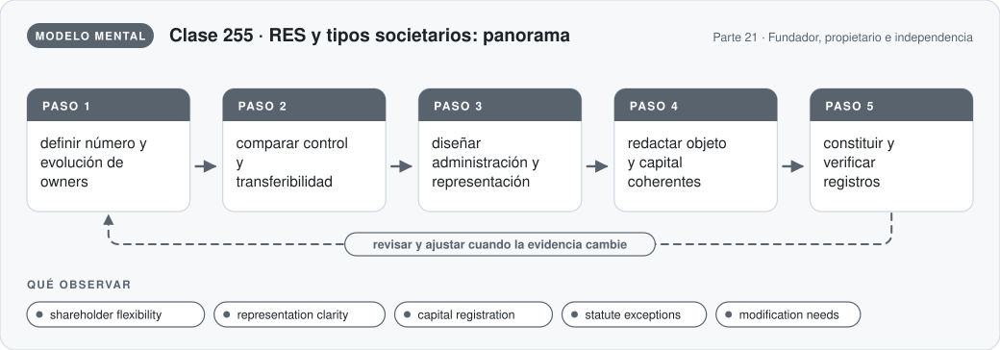

# Clase 255 — RES y tipos societarios: panorama

<!-- nav:inicio -->
> **Parte 21 · Founder Track Chile: formalización y operación** — clase 3 de 12 · [índice de la parte](../../README.md) · [temario](../../../../SYLLABUS.md)
<!-- nav:fin -->

**Parte:** 21 — Founder Track Chile: formalización y operación  
**Nivel:** Etapa 6 — Founder en Chile  
**Duración sugerida:** 150–180 minutos · **Estándar:** deep-class-v2

## 🎯 Propósito

Cuando un fundador decide constituir una persona jurídica en Chile aparece una lista de siglas: EIRL, SpA, SRL, sociedad anónima. Comparar sus nombres no sirve de mucho; lo que importa son **las decisiones que cada tipo deja abiertas o cerradas**: cuántos dueños puede haber y cómo cambian, cómo se venden o ceden las participaciones, quién administra y con qué límites, qué capital se aporta y qué actividad se declara, y qué se inscribe y dónde. El Registro de Empresas y Sociedades (RES) es el portal oficial donde se explican y gestionan los trámites de constitución de ciertos tipos de sociedades, y la Ley N.º 20.659 y su normativa vinculada, que se lee en su texto vigente en LeyChile, es el marco legal asociado. **No existe una sociedad universalmente mejor**: los estatutos, los pactos entre socios y la operación real importan más que la sigla.

Esta clase da un panorama para decidir, no un manual de constitución. **No se interpretan normas ni se afirma, de memoria, qué permite cada tipo**: se plantean las preguntas que el fundador debe responder y se indica en qué fuente oficial se verifican. Las referencias son los portales del RES, del SII, de la Dirección del Trabajo, del seguro de accidentes del trabajo (SUSESO), del seguro de cesantía y de Sercotec, más LeyChile. Al terminar sabrás proyectar la evolución de la propiedad, preguntar por control y transferencia, diseñar administración y representación, cuidar la coherencia entre objeto y capital, y preparar la verificación posterior a la constitución.

## 📚 Resultados de aprendizaje

Al finalizar podrás:

1. **Comparar** tipos societarios con preguntas y no con siglas.
2. **Proyectar** la evolución de la propiedad y el efecto de nuevos aportes.
3. **Diseñar** reglas de administración, representación y decisión con límites claros.
4. **Mantener** coherencia entre objeto, capital y operación real.
5. **Verificar** el resultado de la constitución en los registros oficiales y preparar los pasos siguientes.

## 🧭 Agenda

| Tramo | Qué se hace |
|---|---|
| 0–20 min | Recuperación: ¿cuántos dueños tendrá tu empresa en dos años y cómo se decidirá? |
| 20–60 min | Dueños, control, administración, capital y objeto, registro y pasos posteriores. |
| 60–105 min | Ejemplo trabajado: evolución de la propiedad con un aporte posterior. |
| 105–150 min | Caso ejecutivo y práctica. |
| 150–175 min | Límites y entregable. |

## 🧩 Conceptos centrales

| Concepto | Definición | Cómo se reconoce |
|---|---|---|
| **RES** | Portal oficial para constituir y registrar ciertas sociedades. | registrodeempresasysociedades.cl. |
| **Tipo societario** | Forma jurídica con reglas propias sobre dueños, control y administración. | EIRL, SpA, SRL, sociedad anónima. |
| **Estatutos** | Reglas internas de la sociedad. | Documento constitutivo. |
| **Objeto** | Actividad que la sociedad declara. | Cláusula del acto constitutivo. |
| **Capital** | Aportes de los socios al patrimonio. | Monto y forma de aporte. |
| **Pacto de socios** | Acuerdo adicional sobre decisiones y salida. | Contrato entre socios. |

## 🧠 Modelo mental

**Cómo leer el diagrama.** Una tabla de tres columnas. **Criterio**: dueños, control y transferencia, administración, capital y objeto, y registro. **Pregunta del fundador**: cuántos serán y cómo evolucionará la propiedad, cómo se ceden o venden participaciones, quién representa y decide, qué se aporta y qué actividad se declara, y qué se inscribe y con qué efecto. **Qué se verifica en fuente oficial**: tipos y número de socios, reglas del tipo y del pacto, estatutos, contenido exigido del acto constitutivo y el portal del RES. La nota afirma que no existe una sociedad mejor en abstracto; el pie, que con capital o socios externos la decisión se revisa con asesoría.

## 📖 Desarrollo

### 1. Qué es el RES y qué hace por el fundador

El Registro de Empresas y Sociedades es el sitio oficial donde se tramitan, en línea, la constitución, modificación y otras gestiones de ciertos tipos de sociedades, y donde se publican preguntas frecuentes y documentación. Para el fundador, su valor es doble: **reduce la fricción administrativa** de crear una entidad y **ofrece una fuente oficial** para saber qué tipos pueden gestionarse por ese medio, con qué formularios y con qué efectos. La Ley N.º 20.659 y las normas vinculadas, cuyo texto vigente se consulta en LeyChile, explican el marco. Lo que debe quedar claro es que **el RES es una vía de tramitación, no una recomendación**: no te dice qué tipo te conviene, y no sustituye la revisión de estatutos con un abogado cuando hay socios, capital o riesgos relevantes.

### 2. Dueños: cuántos son y cómo cambiarán

La primera pregunta es **cuántas personas serán dueñas** hoy y cuántas podrían serlo en dos o tres años. Un negocio de una sola persona que prevé socios, familiares con participación, inversionistas o un plan de opciones para empleados necesita una estructura que acepte esa evolución sin rehacerlo todo. Algunos tipos societarios están pensados para un dueño, otros exigen al menos dos, otros admiten muchos con distintos regímenes; **esos límites se verifican en el RES y en LeyChile**, no de memoria. Conviene proyectar la propiedad en tres momentos (hoy, tras una ronda de aportes, tras una salida) y comprobar que el tipo y los estatutos lo soportan. Cambiar de tipo es posible pero cuesta tiempo, honorarios y, a veces, impuestos o consentimientos.

### 3. Control y transferibilidad

La segunda pregunta es **quién decide y cómo entra o sale alguien**. Los estatutos y los pactos fijan: quórums y mayorías para decisiones importantes, derechos de preferencia, restricciones para vender a terceros, cláusulas de arrastre o de salida conjunta, causales de exclusión, valoración en una recompra y procedimientos ante desacuerdos. Wasserman (clase 251) muestra que estas decisiones tempranas condicionan el control y la riqueza de los fundadores, y que los conflictos entre socios se resuelven peor si no se pactó cómo resolverlos. El fundador no necesita redactar cláusulas, pero sí **saber qué temas existen** y llevarlos a la conversación con el abogado: «¿Puede un socio vender a un tercero sin consultar?, ¿qué pasa si fallece?, ¿cómo se valora su parte?».

### 4. Administración y representación

Quién **administra** (toma decisiones de gestión) y quién **representa** (puede obligar a la sociedad ante terceros) son preguntas distintas y deben contestarse por escrito. Una administración mal definida produce dos problemas opuestos: nadie con poder para firmar, o cualquiera con poder para comprometer a la empresa. El fundador debe pensar en **límites**: montos máximos sin autorización, tipos de actos que requieren la firma de dos personas, qué hacer cuando un socio administrador no está disponible, cómo se revoca el poder. Las reglas disponibles dependen del tipo y se leen en las fuentes oficiales; el diseño de límites sensatos se parece al de los controles de tesorería (clase 258): proporcionales al tamaño y al riesgo.

### 5. Capital y objeto

El **capital** es lo que los socios aportan; el **objeto** es la actividad que la sociedad declara. Dos cuidados. Primero, **coherencia**: un objeto demasiado estrecho obliga a modificar estatutos cuando el negocio evoluciona; uno vacío de contenido o demasiado amplio puede dificultar trámites o confundir a terceros. Segundo, **realismo del capital**: el monto y la forma de aporte (dinero, bienes, trabajo cuando corresponda) deben reflejar lo que realmente se pone, porque afectan la propiedad, las cuentas de la empresa y las relaciones con bancos y clientes. Cómo se acredita y paga el capital, y qué ocurre con aportes posteriores, se verifica en la normativa del tipo elegido y con el contador.

### 6. Constituir, verificar y encadenar los pasos siguientes

Constituir no termina el trabajo: la sociedad nace y desde ahí se encadenan pasos. Se **verifica** que lo inscrito coincide con lo acordado (nombre, objeto, capital, administración, domicilio), que la entidad tiene su RUT y que los documentos están a mano y respaldados. Después viene el **inicio de actividades en el SII** (clase 256), la apertura de cuenta bancaria (259), la contratación de personas con sus obligaciones laborales, previsionales y de seguridad (260), la protección de la marca (261) y los permisos (262). En el seguro de accidentes del trabajo (SUSESO), el seguro de cesantía (AFC) y las demás áreas laborales, las obligaciones nacen **cuando hay trabajadores**, no por la mera constitución, y se verifican en cada fuente oficial. Sercotec ofrece información y apoyo a pequeñas empresas que se consulta con su convocatoria vigente.

### 7. Pactos, documentos y revisión periódica

Los estatutos son el mínimo; el **pacto de socios** puede cubrir lo que los estatutos no tocan: dedicación, decisiones reservadas, entrada de inversionistas, no competencia dentro de lo permitido, confidencialidad y salida. Se guardan **copias ordenadas** de todo: acto constitutivo, estatutos, poderes, pactos, actas y certificados, con fecha y responsable. Cada año, o cuando ocurra un cambio importante (nuevo socio, aporte, venta, cambio de actividad), se revisa si la estructura sigue siendo adecuada y si los registros están al día. Un registro desactualizado es una fuente de problemas con bancos, clientes y autoridades. Y todo lo que se afirme sobre el efecto jurídico de una cláusula o de un tipo se **confirma con el texto vigente y con un abogado**.

## 📚 Lectura comparada

| Fuente | Qué aporta | Qué no resuelve | Pregunta para contrastar |
|---|---|---|---|
| Registro de Empresas y Sociedades (portal y preguntas frecuentes) | Trámites y tipos que se gestionan por ese medio. | No recomienda un tipo. | ¿Qué tipos y trámites aplican a mi caso? |
| LeyChile: Ley N.º 20.659 y normativa vinculada | Marco legal de la constitución simplificada. | No lee tu caso. | ¿Qué dice el texto vigente? |
| LeyChile: sociedades anónimas (Ley 18.046) | Marco de un tipo más complejo y su reglamento. | Orientado a otro nivel de complejidad. | ¿Mi escala justifica ese régimen? |
| SII | Qué se hace después de constituir. | No define estatutos. | ¿Cuándo se inicia actividades? |
| Sercotec | Apoyo y orientación a pequeñas empresas. | No define estructura societaria. | ¿Qué convocatoria vigente aplica? |

## 🧮 Ejemplo trabajado

**Situación (hipotética).** Dos socios, Camila y Diego, constituyen una sociedad para desarrollar una aplicación de reservas. Quieren entender cómo cambiaría la propiedad si más adelante entra un inversionista. Los datos son **supuestos para el ejercicio de aritmética**; el tipo societario, el valor de las acciones o derechos y los efectos legales se confirman con un abogado y las fuentes oficiales.

**Aportes iniciales.**

| Socio | Aporte | Participación |
|---|---|---|
| Camila | 6.000.000 pesos | 60 % |
| Diego | 4.000.000 pesos | 40 % |
| **Total** | **10.000.000 pesos** | 100 % |

Si la sociedad se divide en 10.000.000 de partes iguales de 1 peso (supuesto), Camila tiene 6.000.000 de partes y Diego 4.000.000.

**Aporte posterior.** Un inversionista ofrece 5.000.000 pesos, con una valoración previa de la empresa de 20.000.000 pesos (supuesto). El precio por parte sube a 20.000.000 ÷ 10.000.000 = **2 pesos**. El inversionista recibe 5.000.000 ÷ 2 = **2.500.000 partes nuevas**.

**Nueva propiedad.** Total de partes: 10.000.000 + 2.500.000 = 12.500.000.

| Socio | Partes | Participación |
|---|---|---|
| Camila | 6.000.000 | 6.000.000 ÷ 12.500.000 = **48 %** |
| Diego | 4.000.000 | 4.000.000 ÷ 12.500.000 = **32 %** |
| Inversionista | 2.500.000 | 2.500.000 ÷ 12.500.000 = **20 %** |

La valoración posterior es 12.500.000 × 2 = 25.000.000 pesos, igual a 20.000.000 más el aporte de 5.000.000.

**Qué cambia en el control.** Camila pasa de 60 % a 48 %: **deja de tener mayoría por sí sola**. Si una decisión requiere más de la mitad de las partes, Camila y Diego juntos suman 80 %; si requiere una mayoría reforzada (por ejemplo, dos tercios, 66,7 %), Camila necesita a Diego o al inversionista: 48 % + 20 % = 68 %, pero 48 % + 32 % = 80 %. **Las mayorías exigidas por los estatutos y por el tipo elegido importan tanto como los porcentajes**; se verifican en las fuentes oficiales y con asesoría.

**Preguntas para el abogado.** ¿Qué tipo permite emitir partes nuevas con la flexibilidad necesaria?, ¿qué derechos de preferencia tendrían Camila y Diego en la nueva emisión?, ¿qué decisiones requieren mayoría reforzada y cuáles pueden bloquear los minoritarios?, ¿qué cláusulas de salida y de venta a terceros conviene pactar?, ¿cómo se documentan los aportes?

**Decisión.** Antes de constituir, Camila y Diego escriben cuatro decisiones que quieren proteger (quién representa, qué actos requieren dos firmas, qué mayoría exige la entrada de un socio y cómo se valora una salida), eligen el tipo con su abogado, verifican la inscripción en el RES y guardan los documentos con fecha y responsable.

**Cuidados.** Las cifras son un ejercicio de proporciones. Los efectos jurídicos y tributarios de emitir nuevas participaciones se verifican con asesoría.

**Qué muestra.** (1) La propiedad se proyectó antes de decidir el tipo. (2) El aporte posterior diluyó a los socios fundadores de forma calculable. (3) Las mayorías pesan tanto como los porcentajes.

## 🔀 Comparación y límites

**Tipo societario frente a pacto de socios.** El tipo fija un marco legal; el pacto añade reglas privadas entre los socios. Un buen tipo con un mal pacto, o un pacto fuerte en un tipo inadecuado, genera problemas.

**Límites.** Esta clase no recomienda un tipo ni interpreta normas. Los tipos, requisitos y trámites cambian y se verifican en el RES y en LeyChile. El ejemplo es una ilustración de proporciones y no incorpora efectos tributarios. Con capital o socios externos, la decisión requiere asesoría profesional.

## 🪜 De profesional a owner

| Nivel | Cómo se relaciona con la sociedad |
|---|---|
| **Profesional** | Contrata con la sociedad como trabajador o proveedor. |
| **Jefe / Team Lead** | Conoce quién puede firmar y aprobar. |
| **Gerente** | Opera con los poderes recibidos y rinde cuentas. |
| **CEO / Director** | Responde ante los socios y vela por el gobierno. |
| **Founder / Owner** | Elige el tipo, define estatutos y pactos y mantiene los registros. |

## 🏢 Caso ejecutivo

Tres amigos quieren constituir una empresa de capacitación en línea. Aportan 3, 2 y 1 millón de pesos; uno de ellos trabajará a tiempo completo y los otros dos, a medio tiempo. Una universidad quiere ser socia con un 10 % a cambio de contenidos y marca. Un inversionista ofrece 6 millones de pesos con una valoración previa de 18 millones. Uno de los amigos teme que, si todos son socios por igual en decisiones, el trabajo diario se paralice; otro quiere poder vender su parte libremente. Cuentan con una plantilla de estatutos de internet y quieren constituir esa misma semana. Planean contratar a dos docentes.

Entrega un **memo de decisión del fundador sobre la estructura societaria** que contenga: (a) la proyección de la propiedad hoy, con la universidad y tras la oferta del inversionista, con cálculos; (b) las preguntas sobre control y transferencia que llevarán al abogado; (c) el diseño de administración y representación con límites; (d) la coherencia entre objeto y capital; (e) la lista de verificaciones posteriores a la constitución y los pasos siguientes; (f) las fuentes oficiales que consultarán y los puntos que requieren asesoría.

## 🧪 Práctica

1. Proyecta la propiedad de tu empresa en tres momentos (hoy, tras un aporte, tras una salida).
2. Escribe cinco preguntas sobre control y transferencia para tu abogado.
3. Define quién representa, quién administra y qué actos requieren dos firmas.
4. Revisa si tu objeto declarado cubre tu negocio a dos años.
5. Prepara la carpeta de documentos con fecha y responsable.

## ⚠️ Errores frecuentes

| Error | Por qué ocurre | Cómo corregirlo |
|---|---|---|
| Elegir por la sigla | Se busca la respuesta rápida | Comparar con las preguntas del diagrama. |
| Usar una plantilla sin revisar | Es gratis y rápida | Revisar estatutos con un abogado. |
| Ignorar las mayorías | Se mira solo el porcentaje | Verificar quórums y decisiones reservadas. |
| Objeto demasiado estrecho | Se describe solo el producto actual | Pensar en la evolución del negocio. |
| Registros desactualizados | No se revisan | Revisión anual y ante cambios. |
| Sin pacto de socios | «Nos llevamos bien» | Pactar decisiones, salida y valoración. |

## ❓ Preguntas de comprobación

1. ¿Qué es el RES y qué no hace por el fundador?
2. ¿Por qué se proyecta la propiedad en varios momentos?
3. ¿Qué diferencia hay entre administración y representación?
4. ¿Cómo se calcula la participación de un nuevo aportante?
5. ¿Por qué importan las mayorías además de los porcentajes?
6. ¿Qué se verifica después de constituir?
7. ¿Qué límite tiene esta clase?

Claves de respuesta

1. Es el portal oficial de trámites de ciertas sociedades; no recomienda un tipo ni revisa estatutos.
2. Para comprobar que el tipo y los estatutos soportan la evolución de la propiedad.
3. Administrar es tomar decisiones de gestión; representar es obligar a la sociedad ante terceros.
4. Aporte dividido por el precio por parte da las partes nuevas, que se comparan con el total.
5. Porque definen quién puede aprobar o bloquear decisiones importantes.
6. Que lo inscrito coincide con lo acordado, el RUT, los documentos y los pasos siguientes.
7. No interpreta normas ni recomienda un tipo; plantea preguntas y exige verificación oficial y asesoría.

## 📥 Entregable

Guarda en `portfolio/255-res-y-tipos-societarios-panorama/`:

- `founder-owner-decision-brief.md` (plantilla [Founder owner decision brief](../../../../templates/founder-owner-decision-brief.md)) con el memo del caso ejecutivo;
- `decision-journal.md` con la proyección de propiedad, las preguntas al abogado y las verificaciones.

## 📗 Fuentes y verificación

- Registro de Empresas y Sociedades (Chile) — *Portal y documentación oficial*. **Uso en esta clase:** trámites y documentación oficial de constitución y registro. **Fuente primaria:** <https://www.registrodeempresasysociedades.cl/>.
- Registro de Empresas y Sociedades (Chile) — *Preguntas frecuentes del portal oficial*. **Uso en esta clase:** preguntas frecuentes y tipos de empresas del portal oficial. **Fuente primaria:** <https://www.registrodeempresasysociedades.cl/FAQ.aspx>.
- Biblioteca del Congreso Nacional de Chile — *LeyChile: Ley N.º 20.659 y normativa vinculada*. **Uso en esta clase:** texto vigente de la Ley N.º 20.659 y normativa vinculada. **Fuente primaria:** <https://www.bcn.cl/leychile/>.
- Biblioteca del Congreso Nacional de Chile — *LeyChile: sociedades anónimas (Ley 18.046) y su reglamento* (1981). **Uso en esta clase:** marco legal de las sociedades anónimas y su reglamento. **Fuente primaria:** <https://www.bcn.cl/leychile/>.
- Superintendencia de Seguridad Social (Chile) — *Normativa del Seguro de Accidentes del Trabajo y Enfermedades Profesionales*. **Uso en esta clase:** seguro de accidentes del trabajo y enfermedades profesionales. **Fuente primaria:** <https://www.suseso.cl/>.
- Sercotec (Chile) — *Programas, capacitación y Centros de Desarrollo de Negocios*. **Uso en esta clase:** programas, capacitación y apoyo a pequeñas empresas. **Fuente primaria:** <https://www.sercotec.cl/>.

> **Regla de fuentes para RES y tipos societarios:** las obras y portales anteriores estructuran las perspectivas de esta materia; cualquier norma, ley, trámite o plazo mencionado debe comprobarse nuevamente en su fuente primaria oficial vigente, y este programa no reemplaza asesoría legal, tributaria ni contable. Los ejemplos y casos son hipotéticos, con cifras ilustrativas. El desarrollo es original y no reproduce material protegido.

<!-- pie:inicio -->
---

| Anterior | Índice | Siguiente |
|---|---|---|
| [← 254 · Persona natural y persona jurídica: decisiones iniciales](../254-persona-natural-y-persona-juridica-decisiones-iniciales/README.md) | [Parte 21](../../README.md) · [Programa](../../../../SYLLABUS.md) | [256 · Inicio de actividades y ciclo tributario en SII →](../256-inicio-de-actividades-y-ciclo-tributario-en-sii/README.md) |
<!-- pie:fin -->
