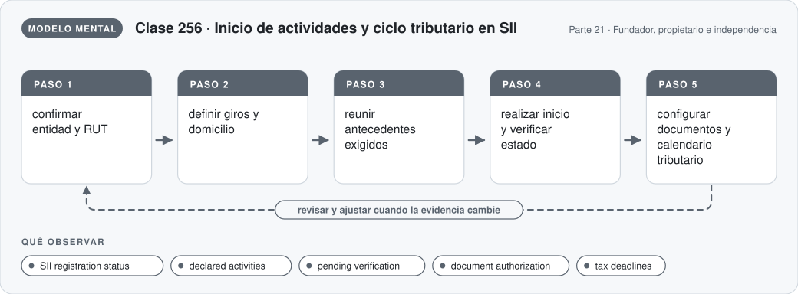

# Clase 256 — Inicio de actividades y ciclo tributario en SII

<!-- nav:inicio -->
> **Parte 21 · Founder Track Chile: formalización y operación** — clase 4 de 12 · [índice de la parte](../../README.md) · [temario](../../../../SYLLABUS.md)
<!-- nav:fin -->

**Parte:** 21 — Founder Track Chile: formalización y operación  
**Nivel:** Etapa 6 — Founder en Chile  
**Duración sugerida:** 150–180 minutos · **Estándar:** deep-class-v2

## 🎯 Propósito

Una empresa puede estar bien constituida y, aun así, no poder operar tributariamente. El paso que la habilita ante el Servicio de Impuestos Internos (SII) es el **inicio de actividades**: la declaración por la cual una persona o entidad se registra como contribuyente para realizar una actividad, informando antecedentes como el giro, el domicilio y otros datos que el SII define. De ahí en adelante se abre un **ciclo tributario** recurrente: documentos que se emiten y reciben, registros que se llevan, declaraciones y pagos periódicos. Muchos fundadores confunden tres cosas que son distintas: la **constitución** (crea la entidad), el **inicio de actividades** (la registra como contribuyente) y el **giro** (la actividad económica que se declara). Mezclarlas lleva a trámites incompletos, documentos que no se pueden emitir y sorpresas en la primera fiscalización.

La clase enseña el inicio de actividades como una **secuencia verificable**: confirmar la entidad y el RUT, definir giros y domicilio, reunir los antecedentes que el SII exige hoy, realizar el trámite y comprobar el estado, y configurar documentos y calendario. **No se enseñan montos, tasas ni plazos como permanentes**: el SII publica los requisitos y los cambia; aquí se aprende qué mirar y cómo registrar la evidencia. Las fuentes son los materiales oficiales del SII (Portal Emprendedor, SII Educa, ciclo de vida del contribuyente, ayudas y acreditación), el RES y otras autoridades que se relacionan, más Drucker sobre gestión. Al terminar sabrás preparar el trámite, evitar los errores típicos y organizar el ciclo tributario inicial con un contador.

## 📚 Resultados de aprendizaje

Al finalizar podrás:

1. **Distinguir** constitución, inicio de actividades y giro.
2. **Preparar** los antecedentes del inicio de actividades con la fuente oficial vigente.
3. **Verificar** el estado de la empresa ante el SII y registrar la evidencia.
4. **Armar** el ciclo tributario inicial: documentos, registros y calendario.
5. **Decidir** qué se hace internamente y qué con un contador, con costo y riesgo.

## 🧭 Agenda

| Tramo | Qué se hace |
|---|---|
| 0–20 min | Recuperación: ¿qué sabes de lo que el SII te pedirá y de lo que debes hacer después? |
| 20–60 min | Entidad y RUT, giros y domicilio, antecedentes, trámite y estado, documentos y calendario. |
| 60–105 min | Ejemplo trabajado: tiempo y costo del cumplimiento mensual, interno frente a contador. |
| 105–150 min | Caso ejecutivo y práctica. |
| 150–175 min | Límites y entregable. |

## 🧩 Conceptos centrales

| Concepto | Definición | Cómo se reconoce |
|---|---|---|
| **Inicio de actividades** | Declaración que registra al contribuyente para su actividad. | Estado y datos en el SII. |
| **Giro** | Actividad económica declarada. | Código y descripción. |
| **Domicilio** | Lugar declarado para efectos tributarios y de operación. | Dirección registrada. |
| **Ciclo tributario** | Obligaciones recurrentes de documentos, registros y declaraciones. | Calendario con responsables. |
| **Contribuyente** | Persona o entidad con obligaciones tributarias. | Registro en el SII. |
| **Evidencia de estado** | Documento o consulta que prueba el estado actual. | Captura o certificado con fecha. |

## 🧠 Modelo mental

**Cómo leer el diagrama.** Una cadena de cinco pasos. **Entidad y RUT**: confirmar quién inicia actividades. **Giros y domicilio**: las actividades declaradas y el lugar. **Antecedentes**: reunir lo que el SII exige hoy. **Inicio y estado**: realizar el trámite y verificarlo. **Documentos y calendario**: configurar la emisión de documentos y los plazos. La flecha de retorno indica que los cambios de giro o de domicilio se actualizan. La nota recuerda que los pasos y antecedentes pueden cambiar y se verifican en sii.cl; el pie, que el inicio de actividades no es el giro y se revisan por separado.

## 📖 Desarrollo

### 1. Tres cosas que no son lo mismo

La **constitución** crea una persona jurídica (clase 255); el **inicio de actividades** registra a una persona natural o jurídica como contribuyente para realizar una actividad económica ante el SII; el **giro** es la actividad o actividades que se declaran en ese registro. Una sociedad puede existir y no haber iniciado actividades, y puede haberlas iniciado con un giro que ya no refleja lo que realmente hace. El SII lo explica en su material educativo (SII Educa y el ciclo de vida del contribuyente) y ofrece ayudas para el trámite. Para el fundador, la distinción importa por una razón práctica: **los documentos tributarios, la contabilidad y las declaraciones se organizan a partir de lo que se informó en el inicio de actividades**. Un dato mal informado se arrastra.

### 2. Entidad y RUT: quién inicia

El primer paso es confirmar **quién** inicia actividades: una persona natural con su RUT o una persona jurídica con el RUT que se le asignó al constituirse. El RES indica cómo se obtiene y qué documentos acreditan la constitución en los casos que gestiona. Antes del trámite se revisa que los datos coincidan en todos los documentos (nombre o razón social, RUT, representante, domicilio) y que quien realiza el trámite tenga facultades para ello. Una inconsistencia en este primer paso produce rechazos o correcciones posteriores. También se decide **quién será el responsable interno** del ciclo tributario (el fundador, un administrativo, un contador externo), porque desde el inicio hay claves de acceso y notificaciones que deben llegar a alguien que las lea.

### 3. Giros y domicilio

Los **giros** deben describir la actividad real, de acuerdo con el listado oficial de actividades que publica el SII. Elegir sin cuidado puede traer problemas: un giro que no corresponde a lo que se hace, o que omite una actividad relevante, afecta documentos, permisos y fiscalización. Se deben declarar las actividades que efectivamente se ejecutarán, y actualizar cuando el negocio cambie. El **domicilio** declarado también importa: es la referencia para notificaciones y para determinar obligaciones locales, y suele cruzarse con los permisos municipales (clase 262). Si el negocio opera en un local, desde la casa o por internet, la descripción debe ser coherente con la realidad y con los contratos de arriendo o autorizaciones que existan. Los requisitos específicos de cada caso se verifican en el SII y con el contador.

### 4. Reunir los antecedentes que el SII exige hoy

El SII publica qué información y documentos se piden, y puede modificarlos. Por eso la regla es **no confiar en listas antiguas**: se consulta el portal el día en que se hace el trámite y se guarda evidencia (captura o PDF con fecha) de lo que decía. Típicamente se necesitan datos de identificación, representación, domicilio, actividades y, según el caso, documentos que acrediten el lugar o la constitución. La **acreditación del inicio de actividades** y las **obligaciones tributarias** asociadas están descritas en el sitio oficial. Se prepara una **carpeta** (digital y ordenada) con todo lo que se usó, quién lo preparó y la fecha. Esa carpeta ahorra tiempo en trámites futuros, bancos, licitaciones y revisiones.

### 5. Realizar el trámite y verificar el estado

Una vez hecho el trámite, **no se supone que está terminado**: se verifica el **estado** de la empresa en el SII, que los datos registrados coincidan con los declarados y que se pueda acceder a los servicios que se usarán (por ejemplo, emisión de documentos y consulta de registros). Se guarda evidencia con fecha. Si algo falta o está mal, se corrige de inmediato y se registra la corrección. Muchas empresas descubren meses después que su estado tenía una observación que nadie revisó. Una buena práctica es dejar en el calendario una **verificación posterior** (por ejemplo, a los 30 días) para confirmar que todo sigue en orden y que las notificaciones llegan al correo correcto.

### 6. Documentos, registros y calendario

El inicio de actividades habilita el uso de documentos tributarios (clase 257), pero no los configura solo. Hay que decidir **qué documentos se emitirán**, **cómo** (el SII describe las alternativas oficiales), **quién emite y quién recibe**, y **dónde se guardan**. También se define cómo se llevarán los **registros** de ventas, compras y otras operaciones y el **calendario** de declaraciones y pagos periódicos, con fechas tomadas del SII y no de la memoria. Un buen calendario tiene: obligación, periodicidad, fecha límite según la fuente, responsable, evidencia que se guarda y fecha de última verificación. Se agrega una alerta previa a cada vencimiento. Y se asigna un **respaldo**: si la persona responsable falta, otra sabe qué hacer.

### 7. Cuánto hacer internamente y cuándo contratar contador

El cumplimiento tiene costo: tiempo del fundador o dinero de un contador. La decisión debe hacerse con números y con riesgo. Se estiman las **horas mensuales** de trabajo tributario, se valora cada hora del fundador por lo que podría generar vendiendo o produciendo, se compara con el **honorario** del contador y se suma el **costo esperado de errores** (multas, intereses, correcciones, atención de requerimientos), que debe consultarse con un profesional. Drucker recuerda que el tiempo del ejecutivo es el recurso más escaso y que conviene dedicarlo a lo que solo él puede hacer. Eso no significa delegar sin supervisar: el responsable de la empresa sigue siendo el dueño. Cuando hay duda sobre el tratamiento de una operación, se pregunta antes de actuar y se guarda la respuesta.

## 📚 Lectura comparada

| Fuente | Qué aporta | Qué no resuelve | Pregunta para contrastar |
|---|---|---|---|
| SII: ciclo de vida del contribuyente | Visión por etapas, incluido el inicio de actividades. | No decide el giro de tu caso. | ¿En qué etapa está mi empresa? |
| SII: ayudas para el inicio de actividades | Orientación práctica del trámite. | No sustituye la revisión del caso. | ¿Qué antecedentes pide hoy? |
| SII: acreditación y obligaciones | Qué se acredita y qué obligaciones se activan. | No es un plan de cumplimiento. | ¿Qué obligaciones tengo desde el primer mes? |
| SII Educa y Portal Emprendedor | Material educativo para emprendedores. | No es asesoría. | ¿Qué parte requiere contador? |
| Drucker | Uso del tiempo del ejecutivo y de la gestión. | No contiene normativa chilena. | ¿Es este el mejor uso de mi hora? |

## 🧮 Ejemplo trabajado

**Situación (hipotética).** Un fundador de una tienda en línea de accesorios debe decidir si llevará el cumplimiento tributario mensual él mismo o contratará un contador. Todos los datos son **supuestos**; los requisitos reales se verifican en el SII y las tarifas con presupuestos de contadores.

**Datos supuestos.**

| Dato | Valor |
|---|---|
| Horas mensuales de trabajo tributario si lo hace él (documentos, registros, declaraciones, consultas) | 10 horas |
| Valor de una hora del fundador (margen que genera vendiendo) | 15.000 pesos |
| Honorario mensual de un contador | 90.000 pesos |
| Horas mensuales del fundador si hay contador (coordinación y entrega de información) | 2 horas |
| Probabilidad mensual de un error con costo si lo hace él | 6 % |
| Probabilidad mensual de un error con costo si lo hace el contador | 2 % |
| Costo promedio de un error (correcciones, intereses, tiempo) | 400.000 pesos |

**Alternativa A: lo hace el fundador.**

- Costo de tiempo: 10 × 15.000 = 150.000 pesos.
- Costo esperado de errores: 0,06 × 400.000 = 24.000 pesos.
- **Total mensual: 174.000 pesos.**

**Alternativa B: contador.**

- Honorario: 90.000 pesos.
- Tiempo del fundador: 2 × 15.000 = 30.000 pesos.
- Costo esperado de errores: 0,02 × 400.000 = 8.000 pesos.
- **Total mensual: 128.000 pesos.**

**Diferencia.** 174.000 − 128.000 = **46.000 pesos al mes** a favor del contador; en doce meses, 552.000 pesos.

**Punto de equilibrio en horas.** Si el fundador pudiera hacerlo en menos horas, ¿cuándo igualaría? Con h horas: 15.000 h + 24.000 = 128.000 → h = 104.000 ÷ 15.000 ≈ **6,9 horas**. Si lo hiciera en menos de 6,9 horas al mes, convendría hacerlo él; si no, el contador.

**Sensibilidad.** Si el valor de la hora del fundador fuera 8.000 pesos (vende menos): costo A = 10 × 8.000 + 24.000 = 104.000 y B = 90.000 + 16.000 + 8.000 = 114.000, y A es más barato por 10.000. **La decisión depende del valor del tiempo y de los errores esperados.**

**Lo que el cálculo no incluye.** El cumplimiento tributario puede tener consecuencias legales y económicas mayores que un «error promedio»; la probabilidad y el costo se estiman con un profesional. Tampoco incluye la **tranquilidad** y el aprendizaje de un contador que sugiere ahorros legítimos y advierte sobre cambios.

**Decisión.** Contratar contador desde el primer mes, hacer una reunión inicial para revisar el inicio de actividades, los giros declarados, los documentos que se emitirán y el calendario, y revisar el contrato de servicio (qué incluye y qué no). El fundador conserva la carpeta de antecedentes y una verificación a los 30 días.

**Cuidados.** Las tarifas, tasas, plazos y requisitos reales se confirman en el SII y con presupuestos.

**Qué muestra.** (1) El costo del cumplimiento se estimó con tiempo valorado y riesgo. (2) El punto de equilibrio dio un criterio simple. (3) La sensibilidad mostró que la decisión cambia con el valor del tiempo.

## 🔀 Comparación y límites

**Inicio de actividades frente a giro.** El primero registra al contribuyente para operar; el segundo describe qué actividad se declara. Se tramitan juntos pero se revisan por separado, porque el giro cambia con el negocio.

**Límites.** Esta clase no indica requisitos, plazos ni montos vigentes: los publica el SII. El ejemplo usa supuestos de tiempo y de error. Los casos con particularidades (actividades reguladas, comercio exterior, regímenes especiales) requieren asesoría tributaria. El programa no reemplaza a un contador.

## 🪜 De profesional a owner

| Nivel | Cómo se relaciona con el ciclo tributario |
|---|---|
| **Profesional** | Emite y recibe documentos en su trabajo. |
| **Jefe / Team Lead** | Respalda gastos y documentos de su equipo. |
| **Gerente** | Responde por la conciliación y los cierres de su área. |
| **CEO / Director** | Vela por cumplimiento, contador y controles. |
| **Founder / Owner** | Inicia actividades, define giros y responde por el ciclo completo. |

## 🏢 Caso ejecutivo

Una fundadora constituyó hace dos meses una sociedad para vender productos de panadería artesanal por suscripción mensual y a restaurantes. Hizo el inicio de actividades ella misma con un giro general; no guardó evidencia. Después amplió a la fabricación de los productos en un local arrendado, y empezó a importar harinas especiales. Emite documentos desde una planilla y paga a una persona que le ayuda con el reparto. Recibió un correo del SII que no leyó porque llegó a la cuenta del socio que se fue. No tiene calendario. Estima 12 horas mensuales de trabajo tributario a 14.000 pesos la hora y un contador le cobra 110.000 al mes; no sabe cuánto costaría un error.

Entrega un **memo de decisión del fundador** que contenga: (a) la distinción entre constitución, inicio de actividades y giros con el estado de su caso; (b) los datos que debe verificar y actualizar en el SII, con fuente; (c) el cálculo comparado de hacerlo ella o contratar contador, con punto de equilibrio y sensibilidad; (d) el plan para recuperar la evidencia faltante y las notificaciones; (e) el calendario inicial con responsable y respaldo; (f) las consultas al contador y los puntos que requieren verificación oficial.

## 🧪 Práctica

1. Escribe qué giros declararías y qué actividad real hace tu empresa.
2. Reúne los antecedentes que el SII pide hoy y guarda evidencia con fecha.
3. Verifica el estado de tu empresa y a qué correo llegan las notificaciones.
4. Calcula tu costo de cumplimiento con y sin contador y el punto de equilibrio.
5. Construye un calendario con responsable, evidencia y respaldo.

## ⚠️ Errores frecuentes

| Error | Por qué ocurre | Cómo corregirlo |
|---|---|---|
| Confundir constitución e inicio de actividades | Se cree que un paso incluye al otro | Tratarlos como pasos con fuentes distintas. |
| Giro que no refleja la actividad | Se elige rápido | Describir la actividad real y actualizar. |
| No guardar evidencia | «Ya está hecho» | Capturas o certificados con fecha. |
| Notificaciones a una persona que se fue | No se actualizan datos | Verificar correos y accesos. |
| Calendario de memoria | Falta de proceso | Calendario con fuente y respaldo. |
| Decidir sin números | Se supone que hacerlo uno mismo es gratis | Valorar el tiempo y el riesgo. |

## ❓ Preguntas de comprobación

1. ¿Qué diferencia hay entre constitución, inicio de actividades y giro?
2. ¿Por qué no se confía en listas antiguas de requisitos?
3. ¿Qué se verifica después de realizar el trámite?
4. ¿Qué debe tener cada fila de un calendario tributario?
5. ¿Cómo se compara hacerlo uno mismo con contratar un contador?
6. ¿Cuándo cambia el giro declarado?
7. ¿Qué límite tiene esta clase?

Claves de respuesta

1. La constitución crea la entidad; el inicio registra al contribuyente; el giro es la actividad declarada.
2. Porque el SII puede cambiar lo que exige; se consulta el portal ese día y se guarda evidencia.
3. El estado, que los datos coincidan y que los servicios necesarios estén accesibles.
4. Obligación, periodicidad, fecha según la fuente, responsable, evidencia y última verificación.
5. Con el costo del tiempo valorado, el honorario y el costo esperado de errores, más sensibilidad.
6. Cuando la actividad real cambia o se agrega una actividad relevante.
7. No indica requisitos, plazos ni montos vigentes y no reemplaza a un contador.

## 📥 Entregable

Guarda en `portfolio/256-inicio-de-actividades-y-ciclo-tributario-en-sii/`:

- `founder-owner-decision-brief.md` (plantilla [Founder owner decision brief](../../../../templates/founder-owner-decision-brief.md)) con el memo del caso ejecutivo;
- `decision-journal.md` con los antecedentes, las evidencias de estado y el calendario inicial.

## 📗 Fuentes y verificación

- Servicio de Impuestos Internos (Chile) — *Ciclo de vida del contribuyente: inicio de actividades*. **Uso en esta clase:** visión por etapas del contribuyente, incluido el inicio de actividades. **Fuente primaria:** <https://www.sii.cl/destacados/educacion/ciclo_vida_contribuyente/paso_02.html>.
- Servicio de Impuestos Internos (Chile) — *Ayudas para el inicio de actividades*. **Uso en esta clase:** orientación oficial para realizar el inicio de actividades. **Fuente primaria:** <https://www.sii.cl/pagina/registro_contribuyentes/ayudas_inicio_actividades.htm>.
- Servicio de Impuestos Internos (Chile) — *Acreditación de inicio de actividades y obligaciones tributarias*. **Uso en esta clase:** acreditación del inicio de actividades y obligaciones tributarias. **Fuente primaria:** <https://www.sii.cl/destacados/ley_cumplimiento_obligaciones_tributarias/inicio_actividades.html>.
- Servicio de Impuestos Internos (Chile) — *SII Educa: inicio de actividades y formalización de un negocio*. **Uso en esta clase:** material educativo sobre inicio de actividades y formalización. **Fuente primaria:** <https://www.sii.cl/siieduca/aprende-con-nosotros/inicio-de-actividades-y-formalizacion-de-un-negocio.html>.
- Servicio de Impuestos Internos (Chile) — *Portal Emprendedor*. **Uso en esta clase:** portal oficial para emprendedores. **Fuente primaria:** <https://www.sii.cl/portales/emprendedor/>.
- Peter F. Drucker — *Management: Tasks, Responsibilities, Practices* (Harper & Row, 1974). **Uso en esta clase:** uso del tiempo del ejecutivo y gestión por resultados. Lectura selectiva sobre **inicio de actividades y ciclo tributario en sii**. **Localizador:** [ISBN-13 9780060110925](https://openlibrary.org/isbn/9780060110925).

> **Regla de fuentes para Inicio de actividades y ciclo tributario en SII:** las obras y portales anteriores estructuran las perspectivas de esta materia; cualquier norma, ley, trámite, tasa o plazo mencionado debe comprobarse nuevamente en su fuente primaria oficial vigente, y este programa no reemplaza asesoría legal, tributaria ni contable. Los ejemplos y casos son hipotéticos, con cifras ilustrativas. El desarrollo es original y no reproduce material protegido.

<!-- pie:inicio -->
---

| Anterior | Índice | Siguiente |
|---|---|---|
| [← 255 · RES y tipos societarios: panorama](../255-res-y-tipos-societarios-panorama/README.md) | [Parte 21](../../README.md) · [Programa](../../../../SYLLABUS.md) | [257 · Documentos tributarios, IVA y registros: panorama ejecutivo →](../257-documentos-tributarios-iva-y-registros-panorama-ejecutivo/README.md) |
<!-- pie:fin -->
