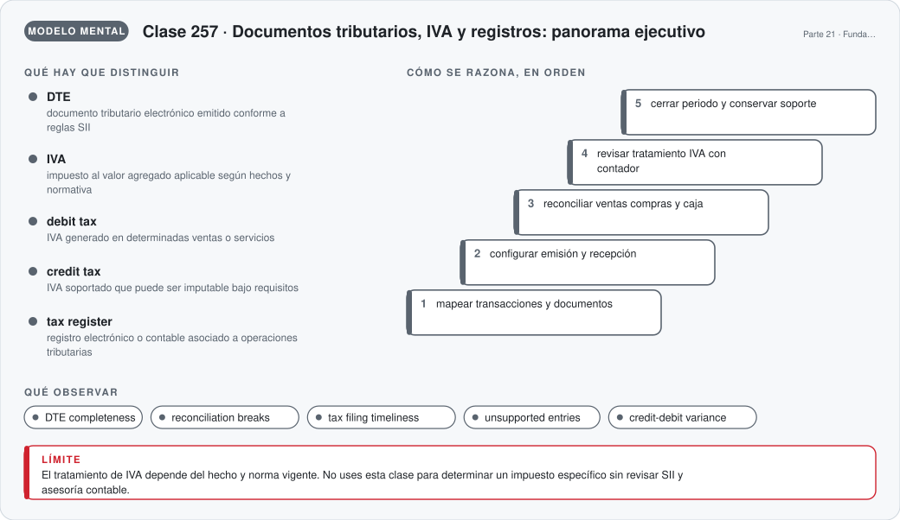

# Clase 257 — Documentos tributarios, IVA y registros: panorama ejecutivo

<!-- nav:inicio -->
> **Parte 21 · Founder Track Chile: formalización y operación** — clase 5 de 12 · [índice de la parte](../../README.md) · [temario](../../../../SYLLABUS.md)
<!-- nav:fin -->

**Parte:** 21 — Founder Track Chile: formalización y operación  
**Nivel:** Etapa 6 — Founder en Chile  
**Duración sugerida:** 150–180 minutos · **Estándar:** deep-class-v2

## 🎯 Propósito

Cada venta, compra, pago o cobro de una empresa deja o debería dejar un **documento**, un **registro** y un **soporte**. En Chile, el SII regula los documentos tributarios, incluidos los electrónicos, y el Impuesto al Valor Agregado (IVA) es una de las obligaciones recurrentes más visibles para quien vende bienes y servicios. Para un fundador, el tema suele aparecer como una lista de miedos («me van a multar», «no entiendo el crédito fiscal») cuando en realidad se trata de **una disciplina de tres movimientos**: documentar cada transacción de forma correcta, registrar y conciliar lo documentado con la caja y el banco, y revisar con un contador el tratamiento del IVA antes de cerrar el período. El objetivo no es que el fundador sea contador, sino que **entienda qué le piden, qué evidencia debe guardar y cuándo preguntar**.

Esta clase es un panorama ejecutivo: **no determina el tratamiento tributario de ninguna operación ni enseña tasas o plazos como permanentes**. El SII y los textos vigentes del Código Tributario y de la Ley sobre Impuesto a las Ventas y Servicios, disponibles en LeyChile, son las fuentes; la aplicación a cada caso la hace un contador. Se usa una tasa de IVA ilustrativa solo para mostrar la mecánica aritmética de débito y crédito, con la advertencia de verificarla en el SII. Al terminar sabrás mapear tus transacciones y documentos, ordenar la emisión y recepción, conciliar ventas, compras y banco, preparar las preguntas para tu contador y cerrar un período con soporte.

## 📚 Resultados de aprendizaje

Al finalizar podrás:

1. **Distinguir** documento tributario, registro, soporte e IVA.
2. **Mapear** las transacciones de tu empresa y el documento que corresponde a cada una.
3. **Conciliar** ventas, compras y movimientos bancarios e investigar diferencias.
4. **Preparar** las preguntas para el contador sobre el tratamiento del IVA.
5. **Cerrar** un período con soporte, plazos y responsables.

## 🧭 Agenda

| Tramo | Qué se hace |
|---|---|
| 0–20 min | Recuperación: ¿qué documento respalda cada ingreso y cada gasto de tu empresa? |
| 20–60 min | Documentos, emisión y recepción, registros, conciliación, IVA con el contador y cierre. |
| 60–105 min | Ejemplo trabajado: conciliación mensual y mecánica ilustrativa de débito y crédito. |
| 105–150 min | Caso ejecutivo y práctica. |
| 150–175 min | Límites y entregable. |

## 🧩 Conceptos centrales

| Concepto | Definición | Cómo se reconoce |
|---|---|---|
| **Documento tributario** | Documento que respalda una operación según reglas del SII. | Factura, boleta u otro, en la forma oficial. |
| **Documento electrónico** | Documento emitido y recibido por medios electrónicos autorizados. | Registro en el SII. |
| **IVA** | Impuesto que grava ciertas ventas y servicios, con mecánica de débito y crédito. | Declaración periódica. |
| **Débito y crédito fiscal** | Lo que se cobra en ventas y lo que se paga en compras, según corresponda. | Registros de ventas y compras. |
| **Conciliación** | Comprobar que documentos, registros y banco coinciden. | Diferencias explicadas. |
| **Soporte** | Respaldo que conserva la empresa para cada operación. | Archivo ordenado y accesible. |

## 🧠 Modelo mental

**Cómo leer el diagrama.** Tres columnas. **Documentar**: qué transacciones existen, qué documento corresponde a cada una y la emisión y recepción configuradas. **Registrar y conciliar**: ventas, compras y caja, diferencias explicadas y soporte conservado. **Revisar y cerrar**: tratamiento del IVA con el contador, cierre del período y plazos y registros al día. La nota afirma que el tratamiento del IVA depende del hecho y de la norma vigente, y que la clase no determina un impuesto específico; el pie, que un documento sin soporte o sin conciliar es un riesgo, aunque el número cuadre.

## 📖 Desarrollo

### 1. Mapear transacciones y documentos

El primer paso es **un inventario de transacciones**: qué vende la empresa (productos, servicios, suscripciones, comisiones), a quién (consumidores, empresas, organismos públicos, clientes del exterior), cómo cobra (efectivo, transferencia, tarjeta, plataforma), qué compra (insumos, servicios, activos, arriendos, honorarios), a quién y cómo paga. Para cada una se pregunta: ¿qué documento corresponde?, ¿quién lo emite?, ¿cuándo?, ¿dónde se guarda? El SII define los documentos tributarios y sus formas de emisión; el contador confirma cuál aplica a cada operación. La tabla resultante es el **mapa de documentos** y es el insumo de todo lo demás. Una transacción sin documento definido es un riesgo, aunque «siempre se haya hecho así».

### 2. Emisión y recepción configuradas

La empresa debe poder **emitir** los documentos que le corresponden y **recibir y registrar** los que le emiten sus proveedores. El SII describe los mecanismos oficiales de documentos electrónicos y los requisitos para usarlos; la empresa elige herramientas (propias, de mercado o del propio SII) según su volumen y complejidad, y se asegura de que **todos los documentos queden registrados en un lugar único**, con numeración y fechas coherentes. Reglas útiles: una persona responsable de la emisión, un respaldo, un procedimiento para anular o corregir documentos según lo permitido, y un acuerdo con proveedores sobre cómo y a qué correo reciben los documentos. Los requisitos técnicos y de autorización cambian: se verifican en el SII, no en un tutorial antiguo.

### 3. Registros: ventas, compras y caja

Los documentos se **registran**: libros o registros de ventas y compras, según las reglas del SII, y la contabilidad de la empresa. Registrar bien significa que cada documento aparece una vez, en el período correcto, con los datos del proveedor o cliente, el monto neto, el impuesto y el total. También significa **conservar el soporte**: el documento original o su copia electrónica, contratos, órdenes de compra, comprobantes de pago, correos de aprobación. Las normas fijan plazos de conservación que se verifican en las fuentes oficiales. Un registro correcto sin soporte es frágil; un soporte sin registro es desorden. Ambos deben existir y relacionarse.

### 4. Conciliar: que los números se parezcan entre sí

La **conciliación** compara tres fuentes: los **documentos emitidos y recibidos**, los **registros** y los **movimientos del banco** (clase 258). Las diferencias son una **señal**, no necesariamente un error: puede haber depósitos que se reciben en otro período, pagos con comisiones descontadas, documentos pendientes de emitir, notas de crédito, anticipos o errores de digitación. Lo importante es que **cada diferencia tenga una explicación escrita y un responsable**. Un depósito sin documento puede indicar una venta no facturada; un documento sin pago puede ser una cuenta por cobrar; un pago sin documento, un gasto sin respaldo. Hacerlo cada mes, y no solo al cierre anual, evita acumular desorden.

### 5. El IVA: mecánica, no interpretación

El IVA funciona, en términos generales, con una lógica de **débito** (impuesto asociado a las ventas gravadas) y **crédito** (impuesto asociado a ciertas compras), y la diferencia se declara y paga en los períodos que fija el SII. **Qué ventas están gravadas, qué compras dan derecho a crédito, cuándo, con qué condiciones y con qué excepciones** son preguntas que se responden con el texto vigente y con un contador. Esta clase solo muestra la mecánica aritmética, con una tasa ilustrativa, para que el fundador entienda **por qué una compra mal documentada o mal clasificada cambia el monto a pagar**. Si hay dudas sobre una operación (exportaciones, servicios del exterior, activos, gastos mixtos, exenciones), se consulta antes de registrarla y se guarda la respuesta.

### 6. Cerrar el período con soporte

El **cierre** de un período es un pequeño ritual: se verifican los documentos emitidos y recibidos, se concilian con el banco, se revisan las diferencias, se calcula con el contador la declaración correspondiente, se aprueba y se paga dentro del plazo, y se **archiva todo** con una nota del cierre (fecha, responsable, incidencias). Un buen cierre deja evidencia de que alguien con autoridad revisó y aprobó. Si el período queda con asuntos pendientes (documentos que no llegaron, operaciones en duda), se anotan y se resuelven en un plazo definido. El cierre mensual también es la oportunidad para mirar el negocio: márgenes, ventas por cliente, gastos que crecen y cuentas por cobrar.

### 7. Qué preguntar al contador y cuándo cambiar el proceso

El contador es un socio de control, no solo de trámite. Preguntas útiles: ¿qué documento corresponde a esta operación?, ¿qué tratamiento tiene en IVA?, ¿qué soporte se requiere?, ¿qué errores comunes ve en empresas como la mía?, ¿qué cambió en la norma o en el SII que me afecte?, ¿qué me conviene automatizar? Se revisa el proceso cuando cambia el volumen, se agregan líneas de negocio, se vende al exterior o se incorporan plataformas de pago. Drucker recuerda que conviene medir lo que importa para decidir; aquí, por ejemplo, el **porcentaje de documentos conciliados** y el **número de diferencias abiertas** al cierre son indicadores simples y útiles. Y como el panorama cambia, cada afirmación sobre una norma se revalida en la fuente vigente.

## 📚 Lectura comparada

| Fuente | Qué aporta | Qué no resuelve | Pregunta para contrastar |
|---|---|---|---|
| SII (normativa y servicios) | Documentos, registros y obligaciones oficiales. | No decide tu caso. | ¿Qué documento y registro aplican hoy? |
| LeyChile: Código Tributario y Ley sobre Impuesto a las Ventas y Servicios | Texto vigente de las normas. | Requiere interpretación profesional. | ¿Qué dice el texto vigente sobre esta operación? |
| Registro de Empresas y Sociedades | Datos de la entidad que emite. | No trata documentos tributarios. | ¿Coinciden los datos de la entidad? |
| Superintendencia de Pensiones | Normativa previsional vinculada a pagos laborales. | No es guía de IVA. | ¿Qué otras obligaciones recurrentes tengo? |
| Drucker | Medir para gestionar. | No contiene normativa chilena. | ¿Qué indicador de control uso? |

## 🧮 Ejemplo trabajado

**Situación (hipotética).** Una empresa de productos de limpieza para hoteles cierra el mes. Para ilustrar la mecánica se usa una **tasa de IVA de 19 %, solo como supuesto aritmético**: la tasa vigente, las ventas gravadas y el derecho a crédito se verifican en el SII y con el contador.

**Ventas del mes (netas).** 8.000.000 pesos. Con IVA, las ventas facturadas suman 8.000.000 × 1,19 = **9.520.000**.

**Compras del mes (netas).**

| Concepto | Neto |
|---|---|
| Insumos y envases | 2.700.000 |
| Transporte | 500.000 |
| Compras en consulta (tratamiento por confirmar con el contador) | 500.000 |

**Mecánica de débito y crédito.**

- Débito: 19 % × 8.000.000 = **1.520.000**.
- Crédito de las compras confirmadas: 19 % × (2.700.000 + 500.000) = 19 % × 3.200.000 = **608.000**.
- IVA a pagar con lo confirmado: 1.520.000 − 608.000 = **912.000**.

**Efecto de la consulta.** Si las compras en consulta (500.000 netas) dieran derecho a crédito, se agregarían 95.000 de crédito y el IVA bajaría a 817.000. Si no, quedan en 912.000. **La diferencia de 95.000 depende de una interpretación que debe hacer el contador con la norma vigente**, no el fundador.

**Conciliación con el banco.**

| Concepto | Monto |
|---|---|
| Ventas facturadas con IVA | 9.520.000 |
| Depósitos del mes asociables a clientes | 9.340.000 |
| Diferencia | 180.000 |

La diferencia puede explicarse por pagos de cuentas por cobrar de otro período, un cliente que pagó parcialmente, descuentos informales o depósitos pendientes. El procedimiento: revisar los 5 documentos de mayor monto sin pago, preguntar a ventas, anotar la causa, abrir un seguimiento. Supón que se encuentra que **120.000** corresponden a una factura pagada el primer día del mes siguiente y **60.000** a una nota de crédito que no se registró. La diferencia queda **explicada: 120.000 + 60.000 = 180.000**, pero la nota de crédito debe registrarse y su efecto sobre el IVA debe revisarse con el contador.

**Indicadores del cierre.** Documentos del mes: 142; conciliados: 136, que equivalen a 95,8 % (136 ÷ 142). Diferencias abiertas: 6. Meta: 100 % conciliado al día 10 del mes siguiente (meta interna, no norma).

**Decisión.** Enviar al contador las compras en consulta con sus documentos y el contexto, registrar la nota de crédito, cerrar el mes cuando las 6 diferencias estén explicadas y guardar el archivo del cierre con fecha y responsable. Revisar el proceso cuando los documentos por mes superen los 300 o se incorpore una nueva plataforma de cobro.

**Cuidados.** La tasa, las operaciones gravadas, el derecho a crédito y los plazos son los vigentes en la fuente oficial y los confirma un contador; el ejemplo solo ilustra la mecánica.

**Qué muestra.** (1) La aritmética de débito y crédito. (2) Cómo una consulta cambia el resultado. (3) Cómo la conciliación convierte una diferencia en una explicación documentada.

## 🔀 Comparación y límites

**Documentar frente a registrar.** Documentar es generar o recibir el respaldo de la operación; registrar es anotarla en los libros o registros en el período correcto. Se necesitan ambos, y la conciliación los vincula con la caja.

**Límites.** La clase no determina el IVA de ninguna operación: la tasa y el tratamiento son los que establecen las normas vigentes, y su aplicación la hace un contador. El ejemplo es ilustrativo. Los plazos, los registros y las formas de emisión cambian y se verifican en el SII.

## 🪜 De profesional a owner

| Nivel | Cómo se relaciona con los documentos y el IVA |
|---|---|
| **Profesional** | Entrega documentos correctos para los gastos y rendiciones. |
| **Jefe / Team Lead** | Revisa que los respaldos de su equipo estén completos. |
| **Gerente** | Responde por el cierre y la conciliación de su unidad. |
| **CEO / Director** | Aprueba el proceso y supervisa al contador. |
| **Founder / Owner** | Es responsable final de que los documentos, registros y pagos cumplan. |

## 🏢 Caso ejecutivo

Una fundadora vende talleres de repostería en línea y kits de ingredientes. Cobra por una plataforma de pagos que descuenta una comisión antes de depositar; emite boletas o facturas «cuando se acuerda». Compra ingredientes a proveedores informales sin documento, paga el arriendo del local a una persona natural y contrata un servicio de edición de video desde el exterior. En el último mes facturó ventas netas por 6.500.000 pesos, tiene compras documentadas netas por 2.100.000, y 700.000 más sin documento. El banco recibió depósitos por 7.050.000. Usa una planilla para registrar todo y no concilia. Su contador le pide los documentos el día del vencimiento. Supón una tasa ilustrativa de 19 % para la aritmética.

Entrega un **memo de decisión del fundador** que contenga: (a) el mapa de transacciones y documentos con los vacíos; (b) el cálculo ilustrativo de débito y crédito con lo documentado y la sensibilidad a las compras sin documento; (c) la conciliación entre ventas con IVA y depósitos, con las hipótesis de explicación; (d) las preguntas al contador sobre arriendo, proveedores informales, servicio del exterior y comisiones de la plataforma; (e) el procedimiento mensual de cierre con responsable y soporte; (f) las verificaciones oficiales pendientes y las decisiones que se posponen hasta tenerlas.

## 🧪 Práctica

1. Lista tus tipos de transacción y el documento que corresponde a cada una.
2. Concilia un mes de ventas con los depósitos y explica cada diferencia.
3. Calcula con una tasa ilustrativa el débito y el crédito de tu mes y marca lo que consultarás.
4. Escribe diez preguntas para tu contador con ejemplos de tus documentos.
5. Diseña tu ritual de cierre: pasos, responsable, plazo y archivo.

## ⚠️ Errores frecuentes

| Error | Por qué ocurre | Cómo corregirlo |
|---|---|---|
| Transacciones sin documento definido | «Siempre se ha hecho así» | Mapa de documentos revisado con el contador. |
| Registrar sin soporte | Se confía en la planilla | Archivo ordenado de respaldos. |
| No conciliar | No se ve valor | Conciliación mensual con diferencias explicadas. |
| Interpretar el IVA de memoria | Parece simple | Consultar la norma vigente y al contador. |
| Entregar documentos el último día | Falta de proceso | Calendario con anticipación y responsable. |
| Mezclar cuentas personales y de la empresa | Comodidad | Separar y documentar. |

## ❓ Preguntas de comprobación

1. ¿Qué diferencia hay entre documento, registro y soporte?
2. ¿Qué se compara en una conciliación?
3. ¿Qué mecánica básica tienen débito y crédito?
4. ¿Por qué no se determina el tratamiento del IVA en esta clase?
5. ¿Cómo se trata una diferencia de conciliación?
6. ¿Qué incluye un buen cierre de período?
7. ¿Qué indicadores simples sirven para controlar el proceso?

Claves de respuesta

1. El documento respalda la operación; el registro la anota en el período; el soporte es el respaldo que se conserva.
2. Los documentos, los registros y los movimientos del banco.
3. El impuesto de las ventas gravadas menos el de compras con derecho a crédito, según la norma vigente.
4. Porque depende del hecho y de la norma vigente, y lo aplica un contador.
5. Con una explicación escrita, un responsable y un seguimiento hasta cerrarla.
6. Verificación, conciliación, revisión con el contador, aprobación, pago, archivo y nota de cierre.
7. Porcentaje de documentos conciliados y número de diferencias abiertas al cierre.

## 📥 Entregable

Guarda en `portfolio/257-documentos-tributarios-iva-y-registros-panorama-ejecutivo/`:

- `founder-owner-decision-brief.md` (plantilla [Founder owner decision brief](../../../../templates/founder-owner-decision-brief.md)) con el memo del caso ejecutivo;
- `decision-journal.md` con el mapa de documentos, la conciliación y las consultas al contador.

## 📗 Fuentes y verificación

- Servicio de Impuestos Internos (Chile) — *Guías, normativa y servicios oficiales*. **Uso en esta clase:** documentos tributarios, registros y obligaciones oficiales. **Fuente primaria:** <https://www.sii.cl/>.
- Biblioteca del Congreso Nacional de Chile — *LeyChile: Código Tributario y Ley sobre Impuesto a las Ventas y Servicios*. **Uso en esta clase:** texto vigente del Código Tributario y de la Ley sobre Impuesto a las Ventas y Servicios. **Fuente primaria:** <https://www.bcn.cl/leychile/>.
- Registro de Empresas y Sociedades (Chile) — *Portal y documentación oficial*. **Uso en esta clase:** datos oficiales de la entidad que emite. **Fuente primaria:** <https://www.registrodeempresasysociedades.cl/>.
- Superintendencia de Pensiones (Chile) — *Normativa y sistema previsional*. **Uso en esta clase:** normativa previsional asociada a pagos laborales. **Fuente primaria:** <https://www.spensiones.cl/>.
- Corporación de Fomento de la Producción (Chile) — *Programas, instrumentos y apoyo empresarial*. **Uso en esta clase:** programas e instrumentos de apoyo empresarial. **Fuente primaria:** <https://www.corfo.cl/>.
- Peter F. Drucker — *Management: Tasks, Responsibilities, Practices* (Harper & Row, 1974). **Uso en esta clase:** medir lo que importa para gestionar. Lectura selectiva sobre **documentos tributarios, iva y registros: panorama ejecutivo**. **Localizador:** [ISBN-13 9780060110925](https://openlibrary.org/isbn/9780060110925).

> **Regla de fuentes para Documentos tributarios, IVA y registros:** las obras y portales anteriores estructuran las perspectivas de esta materia; cualquier norma, ley, trámite, tasa o plazo mencionado debe comprobarse nuevamente en su fuente primaria oficial vigente, y este programa no reemplaza asesoría legal, tributaria ni contable. Los ejemplos y casos son hipotéticos, con cifras ilustrativas. El desarrollo es original y no reproduce material protegido.

<!-- pie:inicio -->
---

| Anterior | Índice | Siguiente |
|---|---|---|
| [← 256 · Inicio de actividades y ciclo tributario en SII](../256-inicio-de-actividades-y-ciclo-tributario-en-sii/README.md) | [Parte 21](../../README.md) · [Programa](../../../../SYLLABUS.md) | [258 · Contabilidad, tesorería y control documental →](../258-contabilidad-tesoreria-y-control-documental/README.md) |
<!-- pie:fin -->
