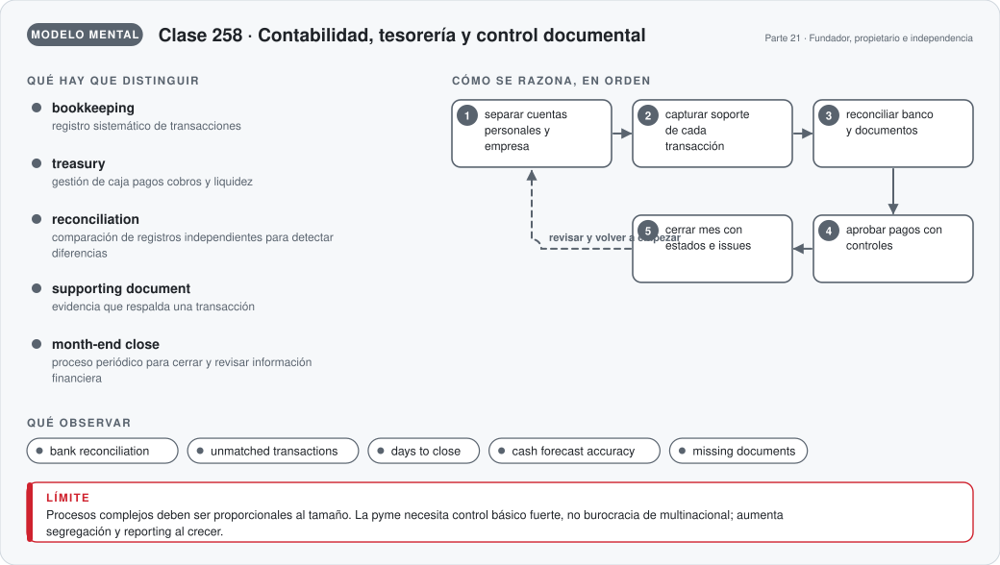

# Clase 258 — Contabilidad, tesorería y control documental

<!-- nav:inicio -->
> **Parte 21 · Founder Track Chile: formalización y operación** — clase 6 de 12 · [índice de la parte](../../README.md) · [temario](../../../../SYLLABUS.md)
<!-- nav:fin -->

**Parte:** 21 — Founder Track Chile: formalización y operación  
**Nivel:** Etapa 6 — Founder en Chile  
**Duración sugerida:** 150–180 minutos · **Estándar:** deep-class-v2

## 🎯 Propósito

Una empresa puede ser rentable en el papel y quedarse sin caja; puede tener caja y no saber de dónde viene; puede tener ambas y no poder probar nada ante un banco, un cliente grande, una autoridad o un inversionista. Para evitar esas tres situaciones hacen falta tres capacidades distintas que los fundadores suelen mezclar: la **contabilidad**, que responde «¿qué pasó y está respaldado?»; la **tesorería**, que responde «¿qué vamos a pagar y cobrar, cuándo, y con qué caja?»; y el **control documental**, que garantiza que cada operación tiene un soporte que se puede encontrar y que las decisiones de pago tuvieron una autorización. En una pyme, estas funciones las hace a veces una sola persona, y justamente por eso conviene entender sus diferencias y diseñar controles **proporcionales al tamaño**: básicos pero firmes, sin la burocracia de una multinacional.

La clase construye un sistema mínimo y sólido: separar cuentas personales y de la empresa, capturar el soporte de cada transacción, conciliar banco y documentos, aprobar pagos con límites y roles, proyectar la caja y cerrar cada mes con revisión. Las fuentes oficiales relevantes son el SII, el RES, la CMF y la normativa contable aplicable según el tipo de entidad (se consulta con el contador y el Colegio de Contadores), el seguro de cesantía y ChileCompra cuando se vende al Estado; Drucker aporta el criterio de gestión por resultados. **No se interpretan normas contables ni tributarias**: se estructura el proceso y se señalan las preguntas para los profesionales. Al terminar sabrás montar un ciclo de cierre mensual, una proyección de caja de cuatro semanas con prueba de estrés y una política de aprobación de pagos.

## 📚 Resultados de aprendizaje

Al finalizar podrás:

1. **Distinguir** contabilidad, tesorería y control documental.
2. **Separar** las finanzas personales y las de la empresa con reglas verificables.
3. **Proyectar** la caja de corto plazo y someterla a una prueba de estrés.
4. **Diseñar** una política de aprobación de pagos proporcional al tamaño.
5. **Cerrar** el mes con conciliación, soporte, incidencias y responsables.

## 🧭 Agenda

| Tramo | Qué se hace |
|---|---|
| 0–20 min | Recuperación: ¿cuánta caja tendrás dentro de un mes y cómo lo sabes? |
| 20–60 min | Separación de cuentas, soporte, conciliación, aprobaciones, proyección de caja y cierre. |
| 60–105 min | Ejemplo trabajado: proyección de cuatro semanas con prueba de estrés. |
| 105–150 min | Caso ejecutivo y práctica. |
| 150–175 min | Límites y entregable. |

## 🧩 Conceptos centrales

| Concepto | Definición | Cómo se reconoce |
|---|---|---|
| **Contabilidad** | Registro ordenado y respaldado de lo ocurrido. | Libros, registros y estados. |
| **Tesorería** | Gestión de cobros, pagos y caja en el tiempo. | Proyección y aprobaciones. |
| **Control documental** | Soporte localizable de cada operación y decisión. | Archivo con índice. |
| **Conciliación** | Verificación de que banco, documentos y registros coinciden. | Diferencias explicadas. |
| **Segregación de funciones** | Separar quien solicita, quien aprueba y quien ejecuta. | Roles distintos. |
| **Colchón de caja** | Saldo mínimo para absorber retrasos y sorpresas. | Política numérica escrita. |

## 🧠 Modelo mental

**Cómo leer el diagrama.** Dos paneles. **Contabilidad: qué pasó**: registrar con soporte, conciliar y cerrar el mes. **Tesorería: qué se paga y cuándo**: proyectar la caja, aprobar pagos y proteger accesos. La nota afirma que los controles deben ser proporcionales al tamaño: una pyme necesita control básico fuerte y lo aumenta al crecer; el pie, que las cuentas personales y las de la empresa se mantienen separadas.

## 📖 Desarrollo

### 1. Tres funciones, tres preguntas

La **contabilidad** mira hacia atrás: registra lo ocurrido con respaldo y produce información para decidir y para cumplir obligaciones. La **tesorería** mira hacia adelante: sabe cuánto hay, cuánto entrará, cuánto debe salir y cuándo, y decide qué pagar primero si no alcanza. El **control documental** sostiene a ambas: sin soporte, el registro es una afirmación sin prueba; sin autorización registrada, un pago es un riesgo. Drucker insiste en que una organización necesita información adecuada para decidir y controlar sus resultados; para una pyme, eso significa tener **pocos números fiables a tiempo** (caja disponible, cuentas por cobrar y por pagar, margen, compromisos próximos) más que muchos informes tardíos. El contador y el Colegio de Contadores orientan sobre la normativa contable aplicable según el tipo de entidad; esa verificación no se hace de memoria.

### 2. Separar cuentas personales y de la empresa

Es la regla más simple y la más infringida. Mezclar gastos personales con los de la empresa dificulta saber si el negocio gana, esconde problemas de caja, complica el trabajo del contador, debilita la credibilidad ante bancos y, según el caso, puede traer consecuencias tributarias o legales que un profesional debe explicar. La separación práctica: **cuenta bancaria propia de la empresa**, medios de pago de la empresa, un procedimiento claro para retirar dinero (con documento y registro, no con transferencias informales), reembolso de gastos pagados por el fundador con respaldo y una política escrita de qué es gasto de la empresa y qué no. La apertura de la cuenta y los medios de cobro se tratan en la clase 259.

### 3. Capturar el soporte de cada transacción

Cada operación debería dejar **tres rastros**: el documento (clase 257), el comprobante de pago o cobro y, cuando corresponde, el contrato, la orden o la aprobación. Un hábito simple: el soporte se captura **el mismo día**, con un nombre de archivo estándar (fecha, proveedor o cliente, monto, tipo), en una carpeta compartida con permisos, y se enlaza con el registro. Se define cuánto tiempo se conserva cada tipo de documento según las normas vigentes (se verifica en el SII y con el contador) y quién puede acceder. Un índice (planilla o sistema) permite encontrar un documento en minutos, algo indispensable ante un requerimiento, una auditoría de un cliente o un proceso de venta de la empresa. Lo que no se puede encontrar, para efectos prácticos, no existe.

### 4. Conciliar banco y documentos

La **conciliación** compara el saldo y los movimientos del banco con los registros contables y los documentos. Se hace al menos **una vez al mes** (idealmente semanal en negocios con mucho movimiento). Las diferencias típicas: depósitos de plataformas con comisiones descontadas, pagos agrupados, cheques o transferencias en tránsito, errores de digitación, cargos desconocidos. Cada diferencia se explica por escrito. Una **diferencia sin explicar** es un riesgo de error o de fraude; una **diferencia explicada y recurrente** es una oportunidad de mejorar el proceso. Es útil dejar el resultado en una hoja de conciliación firmada (o aprobada electrónicamente) por una persona distinta de quien ejecuta los pagos, si el tamaño de la empresa lo permite.

### 5. Aprobar pagos: controles proporcionales

En una empresa pequeña, el fundador suele aprobar todo; a medida que crece, conviene definir **quién puede pedir, quién aprueba y quién ejecuta**. Una política mínima: pagos bajo cierto monto, los puede ejecutar una persona con respaldo del documento; sobre ese monto, requieren dos personas (una que prepara, otra que aprueba); pagos nuevos a un proveedor requieren verificación de datos (por teléfono con un contacto conocido, no solo por correo, para evitar fraudes); cambios de datos bancarios se validan por otro canal; los **accesos al banco** no dependen de una sola persona y se revocan cuando alguien deja el equipo. Los límites los fija cada empresa según su tamaño y riesgo. Lo importante es que existan, estén escritos y se cumplan, y que el fundador no esté siempre en el medio como cuello de botella.

### 6. Proyectar la caja y probarla bajo estrés

La **proyección de caja** (por semana, a cuatro o trece semanas) es la herramienta central de la tesorería: saldo inicial, más cobros esperados, menos pagos comprometidos, igual saldo final. Se hace con **supuestos explícitos**: cuándo paga cada cliente, qué pagos son fijos y cuáles diferibles, qué impuestos, cotizaciones y cuotas vencen y cuándo (las fechas se toman de las fuentes oficiales y de los contratos). Se define un **colchón mínimo** (por ejemplo, el equivalente a dos semanas de gastos fijos) y se ejecuta una **prueba de estrés**: ¿qué pasa si los cobros se retrasan 30 %?, ¿si un cliente grande no paga?, ¿si sube un costo? La prueba no predice el futuro; muestra **dónde se rompe la caja y qué palancas existen** (negociar plazos, adelantar cobros, diferir gastos, línea de crédito, aporte de socios).

### 7. Cerrar el mes y revisar

El **cierre mensual** reúne: conciliación bancaria, revisión de documentos emitidos y recibidos, registro de pagos y cobros, revisión de cuentas por cobrar vencidas, revisión de cuentas por pagar próximas, actualización de la proyección de caja, lista de incidencias y acciones. Se asigna **responsable y fecha**, y se guarda el paquete de cierre. Si la empresa vende al Estado (clase 263), mantiene además la documentación de cada compra pública con sus plazos y requisitos de pago; si tiene trabajadores, el pago de remuneraciones y cotizaciones, con fechas oficiales (clase 260). El cierre es también el momento de decidir: qué cliente cobrar, qué gasto recortar, qué inversión posponer. Un cierre que solo archiva papeles pierde su mayor valor.

## 📚 Lectura comparada

| Fuente | Qué aporta | Qué no resuelve | Pregunta para contrastar |
|---|---|---|---|
| SII | Documentos, registros y plazos tributarios. | No diseña tus controles. | ¿Qué plazos oficiales entran en mi caja? |
| Colegio de Contadores (normativa contable aplicable) | Referencia sobre normas contables según entidad. | No decide tu caso. | ¿Qué normativa contable me corresponde? |
| CMF | Información del sistema financiero y su normativa. | No es guía de tesorería. | ¿Qué condiciones tiene mi producto financiero? |
| ChileCompra | Reglas de compras públicas y pagos. | No cubre ventas privadas. | ¿Qué plazos de pago implica vender al Estado? |
| Drucker | Información para decidir y controlar. | No incluye normativa chilena. | ¿Qué cinco números necesito cada semana? |

## 🧮 Ejemplo trabajado

**Situación (hipotética).** Una empresa de reparación de equipos médicos proyecta su caja de cuatro semanas. Todos los montos son **supuestos para el ejercicio**; las fechas oficiales de impuestos y cotizaciones se toman de las fuentes vigentes.

**Datos.** Saldo inicial: 4.000.000 pesos. Colchón mínimo definido: 2.000.000 (aproximadamente dos semanas de gastos fijos).

| Semana | Cobros esperados | Pagos comprometidos |
|---|---|---|
| 1 | 1.500.000 | 2.700.000 (remuneraciones 1.800.000 y arriendo 900.000) |
| 2 | 1.200.000 | 1.400.000 (proveedores) |
| 3 | 2.000.000 | 1.500.000 (servicios 600.000 e impuesto mensual 900.000) |
| 4 | 1.000.000 | 1.600.000 (proveedores 1.100.000 y cuota de crédito 500.000) |

**Proyección base.**

| Semana | Saldo inicial | Cobros | Pagos | Saldo final |
|---|---|---|---|---|
| 1 | 4.000.000 | 1.500.000 | 2.700.000 | **2.800.000** |
| 2 | 2.800.000 | 1.200.000 | 1.400.000 | **2.600.000** |
| 3 | 2.600.000 | 2.000.000 | 1.500.000 | **3.100.000** |
| 4 | 3.100.000 | 1.000.000 | 1.600.000 | **2.500.000** |

El mínimo es 2.500.000, mayor que el colchón de 2.000.000: la caja es suficiente en el caso base.

**Prueba de estrés: los cobros de las semanas 2 a 4 llegan 30 % menos.**

- Semana 2: cobros 1.200.000 × 0,70 = 840.000. Saldo: 2.800.000 + 840.000 − 1.400.000 = **2.240.000**.
- Semana 3: cobros 2.000.000 × 0,70 = 1.400.000. Saldo: 2.240.000 + 1.400.000 − 1.500.000 = **2.140.000**.
- Semana 4: cobros 1.000.000 × 0,70 = 700.000. Saldo: 2.140.000 + 700.000 − 1.600.000 = **1.240.000**.

El saldo de la semana 4 queda **760.000 por debajo del colchón** (2.000.000 − 1.240.000). La caja no se queda en cero, pero el colchón se rompe.

**Palancas.** Negociar con proveedores un pago de 760.000 de la semana 4 a la semana 5; pedir anticipo del 30 % a clientes nuevos; reprogramar la cuota del crédito si el contrato lo permite (verificar condiciones). Con el pago diferido de 760.000, el saldo de la semana 4 sería 1.240.000 + 760.000 = 2.000.000, exactamente en el colchón.

**Política de aprobación (supuesta).** Pagos hasta 300.000: una persona con documento. Entre 300.000 y 1.500.000: preparación y aprobación por dos personas. Sobre 1.500.000 o a proveedores nuevos: verificación por teléfono y aprobación del fundador. Los pagos de la semana 1 (remuneraciones 1.800.000 y arriendo 900.000) están en el nivel superior o recurrente, con aprobación documentada.

**Decisión.** Mantener el plan, preparar de inmediato la conversación con el proveedor de 760.000 y ajustar la política de cobranza; actualizar la proyección cada semana y guardar las tres versiones en el paquete de cierre.

**Cuidados.** Los montos, los plazos de pago y las fechas de impuestos y cotizaciones son supuestos; se verifican en contratos y fuentes oficiales.

**Qué muestra.** (1) La proyección fija un colchón y un mínimo. (2) La prueba de estrés revela dónde se rompe la caja. (3) Las palancas se preparan antes de que el problema ocurra.

## 🔀 Comparación y límites

**Contabilidad frente a tesorería.** La contabilidad puede mostrar utilidad y la tesorería, falta de caja: son distintas porque los cobros y los pagos ocurren en momentos diferentes de la venta y la compra. Se necesitan ambas.

**Límites.** Los controles deben ser proporcionales: una empresa de tres personas no necesita comités, pero sí separación de cuentas, respaldo y conciliación. La clase no interpreta normas contables ni tributarias. Las cifras del ejemplo son supuestos. Con el crecimiento, conviene un contador o un responsable administrativo y revisiones externas.

## 🪜 De profesional a owner

| Nivel | Cómo se relaciona con contabilidad y tesorería |
|---|---|
| **Profesional** | Rinde gastos con respaldo y cumple los procedimientos. |
| **Jefe / Team Lead** | Solicita pagos con documentos y controla el presupuesto del equipo. |
| **Gerente** | Aprueba pagos dentro de sus límites y responde por su área. |
| **CEO / Director** | Define políticas, revisa la caja y supervisa al contador. |
| **Founder / Owner** | Garantiza separación de cuentas, controles y caja suficiente. |

## 🏢 Caso ejecutivo

Un fundador tiene una empresa de transporte escolar con ocho vehículos y diez personas. Ingresos mensuales de 22 millones de pesos, cobrados por mensualidades de apoderados (60 % paga puntualmente, 40 % se atrasa entre 15 y 30 días). Los gastos fijos son de 17 millones (remuneraciones 9, combustible y mantención 5, arriendo y seguros 3). Hay una cuota de 1,4 millones de un crédito vehicular y un pago de impuestos mensual de 1,1 millones. Paga proveedores con su tarjeta personal y luego se reembolsa; un conductor tiene la clave de la cuenta bancaria; no hace conciliación. En diciembre y enero los ingresos caen 50 %. Un cliente grande, un colegio, paga a 60 días. Tiene 6 millones de saldo.

Entrega un **informe de gobierno y riesgos financieros** que contenga: (a) la distinción entre las funciones contable, de tesorería y documental en su empresa; (b) un plan de separación de cuentas y reglas de reembolso; (c) la proyección de caja de cuatro semanas con colchón y prueba de estrés para la baja estacional; (d) la política de aprobación de pagos y de accesos; (e) el procedimiento de cierre mensual con responsables; (f) las palancas ante una brecha de caja y las verificaciones oficiales y contables pendientes.

## 🧪 Práctica

1. Redacta una política de separación de cuentas personales y de la empresa.
2. Construye una proyección de caja de cuatro semanas con saldo, cobros y pagos.
3. Aplica una prueba de estrés de 30 % en cobros y anota las palancas.
4. Define una política de aprobación de pagos con montos y roles.
5. Prepara una hoja de cierre mensual con responsables y plazos.

## ⚠️ Errores frecuentes

| Error | Por qué ocurre | Cómo corregirlo |
|---|---|---|
| Mezclar cuentas personales y de la empresa | Comodidad | Cuenta propia y política de reembolso. |
| Confundir utilidad con caja | Se mira solo el resultado contable | Proyectar la caja por semana. |
| Soporte disperso | No hay hábito | Captura el mismo día y un índice. |
| Una sola persona con todos los accesos | Confianza | Segregación y accesos revocables. |
| No hacer prueba de estrés | Optimismo | Escenarios de cobros menores y gastos mayores. |
| Cierre que solo archiva | Se ve como trámite | Usarlo para decidir cobranza y gastos. |

## ❓ Preguntas de comprobación

1. ¿Qué pregunta responde cada función: contabilidad, tesorería y control documental?
2. ¿Por qué se separan las cuentas personales y las de la empresa?
3. ¿Qué incluye una proyección de caja?
4. ¿Qué hace una prueba de estrés?
5. ¿Qué es la segregación de funciones?
6. ¿Qué debe ocurrir con las diferencias de conciliación?
7. ¿Qué límite tiene esta clase?

Claves de respuesta

1. Qué pasó y está respaldado; qué se paga y cuándo; y dónde está el soporte y quién autorizó.
2. Para saber si el negocio gana, proteger la credibilidad y evitar consecuencias legales y tributarias.
3. Saldo inicial, cobros esperados, pagos comprometidos, saldo final, colchón y supuestos.
4. Muestra dónde se rompe la caja con cobros menores o gastos mayores y qué palancas existen.
5. Separar quién solicita, quién aprueba y quién ejecuta un pago.
6. Se explican por escrito, con responsable y seguimiento hasta cerrarlas.
7. No interpreta normas contables ni tributarias; propone un proceso proporcional y exige verificar con profesionales.

## 📥 Entregable

Guarda en `portfolio/258-contabilidad-tesoreria-y-control-documental/`:

- `risk-governance-brief.md` (plantilla [Risk governance brief](../../../../templates/risk-governance-brief.md)) con el informe del caso ejecutivo;
- `cash-runway.md` (plantilla [Cash runway](../../../../templates/cash-runway.md)) con la proyección y la prueba de estrés;
- `decision-journal.md` con las políticas, las palancas y las verificaciones pendientes.

## 📗 Fuentes y verificación

- Servicio de Impuestos Internos (Chile) — *Guías, normativa y servicios oficiales*. **Uso en esta clase:** documentos, registros y plazos tributarios oficiales. **Fuente primaria:** <https://www.sii.cl/>.
- Colegio de Contadores de Chile — *Normativa contable aplicable y NIIF según tipo de entidad*. **Uso en esta clase:** normativa contable aplicable y NIIF según el tipo de entidad. **Localizador pendiente:** ver [el registro de fuentes](../../../../docs/FUENTES.md).
- Comisión para el Mercado Financiero (Chile) — *Normativa e información del mercado financiero*. **Uso en esta clase:** información y normativa del sistema financiero. **Fuente primaria:** <https://www.cmfchile.cl/>.
- Dirección ChileCompra — *Mercado Público y normativa de compras públicas*. **Uso en esta clase:** reglas de compras públicas y su documentación. **Fuente primaria:** <https://www.chilecompra.cl/>.
- AFC Chile — *Seguro de Cesantía: información y operación oficial*. **Uso en esta clase:** información oficial del seguro de cesantía y su operación. **Fuente primaria:** <https://www.afc.cl/>.
- Peter F. Drucker — *Management: Tasks, Responsibilities, Practices* (Harper & Row, 1974). **Uso en esta clase:** información para decidir y controlar los resultados. Lectura selectiva sobre **contabilidad, tesorería y control documental**. **Localizador:** [ISBN-13 9780060110925](https://openlibrary.org/isbn/9780060110925).

> **Regla de fuentes para Contabilidad, tesorería y control documental:** las obras y portales anteriores estructuran las perspectivas de esta materia; cualquier norma, ley, trámite, tasa o plazo mencionado debe comprobarse nuevamente en su fuente primaria oficial vigente, y este programa no reemplaza asesoría legal, tributaria ni contable. Los ejemplos y casos son hipotéticos, con cifras ilustrativas. El desarrollo es original y no reproduce material protegido.

<!-- pie:inicio -->
---

| Anterior | Índice | Siguiente |
|---|---|---|
| [← 257 · Documentos tributarios, IVA y registros: panorama ejecutivo](../257-documentos-tributarios-iva-y-registros-panorama-ejecutivo/README.md) | [Parte 21](../../README.md) · [Programa](../../../../SYLLABUS.md) | [259 · Cuenta bancaria, pagos y medios de cobro →](../259-cuenta-bancaria-pagos-y-medios-de-cobro/README.md) |
<!-- pie:fin -->
