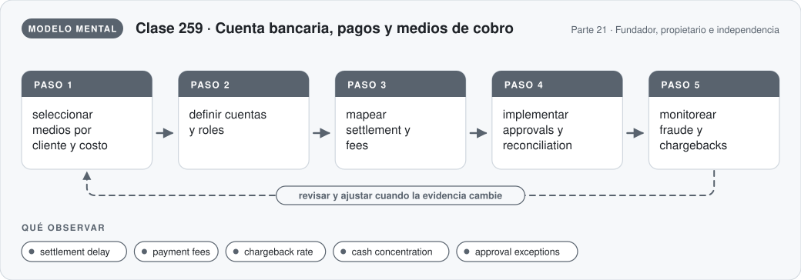

# Clase 259 — Cuenta bancaria, pagos y medios de cobro

<!-- nav:inicio -->
> **Parte 21 · Founder Track Chile: formalización y operación** — clase 7 de 12 · [índice de la parte](../../README.md) · [temario](../../../../SYLLABUS.md)
<!-- nav:fin -->

**Parte:** 21 — Founder Track Chile: formalización y operación  
**Nivel:** Etapa 6 — Founder en Chile  
**Duración sugerida:** 150–180 minutos · **Estándar:** deep-class-v2

## 🎯 Propósito

Una empresa existe para cobrar por lo que entrega y para pagar lo que debe, y ambas cosas pasan por canales que el fundador elige: una **cuenta bancaria**, medios de **cobro** (transferencias, tarjetas, plataformas de pago, pago en línea, efectivo) y medios de **pago** (a proveedores, trabajadores, autoridades). Es frecuente confundir dos contratos distintos: la **cuenta bancaria empresarial**, donde se guarda y mueve el dinero, y el **servicio de adquirencia** o de cobro con tarjetas y plataformas, que procesa pagos y liquida al comercio con comisiones y plazos. También es frecuente decidir sin comparar: se elige el medio que ofreció un conocido, sin mirar comisión, plazo de liquidación, requisitos de seguridad ni cómo se concilia. Esas decisiones determinan margen, caja y riesgo de fraude.

La clase enseña a diseñar el sistema de dinero de una pyme chilena como una secuencia: seleccionar medios por cliente y costo, definir cuentas y roles, mapear liquidación y comisiones, implementar aprobaciones y conciliación, y monitorear fraude y contracargos. **Las condiciones de los productos bancarios y de cobro cambian por proveedor y por fecha**: se comparan contratos vigentes y no se enseñan tarifas como permanentes. Las fuentes de referencia son la Comisión para el Mercado Financiero (CMF), el SII (acreditación del inicio de actividades y obligaciones), el RES, ChileAtiende, Corfo y Drucker. Al terminar sabrás comparar el costo total de los medios de cobro, definir quién puede hacer qué en el banco, calcular el efecto de comisiones y plazos en la caja y preparar una política ante fraudes y contracargos.

## 📚 Resultados de aprendizaje

Al finalizar podrás:

1. **Distinguir** cuenta bancaria empresarial, medio de cobro y servicio de adquirencia.
2. **Comparar** medios de cobro por costo, plazo de liquidación, riesgo y conversión.
3. **Definir** cuentas, roles y accesos sin depender de una sola persona.
4. **Calcular** el efecto de comisiones y contracargos sobre el margen y la caja.
5. **Diseñar** una política de aprobaciones, conciliación y respuesta ante fraude.

## 🧭 Agenda

| Tramo | Qué se hace |
|---|---|
| 0–20 min | Recuperación: ¿cómo cobra y paga tu empresa hoy y cuánto cuesta? |
| 20–60 min | Cuenta empresarial, medios de cobro, liquidación, aprobaciones, conciliación, fraude. |
| 60–105 min | Ejemplo trabajado: comparación del costo de tres medios de cobro y de un cambio de mezcla. |
| 105–150 min | Caso ejecutivo y práctica. |
| 150–175 min | Límites y entregable. |

## 🧩 Conceptos centrales

| Concepto | Definición | Cómo se reconoce |
|---|---|---|
| **Cuenta empresarial** | Cuenta bancaria a nombre de la empresa. | Titularidad y poderes registrados. |
| **Medio de cobro** | Canal por el que el cliente paga. | Transferencia, tarjeta, plataforma. |
| **Adquirencia** | Servicio que procesa pagos con tarjeta y liquida al comercio. | Contrato con comisión y plazo. |
| **Liquidación** | Transferencia de lo cobrado a la cuenta del comercio. | Fecha y monto neto. |
| **Contracargo** | Devolución de un pago a solicitud del titular de la tarjeta. | Notificación y plazo de respuesta. |
| **Segregación de accesos** | Separar quién prepara, aprueba y ejecuta. | Roles y límites en el banco. |

## 🧠 Modelo mental

**Cómo leer el diagrama.** Una cadena de cinco pasos. **Medios de cobro**: por cliente, costo y riesgo. **Cuentas y roles**: quién opera y quién aprueba. **Liquidación y comisiones**: cuándo llega el dinero y a qué costo. **Aprobación y conciliación**: pagos autorizados y cuadrados. **Fraude y contracargos**: monitorear y responder. La flecha de retorno indica que los incidentes ajustan los controles. La nota recuerda que los productos bancarios cambian por proveedor y que no se depende de una sola persona para accesos críticos; el pie, que la cuenta bancaria y el servicio de cobro con tarjeta son contratos distintos.

## 📖 Desarrollo

### 1. Qué se contrata y a nombre de quién

Se contratan al menos dos cosas distintas. La **cuenta bancaria empresarial** guarda el dinero y permite transferir, pagar y recibir; se abre a nombre de la empresa (no de una persona) con los documentos y poderes que cada banco exige, y la información sobre el sistema financiero y su regulación está en la CMF. El **servicio de cobro con tarjetas o plataformas** procesa los pagos de los clientes y deposita el neto en la cuenta, descontando comisiones y a veces reteniendo montos por un tiempo. Para cada uno se pregunta: ¿a nombre de quién está?, ¿quién puede operar?, ¿qué documentos acreditan la existencia y el inicio de actividades (el SII y el RES son las fuentes)?, ¿qué ocurre si la persona que lo contrató se va? La titularidad a nombre de la empresa, y no del fundador, evita problemas al vender el negocio o al incorporar socios.

### 2. Elegir medios de cobro: cliente, costo y riesgo

No hay un medio mejor: **cada cliente prefiere uno distinto**. Los clientes empresariales suelen pagar por transferencia contra factura; los consumidores, con tarjeta o con billeteras y plataformas; algunos pagan en efectivo. El fundador compara por cuatro criterios: **costo** (comisión porcentual, tarifas fijas por transacción, mensualidades), **plazo de liquidación** (cuántos días tarda en llegar el dinero), **riesgo** (contracargos, fraude, retención de fondos) y **efecto en la conversión** (si ofrecer menos medios hace perder ventas). Un error clásico es empujar a todos los clientes al medio más barato sin medir cuántas ventas se pierden. El medio más barato por transacción puede ser el más caro por venta perdida.

### 3. Liquidación, comisiones y caja

Cada medio tiene su **costo directo** (comisión) y su **costo financiero** (el tiempo que tarda el dinero en llegar). Con un plazo de liquidación de dos días, el efecto sobre la caja suele ser pequeño; con plazos de varios días o retenciones, afecta el capital de trabajo (clase 258). Hay que mapear: cuándo se cobra, cuándo se liquida, cuánto se descuenta, cuándo se concilia y cuándo se emite el documento tributario. Los **contratos** fijan condiciones que cambian: se lee cuánto puede variar la comisión, qué pasa en caso de reclamos, cuánto se retiene y con qué excepciones. Se guarda copia de los contratos y se agenda una **revisión anual** para comparar con otras ofertas. Las condiciones se verifican siempre en la fuente vigente (el proveedor y la regulación aplicable).

### 4. Cuentas, roles y accesos

La regla central es **no depender de una sola persona**. Se define quién abre y administra la cuenta, quién prepara pagos, quién los aprueba y quién concilia; cuando el equipo es muy pequeño, se compensa con límites de monto, aprobación del fundador y revisión mensual por otra persona (por ejemplo, el contador). Se crean **usuarios individuales** (no compartidos), con permisos mínimos, autenticación reforzada y registro de actividad cuando el banco lo permita; se revocan los accesos de quien deja el equipo el mismo día; se definen **límites diarios** y una lista de proveedores y destinatarios recurrentes. Se guarda un registro de quién tiene acceso a qué, con fecha de última revisión. Los accesos críticos (banco, plataforma de cobros, correo de la empresa, dominio) no están a nombre de una persona sin respaldo.

### 5. Aprobaciones y conciliación de los cobros

Cada cobro y cada pago debe poder **seguirse de punta a punta**: la venta, el documento, el cobro, la liquidación, el depósito y el registro. La conciliación (clases 257 y 258) compara lo cobrado, lo liquidado y lo depositado y explica las diferencias: comisiones, retenciones, devoluciones, contracargos, impuestos. Un buen hábito es **conciliar por medio de cobro**: cada plataforma entrega un reporte de liquidaciones; se compara con el banco y con las ventas. En los pagos, se verifican los datos del destinatario antes de ejecutar, sobre todo ante **cambios de cuenta** solicitados por correo, que son una vía común de fraude. Las aprobaciones dobles para montos altos y las pruebas con una transferencia pequeña para destinatarios nuevos reducen el riesgo.

### 6. Fraude, contracargos y respuesta

El **fraude** más común contra pequeñas empresas no es sofisticado: correos que suplantan a proveedores o a directivos, cambios de datos bancarios, compras con tarjetas robadas, solicitudes urgentes de transferencias. Los **contracargos** ocurren cuando el titular de una tarjeta desconoce un cargo o reclama por el servicio; el comercio debe responder con evidencia dentro de un plazo definido por el contrato. Para estar preparado: guardar evidencia de cada venta (documento, fecha, entrega, comunicaciones), definir quién responde y cómo, y medir la **tasa de contracargos** por medio de cobro. Un aumento de contracargos puede poner en riesgo la relación con el servicio de cobro. La **educación del equipo** (cómo verificar una solicitud de cambio de cuenta) es el control más barato y más eficaz.

### 7. Revisión periódica y relación con el banco

El banco y los proveedores de cobro son **contrapartes**: conviene conocer a un ejecutivo, entender el producto y mantener información al día (balances, documentos, poderes). Los **productos de crédito** (líneas, créditos, leasing) se evalúan con cuidado, comparando el costo total y las garantías exigidas, incluyendo avales personales que afectan el patrimonio del fundador (clase 254). Corfo y otras instituciones públicas pueden ofrecer apoyo o garantías en ciertos casos, que se verifican en sus convocatorias vigentes (clase 263). Cada trimestre, se revisa: costos totales por medio, plazos de liquidación, tasa de contracargos, accesos vigentes, diferencias de conciliación y condiciones contractuales. Lo que se aprendió en la clase se revalida con el contrato y la normativa vigente.

## 📚 Lectura comparada

| Fuente | Qué aporta | Qué no resuelve | Pregunta para contrastar |
|---|---|---|---|
| CMF (portal y normativa) | Información oficial del sistema financiero. | No compara productos concretos. | ¿Qué regulación aplica a mi proveedor? |
| SII (acreditación y obligaciones) | Qué documentos acreditan la actividad y cómo se vincula a los cobros. | No elige medios de cobro. | ¿Qué debo acreditar al banco? |
| Registro de Empresas y Sociedades | Documentos de constitución y poderes. | No define el producto bancario. | ¿Quién puede representar a la empresa? |
| ChileAtiende | Orientación de trámites del Estado. | No cubre productos privados. | ¿Qué trámites públicos se vinculan? |
| Corfo | Instrumentos de apoyo y garantías. | No reemplaza el análisis del crédito. | ¿Qué convocatoria vigente podría aplicar? |

## 🧮 Ejemplo trabajado

**Situación (hipotética).** Una tienda de artículos deportivos vende 12.000.000 de pesos al mes. Quiere comparar el costo de sus medios de cobro y decidir si conviene empujar a los clientes hacia transferencias. Las comisiones, tarifas y plazos son **supuestos**; los reales dependen del contrato y la fecha.

**Mezcla actual y condiciones supuestas.**

| Medio | Ventas del mes | Comisión | Tarifa fija | Transacciones |
|---|---|---|---|---|
| Transferencia | 6.000.000 (50 %) | 0,2 % | — | — |
| Tarjeta en el local | 4.800.000 (40 %) | 2,5 % | — | — |
| Plataforma en línea | 1.200.000 (10 %) | 3,5 % | 150 pesos por transacción | 300 |

**Costos mensuales.**

- Transferencias: 6.000.000 × 0,2 % = **12.000**.
- Tarjeta: 4.800.000 × 2,5 % = **120.000**.
- Plataforma: 1.200.000 × 3,5 % = 42.000, más 300 × 150 = 45.000; total **87.000**.
- **Costo total: 219.000 pesos**, equivalente a 219.000 ÷ 12.000.000 = **1,825 %** de las ventas.

**Escenario: empujar a 70 % transferencias, 25 % tarjeta, 5 % plataforma (150 transacciones).**

- Transferencias: 8.400.000 × 0,2 % = 16.800.
- Tarjeta: 3.000.000 × 2,5 % = 75.000.
- Plataforma: 600.000 × 3,5 % = 21.000 + 150 × 150 = 22.500 = 43.500.
- Total: 135.300 pesos (1,13 % de las ventas).
- **Ahorro: 219.000 − 135.300 = 83.700 pesos al mes.**

**Efecto sobre la conversión.** Si ese empuje hiciera perder el 3 % de las ventas: 12.000.000 × 3 % = 360.000 de ventas. Con un margen de contribución del 40 %, se pierden 360.000 × 0,40 = **144.000 pesos**, mayor que el ahorro de 83.700. **Con estos supuestos, empujar a transferencias a costa de perder ventas empeora el resultado en 60.300 pesos al mes** (144.000 − 83.700). El punto de equilibrio: el ahorro de 83.700 se iguala con una pérdida de ventas de 83.700 ÷ 0,40 = 209.250, es decir 1,74 % de las ventas. Si la pérdida esperada es menor que 1,74 %, conviene; si es mayor, no.

**Contracargos.** Sobre las ventas de tarjeta y plataforma (6.000.000), una tasa de 0,5 % son 30.000 de monto en disputa; con 6 casos al mes y un costo operativo de 8.000 cada uno, son 48.000 de costo directo, más el tiempo para responder. Un incremento en la tasa de contracargos aumenta el riesgo contractual. Medidas: evidencia de entrega, descripciones claras en el comprobante, política de devoluciones visible.

**Liquidación.** Si la plataforma liquida a 5 días y la tarjeta a 2, con ventas diarias de 160.000 por tarjeta, la caja inmovilizada por plazo es del orden de 160.000 × 2 = 320.000, pequeña frente al total. El plazo importa más cuando las ventas son grandes o los márgenes, estrechos.

**Decisión.** No empujar a transferencias por precio; ofrecer un incentivo pequeño y medible para pagos por transferencia en compras grandes, mantener tarjeta y plataforma, negociar la comisión con el volumen anual y revisar el contrato en doce meses. Definir dos usuarios en el banco (fundador y administradora) con límites, y un tercer acceso de solo consulta para el contador.

**Cuidados.** Todas las comisiones, plazos y condiciones son supuestos; se confirman con los contratos y la fuente vigente.

**Qué muestra.** (1) El costo total por medio se calculó con comisiones y tarifas. (2) El ahorro aparente desaparece si se pierde conversión. (3) El punto de equilibrio dio un criterio para decidir.

## 🔀 Comparación y límites

**Cuenta bancaria frente a medio de cobro.** La cuenta guarda y mueve el dinero; el medio de cobro es el canal por el que el cliente paga y el proveedor liquida. Se contratan por separado y se concilian entre sí.

**Límites.** Las condiciones de productos bancarios y de cobro cambian por proveedor y fecha, y se verifican en los contratos y las fuentes vigentes. Esta clase no recomienda un banco ni un proveedor. El ejemplo usa supuestos. El fraude evoluciona: los controles se revisan periódicamente.

## 🪜 De profesional a owner

| Nivel | Cómo se relaciona con cuentas y cobros |
|---|---|
| **Profesional** | Cumple los procedimientos de pagos y reembolsos. |
| **Jefe / Team Lead** | Solicita pagos con respaldo y detecta anomalías. |
| **Gerente** | Aprueba pagos y revisa la conciliación de su área. |
| **CEO / Director** | Define políticas de accesos, límites y proveedores. |
| **Founder / Owner** | Es titular de los contratos, responde por los controles y por el costo total. |

## 🏢 Caso ejecutivo

Un fundador vende cursos de fotografía: 40 % de las ventas por una plataforma de pago en línea con comisión de 4 % más 200 pesos por transacción, 35 % por transferencias de empresas que contratan capacitación y 25 % con tarjeta en talleres presenciales (comisión de 2,4 %). Las ventas mensuales son de 15 millones de pesos, con 250 transacciones en la plataforma. Un cliente de 3,2 millones pidió un cambio de cuenta de pago por correo y el equipo transfirió sin verificar: la cuenta no era del proveedor y el dinero no se recuperó. Tiene dos contracargos al mes de 80.000 pesos cada uno. La cuenta bancaria está a nombre del fundador personal y comparte clave con su asistente. La plataforma liquida a 7 días. Un competidor le ofrece reducir la comisión a 3,2 % si cambia de plataforma, con un costo de migración de 600.000 pesos.

Entrega un **informe de gobierno y riesgos de pagos y cobros** que contenga: (a) la comparación del costo total mensual por medio con las cifras del caso; (b) el análisis del cambio de plataforma con ahorro mensual y plazo de recuperación de la migración; (c) el rediseño de cuentas, roles y accesos y el traspaso a nombre de la empresa; (d) la política de verificación de cambios de datos bancarios y aprobaciones; (e) el manejo de contracargos y fraude con indicadores; (f) las verificaciones contractuales y oficiales pendientes.

## 🧪 Práctica

1. Lista tus medios de cobro con ventas, comisión, tarifa fija y plazo.
2. Calcula el costo total mensual y el porcentaje de ventas.
3. Estima el punto de equilibrio de un cambio de mezcla considerando conversión.
4. Define quién prepara, aprueba y ejecuta pagos, con límites.
5. Redacta un procedimiento para verificar cambios de datos bancarios.

## ⚠️ Errores frecuentes

| Error | Por qué ocurre | Cómo corregirlo |
|---|---|---|
| Cuenta a nombre de una persona | Se abrió rápido | Titularidad de la empresa y poderes. |
| Empujar al medio más barato sin medir ventas | Se mira solo la comisión | Calcular el punto de equilibrio con conversión. |
| Accesos compartidos | Comodidad | Usuarios individuales y revocables. |
| Aceptar cambios de cuenta por correo | Confianza en el remitente | Verificar por otro canal conocido. |
| No conciliar por medio de cobro | Se mira el saldo total | Reporte de cada plataforma contra el banco. |
| No leer el contrato | Se asume lo estándar | Revisar comisiones variables, retenciones y plazos. |

## ❓ Preguntas de comprobación

1. ¿Qué diferencia hay entre cuenta empresarial y servicio de cobro?
2. ¿Qué criterios sirven para comparar medios de cobro?
3. ¿Por qué el medio más barato puede salir caro?
4. ¿Qué es un contracargo y cómo se prepara una respuesta?
5. ¿Qué significa no depender de una sola persona en los accesos?
6. ¿Cómo se reduce el riesgo de fraude por cambio de cuenta?
7. ¿Qué límite tiene esta clase?

Claves de respuesta

1. La cuenta guarda y mueve el dinero; el servicio de cobro procesa los pagos y los liquida con comisión y plazo.
2. Costo, plazo de liquidación, riesgo y efecto en la conversión.
3. Porque puede hacer perder ventas cuya contribución supera el ahorro.
4. Devolución solicitada por el titular de la tarjeta; se responde con evidencia de la venta dentro del plazo.
5. Usuarios individuales, roles separados, límites y respaldo para accesos críticos.
6. Verificando por un canal distinto y conocido, y con pruebas y aprobaciones dobles.
7. No recomienda productos ni proveedores; las condiciones cambian y se verifican en contratos y fuentes vigentes.

## 📥 Entregable

Guarda en `portfolio/259-cuenta-bancaria-pagos-y-medios-de-cobro/`:

- `risk-governance-brief.md` (plantilla [Risk governance brief](../../../../templates/risk-governance-brief.md)) con el informe del caso ejecutivo;
- `decision-journal.md` con la comparación de medios, la política de accesos y las verificaciones pendientes.

## 📗 Fuentes y verificación

- Comisión para el Mercado Financiero (Chile) — *Normativa e información del mercado financiero*. **Uso en esta clase:** información y normativa del sistema financiero. **Fuente primaria:** <https://www.cmfchile.cl/>.
- Comisión para el Mercado Financiero — *Portal oficial de la CMF de Chile* (2017). **Uso en esta clase:** portal oficial de la CMF y su información al público. **Fuente primaria:** <https://www.cmfchile.cl/>.
- Servicio de Impuestos Internos (Chile) — *Acreditación de inicio de actividades y obligaciones tributarias*. **Uso en esta clase:** acreditación del inicio de actividades y obligaciones tributarias. **Fuente primaria:** <https://www.sii.cl/destacados/ley_cumplimiento_obligaciones_tributarias/inicio_actividades.html>.
- Registro de Empresas y Sociedades (Chile) — *Portal y documentación oficial*. **Uso en esta clase:** documentos de constitución y poderes de la entidad. **Fuente primaria:** <https://www.registrodeempresasysociedades.cl/>.
- ChileAtiende — *Trámites y orientación del Estado*. **Uso en esta clase:** orientación de trámites del Estado. **Fuente primaria:** <https://www.chileatiende.gob.cl/>.
- Corporación de Fomento de la Producción (Chile) — *Programas, instrumentos y apoyo empresarial*. **Uso en esta clase:** instrumentos de apoyo y garantías para empresas. **Fuente primaria:** <https://www.corfo.cl/>.
- Peter F. Drucker — *Management: Tasks, Responsibilities, Practices* (Harper & Row, 1974). **Uso en esta clase:** gestión por resultados y control. Lectura selectiva sobre **cuenta bancaria, pagos y medios de cobro**. **Localizador:** [ISBN-13 9780060110925](https://openlibrary.org/isbn/9780060110925).

> **Regla de fuentes para Cuenta bancaria, pagos y medios de cobro:** las obras y portales anteriores estructuran las perspectivas de esta materia; cualquier norma, ley, trámite, tasa o plazo mencionado debe comprobarse nuevamente en su fuente primaria oficial vigente, y este programa no reemplaza asesoría legal, tributaria ni contable. Los ejemplos y casos son hipotéticos, con cifras ilustrativas. El desarrollo es original y no reproduce material protegido.

<!-- pie:inicio -->
---

| Anterior | Índice | Siguiente |
|---|---|---|
| [← 258 · Contabilidad, tesorería y control documental](../258-contabilidad-tesoreria-y-control-documental/README.md) | [Parte 21](../../README.md) · [Programa](../../../../SYLLABUS.md) | [260 · Contratación, honorarios y obligaciones laborales: panorama →](../260-contratacion-honorarios-y-obligaciones-laborales-panorama/README.md) |
<!-- pie:fin -->
