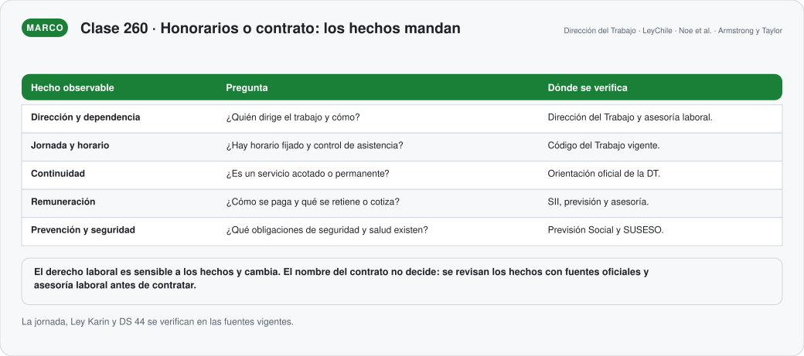

# Clase 260 — Contratación, honorarios y obligaciones laborales: panorama

<!-- nav:inicio -->
> **Parte 21 · Founder Track Chile: formalización y operación** — clase 8 de 12 · [índice de la parte](../../README.md) · [temario](../../../../SYLLABUS.md)
<!-- nav:fin -->

**Parte:** 21 — Founder Track Chile: formalización y operación  
**Nivel:** Etapa 6 — Founder en Chile  
**Duración sugerida:** 150–180 minutos · **Estándar:** deep-class-v2

## 🎯 Propósito

Contratar a la primera persona cambia la naturaleza de una empresa: de ahí en adelante hay **obligaciones hacia otro ser humano**, con reglas sobre contrato, jornada, remuneración, cotizaciones, seguridad y salud, trato digno y término de la relación. Los fundadores suelen enfrentar la decisión con una pregunta de costo: «¿lo contrato o le pago honorarios?». Esa pregunta está mal formulada. En el derecho laboral chileno, como en muchos otros, **lo que cuenta son los hechos de la relación** (quién dirige el trabajo, si hay horario, si es continuo, cómo se paga, de quién son las herramientas) más que el nombre que las partes le pongan al contrato. Elegir una figura por ser más barata, cuando los hechos describen otra, es una de las formas más frecuentes de crear un pasivo oculto.

La clase da un panorama ejecutivo para decidir y operar con criterio. **No interpreta el Código del Trabajo ni resuelve casos**: indica qué hechos mirar, qué obligaciones suelen activarse y dónde se verifican, y cuándo es indispensable la asesoría laboral. Las fuentes son la Dirección del Trabajo (orientación sobre contrato individual, cláusulas mínimas, jornada y Ley Karin), el texto vigente del Código del Trabajo en LeyChile, la Subsecretaría de Previsión Social (seguridad y salud, DS 44), la Superintendencia de Seguridad Social, y, para criterios de gestión de personas, Noe y colaboradores y Armstrong y Taylor. Al terminar sabrás clasificar los hechos de una relación, preparar un contrato con las cláusulas que la DT señala como mínimas, operar un ciclo básico de obligaciones y gestionar cambios y término con evidencia.

## 📚 Resultados de aprendizaje

Al finalizar podrás:

1. **Clasificar** los hechos de una relación de trabajo antes de elegir la figura contractual.
2. **Distinguir** contrato de trabajo, contrato de plazo fijo y prestación de servicios a honorarios como categorías distintas.
3. **Preparar** un contrato con las cláusulas mínimas indicadas por la autoridad y verificar la normativa vigente.
4. **Operar** el ciclo básico: jornada, remuneraciones, cotizaciones, prevención y registros.
5. **Gestionar** modificaciones y término con evidencia y asesoría.

## 🧭 Agenda

| Tramo | Qué se hace |
|---|---|
| 0–20 min | Recuperación: ¿quiénes trabajan hoy para tu empresa y bajo qué figura? |
| 20–60 min | Hechos, contrato, cláusulas, obligaciones recurrentes, seguridad y salud, cambios y término. |
| 60–105 min | Ejemplo trabajado: costo aparente y riesgo de reclasificación, con checklist de hechos. |
| 105–150 min | Caso ejecutivo y práctica. |
| 150–175 min | Límites y entregable. |

## 🧩 Conceptos centrales

| Concepto | Definición | Cómo se reconoce |
|---|---|---|
| **Relación laboral** | Vínculo de trabajo con dirección y remuneración. | Hechos observables. |
| **Contrato individual de trabajo** | Acuerdo escrito que regula la relación. | Cláusulas mínimas exigidas. |
| **Prestación de servicios a honorarios** | Servicio independiente sin relación laboral. | Autonomía real. |
| **Jornada** | Tiempo de trabajo que la normativa regula. | Horario y registro de asistencia. |
| **Cotizaciones y seguros** | Aportes previsionales y de seguridad social asociados al trabajo. | Pagos y planillas. |
| **Prevención de riesgos** | Obligaciones de seguridad y salud en el trabajo. | Normas, procedimientos y capacitación. |

## 🧠 Modelo mental

**Cómo leer el diagrama.** Una tabla de tres columnas. **Hecho observable**: dirección y dependencia, jornada y horario, continuidad, remuneración, y prevención y seguridad. **Pregunta**: quién dirige el trabajo y cómo; si hay horario fijado y control de asistencia; si el servicio es acotado o permanente; cómo se paga y qué se retiene o cotiza; qué obligaciones de seguridad y salud existen. **Dónde se verifica**: la Dirección del Trabajo y asesoría laboral, el Código del Trabajo vigente, la orientación oficial de la DT, el SII, la previsión, y Previsión Social y SUSESO. La nota afirma que el nombre del contrato no decide: se revisan los hechos antes de contratar; el pie, que la jornada, Ley Karin y DS 44 se verifican en fuentes vigentes.

## 📖 Desarrollo

### 1. Los hechos mandan, no el nombre

Una relación de trabajo se reconoce por **hechos**. Se miran cinco ejes: **dirección y dependencia** (¿alguien de la empresa decide cómo, cuándo y dónde se hace el trabajo, da instrucciones, revisa y corrige?), **jornada y horario** (¿hay un horario obligatorio, control de asistencia, permiso para ausentarse?), **continuidad** (¿es una tarea con principio y fin o una función permanente?), **remuneración** (¿pago periódico similar, o pago por resultado contra boleta?) y **medios** (¿usa herramientas, oficina y correo de la empresa, o los propios?). Cuantos más hechos apuntan a dependencia, más probable es que la autoridad o un tribunal considere que existe una relación laboral, independientemente de lo escrito en el contrato. La Dirección del Trabajo publica orientación sobre el contrato individual y el Código del Trabajo vigente (LeyChile) es la fuente legal. Esta clase no califica casos: **enseña a levantar los hechos y a llevarlos a un profesional**.

### 2. Qué se firma y qué debe contener

Cuando la relación es laboral, el contrato individual de trabajo se escribe y firma, y la DT publica las **cláusulas mínimas** que debe incluir. Verifica siempre la lista vigente en la fuente oficial; típicamente se refiere a la identificación de las partes, la naturaleza de los servicios y el lugar, la remuneración y su forma de pago, la duración y distribución de la jornada, el plazo del contrato y otros acuerdos. El fundador no necesita memorizarlas, sino **usar un modelo revisado por un profesional**, adaptarlo con cuidado y conservar copia firmada y entregada. Un contrato mal redactado (funciones vagas, jornada contradictoria, pagos que no coinciden con la práctica) es una fuente de conflictos. Al elegir plazo fijo o indefinido, se verifican las reglas vigentes; la elección por conveniencia sin respaldo de los hechos puede ser cuestionada.

### 3. Honorarios: cuándo y con qué cuidado

La prestación de servicios a honorarios es una figura legítima cuando la persona **presta un servicio de manera autónoma**: define cómo lo hace, tiene otros clientes, usa sus propios medios, factura por resultados o entregables, y puede ser reemplazada o subcontratar dentro de lo acordado. Los **honorarios** se documentan con contratos de servicios claros (objeto, entregables, plazos, precio, propiedad intelectual, confidencialidad, término) y con los documentos tributarios que correspondan (clase 257). Los cuidados: no exigir horario ni exclusividad; no integrar a la persona en la estructura jerárquica como a un empleado; no pagar un monto fijo mensual por tiempo de disponibilidad; no usar honorarios para tareas permanentes del núcleo del negocio sin análisis. Ante dudas, se consulta antes de firmar, porque corregir después puede ser más caro.

### 4. Obligaciones recurrentes cuando hay contrato de trabajo

Con trabajadores, el calendario de la empresa incorpora: **remuneraciones** con sus conceptos y formas de pago, **cotizaciones previsionales y de salud** y **seguros** (incluido el de cesantía, cuya información oficial publica la AFC, y el de accidentes del trabajo y enfermedades profesionales, cuya normativa publica la SUSESO), **registro de asistencia y jornada** según corresponda, **feriados y permisos** según la normativa vigente, **liquidaciones de sueldo**, y documentos de **término**. Las reglas sobre la jornada máxima y su implementación las publica la DT (por ejemplo, el material sobre la rebaja de la jornada); se verifican en la fuente y con asesoría, porque cambian por ley y por dictamen. Una planilla o sistema con **fechas y responsables** evita atrasos y errores. Pagos atrasados o incorrectos generan multas, reclamos y desconfianza.

### 5. Seguridad, salud y trato digno

La empresa debe **prevenir riesgos**: evaluar peligros del puesto, informar, capacitar, entregar los elementos necesarios y mantener condiciones de trabajo seguras, según la normativa. La Subsecretaría de Previsión Social publica el **DS 44** sobre gestión de la seguridad y salud en el trabajo y su material de implementación, y la SUSESO la normativa del seguro de accidentes; se verifican en sus portales. Además, la normativa laboral protege la **dignidad** de las personas, e incluye reglas sobre acoso y violencia en el trabajo (la DT publica la Ley Karin y los dictámenes asociados): el fundador debe conocer los **protocolos** que exigen, designar responsables y asegurar canales de denuncia. En una empresa pequeña esto puede parecer excesivo, pero un incidente grave sin procedimiento es mucho más costoso que prevenirlo.

### 6. Gestión de personas: más que cumplimiento

Cumplir la ley es el piso, no el techo. Noe y colaboradores describen la gestión de recursos humanos como el conjunto de decisiones sobre **atraer, desarrollar, motivar, evaluar y retener** personas; Armstrong y Taylor, como una práctica que debe alinearse con la estrategia del negocio. Para una empresa nueva, eso significa: **descripciones de cargo claras**, expectativas escritas, retroalimentación frecuente, compensación coherente, onboarding ordenado y un clima donde se pueden decir las cosas. Las buenas prácticas reducen conflictos que luego se transforman en reclamos. Una empresa que paga bien, a tiempo y con claridad suele enfrentar menos problemas laborales que una que ahorra en lo básico. Pero los criterios de gestión no sustituyen las obligaciones legales: las complementan.

### 7. Cambios, término y evidencia

Las relaciones cambian: se modifican funciones, jornada, lugar o remuneración; se toman licencias, vacaciones y permisos; se evalúa el desempeño; se termina el contrato por distintas causas. En cada caso, **la forma importa**: se documentan los acuerdos, se cumplen los avisos y plazos que establece la normativa, se pagan los conceptos correspondientes y se guardan las pruebas. Un término mal hecho (sin carta, sin fundamento verificable, sin finiquito) puede derivar en demandas costosas. Se consulta a un abogado laboral **antes** de modificar condiciones importantes o de terminar una relación, y se guarda un expediente de cada persona: contrato, anexos, liquidaciones, evaluaciones, comunicaciones relevantes y comprobantes de pago de obligaciones. Todo lo dicho se revalida en la DT y LeyChile, porque la normativa laboral es sensible a los hechos y cambia.

## 📚 Lectura comparada

| Fuente | Qué aporta | Qué no resuelve | Pregunta para contrastar |
|---|---|---|---|
| Dirección del Trabajo | Orientación oficial sobre contrato, cláusulas, jornada y Ley Karin. | No resuelve tu caso individual. | ¿Qué dice hoy sobre este tema? |
| LeyChile: Código del Trabajo | Texto vigente de las normas. | Requiere interpretación profesional. | ¿Qué dispone el texto vigente? |
| Previsión Social (DS 44) y SUSESO | Seguridad y salud, seguro de accidentes. | No diseña tu programa. | ¿Qué debo implementar en mi rubro? |
| Noe y colaboradores | Marco de gestión de recursos humanos. | No contiene normativa chilena. | ¿Cómo atraigo y retengo a mi equipo? |
| Armstrong y Taylor | Gestión de personas alineada con la estrategia. | No resuelve casos laborales. | ¿Qué prácticas sostienen mi estrategia? |

## 🧮 Ejemplo trabajado

**Situación (hipotética).** Una empresa de diseño gráfico quiere incorporar a una diseñadora para un puesto que hoy imagina como «honorarios por 900.000 pesos al mes». Antes de decidir, el fundador levanta los hechos y estima costos. Todos los porcentajes son **supuestos para la aritmética**; las cotizaciones, seguros, feriados y demás conceptos reales los fija la normativa vigente y los calcula un profesional.

**Paso 1: hechos de la relación (sí o no).**

| Hecho | ¿Se da? |
|---|---|
| Recibe instrucciones diarias del equipo | Sí |
| Debe cumplir horario de 9 a 18 horas | Sí |
| Trabaja de forma permanente en tareas centrales del negocio | Sí |
| Recibe un pago fijo mensual | Sí |
| Usa computador, correo y herramientas de la empresa | Sí |
| Tiene otros clientes y define cómo trabaja | No |

**Resultado.** 5 de 6 hechos apuntan a dependencia. **La figura de honorarios no describe esta relación**: los hechos sugieren una relación laboral, que debe confirmarse con asesoría.

**Paso 2: costo aparente.** Con honorarios, el costo mensual aparente es 900.000. Con contrato de trabajo, supóngase una remuneración bruta de 900.000 y un recargo supuesto del 12 % por aportes del empleador y del 10 % por provisiones de feriado y otros conceptos (porcentajes supuestos). Costo mensual: 900.000 × (1 + 0,12 + 0,10) = 900.000 × 1,22 = **1.098.000**. Diferencia aparente: 198.000 pesos al mes, 2.376.000 al año.

**Paso 3: riesgo de elegir mal.** Si se contrata a honorarios y después se reclasifica la relación, la empresa podría enfrentar pagos retroactivos, multas y costos legales. Con supuestos: probabilidad de reclamo 20 %, diferencias acumuladas de doce meses por 2.376.000 y costo legal de 600.000. Costo esperado: 0,20 × (2.376.000 + 600.000) = 0,20 × 2.976.000 = **595.200**. Además, hay un riesgo de **daño reputacional y de clima** que no se cuantifica.

**Paso 4: lectura.** El ahorro aparente anual de 2.376.000 se reduce en 595.200 al descontar el riesgo esperado: queda 1.780.800. Pero este resultado **no autoriza a elegir honorarios**: la figura no se elige por ahorro cuando los hechos describen otra relación. La comparación de costos solo es legítima entre figuras que correspondan a los hechos.

**Paso 5: alternativas legítimas.** (a) Contratar con contrato de trabajo y presupuestar 1.098.000 al mes. (b) Rediseñar el servicio como un encargo real de diseño por proyectos con entregables, precio por proyecto, sin horario ni exclusividad, con otros clientes y medios propios, y consultar con asesoría si realmente se cumple. (c) Contratar un estudio externo. Cada alternativa tiene costo y control distintos.

**Decisión.** Contratar a la diseñadora con contrato de trabajo, usando un modelo revisado por un abogado laboral, con funciones y jornada claras; incorporar en el presupuesto 1.098.000 mensuales como supuesto y reemplazarlo por el cálculo real del contador; consultar a la DT y LeyChile sobre jornada y cláusulas; preparar el calendario de obligaciones y el protocolo exigido en materia de trato digno.

**Cuidados.** Los porcentajes y montos son supuestos; la calificación de la relación y los cálculos reales requieren asesoría laboral y contable y la verificación de las fuentes oficiales.

**Qué muestra.** (1) La decisión empezó por los hechos, no por el costo. (2) El costo esperado del riesgo no justifica una figura que no corresponde. (3) La aritmética sirve para presupuestar la alternativa correcta.

## 🔀 Comparación y límites

**Contrato de trabajo frente a honorarios.** El primero regula una relación con dependencia y protecciones; el segundo, un servicio autónomo. La elección no es una preferencia de costos sino una consecuencia de los hechos.

**Límites.** Esta clase no califica casos ni calcula remuneraciones, cotizaciones o indemnizaciones. La normativa laboral cambia (jornada, Ley Karin, seguridad y salud) y se verifica en la DT, LeyChile, Previsión Social y la SUSESO. Las cifras son supuestos. Para contratar, modificar o terminar una relación, se consulta a un abogado laboral.

## 🪜 De profesional a owner

| Nivel | Cómo se relaciona con la contratación |
|---|---|
| **Profesional** | Conoce su contrato, sus derechos y deberes. |
| **Jefe / Team Lead** | Dirige a personas dentro del marco de jornada y trato digno. |
| **Gerente** | Responde por contratación, evaluación y cumplimiento en su área. |
| **CEO / Director** | Define políticas de personas y supervisa riesgos laborales. |
| **Founder / Owner** | Es empleador: responde por contratos, pagos, seguridad y trato digno. |

## 🏢 Caso ejecutivo

Una fundadora tiene un pequeño restaurante con 6 personas: dos cocineros contratados, una garzona a honorarios que trabaja todos los fines de semana con horario fijo y uniforme de la empresa, una persona de aseo que viene tres días a la semana, un contador externo y un joven que reparte pedidos con su moto y cobra por viaje sin horario ni exclusividad. Paga las remuneraciones en efectivo y a veces con retraso de una semana; no registra la asistencia; no ha entregado a nadie copia del contrato; no tiene protocolo ante conductas de acoso. Un cocinero tuvo un accidente leve y la empresa pagó la atención de su bolsillo. Quiere reducir costos y contratar a un cocinero más con «honorarios para no tener problemas». El margen del restaurante es ajustado.

Entrega un **memo de decisión del fundador sobre contratación y obligaciones laborales** que contenga: (a) la clasificación de los hechos de cada relación con la tabla de cinco ejes; (b) la propuesta de figura para cada persona y las dudas que irán a asesoría; (c) el presupuesto de la contratación adicional con supuestos explícitos; (d) el calendario de obligaciones y los responsables; (e) el plan de seguridad y salud y de trato digno con las fuentes oficiales; (f) el plan de regularización con prioridades y el costo esperado de no hacerlo.

## 🧪 Práctica

1. Para cada persona que trabaja contigo, completa la tabla de hechos.
2. Verifica en la DT las cláusulas mínimas vigentes del contrato y compáralas con tu modelo.
3. Presupuesta una contratación con supuestos explícitos y márcalos para el contador.
4. Arma un calendario con fechas de pago, cotizaciones y revisiones.
5. Redacta tu plan básico de seguridad, salud y trato digno con las fuentes oficiales.

## ⚠️ Errores frecuentes

| Error | Por qué ocurre | Cómo corregirlo |
|---|---|---|
| Elegir honorarios por ahorro | Se compara solo el costo | Partir de los hechos de la relación. |
| Contrato sin copia entregada | Se supone innecesario | Contrato escrito, firmado y entregado. |
| Pagos informales o atrasados | Falta de caja o proceso | Calendario y sistema de remuneraciones. |
| Sin registro de asistencia | «Confianza» | Registro según la normativa vigente. |
| Sin protocolo de trato digno | Se ve como lejano | Protocolo, responsables y canal de denuncia. |
| Terminar sin documentación | Urgencia o conflicto | Asesoría previa y expediente completo. |

## ❓ Preguntas de comprobación

1. ¿Por qué el nombre del contrato no decide la figura?
2. ¿Qué cinco ejes se miran para clasificar los hechos?
3. ¿Cuándo es legítima la prestación a honorarios?
4. ¿Qué obligaciones recurrentes aparecen al contratar?
5. ¿Dónde se verifican seguridad y salud, y trato digno?
6. ¿Por qué un ahorro aparente puede no ser un ahorro?
7. ¿Qué límite tiene esta clase?

Claves de respuesta

1. Porque cuentan los hechos de la relación: dirección, horario, continuidad, pago y medios.
2. Dirección y dependencia, jornada y horario, continuidad, remuneración y medios.
3. Cuando el servicio es autónomo: se define cómo se hace, hay otros clientes, medios propios y entregables.
4. Remuneraciones, cotizaciones y seguros, registros de jornada, liquidaciones, permisos y documentos de término.
5. En la Subsecretaría de Previsión Social (DS 44), la SUSESO y la Dirección del Trabajo (Ley Karin y dictámenes).
6. Porque el riesgo de reclasificación, multas y costos legales puede superar la diferencia de costo.
7. No califica casos ni calcula remuneraciones o indemnizaciones; exige verificar fuentes y consultar asesoría laboral.

## 📥 Entregable

Guarda en `portfolio/260-contratacion-honorarios-y-obligaciones-laborales-panorama/`:

- `founder-owner-decision-brief.md` (plantilla [Founder owner decision brief](../../../../templates/founder-owner-decision-brief.md)) con el memo del caso ejecutivo;
- `decision-journal.md` con la tabla de hechos, el presupuesto supuesto y el plan de regularización.

## 📗 Fuentes y verificación

- Dirección del Trabajo (Chile) — *Normativa y orientación oficial*. **Uso en esta clase:** normativa y orientación oficial sobre obligaciones laborales. **Fuente primaria:** <https://www.dt.gob.cl/>.
- Dirección del Trabajo (Chile) — *Contrato individual de trabajo*. **Uso en esta clase:** orientación oficial sobre el contrato individual de trabajo. **Fuente primaria:** <https://dt.gob.cl/portal/1626/w3-article-100172.html>.
- Dirección del Trabajo (Chile) — *Cláusulas mínimas del contrato de trabajo*. **Uso en esta clase:** cláusulas mínimas del contrato de trabajo. **Fuente primaria:** <https://www.dt.gob.cl/portal/1628/w3-article-60800.html>.
- Dirección del Trabajo (Chile) — *Implementación de la rebaja de jornada a 42 horas (Ord. N°253/21)*. **Uso en esta clase:** implementación de la rebaja de jornada a 42 horas. **Fuente primaria:** <https://dt.gob.cl/legislacion/1624/w3-article-129189.html>.
- Dirección del Trabajo (Chile) — *Ley Karin y dictámenes asociados*. **Uso en esta clase:** Ley Karin y dictámenes asociados. **Fuente primaria:** <https://www.dt.gob.cl/legislacion/1624/w3-propertyvalue-194488.html>.
- Biblioteca del Congreso Nacional de Chile — *LeyChile: Código del Trabajo (texto vigente)*. **Uso en esta clase:** texto vigente del Código del Trabajo. **Fuente primaria:** <https://www.bcn.cl/leychile/navegar?idNorma=207436>.
- Biblioteca del Congreso Nacional de Chile — *LeyChile: Código del Trabajo y legislación laboral vigente*. **Uso en esta clase:** legislación laboral vigente en LeyChile. **Fuente primaria:** <https://www.bcn.cl/leychile/>.
- Subsecretaría de Previsión Social (Chile) — *Decreto Supremo N°44 y material de implementación*. **Uso en esta clase:** DS 44 y material de implementación. **Fuente primaria:** <https://previsionsocial.gob.cl/ds44/>.
- Subsecretaría de Previsión Social (Chile) — *Seguridad y Salud Laboral / Decreto Supremo N°44*. **Uso en esta clase:** seguridad y salud laboral. **Fuente primaria:** <https://previsionsocial.gob.cl/ds44/>.
- Superintendencia de Seguridad Social (Chile) — *Normativa del Seguro de Accidentes del Trabajo y Enfermedades Profesionales*. **Uso en esta clase:** seguro de accidentes del trabajo y enfermedades profesionales. **Fuente primaria:** <https://www.suseso.cl/>.
- Raymond Noe et al. — *Human Resource Management* (Irwin/McGraw-Hill, 2002). **Uso en esta clase:** marco de gestión de recursos humanos. Lectura selectiva sobre **contratación, honorarios y obligaciones laborales: panorama**. **Localizador:** [ISBN-13 9780072469943](https://openlibrary.org/isbn/9780072469943).
- Michael Armstrong & Stephen Taylor — *Armstrong's Handbook of Human Resource Management Practice* (Kogan Page, Limited, 2023). **Uso en esta clase:** gestión de personas alineada con la estrategia. Lectura selectiva sobre **contratación, honorarios y obligaciones laborales: panorama**. **Localizador:** [ISBN-13 9781398606654](https://openlibrary.org/isbn/9781398606654).

> **Regla de fuentes para Contratación, honorarios y obligaciones laborales:** las obras y portales anteriores estructuran las perspectivas de esta materia; cualquier norma, ley, trámite, tasa o plazo mencionado debe comprobarse nuevamente en su fuente primaria oficial vigente, y este programa no reemplaza asesoría legal, tributaria ni contable. Los ejemplos y casos son hipotéticos, con cifras ilustrativas. El desarrollo es original y no reproduce material protegido.

<!-- pie:inicio -->
---

| Anterior | Índice | Siguiente |
|---|---|---|
| [← 259 · Cuenta bancaria, pagos y medios de cobro](../259-cuenta-bancaria-pagos-y-medios-de-cobro/README.md) | [Parte 21](../../README.md) · [Programa](../../../../SYLLABUS.md) | [261 · Propiedad intelectual e INAPI →](../261-propiedad-intelectual-e-inapi/README.md) |
<!-- pie:fin -->
