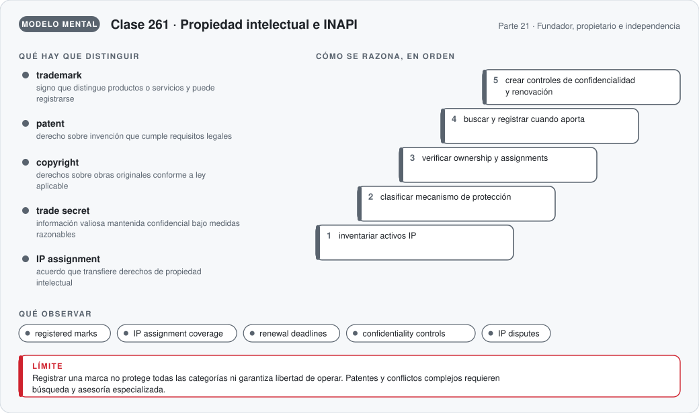

# Clase 261 — Propiedad intelectual e INAPI

<!-- nav:inicio -->
> **Parte 21 · Founder Track Chile: formalización y operación** — clase 9 de 12 · [índice de la parte](../../README.md) · [temario](../../../../SYLLABUS.md)
<!-- nav:fin -->

**Parte:** 21 — Founder Track Chile: formalización y operación  
**Nivel:** Etapa 6 — Founder en Chile  
**Duración sugerida:** 150–180 minutos · **Estándar:** deep-class-v2

## 🎯 Propósito

En muchas empresas nuevas, lo más valioso no está en el local ni en las máquinas, sino en intangibles: el **nombre** con el que los clientes reconocen el negocio, el **software** que lo opera, el **contenido** que lo distingue, los **procesos** y datos que acumula, el **dominio** y las cuentas en redes. Esos activos suelen estar mal ordenados: el nombre sin registrar, el logo diseñado por un conocido sin contrato, el software escrito por un freelance que nunca cedió derechos, el dominio a nombre de un socio que se fue. El resultado aparece en el peor momento: cuando alguien registra tu marca antes que tú, cuando un inversionista pide acreditar la titularidad de lo que compra, o cuando un socio se lleva las claves. La propiedad intelectual no es un lujo legal: es **inventariar lo que vale, saber de quién es y decidir cómo protegerlo**.

La clase presenta un enfoque ejecutivo: un inventario de activos intangibles, la elección del mecanismo de protección adecuado para cada uno (marcas y patentes ante INAPI, derecho de autor ante el Departamento de Derechos Intelectuales, confidencialidad y contratos para lo que no se registra), la cadena de titularidad y los controles de renovación. **No interpreta la legislación de propiedad industrial ni intelectual**: indica qué decisiones tomar, qué preguntar a un especialista y dónde se verifica cada requisito. Las fuentes son los portales oficiales de INAPI y del Departamento de Derechos Intelectuales, los principios de gobierno corporativo de la OECD, Drucker y los portales del SII, el RES y ChileCompra donde la titularidad importa. Al terminar sabrás construir el inventario, priorizar qué proteger primero, ordenar la titularidad y preparar la conversación con un abogado o agente de propiedad industrial.

## 📚 Resultados de aprendizaje

Al finalizar podrás:

1. **Distinguir** marca, patente, derecho de autor, secreto y dominio como activos y mecanismos distintos.
2. **Inventariar** los activos intangibles de una empresa con su titular y su estado de protección.
3. **Priorizar** qué proteger según valor, riesgo y costo con supuestos explícitos.
4. **Verificar** la cadena de titularidad: contratos con creadores, socios y proveedores.
5. **Controlar** renovaciones, confidencialidad y accesos a activos digitales.

## 🧭 Agenda

| Tramo | Qué se hace |
|---|---|
| 0–20 min | Recuperación: ¿cuáles son tus cinco activos intangibles más valiosos y de quién son? |
| 20–60 min | Inventario, mecanismos, marca, patente, derecho de autor, secreto, titularidad y controles. |
| 60–105 min | Ejemplo trabajado: prioridad de protección con costo y exposición esperada. |
| 105–150 min | Caso ejecutivo y práctica. |
| 150–175 min | Límites y entregable. |

## 🧩 Conceptos centrales

| Concepto | Definición | Cómo se reconoce |
|---|---|---|
| **Marca** | Signo que distingue productos o servicios en el mercado. | Nombre, logo o lema que el cliente asocia al negocio. |
| **Patente** | Protección de invenciones que cumplan los requisitos que fije la ley. | Solicitud ante la autoridad competente. |
| **Derecho de autor** | Protección de obras originales, incluido el software. | Obra y autor; registro opcional. |
| **Secreto empresarial** | Información valiosa que se mantiene reservada. | Confidencialidad real y contractual. |
| **Titularidad** | Quién es el dueño de un activo. | Contrato, cesión o registro. |
| **Cesión** | Traspaso de derechos de un creador a la empresa. | Documento firmado. |

## 🧠 Modelo mental

**Cómo leer el diagrama.** Una tabla de tres columnas. **Activo**: nombre y marca, invento o proceso técnico, software, obra y contenido, know-how y datos, dominio y cuentas. **Mecanismo a evaluar**: registro de marca ante INAPI, patente u otra figura de propiedad industrial, derecho de autor y su registro, confidencialidad y contratos, titularidad a nombre de la empresa. **Qué se verifica**: búsqueda previa y categorías, novedad y asesoría especializada, titularidad y cesiones, quién accede y bajo qué acuerdo, y quién controla los accesos. La nota advierte que registrar una marca no protege todas las categorías ni garantiza libertad de operar; el pie, que cada activo tiene un titular claro: la empresa, no una persona.

## 📖 Desarrollo

### 1. El inventario: ver lo que se tiene

El primer paso es una **lista de activos intangibles** con cuatro columnas: qué es, quién lo creó, a nombre de quién está, qué protección tiene. Se incluyen: nombres y logos, eslóganes, dominio, cuentas en redes, software y repositorios, bases de datos, contenidos (textos, fotos, videos, cursos), diseños, procesos, recetas, fórmulas, listas de clientes, contratos clave y cualquier invento. La OECD, en sus principios de gobierno corporativo, subraya la importancia de que los órganos de dirección comprendan y gestionen los **riesgos y activos relevantes**; Drucker recuerda que lo que no se mide ni se gestiona se deteriora. El inventario permite descubrir lo más frecuente: activos valiosos a nombre de la persona equivocada o sin ninguna protección.

### 2. Marca: nombre, logo y reputación

La **marca** distingue tu negocio de otros y concentra la reputación. INAPI, el organismo oficial de propiedad industrial en Chile, publica la información sobre el registro y sus requisitos. Las decisiones para el fundador son: **buscar** antes de elegir un nombre (para no invertir en una marca que ya está registrada por otro en tu rubro), **decidir qué registrar** (nombre, logo, ambos), **en qué categorías de productos o servicios** (el registro no cubre todos los rubros), y **quién será el titular** (la empresa). Registrar una marca **no garantiza libertad de operar** ni protege automáticamente todas las categorías, y una marca similar a otra puede generar conflictos. Los plazos, costos y procedimientos se verifican en el portal de INAPI; las situaciones complejas requieren un agente o abogado especializado.

### 3. Patentes y otras figuras de propiedad industrial

Si la empresa desarrolla una **invención técnica** (un producto o proceso nuevo con aplicación industrial), puede evaluar protegerla con una patente u otra figura de propiedad industrial, según lo que establezca la ley y evalúe INAPI. La decisión es costosa y técnica: depende de la **novedad**, de si ya se divulgó (publicar o vender antes de solicitar puede afectar la posibilidad de protección, algo que debe consultarse con un especialista antes de hacerlo), del mercado en que se quiere proteger y de la estrategia (¿proteger o mantener como secreto?). El fundador no necesita dominar los requisitos: necesita **detectar a tiempo que existe una posible invención y consultar antes de divulgar**. Para muchas pymes de servicios o comercio, las patentes no son relevantes; para empresas de tecnología o manufactura, pueden ser centrales.

### 4. Derecho de autor: software, contenido y obras

El **derecho de autor** protege obras originales (textos, imágenes, música, software, videos, diseños), y el Departamento de Derechos Intelectuales publica orientación y los procedimientos de registro. El punto crítico para la empresa es la **titularidad**: la ley y los contratos determinan si los derechos pertenecen al creador o a quien lo contrató, y en qué condiciones. Por eso, cuando alguien externo crea algo para tu negocio (logo, sitio web, software, contenido), conviene un **contrato escrito** que defina el alcance, la cesión o licencia de derechos, la confidencialidad y las responsabilidades; lo mismo con los socios y empleados que crean obras. Lo que se firme debe revisarlo un abogado. Un software sin cesión clara es una duda en cualquier venta o inversión.

### 5. Secretos, confidencialidad y datos

No todo se registra. El **know-how**, los procesos, las fórmulas, las listas de clientes y las bases de datos suelen protegerse manteniéndolos **reservados** y regulando por contrato quién accede: acuerdos de confidencialidad con empleados, socios y proveedores, controles de acceso, registro de quién tiene qué, procedimientos al salir una persona. La protección de un secreto depende de **qué tan real es la reserva**: si cualquiera puede acceder o copiar, difícilmente será considerado un secreto. En materia de datos personales de clientes y trabajadores existen normas especiales (LeyChile publica los textos vigentes) que se verifican con asesoría. Los registros de actividad, los respaldos y las claves bien administradas forman parte de la protección.

### 6. Dominio, cuentas y activos digitales

El **dominio**, las cuentas de redes, las tiendas en línea, los repositorios y los servicios en la nube son activos que suelen registrarse con el correo de quien los creó. Si esa persona se va o se enemista, la empresa pierde el control. La regla: **todo activo digital crítico se registra a nombre de la empresa**, con un correo institucional, con autenticación reforzada, con al menos dos personas con acceso de administración y con un registro de claves y renovaciones. Se agenda la **renovación de dominios y registros** con anticipación. Un dominio expirado o secuestrado puede costar semanas de ventas y una reputación difícil de recuperar. En compras públicas y contratos con grandes clientes, la titularidad de estos activos puede ser requisito de contratación (ChileCompra y bases de cada licitación).

### 7. Cadena de titularidad y controles periódicos

La cadena de titularidad responde: **¿de quién fue originalmente y cómo llegó a la empresa?** Cada eslabón necesita un documento: contratos de trabajo con cláusulas de propiedad de lo creado en el ejercicio de funciones, contratos de servicios con cesión, acuerdos de socios, registros de INAPI o del Departamento de Derechos Intelectuales a nombre de la empresa. Una **auditoría anual** revisa: ¿hay activos nuevos sin inventario?, ¿hay renovaciones próximas?, ¿hay terceros usando la marca?, ¿hubo cambios de personas con accesos?, ¿hay contratos con cláusulas que cedan derechos sin querer? Se prepara también una **respuesta a infracciones**: quién decide, qué evidencia se guarda, cuándo se consulta a un abogado. La clase da el marco; la estrategia concreta de protección se diseña con un especialista.

## 📚 Lectura comparada

| Fuente | Qué aporta | Qué no resuelve | Pregunta para contrastar |
|---|---|---|---|
| INAPI | Información oficial de marcas, patentes y propiedad industrial. | No decide tu estrategia. | ¿Qué debo buscar y registrar? |
| Departamento de Derechos Intelectuales | Orientación sobre derecho de autor y su registro. | No redacta tus contratos. | ¿De quién son los derechos de esta obra? |
| OECD (principios de gobierno corporativo) | Gestión de riesgos y activos desde el directorio. | No trata propiedad intelectual específica. | ¿Mi órgano de dirección ve estos activos? |
| Drucker | Gestionar lo que importa. | No contiene normativa chilena. | ¿Qué activo vale más y está menos protegido? |
| SII y RES | Titularidad de la empresa y sus datos. | No protegen intangibles. | ¿A nombre de quién estará el registro? |

## 🧮 Ejemplo trabajado

**Situación (hipotética).** Una empresa de repostería saludable con una marca propia, una tienda en línea y una aplicación de pedidos desarrollada por un freelance debe decidir qué proteger primero con un presupuesto limitado. Todos los valores son **supuestos**; los costos, plazos y requisitos reales se verifican en INAPI y con especialistas.

**Inventario y estado.**

| Activo | Titular actual | Protección | Valor estimado si se pierde |
|---|---|---|---|
| Nombre y logo | La fundadora | Sin registro | 3.600.000 (rediseño, letreros, empaques) más 3.000.000 de margen perdido |
| Dominio y redes | Correo personal de un socio que se fue | Ninguna | 4.500.000 (ventas de 3 semanas de interrupción) |
| Aplicación de pedidos | El freelance (sin contrato de cesión) | Ninguna | 8.000.000 (reconstrucción) |
| Recetas | La fundadora y dos cocineros | Sin acuerdos de confidencialidad | 2.000.000 |

**Probabilidades supuestas (en tres años) y exposición esperada.**

| Activo | Probabilidad de problema | Pérdida | Exposición esperada |
|---|---|---|---|
| Nombre y logo (alguien registra o usa algo similar) | 10 % | 6.600.000 | 660.000 |
| Dominio y redes (pérdida de control) | 15 % | 4.500.000 | 675.000 |
| Aplicación (disputa o falta de cesión en una venta o inversión) | 12 % | 8.000.000 | 960.000 |
| Recetas (salida de un cocinero con la receta) | 8 % | 2.000.000 | 160.000 |
| **Total** | | | **2.455.000** |

**Costo de las medidas (supuestos).**

| Medida | Costo |
|---|---|
| Registro de marca con búsqueda y asesoría | 350.000 |
| Transferir dominio y redes a la empresa, con correo institucional y doble acceso | 80.000 (principalmente tiempo) |
| Contrato de cesión con el freelance y revisión legal | 450.000 |
| Acuerdos de confidencialidad con dos cocineros | 120.000 |
| **Total** | **1.000.000** |

**Prioridad por razón exposición/costo.**

- Dominio y redes: 675.000 ÷ 80.000 = **8,4**.
- Aplicación: 960.000 ÷ 450.000 = **2,1**.
- Marca: 660.000 ÷ 350.000 = **1,9**.
- Recetas: 160.000 ÷ 120.000 = **1,3**.

**Lectura.** Las cuatro medidas tienen una razón mayor que 1 con estos supuestos, pero la **primera** (casi gratuita) debe hacerse de inmediato, la **cesión de la aplicación** y el **registro de marca** siguen en el orden de la tabla, y los **acuerdos de confidencialidad** son importantes pero de menor retorno. El total de medidas es 1.000.000 contra una exposición esperada de 2.455.000.

**Lo que el cálculo no incluye.** La exposición esperada no recoge el valor de la empresa en una venta o ronda de inversión, donde un inversionista puede exigir titularidad clara; tampoco recoge conflictos que no se pueden cuantificar. Los supuestos se revisan con un abogado o agente de propiedad industrial.

**Decisión.** Esta semana transferir dominio y redes a la empresa; en 30 días firmar la cesión con el freelance y hacer la búsqueda y la solicitud de marca; en 60 días firmar confidencialidad con el equipo; crear un calendario de renovaciones y una auditoría anual.

**Cuidados.** Las probabilidades, pérdidas y costos son supuestos. La procedencia y alcance de cada protección dependen de la ley vigente y de las categorías que se registren.

**Qué muestra.** (1) El inventario reveló titularidades equivocadas. (2) La razón exposición/costo ordenó las acciones. (3) La medida más barata resultó la más urgente.

## 🔀 Comparación y límites

**Registrar frente a contratar.** El registro (marca, patente, obra) da un derecho frente a terceros; el contrato ordena la titularidad dentro de la empresa. Muchas veces el problema no es el registro, sino un contrato que nunca se hizo.

**Límites.** Esta clase no interpreta la legislación de propiedad industrial ni intelectual. El registro de una marca no protege todas las categorías ni garantiza libertad de operar. Las patentes y los conflictos complejos requieren búsqueda y asesoría especializada. Los valores del ejemplo son supuestos.

## 🪜 De profesional a owner

| Nivel | Cómo se relaciona con la propiedad intelectual |
|---|---|
| **Profesional** | Respeta la confidencialidad y la titularidad de lo que crea para la empresa. |
| **Jefe / Team Lead** | Sabe qué creaciones de su equipo son activos de la empresa. |
| **Gerente** | Vela por contratos con creadores y proveedores. |
| **CEO / Director** | Gestiona los riesgos de intangibles y supervisa el inventario. |
| **Founder / Owner** | Decide qué proteger y se asegura de que todo esté a nombre de la empresa. |

## 🏢 Caso ejecutivo

Una fundadora lanzó una plataforma de clases de yoga en línea. El nombre «Soma Yoga» lo eligió ella y el logo lo diseñó una amiga sin contrato; el sitio web y la aplicación los desarrolló un estudio externo, con una factura y sin documento de cesión; el dominio está a nombre de su hermano, que se mudó al extranjero; las clases las graban tres profesoras con una carta de acuerdo simple; el contenido es su principal valor. Un competidor lanzó un servicio con el nombre «Soma Yoga Online» en otra ciudad. Una inversionista ofrece 20 millones de pesos por el 15 % y quiere que le acrediten la titularidad de marca, software y contenido en 30 días. Un cliente corporativo pide un contrato con cláusula de propiedad intelectual y confidencialidad. Tiene un presupuesto de 1,5 millones para proteger sus activos.

Entrega un **memo de decisión del fundador sobre propiedad intelectual** que contenga: (a) el inventario de activos con titular, protección y brecha; (b) la priorización con exposición esperada, costo y razón, con supuestos explícitos; (c) el plan para ordenar titularidades en 30 días con documentos y responsables; (d) la estrategia ante el competidor con el nombre similar, incluyendo qué consultar y qué evidencia guardar; (e) las cláusulas y acuerdos que pedirá al abogado para el inversionista y el cliente corporativo; (f) las verificaciones oficiales pendientes en INAPI y el Departamento de Derechos Intelectuales.

## 🧪 Práctica

1. Construye el inventario de tus activos con titular y protección actual.
2. Estima probabilidad, pérdida y exposición esperada de cada brecha.
3. Calcula la razón exposición/costo de cada medida y ordénalas.
4. Revisa a nombre de quién están dominio, redes, repositorios y servicios.
5. Prepara cinco preguntas para un agente de propiedad industrial y cinco para un abogado.

## ⚠️ Errores frecuentes

| Error | Por qué ocurre | Cómo corregirlo |
|---|---|---|
| Elegir un nombre sin búsqueda | Entusiasmo | Buscar antes y registrar por categoría. |
| Creaciones sin contrato | «Es de confianza» | Cesión o licencia escrita revisada por un abogado. |
| Activos digitales a nombre de personas | Comodidad | Titularidad de la empresa y doble acceso. |
| Divulgar un invento antes de consultar | Prisa por mostrar | Consultar a un especialista antes de publicar. |
| Creer que registrar protege todo | Confusión | Entender categorías y límites del registro. |
| No renovar | Sin calendario | Agenda de renovaciones y auditoría anual. |

## ❓ Preguntas de comprobación

1. ¿Qué diferencia hay entre marca, patente y derecho de autor?
2. ¿Por qué un secreto empresarial requiere reserva real?
3. ¿Qué es una cesión y por qué importa?
4. ¿Qué activos digitales conviene registrar a nombre de la empresa?
5. ¿Cómo se prioriza qué proteger primero?
6. ¿Qué no garantiza el registro de una marca?
7. ¿Qué límite tiene esta clase?

Claves de respuesta

1. La marca distingue productos o servicios; la patente protege invenciones; el derecho de autor protege obras originales.
2. Porque si cualquiera puede acceder o copiar, difícilmente se considerará reservado.
3. Un documento por el cual un creador traspasa derechos a la empresa; ordena la titularidad.
4. Dominio, redes, tiendas, repositorios, servicios en la nube y correo.
5. Comparando exposición esperada y costo de cada medida, empezando por la de mayor razón.
6. No protege todas las categorías ni asegura libertad de operar.
7. No interpreta la legislación; plantea decisiones y preguntas, y exige verificar en INAPI y con especialistas.

## 📥 Entregable

Guarda en `portfolio/261-propiedad-intelectual-e-inapi/`:

- `founder-owner-decision-brief.md` (plantilla [Founder owner decision brief](../../../../templates/founder-owner-decision-brief.md)) con el memo del caso ejecutivo;
- `decision-journal.md` con el inventario, las prioridades y el calendario de renovaciones.

## 📗 Fuentes y verificación

- INAPI (Chile) — *Propiedad industrial y orientación oficial*. **Uso en esta clase:** información oficial de marcas, patentes y propiedad industrial. **Fuente primaria:** <https://www.inapi.cl/>.
- Departamento de Derechos Intelectuales (Chile) — *Derecho de autor: registro y orientación oficial*. **Uso en esta clase:** orientación oficial sobre derecho de autor y su registro. **Fuente primaria:** <https://www.propiedadintelectual.gob.cl/>.
- OECD — *G20/OECD Principles of Corporate Governance 2023*. **Uso en esta clase:** gestión de riesgos y activos desde el órgano de dirección. **Fuente primaria:** <https://www.oecd.org/en/publications/2023/09/g20-oecd-principles-of-corporate-governance-2023_60836fcb.html>.
- Servicio de Impuestos Internos (Chile) — *Guías, normativa y servicios oficiales*. **Uso en esta clase:** datos tributarios de la entidad titular. **Fuente primaria:** <https://www.sii.cl/>.
- Dirección ChileCompra — *Mercado Público y normativa de compras públicas*. **Uso en esta clase:** requisitos de titularidad en compras públicas. **Fuente primaria:** <https://www.chilecompra.cl/>.
- Peter F. Drucker — *Management: Tasks, Responsibilities, Practices* (Harper & Row, 1974). **Uso en esta clase:** gestionar lo que importa. Lectura selectiva sobre **propiedad intelectual e inapi**. **Localizador:** [ISBN-13 9780060110925](https://openlibrary.org/isbn/9780060110925).

> **Regla de fuentes para Propiedad intelectual e INAPI:** las obras y portales anteriores estructuran las perspectivas de esta materia; cualquier norma, ley, trámite, tasa o plazo mencionado debe comprobarse nuevamente en su fuente primaria oficial vigente, y este programa no reemplaza asesoría legal, tributaria ni contable. Los ejemplos y casos son hipotéticos, con cifras ilustrativas. El desarrollo es original y no reproduce material protegido.

<!-- pie:inicio -->
---

| Anterior | Índice | Siguiente |
|---|---|---|
| [← 260 · Contratación, honorarios y obligaciones laborales: panorama](../260-contratacion-honorarios-y-obligaciones-laborales-panorama/README.md) | [Parte 21](../../README.md) · [Programa](../../../../SYLLABUS.md) | [262 · Patentes, permisos y obligaciones sectoriales →](../262-patentes-permisos-y-obligaciones-sectoriales/README.md) |
<!-- pie:fin -->
