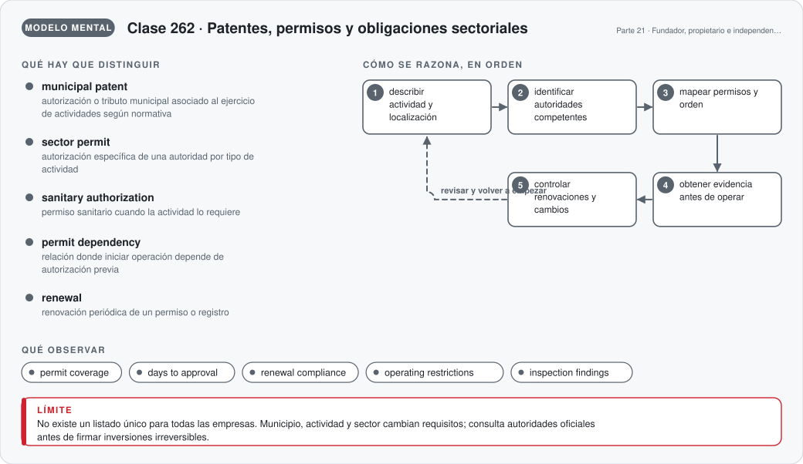

# Clase 262 — Patentes, permisos y obligaciones sectoriales

<!-- nav:inicio -->
> **Parte 21 · Founder Track Chile: formalización y operación** — clase 10 de 12 · [índice de la parte](../../README.md) · [temario](../../../../SYLLABUS.md)
<!-- nav:fin -->

**Parte:** 21 — Founder Track Chile: formalización y operación  
**Nivel:** Etapa 6 — Founder en Chile  
**Duración sugerida:** 150–180 minutos · **Estándar:** deep-class-v2

## 🎯 Propósito

Tener el inicio de actividades al día no autoriza, por sí solo, a abrir las puertas. Muchas actividades requieren una **patente municipal** para operar en un lugar determinado y, según el rubro, **permisos o registros sectoriales** de otras autoridades: sanitarios, de seguridad, ambientales, de transporte, de educación, de salud, de comercio exterior, financieros, entre otros. Cada uno tiene su propio ente, sus propios requisitos, sus propios plazos y su propia lógica de renovación. El error clásico es **invertir antes de saber si se puede operar**: arrendar un local, comprar equipos o contratar personal y descubrir después que el lugar no admite esa actividad, que el permiso requiere obras costosas o que la autoridad tarda meses. Esa decisión es la menos reversible de un emprendimiento físico.

Esta clase enseña a **descubrir y ordenar las obligaciones sectoriales** de una actividad: describir qué se hace y dónde, identificar las autoridades competentes, mapear los permisos y su orden, obtener evidencia antes de operar y controlar renovaciones y cambios. **No existe un listado único para todas las empresas**: el municipio, la actividad y el sector cambian los requisitos, y las normas se actualizan. Por eso aquí no se enumeran permisos ni plazos; se enseña el método y se indican las fuentes de verificación (ChileAtiende, la municipalidad correspondiente, el SII, el RES, la DT, Corfo y los organismos sectoriales). Al terminar sabrás construir un mapa de permisos, comparar alternativas de ubicación con riesgo y costo y mantener un registro de obligaciones vigentes.

## 📚 Resultados de aprendizaje

Al finalizar podrás:

1. **Distinguir** patente municipal, permiso sectorial, registro y obligación recurrente.
2. **Describir** la actividad y el lugar con el detalle que cada autoridad necesita.
3. **Mapear** autoridades, permisos y su orden, con evidencia verificable.
4. **Comparar** alternativas de local o modelo con costo y riesgo esperados.
5. **Controlar** renovaciones, cambios y vencimientos con un registro vigente.

## 🧭 Agenda

| Tramo | Qué se hace |
|---|---|
| 0–20 min | Recuperación: ¿qué autoridades deberían autorizar tu actividad en tu lugar? |
| 20–60 min | Actividad y lugar, autoridades, permisos y orden, evidencia, renovaciones y cambios. |
| 60–105 min | Ejemplo trabajado: elección de local con probabilidad de aprobación y costo esperado. |
| 105–150 min | Caso ejecutivo y práctica. |
| 150–175 min | Límites y entregable. |

## 🧩 Conceptos centrales

| Concepto | Definición | Cómo se reconoce |
|---|---|---|
| **Patente municipal** | Autorización local para ejercer una actividad en un lugar. | Documento del municipio. |
| **Permiso sectorial** | Autorización de un organismo según el rubro. | Resolución o certificado. |
| **Registro sectorial** | Inscripción exigida a ciertas actividades. | Número o constancia. |
| **Autoridad competente** | Organismo que decide sobre un permiso. | Municipio o servicio sectorial. |
| **Obligación recurrente** | Deber periódico para mantener la autorización. | Renovación, informe, inspección. |
| **Evidencia previa** | Documento que prueba el permiso antes de operar. | Copia vigente y fecha. |

## 🧠 Modelo mental

**Cómo leer el diagrama.** Una cadena de cinco pasos. **Actividad y lugar**: qué se hace y dónde. **Autoridades**: municipio y organismos sectoriales. **Permisos y orden**: qué se necesita y en qué secuencia. **Evidencia antes de operar**: documentos y resoluciones. **Renovaciones y cambios**: vencimientos y modificaciones. La flecha de retorno indica que un cambio de local o de actividad reinicia el mapa. La nota recuerda que no existe un listado único y que se consulta a la autoridad antes de firmar inversiones irreversibles; el pie, que la patente municipal y el permiso sectorial son cosas distintas.

## 📖 Desarrollo

### 1. Dos grandes familias: lo local y lo sectorial

La **patente municipal** (o autorización equivalente según el caso) habilita el ejercicio de una actividad en un lugar y depende de la normativa y la práctica de la municipalidad correspondiente: zonificación, tipo de actividad, características del local, y los documentos que cada comuna pida. Los **permisos sectoriales** dependen del rubro: quien manipula alimentos, atiende a niños, ofrece servicios de salud, transporta personas o mercancías, usa productos regulados, maneja datos sensibles, ofrece servicios financieros o educativos, o impacta el ambiente se relaciona con autoridades específicas. Una misma empresa puede necesitar varias. ChileAtiende ofrece orientación de trámites del Estado, y SII Educa describe la formalización de un negocio; **ninguno reemplaza la consulta directa** a la autoridad que decidirá.

### 2. Describir actividad y lugar con precisión

La autoridad decide sobre **hechos**: qué se hará exactamente, en qué superficie, con qué instalaciones, con cuántas personas, qué público se atenderá, qué materiales o equipos se usarán, qué horarios, qué residuos se generarán. Una descripción vaga produce respuestas vagas o, peor, una autorización que no cubre lo que realmente se hará. Se redacta una **ficha de actividad** de una página, que se actualiza si el negocio cambia. También se documenta el **lugar**: dirección, superficie, uso del inmueble, propietario, contrato de arriendo, planos o fotos. Esa ficha se usa para consultar a cada autoridad con la misma información y evitar contradicciones. El SII exige además que el domicilio declarado sea coherente con la realidad (clase 256).

### 3. Identificar autoridades y el orden de los pasos

Con la ficha, se pregunta **a quién corresponde autorizar cada aspecto**. Un método: leer lo que publican los portales de ChileAtiende y de los organismos sectoriales, llamar o escribir a la **municipalidad** para preguntar qué requisitos tiene la actividad en ese lugar, y consultar a asociaciones del rubro o a profesionales con experiencia. Se registra **qué dijo cada fuente, quién lo dijo, cuándo** y con qué documento. Luego se arma el **orden**: algunos permisos requieren otros como antecedente (por ejemplo, el municipio puede pedir que el SII haya registrado tu actividad o que otra autoridad haya aprobado ciertas condiciones); otros pueden tramitarse en paralelo. El orden real lo confirman las autoridades; no se supone ni se copia de un caso ajeno.

### 4. Obtener evidencia antes de operar

Un permiso en trámite **no es** un permiso otorgado. Antes de abrir, se debe tener la evidencia del permiso vigente, con su fecha, alcance, vencimiento y condiciones. Operar sin autorización o con una autorización que no cubre la actividad expone a sanciones, clausuras y, en algunos rubros, a riesgos para las personas. Si existe una autorización provisoria o un procedimiento especial, se verifica en la fuente oficial qué permite exactamente y hasta cuándo. Se guarda una **carpeta de permisos** con: copia del documento, autoridad emisora, número, fecha de otorgamiento, vencimiento, condiciones (por ejemplo, aforo, horarios, requisitos de seguridad), costos y responsable de la renovación. En licitaciones y contratos grandes, esa carpeta se solicita frecuentemente como parte de la evidencia de cumplimiento.

### 5. Comparar alternativas de lugar y de modelo

Las decisiones de lugar se comparan con **riesgo de autorización**. Se consulta a la autoridad sobre cada alternativa, se estima la probabilidad de aprobación y el plazo, se identifican las **adecuaciones necesarias** (obras, instalaciones, accesos, ventilación, seguridad) y su costo, y se calcula el **costo esperado**: arriendo, adecuaciones, costo de espera si hay retraso y pérdida si el permiso se deniega. Las estimaciones de probabilidad no son exactas, pero **obligan a preguntar** y a ponderar. A veces la alternativa correcta no es otro local sino otro modelo: operar desde una cocina autorizada de terceros, empezar con venta en línea mientras se tramita, usar un espacio ya habilitado. Corfo y otras instituciones pueden ofrecer apoyo para ciertas inversiones, pero sus programas cambian y se consultan en sus convocatorias vigentes.

### 6. Obligaciones recurrentes, inspecciones y cambios

Los permisos no son eternos ni estáticos. Hay **renovaciones**, **pagos periódicos**, **declaraciones**, **inspecciones**, **capacitaciones**, **informes** y **condiciones** que deben mantenerse. Un cambio importante (nuevo local, ampliación, nueva línea de productos, cambio de horarios, incorporación de maquinaria, cambio de titular) puede exigir **modificar o solicitar permisos nuevos**. Se mantiene un **registro de obligaciones** con: permiso, autoridad, obligación, periodicidad, responsable, fecha próxima, evidencia y fecha de verificación. Se incluyen también las obligaciones laborales y de seguridad (clase 260). Armstrong y Taylor destacan que la gestión de las personas incluye informar y capacitar sobre obligaciones de seguridad; en este contexto, los permisos suelen depender de que el equipo conozca y cumpla ciertos procedimientos.

### 7. Gobierno y proporcionalidad

Los principios de gobierno corporativo de la OECD destacan que el órgano de dirección debe comprender y supervisar los **riesgos relevantes**, incluidos los de cumplimiento. Para una pyme esto se traduce en: un responsable explícito de los permisos, un calendario revisado al menos mensualmente, un informe breve al dueño o socios con los vencimientos de los próximos 90 días y un mecanismo para escalar problemas. La proporcionalidad importa: no se necesita un sistema complejo, sino **constancia** y **ninguna sorpresa**. Y como la normativa y las prácticas locales cambian, se **revalida cada año** lo que se creía vigente. Para casos complejos (rubros regulados, grandes inversiones, actividades con impacto ambiental o sanitario), se contrata asesoría especializada antes de comprometer capital.

## 📚 Lectura comparada

| Fuente | Qué aporta | Qué no resuelve | Pregunta para contrastar |
|---|---|---|---|
| ChileAtiende | Orientación de trámites del Estado. | No decide tu permiso. | ¿Qué trámites se relacionan con mi actividad? |
| Municipalidad competente | Requisitos locales de patente y uso del lugar. | No cubre permisos sectoriales. | ¿Qué exige mi comuna para este local? |
| SII Educa | Formalización de un negocio y vínculo con permisos. | No define autorizaciones sectoriales. | ¿Qué debo tener antes de pedir la patente? |
| Corfo | Apoyo a inversión y desarrollo empresarial. | No otorga permisos. | ¿Qué convocatoria vigente se relaciona? |
| OECD (gobierno corporativo) | Supervisión de riesgos de cumplimiento. | No lista permisos. | ¿Quién supervisa mis vencimientos? |

## 🧮 Ejemplo trabajado

**Situación (hipotética).** Una fundadora de una pastelería con venta al público evalúa tres locales. Antes de firmar, consulta a la municipalidad y a una asesora del rubro sobre requisitos. Todos los montos y probabilidades son **supuestos** que ella obtiene de esas consultas y que debe actualizar con la información oficial; el método es lo que importa.

**Datos por alternativa.**

| Dato | Local A | Local B | Local C |
|---|---|---|---|
| Arriendo mensual | 700.000 | 500.000 | 600.000 |
| Adecuaciones necesarias | 1.500.000 | 2.500.000 | 1.000.000 |
| Probabilidad de aprobación a tiempo | 90 % | 50 % | 80 % |
| Meses de retraso si no es a tiempo | 2 | 4 | 3 |
| Probabilidad de denegación | 2 % | 15 % | 5 % |

**Costo de espera esperado.** (1 − probabilidad a tiempo) × meses de retraso × arriendo. Se descuenta la denegación para no contarla dos veces: se usa la probabilidad de retraso como (1 − probabilidad a tiempo − probabilidad de denegación).

- Local A: probabilidad de retraso = 1 − 0,90 − 0,02 = 0,08; costo = 0,08 × 2 × 700.000 = **112.000**.
- Local B: 1 − 0,50 − 0,15 = 0,35; costo = 0,35 × 4 × 500.000 = **700.000**.
- Local C: 1 − 0,80 − 0,05 = 0,15; costo = 0,15 × 3 × 600.000 = **270.000**.

**Pérdida si se deniega (adecuaciones más tres meses de arriendo, supuesto).**

- A: 1.500.000 + 3 × 700.000 = 3.600.000; × 0,02 = **72.000**.
- B: 2.500.000 + 3 × 500.000 = 4.000.000; × 0,15 = **600.000**.
- C: 1.000.000 + 3 × 600.000 = 2.800.000; × 0,05 = **140.000**.

**Costo esperado del primer año (arriendo de 12 meses + adecuaciones + espera esperada + denegación esperada).**

| Local | Arriendo anual | Adecuaciones | Espera esperada | Denegación esperada | Total |
|---|---|---|---|---|---|
| A | 8.400.000 | 1.500.000 | 112.000 | 72.000 | **10.084.000** |
| B | 6.000.000 | 2.500.000 | 700.000 | 600.000 | **9.800.000** |
| C | 7.200.000 | 1.000.000 | 270.000 | 140.000 | **8.610.000** |

**Lectura.** El local C tiene el menor costo esperado del primer año (8.610.000), pese a no ser el más barato en arriendo. El local B, el más barato de arrendar, queda 1.190.000 por encima de C (9.800.000 − 8.610.000) por su riesgo de autorización. El local A es el más seguro, pero cuesta 1.474.000 más que C (10.084.000 − 8.610.000).

**Sensibilidad.** Si la probabilidad de aprobación a tiempo de C bajara de 80 % a 60 % (con 5 % de denegación): probabilidad de retraso 0,35; costo de espera 0,35 × 3 × 600.000 = 630.000; total 7.200.000 + 1.000.000 + 630.000 + 140.000 = **8.970.000**. C sigue siendo la mejor alternativa. **El resultado es robusto a esa variación.** Pero la calidad de las estimaciones es la clave: se mejoran con consultas formales, por escrito, a la autoridad.

**Decisión.** Elegir el local C, pero **condicionar el contrato de arriendo** a la obtención de la patente y los permisos (cláusula de término sin costo si se deniega, a validar con un abogado), consultar por escrito a las autoridades, tramitar en el orden que ellas indiquen y no comprar equipos grandes hasta tener la evidencia.

**Cuidados.** Las probabilidades, plazos y costos son supuestos; los requisitos reales los confirman las autoridades.

**Qué muestra.** (1) Las estimaciones obligaron a preguntar a las autoridades. (2) El costo esperado cambió el ranking que sugería el arriendo. (3) La cláusula condicional transfiere parte del riesgo.

## 🔀 Comparación y límites

**Patente municipal frente a permiso sectorial.** La patente autoriza el ejercicio de una actividad en un lugar y la entrega el municipio; el permiso sectorial depende del rubro y lo entrega el organismo competente. Una actividad puede necesitar ambos, en un orden que las autoridades confirman.

**Límites.** No existe un listado único. Esta clase no enumera permisos ni plazos y no reemplaza la consulta directa a las autoridades. Las probabilidades del ejemplo son supuestos. Para rubros regulados o inversiones grandes se requiere asesoría especializada antes de comprometer capital.

## 🪜 De profesional a owner

| Nivel | Cómo se relaciona con permisos y obligaciones |
|---|---|
| **Profesional** | Cumple los procedimientos que sostienen los permisos. |
| **Jefe / Team Lead** | Vela por las condiciones de seguridad y operación de su área. |
| **Gerente** | Mantiene el registro de permisos y responde por los vencimientos. |
| **CEO / Director** | Supervisa los riesgos de cumplimiento y la evidencia disponible. |
| **Founder / Owner** | Decide el lugar y el modelo, y no opera sin evidencia de autorización. |

## 🏢 Caso ejecutivo

Un fundador quiere abrir una clínica veterinaria con peluquería canina y venta de alimentos. Ha encontrado un local de 120 metros cuadrados en una calle residencial con arriendo de 1.200.000 pesos al mes y 18 meses de contrato mínimo. Compró un autoclave y una camilla radiográfica por 9.500.000 pesos «en oferta». Contrató a una veterinaria a honorarios y a dos auxiliares. Su pareja le dijo que «con la patente basta». Un vecino le advierte sobre ruidos y olores. El municipio indicó que el uso del local debe revisarse; otro organismo debe autorizar los equipos radiográficos, y debe resolver cómo se manejan los residuos. No ha consultado a ninguno por escrito. Planea abrir en 60 días. Su caja es de 15 millones.

Entrega un **informe de gobierno y riesgos de permisos** que contenga: (a) la ficha de actividad y lugar; (b) el mapa de autoridades, permisos y orden con lo que sabe y lo que debe preguntar; (c) el cálculo del costo esperado de tres escenarios (continuar con este local, negociar condiciones y buscar otro lugar) con supuestos explícitos; (d) las cláusulas condicionales que pedirá en el contrato de arriendo; (e) el registro de obligaciones recurrentes y su calendario; (f) las consultas formales que realizará y las verificaciones oficiales pendientes.

## 🧪 Práctica

1. Escribe tu ficha de actividad y lugar de una página.
2. Haz una lista de autoridades que podrían intervenir y la pregunta que harás a cada una.
3. Compara dos alternativas de lugar con costo esperado y sensibilidad.
4. Diseña tu registro de obligaciones con responsable, fecha y evidencia.
5. Define qué no comprarás ni firmarás hasta tener la evidencia de autorización.

## ⚠️ Errores frecuentes

| Error | Por qué ocurre | Cómo corregirlo |
|---|---|---|
| Arrendar antes de consultar | Urgencia o entusiasmo | Consulta formal y cláusula condicional. |
| Creer que la patente lo resuelve todo | Se ignoran los permisos sectoriales | Mapear todas las autoridades. |
| Operar con el permiso «en trámite» | Presión de caja | Evidencia vigente antes de abrir. |
| Descripción vaga de la actividad | Se quiere evitar complicaciones | Ficha precisa y actualizada. |
| Olvidar renovaciones | Sin responsable ni calendario | Registro de obligaciones y alertas. |
| Comprar equipos antes de la autorización | Ofertas tentadoras | Posponer compras grandes. |

## ❓ Preguntas de comprobación

1. ¿Qué diferencia hay entre patente municipal y permiso sectorial?
2. ¿Por qué se describe la actividad y el lugar con precisión?
3. ¿Cómo se identifican las autoridades competentes?
4. ¿Por qué un permiso en trámite no habilita a operar?
5. ¿Cómo se calcula el costo esperado de una alternativa de lugar?
6. ¿Qué debe tener un registro de obligaciones?
7. ¿Qué límite tiene esta clase?

Claves de respuesta

1. La patente autoriza ejercer en un lugar y la entrega el municipio; el permiso sectorial depende del rubro y lo otorga el organismo competente.
2. Porque la autoridad decide sobre hechos y una descripción vaga produce autorizaciones que no cubren lo real.
3. Con orientación oficial, consulta directa al municipio y a organismos sectoriales, y registro de lo que cada uno dijo.
4. Porque aún no existe autorización vigente; operar así expone a sanciones y riesgos.
5. Sumando arriendo, adecuaciones, costo de espera esperado y pérdida esperada por denegación.
6. Permiso, autoridad, obligación, periodicidad, responsable, fecha, evidencia y última verificación.
7. No enumera permisos ni plazos, y exige consultar a las autoridades y a especialistas.

## 📥 Entregable

Guarda en `portfolio/262-patentes-permisos-y-obligaciones-sectoriales/`:

- `risk-governance-brief.md` (plantilla [Risk governance brief](../../../../templates/risk-governance-brief.md)) con el informe del caso ejecutivo;
- `decision-journal.md` con la ficha, las consultas realizadas y el registro de obligaciones.

## 📗 Fuentes y verificación

- ChileAtiende — *Trámites y orientación del Estado*. **Uso en esta clase:** orientación de trámites y servicios del Estado. **Fuente primaria:** <https://www.chileatiende.gob.cl/>.
- Servicio de Impuestos Internos (Chile) — *SII Educa: inicio de actividades y formalización de un negocio*. **Uso en esta clase:** formalización de un negocio y vínculo con permisos. **Fuente primaria:** <https://www.sii.cl/siieduca/aprende-con-nosotros/inicio-de-actividades-y-formalizacion-de-un-negocio.html>.
- Registro de Empresas y Sociedades (Chile) — *Portal y documentación oficial*. **Uso en esta clase:** documentos oficiales de la entidad. **Fuente primaria:** <https://www.registrodeempresasysociedades.cl/>.
- Dirección del Trabajo (Chile) — *Normativa y orientación oficial*. **Uso en esta clase:** obligaciones laborales vinculadas a la operación. **Fuente primaria:** <https://www.dt.gob.cl/>.
- Corporación de Fomento de la Producción (Chile) — *Programas, instrumentos y apoyo empresarial*. **Uso en esta clase:** instrumentos de apoyo a la inversión y el desarrollo empresarial. **Fuente primaria:** <https://www.corfo.cl/>.
- Michael Armstrong & Stephen Taylor — *Armstrong's Handbook of Human Resource Management Practice* (Kogan Page, Limited, 2023). **Uso en esta clase:** gestión de personas y capacitación en obligaciones de seguridad. Lectura selectiva sobre **patentes, permisos y obligaciones sectoriales**. **Localizador:** [ISBN-13 9781398606654](https://openlibrary.org/isbn/9781398606654).
- OECD — *G20/OECD Principles of Corporate Governance 2023*. **Uso en esta clase:** supervisión de riesgos de cumplimiento por el órgano de dirección. **Fuente primaria:** <https://www.oecd.org/en/publications/2023/09/g20-oecd-principles-of-corporate-governance-2023_60836fcb.html>.

> **Regla de fuentes para Patentes, permisos y obligaciones sectoriales:** las obras y portales anteriores estructuran las perspectivas de esta materia; cualquier norma, ley, trámite, tasa o plazo mencionado debe comprobarse nuevamente en su fuente primaria oficial vigente, y este programa no reemplaza asesoría legal, tributaria ni contable. Los ejemplos y casos son hipotéticos, con cifras ilustrativas. El desarrollo es original y no reproduce material protegido.

<!-- pie:inicio -->
---

| Anterior | Índice | Siguiente |
|---|---|---|
| [← 261 · Propiedad intelectual e INAPI](../261-propiedad-intelectual-e-inapi/README.md) | [Parte 21](../../README.md) · [Programa](../../../../SYLLABUS.md) | [263 · ChileCompra, Sercotec, Corfo y ecosistema público →](../263-chilecompra-sercotec-corfo-y-ecosistema-publico/README.md) |
<!-- pie:fin -->
