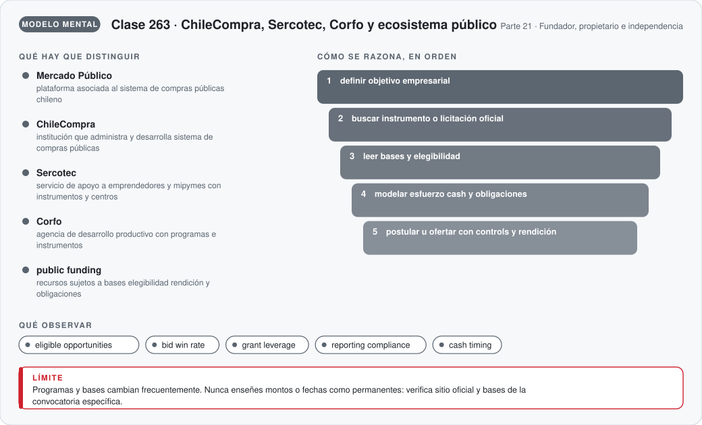

# Clase 263 — ChileCompra, Sercotec, Corfo y ecosistema público

<!-- nav:inicio -->
> **Parte 21 · Founder Track Chile: formalización y operación** — clase 11 de 12 · [índice de la parte](../../README.md) · [temario](../../../../SYLLABUS.md)
<!-- nav:fin -->

**Parte:** 21 — Founder Track Chile: formalización y operación  
**Nivel:** Etapa 6 — Founder en Chile  
**Duración sugerida:** 150–180 minutos · **Estándar:** deep-class-v2

## 🎯 Propósito

El Estado chileno aparece en la vida de una empresa de tres formas muy distintas: como **cliente** (compra bienes y servicios a través de Mercado Público, que administra la Dirección ChileCompra), como **apoyo** a pequeñas empresas (Sercotec, con programas, capacitación y centros de desarrollo de negocios) y como **fomento** al desarrollo productivo y la innovación (Corfo, con instrumentos de financiamiento y cofinanciamiento). Un fundador mal informado trata a los tres como «plata del gobierno» y cae en dos errores: perseguir toda convocatoria sin evaluar si le conviene, o ignorar el ecosistema por prejuicio. Las tres vías son diferentes: vender al Estado es una **venta con reglas de licitación, garantías y plazos de pago**; los programas de apoyo son **convocatorias con bases, elegibilidad y rendición**; y ambas tienen costos de postulación y de cumplimiento que deben compararse con el beneficio esperado.

La clase propone un método: definir el objetivo empresarial, buscar el instrumento o la licitación oficial, leer bases y elegibilidad, modelar esfuerzo, caja y obligaciones, y postular u ofertar con controles y rendición. **Los programas y las bases cambian con frecuencia**: aquí no se enseñan montos, fechas ni requisitos como permanentes; se verifica siempre en el sitio oficial y en las bases de la convocatoria específica. Las fuentes son los portales oficiales de ChileCompra, Sercotec y Corfo, junto con el SII y el RES para los requisitos de la empresa, y Drucker para el criterio de gestión. Al terminar sabrás evaluar una licitación con valor esperado, estimar el apalancamiento de un subsidio, preparar la postulación y cuidar la rendición.

## 📚 Resultados de aprendizaje

Al finalizar podrás:

1. **Distinguir** vender al Estado, recibir apoyo y obtener fomento como vías diferentes.
2. **Buscar** oportunidades en las fuentes oficiales y leer bases y requisitos de elegibilidad.
3. **Modelar** el costo de postular, las garantías, los plazos de pago y la caja necesaria.
4. **Evaluar** una licitación con valor esperado y una convocatoria con apalancamiento.
5. **Cumplir** con la rendición y registrar el aprendizaje de cada postulación.

## 🧭 Agenda

| Tramo | Qué se hace |
|---|---|
| 0–20 min | Recuperación: ¿qué has intentado conseguir del sector público y con qué resultado? |
| 20–60 min | Tres vías, búsqueda, bases, costo, valor esperado, apalancamiento, rendición y aprendizaje. |
| 60–105 min | Ejemplo trabajado: valor esperado de una licitación y apalancamiento de un subsidio. |
| 105–150 min | Caso ejecutivo y práctica. |
| 150–175 min | Límites y entregable. |

## 🧩 Conceptos centrales

| Concepto | Definición | Cómo se reconoce |
|---|---|---|
| **Mercado Público** | Plataforma de compras del Estado administrada por ChileCompra. | Licitaciones y órdenes de compra. |
| **Convocatoria** | Llamado con bases para postular a apoyos o subsidios. | Plazos, requisitos y evaluación. |
| **Elegibilidad** | Condiciones que debe cumplir quien postula. | Requisitos de las bases. |
| **Cofinanciamiento** | Parte del costo que aporta quien recibe el apoyo. | Aporte propio en dinero o en especie. |
| **Rendición** | Reporte de uso y resultados que exige el programa. | Informes y respaldos. |
| **Tasa de adjudicación** | Proporción de ofertas ganadas sobre las presentadas. | Número ganado ÷ número ofertado. |

## 🧠 Modelo mental

**Cómo leer el diagrama.** Una tabla de tres columnas. **Actor**: ChileCompra y Mercado Público, Sercotec, Corfo y el costo real de postular. **Para qué sirve**: vender bienes y servicios a organismos del Estado, capacitación, asesoría y apoyo a pequeñas empresas, instrumentos de fomento al desarrollo empresarial, y las horas, garantías y capital de trabajo que exige postular. **Qué se verifica antes de postular**: bases, requisitos, plazos y registro; convocatoria vigente y elegibilidad; bases, cofinanciamiento y rendición; y el modelo de caja del caso. La nota advierte que los programas y las bases cambian y que montos, fechas y requisitos no son permanentes; el pie, que postular tiene costo y se modela antes de decidir.

## 📖 Desarrollo

### 1. Tres vías, tres lógicas

Vender al Estado es una **relación comercial** con reglas propias: bases de licitación, criterios de evaluación, plazos, garantías, órdenes de compra y condiciones de pago. Los **apoyos** de Sercotec son, en general, programas de capacitación, asesoría y cofinanciamiento orientados a pequeñas empresas, con convocatorias que fijan quién puede postular. Los **instrumentos de fomento** de Corfo apoyan iniciativas de desarrollo productivo, innovación y emprendimiento, con diversas modalidades de financiamiento. Lo que une a las tres es la necesidad de **leer las bases oficiales** y cumplirlas; lo que las separa es el tipo de beneficio, el costo de postular y las obligaciones posteriores. Drucker señala que una organización debe decidir en qué resultados concentrarse: el fundador necesita decidir si el sector público es una línea de ingreso, un apoyo puntual o una distracción.

### 2. Buscar en la fuente oficial y verificar la vigencia

Las oportunidades se buscan en los **portales oficiales**: Mercado Público para licitaciones y compras, los sitios de Sercotec y de Corfo para convocatorias e instrumentos. Se verifica en cada caso: **vigencia** (fechas de apertura y cierre), **bases** completas (no solo el resumen), **requisitos de elegibilidad**, **documentos exigidos**, **criterios de evaluación y su ponderación**, **monto y forma de financiamiento**, **obligaciones de rendición** y **canales de consulta**. Se guarda copia de las bases con la fecha de consulta, porque pueden modificarse. Nunca se confía en publicaciones de terceros o en recuerdos de convocatorias pasadas para determinar montos, plazos o requisitos. Los registros de la empresa (SII, RES) deben estar al día, porque muchas bases piden acreditar la existencia, el inicio de actividades y la situación de la entidad.

### 3. Leer las bases como un contrato

Las bases son el documento que define las reglas del juego. Se leen **completas**, con una lista de verificación: ¿quién puede postular?, ¿qué actividades o gastos se financian y cuáles no?, ¿qué porcentaje cubre el programa y qué aporta el postulante (en dinero o en especie)?, ¿qué garantías o documentos se exigen?, ¿cómo se evalúa y con qué puntajes?, ¿cuándo y cómo se paga?, ¿qué obligaciones hay durante y después (informes, visitas, publicidad, mantención de activos)?, ¿qué sanciones hay por incumplimiento? Se anotan las **ambigüedades** y se consultan por los canales oficiales **antes** de postular. Si las bases exigen cosas que la empresa no puede cumplir (plazos, experiencia, certificaciones), la decisión correcta puede ser no postular.

### 4. Modelar esfuerzo, caja y obligaciones

Postular cuesta: **horas** de preparación (propuestas técnicas y económicas, documentos), eventuales **garantías** o documentos con costo, **capital de trabajo** hasta cobrar (los pagos del Estado tienen plazos), **adecuaciones** para cumplir y **costos de rendición**. Se estima cada uno con supuestos explícitos. Para ventas al Estado, se agrega el **efecto del plazo de pago** sobre la caja (clase 258) y el costo de financiarlo. Para subsidios, se calcula el **aporte propio total** (incluyendo horas y gastos que el programa no cubre) y se pregunta: ¿haríamos este proyecto sin el apoyo? Si la respuesta es no, el apoyo es **adicional**; si es sí, el apoyo reemplaza gasto propio y conviene mirar el costo de oportunidad de las horas dedicadas a postular y rendir.

### 5. Evaluar una licitación: valor esperado y tasa de adjudicación

Ofertar es apostar con información: se invierte un costo cierto (preparar la oferta) por una **probabilidad** de ganar un contrato con cierto margen. El valor esperado se calcula como probabilidad de adjudicación × margen neto (ya descontado el costo de financiar el plazo de pago y de cumplir) menos el costo de ofertar. La probabilidad se estima con **datos**: la **tasa de adjudicación** propia (ofertas ganadas ÷ ofertas presentadas), la cantidad de competidores habituales y la adecuación a los criterios de evaluación. Con pocas ofertas históricas, la tasa es una estimación frágil: no se atribuye automáticamente a la calidad de la oferta (puede deberse a la selección de licitaciones, a la competencia o al azar). Se registra cada oferta con resultado y aprendizaje, y se prioriza participar donde la empresa tenga **ventaja real** y alta elegibilidad.

### 6. Evaluar un apoyo: apalancamiento y adicionalidad

Para un subsidio o cofinanciamiento se calcula el **apalancamiento**: cuánto aporta el programa por cada peso que el postulante invierte realmente, contando también sus costos de postular y rendir. También se evalúa la **adicionalidad**: ¿qué se logra con el apoyo que no se lograría sin él (o que se lograría mucho más tarde)? Los apoyos útiles son los que aceleran algo que ya es parte de la estrategia, no los que obligan a cambiar el negocio para calzar con las bases. Los **efectos secundarios** también cuentan: obligaciones de reporte, restricciones al uso de los fondos, exigencias de publicidad, mantenimiento de activos y posibles obligaciones de devolver fondos ante incumplimiento. Y el riesgo de **dependencia**: una empresa cuyo flujo depende de fondos públicos es frágil ante cambios de convocatorias.

### 7. Rendición, control y aprendizaje

Si se gana, comienza el trabajo de **cumplimiento**: ejecutar según lo comprometido, guardar respaldos de cada gasto, preparar informes en plazo, atender visitas o auditorías y cerrar formalmente. El **control** es proporcional: un responsable, un calendario de hitos y entregables, una carpeta ordenada y reuniones de seguimiento. Un fondo o contrato bien ejecutado abre puertas; uno mal rendido genera sanciones, devoluciones y reputación negativa. Con cada postulación, ganada o perdida, se documenta: qué se esperaba, qué ocurrió, qué costó, qué aprendimos de las evaluaciones o retroalimentación disponible y qué cambiaremos. Este **registro de aprendizaje** mejora las próximas decisiones. Y se recuerda que todo lo referido a programas, plazos y requisitos se **revalida en los sitios oficiales y en las bases específicas**.

## 📚 Lectura comparada

| Fuente | Qué aporta | Qué no resuelve | Pregunta para contrastar |
|---|---|---|---|
| ChileCompra y Mercado Público | Reglas y portal de compras públicas. | No garantiza ventas. | ¿Qué exigen estas bases y cuál es mi ventaja? |
| Sercotec | Programas, capacitación y centros de desarrollo de negocios. | No define tu estrategia. | ¿Qué convocatoria vigente calza con mi etapa? |
| Corfo | Instrumentos de fomento y apoyo empresarial. | No sustituye tu modelo de negocio. | ¿Haría este proyecto sin el apoyo? |
| SII y RES | Acreditación de la existencia y situación de la empresa. | No eligen oportunidades. | ¿Mi empresa cumple lo que piden las bases? |
| Drucker | Concentrar recursos en resultados. | No contiene información de programas. | ¿Es esto parte de mi estrategia o una distracción? |

## 🧮 Ejemplo trabajado

**Situación (hipotética).** Una empresa de capacitación en seguridad laboral evalúa dos oportunidades: una licitación de un organismo público y un cofinanciamiento de un programa de apoyo a pequeñas empresas. Todos los valores son **supuestos para el ejercicio**; los reales dependen de las bases vigentes, que se verifican en los portales oficiales.

**Oportunidad 1: licitación.**

| Dato | Valor |
|---|---|
| Valor del contrato | 12.000.000 pesos |
| Margen bruto antes de financiamiento | 25 % |
| Plazo de pago supuesto | 60 días |
| Costo mensual de financiar capital de trabajo (supuesto) | 1,5 % |
| Costo de preparar la oferta (horas) | 400.000 |
| Costo de documentos y garantías de la oferta | 80.000 |
| Probabilidad de adjudicación estimada | 20 % |

**Margen y financiamiento.** Margen bruto: 12.000.000 × 25 % = 3.000.000. Costo de financiar 60 días (2 meses): 12.000.000 × 1,5 % × 2 = **360.000**. Margen neto: 3.000.000 − 360.000 = **2.640.000**.

**Valor esperado.** 0,20 × 2.640.000 = 528.000; menos costos de ofertar (400.000 + 80.000 = 480.000): **+48.000 pesos**. Con estos supuestos, el valor esperado es positivo pero **pequeño**.

**Tasa de equilibrio.** La probabilidad mínima de adjudicación para que el valor esperado sea cero es 480.000 ÷ 2.640.000 = **18,2 %**. Si la probabilidad real fuera 15 %, el valor esperado sería 0,15 × 2.640.000 − 480.000 = 396.000 − 480.000 = **−84.000**.

**Qué dice el historial.** La empresa ofertó 10 veces en dos años y ganó 1: tasa de adjudicación 10 %. Con 10 observaciones la estimación es muy incierta (podría ser 3 % o 30 %); además, algunas ofertas fueron a licitaciones donde no cumplía bien los criterios. No se debe atribuir automáticamente la tasa a la calidad de las ofertas. Con una probabilidad de 10 %, el valor esperado sería 0,10 × 2.640.000 − 480.000 = **−216.000**.

**Decisión sobre la licitación.** No ofertar a licitaciones donde la empresa no tenga ventaja; ofertar a las que calcen con sus certificaciones y experiencia (donde se estima una probabilidad superior a 25 %), y registrar cada resultado.

**Oportunidad 2: cofinanciamiento.**

| Dato | Valor |
|---|---|
| Proyecto total (plataforma de capacitación en línea) | 4.000.000 |
| Aporte del programa | 3.000.000 (75 %) |
| Aporte propio en dinero | 1.000.000 |
| Horas de postulación y rendición (60 h a 9.000 pesos) | 540.000 |

**Costo propio total.** 1.000.000 + 540.000 = **1.540.000**. **Apalancamiento:** 3.000.000 ÷ 1.540.000 ≈ **1,95**: por cada peso propio invertido, el programa aporta casi dos pesos.

**Adicionalidad.** Pregunta clave: ¿se haría el proyecto sin el apoyo? Si la respuesta es «sí, en 18 meses con recursos propios», el beneficio real es **acelerar** y ahorrar 3.000.000 durante ese tiempo, no crear algo nuevo. Si es «no», el apoyo es plenamente adicional. Además, hay que leer las obligaciones de mantención de lo financiado, los informes y las sanciones.

**Decisión sobre el cofinanciamiento.** Postular, porque el proyecto es parte de la estrategia, el apalancamiento es alto y la empresa puede cumplir; asignar un responsable de rendición y reservar 60 horas.

**Cuidados.** Los porcentajes, plazos y montos son supuestos y no se asumen para otras convocatorias; las bases vigentes se verifican en Mercado Público, Sercotec y Corfo.

**Qué muestra.** (1) El valor esperado de ofertar puede ser casi cero o negativo con la tasa real. (2) La tasa histórica no se interpreta de forma causal automática. (3) El apalancamiento y la adicionalidad evalúan un subsidio mejor que el monto recibido.

## 🔀 Comparación y límites

**Vender al Estado frente a recibir un subsidio.** Vender implica entregar a cambio de pago, con competencia y cumplimiento contractual; un subsidio implica cofinanciar un proyecto con obligaciones de ejecución y rendición. El primero genera ingresos; el segundo, apoyo a una inversión.

**Límites.** Los programas, bases, montos y plazos cambian y no se enseñan como permanentes. Esta clase no recomienda postular a ninguna convocatoria específica. Las tasas de adjudicación con pocas observaciones son estimaciones frágiles y no prueban causalidad. Las cifras del ejemplo son supuestos.

## 🪜 De profesional a owner

| Nivel | Cómo se relaciona con el ecosistema público |
|---|---|
| **Profesional** | Prepara documentos y ejecuta tareas de proyectos con financiamiento público. |
| **Jefe / Team Lead** | Coordina entregables y respaldos de un proyecto o contrato. |
| **Gerente** | Evalúa oportunidades y responde por la ejecución y rendición. |
| **CEO / Director** | Decide si el sector público es parte de la estrategia. |
| **Founder / Owner** | Elige a qué postular, financia el capital de trabajo y responde por el cumplimiento. |

## 🏢 Caso ejecutivo

Un fundador tiene una empresa de mantenimiento de equipos de climatización con 8 trabajadores y ventas de 90 millones de pesos al año. Un colega le comenta que «el Estado paga bien» y que hay un cofinanciamiento para modernizar equipos. Revisa una licitación de mantenimiento en dependencias públicas por 36 millones de pesos a 12 meses, con margen bruto de 22 %, pago a 45 días, una garantía de cumplimiento que exige inmovilizar 1,2 millones, y 4 competidores habituales; preparar la oferta le tomaría 50 horas a 10.000 pesos. En sus últimos 6 intentos ganó 2. Además, un programa de apoyo cofinancia hasta el 60 % de una inversión de 8 millones en equipos de diagnóstico, con aporte propio y 40 horas de gestión a 10.000 pesos. Su caja es de 7 millones y paga remuneraciones el día 5 de cada mes.

Entrega un **memo de decisión del fundador** que contenga: (a) la distinción entre las vías pública y privada y la estrategia de la empresa; (b) el valor esperado de la licitación con margen, financiamiento, garantía y probabilidad, y su tasa de equilibrio; (c) el análisis de la tasa de adjudicación de 2 de 6 y sus límites; (d) el apalancamiento y la adicionalidad del cofinanciamiento; (e) el plan de caja para financiar el contrato y la inversión; (f) la lista de verificación de bases y las consultas oficiales pendientes.

## 🧪 Práctica

1. Revisa las bases de una convocatoria o licitación vigente y completa la lista de lectura.
2. Estima costo de postular, plazo de pago y capital de trabajo necesario.
3. Calcula el valor esperado de una oferta y su probabilidad de equilibrio.
4. Calcula el apalancamiento de un cofinanciamiento incluyendo tus horas.
5. Diseña el registro de aprendizaje de tus postulaciones.

## ⚠️ Errores frecuentes

| Error | Por qué ocurre | Cómo corregirlo |
|---|---|---|
| Postular a todo | Se ve el Estado como dinero fácil | Evaluar valor esperado y ventaja. |
| Leer solo el resumen de las bases | Falta de tiempo | Lectura completa con lista de verificación. |
| Ignorar el plazo de pago | Se mira solo el margen | Modelar capital de trabajo y costo financiero. |
| Atribuir la tasa de adjudicación a la calidad | Pocas observaciones | Reconocer incertidumbre y seleccionar mejor. |
| Cambiar el negocio para calzar con el programa | Se persigue el fondo | Elegir apoyos alineados con la estrategia. |
| Descuidar la rendición | Se celebra la adjudicación | Responsable, calendario y respaldos. |

## ❓ Preguntas de comprobación

1. ¿Qué diferencia hay entre vender al Estado y recibir un subsidio?
2. ¿Dónde se verifican vigencia, bases y requisitos?
3. ¿Cómo se calcula el valor esperado de una oferta?
4. ¿Por qué una tasa de adjudicación con pocas ofertas es frágil?
5. ¿Qué miden apalancamiento y adicionalidad?
6. ¿Qué incluye el costo real de postular?
7. ¿Qué límite tiene esta clase?

Claves de respuesta

1. Vender es una relación comercial con licitación y pago; el subsidio cofinancia un proyecto con ejecución y rendición.
2. En los portales oficiales de ChileCompra, Sercotec y Corfo y en las bases de cada convocatoria.
3. Probabilidad de adjudicación por margen neto menos el costo de ofertar.
4. Porque con pocas observaciones la estimación es muy incierta y no prueba causalidad.
5. Cuánto aporta el programa por cada peso propio y qué se logra que no se lograría sin él.
6. Horas, garantías, documentos, capital de trabajo, adecuaciones y costos de rendición.
7. No enseña montos, plazos ni requisitos como permanentes y no recomienda postular a una convocatoria específica.

## 📥 Entregable

Guarda en `portfolio/263-chilecompra-sercotec-corfo-y-ecosistema-publico/`:

- `founder-owner-decision-brief.md` (plantilla [Founder owner decision brief](../../../../templates/founder-owner-decision-brief.md)) con el memo del caso ejecutivo;
- `decision-journal.md` con las bases leídas, los cálculos y el registro de aprendizaje.

## 📗 Fuentes y verificación

- Dirección ChileCompra — *Mercado Público y normativa de compras públicas*. **Uso en esta clase:** reglas y portal de compras públicas. **Fuente primaria:** <https://www.chilecompra.cl/>.
- Sercotec (Chile) — *Programas, capacitación y Centros de Desarrollo de Negocios*. **Uso en esta clase:** programas, capacitación y centros de desarrollo de negocios. **Fuente primaria:** <https://www.sercotec.cl/>.
- Corporación de Fomento de la Producción (Chile) — *Programas, instrumentos y apoyo empresarial*. **Uso en esta clase:** instrumentos de fomento y apoyo empresarial. **Fuente primaria:** <https://www.corfo.cl/>.
- Servicio de Impuestos Internos (Chile) — *Guías, normativa y servicios oficiales*. **Uso en esta clase:** acreditación de la situación tributaria de la empresa. **Fuente primaria:** <https://www.sii.cl/>.
- Registro de Empresas y Sociedades (Chile) — *Portal y documentación oficial*. **Uso en esta clase:** acreditación de la existencia de la entidad. **Fuente primaria:** <https://www.registrodeempresasysociedades.cl/>.
- Peter F. Drucker — *Management: Tasks, Responsibilities, Practices* (Harper & Row, 1974). **Uso en esta clase:** concentrar recursos en los resultados. Lectura selectiva sobre **chilecompra, sercotec, corfo y ecosistema público**. **Localizador:** [ISBN-13 9780060110925](https://openlibrary.org/isbn/9780060110925).

> **Regla de fuentes para ChileCompra, Sercotec, Corfo y ecosistema público:** las obras y portales anteriores estructuran las perspectivas de esta materia; cualquier norma, ley, trámite, tasa o plazo mencionado debe comprobarse nuevamente en su fuente primaria oficial vigente, y este programa no reemplaza asesoría legal, tributaria ni contable. Los ejemplos y casos son hipotéticos, con cifras ilustrativas. El desarrollo es original y no reproduce material protegido.

<!-- pie:inicio -->
---

| Anterior | Índice | Siguiente |
|---|---|---|
| [← 262 · Patentes, permisos y obligaciones sectoriales](../262-patentes-permisos-y-obligaciones-sectoriales/README.md) | [Parte 21](../../README.md) · [Programa](../../../../SYLLABUS.md) | [264 · Capstone: empresa operable y checklist de cumplimiento →](../264-capstone-empresa-operable-y-checklist-de-cumplimiento/README.md) |
<!-- pie:fin -->
