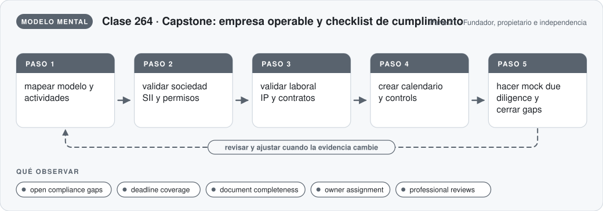

# Clase 264 — Capstone: empresa operable y checklist de cumplimiento

<!-- nav:inicio -->
> **Parte 21 · Founder Track Chile: formalización y operación** — clase 12 de 12 · [índice de la parte](../../README.md) · [temario](../../../../SYLLABUS.md)
<!-- nav:fin -->

**Parte:** 21 — Founder Track Chile: formalización y operación  
**Nivel:** Etapa 6 — Founder en Chile  
**Duración sugerida:** 150–180 minutos · **Estándar:** deep-class-v2

## 🎯 Propósito

Una empresa **operable** no es la que tiene todos los papeles el día en que se constituyó, sino la que puede **funcionar mañana y dentro de un año sin sorpresas**: existe legalmente, está registrada ante el SII, tiene los permisos de su actividad, contrata y paga correctamente a sus trabajadores, protege lo que vale, cobra y paga con control, y tiene un calendario que evita vencimientos olvidados. Esta clase integra la parte 21 en una **checklist de cumplimiento** viva y verificable. Una checklist no es un trámite ni una garantía: es una herramienta para ver qué está hecho, qué falta, qué venció y quién responde. Lo que la distingue de una lista cualquiera es que cada punto lleva **fuente oficial, evidencia, fecha de verificación y responsable**, porque lo que hoy está completo mañana puede estar obsoleto.

El capstone propone construir esa checklist para tu empresa o un caso, medirla con indicadores simples (brechas abiertas, cobertura de plazos, completitud documental), priorizar las brechas por severidad y probabilidad, y someterla a una **simulación de revisión previa** (mock due diligence) como la que haría un banco, un cliente grande o un inversionista. **Este programa no es asesoría legal, tributaria ni contable**: la checklist ordena preguntas y evidencias, y las respuestas las confirman las fuentes oficiales (RES, SII, Dirección del Trabajo, INAPI, LeyChile) y los profesionales. Al terminar sabrás armar una checklist de empresa operable, calcular sus indicadores, decidir qué brechas cerrar primero y presentar un resultado honesto, con límites explícitos.

## 📚 Resultados de aprendizaje

Al finalizar podrás:

1. **Distinguir** una empresa operable de una lista de cumplimiento aprobada una sola vez.
2. **Construir** una checklist con fuente, evidencia, fecha de verificación y responsable por punto.
3. **Medir** brechas abiertas, cobertura de plazos y completitud documental.
4. **Priorizar** brechas por severidad y probabilidad con un criterio explícito.
5. **Presentar** el resultado de una simulación de revisión previa, con límites y plan de cierre.

## 🧭 Agenda

| Tramo | Qué se hace |
|---|---|
| 0–20 min | Recuperación: ¿qué obligaciones de tu empresa podrías probar hoy con un documento? |
| 20–60 min | Modelo de actividades, sociedad y SII, laboral, propiedad intelectual, calendario y revisión previa. |
| 60–105 min | Ejemplo trabajado: indicadores de una checklist de 30 puntos y priorización de brechas. |
| 105–150 min | Caso ejecutivo y práctica. |
| 150–175 min | Límites y entregable. |

## 🧩 Conceptos centrales

| Concepto | Definición | Cómo se reconoce |
|---|---|---|
| **Empresa operable** | Entidad que puede funcionar y cumplir de manera sostenida. | Evidencia vigente y responsables. |
| **Checklist de cumplimiento** | Lista verificable de obligaciones y evidencias. | Fuente, evidencia, fecha y dueño por punto. |
| **Brecha abierta** | Punto sin evidencia o vencido. | Estado «falta» o «vencido». |
| **Cobertura de plazos** | Proporción de obligaciones recurrentes con calendario. | Entradas en el calendario ÷ obligaciones. |
| **Completitud documental** | Proporción de puntos con evidencia vigente. | Puntos con evidencia ÷ puntos totales. |
| **Revisión previa (due diligence)** | Examen que hace un tercero antes de contratar o invertir. | Solicitud de documentos y preguntas. |

## 🧠 Modelo mental

**Cómo leer el diagrama.** Tres columnas. **Existe**: sociedad y registros, inicio de actividades en el SII y permisos de la actividad. **Opera**: contratos laborales y de clientes, propiedad intelectual a nombre de la empresa, y cuentas, cobros y contabilidad. **Se mantiene**: calendario de obligaciones, controles y responsables, y fuente y fecha de verificación. La nota afirma que una checklist completa hoy puede quedar obsoleta mañana y que cada punto registra su fuente, su fecha de verificación y quién la actualiza; el pie, que una simulación de revisión previa detecta brechas antes de que lo haga un tercero.

## 📖 Desarrollo

### 1. Operable no es lo mismo que formalizada

Una empresa puede tener RUT, inicio de actividades y una patente colgada en la pared y aun así no ser operable: contratos sin firmar, un permiso que venció, cotizaciones atrasadas, una marca sin titular claro, sin respaldo de claves, sin calendario. Drucker enseña que la gestión se orienta a resultados y que los controles deben servir a ellos; aquí, el resultado es **poder operar y demostrarlo**. Los principios de gobierno corporativo de la OECD recalcan que el órgano de dirección debe supervisar los riesgos relevantes, incluidos los de cumplimiento; en una pyme, ese «órgano» es el fundador y los socios, y la supervisión se concreta en una checklist revisada con regularidad. La diferencia entre formalizada y operable es **el mantenimiento**.

### 2. Mapear modelo y actividades

La checklist parte de **qué hace la empresa**: actividades, lugares, personas, clientes, proveedores, datos, activos intangibles, medios de cobro. De esa descripción se derivan los **bloques de cumplimiento**: existencia (sociedad, registros, SII, permisos), operación (laboral, contratos, propiedad intelectual, bancos, contabilidad, datos) y mantenimiento (calendario, controles, responsables). Se descartan puntos que no aplican (con una nota explicando por qué) y se agregan los específicos del rubro. Una checklist genérica de internet sirve como punto de partida, pero **la que vale es la derivada de tu actividad**, con los requisitos que las autoridades de tu caso exigen. Cada bloque se vincula con las clases anteriores: 253 a 255 (existencia), 256 a 259 (SII, documentos, contabilidad, bancos), 260 a 262 (laboral, propiedad intelectual, permisos) y 263 (ecosistema público).

### 3. Validar sociedad, SII y permisos

Para cada punto del bloque «Existe» se anota: qué se debe acreditar, la **fuente oficial** donde se verifica (RES, SII, municipalidad, organismo sectorial), la **evidencia** (documento, certificado, captura con fecha), el **estado** (verificado, desactualizado, faltante, no aplica), la **fecha de verificación** y el **responsable**. Se verifica que los datos coincidan entre documentos: razón social, RUT, representante, domicilio, giros, objeto. Una incoherencia entre el RES, el SII y los contratos suele ser lo primero que detecta un banco o un cliente. Se revisan los **permisos**: vigencia, alcance, condiciones y próxima renovación. Cualquier afirmación sobre la norma aplicable se confirma en la fuente oficial vigente y, si hay dudas, con un profesional.

### 4. Validar laboral, propiedad intelectual y contratos

En el bloque «Opera» se revisan: **contratos de trabajo** firmados y entregados, anexos, liquidaciones, cotizaciones al día, registro de jornada según corresponda, obligaciones de seguridad y salud y protocolos de trato digno (la DT, el Código del Trabajo en LeyChile y Previsión Social son las fuentes); **contratos con clientes y proveedores** con cláusulas claras sobre alcance, pago, propiedad intelectual y confidencialidad; **propiedad intelectual** (marca, dominio, software, contenido, acuerdos con creadores) con titularidad de la empresa e INAPI como fuente de la propiedad industrial; **banco, cobros y contabilidad** con accesos controlados, conciliación al día y documentos tributarios en orden. Para cada punto se pregunta: ¿puedo probarlo con un documento hoy, sin buscar durante días?

### 5. Calendario, controles y responsables

El bloque «Se mantiene» es el que evita que la checklist envejezca. Se construye un **calendario de obligaciones** con: obligación, periodicidad, fecha límite según la fuente, responsable, respaldo, evidencia que se guarda y fecha de la última verificación. Se agregan **controles**: revisión mensual de la caja y conciliación, revisión trimestral de permisos y contratos, revisión anual de la checklist completa y de las fuentes (ya que las normas cambian). Cada obligación recurrente debe tener **una persona responsable y una suplente**. Se define cómo se **escalan** los problemas (a quién se avisa y en qué plazo) y qué se hace ante un vencimiento perdido: corregir, documentar y aprender. Una checklist sin dueños y sin fechas de revisión pierde utilidad rápidamente.

### 6. Medir: brechas, cobertura y completitud

Tres indicadores simples resumen el estado. **Brechas abiertas**: número y severidad de los puntos faltantes o vencidos. **Cobertura de plazos**: de las obligaciones recurrentes, cuántas tienen entrada en el calendario con fecha, responsable y alerta. **Completitud documental**: de los puntos aplicables, cuántos tienen evidencia vigente (dentro de una ventana de verificación que se define, por ejemplo, 90 días). Los indicadores **no prueban que la empresa cumpla**: miden el estado de la **documentación y del control**, no la realidad completa ni la causalidad entre ambas. Un 100 % documental puede ocultar errores de fondo; un 70 % puede corresponder a una empresa que cumple pero no documenta. Por eso se combinan con la revisión de un profesional y con una muestra de verificación en las fuentes oficiales.

### 7. Priorizar, simular la revisión previa y presentar

Con las brechas listadas, se prioriza por **severidad** (qué pasa si se materializa: sanción, clausura, pérdida de un contrato, riesgo para personas) y **probabilidad** (qué tan probable es que ocurra o se detecte), por ejemplo en escalas de 1 a 5, y se multiplican. Se cierran primero las de puntaje alto y las que son baratas de resolver. Luego se hace una **simulación de revisión previa**: se pide a una persona ajena que, con la lista de documentos que solicitaría un banco, un cliente grande o un inversionista, intente encontrar la evidencia y registre cuánto tarda y qué falta. El resultado se **presenta con honestidad**: qué está verificado, qué no, qué se supone, cuál es el plan de cierre con fechas y quién responde, y los **límites** de la checklist. Una presentación que oculta brechas pierde credibilidad cuando un tercero las encuentra.

## 📚 Lectura comparada

| Fuente | Qué aporta | Qué no resuelve | Pregunta para contrastar |
|---|---|---|---|
| Registro de Empresas y Sociedades | Existencia y datos de la sociedad. | No cubre la operación diaria. | ¿Coinciden los datos con los demás documentos? |
| SII (Portal Emprendedor y guías) | Obligaciones tributarias y su ciclo. | No evalúa laboral ni permisos. | ¿Está mi estado tributario verificado? |
| Dirección del Trabajo y LeyChile | Obligaciones laborales y su texto vigente. | No revisa tus contratos. | ¿Puedo probar el cumplimiento laboral? |
| INAPI | Propiedad industrial y su registro. | No ordena tus contratos con creadores. | ¿Quién es el titular de mis activos? |
| OECD y Drucker | Supervisión de riesgos y gestión por resultados. | No contienen normativa chilena. | ¿Quién revisa esta checklist y cuándo? |

## 🧮 Ejemplo trabajado

**Situación (hipotética).** Una empresa de servicios de limpieza con 14 trabajadores construye su checklist de 30 puntos aplicables y la somete a una simulación de revisión previa antes de postular a un contrato grande. Todos los números son **supuestos**; los requisitos reales se verifican en las fuentes oficiales.

**Estado de los 30 puntos.**

| Bloque | Puntos | Verificado con evidencia vigente (≤ 90 días) | Evidencia antigua (> 90 días) | Falta |
|---|---|---|---|---|
| Existe | 10 | 8 | 1 | 1 |
| Opera | 12 | 6 | 3 | 3 |
| Se mantiene | 8 | 4 | 2 | 2 |
| **Total** | **30** | **18** | **6** | **6** |

**Completitud documental.**

- Con evidencia vigente: 18 ÷ 30 = **60 %**.
- Con evidencia vigente o antigua (a actualizar): 24 ÷ 30 = **80 %**.
- Brechas abiertas (faltantes): **6**.

**Cobertura de plazos.** La empresa tiene 22 obligaciones recurrentes; 17 están en el calendario con fecha, responsable y alerta: 17 ÷ 22 = **77,3 %**. Faltan 5 en el calendario.

**Brechas y priorización (severidad × probabilidad, escala 1 a 5).**

| Brecha | Severidad | Probabilidad | Puntaje |
|---|---|---|---|
| Dos contratos de trabajo sin firmar | 5 | 4 | **20** |
| Permiso con renovación en 45 días y sin responsable | 4 | 5 | **20** |
| Acuerdo de socios sin firmar | 4 | 3 | **12** |
| Protocolo de trato digno inexistente | 4 | 3 | **12** |
| Marca sin registrar | 3 | 3 | **9** |
| Respaldo de claves bancarias en una sola persona | 3 | 2 | **6** |
| **Total** | | | **79** |

Las dos primeras suman 40 puntos, es decir 40 ÷ 79 = **50,6 %** del puntaje total; con las dos siguientes, 64 ÷ 79 = **81 %**.

**Simulación de revisión previa.** Una persona ajena recibe 14 solicitudes de documentos típicas de un cliente grande. Encuentra 9 en menos de 10 minutos cada una, 3 en un tiempo de 30 a 60 minutos (por estar dispersas), y no encuentra 2. Resultado: **64,3 % (9 de 14) disponible de inmediato**, 21,4 % disponible con esfuerzo y 14,3 % ausente. Tiempo total para reunirlos: 6 horas. El cliente solicita la documentación en un plazo de 48 horas: **riesgo real**.

**Plan de cierre.** Semana 1: firmar los dos contratos y asignar responsable al permiso (con consulta a la autoridad sobre la renovación). Semana 2: firmar el acuerdo de socios con asesoría y adoptar el protocolo con apoyo del organismo correspondiente. Semana 3: registrar la marca y repartir accesos. Semana 4: completar el calendario con las 5 obligaciones faltantes y repetir la simulación. Meta de completitud vigente: 90 % (27 de 30).

**Lectura honesta.** Con 60 % de completitud vigente y 6 brechas, la empresa **no está lista para una revisión externa**; podría estarlo en cuatro semanas si cumple el plan. Los indicadores miden el estado de la documentación y los controles; no prueban que se cumplan las obligaciones de fondo, que deben verificarse con un contador, un abogado laboral y las fuentes oficiales.

**Cuidados.** Las escalas, ventanas de 90 días y metas son criterios internos, no normas. Las obligaciones reales y sus plazos se confirman en las fuentes oficiales vigentes.

**Qué muestra.** (1) Tres indicadores convierten una lista en un estado verificable. (2) La priorización concentra el esfuerzo donde el riesgo es mayor. (3) La simulación revela el tiempo real de respuesta ante un tercero.

## 🔀 Comparación y límites

**Checklist frente a certificación.** La checklist es una herramienta interna de orden y verificación; una certificación o auditoría externa la realiza un tercero con criterios y responsabilidad propios. Una checklist al día facilita ambas, pero no las reemplaza.

**Límites.** Una checklist completa hoy puede quedar obsoleta mañana: cada punto registra fuente, fecha de verificación y responsable de actualización. Los indicadores miden documentación y control, no cumplimiento sustantivo. Este programa no sustituye la asesoría legal, tributaria, laboral ni contable, ni la verificación en las fuentes oficiales vigentes.

## 🪜 De profesional a owner

| Nivel | Cómo se relaciona con el cumplimiento |
|---|---|
| **Profesional** | Cumple los procedimientos y entrega las evidencias que le corresponden. |
| **Jefe / Team Lead** | Mantiene al día los registros y respaldos de su equipo. |
| **Gerente** | Responde por los puntos de su área y por la cobertura de plazos. |
| **CEO / Director** | Supervisa los indicadores, prioriza brechas y exige verificación. |
| **Founder / Owner** | Es responsable final de que la empresa sea operable y pueda probarlo. |

## 🏢 Caso ejecutivo

Un fundador dirige una empresa de desarrollo de software con 9 personas (6 con contrato de trabajo y 3 a honorarios), constituida hace tres años, con clientes en Chile y un contrato a punto de firmarse con un banco, que exige una revisión previa en 10 días. Su situación: el inicio de actividades está al día, pero el giro no incluye una actividad nueva; la marca no está registrada; el código de dos productos fue escrito por un freelance sin cesión; el dominio está a nombre de un socio que renunció; las cotizaciones de un mes tienen atraso; no hay protocolo de trato digno ni registro de actividades de tratamiento de datos personales; el calendario es una planilla de un contador con tres fechas; las claves del banco las tiene solo la asistente; el pacto de socios es verbal. Estima que tiene evidencia vigente de 14 de 32 puntos aplicables.

Entrega un **memo de decisión del fundador y checklist de cumplimiento** que contenga: (a) la checklist por bloques con fuente, evidencia, estado, fecha y responsable; (b) los tres indicadores (completitud, brechas, cobertura de plazos) con cálculos a partir de datos supuestos coherentes con el caso; (c) la priorización de brechas por severidad y probabilidad; (d) el plan de cierre de diez días con responsables; (e) el diseño de una simulación de revisión previa y qué documentos pedirá el banco; (f) los límites de la presentación y las verificaciones con profesionales y fuentes oficiales.

## 🧪 Práctica

1. Construye tu checklist de empresa operable con fuente, evidencia, fecha y responsable por punto.
2. Calcula completitud documental, brechas abiertas y cobertura de plazos.
3. Prioriza tus brechas con severidad y probabilidad y define un plan de cuatro semanas.
4. Haz que una persona ajena intente encontrar diez documentos y mide el tiempo.
5. Escribe los límites de tu checklist y quién la actualizará y cuándo.

## ⚠️ Errores frecuentes

| Error | Por qué ocurre | Cómo corregirlo |
|---|---|---|
| Checklist genérica | Se copia de internet | Derivarla de tu actividad y requisitos. |
| Punto sin fuente ni fecha | Se anota «ok» | Registrar fuente, evidencia y fecha. |
| Checklist sin dueños | Se supone que «alguien» la mira | Responsable y suplente por obligación. |
| Medir solo documentos | Se confunde papel con cumplimiento | Complementar con revisión profesional. |
| Ocultar brechas | Se busca aprobación | Presentar lo faltante con plan y fechas. |
| No actualizar | Se ve como un proyecto cerrado | Revisión mensual, trimestral y anual. |

## ❓ Preguntas de comprobación

1. ¿Qué distingue una empresa operable de una formalizada?
2. ¿Qué debe tener cada punto de la checklist?
3. ¿Cómo se calculan la completitud documental y la cobertura de plazos?
4. ¿Cómo se prioriza una brecha?
5. ¿Para qué sirve una simulación de revisión previa?
6. ¿Qué no prueban los indicadores?
7. ¿Qué límite tiene esta clase?

Claves de respuesta

1. La operable puede funcionar y probar su cumplimiento de forma sostenida, con mantenimiento y responsables.
2. Fuente oficial, evidencia, estado, fecha de verificación y responsable.
3. Puntos con evidencia vigente ÷ puntos aplicables; obligaciones con calendario ÷ obligaciones recurrentes.
4. Por severidad por probabilidad, y por costo y facilidad de resolverla.
5. Para detectar brechas y tiempos de respuesta antes de que lo haga un tercero.
6. No prueban cumplimiento sustantivo ni causalidad; miden documentación y control.
7. No es asesoría legal, tributaria ni contable; cada punto se confirma en fuentes oficiales vigentes y con profesionales.

## 📥 Entregable

Guarda en `portfolio/264-capstone-empresa-operable-y-checklist-de-cumplimiento/`:

- `founder-owner-decision-brief.md` (plantilla [Founder owner decision brief](../../../../templates/founder-owner-decision-brief.md)) con el memo del caso ejecutivo;
- `risk-governance-brief.md` (plantilla [Risk governance brief](../../../../templates/risk-governance-brief.md)) con la checklist, los indicadores y la priorización de brechas;
- `decision-journal.md` con el plan de cierre, la simulación de revisión previa y las verificaciones con profesionales.

## 📗 Fuentes y verificación

- Registro de Empresas y Sociedades (Chile) — *Portal y documentación oficial*. **Uso en esta clase:** existencia y datos oficiales de la sociedad. **Fuente primaria:** <https://www.registrodeempresasysociedades.cl/>.
- Servicio de Impuestos Internos (Chile) — *Portal Emprendedor*. **Uso en esta clase:** obligaciones tributarias del emprendedor y su ciclo. **Fuente primaria:** <https://www.sii.cl/portales/emprendedor/>.
- Dirección del Trabajo (Chile) — *Normativa y orientación oficial*. **Uso en esta clase:** normativa y orientación oficial laboral. **Fuente primaria:** <https://www.dt.gob.cl/>.
- Biblioteca del Congreso Nacional de Chile — *LeyChile: Código del Trabajo y legislación laboral vigente*. **Uso en esta clase:** texto vigente del Código del Trabajo y legislación laboral. **Fuente primaria:** <https://www.bcn.cl/leychile/>.
- INAPI (Chile) — *Propiedad industrial y orientación oficial*. **Uso en esta clase:** propiedad industrial y su registro. **Fuente primaria:** <https://www.inapi.cl/>.
- OECD — *G20/OECD Principles of Corporate Governance 2023*. **Uso en esta clase:** supervisión de riesgos de cumplimiento. **Fuente primaria:** <https://www.oecd.org/en/publications/2023/09/g20-oecd-principles-of-corporate-governance-2023_60836fcb.html>.
- Peter F. Drucker — *Management: Tasks, Responsibilities, Practices* (Harper & Row, 1974). **Uso en esta clase:** gestión por resultados y control. Lectura selectiva sobre **capstone: empresa operable y checklist de cumplimiento**. **Localizador:** [ISBN-13 9780060110925](https://openlibrary.org/isbn/9780060110925).

> **Regla de fuentes para Capstone: empresa operable y checklist de cumplimiento:** las obras y portales anteriores estructuran las perspectivas de esta materia; cualquier norma, ley, trámite, tasa o plazo mencionado debe comprobarse nuevamente en su fuente primaria oficial vigente, y este programa no reemplaza asesoría legal, tributaria ni contable. Los ejemplos y casos son hipotéticos, con cifras ilustrativas. El desarrollo es original y no reproduce material protegido.

<!-- pie:inicio -->
---

| Anterior | Índice | Siguiente |
|---|---|---|
| [← 263 · ChileCompra, Sercotec, Corfo y ecosistema público](../263-chilecompra-sercotec-corfo-y-ecosistema-publico/README.md) | [Parte 21](../../README.md) · [Programa](../../../../SYLLABUS.md) | [265 · De fundador-operador a propietario →](../../../22-scaling-business-ownership/classes/265-de-fundador-operador-a-propietario/README.md) |
<!-- pie:fin -->
