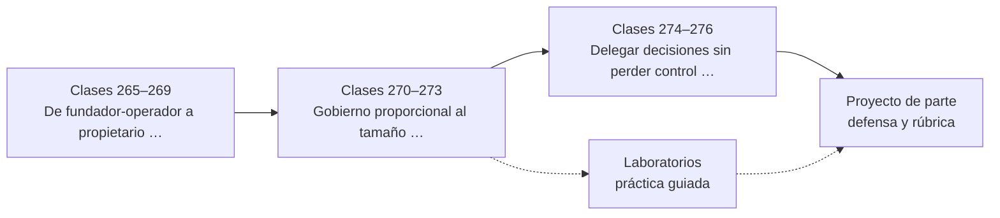

# Parte 22 — Escalamiento, propiedad y portafolio empresarial

<!-- parte:inicio -->

> ← [Parte 21 — Founder Track Chile: formalización y operación](../21-chile-founder-track/README.md) · [Temario](../../SYLLABUS.md) · [Parte 23 — Independencia profesional y Business Owner Capstone](../23-independence-capstone/README.md) →

*Pasar de operar el negocio a ser dueño de un sistema*

**Etapa:** 6 — Fundador, propietario e independencia  
**Duración:** 12 clases · 30 horas  
**Resultado de salida:** Pasar de autoempleo/fundador-operador a sistemas, líderes y activos que pueden funcionar con menor dependencia personal.

⚫ [Ver las 6 etapas](../../SYLLABUS.md) · 12 clases (265–276) · 4 laboratorios · [proyecto de parte](project.md)

## 🎯 De qué trata esta parte

El fundador que lo hace todo crea un empleo, no una empresa. Esta parte enseña a construir sistemas, equipos de liderazgo y controles que permiten crecer sin que el negocio dependa de una persona.

El eje es **menor dependencia con más control**: delegar decisiones sin perder visibilidad, escalar ventas sin destruir margen y gobernar en proporción al tamaño.

## 🧱 Con qué hay que llegar

| Parte | Qué aporta |
|---|---|
| [21 — Founder Track Chile: formalización y operación](../21-chile-founder-track/README.md) | Empresa formalizada y operable. |
| [14 — Diseño organizacional, cultura y cambio](../14-organization-design-culture-change/README.md) | Diseño organizacional. |
| [17 — Directorios y gobierno corporativo](../17-boards-corporate-governance/README.md) | Gobierno. |

Cada clase supone la anterior: el orden importa, y saltarse una deja sin base a las que vienen después.

## 📚 Resultados de la parte

Al terminar esta parte podrás:

1. **Transitar** de fundador-operador a propietario.
2. **Construir** sistemas antes que heroicidad.
3. **Contratar** líderes y delegar decisiones con control.
4. **Escalar** ventas cuidando el margen.
5. **Gobernar** un portafolio o una estructura de propiedad.

## 🗺️ Mapa de la parte

## 🧭 Cómo se encadenan las 12 clases

Las clases **265 a 269** cambian el rol: de operador a propietario, sistemas, líderes, ventas y controles.

Las clases **270 a 273** amplían la estructura: gobierno proporcional, multiunidad, holdings y adquisiciones.

Las clases **274 a 276** cierran el traspaso: delegación, tablero del dueño y el capstone de una empresa menos dependiente del fundador.

## 📘 Las 12 clases

| # | Clase | Qué se trabaja | Entregable | Min |
|---:|---|---|---|---:|
| 265 | [De fundador-operador a propietario](classes/265-de-fundador-operador-a-propietario/README.md) | founder dependency, owner role, operator role | [founder-owner-decision-brief](../../templates/founder-owner-decision-brief.md) | 150 |
| 266 | [Sistemas antes que heroicidad](classes/266-sistemas-antes-que-heroicidad/README.md) | business system, standard work, SOP | [modelo-financiero-y-memo-de-decision](../../templates/modelo-financiero-y-memo-de-decision.md) | 150 |
| 267 | [Contratar líderes](classes/267-contratar-lideres/README.md) | leadership mandate, executive scorecard, decision authority | [founder-owner-decision-brief](../../templates/founder-owner-decision-brief.md) | 150 |
| 268 | [Escalar ventas sin destruir margen](classes/268-escalar-ventas-sin-destruir-margen/README.md) | sales scale, contribution margin, cost-to-serve | [modelo-financiero-y-memo-de-decision](../../templates/modelo-financiero-y-memo-de-decision.md) | 150 |
| 269 | [Controles financieros para crecer](classes/269-controles-financieros-para-crecer/README.md) | financial control, cash forecast, approval matrix | [modelo-financiero-y-memo-de-decision](../../templates/modelo-financiero-y-memo-de-decision.md) | 150 |
| 270 | [Gobierno proporcional al tamaño](classes/270-gobierno-proporcional-al-tamano/README.md) | governance maturity, advisory board, reserved matters | [board-or-executive-memo](../../templates/board-or-executive-memo.md) | 150 |
| 271 | [Multiunidad y portafolio](classes/271-multiunidad-y-portafolio/README.md) | business unit, portfolio, shared service | [strategy-memo](../../templates/strategy-memo.md) | 150 |
| 272 | [Holdings y estructuras de propiedad: conceptos](classes/272-holdings-y-estructuras-de-propiedad-conceptos/README.md) | holding company, subsidiary, ring-fencing | [founder-owner-decision-brief](../../templates/founder-owner-decision-brief.md) | 150 |
| 273 | [Adquisiciones como vía de crecimiento](classes/273-adquisiciones-como-via-de-crecimiento/README.md) | acquisition entrepreneurship, search criteria, seller dependency | [strategy-memo](../../templates/strategy-memo.md) | 150 |
| 274 | [Delegar decisiones sin perder control](classes/274-delegar-decisiones-sin-perder-control/README.md) | delegation, guardrail, management by exception | [founder-owner-decision-brief](../../templates/founder-owner-decision-brief.md) | 150 |
| 275 | [Owner dashboard](classes/275-owner-dashboard/README.md) | owner dashboard, cash conversion, owner dependency metric | [board-or-executive-memo](../../templates/board-or-executive-memo.md) | 150 |
| 276 | [Capstone: empresa menos dependiente del fundador](classes/276-capstone-empresa-menos-dependiente-del-fundador/README.md) | founder independence, operating autonomy, continuity test | [founder-owner-decision-brief](../../templates/founder-owner-decision-brief.md) | 150 |

## ⚠️ Riesgos característicos

- Contratar un líder y seguir decidiendo por él.
- Crecer en ventas deteriorando el margen.
- Gobernar de forma informal cuando ya hay terceros afectados.
- Estructurar la propiedad sin entender sus consecuencias.

## 🔤 Glosario de la parte

60 conceptos definidos en las clases, con la definición operacional que usa cada una.

| Concepto | Definición operacional |
|---|---|
| **acquisition entrepreneurship** | crecimiento mediante compra de negocio existente. |
| **advisory board** | grupo sin las mismas facultades legales de un directorio formal que aporta consejo. |
| **approval matrix** | límites de gasto y autoridad por rol. |
| **beneficial ownership** | persona que en última instancia posee o controla según definiciones aplicables. |
| **board cadence** | frecuencia y agenda regular de governance. |
| **business system** | conjunto repetible de personas procesos tecnología y controles. |
| **business unit** | unidad con mercado resultados y accountability distinguibles. |
| **capital allocation** | movimiento de recursos entre unidades según retorno y estrategia. |
| **cash conversion** | capacidad de convertir ganancias o ventas en caja. |
| **cash forecast** | proyección de entradas y salidas para anticipar liquidez. |
| **context** | información de propósito constraints y economics necesaria para decidir. |
| **continuity test** | ejercicio de ausencia planificada del owner. |
| **contribution margin** | ingreso menos costos variables atribuibles. |
| **cost-to-serve** | costo de entregar y soportar un segmento. |
| **customization debt** | costo futuro creado por excepciones específicas de clientes. |
| **decision authority** | decisiones que el líder puede tomar sin owner. |
| **delegation** | transferencia de responsabilidad y autoridad para decidir o ejecutar. |
| **discount leakage** | erosión de precio por descuentos no controlados. |
| **earn-out** | precio contingente ligado a desempeño futuro. |
| **escalation trigger** | condición que obliga a elevar una decisión. |
| **exception indicator** | señal que requiere intervención fuera de cadencia. |
| **exception path** | ruta definida para casos fuera del estándar. |
| **exception protocol** | reglas para contactar al owner solo ante eventos definidos. |
| **executive onboarding** | transición estructurada para comprender negocio y construir relaciones. |
| **executive scorecard** | outcomes capabilities y behaviors usados para evaluar. |
| **financial control** | política y evidencia que protege activos y confiabilidad. |
| **founder dependency** | grado en que operación o decisiones requieren al fundador. |
| **founder independence** | grado en que negocio opera sin intervención cotidiana del founder. |
| **governance maturity** | grado de formalización adecuado a ownership y complejidad. |
| **governance threshold** | evento de escala o riesgo que justifica mayor formalización. |
| **guardrail** | límite que define espacio seguro de autonomía. |
| **holding company** | entidad que posee participaciones en otras entidades. |
| **institutional memory** | conocimiento preservado en sistemas personas y documentación. |
| **institutionalization** | conversión de conocimiento y decisiones en sistemas reproducibles. |
| **intercompany transaction** | operación entre entidades relacionadas. |
| **key-person risk** | exposición por dependencia de una persona. |
| **leadership leverage** | impacto del líder a través de otros. |
| **leadership mandate** | resultado y alcance que se espera de un líder. |
| **management accounts** | reporting periódico para decisión interna. |
| **management by exception** | intervención superior solo cuando se exceden tolerancias. |
| **operating autonomy** | capacidad de equipos y líderes para decidir dentro de límites. |
| **operator role** | responsabilidad por ejecutar el negocio cotidiano. |
| **owner dashboard** | tablero de señales para supervisar valor y riesgo desde rol de propietario. |
| **owner dependency metric** | medida de decisiones o ingresos que requieren al owner. |
| **owner role** | responsabilidad de propiedad sobre capital gobierno y liderazgo superior. |
| **portfolio** | conjunto de negocios gestionados bajo una propiedad. |
| **portfolio parenting** | valor que la matriz puede agregar a unidades. |
| **portfolio return** | retorno de negocios o inversiones bajo propiedad. |
| **process owner** | rol accountable por desempeño end-to-end. |
| **reserved matters** | decisiones que propietarios o board retienen. |
| **ring-fencing** | separación de riesgos o activos entre entidades. |
| **sales scale** | crecimiento repetible de adquisición y cierre. |
| **search criteria** | filtros de industria tamaño economics y riesgo. |
| **seller dependency** | dependencia del propietario saliente. |
| **shared service** | función central que sirve a varias unidades. |
| **SOP** | procedimiento operativo estándar para tareas recurrentes. |
| **standard work** | mejor método actual documentado y mejorable. |
| **subsidiary** | entidad controlada por otra. |
| **transition services** | apoyo temporal del vendedor para transición. |
| **working capital** | capital comprometido en operación corriente. |

## 📦 Qué queda como evidencia

- Un mapa de dependencias del fundador.
- Un tablero del dueño.
- Un plan de delegación con control.
- El capstone: empresa menos dependiente.

## 🔗 Cómo se conecta

Prepara la parte 23, donde se integra todo en un plan de independencia y en el capstone final.

## 🧪 Cómo se trabaja

Son **12 clases de 150 minutos** —30 horas— con **4 laboratorios** y un proyecto integrador. Cada clase trae su propósito, sus conceptos, un caso, práctica, errores frecuentes, preguntas de comprobación, entregable y fuentes, y se evalúa con su `assessment.md`. Los laboratorios se resuelven con datos propios o sintéticos, nunca con datos reales de terceros, y la parte se cierra con el proyecto y su defensa. Las reglas de recorrido están en [la guía de navegación](../../docs/NAVIGATION.md).

<!-- parte:fin -->

## Laboratorios

- [Lab 01 — Founder dependency audit](labs/lab-01.md)
- [Lab 02 — Owner dashboard](labs/lab-02.md)
- [Lab 03 — Management layer design](labs/lab-03.md)
- [Lab 04 — Acquisition screen](labs/lab-04.md)

## Proyecto de parte

Diseñar la transición de una empresa founder-dependent a un negocio dirigido por sistemas y líderes.

## Bibliografía rectora

- Ben Horowitz — *The Hard Thing About Hard Things* (CEO / Founder)
- Michael E. Gerber — *The E-Myth Revisited* (Sistemas de negocio)
- Verne Harnish — *Scaling Up* (Escalamiento)
- Robert I. Sutton & Huggy Rao — *Scaling Up Excellence* (Escalamiento)
- Noam Wasserman — *The Founder's Dilemmas* (Founders)

## Criterio de aprobación

80/100 y entrega del proyecto integrador.
