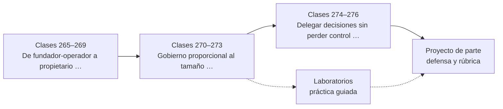

# Parte 22 — Escalamiento, propiedad y portafolio empresarial

<!-- parte:inicio -->

> ← [Parte 21 — Founder Track Chile: formalización y operación](../21-chile-founder-track/README.md) · [Temario](../../SYLLABUS.md) · [Parte 23 — Independencia profesional y Business Owner Capstone](../23-independence-capstone/README.md) →

*Pasar de operar el negocio a ser dueño de un sistema*

**Etapa:** 6 — Fundador, propietario e independencia  
**Duración:** 12 clases · 30 horas  
**Resultado de salida:** Pasar de autoempleo/fundador-operador a sistemas, líderes y activos que pueden funcionar con menor dependencia personal.

⚫ [Ver las 6 etapas](../../SYLLABUS.md) · 12 clases (265–276) · 4 laboratorios · [proyecto de parte](project.md)

## 🎯 De qué trata esta parte

El fundador que lo hace todo crea un empleo, no una empresa. Esta parte enseña a construir sistemas, equipos de liderazgo y controles que permiten crecer sin que el negocio dependa de una persona.

El eje es **menor dependencia con más control**: delegar decisiones sin perder visibilidad, escalar ventas sin destruir margen y gobernar en proporción al tamaño.

## 🧱 Con qué hay que llegar

| Parte | Qué aporta |
|---|---|
| [21 — Founder Track Chile: formalización y operación](../21-chile-founder-track/README.md) | Empresa formalizada y operable. |
| [14 — Diseño organizacional, cultura y cambio](../14-organization-design-culture-change/README.md) | Diseño organizacional. |
| [17 — Directorios y gobierno corporativo](../17-boards-corporate-governance/README.md) | Gobierno. |

Cada clase supone la anterior: el orden importa, y saltarse una deja sin base a las que vienen después.

## 📚 Resultados de la parte

Al terminar esta parte podrás:

1. **Transitar** de fundador-operador a propietario.
2. **Construir** sistemas antes que heroicidad.
3. **Contratar** líderes y delegar decisiones con control.
4. **Escalar** ventas cuidando el margen.
5. **Gobernar** un portafolio o una estructura de propiedad.

## 🗺️ Mapa de la parte

## 🧭 Cómo se encadenan las 12 clases

Las clases **265 a 269** cambian el rol: de operador a propietario, sistemas, líderes, ventas y controles.

Las clases **270 a 273** amplían la estructura: gobierno proporcional, multiunidad, holdings y adquisiciones.

Las clases **274 a 276** cierran el traspaso: delegación, tablero del dueño y el capstone de una empresa menos dependiente del fundador.

## 📘 Las 12 clases

| # | Clase | Qué se trabaja | Entregable | Min |
|---:|---|---|---|---:|
| 265 | [De fundador-operador a propietario](classes/265-de-fundador-operador-a-propietario/README.md) | Propietario, Director o CEO, Operador | [founder-owner-decision-brief](../../templates/founder-owner-decision-brief.md) | 150 |
| 266 | [Sistemas antes que heroicidad](classes/266-sistemas-antes-que-heroicidad/README.md) | Sistema, Proceso crítico, Estándar | [modelo-financiero-y-memo-de-decision](../../templates/modelo-financiero-y-memo-de-decision.md) | 150 |
| 267 | [Contratar líderes](classes/267-contratar-lideres/README.md) | Scorecard, Derechos de decisión, Evidencia de escala | [founder-owner-decision-brief](../../templates/founder-owner-decision-brief.md) | 150 |
| 268 | [Escalar ventas sin destruir margen](classes/268-escalar-ventas-sin-destruir-margen/README.md) | Margen de contribución, Tasa de descuento, Período de recuperación del CAC | [modelo-financiero-y-memo-de-decision](../../templates/modelo-financiero-y-memo-de-decision.md) | 150 |
| 269 | [Controles financieros para crecer](classes/269-controles-financieros-para-crecer/README.md) | Capital de trabajo, Pronóstico de caja a 13 semanas, Error de pronóstico | [modelo-financiero-y-memo-de-decision](../../templates/modelo-financiero-y-memo-de-decision.md) | 150 |
| 270 | [Gobierno proporcional al tamaño](classes/270-gobierno-proporcional-al-tamano/README.md) | Gobierno, Materias reservadas, Cadencia | [board-or-executive-memo](../../templates/board-or-executive-memo.md) | 150 |
| 271 | [Multiunidad y portafolio](classes/271-multiunidad-y-portafolio/README.md) | Unidad económica, Capacidad compartida, Retorno sobre el capital invertido | [strategy-memo](../../templates/strategy-memo.md) | 150 |
| 272 | [Holdings y estructuras de propiedad: conceptos](classes/272-holdings-y-estructuras-de-propiedad-conceptos/README.md) | Holding, Sociedad operativa, Sociedad patrimonial | [founder-owner-decision-brief](../../templates/founder-owner-decision-brief.md) | 150 |
| 273 | [Adquisiciones como vía de crecimiento](classes/273-adquisiciones-como-via-de-crecimiento/README.md) | Tesis de adquisición, EBITDA normalizado, Concentración de clientes | [strategy-memo](../../templates/strategy-memo.md) | 150 |
| 274 | [Delegar decisiones sin perder control](classes/274-delegar-decisiones-sin-perder-control/README.md) | Nivel de delegación, Guardrail, Gatillo de excepción | [founder-owner-decision-brief](../../templates/founder-owner-decision-brief.md) | 150 |
| 275 | [Owner dashboard](classes/275-owner-dashboard/README.md) | Tablero del propietario, Flujo de caja libre, Retorno sobre el capital invertido | [board-or-executive-memo](../../templates/board-or-executive-memo.md) | 150 |
| 276 | [Capstone: empresa menos dependiente del fundador](classes/276-capstone-empresa-menos-dependiente-del-fundador/README.md) | Simulación de ausencia, Contacto evitable, Continuidad del servicio | [founder-owner-decision-brief](../../templates/founder-owner-decision-brief.md) | 150 |

## ⚠️ Riesgos característicos

- Contratar un líder y seguir decidiendo por él.
- Crecer en ventas deteriorando el margen.
- Gobernar de forma informal cuando ya hay terceros afectados.
- Estructurar la propiedad sin entender sus consecuencias.

## 🔤 Glosario de la parte

69 conceptos definidos en las clases, con la definición operacional que usa cada una.

| Concepto | Definición operacional |
|---|---|
| **Asesor o director independiente** | Persona sin vínculos que sesguen su juicio. |
| **Asignación de capital** | Decisión de dónde invertir, mantener o retirar recursos. |
| **Cadencia** | Calendario de reuniones, informes y revisiones. |
| **Capacidad** | Volumen que la empresa puede atender con calidad. |
| **Capacidad compartida** | Servicio o recurso usado por varias unidades. |
| **Capital de trabajo** | Recursos necesarios para operar entre pagos y cobros. |
| **Ciclo de conversión de caja** | Días entre pagar insumos y cobrar ventas. |
| **Comité** | Grupo con mandato específico (por ejemplo, auditoría). |
| **Concentración de clientes** | Peso de pocos clientes en las ventas. |
| **Concentración de propiedad** | Grado en que pocos propietarios controlan la empresa. |
| **Contacto evitable** | Consulta al fundador que una regla o límite ya cubría. |
| **Continuidad del servicio** | Mantención de la calidad y los plazos hacia el cliente. |
| **Dependencia del fundador** | Parte del negocio que no funciona sin él. |
| **Derechos de decisión** | Qué decide solo el líder y qué se acuerda. |
| **Director o CEO** | Quien define la estrategia y conduce a los líderes. |
| **DSO** | Días promedio que tardan en cobrarse las ventas. |
| **Dueño de proceso** | Responsable de que funcione y mejore. |
| **EBITDA normalizado** | Resultado operativo ajustado por partidas no recurrentes y no de mercado. |
| **Entrega a medida** | Trabajo adaptado a un cliente. |
| **Error de pronóstico** | Diferencia entre lo proyectado y lo real. |
| **Estándar** | Manera esperada de ejecutar un proceso. |
| **Evidencia de escala** | Pruebas de que hizo algo parecido en un contexto parecido. |
| **Excepción** | Caso que no calza con el estándar. |
| **Falla** | Evento en que la empresa necesitó al fundador o falló sin él. |
| **Flujo de caja libre** | Caja que queda tras operar e invertir. |
| **Gatillo de excepción** | Condición que obliga a escalar. |
| **Gobierno** | Sistema que define quién decide, quién rinde cuentas y cómo se resuelven desacuerdos. |
| **Guardrail** | Límite dentro del cual se puede decidir. |
| **Holding** | Sociedad que posee participaciones en otras sociedades. |
| **Integración de 100 días** | Plan de los primeros cien días tras la compra. |
| **Latencia de decisión** | Tiempo entre la necesidad y la decisión. |
| **Margen de contribución** | Ingreso menos costos variables. |
| **Materias reservadas** | Decisiones que requieren aprobación de los propietarios o del directorio. |
| **Matriz de aprobación** | Reglas de quién autoriza qué y hasta cuánto. |
| **Movimiento comercial** | Manera repetible de atraer, vender y entregar. |
| **Nivel de delegación** | Grado de autoridad que se transfiere para una decisión. |
| **Operador** | Quien ejecuta el trabajo diario. |
| **Pago contingente** | Parte del precio que depende de resultados futuros. |
| **Persona clave** | Persona cuya salida afectaría gravemente la operación. |
| **Período de recuperación del CAC** | Meses para recuperar el costo de adquirir un cliente. |
| **Plan de 90 días** | Aprendizaje y decisiones acordadas para el inicio. |
| **Proceso crítico** | Proceso que afecta al cliente, la caja o el riesgo. |
| **Pronóstico de caja a 13 semanas** | Proyección semanal de cobros y pagos para un trimestre. |
| **Propietario** | Quien aporta capital, asume el riesgo y gobierna. |
| **Referencia propia** | Conversación con alguien que trabajó con el candidato, elegida por el contratante. |
| **Remediación** | Acción para eliminar la causa de una falla. |
| **Retención de ejecutivos** | Permanencia de líderes en el cargo. |
| **Retorno sobre el capital invertido** | Resultado operativo dividido por el capital empleado. |
| **Retraso de decisiones** | Decisiones pendientes que esperan al fundador. |
| **Revisión de calidad** | Muestreo de decisiones para verificar su criterio. |
| **Scorecard** | Resultados y competencias esperadas, con ponderación. |
| **Segregación de riesgo** | Separar activos y obligaciones para limitar el alcance de una contingencia. |
| **Servicio de la deuda** | Pago periódico de capital e intereses. |
| **Simulación de ausencia** | Prueba en la que el fundador se aparta bajo reglas acordadas. |
| **Sistema** | Forma acordada, escrita y medida de hacer algo importante. |
| **Sociedad operativa** | Entidad que realiza la actividad con clientes y trabajadores. |
| **Sociedad patrimonial** | Entidad que posee activos como inmuebles o propiedad intelectual. |
| **Sustancia** | Realidad económica y de gestión detrás de cada entidad. |
| **Tablero del propietario** | Conjunto breve de indicadores para supervisar la empresa. |
| **Tasa de descuento** | Reducción promedio sobre el precio de lista. |
| **Tasa de escalamiento** | Proporción de decisiones que suben al dueño. |
| **Tesis de adquisición** | Razón estratégica y económica de la compra. |
| **Tiempo de ciclo** | Tiempo desde el inicio hasta el final de un proceso. |
| **Transacción intragrupo** | Operación entre entidades del mismo grupo. |
| **Transferencia gradual** | Traspaso de tareas con contexto y revisión. |
| **Umbral** | Valor que separa lo normal de lo que requiere acción. |
| **Unidad económica** | Negocio con clientes, costos y decisiones propios. |
| **Valor económico agregado** | Resultado operativo menos el costo del capital empleado. |
| **Ventaja de la matriz** | Valor que la casa matriz agrega al negocio frente a otro dueño. |

## 📦 Qué queda como evidencia

- Un mapa de dependencias del fundador.
- Un tablero del dueño.
- Un plan de delegación con control.
- El capstone: empresa menos dependiente.

## 🔗 Cómo se conecta

Prepara la parte 23, donde se integra todo en un plan de independencia y en el capstone final.

## 🧪 Cómo se trabaja

Son **12 clases de 150 minutos** —30 horas— con **4 laboratorios** y un proyecto integrador. Cada clase trae su propósito, sus conceptos, un caso, práctica, errores frecuentes, preguntas de comprobación, entregable y fuentes, y se evalúa con su `assessment.md`. Los laboratorios se resuelven con datos propios o sintéticos, nunca con datos reales de terceros, y la parte se cierra con el proyecto y su defensa. Las reglas de recorrido están en [la guía de navegación](../../docs/NAVIGATION.md).

<!-- parte:fin -->

## Laboratorios

- [Lab 01 — Founder dependency audit](labs/lab-01.md)
- [Lab 02 — Owner dashboard](labs/lab-02.md)
- [Lab 03 — Management layer design](labs/lab-03.md)
- [Lab 04 — Acquisition screen](labs/lab-04.md)

## Proyecto de parte

Diseñar la transición de una empresa founder-dependent a un negocio dirigido por sistemas y líderes.

## Bibliografía rectora

- Ben Horowitz — *The Hard Thing About Hard Things* (CEO / Founder)
- Michael E. Gerber — *The E-Myth Revisited* (Sistemas de negocio)
- Verne Harnish — *Scaling Up* (Escalamiento)
- Robert I. Sutton & Huggy Rao — *Scaling Up Excellence* (Escalamiento)
- Noam Wasserman — *The Founder's Dilemmas* (Founders)

## Criterio de aprobación

80/100 y entrega del proyecto integrador.
