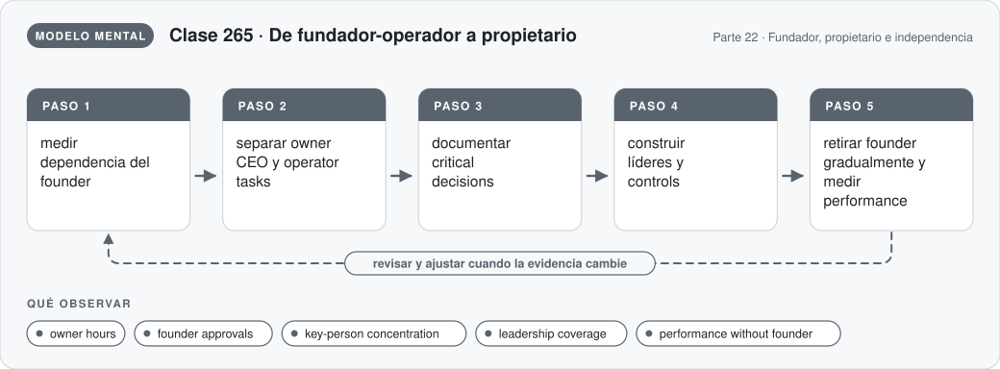

# Clase 265 — De fundador-operador a propietario

<!-- nav:inicio -->
> **Parte 22 · Escalamiento, propiedad y portafolio empresarial** — clase 1 de 12 · [índice de la parte](../../README.md) · [temario](../../../../SYLLABUS.md)
<!-- nav:fin -->

**Parte:** 22 — Escalamiento, propiedad y portafolio empresarial  
**Nivel:** Etapa 6 — Business Owner  
**Duración sugerida:** 150–180 minutos · **Estándar:** deep-class-v2

## 🎯 Propósito

La mayoría de las empresas pequeñas nacen con un fundador que **hace todo**: vende, atiende, resuelve, aprueba, cobra y apaga incendios. Al principio es una virtud, porque nadie conoce mejor el negocio. Con el tiempo se vuelve un techo: la empresa no puede crecer más que las horas, la memoria y la energía de una persona; cada ausencia paraliza algo; cada decisión pasa por el mismo cuello de botella; y el valor de la empresa se confunde con el valor del fundador. Gerber describió esta trampa como la del técnico que abre un negocio y termina trabajando **en** él en vez de **sobre** él. La salida no es «trabajar menos» sino **separar tres roles** que se mezclan en una sola persona: el **propietario** (capital, riesgo y gobierno), el **director o CEO** (estrategia, líderes y resultados) y el **operador** (ejecución diaria).

La clase presenta un método para medir la dependencia del fundador, separar tareas de cada rol, documentar las decisiones críticas, construir líderes y controles, y retirar al fundador de forma gradual verificando el desempeño. Se apoya en Gerber, Harnish (sistemas de gestión para crecer), Drucker (gestión por resultados), Koller y coautores (el valor de una empresa depende de flujos futuros que no deberían depender de una sola persona), Hoffman y Yeh, y Sutton y Rao sobre escalar prácticas sin perder lo que funciona. Al terminar sabrás calcular horas, aprobaciones y concentración de dependencia, decidir qué tareas transferir primero, estimar el costo y el retorno de liberar tiempo del fundador y diseñar una transición con criterios de revisión.

## 📚 Resultados de aprendizaje

Al finalizar podrás:

1. **Distinguir** las tareas de propietario, de director y de operador.
2. **Medir** la dependencia del fundador con horas, aprobaciones y concentración de personas clave.
3. **Priorizar** qué tareas transferir según valor del tiempo y riesgo.
4. **Estimar** el costo y el retorno de liberar tiempo del fundador con supuestos explícitos.
5. **Diseñar** una transición gradual con criterios para avanzar, pausar o revertir.

## 🧭 Agenda

| Tramo | Qué se hace |
|---|---|
| 0–20 min | Recuperación: ¿qué pasaría con tu empresa si no pudieras trabajar un mes? |
| 20–60 min | Tres roles, medición, tareas críticas, líderes y controles, retiro gradual. |
| 60–105 min | Ejemplo trabajado: auditoría de tiempo, aprobaciones y retorno de contratar un gerente de operaciones. |
| 105–150 min | Caso ejecutivo y práctica. |
| 150–175 min | Límites y entregable. |

## 🧩 Conceptos centrales

| Concepto | Definición | Cómo se reconoce |
|---|---|---|
| **Propietario** | Quien aporta capital, asume el riesgo y gobierna. | Decisiones reservadas y rendición de cuentas. |
| **Director o CEO** | Quien define la estrategia y conduce a los líderes. | Resultados y prioridades. |
| **Operador** | Quien ejecuta el trabajo diario. | Tareas repetibles. |
| **Dependencia del fundador** | Parte del negocio que no funciona sin él. | Horas, aprobaciones y clientes ligados. |
| **Persona clave** | Persona cuya salida afectaría gravemente la operación. | Concentración de conocimiento o relaciones. |
| **Transferencia gradual** | Traspaso de tareas con contexto y revisión. | Plan por etapas con criterios. |

## 🧠 Modelo mental

**Cómo leer el diagrama.** Tres columnas. **Propietario**: capital, riesgo y reglas de reparto, quién gobierna y a quién rinde cuentas, y las decisiones que solo él puede tomar. **Director o CEO**: estrategia y prioridades, líderes y sistemas de gestión, y resultados y asignación de recursos. **Operador**: ventas, entrega y atención diarias, aprobaciones y urgencias, y tareas que otros podrían hacer. La nota afirma que salir demasiado pronto del rol de operador puede destruir relaciones y conocimiento, por lo que el traspaso es gradual; el pie, que primero se mide cuántas horas y aprobaciones dependen del fundador.

## 📖 Desarrollo

### 1. Tres roles en una sola persona

El **propietario** responde a la pregunta «¿para qué existe esta empresa y qué riesgo y retorno acepto con mi capital?»: decide el reparto de utilidades, la entrada de socios, la deuda, la venta y las reglas de gobierno. El **director o CEO** responde «¿qué resultados buscamos y cómo organizamos a las personas para lograrlos?»: define la estrategia, elige y conduce a los líderes, asigna recursos y revisa el desempeño. El **operador** responde «¿cómo se hace hoy el trabajo?»: vende, produce, atiende, cobra. Un fundador suele cumplir los tres y pasa la mayor parte del tiempo en el tercero, porque es lo urgente y lo que mejor sabe hacer. Drucker sostiene que el trabajo del directivo es lograr resultados a través de otros; mientras el fundador siga siendo el operador principal, la organización no aprende a funcionar sin él.

### 2. Medir la dependencia

Lo que no se mide se discute por intuición. Cuatro mediciones simples sirven de partida. **Horas del dueño por rol**: una auditoría de tiempo de dos a cuatro semanas, anotando cuánto se dedica a operar, a dirigir y a decisiones de propietario. **Aprobaciones del fundador**: qué porcentaje de las decisiones del mes requirió su visto bueno, y cuántas eran de bajo riesgo. **Concentración de personas clave**: qué clientes, procesos, conocimientos o relaciones dependen de una sola persona (incluido el fundador). **Continuidad**: qué se detiene si el fundador no responde durante tres días. Estas mediciones no prueban por sí mismas que haya un problema ni que su causa sea el fundador, pero **hacen visible** lo que antes era una sensación y permiten fijar metas.

### 3. Separar las tareas por rol y por valor

Con la auditoría se arma una lista de tareas y se clasifica cada una: ¿es de propietario, de director o de operador?, ¿solo el fundador puede hacerla?, ¿qué pasa si no se hace o se hace mal?, ¿cuánto vale la hora del fundador dedicada a ella? Las tareas de operador que otros podrían hacer con instrucciones razonables son las primeras candidatas a transferir. Las que requieren relaciones o juicio del fundador se transfieren más despacio, con acompañamiento. Las de propietario no se delegan, pero se pueden **ordenar** con reglas escritas. Harnish propone una rutina de gestión (prioridades trimestrales, reuniones breves y regulares, indicadores) para que la empresa funcione con un ritmo común y no con el humor del día; esa rutina es la base sobre la cual se transfiere la autoridad.

### 4. Documentar decisiones críticas

Muchas decisiones que «solo el fundador toma» siguen reglas implícitas: qué descuento se acepta, qué cliente se prioriza, qué gasto se aprueba, cuándo se contrata. Documentarlas no es burocracia: es **traducir su criterio en reglas y ejemplos**. Para cada decisión crítica se escribe: qué se decide, quién la toma hoy, qué información usa, qué criterios aplica, qué límites existen y qué casos deben escalarse. Se complementa con ejemplos reales (tres casos resueltos y por qué). Con esto, otra persona puede decidir con una calidad razonable y el fundador revisa **por excepción**. Es la base de la delegación con control (clase 274) y de los sistemas (clase 266). Sin este paso, la transferencia es solo un cambio de nombre en el organigrama.

### 5. Construir líderes y controles

Transferir tareas exige personas capaces y reglas de control. Se identifica a quién se puede desarrollar internamente y qué puestos requieren contratación externa (clase 267). Se define para cada responsable: **resultados esperados**, **autoridad y límites**, **información que recibe**, **cómo se le evalúa** y **a quién reporta**. Se instalan controles básicos: tablero de indicadores, reunión semanal de seguimiento, revisión mensual de resultados, alertas de excepción (clase 275). Sutton y Rao destacan que escalar no es copiar lo que se hace, sino **transmitir las pocas prácticas que realmente generan resultados** y adaptar el resto; en esta etapa, el fundador debe identificar qué es esencial y cuidarlo, y soltar lo accesorio.

### 6. Retirar al fundador de forma gradual

El retiro se planifica por **etapas** con criterios: primero se transfieren tareas de bajo riesgo y se observa la calidad; luego, procesos de riesgo medio con acompañamiento; después, relaciones y decisiones más delicadas. En cada etapa se define qué se medirá (calidad, plazos, satisfacción del cliente, retrabajo, aprobaciones) y con qué umbrales se **avanza, se pausa o se revierte**. Se acuerda con clientes y equipo qué cambiará y se cuida la comunicación, porque una transferencia mal explicada se vive como abandono. Un retiro demasiado rápido puede destruir relaciones y conocimiento; uno demasiado lento perpetúa la dependencia. La regla práctica es ampliar la autonomía cuando la evidencia de calidad lo respalda y no por el calendario.

### 7. Valor, sucesión y el nuevo trabajo del propietario

Koller y colaboradores explican que el valor de una empresa se funda en los flujos de caja futuros que genera y en el riesgo de esos flujos; si una gran parte depende de una persona, el riesgo es mayor y el valor, menor para cualquier comprador, socio o prestamista. Reducir la dependencia del fundador **aumenta** la previsibilidad y la transferibilidad del negocio, tenga o no intención de venderlo. Pero también transforma el trabajo del fundador: menos urgencias diarias y más decisiones sobre capital, estrategia, personas y gobierno (clase 270). Ese cambio puede ser incómodo; muchos fundadores echan de menos la acción. Conviene decidir qué tareas **elige mantener** (por gusto y valor) y cuáles no, y definir cómo se medirá su propio desempeño como propietario.

## 📚 Lectura comparada

| Obra | Qué aporta | Qué no resuelve | Pregunta para contrastar |
|---|---|---|---|
| Gerber | Diferencia entre trabajar en el negocio y sobre el negocio. | Enfoque general. | ¿Qué parte del negocio depende de mí? |
| Harnish | Rutinas de gestión para crecer. | No es teoría de gobierno. | ¿Qué ritmo común tiene mi equipo? |
| Drucker | Gestión por resultados a través de otros. | No cuantifica tu caso. | ¿Qué resultados espero de quien asumirá esto? |
| Koller y coautores | Valor y riesgo de los flujos futuros. | No dice cómo transferir tareas. | ¿Cuánto riesgo agrega mi dependencia? |
| Sutton y Rao | Escalar lo esencial sin perderlo. | No define roles concretos. | ¿Qué práctica debo preservar? |

## 🧮 Ejemplo trabajado

**Situación (hipotética).** El fundador de una empresa de servicios de mantención industrial con 30 personas hace una auditoría de tiempo y de decisiones durante cuatro semanas. Los valores son **supuestos para el ejercicio**.

**Horas semanales por rol.**

| Rol | Horas por semana | % del total |
|---|---|---|
| Operador (cotizar, coordinar visitas, resolver reclamos) | 38 | 69,1 % |
| Director o CEO (equipo, estrategia, finanzas) | 12 | 21,8 % |
| Propietario (capital, socios, banco) | 5 | 9,1 % |
| **Total** | **55** | 100 % |

**Aprobaciones.** En el mes hubo 140 decisiones registradas que requerían autorización; 62 pasaron por el fundador: 62 ÷ 140 = **44,3 %**. De las 62, 41 eran de bajo riesgo (gastos menores a un umbral y cambios de horarios): 41 ÷ 62 = 66,1 %.

**Concentración.** Tres clientes, que representan **46 %** de las ventas, se relacionan solo con el fundador; dos procesos de cotización dependen de su criterio.

**Metas a seis meses.** Reducir horas de operador de 38 a 18 por semana, bajar las aprobaciones del fundador de 44,3 % a menos de 15 % (es decir, menos de 21 de 140) y asignar un segundo contacto a cada uno de los tres clientes.

**Plan de transferencia.** Contratar un gerente de operaciones que asuma 20 horas semanales de las tareas de operador (coordinación de visitas, seguimiento de reclamos y primera cotización). Costo mensual supuesto: 2.000.000 de pesos.

**Retorno del tiempo liberado.** Horas mensuales liberadas: 20 × 52 ÷ 12 = **86,7 horas**. Si cada hora redirigida a vender a nuevos clientes y gestionar al equipo vale, con un supuesto prudente, 30.000 pesos de contribución, el valor es 86,7 × 30.000 = **2.600.000**. Resultado neto: 2.600.000 − 2.000.000 = **+600.000 pesos al mes**. **Valor mínimo de la hora para empatar:** 2.000.000 ÷ 86,7 = **23.077 pesos**. Si el valor de la hora redirigida fuera de 20.000, el resultado sería 86,7 × 20.000 − 2.000.000 ≈ −267.000: **la transferencia solo se paga si el tiempo liberado se usa en trabajo de mayor valor**.

**Qué no incluye el cálculo.** La reducción del riesgo por dependencia (el 46 % de ventas ligado a una persona) no se valoró; tampoco el costo de la curva de aprendizaje del nuevo gerente ni el riesgo de que la calidad baje durante el traspaso.

**Decisión.** Contratar al gerente con un plan de 90 días, una etapa inicial con tareas de bajo riesgo (41 de las 62 aprobaciones), revisión de calidad cada dos semanas, dos clientes presentados a un segundo contacto en los primeros 60 días y revisión de los criterios para avanzar, pausar o revertir. El fundador reserva cuatro horas semanales para dirección estratégica y cuatro para el equipo.

**Cuidados.** Las cifras son supuestos; la valoración de la hora del fundador, la efectividad del traspaso y el efecto sobre los clientes se verifican con datos reales.

**Qué muestra.** (1) La dependencia se midió con horas, aprobaciones y concentración. (2) El retorno depende del uso del tiempo liberado. (3) El plan tiene etapas con criterios de revisión.

## 🔀 Comparación y límites

**Retiro gradual frente a delegación total inmediata.** El primero transfiere con acompañamiento y evidencia de calidad; la segunda abandona tareas esperando que otros las asuman. La primera preserva clientes y conocimiento.

**Límites.** Eliminar al fundador demasiado pronto puede destruir relaciones y conocimiento; las métricas de dependencia no prueban causalidad por sí solas. Algunas empresas dependen legítimamente de la reputación personal de su fundador (servicios profesionales, artesanía, marca personal): el objetivo es entonces gestionar la dependencia, no eliminarla. Las cifras del ejemplo son supuestos.

## 🪜 De profesional a owner

| Nivel | Cómo se relaciona con la dependencia del fundador |
|---|---|
| **Profesional** | Ejecuta tareas bien definidas y documenta lo que sabe. |
| **Jefe / Team Lead** | Recibe tareas transferidas y forma a su equipo. |
| **Gerente** | Asume resultados y decisiones con límites claros. |
| **CEO / Director** | Conduce la transición y mide la autonomía del equipo. |
| **Founder / Owner** | Decide qué rol ocupar, qué transferir y cómo medir el avance. |

## 🏢 Caso ejecutivo

Una fundadora dirige una agencia de eventos corporativos con 18 personas y ventas anuales de 540 millones de pesos. Ella cotiza todos los eventos de más de 5 millones (en promedio 14 por mes), participa en la producción de los 8 eventos más grandes, responde a los clientes por WhatsApp a cualquier hora y aprueba todos los pagos a proveedores. Trabaja 62 horas por semana: 41 operando, 14 dirigiendo y 7 en temas de propietaria. Tres clientes representan 52 % de las ventas y solo ella los conoce. Su gerente de producción, con cuatro años en la empresa, quiere más responsabilidad; su socio capitalista (30 % de la propiedad) le pide que la empresa pueda operar sin ella para considerar una expansión. Sus vacaciones del último año fueron de cinco días y las interrumpió dos veces. Un candidato a gerente comercial pide 3,2 millones de pesos mensuales.

Entrega un **memo de decisión del fundador** que contenga: (a) la auditoría de horas por rol y las aprobaciones, con porcentajes; (b) el mapa de dependencias y personas clave; (c) la lista de tareas a transferir, ordenadas por riesgo y valor, con responsables; (d) el análisis de costo y retorno de contratar al gerente comercial, con el valor mínimo de la hora liberada y la sensibilidad; (e) el plan por etapas con criterios para avanzar, pausar o revertir; (f) los límites del análisis y las decisiones que seguirán siendo de la propietaria.

## 🧪 Práctica

1. Registra durante dos semanas tus horas por rol y tus aprobaciones.
2. Lista las diez decisiones que más te consultan y escribe la regla implícita de cada una.
3. Calcula el valor mínimo por hora que justificaría contratar a quien te releve.
4. Define a quién entregarás cada cliente clave y cómo lo presentarás.
5. Escribe tres criterios para avanzar, pausar o revertir una transferencia.

## ⚠️ Errores frecuentes

| Error | Por qué ocurre | Cómo corregirlo |
|---|---|---|
| No medir | Se confía en la intuición | Auditoría de horas y aprobaciones. |
| Delegar sin contexto | Falta tiempo para explicar | Documentar criterios y ejemplos. |
| Contratar sin cambiar el uso del tiempo | Se llena el tiempo liberado con operación | Fijar a qué se dedicará el tiempo liberado. |
| Retiro brusco | Cansancio o urgencia | Etapas con criterios de calidad. |
| Ignorar la concentración de clientes | Se supone que la relación es eterna | Segundo contacto y acuerdos explícitos. |
| Medir solo horas | Se olvida la calidad | Combinar horas, aprobaciones y satisfacción. |

## ❓ Preguntas de comprobación

1. ¿Qué diferencia hay entre propietario, director y operador?
2. ¿Qué mediciones muestran la dependencia del fundador?
3. ¿Por qué se documentan las decisiones críticas?
4. ¿Cómo se estima el retorno de liberar tiempo del fundador?
5. ¿Qué criterios gobiernan una transferencia gradual?
6. ¿Por qué la dependencia afecta el valor de la empresa?
7. ¿Qué límite tiene el análisis?

Claves de respuesta

1. El propietario aporta capital y gobierna; el director define estrategia y conduce a los líderes; el operador ejecuta el trabajo diario.
2. Horas por rol, porcentaje de aprobaciones, concentración de personas clave y continuidad ante ausencia.
3. Para traducir el criterio del fundador en reglas y ejemplos que otros puedan aplicar.
4. Horas liberadas por el valor de su mejor uso, menos el costo de quien asume las tareas, con sensibilidad.
5. Calidad, plazos, satisfacción del cliente y aprobaciones con umbrales para avanzar, pausar o revertir.
6. Porque aumenta el riesgo de los flujos futuros y reduce la transferibilidad del negocio.
7. Las métricas no prueban causalidad y un retiro prematuro puede destruir relaciones y conocimiento.

## 📥 Entregable

Guarda en `portfolio/265-de-fundador-operador-a-propietario/`:

- `founder-owner-decision-brief.md` (plantilla [Founder owner decision brief](../../../../templates/founder-owner-decision-brief.md)) con el memo del caso ejecutivo;
- `decision-journal.md` con la auditoría de tiempo, las reglas documentadas y el plan por etapas.

## 📗 Fuentes y verificación

- Michael E. Gerber — *The E-Myth Revisited* (HarperAudio, 1995). **Uso en esta clase:** trabajar en el negocio frente a trabajar sobre el negocio. Lectura selectiva sobre **de fundador-operador a propietario**. **Localizador:** [ISBN-13 9780060574901](https://openlibrary.org/isbn/9780060574901).
- Verne Harnish — *Scaling Up* (Gazelles, Inc., 2014). **Uso en esta clase:** rutinas de gestión para crecer. Lectura selectiva sobre **de fundador-operador a propietario**. **Localizador:** [ISBN-13 9780986019555](https://openlibrary.org/isbn/9780986019555).
- Peter F. Drucker — *Management: Tasks, Responsibilities, Practices* (Harper & Row, 1974). **Uso en esta clase:** gestión por resultados a través de otros. Lectura selectiva sobre **de fundador-operador a propietario**. **Localizador:** [ISBN-13 9780060110925](https://openlibrary.org/isbn/9780060110925).
- Tim Koller, Marc Goedhart & David Wessels — *Valuation: Measuring and Managing the Value of Companies* (Wiley, 2005). **Uso en esta clase:** valor de una empresa según sus flujos futuros y su riesgo. Lectura selectiva sobre **de fundador-operador a propietario**. **Localizador:** [ISBN-13 9780471702191](https://openlibrary.org/isbn/9780471702191).
- Reid Hoffman & Chris Yeh — *Blitzscaling* (HarperCollins Publishers Limited, 2018). **Uso en esta clase:** crecimiento acelerado y sus tensiones. Lectura selectiva sobre **de fundador-operador a propietario**. **Localizador:** [ISBN-13 9780008303648](https://openlibrary.org/isbn/9780008303648).
- Robert I. Sutton & Huggy Rao — *Scaling Up Excellence* (Random House Canada, 2014). **Uso en esta clase:** escalar prácticas esenciales sin perderlas. Lectura selectiva sobre **de fundador-operador a propietario**. **Localizador:** [ISBN-13 9780307363428](https://openlibrary.org/isbn/9780307363428).

> **Regla de fuentes para De fundador-operador a propietario:** las obras anteriores estructuran las perspectivas de esta materia; cualquier norma, ley o estándar vivo mencionado debe comprobarse nuevamente en su fuente primaria vigente. Los ejemplos y casos son hipotéticos, con cifras ilustrativas. El desarrollo es original y no reproduce capítulos protegidos.

<!-- pie:inicio -->
---

| Anterior | Índice | Siguiente |
|---|---|---|
| [← 264 · Capstone: empresa operable y checklist de cumplimiento](../../../21-chile-founder-track/classes/264-capstone-empresa-operable-y-checklist-de-cumplimiento/README.md) | [Parte 22](../../README.md) · [Programa](../../../../SYLLABUS.md) | [266 · Sistemas antes que heroicidad →](../266-sistemas-antes-que-heroicidad/README.md) |
<!-- pie:fin -->
