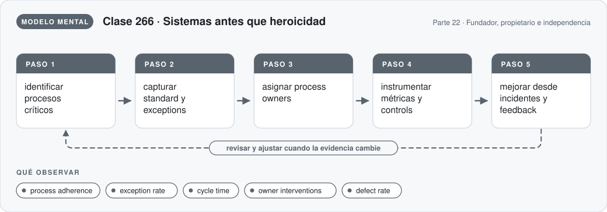

# Clase 266 — Sistemas antes que heroicidad

<!-- nav:inicio -->
> **Parte 22 · Escalamiento, propiedad y portafolio empresarial** — clase 2 de 12 · [índice de la parte](../../README.md) · [temario](../../../../SYLLABUS.md)
<!-- nav:fin -->

**Parte:** 22 — Escalamiento, propiedad y portafolio empresarial  
**Nivel:** Etapa 6 — Business Owner  
**Duración sugerida:** 150–180 minutos · **Estándar:** deep-class-v2

## 🎯 Propósito

En una empresa que depende de héroes, las cosas salen bien porque alguien se queda hasta tarde, recuerda un detalle, llama a un cliente o arregla a último minuto lo que falló. Eso funciona mientras la empresa es pequeña y mientras el héroe aguanta. Después aparecen los síntomas: el mismo error se repite, la calidad depende de quién atiende, los nuevos tardan meses en aprender «cómo se hace aquí», las vacaciones paralizan procesos y el cansancio del equipo se confunde con compromiso. Un **sistema** es la alternativa: una manera **acordada, escrita, medida y mejorable** de hacer lo importante, de modo que el resultado no dependa de la memoria ni del esfuerzo extraordinario de una persona. Gerber insiste en que construir un negocio es construir sistemas que cualquier persona competente pueda operar.

La clase presenta un método para pasar de la heroicidad a los sistemas: identificar los procesos críticos, capturar el estándar y sus excepciones, asignar un dueño a cada proceso, instrumentar métricas y controles, y mejorar a partir de incidentes y retroalimentación. Se apoya en Gerber, Harnish (rutinas y prioridades), Galbraith (diseño de organizaciones y coordinación), Sutton y Rao (escalar prácticas esenciales), Gil (manual de crecimiento acelerado) y Hoffman y Yeh. Al terminar sabrás elegir qué procesos documentar primero, definir indicadores de adherencia, excepciones y tiempo de ciclo, estimar el retorno de un sistema con un modelo simple y evitar la burocracia que mata el criterio.

## 📚 Resultados de aprendizaje

Al finalizar podrás:

1. **Distinguir** un sistema de una heroicidad, de un manual guardado y de una burocracia.
2. **Priorizar** los procesos críticos para documentar y medir.
3. **Capturar** un estándar con sus excepciones y su dueño.
4. **Medir** adherencia, tasa de excepciones y tiempo de ciclo sin atribuir causalidad automática.
5. **Estimar** el retorno de un sistema con supuestos explícitos.

## 🧭 Agenda

| Tramo | Qué se hace |
|---|---|
| 0–20 min | Recuperación: ¿qué proceso de tu empresa funciona solo porque alguien lo sostiene? |
| 20–60 min | Procesos críticos, estándar y excepciones, dueños, métricas, mejora continua. |
| 60–105 min | Ejemplo trabajado: tasa de excepciones, costo del retrabajo y retorno de un sistema. |
| 105–150 min | Caso ejecutivo y práctica. |
| 150–175 min | Límites y entregable. |

## 🧩 Conceptos centrales

| Concepto | Definición | Cómo se reconoce |
|---|---|---|
| **Sistema** | Forma acordada, escrita y medida de hacer algo importante. | Estándar, dueño y métricas. |
| **Proceso crítico** | Proceso que afecta al cliente, la caja o el riesgo. | Su falla se nota rápido. |
| **Estándar** | Manera esperada de ejecutar un proceso. | Pasos, criterios y ejemplos. |
| **Excepción** | Caso que no calza con el estándar. | Se registra y se analiza. |
| **Dueño de proceso** | Responsable de que funcione y mejore. | Una persona con nombre. |
| **Tiempo de ciclo** | Tiempo desde el inicio hasta el final de un proceso. | Fecha de inicio y de término. |

## 🧠 Modelo mental

**Cómo leer el diagrama.** Una cadena de cinco pasos. **Procesos críticos**: los que afectan al cliente, la caja o el riesgo. **Estándar y excepciones**: cómo se hace y cuándo se desvía. **Dueños de proceso**: una persona responsable por cada uno. **Métricas y controles**: adherencia, excepciones y tiempo de ciclo. **Mejora desde incidentes**: cada falla ajusta el sistema. La flecha de retorno indica que las excepciones actualizan el estándar. La nota advierte que un sistema demasiado rígido o prematuro frena el aprendizaje; el pie, que si una persona heroica sostiene el proceso, el proceso aún no existe.

## 📖 Desarrollo

### 1. Heroicidad, sistema y burocracia

La **heroicidad** es el resultado excelente que depende del esfuerzo extraordinario de una persona; es valiosa en una emergencia y peligrosa como forma habitual de operar. El **sistema** es lo contrario: un resultado consistente que no depende de quién lo haga, porque el método está claro. La **burocracia** es la caricatura del sistema: reglas sin propósito, aprobaciones innecesarias y papeles que nadie lee. Un buen sistema es **lo más simple que asegura el resultado**, y deja criterio donde cada caso es distinto. Gerber sostiene que el propietario debe diseñar la empresa como un prototipo replicable, de modo que el cliente reciba lo mismo con independencia de quién lo atienda. Eso no significa uniformidad ciega, sino previsibilidad en lo que importa y flexibilidad en lo demás.

### 2. Elegir los procesos críticos

No todo merece un sistema. Se priorizan los procesos que cumplen alguno de estos criterios: **afectan directamente al cliente** (entrega, atención, postventa), **mueven caja** (cotizar, facturar, cobrar, pagar), **implican riesgo** (seguridad, cumplimiento, calidad) o **son repetitivos y consumen tiempo** del dueño o de personas clave. Se enumeran entre cinco y diez, se estiman su frecuencia, su costo cuando fallan y cuántas personas los saben hacer. Harnish recomienda enfocarse en pocas prioridades por período: en sistemas, eso significa documentar y mejorar **uno o dos procesos por trimestre**, no intentar un manual completo. Un proceso mal elegido puede consumir meses y no cambiar nada.

### 3. Capturar el estándar y las excepciones

El estándar se captura **observando cómo lo hace la persona que mejor lo hace**, no inventando un proceso ideal en una oficina. Se registran los pasos, las decisiones, las herramientas, los tiempos y los criterios de calidad, con ejemplos y errores comunes. Se escribe breve y visual (listas de verificación, diagramas simples, plantillas). Luego se identifican las **excepciones**: casos que se desvían del estándar y qué hacer en cada uno, con una regla clara de cuándo escalar. Sutton y Rao destacan que escalar una práctica implica distinguir lo que debe replicarse **exactamente** de lo que puede adaptarse; el estándar debe marcar esa frontera. Se prueba con alguien nuevo: si no puede ejecutar el proceso con el documento, el documento aún no sirve.

### 4. Asignar dueños y diseñar la coordinación

Un proceso sin dueño se degrada. El **dueño** es responsable de que el proceso se cumpla, de medirlo, de actualizarlo y de proponer mejoras; no necesariamente ejecuta todos los pasos. Galbraith explica que el diseño de la organización consiste en decidir cómo se **divide el trabajo y cómo se coordina**: procesos que cruzan áreas requieren mecanismos de coordinación explícitos (roles integradores, reuniones breves, tableros compartidos, reglas de traspaso). Se define para cada proceso: quién lo inicia, quién lo ejecuta, quién lo aprueba, quién lo recibe y cómo se resuelven los conflictos. La coordinación informal funciona en equipos de pocas personas; con el crecimiento, lo implícito se rompe y el costo de coordinar crece.

### 5. Medir con pocas métricas útiles

Tres métricas simples aplican a casi cualquier proceso. **Adherencia**: qué porcentaje de las veces se siguió el estándar. **Tasa de excepciones**: qué porcentaje de los casos se desvió o requirió corrección. **Tiempo de ciclo**: cuánto tarda de principio a fin. Se agregan **calidad** (reclamos, retrabajo) y **costo** cuando son relevantes. Se registran de forma sencilla y se revisan en una reunión regular. Las métricas deben ser **accionables**: si cambian, alguien decide algo distinto. Y se interpretan con cuidado: una baja en la tasa de excepciones puede deberse a una mejora real, a que se dejó de registrar excepciones o a un cambio en el tipo de pedidos. **No se atribuye causalidad automática**; se pregunta qué más cambió.

### 6. Mejorar desde incidentes y retroalimentación

Los sistemas no se terminan; se **actualizan**. Cada incidente (un error, un reclamo, un retraso) es una oportunidad de aprender: se describe qué pasó sin buscar culpables, se identifica la causa, se decide el cambio al estándar o a la capacitación, y se verifica después si funcionó. Se recogen también las sugerencias de quienes ejecutan el proceso: suelen saber mejor que nadie dónde se pierde tiempo. Se fija un **ritmo de revisión** (por ejemplo, trimestral) y se archivan las versiones. Gil, en su manual de crecimiento acelerado, subraya que los procesos que funcionaban con diez personas se rompen con cincuenta; revisar los sistemas al crecer es parte del trabajo, no una señal de que se hicieron mal.

### 7. Qué sistemas no construir (todavía) y cómo evitar la burocracia

Un sistema prematuro puede congelar una práctica que aún se está descubriendo; uno excesivo puede quitar iniciativa y generar trabajo sin valor. Criterios para no sobredimensionar: **no documentar lo que cambia cada semana**, no exigir aprobaciones donde el riesgo es bajo, no crear formularios que nadie usa, no medir lo que no se usará para decidir. Conviene también proteger los espacios donde el **criterio** es el valor (diseño, negociación, relaciones estratégicas): ahí el sistema debe orientar, no reemplazar. Hoffman y Yeh describen cómo, en etapas de crecimiento muy rápido, las empresas aceptan desorden a cambio de velocidad; una empresa que no está en ese régimen debe, en cambio, buscar consistencia. La pregunta guía es: **¿qué es lo mínimo que debe ser consistente para que el cliente confíe y la empresa no dependa de una persona?**

## 📚 Lectura comparada

| Obra | Qué aporta | Qué no resuelve | Pregunta para contrastar |
|---|---|---|---|
| Gerber | La empresa como prototipo replicable. | Puede entenderse como rigidez. | ¿Qué debe ser igual para todos los clientes? |
| Harnish | Prioridades y rutinas de gestión. | No diseña procesos específicos. | ¿Qué proceso mejoro este trimestre? |
| Galbraith | Diseño y coordinación de la organización. | Enfoque en organizaciones grandes. | ¿Cómo se coordinan las áreas en este proceso? |
| Sutton y Rao | Qué replicar exactamente y qué adaptar. | No dice cómo documentar. | ¿Qué parte del proceso no puede cambiar? |
| Gil | Qué se rompe al crecer y cómo ajustarlo. | Basado en empresas de crecimiento rápido. | ¿Qué proceso no resistirá el doble de volumen? |

## 🧮 Ejemplo trabajado

**Situación (hipotética).** Una empresa de impresión personalizada procesa 400 pedidos al mes. El proceso «pedido a entrega» depende de dos personas que «saben cómo se hace». Se decide documentarlo y medirlo. Los números son **supuestos**; deben verificarse con datos reales.

**Línea base (tres meses).**

| Métrica | Valor |
|---|---|
| Pedidos por mes | 400 |
| Pedidos con excepción (reproceso, error de datos o retraso) | 18 % |
| Costo promedio de una excepción | 35.000 pesos (horas, materiales, envíos) |
| Tiempo de ciclo promedio | 9 días |
| Adherencia al estándar informal | 62 % |

**Costo mensual de las excepciones.** 400 × 18 % = 72 pedidos; 72 × 35.000 = **2.520.000 pesos**.

**Inversión en el sistema.** Documentar el proceso, preparar listas de verificación, capacitar a seis personas, ajustar el tablero: 60 horas de trabajo a 25.000 pesos la hora (1.500.000) más herramientas y capacitación externa (4.500.000). **Total: 6.000.000 pesos.**

**Resultados tras tres meses (observados).**

| Métrica | Antes | Después |
|---|---|---|
| Pedidos con excepción | 18 % | 8 % |
| Tiempo de ciclo | 9 días | 6 días |
| Adherencia | 62 % | 90 % |

**Costo mensual de excepciones después.** 400 × 8 % = 32 pedidos; 32 × 35.000 = **1.120.000**. **Ahorro mensual:** 2.520.000 − 1.120.000 = **1.400.000 pesos**.

**Período de recuperación.** 6.000.000 ÷ 1.400.000 ≈ **4,3 meses**.

**Efecto en el tiempo de ciclo.** Reducir de 9 a 6 días equivale a un 33,3 % (3 ÷ 9). Con 400 pedidos por mes, y un trabajo en curso proporcional al tiempo de ciclo, el inventario promedio de pedidos en proceso baja de aproximadamente 400 × 9 ÷ 30 = 120 a 400 × 6 ÷ 30 = 80, es decir **40 pedidos menos en proceso**.

**Cautela sobre la causalidad.** Antes de atribuir toda la mejora al sistema, se revisan otras explicaciones: ¿cambió el tipo de pedidos?, ¿se registraron las excepciones con el mismo criterio?, ¿hubo un mes de menor volumen o de menor complejidad?, ¿mejoró la calidad de los archivos que envían los clientes? Si la mitad de la mejora se debiera a otros factores, el ahorro atribuible sería 700.000 y la recuperación, 8,6 meses (6.000.000 ÷ 700.000), todavía razonable. **El análisis se repite con seis meses de datos.**

**Decisión.** Mantener el sistema, nombrar un dueño del proceso, revisar el estándar con las excepciones de cada mes, registrar excepciones con definiciones claras, y documentar el siguiente proceso crítico (cotizaciones) solo cuando la adherencia del primero se mantenga sobre 85 % durante dos meses.

**Cuidados.** Los valores son supuestos; la definición de excepción y el costo promedio se calculan con registros reales.

**Qué muestra.** (1) Los tres indicadores describen el proceso. (2) El costo de las excepciones justificó la inversión. (3) La causalidad se cuestionó antes de atribuir el ahorro.

## 🔀 Comparación y límites

**Sistema frente a manual archivado.** Un manual que nadie usa no es un sistema: un sistema tiene dueño, métricas y revisión, y se incorpora a la rutina de trabajo. La documentación es solo una parte.

**Límites.** Un sistema demasiado rígido o prematuro frena el aprendizaje y el criterio. Las métricas no prueban causalidad. Los procesos con alta variabilidad requieren más juicio que estandarización. Las cifras del ejemplo son supuestos.

## 🪜 De profesional a owner

| Nivel | Cómo se relaciona con los sistemas |
|---|---|
| **Profesional** | Sigue el estándar y propone mejoras desde la práctica. |
| **Jefe / Team Lead** | Hace cumplir y mide el proceso de su equipo. |
| **Gerente** | Es dueño de procesos y coordina entre áreas. |
| **CEO / Director** | Prioriza qué sistemas construir y revisa la consistencia. |
| **Founder / Owner** | Diseña la empresa como un sistema y lo deja de sostener personalmente. |

## 🏢 Caso ejecutivo

Una empresa de instalación de redes domésticas tiene 22 técnicos y cerca de 260 visitas al mes. El gerente de operaciones, con 7 años en la empresa, reasigna visitas por teléfono; ante imprevistos, el fundador llama personalmente a los clientes. El 24 % de las visitas requiere una segunda visita por falta de materiales, información incompleta o errores de diagnóstico; cada segunda visita cuesta 48.000 pesos entre traslado, tiempo y repuestos. La satisfacción del cliente es muy alta en las visitas del gerente y baja en las de técnicos nuevos. El tiempo entre solicitud e instalación es de 8 días. El gerente ha dicho que se va a otra empresa en cuatro meses. El fundador cree que «los sistemas matan la flexibilidad». Hay una propuesta para implementar un software de despacho por 7,5 millones de pesos.

Entrega un **memo de decisión y modelo financiero** que contenga: (a) los procesos críticos priorizados con criterios; (b) el costo mensual de las segundas visitas y el efecto de reducir la tasa a 12 %; (c) el estándar mínimo y las excepciones que documentaría primero; (d) el diseño de dueños, métricas y revisión; (e) el período de recuperación del software y una versión sin software (listas de verificación, capacitación), con sensibilidad; (f) los límites del análisis y qué decisiones requieren criterio humano.

## 🧪 Práctica

1. Lista tus cinco procesos críticos y prioriza dos con los criterios de la clase.
2. Observa cómo lo hace la mejor persona y escribe el estándar en una página.
3. Define la métrica de excepción de tu proceso y el costo promedio de cada una.
4. Calcula la recuperación de la inversión y una versión conservadora con la mitad del ahorro.
5. Asigna un dueño y una fecha de revisión trimestral.

## ⚠️ Errores frecuentes

| Error | Por qué ocurre | Cómo corregirlo |
|---|---|---|
| Documentar todo | Se busca control total | Uno o dos procesos críticos por trimestre. |
| Manual sin dueño | Se escribe y se archiva | Dueño, métricas y revisión. |
| Estándar inventado en la oficina | No se observa a quien lo hace bien | Capturar la práctica real y probarla con un nuevo. |
| Medir sin decidir | Se acumulan datos | Métricas que cambian decisiones. |
| Atribuir toda mejora al sistema | Se celebra rápido | Revisar otras explicaciones. |
| Rigidez excesiva | Se desconfía del criterio | Marcar dónde se permite adaptación. |

## ❓ Preguntas de comprobación

1. ¿Qué diferencia hay entre heroicidad, sistema y burocracia?
2. ¿Qué criterios sirven para elegir procesos críticos?
3. ¿Por qué se observa al mejor ejecutante antes de escribir el estándar?
4. ¿Qué hace un dueño de proceso?
5. ¿Qué tres métricas aplican a casi cualquier proceso?
6. ¿Por qué no se atribuye causalidad automática a una mejora?
7. ¿Qué límite tiene este enfoque?

Claves de respuesta

1. La heroicidad depende de una persona; el sistema es un método acordado y medido; la burocracia son reglas sin propósito.
2. Que afecte al cliente, mueva caja, implique riesgo o sea repetitivo y consuma tiempo clave.
3. Porque el estándar debe reflejar la práctica que funciona y no un ideal sin prueba.
4. Responde por que el proceso se cumpla, se mida, se actualice y mejore.
5. Adherencia, tasa de excepciones y tiempo de ciclo.
6. Porque pueden haber cambiado el mix, los criterios de registro u otros factores.
7. Un sistema rígido o prematuro frena el aprendizaje, y las métricas no prueban causalidad.

## 📥 Entregable

Guarda en `portfolio/266-sistemas-antes-que-heroicidad/`:

- `modelo-financiero-y-memo-de-decision.md` (plantilla [Modelo financiero y memo de decisión](../../../../templates/modelo-financiero-y-memo-de-decision.md)) con el memo y el cálculo del caso ejecutivo;
- `decision-journal.md` con el estándar, las excepciones y la revisión de métricas.

## 📗 Fuentes y verificación

- Michael E. Gerber — *The E-Myth Revisited* (HarperAudio, 1995). **Uso en esta clase:** la empresa como prototipo replicable que no depende de una persona. Lectura selectiva sobre **sistemas antes que heroicidad**. **Localizador:** [ISBN-13 9780060574901](https://openlibrary.org/isbn/9780060574901).
- Verne Harnish — *Scaling Up* (Gazelles, Inc., 2014). **Uso en esta clase:** prioridades y rutinas de gestión para crecer. Lectura selectiva sobre **sistemas antes que heroicidad**. **Localizador:** [ISBN-13 9780986019555](https://openlibrary.org/isbn/9780986019555).
- Jay R. Galbraith — *Designing Organizations* (Jossey-Bass Publishers, 1995). **Uso en esta clase:** división del trabajo y coordinación organizacional. Lectura selectiva sobre **sistemas antes que heroicidad**. **Localizador:** [ISBN-13 9780787900915](https://openlibrary.org/isbn/9780787900915).
- Robert I. Sutton & Huggy Rao — *Scaling Up Excellence* (Random House Canada, 2014). **Uso en esta clase:** qué replicar exactamente y qué adaptar al escalar. Lectura selectiva sobre **sistemas antes que heroicidad**. **Localizador:** [ISBN-13 9780307363428](https://openlibrary.org/isbn/9780307363428).
- Elad Gil — *High Growth Handbook* (Stripe Matter Inc, 2018). **Uso en esta clase:** qué se rompe al crecer y cómo ajustarlo. Lectura selectiva sobre **sistemas antes que heroicidad**. **Localizador:** [ISBN-13 9781953953377](https://openlibrary.org/isbn/9781953953377).
- Reid Hoffman & Chris Yeh — *Blitzscaling* (HarperCollins Publishers Limited, 2018). **Uso en esta clase:** velocidad frente a consistencia en el crecimiento acelerado. Lectura selectiva sobre **sistemas antes que heroicidad**. **Localizador:** [ISBN-13 9780008303648](https://openlibrary.org/isbn/9780008303648).

> **Regla de fuentes para Sistemas antes que heroicidad:** las obras anteriores estructuran las perspectivas de esta materia; cualquier norma, ley o estándar vivo mencionado debe comprobarse nuevamente en su fuente primaria vigente. Los ejemplos y casos son hipotéticos, con cifras ilustrativas. El desarrollo es original y no reproduce capítulos protegidos.

<!-- pie:inicio -->
---

| Anterior | Índice | Siguiente |
|---|---|---|
| [← 265 · De fundador-operador a propietario](../265-de-fundador-operador-a-propietario/README.md) | [Parte 22](../../README.md) · [Programa](../../../../SYLLABUS.md) | [267 · Contratar líderes →](../267-contratar-lideres/README.md) |
<!-- pie:fin -->
