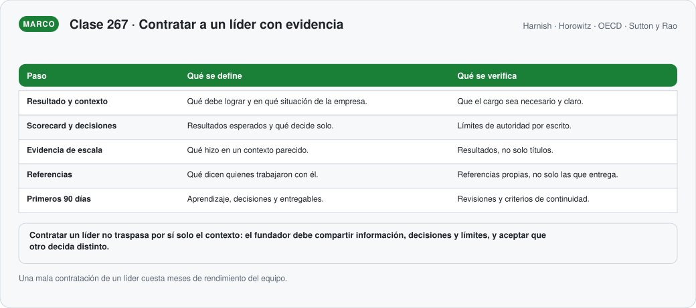

# Clase 267 — Contratar líderes

<!-- nav:inicio -->
> **Parte 22 · Escalamiento, propiedad y portafolio empresarial** — clase 3 de 12 · [índice de la parte](../../README.md) · [temario](../../../../SYLLABUS.md)
<!-- nav:fin -->

**Parte:** 22 — Escalamiento, propiedad y portafolio empresarial  
**Nivel:** Etapa 6 — Business Owner  
**Duración sugerida:** 150–180 minutos · **Estándar:** deep-class-v2

## 🎯 Propósito

Contratar al primer gerente o director es una de las decisiones más difíciles y más caras para un fundador. Es difícil porque obliga a **transferir contexto, autoridad y decisiones** a alguien que no vivió la historia de la empresa; es cara porque un error cuesta meses de rendimiento del equipo, relaciones con clientes y el tiempo del propio fundador. Los errores típicos se repiten: contratar a alguien «como yo» o a alguien «de gran empresa» sin verificar si sabe operar con recursos escasos; fijar el cargo por un título y no por un resultado; apoyarse solo en la entrevista y las referencias que el candidato entrega; esperar que el nuevo líder «arregle todo» sin darle autoridad; o no tener un plan para los primeros noventa días. Horowitz advierte que dirigir una empresa en crecimiento incluye decisiones duras sobre personas que se postergan demasiado.

La clase propone un método: definir el resultado y el contexto que justifican el cargo, construir un scorecard y los derechos de decisión, buscar evidencia de que el candidato ha escalado algo parecido, hacer referencias propias y planificar un aprendizaje y una toma de decisiones de noventa días. Se apoya en Harnish (equipo directivo y rutinas), Horowitz (liderazgo en situaciones difíciles), la OECD (responsabilidades de dirección y gobierno), Sutton y Rao (escalar prácticas) y Hoffman y Yeh, y en Gerber sobre el paso de dueño-operador a dueño-constructor. Al terminar sabrás armar un scorecard ponderado, estimar el costo esperado de una mala contratación, decidir entre candidatos con evidencia y diseñar el traspaso de autoridad.

## 📚 Resultados de aprendizaje

Al finalizar podrás:

1. **Definir** el resultado, el contexto y las decisiones de un cargo directivo.
2. **Construir** un scorecard ponderado con criterios observables.
3. **Buscar** evidencia de escala y realizar referencias propias.
4. **Estimar** el costo esperado de contratar bien o mal con supuestos explícitos.
5. **Planificar** los primeros noventa días con aprendizaje, decisiones y criterios de continuidad.

## 🧭 Agenda

| Tramo | Qué se hace |
|---|---|
| 0–20 min | Recuperación: ¿qué resultado exacto necesitas que logre la persona que contrates? |
| 20–60 min | Resultado y contexto, scorecard, derechos de decisión, evidencia, referencias, noventa días. |
| 60–105 min | Ejemplo trabajado: comparación de tres candidatos con scorecard y costo esperado. |
| 105–150 min | Caso ejecutivo y práctica. |
| 150–175 min | Límites y entregable. |

## 🧩 Conceptos centrales

| Concepto | Definición | Cómo se reconoce |
|---|---|---|
| **Scorecard** | Resultados y competencias esperadas, con ponderación. | Criterios, pesos y evidencia. |
| **Derechos de decisión** | Qué decide solo el líder y qué se acuerda. | Matriz de decisiones. |
| **Evidencia de escala** | Pruebas de que hizo algo parecido en un contexto parecido. | Resultados verificables. |
| **Referencia propia** | Conversación con alguien que trabajó con el candidato, elegida por el contratante. | Fuente no entregada por el candidato. |
| **Plan de 90 días** | Aprendizaje y decisiones acordadas para el inicio. | Hitos y revisiones. |
| **Retención de ejecutivos** | Permanencia de líderes en el cargo. | Rotación directiva. |

## 🧠 Modelo mental

**Cómo leer el diagrama.** Una tabla de tres columnas. **Paso**: resultado y contexto, scorecard y decisiones, evidencia de escala, referencias y primeros noventa días. **Qué se define**: qué debe lograr y en qué situación está la empresa, los resultados esperados y qué decide solo, qué hizo en un contexto parecido, qué dicen quienes trabajaron con él, y el aprendizaje y las decisiones iniciales. **Qué se verifica**: que el cargo sea necesario y claro, los límites de autoridad por escrito, resultados y no solo títulos, referencias propias, y revisiones con criterios de continuidad. La nota afirma que contratar a un líder no traspasa el contexto por sí solo; el pie, que una mala contratación cuesta meses de rendimiento del equipo.

## 📖 Desarrollo

### 1. Definir el resultado y el contexto

Un cargo directivo se define por **resultados** y por el **contexto** en el que deben lograrse. Resultados: «llevar el margen de la línea B de 18 % a 26 % en doce meses», «reducir la rotación de técnicos de 30 % a 18 %», «montar un equipo comercial que genere el 60 % de las ventas sin intervención del fundador». Contexto: tamaño, madurez de los procesos, calidad de los datos, cultura, restricciones de caja, relación con clientes clave y estado del equipo actual. Un gerente brillante en una empresa con sistemas maduros puede fracasar donde todo está por construirse, y viceversa. Antes de buscar a alguien, el fundador debe poder responder: ¿qué problema resuelve este cargo?, ¿qué pasa si no lo contrato?, ¿qué debería lograr en doce meses? La claridad reduce el riesgo de contratar por ansiedad.

### 2. Scorecard, pesos y derechos de decisión

El **scorecard** traduce el cargo en 4 a 7 criterios observables con **pesos**: resultados en contextos parecidos, capacidad de construir y conducir equipos, calidad de juicio en decisiones difíciles, ajuste con el contexto y los valores, comunicación y colaboración con el fundador. Cada criterio se acompaña de **señales** de evidencia y de **alertas**. Con él, todos los entrevistadores evalúan lo mismo y se evita decidir por simpatía. Se define además la matriz de **derechos de decisión**: qué decide el líder solo (contratar dentro de su presupuesto, cambiar procesos de su área), qué decide con consulta, qué requiere aprobación del dueño. Harnish destaca la importancia de claridad sobre quién es responsable de qué; sin ella, el nuevo líder se vuelve un asistente del fundador y no puede producir resultados.

### 3. Buscar evidencia de escala

La pregunta clave es: **¿ha hecho algo parecido, en una situación parecida?** No basta un título. Se pide al candidato que describa con detalle una situación concreta: el punto de partida, qué decidió, qué hizo, qué resultados obtuvo con números, qué salió mal, qué aprendió y qué haría distinto. Se verifica con documentos o con terceros. Sutton y Rao enfatizan que escalar requiere distinguir lo que se replica de lo que se adapta: un buen candidato explica **qué parte de su experiencia es transferible** a tu contexto y cuál no. Se desconfía de los relatos en que todo el mérito es del candidato y nada del equipo, y de los resultados que no se pueden verificar. También se evalúa la **disposición a operar con recursos escasos**, no solo con grandes equipos.

### 4. Referencias propias

Las referencias que entrega el candidato suelen ser favorables; las **referencias propias** son más informativas: se pide a otras personas que trabajaron con él (antiguos jefes, pares, subordinados) y se les hacen preguntas concretas: ¿qué resultados logró?, ¿cómo trató a su equipo?, ¿cómo reaccionó ante un fracaso?, ¿lo volverías a contratar?, ¿en qué contexto lo ubicarías y en cuál no? Se realizan con respeto y respetando la confidencialidad y las normas aplicables (laborales, de datos personales y de no discriminación, que se consultan con asesoría). Se busca coherencia entre lo que dice el candidato y lo que cuentan los demás. Una discrepancia importante no descalifica automáticamente, pero **obliga a investigar**.

### 5. Costo de contratar mal y contratar bien

Una mala contratación directiva cuesta: salarios pagados sin el resultado esperado, costos de reclutamiento y de salida (que se consultan con asesoría laboral), desorganización del equipo, relaciones con clientes dañadas, y el tiempo del fundador dedicado a corregir. Estimarlo con **supuestos explícitos** ayuda a dimensionar cuánto vale invertir en una buena selección (más entrevistas, referencias, un caso de trabajo pagado, una prueba de colaboración). También se estima el **valor de contratar bien**: el resultado esperado del cargo, que puede superar con creces el costo del salario. La decisión debe considerar la **probabilidad de éxito** de cada candidato: no es cierto, y esa incertidumbre es la razón de reducirla con evidencia. A veces, la mejor decisión es **no contratar todavía** y reorganizar mientras se aclara el cargo.

### 6. Transferir contexto y autoridad

Contratar es solo la mitad; la otra mitad es **permitir que el líder lidere**. El fundador debe compartir información (finanzas, clientes, historia de decisiones), presentar al líder ante el equipo y los clientes clave con una declaración clara de autoridad, abstenerse de contradecirlo en público, y acordar cómo se tomarán las decisiones que el fundador antes tomaba. Un error frecuente es **contratar y seguir decidiendo por encima**: el líder pierde credibilidad y se va. Otro es **desaparecer**: sin contexto ni apoyo, el líder tampoco puede tener éxito. La OECD, en sus principios de gobierno, recuerda que la dirección responde por la gestión y que la propiedad no debe interferir con la gestión de manera que desdibuje responsabilidades; en una pyme, esa idea se traduce en límites claros entre lo que decide el dueño y lo que decide el gerente.

### 7. Los primeros noventa días y la decisión de continuidad

Se acuerda un **plan de 90 días** con tres etapas: **aprender** (conocer a las personas, los clientes, los datos y los sistemas, y entregar un diagnóstico al día 30), **decidir** (proponer prioridades y cambios, con decisiones acotadas al día 60) y **entregar** (primeros resultados y plan de doce meses al día 90). Se agendan revisiones con el fundador cada dos semanas y con el equipo al mes. Se definen **criterios de continuidad** (resultados y comportamientos esperados), de modo que si no hay ajuste, se tome una decisión a tiempo. Horowitz enfatiza que postergar decisiones difíciles sobre personas daña al equipo; la claridad inicial permite actuar sin sorpresas. Se registran las lecciones para mejorar el próximo proceso de selección.

## 📚 Lectura comparada

| Obra | Qué aporta | Qué no resuelve | Pregunta para contrastar |
|---|---|---|---|
| Harnish | Claridad de roles y rutinas del equipo directivo. | No profundiza en selección. | ¿Quién es responsable de cada resultado? |
| Horowitz | Realidad de las decisiones difíciles sobre personas. | Enfoque de empresas tecnológicas. | ¿Qué decisión estoy postergando? |
| OECD (principios de gobierno) | Responsabilidades de dirección y gobierno. | No es guía de reclutamiento. | ¿Dónde termina el dueño y empieza el gerente? |
| Sutton y Rao | Qué replicar y qué adaptar al escalar. | No define el scorecard. | ¿Qué parte de su experiencia es transferible aquí? |
| Gerber | Pasar de operador a constructor del negocio. | No trata el reclutamiento de ejecutivos. | ¿Qué sistema sostiene a este líder? |

## 🧮 Ejemplo trabajado

**Situación (hipotética).** Una empresa de distribución de insumos médicos con ventas de 1.800 millones de pesos al año busca un gerente comercial. El fundador define el resultado: «aumentar un 25 % las ventas en 12 meses sin descuentos mayores a los actuales y reducir en la mitad las ventas que dependen de él». Tres candidatos pasan por el proceso. Todas las cifras son **supuestos**.

**Scorecard (puntajes de 1 a 5 tras entrevistas y casos de trabajo).**

| Criterio | Peso | Candidata A | Candidato B | Candidata C (interna) |
|---|---|---|---|---|
| Resultados en contexto parecido | 30 % | 4 | 5 | 3 |
| Capacidad de construir equipos | 20 % | 4 | 3 | 4 |
| Calidad de juicio en decisiones difíciles | 20 % | 3 | 4 | 4 |
| Ajuste con el contexto y los valores | 15 % | 5 | 3 | 5 |
| Comunicación y colaboración | 15 % | 4 | 3 | 4 |

**Puntajes ponderados.**

- A: 0,30 × 4 + 0,20 × 4 + 0,20 × 3 + 0,15 × 5 + 0,15 × 4 = 1,20 + 0,80 + 0,60 + 0,75 + 0,60 = **3,95**.
- B: 1,50 + 0,60 + 0,80 + 0,45 + 0,45 = **3,80**.
- C: 0,90 + 0,80 + 0,80 + 0,75 + 0,60 = **3,85**.

Las diferencias son **pequeñas**: 0,15 entre A y B. Con evaluaciones subjetivas y cinco criterios, no son concluyentes.

**Referencias propias.** Se realizan tres por candidato. Resultado: A, referencias coherentes con lo relatado (probabilidad de éxito estimada 70 %); B, resultados confirmados pero dos referencias cuestionan su trato al equipo (60 %); C, apoyo de sus pares pero sin experiencia directa de construir un equipo comercial (65 %).

**Costo esperado de una mala contratación (supuestos).** Costo mensual total del cargo: 5,2 millones. Un error cuesta 8 meses de ese costo (41,6 millones), más 6 millones de reclutamiento y salida (a validar con asesoría laboral) y 10 millones por desorganización: **57,6 millones**.

**Costo esperado del primer año.**

| Candidato | Costo anual (salario y cargas supuestos) | Probabilidad de fracaso | Costo esperado de fracaso | Otros costos | Total esperado |
|---|---|---|---|---|---|
| A | 5,2 × 12 = 62,4 | 30 % | 0,30 × 57,6 = 17,28 | — | **79,68 millones** |
| B | 4,8 × 12 = 57,6 | 40 % | 0,40 × 57,6 = 23,04 | — | **80,64 millones** |
| C | 4,2 × 12 = 50,4 | 35 % | 0,35 × 57,6 = 20,16 | Reemplazo de su cargo actual: 12,0 | **82,56 millones** |

**Valor esperado del resultado.** Un aumento de ventas de 25 % equivale a 450 millones de pesos; con un margen de contribución de 22 %, son **99 millones** al año. Con una probabilidad de éxito de 70 % para A, el valor esperado es 0,70 × 99 = 69,3 millones; para B (60 %), 59,4; para C (65 %), 64,35. Restando el costo anual: A: 69,3 − 62,4 = +6,9; B: 59,4 − 57,6 = +1,8; C: 64,35 − 50,4 − 12,0 = +1,95 (sin considerar el costo esperado de fracaso, ya incorporado en la probabilidad). **El orden es A, luego C y B**, pero las diferencias dependen de supuestos frágiles.

**Lectura.** La decisión no debe depender de un decimal: debe depender de la evidencia sobre **el contexto** (A ajusta mejor), de las alertas sobre trato al equipo (B) y de la experiencia faltante (C). El análisis sugiere elegir a A, con una cláusula de revisión a los 90 días, y evaluar a C para un rol de apoyo con desarrollo.

**Plan de 90 días de A.** Día 30: diagnóstico de clientes y equipo; día 60: propuesta de estructura comercial y primeras decisiones de precios dentro de límites; día 90: plan de doce meses y primeros resultados. Derechos de decisión: contratar y despedir vendedores dentro de su presupuesto con consulta; precios fuera de la política requieren al fundador.

**Cuidados.** Los puntajes, probabilidades y costos son supuestos; las condiciones laborales y los costos de salida se verifican con asesoría laboral.

**Qué muestra.** (1) El scorecard ordenó la evaluación. (2) Las referencias propias ajustaron la probabilidad de éxito. (3) El costo esperado de fracaso dimensiona cuánto invertir en seleccionar bien.

## 🔀 Comparación y límites

**Contratar un líder frente a promover a un operador.** El primero trae experiencia externa y requiere traspasar contexto; el segundo conoce la empresa pero puede carecer de experiencia en el nuevo rol y deja un vacío. Ninguna alternativa elimina el riesgo.

**Límites.** Los puntajes y probabilidades son estimaciones subjetivas. Un scorecard mejora la consistencia pero no sustituye el juicio. Las normas laborales, de datos personales y de no discriminación que rigen los procesos de selección se verifican con asesoría. Las cifras del ejemplo son supuestos.

## 🪜 De profesional a owner

| Nivel | Cómo se relaciona con contratar líderes |
|---|---|
| **Profesional** | Aspira a liderar y construye evidencia de resultados. |
| **Jefe / Team Lead** | Participa en la selección de su equipo con criterios. |
| **Gerente** | Define el scorecard de sus reportes y los incorpora. |
| **CEO / Director** | Decide contrataciones directivas y evalúa su desempeño. |
| **Founder / Owner** | Define el cargo, cede autoridad real y responde por la decisión. |

## 🏢 Caso ejecutivo

Una fundadora dirige una cadena de cuatro centros de rehabilitación kinesiológica con 55 personas y ventas anuales de 1.320 millones de pesos. Quiere contratar a un gerente general para poder concentrarse en abrir dos nuevos centros. Tres opciones: un exgerente de una clínica grande que pide 7,8 millones mensuales, con experiencia en sistemas pero sin haber manejado centros pequeños; la actual jefa del centro principal, con cinco años en la empresa, a quien le falta experiencia en finanzas y a quien subiría a 5,2 millones; y un consultor de gestión sanitaria que ofrece trabajar a tiempo parcial por 3,5 millones mensuales. La fundadora tiene miedo a perder el control de las relaciones con las derivaciones médicas, que representan el 70 % de los pacientes. Dos centros tienen márgenes de 8 % y otros dos de 21 %. No ha definido derechos de decisión. Estima que una mala contratación le costaría 10 meses del salario completo más 12 millones.

Entrega un **memo de decisión del fundador** que contenga: (a) el resultado y contexto del cargo; (b) un scorecard ponderado con las tres opciones y sus puntajes con justificación; (c) las alertas y las referencias propias que pedirá; (d) el costo esperado de fracaso de cada opción con probabilidades supuestas; (e) los derechos de decisión y la forma de transferir las relaciones con médicos; (f) el plan de 90 días, los criterios de continuidad y los límites del análisis.

## 🧪 Práctica

1. Redacta el resultado de un cargo directivo que necesitas, con su contexto.
2. Construye un scorecard con cinco criterios, pesos y señales de alerta.
3. Escribe diez preguntas de referencia propia basadas en evidencia.
4. Estima el costo de una mala contratación y de una buena con supuestos explícitos.
5. Diseña el plan de 90 días y los derechos de decisión del cargo.

## ⚠️ Errores frecuentes

| Error | Por qué ocurre | Cómo corregirlo |
|---|---|---|
| Contratar por título | Se busca prestigio | Definir resultados y contexto. |
| Entrevistas sin criterios | Se decide por simpatía | Scorecard ponderado y evaluación compartida. |
| Solo referencias entregadas | Es lo fácil | Referencias propias con preguntas concretas. |
| Contratar y decidir por encima | Cuesta soltar | Matriz de derechos de decisión. |
| Sin plan inicial | Se espera que «se adapte» | Plan de 90 días con revisiones. |
| Postergar la decisión de continuidad | Se evita el conflicto | Criterios escritos y fecha de revisión. |

## ❓ Preguntas de comprobación

1. ¿Qué incluye la definición de un cargo directivo?
2. ¿Para qué sirve un scorecard ponderado?
3. ¿Qué es evidencia de escala?
4. ¿Qué ventaja tienen las referencias propias?
5. ¿Qué se incluye en el costo de una mala contratación?
6. ¿Qué errores comete el fundador tras contratar?
7. ¿Qué límite tiene el análisis cuantitativo?

Claves de respuesta

1. Resultados esperados, contexto de la empresa y decisiones que tomará.
2. Para evaluar a todos con los mismos criterios y reducir decisiones por simpatía.
3. Pruebas verificables de que hizo algo parecido en un contexto parecido.
4. Que no están elegidas por el candidato y suelen ser más informativas.
5. Salarios sin resultado, reclutamiento y salida, desorganización del equipo y tiempo del fundador.
6. Decidir por encima del líder o desaparecer sin darle contexto.
7. Son estimaciones subjetivas y frágiles; no sustituyen el juicio ni la evidencia.

## 📥 Entregable

Guarda en `portfolio/267-contratar-lideres/`:

- `founder-owner-decision-brief.md` (plantilla [Founder owner decision brief](../../../../templates/founder-owner-decision-brief.md)) con el memo del caso ejecutivo;
- `org-design.md` (plantilla [Org design](../../../../templates/org-design.md)) con el scorecard, los derechos de decisión y el plan de 90 días;
- `decision-journal.md` con las referencias, las probabilidades y los criterios de continuidad.

## 📗 Fuentes y verificación

- Verne Harnish — *Scaling Up* (Gazelles, Inc., 2014). **Uso en esta clase:** claridad de roles y rutinas del equipo directivo. Lectura selectiva sobre **contratar líderes**. **Localizador:** [ISBN-13 9780986019555](https://openlibrary.org/isbn/9780986019555).
- Ben Horowitz — *The Hard Thing About Hard Things* (HarperCollins Publishers, 2014). **Uso en esta clase:** decisiones difíciles sobre personas en empresas en crecimiento. Lectura selectiva sobre **contratar líderes**. **Localizador:** [ISBN-13 9780062273215](https://openlibrary.org/isbn/9780062273215).
- OECD — *G20/OECD Principles of Corporate Governance 2023*. **Uso en esta clase:** responsabilidades de la dirección y del gobierno. **Fuente primaria:** <https://www.oecd.org/en/publications/2023/09/g20-oecd-principles-of-corporate-governance-2023_60836fcb.html>.
- Robert I. Sutton & Huggy Rao — *Scaling Up Excellence* (Random House Canada, 2014). **Uso en esta clase:** qué replicar y qué adaptar al escalar. Lectura selectiva sobre **contratar líderes**. **Localizador:** [ISBN-13 9780307363428](https://openlibrary.org/isbn/9780307363428).
- Michael E. Gerber — *The E-Myth Revisited* (HarperAudio, 1995). **Uso en esta clase:** del dueño-operador al dueño-constructor. Lectura selectiva sobre **contratar líderes**. **Localizador:** [ISBN-13 9780060574901](https://openlibrary.org/isbn/9780060574901).
- Reid Hoffman & Chris Yeh — *Blitzscaling* (HarperCollins Publishers Limited, 2018). **Uso en esta clase:** contratación de líderes en etapas de crecimiento acelerado. Lectura selectiva sobre **contratar líderes**. **Localizador:** [ISBN-13 9780008303648](https://openlibrary.org/isbn/9780008303648).

> **Regla de fuentes para Contratar líderes:** las obras anteriores estructuran las perspectivas de esta materia; cualquier norma, ley o estándar vivo mencionado debe comprobarse nuevamente en su fuente primaria vigente, incluidas las normas laborales y de datos personales. Los ejemplos y casos son hipotéticos, con cifras ilustrativas. El desarrollo es original y no reproduce capítulos protegidos.

<!-- pie:inicio -->
---

| Anterior | Índice | Siguiente |
|---|---|---|
| [← 266 · Sistemas antes que heroicidad](../266-sistemas-antes-que-heroicidad/README.md) | [Parte 22](../../README.md) · [Programa](../../../../SYLLABUS.md) | [268 · Escalar ventas sin destruir margen →](../268-escalar-ventas-sin-destruir-margen/README.md) |
<!-- pie:fin -->
