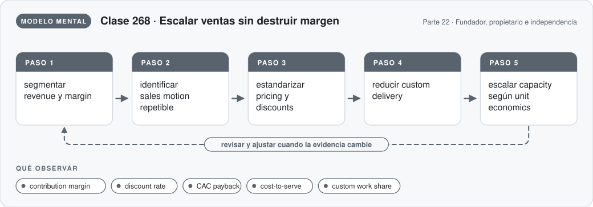

# Clase 268 — Escalar ventas sin destruir margen

<!-- nav:inicio -->
> **Parte 22 · Escalamiento, propiedad y portafolio empresarial** — clase 4 de 12 · [índice de la parte](../../README.md) · [temario](../../../../SYLLABUS.md)
<!-- nav:fin -->

**Parte:** 22 — Escalamiento, propiedad y portafolio empresarial  
**Nivel:** Etapa 6 — Business Owner  
**Duración sugerida:** 150–180 minutos · **Estándar:** deep-class-v2

## 🎯 Propósito

Vender más no siempre significa ganar más. Muchas empresas crecen en ventas mientras su rentabilidad se deteriora: descuentos que se vuelven costumbre, clientes que exigen adaptaciones a medida, proyectos que consumen más horas de las cotizadas, canales con comisiones altas, equipos comerciales que ganan por volumen sin mirar el margen. El fundador se alegra con la línea de ingresos, hasta que la caja no alcanza o descubre que sus clientes más grandes son los menos rentables. **Escalar ventas es crecer con una economía por cliente que mejora o se mantiene, no que se destruye**: eso exige segmentar ingresos y márgenes, identificar un movimiento comercial repetible, estandarizar precios y descuentos, reducir la entrega a medida y ampliar la capacidad solo cuando la economía lo justifica.

La clase propone un método basado en cuatro preguntas: ¿qué ventas dejan margen y cuáles lo consumen?, ¿cuál es la manera repetible de venderle a quien más valor obtiene?, ¿qué reglas de precio y descuento protegen el margen?, ¿cuánta capacidad se necesita y cuánto cuesta cada cliente nuevo? Se apoya en Koller y colaboradores (el valor surge de crecer con retorno sobre el capital superior al costo del capital), Harnish (disciplina de ejecución y métricas), Gil (qué se rompe al crecer), Sutton y Rao (escalar prácticas esenciales), Drucker (los resultados están afuera, en el cliente) y Gerber. Al terminar sabrás calcular el margen de contribución por segmento, evaluar un tope de descuentos, estimar el período de recuperación del costo de adquisición y decidir cuándo ampliar capacidad.

## 📚 Resultados de aprendizaje

Al finalizar podrás:

1. **Segmentar** ingresos y margen de contribución por cliente, producto o canal.
2. **Identificar** un movimiento comercial repetible y sus condiciones.
3. **Evaluar** una política de precios y descuentos con efecto en volumen y contribución.
4. **Calcular** el período de recuperación del costo de adquisición con y sin descuentos.
5. **Decidir** cuándo y cuánto ampliar capacidad, o cuándo aceptar trabajo a medida.

## 🧭 Agenda

| Tramo | Qué se hace |
|---|---|
| 0–20 min | Recuperación: ¿qué segmento de tu empresa vende más y cuál deja más margen? |
| 20–60 min | Segmentación, movimiento repetible, precios y descuentos, entrega a medida, capacidad. |
| 60–105 min | Ejemplo trabajado: contribución por segmento, tope de descuentos y período de recuperación. |
| 105–150 min | Caso ejecutivo y práctica. |
| 150–175 min | Límites y entregable. |

## 🧩 Conceptos centrales

| Concepto | Definición | Cómo se reconoce |
|---|---|---|
| **Margen de contribución** | Ingreso menos costos variables. | Dinero que queda para costos fijos y utilidad. |
| **Tasa de descuento** | Reducción promedio sobre el precio de lista. | Descuento ÷ precio de lista. |
| **Período de recuperación del CAC** | Meses para recuperar el costo de adquirir un cliente. | CAC ÷ contribución mensual. |
| **Movimiento comercial** | Manera repetible de atraer, vender y entregar. | Perfil, canal, propuesta y proceso. |
| **Entrega a medida** | Trabajo adaptado a un cliente. | Horas no estándar. |
| **Capacidad** | Volumen que la empresa puede atender con calidad. | Personas, sistemas y plazos. |

## 🧠 Modelo mental

**Cómo leer el diagrama.** Dos ejes. El horizontal mide el **margen de contribución** (de bajo a alto); el vertical, qué tan **repetible** es la entrega (de a medida a repetible). Cuatro cuadrantes: **margen alto y entrega repetible**, escalar con inversión en capacidad y canal; **margen bajo y entrega repetible**, reparar precio o costo; **margen alto pero artesanal**, aceptar a medida solo si enseña, con criterio de salida; **margen bajo y a medida**, salir o rediseñar. La nota advierte que estandarizar demasiado pronto puede perder clientes estratégicos; el pie, que la capacidad se amplía según la economía por cliente y el período de recuperación.

## 📖 Desarrollo

### 1. Segmentar ingresos y margen

El promedio oculta lo que importa. Se abre el total de ventas por **segmento**: tipo de cliente, producto o servicio, canal, tamaño, región. Para cada uno se calcula el **ingreso**, los **costos variables** (materiales, comisiones, horas directas, transporte, comisiones de pago), el **margen de contribución** y su porcentaje, y el **tiempo del fundador** que consume. Es frecuente descubrir que el 20 % de los clientes genera la mayor parte del margen y que otro grupo, de apariencia atractiva por su volumen, apenas cubre sus costos o los supera. Drucker sostiene que los resultados de un negocio están fuera de él, en el cliente; aquí eso significa **mirar la rentabilidad por cliente y no solo por ventas totales**. Esta segmentación es el primer paso para decidir dónde crecer, dónde reparar y dónde salir.

### 2. Un movimiento comercial repetible

Un movimiento comercial es repetible cuando se puede describir y reproducir: **a quién se vende** (perfil de cliente ideal), **cómo se llega** (canal), **qué se promete** (propuesta de valor), **cómo se avanza** (etapas de venta con criterios de salida), **cómo se cierra** (precio, condiciones, contrato) y **cómo se entrega** (proceso estándar). Harnish recomienda gestionar las ventas con indicadores de actividad y de resultado, y con una rutina semanal de revisión. Gil advierte que, al crecer, las prácticas comerciales que dependían del fundador se rompen; conviene documentar lo que funciona y entrenar a otros. El objetivo no es uniformar a todos los clientes, sino identificar **dónde la empresa gana consistentemente** y apuntar hacia allá. Sutton y Rao recuerdan que la expansión exitosa suele implicar copiar con fidelidad lo esencial.

### 3. Precios y descuentos como política

Un descuento sin regla es una decisión individual repetida por muchos vendedores: erosiona el margen y enseña al cliente a negociar. Una **política de precios** define: lista de precios, rangos de descuento por volumen o plazo, quién puede aprobar qué nivel, qué se pide a cambio (pago anticipado, mayor plazo, referencias, compromiso de volumen) y cómo se registran las excepciones. Se mide la **tasa de descuento promedio** y su dispersión por vendedor y por cliente. Se evalúa el **efecto en volumen**: un tope de descuentos puede perder algunos clientes, pero mejorar la contribución total; el cálculo (ver ejemplo) permite decidir con números. Los precios deben también cumplir la normativa de consumo y de competencia aplicable, que se consulta con asesoría cuando corresponde.

### 4. Reducir la entrega a medida

El trabajo a medida suele ser caro, difícil de planificar y de transferir, y puede depender de personas clave. Se mide: **horas reales frente a horas cotizadas**, número de adaptaciones por cliente, retrasos y reclamos. La respuesta no es negarse siempre: el trabajo a medida **puede ser estratégico** si compra aprendizaje (nuevo segmento, nueva funcionalidad, entrada a un cliente de referencia) o si el cliente paga una prima que lo justifica. La regla es **cuantificar su costo y definir un criterio de salida**: cuántas veces se hará, qué se aprenderá, cuándo se transformará en producto estándar o se abandonará. Con el tiempo se busca convertir lo repetido en módulos, paquetes y opciones definidas, lo que mejora el margen y reduce la dependencia del fundador.

### 5. Economía por cliente y recuperación del CAC

Antes de ampliar capacidad comercial, se calcula la economía por cliente: **precio**, **costo variable**, **contribución mensual**, **costo de adquisición (CAC)**, **período de recuperación** (CAC ÷ contribución mensual) y **permanencia** o duración del cliente. Un período de recuperación corto y una permanencia larga justifican invertir en ventas; uno largo, con alta cancelación, indica que crecer consume caja. Los descuentos alargan la recuperación: reducen la contribución mensual sin reducir el CAC. Koller y coautores recuerdan que **crecer crea valor solo si el retorno sobre el capital invertido supera el costo del capital**; vender más con retorno inferior destruye valor aunque aumente el ingreso. Se complementa con la evaluación de la caja necesaria durante la recuperación (clase 269).

### 6. Capacidad: cuándo ampliar y cuándo no

La capacidad (personas, sistemas, instalaciones, inventario) debe seguir a la **demanda con economía probada**, no precederla por entusiasmo. Se estima: ¿qué volumen puede atender hoy con calidad?, ¿cuál es la utilización actual?, ¿cuándo se llega al límite?, ¿qué cuesta ampliar y en cuánto tiempo?, ¿qué ocurre con la calidad si se sobrecarga? Una regla útil es ampliar cuando la utilización sostenida supera un umbral definido (por ejemplo, 85 %) y la contribución por unidad de capacidad adicional supera su costo en un plazo razonable. Las empresas de servicios deben vigilar también el tiempo del fundador y de personas clave, que suele ser la capacidad más escasa. Ampliar capacidad antes de tener un movimiento comercial repetible incrementa los costos fijos y el riesgo.

### 7. Gobernar el crecimiento: incentivos, métricas y límites

Los incentivos explican gran parte del comportamiento comercial. Si se premia solo el volumen, aparecen descuentos y clientes no rentables; si se premia el margen, puede frenarse el aprendizaje. Conviene combinar **volumen, margen de contribución y calidad** (retención, reclamos) en la compensación y en los tableros, con reglas simples. Se revisa mensualmente: contribución por segmento, tasa de descuento, período de recuperación, utilización de capacidad y concentración de clientes. Se fijan **límites explícitos**: descuento máximo sin aprobación, margen mínimo por pedido, porcentaje máximo de trabajo a medida, concentración máxima en un cliente. El fundador define las reglas y deja que el equipo las aplique, interviniendo por excepción. Y se acepta que las reglas se ajustan con la evidencia.

## 📚 Lectura comparada

| Obra | Qué aporta | Qué no resuelve | Pregunta para contrastar |
|---|---|---|---|
| Koller y coautores | Crecer crea valor si el retorno supera el costo del capital. | No diseña la política de precios. | ¿Mi crecimiento rinde más que su costo? |
| Harnish | Disciplina de ejecución e indicadores comerciales. | No profundiza en economía unitaria. | ¿Qué reviso cada semana en ventas? |
| Gil | Qué se rompe al crecer en ventas y operaciones. | Basado en empresas de crecimiento rápido. | ¿Qué proceso comercial no resistirá el doble? |
| Sutton y Rao | Replicar con fidelidad lo esencial. | No fija precios. | ¿Qué práctica comercial debo copiar tal cual? |
| Drucker | Los resultados están fuera, en el cliente. | No contiene cálculos. | ¿Qué clientes generan realmente el resultado? |

## 🧮 Ejemplo trabajado

**Situación (hipotética).** Una empresa de software y servicios para gestión de flotas vende 600 millones de pesos al año. El fundador quiere crecer 30 %, pero sospecha que parte de las ventas destruye margen. Todas las cifras son **supuestos**.

**Segmentación del año.**

| Segmento | Ingresos (millones) | Margen de contribución | Contribución (millones) |
|---|---|---|---|
| A. Suscripciones estándar | 240 | 46 % | 110,4 |
| B. Proyectos corporativos a medida | 200 | 18 % | 36,0 |
| C. Distribuidores | 100 | 31 % | 31,0 |
| D. Pilotos con descuento fuerte | 60 | 5 % | 3,0 |
| **Total** | **600** | **30,1 %** | **180,4** |

El total de contribución es 110,4 + 36,0 + 31,0 + 3,0 = 180,4 millones, es decir 180,4 ÷ 600 = **30,07 %**. El segmento A, con el 40 % de los ingresos, aporta el **61,2 %** de la contribución (110,4 ÷ 180,4); el segmento D, con el 10 % de los ingresos, aporta el **1,7 %** (3,0 ÷ 180,4).

**Cuadrante.** A: margen alto y entrega repetible, **escalar**. C: margen medio y relativamente repetible, **mantener y vigilar**. B: margen bajo y a medida, **rediseñar o salir**, salvo proyectos que enseñen. D: margen muy bajo, **cerrar o convertir a pago**.

**Política de descuentos en el segmento B.** El descuento promedio sobre lista es 17 %: ingresos de lista = 200 ÷ 0,83 = **240,96** millones; costos variables = 200 − 36 = **164** millones. Propuesta: tope de 10 % y una regla de alcance cerrado. Supuesto de efecto: se pierde el 15 % del volumen.

- Volumen de lista: 240,96 × 0,85 = 204,82.
- Ingresos con 10 % de descuento: 204,82 × 0,90 = **184,34**.
- Costos variables: 164 × 0,85 = **139,4**.
- Contribución: 184,34 − 139,4 = **44,94**, frente a 36,0: **+8,94 millones**, con un margen de 24,4 % (44,94 ÷ 184,34).

**Sensibilidad.** Si se perdiera el 30 % del volumen: volumen de lista 168,67; ingresos 151,80; costos 114,8; contribución 37,0, apenas +1,0 millón. **Con una pérdida superior a aproximadamente 32 % del volumen, el tope empeora el resultado**; el cálculo del equilibrio exige estimar con cuidado cuántos clientes se perderían (se prueba con un grupo piloto de clientes).

**Período de recuperación del CAC en el segmento A.**

| Dato | Estándar | Con promoción de 20 % |
|---|---|---|
| Precio mensual | 150.000 | 120.000 |
| Costo variable mensual | 81.000 | 81.000 |
| Contribución mensual | 69.000 | 39.000 |
| CAC | 900.000 | 900.000 |
| Período de recuperación | 900.000 ÷ 69.000 = **13,0 meses** | 900.000 ÷ 39.000 = **23,1 meses** |

Con una cancelación mensual de 3 % (permanencia de 33 meses), la promoción de 20 % reduce el valor de vida de 69.000 × 33,3 = 2,30 millones a 39.000 × 33,3 = 1,30 millones. **Un descuento de 20 % del precio recorta 43 % de la contribución mensual** (30.000 ÷ 69.000).

**Decisión.** Reorientar el crecimiento hacia el segmento A (meta de 30 % de crecimiento en suscripciones), aplicar un tope de descuento de 10 % en proyectos con prueba en un grupo de clientes, cerrar los pilotos con descuento de más de 30 % salvo los que se conviertan a pago en 90 días, convertir los trabajos repetidos del segmento B en paquetes y no ampliar el equipo de ventas hasta confirmar la recuperación del CAC en 14 meses o menos.

**Cuidados.** Los márgenes, el efecto del tope de descuentos y los parámetros de permanencia son supuestos; se verifican con datos reales y pruebas controladas.

**Qué muestra.** (1) La segmentación reveló dónde está el margen. (2) El tope de descuentos mejora la contribución si la pérdida de volumen es moderada. (3) El descuento alarga la recuperación del CAC y reduce el valor del cliente.

## 🔀 Comparación y límites

**Crecer en ingresos frente a crecer en valor.** El primero aumenta ventas; el segundo, el retorno sobre el capital y la caja. Un crecimiento que reduce el retorno puede disminuir el valor aunque suba el ingreso.

**Límites.** Estandarizar demasiado pronto puede perder clientes estratégicos; el trabajo a medida puede comprar aprendizaje o ventaja si se cuantifica su costo y se fija un criterio de salida. Los efectos de un tope de descuentos se estiman con supuestos y se prueban en pequeño. Las políticas de precios deben respetar la normativa de consumo y competencia aplicable. Las cifras del ejemplo son supuestos.

## 🪜 De profesional a owner

| Nivel | Cómo se relaciona con el crecimiento de ventas |
|---|---|
| **Profesional** | Vende y entrega según el estándar y reporta lo que ve en clientes. |
| **Jefe / Team Lead** | Gestiona el cumplimiento de metas y la calidad de la venta de su equipo. |
| **Gerente** | Responde por el margen, los descuentos y el pipeline. |
| **CEO / Director** | Fija la política de precios y la asignación de capacidad. |
| **Founder / Owner** | Decide dónde crecer, qué ventas rechazar y cuánto riesgo asumir. |

## 🏢 Caso ejecutivo

Una fundadora dirige una empresa de diseño e instalación de iluminación para tiendas, con ventas anuales de 900 millones de pesos. Por tipo de cliente: cadenas grandes (360 millones, margen de contribución 14 %, descuentos de hasta 25 % y exigencias de adaptaciones), tiendas independientes (270 millones, 38 %), arquitectos y diseñadores que recomiendan (180 millones, 33 %) y proyectos públicos (90 millones, 9 %, pagos a 75 días). Cada cadena grande requiere horas de la fundadora para negociar. El equipo comercial gana comisión por ventas totales; un vendedor concentra el 40 % de las ventas con descuentos altos. El CAC de las tiendas independientes es de 1,1 millones, con contribución mensual de 85.000 pesos por cliente de servicio recurrente. La empresa podría contratar dos vendedores más (costo anual conjunto de 54 millones) para llegar a más independientes y a arquitectos. La fundadora trabaja 60 horas semanales.

Entrega un **memo de decisión y modelo financiero** que contenga: (a) la segmentación de ingresos y contribución con cálculos y el cuadrante de cada segmento; (b) el análisis de un tope de descuentos en cadenas grandes con sensibilidad a la pérdida de volumen; (c) el período de recuperación del CAC en tiendas independientes y el efecto de la contratación; (d) el rediseño de incentivos y los límites explícitos; (e) el plan para reducir la entrega a medida y el tiempo de la fundadora; (f) los límites del análisis y las pruebas que realizará antes de decidir.

## 🧪 Práctica

1. Segmenta tus ventas por cliente o línea y calcula el margen de contribución de cada una.
2. Ubica cada segmento en el cuadrante y decide la acción.
3. Calcula el efecto de un tope de descuentos con dos supuestos de pérdida de volumen.
4. Calcula el período de recuperación del CAC con y sin descuento.
5. Redacta tres límites explícitos para tu política comercial.

## ⚠️ Errores frecuentes

| Error | Por qué ocurre | Cómo corregirlo |
|---|---|---|
| Mirar solo el total de ventas | Es lo visible | Segmentar margen de contribución. |
| Descuentos sin regla | Se quiere cerrar | Política con aprobaciones y contraprestaciones. |
| Aceptar todo trabajo a medida | Se necesita ingreso | Cuantificar costo y fijar criterio de salida. |
| Ampliar capacidad por optimismo | Se confía en la demanda | Esperar economía probada y utilización alta. |
| Incentivos solo por volumen | Es simple | Combinar volumen, margen y calidad. |
| Estandarizar demasiado pronto | Se busca eficiencia | Mantener espacio para clientes estratégicos. |

## ❓ Preguntas de comprobación

1. ¿Qué es el margen de contribución y por qué se segmenta?
2. ¿Qué caracteriza un movimiento comercial repetible?
3. ¿Cómo se evalúa un tope de descuentos?
4. ¿Cómo se calcula el período de recuperación del CAC?
5. ¿Cuándo se justifica el trabajo a medida?
6. ¿Cuándo se amplía la capacidad?
7. ¿Qué límite tiene el análisis?

Claves de respuesta

1. Ingreso menos costos variables; se segmenta porque el promedio oculta qué ventas dejan margen.
2. Perfil de cliente, canal, propuesta, etapas de venta, cierre y entrega que se pueden describir y reproducir.
3. Comparando la contribución con y sin tope, considerando la pérdida de volumen esperada y su sensibilidad.
4. Dividiendo el CAC por la contribución mensual del cliente.
5. Cuando compra aprendizaje o ventaja y su costo se cuantifica con un criterio de salida.
6. Cuando la utilización es alta y sostenida y la contribución adicional justifica el costo en un plazo razonable.
7. Se basa en supuestos; los efectos se prueban en pequeño y se verifican con datos reales.

## 📥 Entregable

Guarda en `portfolio/268-escalar-ventas-sin-destruir-margen/`:

- `modelo-financiero-y-memo-de-decision.md` (plantilla [Modelo financiero y memo de decisión](../../../../templates/modelo-financiero-y-memo-de-decision.md)) con el memo y los cálculos del caso ejecutivo;
- `decision-journal.md` con la política de precios, los límites y las pruebas planificadas.

## 📗 Fuentes y verificación

- Tim Koller, Marc Goedhart & David Wessels — *Valuation: Measuring and Managing the Value of Companies* (Wiley, 2005). **Uso en esta clase:** crecer crea valor cuando el retorno supera el costo del capital. Lectura selectiva sobre **escalar ventas sin destruir margen**. **Localizador:** [ISBN-13 9780471702191](https://openlibrary.org/isbn/9780471702191).
- Verne Harnish — *Scaling Up* (Gazelles, Inc., 2014). **Uso en esta clase:** disciplina de ejecución e indicadores comerciales. Lectura selectiva sobre **escalar ventas sin destruir margen**. **Localizador:** [ISBN-13 9780986019555](https://openlibrary.org/isbn/9780986019555).
- Elad Gil — *High Growth Handbook* (Stripe Matter Inc, 2018). **Uso en esta clase:** qué se rompe al crecer en ventas y operaciones. Lectura selectiva sobre **escalar ventas sin destruir margen**. **Localizador:** [ISBN-13 9781953953377](https://openlibrary.org/isbn/9781953953377).
- Robert I. Sutton & Huggy Rao — *Scaling Up Excellence* (Random House Canada, 2014). **Uso en esta clase:** replicar con fidelidad lo esencial al escalar. Lectura selectiva sobre **escalar ventas sin destruir margen**. **Localizador:** [ISBN-13 9780307363428](https://openlibrary.org/isbn/9780307363428).
- Peter F. Drucker — *Management: Tasks, Responsibilities, Practices* (Harper & Row, 1974). **Uso en esta clase:** los resultados están fuera, en el cliente. Lectura selectiva sobre **escalar ventas sin destruir margen**. **Localizador:** [ISBN-13 9780060110925](https://openlibrary.org/isbn/9780060110925).
- Michael E. Gerber — *The E-Myth Revisited* (HarperAudio, 1995). **Uso en esta clase:** sistemas que no dependen del fundador. Lectura selectiva sobre **escalar ventas sin destruir margen**. **Localizador:** [ISBN-13 9780060574901](https://openlibrary.org/isbn/9780060574901).

> **Regla de fuentes para Escalar ventas sin destruir margen:** las obras anteriores estructuran las perspectivas de esta materia; cualquier norma, ley o estándar vivo mencionado debe comprobarse nuevamente en su fuente primaria vigente, incluidas las normas de consumo y de competencia. Los ejemplos y casos son hipotéticos, con cifras ilustrativas. El desarrollo es original y no reproduce capítulos protegidos.

<!-- pie:inicio -->
---

| Anterior | Índice | Siguiente |
|---|---|---|
| [← 267 · Contratar líderes](../267-contratar-lideres/README.md) | [Parte 22](../../README.md) · [Programa](../../../../SYLLABUS.md) | [269 · Controles financieros para crecer →](../269-controles-financieros-para-crecer/README.md) |
<!-- pie:fin -->
