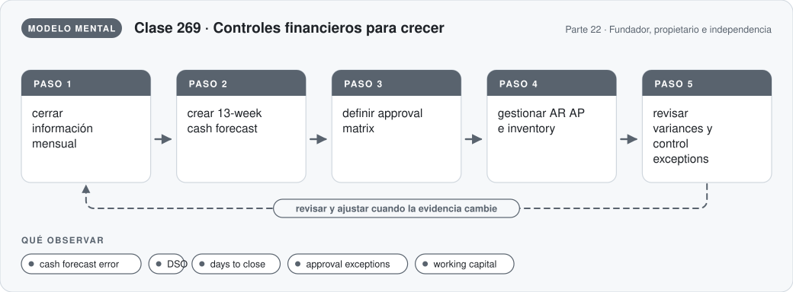

# Clase 269 — Controles financieros para crecer

<!-- nav:inicio -->
> **Parte 22 · Escalamiento, propiedad y portafolio empresarial** — clase 5 de 12 · [índice de la parte](../../README.md) · [temario](../../../../SYLLABUS.md)
<!-- nav:fin -->

**Parte:** 22 — Escalamiento, propiedad y portafolio empresarial  
**Nivel:** Etapa 6 — Business Owner  
**Duración sugerida:** 150–180 minutos · **Estándar:** deep-class-v2

## 🎯 Propósito

Una empresa que crece consume caja antes de producirla: contrata antes de vender más, compra inventario antes de cobrarlo, otorga plazos a clientes antes de pagar a proveedores. Muchas empresas rentables quiebran por falta de caja, no de utilidad. En la etapa de escalamiento, el fundador debe pasar de «ver el saldo del banco» a **gestionar la información financiera como un sistema de control**: cierres mensuales confiables y rápidos, pronóstico de caja a trece semanas, reglas de aprobación de gastos, gestión de cuentas por cobrar, por pagar e inventario, y revisión sistemática de variaciones. Sin ello, las decisiones de crecer (contratar, abrir, comprar, endeudarse) se toman con información tardía o dudosa. Horowitz recuerda que los problemas de caja suelen aparecer tarde y que el peor momento para descubrirlos es cuando la empresa los necesita resueltos.

La clase propone un conjunto mínimo de controles proporcionales al tamaño. No pretende convertir al fundador en contador: pretende que **exija información útil a tiempo y sepa leerla**. Se apoya en Harnish (rutinas y cifras clave), Horowitz (liderar en situaciones críticas, caja y decisiones difíciles), Galbraith (información y coordinación en la organización), Sutton y Rao (prácticas esenciales al escalar) y Hoffman y Yeh (tensiones del crecimiento acelerado). Al terminar sabrás diseñar un cierre mensual, construir y evaluar un pronóstico de caja a trece semanas, calcular días de cobro, inventario y pago, diseñar una matriz de aprobación y revisar variaciones y excepciones.

## 📚 Resultados de aprendizaje

Al finalizar podrás:

1. **Distinguir** utilidad, caja y capital de trabajo.
2. **Diseñar** un cierre mensual con plazo, responsables y controles.
3. **Construir** un pronóstico de caja a trece semanas y medir su error.
4. **Calcular** días de cobro, de inventario y de pago, y el ciclo de conversión de caja.
5. **Definir** una matriz de aprobación proporcional y un proceso de revisión de excepciones.

## 🧭 Agenda

| Tramo | Qué se hace |
|---|---|
| 0–20 min | Recuperación: ¿cuántas semanas de caja tienes y cómo lo sabes? |
| 20–60 min | Cierre, pronóstico, aprobaciones, cobros, pagos, inventario y variaciones. |
| 60–105 min | Ejemplo trabajado: error de pronóstico, días de cobro y caja liberable. |
| 105–150 min | Caso ejecutivo y práctica. |
| 150–175 min | Límites y entregable. |

## 🧩 Conceptos centrales

| Concepto | Definición | Cómo se reconoce |
|---|---|---|
| **Capital de trabajo** | Recursos necesarios para operar entre pagos y cobros. | Cobros pendientes, inventario y pagos por hacer. |
| **Pronóstico de caja a 13 semanas** | Proyección semanal de cobros y pagos para un trimestre. | Saldos por semana y supuestos. |
| **Error de pronóstico** | Diferencia entre lo proyectado y lo real. | Porcentaje por semana. |
| **DSO** | Días promedio que tardan en cobrarse las ventas. | Cuentas por cobrar ÷ ventas × días. |
| **Ciclo de conversión de caja** | Días entre pagar insumos y cobrar ventas. | Días de cobro + inventario − pago. |
| **Matriz de aprobación** | Reglas de quién autoriza qué y hasta cuánto. | Montos, roles y excepciones. |

## 🧠 Modelo mental

**Cómo leer el diagrama.** Una cadena de cinco pasos. **Cierre mensual**: información confiable en pocos días. **Caja a 13 semanas**: pronóstico con supuestos y revisión. **Matriz de aprobación**: quién autoriza qué y hasta cuánto. **Cobros, pagos e inventario**: plazos, incobrables y existencias. **Variaciones y excepciones**: qué se desvió y por qué. La flecha de retorno indica que el error del pronóstico mejora el modelo. La nota recuerda que los controles deben ser proporcionales: demasiados frenan la ejecución y muy pocos dejan huecos; el pie, que un pronóstico sin revisión del error es una opinión.

## 📖 Desarrollo

### 1. Utilidad no es caja

La **utilidad** es una medida contable de resultado en un período; la **caja** es el dinero disponible. Pueden divergir mucho. Una empresa que vende a 60 días y paga a proveedores a 30 necesita financiar 30 días de operación; si crece 40 %, necesita financiar más. El **capital de trabajo** (cuentas por cobrar más inventario menos cuentas por pagar) crece con las ventas y consume caja. Un fundador atento mira tres cifras cada semana: **saldo de caja**, **cobros y pagos de las próximas semanas** y **compromisos grandes** (remuneraciones, impuestos, cuotas de deuda, arriendos). La decisión de crecer debe incluir la pregunta: **¿cuánta caja adicional necesito y de dónde la saco?** (clase 222 sobre caja y financiamiento). Una empresa puede crecer hasta quedarse sin caja si no monitorea esta dinámica.

### 2. Cierre mensual confiable y rápido

El **cierre mensual** convierte los movimientos del mes en información fiable: conciliaciones bancarias, documentos registrados, provisiones, estado de resultados, balance y flujo de caja. Dos indicadores simples: **días para cerrar** (cuántos días hábiles después del fin de mes se entrega la información) y **calidad** (cuántos ajustes se hacen después del cierre). Un cierre que tarda tres semanas sirve para archivar, no para decidir. Se establece un **calendario de cierre** con responsables, fechas y listas de verificación (similar a la de la clase 258), y una reunión de revisión de resultados con el fundador y los líderes. Se define qué información mínima se espera: ventas por segmento, margen de contribución, gastos por área, caja, cuentas por cobrar y por pagar, y variación frente a lo presupuestado. Galbraith destaca que las organizaciones requieren información oportuna para coordinar; el cierre es el insumo de ese sistema.

### 3. El pronóstico de caja a trece semanas

El pronóstico de **trece semanas** (un trimestre) es la herramienta de control más útil en una empresa en crecimiento. Estructura: saldo inicial; **cobros esperados** por semana (por cliente grande o por antigüedad de cuentas por cobrar), **pagos comprometidos** (remuneraciones, proveedores, arriendos, impuestos, deuda), **pagos discrecionales** y saldo final. Se actualiza **cada semana**: se reemplaza lo proyectado por lo real y se agrega una semana nueva. Se acompaña de **supuestos explícitos** (cuándo paga cada cliente, qué pagos se pueden diferir) y de una **prueba de estrés** (cobros 20 % menores o retrasados). El valor de la herramienta está también en **medir su error**: si se proyecta una caja de 52 y la real es 41, ¿por qué? Aprender de las diferencias mejora los supuestos. Un pronóstico que nunca se compara con la realidad es una opinión.

### 4. Matriz de aprobación

La **matriz de aprobación** define quién puede autorizar cada tipo de gasto o compromiso y hasta qué monto: por ejemplo, un jefe hasta cierto monto, un gerente hasta un monto mayor, dos firmas o el fundador sobre un umbral, y revisión de contratos por un asesor sobre otro. Se definen reglas para **excepciones** (urgencias, proveedores únicos), para **contratos de largo plazo** y para **gastos fuera de presupuesto**. La finalidad no es frenar, sino **asignar responsabilidad y evitar sorpresas**: el fundador deja de aprobar lo menor y concentra su atención en lo que cambia el riesgo. Harnish destaca la importancia de reglas claras para que el equipo pueda actuar rápido dentro de un marco. La matriz debe ser **simple y escrita**, y revisarse al crecer. Un exceso de aprobaciones paraliza; una ausencia de ellas expone a errores y fraudes.

### 5. Cobros, pagos e inventario

Tres indicadores de ciclo permiten gestionar el capital de trabajo. **Días de cobro (DSO)**: cuentas por cobrar ÷ ventas del período × días del período. **Días de inventario (DIO)**: inventario ÷ costo de ventas × días. **Días de pago (DPO)**: cuentas por pagar ÷ costo de ventas × días. El **ciclo de conversión de caja** es DSO + DIO − DPO: los días en que la empresa financia su operación. Acortarlo libera caja: cada día de DSO de menos equivale a un día de ventas. Se gestiona con: condiciones de pago claras, cobranza sistemática con responsables, anticipos o pagos parciales, límites de crédito por cliente, rotación y reposición de inventario basadas en datos, y negociación con proveedores. Un cliente que paga tarde es una forma de crédito sin interés; se decide con cuidado a quién se le da.

### 6. Revisar variaciones y excepciones

Cada mes se compara lo real con el presupuesto o con el pronóstico: ventas, margen, gastos, caja. Las **variaciones** relevantes (por monto o porcentaje) se explican: ¿precio, volumen, mezcla, costo, error, evento único? Se distinguen **variaciones que requieren acción** (una tendencia) de **ruido**. Las **excepciones de control** (gastos sin aprobación, pagos duplicados, facturas atrasadas, saldos inusuales) se listan, se investigan y se resuelven, con un responsable y una fecha. Se mantiene un **registro de lecciones**. Jensen advierte, en sus estudios sobre presupuestos, que los procesos presupuestarios mal diseñados incentivan el juego de números; un buen control no castiga la mala noticia, sino que **exige que llegue temprano**. Ese principio es parte de la cultura financiera del equipo.

### 7. Proporcionalidad y cultura de control

Los controles tienen costo. Una empresa de 20 personas necesita menos formalidad que una de 200, pero **no necesita menos claridad**. Una regla práctica: aplicar controles más estrictos donde la **exposición** (monto y probabilidad de error o fraude) es mayor, y simplificar donde es menor. Sutton y Rao destacan que escalar implica transmitir prácticas esenciales; en finanzas, eso se traduce en pocas rutinas bien ejecutadas (cierre, pronóstico semanal, aprobaciones, cobranza) más que en muchos informes. Hoffman y Yeh muestran que el crecimiento acelerado tolera cierto desorden a cambio de velocidad, pero que la caja es un límite que no se negocia. Finalmente, el fundador da el ejemplo: respeta la matriz, lee los informes y pregunta por las variaciones.

## 📚 Lectura comparada

| Obra | Qué aporta | Qué no resuelve | Pregunta para contrastar |
|---|---|---|---|
| Harnish | Rutinas y cifras clave de gestión. | No es manual de contabilidad. | ¿Qué cifra reviso cada semana? |
| Horowitz | Caja y decisiones difíciles en crisis. | Enfoque de empresas tecnológicas. | ¿Qué problema de caja estoy evitando mirar? |
| Galbraith | Información y coordinación organizacional. | No define indicadores financieros. | ¿La información llega a quien decide a tiempo? |
| Sutton y Rao | Prácticas esenciales al escalar. | No fija controles. | ¿Qué rutina financiera debo conservar? |
| Hoffman y Yeh | Tensión entre velocidad y control. | No es guía financiera. | ¿Cuánto desorden puedo pagar? |

## 🧮 Ejemplo trabajado

**Situación (hipotética).** Una distribuidora de materiales de construcción con ventas anuales de 1.095 millones de pesos (3 millones diarios) y costo de ventas de 730 millones (2 millones diarios) quiere crecer 40 % y revisa sus controles. Todos los valores son **supuestos**.

**Error del pronóstico de caja (cuatro semanas, millones).**

| Semana | Proyectado | Real | Diferencia | Error porcentual |
|---|---|---|---|---|
| 1 | 52 | 50 | 2 | 4,0 % |
| 2 | 48 | 41 | 7 | 17,1 % |
| 3 | 45 | 44 | 1 | 2,3 % |
| 4 | 40 | 31 | 9 | 29,0 % |

Error porcentual absoluto promedio: (4,0 + 17,1 + 2,3 + 29,0) ÷ 4 = **13,1 %**. Las semanas 2 y 4 explican la mayor parte: un cliente grande pagó 10 días tarde y una compra de inventario se adelantó. **Lectura:** el error crece cuando hay clientes grandes y compras de inventario; se agregan al pronóstico fechas de pago por cliente y calendario de compras.

**Indicadores de ciclo.**

| Cifra | Valor |
|---|---|
| Cuentas por cobrar | 180 millones |
| Inventario | 90 millones |
| Cuentas por pagar | 54 millones |

- DSO: 180 ÷ 1.095 × 365 = **60 días**.
- DIO: 90 ÷ 730 × 365 = **45 días**.
- DPO: 54 ÷ 730 × 365 = **27 días**.
- Ciclo de conversión de caja: 60 + 45 − 27 = **78 días**.

**Caja liberable con metas (DSO 48, DIO 40, DPO 30).**

- Cobros: 12 días × 3 millones = **36 millones**.
- Inventario: 5 días × 2 millones = **10 millones**.
- Pagos: 3 días × 2 millones = **6 millones**.
- **Total liberable: 52 millones**, y el ciclo baja a 48 + 40 − 30 = **58 días**.

**Efecto del crecimiento de 40 %.** Con ventas de 1.533 millones (1.095 × 1,4) y los mismos días de cobro, inventario y pago, el capital de trabajo necesario crece en proporción: cuentas por cobrar de 252 millones (180 × 1,4), inventario de 126 y cuentas por pagar de 75,6. Capital de trabajo: 252 + 126 − 75,6 = **302,4 millones**, frente a 180 + 90 − 54 = **216 millones** hoy: **+86,4 millones de caja adicional**. Con las metas de ciclo logradas, el incremento sería menor porque los saldos se mantendrían más bajos (se verifica con el nuevo modelo). **El crecimiento de 40 % necesita financiamiento por unos 86 millones si no se mejora el ciclo.**

**Matriz de aprobación (supuesta).** Compras hasta 2 millones: jefe de bodega; hasta 10 millones: gerente de operaciones; sobre 10 millones o proveedores nuevos: fundador y verificación por teléfono; contratos de más de 12 meses: revisión del asesor; pagos fuera de presupuesto: gerente y fundador.

**Cierre mensual.** Hoy se cierra en 18 días hábiles con 12 ajustes posteriores. Meta: 8 días hábiles y menos de 4 ajustes. Con 8 días, el fundador revisa los resultados a mediados de mes y puede reaccionar.

**Decisión.** Financiar el crecimiento con una combinación de caja liberada (hasta 52 millones con metas de DSO, DIO y DPO a 6 meses) y una línea de crédito evaluada con el banco, implementar el pronóstico semanal con error por cliente grande, adoptar la matriz de aprobación y acordar el cierre en 8 días. Revisar las metas mensualmente.

**Cuidados.** Los valores son supuestos y los resultados dependen del comportamiento real de clientes y proveedores; las condiciones de crédito y las normas tributarias y laborales se verifican con asesoría.

**Qué muestra.** (1) El error del pronóstico señaló dónde mejorar los supuestos. (2) El ciclo de conversión de caja dimensionó la caja liberable. (3) El crecimiento aumenta el capital de trabajo necesario.

## 🔀 Comparación y límites

**Control frente a burocracia.** El control asigna responsabilidad y detecta desvíos en lo que importa; la burocracia añade pasos sin reducir riesgo. La diferencia está en la exposición que cada control reduce.

**Límites.** Los controles tienen costo y deben ser proporcionales. Un pronóstico mejora con la práctica pero siempre tiene error. Los indicadores de ciclo dependen de definiciones y estacionalidad. Las cifras del ejemplo son supuestos. Las normas contables y tributarias se verifican con profesionales.

## 🪜 De profesional a owner

| Nivel | Cómo se relaciona con los controles financieros |
|---|---|
| **Profesional** | Cumple los procedimientos de gasto y rendición. |
| **Jefe / Team Lead** | Aprueba dentro de su límite y vigila su presupuesto. |
| **Gerente** | Responde por variaciones, cobros y pagos de su área. |
| **CEO / Director** | Exige cierre oportuno y pronóstico de caja, y fija la matriz de aprobación. |
| **Founder / Owner** | Define la tolerancia al riesgo y financia el crecimiento con caja y deuda. |

## 🏢 Caso ejecutivo

Un fundador dirige una empresa de alimentos congelados para restaurantes con ventas anuales de 1.460 millones de pesos (4 millones diarios), costo de ventas de 1.022 millones (2,8 millones diarios), cuentas por cobrar de 280 millones, inventario de 140 millones y cuentas por pagar de 70 millones. Cierra el mes en 25 días, su pronóstico de caja es una planilla semanal que no actualiza, los vendedores otorgan plazos distintos sin registro, el gerente de compras aprueba pedidos sin límite y hubo un pago duplicado de 3,2 millones. Un restaurante grande que representa el 14 % de las ventas paga con 50 días de atraso. El fundador planea abrir una segunda planta con una inversión de 180 millones y crecer 35 %. La línea de crédito es de 60 millones y está usada en 45 millones.

Entrega un **memo de decisión y modelo financiero** que contenga: (a) los indicadores DSO, DIO, DPO y ciclo de conversión con cálculo; (b) la caja liberable con metas realistas y la caja adicional que requeriría un crecimiento de 35 % si el ciclo no mejora; (c) el diseño del pronóstico de trece semanas y cómo medirá el error; (d) la matriz de aprobación y las medidas ante el pago duplicado; (e) el plan de cobranza para el cliente grande y la política de plazos; (f) los límites del análisis y las decisiones que dependen de verificación con el contador y el banco.

## 🧪 Práctica

1. Calcula tus DSO, DIO, DPO y ciclo de conversión de caja con datos reales.
2. Construye un pronóstico de trece semanas y mídele el error durante cuatro semanas.
3. Define una matriz de aprobación con montos y roles para tu empresa.
4. Calcula cuánta caja necesitaría un crecimiento de 30 % con tus indicadores actuales.
5. Diseña un cierre mensual con calendario y lista de verificación.

## ⚠️ Errores frecuentes

| Error | Por qué ocurre | Cómo corregirlo |
|---|---|---|
| Confundir utilidad con caja | Se mira solo el resultado | Pronóstico de caja y capital de trabajo. |
| Cierre tardío | Falta proceso | Calendario, responsables y meta de días. |
| Pronóstico sin medición del error | Se supone exacto | Comparar con la realidad cada semana. |
| Aprobar todo o no aprobar nada | Falta de reglas | Matriz simple y escrita. |
| Plazos de pago sin política | Cada vendedor decide | Condiciones estándar y límites por cliente. |
| Crecer sin financiar el capital de trabajo | Se piensa en ventas | Calcular la caja adicional del crecimiento. |

## ❓ Preguntas de comprobación

1. ¿Por qué la utilidad no equivale a la caja?
2. ¿Qué mide el ciclo de conversión de caja?
3. ¿Cómo se calcula el DSO?
4. ¿Para qué se mide el error del pronóstico?
5. ¿Qué define una matriz de aprobación?
6. ¿Cómo afecta crecer al capital de trabajo?
7. ¿Qué límite tienen los controles?

Claves de respuesta

1. Porque cobros y pagos ocurren en momentos distintos del resultado contable y el capital de trabajo consume caja.
2. Los días en que la empresa financia su operación: días de cobro más inventario menos pago.
3. Cuentas por cobrar divididas por ventas del período, multiplicadas por los días del período.
4. Para entender las diferencias y mejorar los supuestos del pronóstico.
5. Quién autoriza qué tipo de gasto y hasta qué monto, y cómo se tratan las excepciones.
6. Aumenta en proporción a las ventas si los ciclos se mantienen, y exige financiamiento adicional.
7. Tienen costo, deben ser proporcionales y no eliminan el error ni el riesgo.

## 📥 Entregable

Guarda en `portfolio/269-controles-financieros-para-crecer/`:

- `modelo-financiero-y-memo-de-decision.md` (plantilla [Modelo financiero y memo de decisión](../../../../templates/modelo-financiero-y-memo-de-decision.md)) con el memo y los cálculos del caso ejecutivo;
- `cash-runway.md` (plantilla [Cash runway](../../../../templates/cash-runway.md)) con el pronóstico de trece semanas;
- `decision-journal.md` con la matriz de aprobación y el calendario de cierre.

## 📗 Fuentes y verificación

- Verne Harnish — *Scaling Up* (Gazelles, Inc., 2014). **Uso en esta clase:** rutinas y cifras clave de gestión para crecer. Lectura selectiva sobre **controles financieros para crecer**. **Localizador:** [ISBN-13 9780986019555](https://openlibrary.org/isbn/9780986019555).
- Ben Horowitz — *The Hard Thing About Hard Things* (HarperCollins Publishers, 2014). **Uso en esta clase:** caja y decisiones difíciles en empresas en crecimiento. Lectura selectiva sobre **controles financieros para crecer**. **Localizador:** [ISBN-13 9780062273215](https://openlibrary.org/isbn/9780062273215).
- Jay R. Galbraith — *Designing Organizations* (Jossey-Bass Publishers, 1995). **Uso en esta clase:** información y coordinación en la organización. Lectura selectiva sobre **controles financieros para crecer**. **Localizador:** [ISBN-13 9780787900915](https://openlibrary.org/isbn/9780787900915).
- Robert I. Sutton & Huggy Rao — *Scaling Up Excellence* (Random House Canada, 2014). **Uso en esta clase:** prácticas esenciales al escalar. Lectura selectiva sobre **controles financieros para crecer**. **Localizador:** [ISBN-13 9780307363428](https://openlibrary.org/isbn/9780307363428).
- Reid Hoffman & Chris Yeh — *Blitzscaling* (HarperCollins Publishers Limited, 2018). **Uso en esta clase:** tensión entre velocidad y control en el crecimiento. Lectura selectiva sobre **controles financieros para crecer**. **Localizador:** [ISBN-13 9780008303648](https://openlibrary.org/isbn/9780008303648).
- Michael C. Jensen — *Paying People to Lie: the Truth about the Budgeting Process* (European Financial Management, 2003). **Uso en esta clase:** incentivos y presupuestos que distorsionan la información. Lectura selectiva sobre **controles financieros para crecer**. **Localizador:** [DOI 10.1111/1468-036x.00226](https://doi.org/10.1111/1468-036x.00226).
- Michael E. Gerber — *The E-Myth Revisited* (HarperAudio, 1995). **Uso en esta clase:** sistemas que sostienen la empresa sin el fundador. Lectura selectiva sobre **controles financieros para crecer**. **Localizador:** [ISBN-13 9780060574901](https://openlibrary.org/isbn/9780060574901).

> **Regla de fuentes para Controles financieros para crecer:** las obras anteriores estructuran las perspectivas de esta materia; cualquier norma, ley o estándar vivo mencionado debe comprobarse nuevamente en su fuente primaria vigente, incluidas las normas contables y tributarias. Los ejemplos y casos son hipotéticos, con cifras ilustrativas. El desarrollo es original y no reproduce capítulos protegidos.

<!-- pie:inicio -->
---

| Anterior | Índice | Siguiente |
|---|---|---|
| [← 268 · Escalar ventas sin destruir margen](../268-escalar-ventas-sin-destruir-margen/README.md) | [Parte 22](../../README.md) · [Programa](../../../../SYLLABUS.md) | [270 · Gobierno proporcional al tamaño →](../270-gobierno-proporcional-al-tamano/README.md) |
<!-- pie:fin -->
