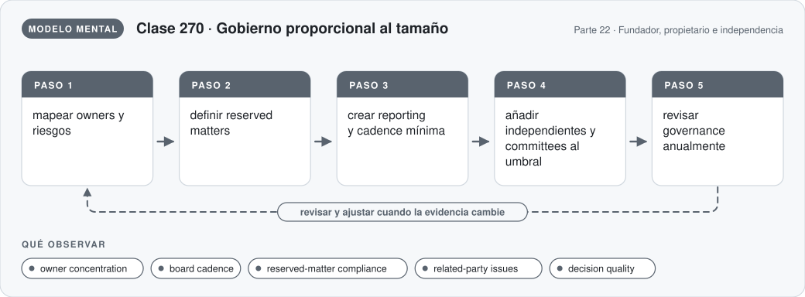

# Clase 270 — Gobierno proporcional al tamaño

<!-- nav:inicio -->
> **Parte 22 · Escalamiento, propiedad y portafolio empresarial** — clase 6 de 12 · [índice de la parte](../../README.md) · [temario](../../../../SYLLABUS.md)
<!-- nav:fin -->

**Parte:** 22 — Escalamiento, propiedad y portafolio empresarial  
**Nivel:** Etapa 6 — Business Owner  
**Duración sugerida:** 150–180 minutos · **Estándar:** deep-class-v2

## 🎯 Propósito

«Gobierno corporativo» suena a sala de directorio de una gran empresa, con comités, auditores y actas. En una empresa de cuarenta personas, con tres socios y un fundador que decide casi todo, parece una exageración. Sin embargo, el **gobierno** es sencillamente el sistema que responde tres preguntas: **¿quién decide qué?, ¿a quién rinde cuentas cada decisor?, ¿cómo se resuelven los desacuerdos?** Toda empresa tiene gobierno, explícito o implícito. Cuando es implícito, funciona mientras el fundador manda y todos están de acuerdo; falla cuando entra un socio, se retira un familiar, se pide un crédito grande, se enferma el fundador o hay una oferta de compra. La pregunta útil no es «¿necesito un directorio?» sino **«¿qué nivel de gobierno corresponde al tamaño, la complejidad y el riesgo de mi empresa hoy, y cuándo debería cambiar?»**

La clase propone un gobierno por niveles: dueño con reglas escritas, reuniones y reportes mínimos, asesores independientes y, finalmente, directorio con comités. Se apoya en los Principios de Gobierno Corporativo de la OECD y el G20 (derechos de los accionistas, responsabilidades del directorio, transparencia), en Drucker (la gestión y el rol del directorio), en Gil (cómo evoluciona el gobierno en empresas de crecimiento), en Harnish (cadencia de reuniones), en Sutton y Rao (escalar prácticas esenciales) y en Gerber. Al terminar sabrás mapear propietarios y riesgos, definir materias reservadas, diseñar una cadencia mínima de reuniones y reportes, decidir cuándo agregar asesores independientes y revisar el gobierno cada año.

## 📚 Resultados de aprendizaje

Al finalizar podrás:

1. **Distinguir** propiedad, dirección y gestión.
2. **Mapear** propietarios, riesgos y conflictos posibles.
3. **Definir** materias reservadas y reglas de decisión escritas.
4. **Diseñar** una cadencia mínima de reuniones, informes y actas.
5. **Decidir** cuándo incorporar asesores independientes y comités.

## 🧭 Agenda

| Tramo | Qué se hace |
|---|---|
| 0–20 min | Recuperación: ¿qué decisiones de tu empresa no podría tomar solo el fundador y quién lo dice? |
| 20–60 min | Tres funciones, riesgos, materias reservadas, cadencia, independientes, comités y revisión anual. |
| 60–105 min | Ejemplo trabajado: concentración de propiedad, cumplimiento de la cadencia y puntaje de umbral. |
| 105–150 min | Caso ejecutivo y práctica. |
| 150–175 min | Límites y entregable. |

## 🧩 Conceptos centrales

| Concepto | Definición | Cómo se reconoce |
|---|---|---|
| **Gobierno** | Sistema que define quién decide, quién rinde cuentas y cómo se resuelven desacuerdos. | Reglas y reuniones. |
| **Materias reservadas** | Decisiones que requieren aprobación de los propietarios o del directorio. | Lista escrita con umbrales. |
| **Cadencia** | Calendario de reuniones, informes y revisiones. | Fechas, actas y paquetes. |
| **Asesor o director independiente** | Persona sin vínculos que sesguen su juicio. | Ausencia de conflicto relevante. |
| **Concentración de propiedad** | Grado en que pocos propietarios controlan la empresa. | Porcentajes y derechos. |
| **Comité** | Grupo con mandato específico (por ejemplo, auditoría). | Mandato, miembros y agenda. |

## 🧠 Modelo mental

**Cómo leer el diagrama.** Una escalera de cuatro niveles. **Dueño con reglas**: decisiones reservadas y límites escritos. **Reuniones y reporte mínimo**: cadencia, actas y tablero simple. **Asesores independientes**: voz externa sin voto o con voto limitado. **Directorio con comités**: independientes, auditoría y compensación. La nota advierte que no se copia el gobierno de una gran empresa en una pyme y que se agregan capas cuando el tamaño, la complejidad o la concentración de propiedad lo justifican; el pie, que el gobierno se revisa al menos una vez al año.

## 📖 Desarrollo

### 1. Propiedad, dirección y gestión

La **propiedad** pertenece a quienes aportaron capital y asumen el riesgo residual; la **dirección** define el rumbo, aprueba las decisiones estratégicas y supervisa a la gestión; la **gestión** ejecuta el día a día. En una empresa pequeña, las tres funciones se concentran en una persona o en pocas. Eso no es un problema en sí, pero **confunde las responsabilidades**: ¿el fundador decide como dueño, como director o como gerente? Los Principios de la OECD y el G20 destacan que un buen gobierno protege los derechos de los accionistas, asegura un trato equitativo, define responsabilidades del órgano de dirección y garantiza transparencia. Aunque están pensados para sociedades abiertas, sus ideas se **aplican proporcionalmente** a empresas cerradas: reglas claras, información fiable, rendición de cuentas y manejo de conflictos.

### 2. Mapear propietarios y riesgos

El primer paso es un mapa: **quiénes son los propietarios** (porcentajes, derechos, si trabajan o no en la empresa, si hay familiares), **qué intereses pueden diverger** (reinvertir o repartir utilidades, vender o conservar, crecer o mantener, contratar a familiares), y **qué riesgos de gobierno existen**: decisiones concentradas en una persona, desacuerdos sin mecanismo de solución, falta de información para propietarios no operativos, endeudamiento sin aprobación, transacciones con partes relacionadas, ausencia de reglas de salida o sucesión. Jensen y Meckling explican que la separación entre propiedad y gestión crea **costos de agencia**: los gestores pueden no actuar en el mejor interés de los propietarios; Fama y Jensen analizan cómo los sistemas de decisión controlan esos problemas. Incluso en empresas pequeñas, un socio que no gestiona necesita información y reglas.

### 3. Materias reservadas y reglas de decisión

Las **materias reservadas** son las decisiones que no puede tomar solo la gestión o el fundador, sino que requieren la aprobación de los propietarios o del directorio. Ejemplos de categorías: **cambios en la estructura** (entrada de nuevos socios, fusiones, venta), **capital y deuda** (aportes, endeudamiento sobre un monto, garantías), **inversiones y compromisos grandes**, **transacciones con partes relacionadas**, **contratación y remuneración de ejecutivos clave**, **distribución de utilidades**, **cambios estratégicos** y **apertura o cierre de líneas**. Se definen **umbrales** (montos o porcentajes) y la **mayoría** requerida. La lista es breve y escrita, y se incorpora a los estatutos o a un pacto de socios con asesoría legal (clase 251 y la parte 21 para el marco societario chileno). Las reglas dan **predictibilidad** y protegen a minoritarios y mayoritarios.

### 4. Cadencia mínima y reportes

El gobierno vive en una **cadencia**: reuniones con fechas fijas, agenda, información previa y actas con decisiones y responsables. Para una empresa pequeña, una reunión de propietarios cada trimestre y una reunión mensual de seguimiento con un tablero simple suelen bastar; una reunión anual de revisión de estrategia, presupuesto y gobierno completa el ciclo. El **paquete de información** (resultados, caja, indicadores, riesgos, decisiones pendientes) se envía con anticipación. Harnish enfatiza que las rutinas regulares de reunión y revisión permiten decidir con base en datos. Las **actas** registran lo decidido, no una transcripción: qué se aprobó, quién responde y cuándo. Una cadencia que se cumple vale más que un directorio sofisticado que no se reúne. El indicador básico es **qué porcentaje de las reuniones planificadas se realizó**.

### 5. Cuándo agregar voces independientes

Un **asesor independiente** (o consejo asesor) aporta experiencia y objetividad sin los vínculos que sesgan el juicio de socios y gerentes; puede ayudar en estrategia, finanzas, gobierno o industria. Se considera cuando se da alguna de estas condiciones: **propietarios no operativos** que necesitan una voz neutral; **conflictos** entre socios o familiares; **endeudamiento relevante**; **proyectos de inversión grandes**; **preparación para ingresar capital externo o vender**; **complejidad** de varias unidades (clase 271). Gil describe cómo, en empresas que crecen, los directorios pasan de ser un trámite a una herramienta de ayuda al fundador. Se define el **mandato** (asesorar, con o sin voto), la **frecuencia**, la **remuneración**, la **confidencialidad** y el procedimiento de **conflictos de interés**. Un asesor de papel, sin información real, no cumple su función.

### 6. Comités, directorio e independientes

Con mayor tamaño o complejidad, se formaliza un **directorio** con responsabilidades definidas (aprobar estrategia y presupuesto, supervisar a la gestión, nombrar y evaluar al CEO, aprobar transacciones relevantes) y, cuando corresponda, **comités** (auditoría y riesgos, compensación, nominaciones) con **directores independientes**. Los principios de la OECD ofrecen referencias sobre composición, independencia, evaluación y transparencia. El **costo** del gobierno (tiempo, honorarios, preparación, formalidades) crece con el nivel; por eso se **escala por umbrales** y no por moda. En las sociedades de ciertos tipos, la ley impone estructuras y deberes específicos que se verifican con asesoría legal y fuentes oficiales; esta clase no los interpreta. Los comités deben tener mandato, información suficiente y agenda anual.

### 7. Revisar el gobierno cada año

El gobierno se **evalúa** una vez al año con preguntas simples: ¿se cumplió la cadencia?, ¿se respetaron las materias reservadas?, ¿llegó la información a tiempo?, ¿se resolvieron los desacuerdos sin dañar la relación?, ¿hay propietarios o gestores con conflictos no declarados?, ¿cambió el tamaño, el riesgo o la propiedad de modo que el nivel actual ya no es adecuado? Se documentan los cambios y se actualizan reglas y pactos. Drucker advierte que los órganos de dirección tienden a ser ceremoniales si no tienen una función clara; el objetivo es que el gobierno **ayude a decidir mejor y a proteger** la empresa y a sus propietarios, no a producir papeles. Y se recuerda que las reglas legales aplicables al tipo societario y al caso se consultan con asesoría.

## 📚 Lectura comparada

| Obra | Qué aporta | Qué no resuelve | Pregunta para contrastar |
|---|---|---|---|
| OECD y G20 (principios de gobierno corporativo) | Marco de derechos, responsabilidades y transparencia. | Pensado para sociedades abiertas. | ¿Qué principio aplica proporcionalmente a mi empresa? |
| Jensen y Meckling; Fama y Jensen | Costos de agencia y control de las decisiones. | Teoría, no guía práctica. | ¿Qué conflicto de intereses existe entre mis socios y gestores? |
| Drucker | Función real del órgano de dirección. | No es guía legal. | ¿Mi directorio cumple una función o es ceremonial? |
| Gil | Evolución del gobierno en empresas que crecen. | Enfoque de empresas de crecimiento. | ¿Qué cambio de gobierno me toca ahora? |
| Harnish | Cadencia de reuniones y rutinas. | No trata conflictos de propiedad. | ¿Qué reunión regular me falta? |

## 🧮 Ejemplo trabajado

**Situación (hipotética).** Una empresa de ingeniería con 45 personas y ventas de 2.400 millones de pesos tiene tres propietarios: Marta (60 %, gerente general), Iván (25 %, gerente de proyectos) y un inversionista pasivo, Julián (15 %). Quieren definir su gobierno. Los números son **supuestos**.

**Concentración de propiedad.** Índice de concentración (suma de cuadrados de las participaciones): 0,60² + 0,25² + 0,15² = 0,36 + 0,0625 + 0,0225 = **0,445**. Número efectivo de propietarios: 1 ÷ 0,445 = **2,25**. Marta controla por sí sola la mayoría simple (60 %); para decisiones que exijan una mayoría reforzada de dos tercios (66,7 %), necesita a Iván (85 %) o a Julián (75 %). **Las reglas de mayoría importan tanto como los porcentajes.**

**Materias reservadas propuestas (con umbral).** Entrada de nuevos socios o venta (unanimidad); endeudamiento sobre 300 millones o garantías sobre los activos (mayoría reforzada de dos tercios); inversiones sobre 150 millones (mayoría simple con voto de Julián o de Iván); transacciones con partes relacionadas (aprobación sin voto del interesado); distribución de utilidades (mayoría simple según política); contratación del gerente general (mayoría reforzada).

**Cadencia propuesta.** Reunión de propietarios cada trimestre (4), reunión mensual de seguimiento con tablero (12) y revisión anual de estrategia y gobierno (1): **17 reuniones al año**. El año anterior se realizaron 11: cumplimiento = 11 ÷ 17 = **64,7 %**. Se fijan fechas con anticipación, paquete de información cinco días antes y actas en una semana.

**Puntaje para agregar un asesor independiente (criterio interno).**

| Condición | Puntos | ¿Se cumple? | Puntos obtenidos |
|---|---|---|---|
| Propietarios no operativos | 1 | Sí (Julián) | 1 |
| Ventas anuales sobre 1.500 millones | 1 | Sí | 1 |
| Deuda externa sobre 30 % de las ventas anuales | 1 | No (18 %) | 0 |
| Riesgo de conflicto entre socios | 1 | Sí | 1 |
| Preparación para ingresar capital externo o vender | 2 | Sí (plan a 18 meses) | 2 |
| **Total** | **6 posibles** | | **5** |

El umbral interno para agregar un asesor independiente es 3 puntos: **se supera con holgura**. Mandato propuesto: consejo asesor de dos personas independientes, sin voto en las materias reservadas, cuatro sesiones al año, con honorarios de 1,5 millones por sesión y por asesor: 2 × 4 × 1,5 = **12 millones al año**, equivalente al **0,5 %** de las ventas (12 ÷ 2.400).

**Cumplimiento de materias reservadas.** El año anterior hubo 14 decisiones que habrían sido materias reservadas; 11 siguieron un proceso formal de aprobación: 11 ÷ 14 = **78,6 %**. Las tres restantes (un anticipo a un proveedor relacionado, una garantía y una contratación) se revisarán y ratificarán o corregirán, con registro del aprendizaje.

**Decisión.** Adoptar el gobierno de nivel 3 (asesores independientes) con un pacto de socios revisado por un abogado, definir las materias reservadas y la cadencia, designar a una persona responsable de actas y paquetes, y evaluar el gobierno a los doce meses. Considerar un directorio con comités solo si se incorpora capital externo o la deuda supera el umbral.

**Cuidados.** El puntaje y los umbrales son criterios internos; los requisitos legales del tipo societario se verifican con asesoría y fuentes oficiales.

**Qué muestra.** (1) La concentración de propiedad y las mayorías definen el poder real. (2) La cadencia se mide con un porcentaje de cumplimiento. (3) El puntaje de umbral ayuda a decidir el nivel de gobierno con criterio y costo explícitos.

## 🔀 Comparación y límites

**Gobierno frente a gestión.** El gobierno define reglas, supervisa y decide lo reservado; la gestión ejecuta. Confundirlos genera dos problemas: gestores sin control o dueños que se meten en cada detalle.

**Límites.** No hay un nivel de gobierno universal: debe ser proporcional al tamaño, la complejidad y el riesgo. Un exceso de formalidad es costoso y desmotiva; su ausencia expone a conflictos. Las obligaciones legales según tipo societario se consultan con asesoría y fuentes oficiales. Los puntajes y cifras del ejemplo son criterios y supuestos.

## 🪜 De profesional a owner

| Nivel | Cómo se relaciona con el gobierno |
|---|---|
| **Profesional** | Cumple las políticas y entiende quién autoriza qué. |
| **Jefe / Team Lead** | Reporta información fiable a su línea. |
| **Gerente** | Prepara los informes y ejecuta las decisiones del directorio. |
| **CEO / Director** | Responde ante los propietarios y conduce la cadencia. |
| **Founder / Owner** | Diseña las reglas, acepta límites a su propio poder y revisa el gobierno cada año. |

## 🏢 Caso ejecutivo

Una empresa familiar de transporte de carga con 70 personas y ventas de 3.800 millones de pesos pertenece a un padre de 68 años (50 %) y a sus tres hijos (cada uno con 16,7 %). El padre decide casi todo; uno de los hijos es gerente general, otro dirige talleres y la tercera no trabaja en la empresa pero exige información. El padre quiere solicitar un crédito de 900 millones para comprar camiones y ha firmado garantías personales y de la empresa sin consultar. Hay un préstamo de 120 millones del padre a la empresa y arriendos de bodegas a una sociedad de uno de los hijos. No hay actas ni reuniones formales. Un competidor ofreció comprar el 30 % de la empresa. Los hijos discuten sobre cuándo el padre se retirará y sobre cómo se repartirá la propiedad.

Entrega un **memo ejecutivo de gobierno** que contenga: (a) el mapa de propietarios con concentración, intereses y conflictos; (b) las materias reservadas con umbrales y mayorías; (c) las reglas para transacciones con partes relacionadas y garantías; (d) la cadencia de reuniones y reportes con indicador de cumplimiento; (e) el puntaje de umbral para agregar un consejo asesor y su mandato; (f) la hoja de ruta de la sucesión y los límites del análisis, con las verificaciones legales pendientes.

## 🧪 Práctica

1. Construye el mapa de propietarios de tu empresa con porcentajes, roles e intereses.
2. Escribe diez materias reservadas con umbrales y la mayoría requerida.
3. Diseña un calendario anual de reuniones y mide el cumplimiento del año anterior.
4. Aplica un puntaje de umbral para decidir si agregas un asesor independiente.
5. Redacta cinco preguntas para la revisión anual del gobierno.

## ⚠️ Errores frecuentes

| Error | Por qué ocurre | Cómo corregirlo |
|---|---|---|
| Copiar un directorio de empresa grande | Se imita la forma | Escalar por umbrales de tamaño y riesgo. |
| Decisiones reservadas implícitas | Se confía en la buena fe | Lista escrita con umbrales. |
| Sin información para propietarios no operativos | Se supone que no la necesitan | Paquete periódico y reuniones. |
| Asesores sin información | Se busca el nombre | Mandato, acceso y agenda. |
| Transacciones con partes relacionadas sin control | Se ven como normales | Aprobación sin voto del interesado y registro. |
| No revisar | Se supone que basta con haberlo hecho | Revisión anual del gobierno. |

## ❓ Preguntas de comprobación

1. ¿Qué preguntas responde el gobierno?
2. ¿Qué son las materias reservadas?
3. ¿Qué incluye una cadencia mínima?
4. ¿Cuándo se agrega un asesor independiente?
5. ¿Por qué importan las mayorías además de los porcentajes?
6. ¿Qué es un costo de agencia?
7. ¿Qué límite tiene el gobierno proporcional?

Claves de respuesta

1. Quién decide qué, a quién rinde cuentas cada decisor y cómo se resuelven desacuerdos.
2. Decisiones que requieren aprobación de propietarios o directorio, con umbrales y mayoría.
3. Reuniones con fechas fijas, información previa, actas con responsables y una revisión anual.
4. Con propietarios no operativos, conflictos, deuda relevante, proyectos grandes, ventas o ingreso de capital.
5. Porque definen quién puede aprobar o bloquear decisiones importantes.
6. La pérdida que surge cuando los gestores no actúan en el mejor interés de los propietarios.
7. No hay nivel universal; el exceso de formalidad cuesta y la ausencia expone a conflictos, y las obligaciones legales se verifican con asesoría.

## 📥 Entregable

Guarda en `portfolio/270-gobierno-proporcional-al-tamano/`:

- `board-or-executive-memo.md` (plantilla [Board or executive memo](../../../../templates/board-or-executive-memo.md)) con el memo ejecutivo del caso;
- `decision-journal.md` con las materias reservadas, la cadencia y la revisión anual.

## 📗 Fuentes y verificación

- OECD — *G20/OECD Principles of Corporate Governance 2023*. **Uso en esta clase:** principios de gobierno corporativo y responsabilidades de la dirección. **Fuente primaria:** <https://www.oecd.org/en/publications/2023/09/g20-oecd-principles-of-corporate-governance-2023_60836fcb.html>.
- Michael C. Jensen & William H. Meckling — *Theory of the firm: Managerial behavior, agency costs and ownership structure* (Journal of Financial Economics, 1976). **Uso en esta clase:** costos de agencia y estructura de propiedad. Lectura selectiva sobre **gobierno proporcional al tamaño**. **Localizador:** [DOI 10.1016/0304-405X(76)90026-X](https://doi.org/10.1016/0304-405X(76)90026-X).
- Eugene F. Fama & Michael C. Jensen — *Separation of Ownership and Control* (The Journal of Law and Economics, 1983). **Uso en esta clase:** control de las decisiones cuando se separan propiedad y gestión. Lectura selectiva sobre **gobierno proporcional al tamaño**. **Localizador:** [DOI 10.1086/467037](https://doi.org/10.1086/467037).
- Peter F. Drucker — *Management: Tasks, Responsibilities, Practices* (Harper & Row, 1974). **Uso en esta clase:** función real del órgano de dirección. Lectura selectiva sobre **gobierno proporcional al tamaño**. **Localizador:** [ISBN-13 9780060110925](https://openlibrary.org/isbn/9780060110925).
- Elad Gil — *High Growth Handbook* (Stripe Matter Inc, 2018). **Uso en esta clase:** evolución del gobierno en empresas que crecen. Lectura selectiva sobre **gobierno proporcional al tamaño**. **Localizador:** [ISBN-13 9781953953377](https://openlibrary.org/isbn/9781953953377).
- Verne Harnish — *Scaling Up* (Gazelles, Inc., 2014). **Uso en esta clase:** cadencia de reuniones y rutinas de gestión. Lectura selectiva sobre **gobierno proporcional al tamaño**. **Localizador:** [ISBN-13 9780986019555](https://openlibrary.org/isbn/9780986019555).
- Robert I. Sutton & Huggy Rao — *Scaling Up Excellence* (Random House Canada, 2014). **Uso en esta clase:** prácticas esenciales al escalar. Lectura selectiva sobre **gobierno proporcional al tamaño**. **Localizador:** [ISBN-13 9780307363428](https://openlibrary.org/isbn/9780307363428).
- Michael E. Gerber — *The E-Myth Revisited* (HarperAudio, 1995). **Uso en esta clase:** el fundador y el sistema que lo reemplaza. Lectura selectiva sobre **gobierno proporcional al tamaño**. **Localizador:** [ISBN-13 9780060574901](https://openlibrary.org/isbn/9780060574901).

> **Regla de fuentes para Gobierno proporcional al tamaño:** las obras anteriores estructuran las perspectivas de esta materia; cualquier norma, ley o estándar vivo mencionado debe comprobarse nuevamente en su fuente primaria vigente, incluidas las obligaciones legales del tipo societario, que no se interpretan aquí. Los ejemplos y casos son hipotéticos, con cifras ilustrativas. El desarrollo es original y no reproduce capítulos protegidos.

<!-- pie:inicio -->
---

| Anterior | Índice | Siguiente |
|---|---|---|
| [← 269 · Controles financieros para crecer](../269-controles-financieros-para-crecer/README.md) | [Parte 22](../../README.md) · [Programa](../../../../SYLLABUS.md) | [271 · Multiunidad y portafolio →](../271-multiunidad-y-portafolio/README.md) |
<!-- pie:fin -->
