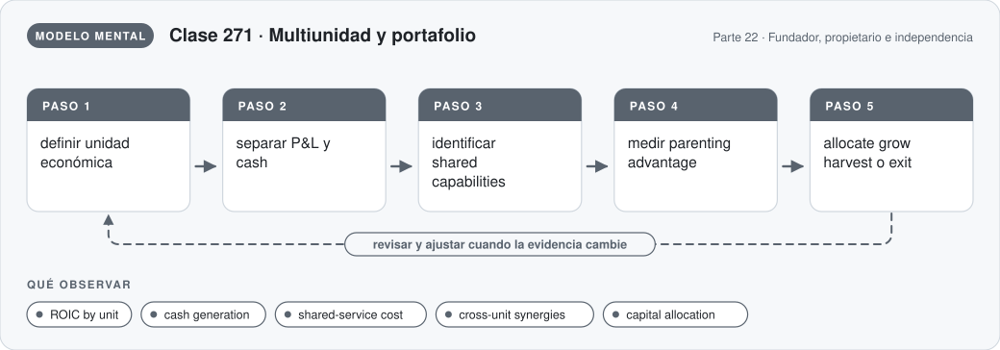

# Clase 271 — Multiunidad y portafolio

<!-- nav:inicio -->
> **Parte 22 · Escalamiento, propiedad y portafolio empresarial** — clase 7 de 12 · [índice de la parte](../../README.md) · [temario](../../../../SYLLABUS.md)
<!-- nav:fin -->

**Parte:** 22 — Escalamiento, propiedad y portafolio empresarial  
**Nivel:** Etapa 6 — Business Owner  
**Duración sugerida:** 150–180 minutos · **Estándar:** deep-class-v2

## 🎯 Propósito

Muchos fundadores terminan dirigiendo, sin haberlo decidido, un conjunto de negocios: una línea nueva que nació de un cliente, una sucursal, una marca adquirida, una empresa de servicios que se agregó a una de productos. Cada unidad se gestiona con los hábitos de la original, comparte personas, caja y atención del dueño, y nadie puede decir con certeza **cuáles ganan dinero de verdad, cuáles lo consumen y qué valor agrega tenerlas juntas**. El resultado habitual es que las unidades rentables financian en silencio a las que no lo son, y que la atención del fundador se va hacia donde hay más ruido y no donde hay más retorno. Gestionar varias unidades exige **una disciplina de portafolio**: definir qué es una unidad económica, separar su estado de resultados y su caja, medir el costo de las capacidades compartidas, preguntarse qué aporta la matriz y decidir dónde crecer, dónde cosechar y dónde salir.

La clase propone ese método y lo ilustra con cálculos de retorno por unidad y de asignación de capital. Se apoya en Goold, Campbell y Alexander (valor que la corporación agrega a sus negocios o, al contrario, destruye: la «ventaja de la matriz»), Koller y colaboradores (valor y retorno sobre el capital invertido), Galbraith (diseño de organizaciones con varias unidades), Horowitz (decisiones difíciles de salir de un negocio), Sutton y Rao, Harnish y Gerber. Al terminar sabrás separar un estado de resultados y una caja por unidad, asignar costos compartidos con un criterio explícito, calcular retorno sobre el capital y valor económico agregado por unidad, estimar la ventaja de la matriz y decidir una asignación de capital con alternativas.

## 📚 Resultados de aprendizaje

Al finalizar podrás:

1. **Definir** una unidad económica con clientes, costos y decisiones propias.
2. **Separar** resultados y caja por unidad y asignar costos compartidos con criterio.
3. **Calcular** retorno sobre el capital y valor agregado por unidad.
4. **Estimar** la ventaja que aporta la matriz frente a un dueño alternativo.
5. **Decidir** crecer, cosechar o salir de cada unidad con evidencia y alternativas.

## 🧭 Agenda

| Tramo | Qué se hace |
|---|---|
| 0–20 min | Recuperación: ¿cuántos negocios distintos hay dentro de tu empresa y cuánto gana cada uno? |
| 20–60 min | Unidad económica, resultados y caja, capacidades compartidas, matriz, asignación. |
| 60–105 min | Ejemplo trabajado: retorno por unidad, valor agregado y ventaja de la matriz. |
| 105–150 min | Caso ejecutivo y práctica. |
| 150–175 min | Límites y entregable. |

## 🧩 Conceptos centrales

| Concepto | Definición | Cómo se reconoce |
|---|---|---|
| **Unidad económica** | Negocio con clientes, costos y decisiones propios. | Estado de resultados separable. |
| **Capacidad compartida** | Servicio o recurso usado por varias unidades. | Contabilidad, compras, tecnología, ventas. |
| **Retorno sobre el capital invertido** | Resultado operativo dividido por el capital empleado. | Porcentaje por unidad. |
| **Valor económico agregado** | Resultado operativo menos el costo del capital empleado. | Positivo o negativo por unidad. |
| **Ventaja de la matriz** | Valor que la casa matriz agrega al negocio frente a otro dueño. | Beneficios menos costos de la matriz. |
| **Asignación de capital** | Decisión de dónde invertir, mantener o retirar recursos. | Crecer, cosechar o salir. |

## 🧠 Modelo mental

**Cómo leer el diagrama.** Una tabla de tres columnas. **Pregunta**: qué es una unidad, cuánta caja genera o consume, qué se comparte, si aporta valor la matriz y si conviene crecer, cosechar o salir. **Cómo se mide**: clientes, costos y decisiones propias; flujo de caja por unidad; costo y servicio de las áreas comunes; qué hace la matriz mejor que un dueño independiente; retorno sobre el capital por unidad. **Decisión asociada**: separar el estado de resultados, financiar, cosechar o frenar, cobrar o centralizar, mantener, vender o fusionar, y asignar recursos con criterio. La nota advierte que una unidad rentable en el papel puede consumir la atención y la caja de las demás; el pie, que cada unidad tiene un responsable y una regla de asignación de capital.

## 📖 Desarrollo

### 1. Qué es una unidad económica

Una **unidad económica** es una parte de la empresa con **clientes propios**, **costos identificables** y **decisiones relativamente autónomas** sobre precio, producto y operación. No es lo mismo que un departamento (finanzas, tecnología) ni que un producto cualquiera: es un conjunto que podría, en principio, operar como negocio separado. Definir unidades es una decisión de gestión: se puede agrupar por línea de negocio, por geografía, por tipo de cliente o por canal. El criterio útil es **si las decisiones y los resultados de ese grupo se pueden separar con sentido**. Un error es mezclar unidades distintas en una sola cifra («la empresa gana») y otro es separar tanto que se pierde la coordinación. Galbraith explica que el diseño organizacional con varias unidades debe equilibrar **autonomía** (para responder a sus mercados) y **coordinación** (para aprovechar lo común).

### 2. Separar estado de resultados y caja

Cada unidad necesita su propio **estado de resultados** (ingresos, costos directos, margen de contribución, costos de la unidad, resultado operativo) y su propia **proyección de caja**: cuánto efectivo genera o consume por operar y por invertir. La separación revela subsidios cruzados. También se estima el **capital empleado** por unidad: activos fijos, inventario y capital de trabajo que necesita. Koller y colaboradores explican que el valor surge del **retorno sobre el capital invertido** frente a su costo; sin capital por unidad no se puede comparar. La separación exige decisiones contables (qué ingresos y costos se asignan a cada una), que deben ser coherentes, documentadas y estables; los profesionales contables ayudan a diseñar criterios, y los efectos tributarios y legales se verifican con asesoría.

### 3. Capacidades compartidas y asignación de costos

Las unidades comparten servicios: contabilidad, tecnología, compras, recursos humanos, marketing, el tiempo del fundador. Los costos de esos servicios deben **asignarse** de manera que reflejen su uso, o al menos de un modo que oriente decisiones: por ingresos, por personas, por transacciones, por horas. Ninguna regla es perfecta; lo importante es **explicitar el criterio**, revisar si distorsiona las decisiones y evitar dos extremos: ignorar los costos comunes (todas las unidades parecen rentables) o asignarlos mecánicamente de forma injusta (se castiga a una unidad pequeña). Se mide también la **calidad y el costo del servicio compartido** frente a alternativas externas: ¿cuesta más o menos que un proveedor independiente? Si es más caro y peor, la matriz está perdiendo valor.

### 4. Retorno por unidad y valor agregado

Para cada unidad se calcula el **retorno sobre el capital invertido** (resultado operativo después de asignaciones, dividido por el capital empleado) y se compara con el **costo del capital**, que refleja lo que exigirían quienes aportan recursos dado el riesgo. La diferencia, multiplicada por el capital, es el **valor económico agregado**: positivo si la unidad rinde más que su costo de capital, negativo si no. Estas cifras no son verdades absolutas: dependen de las asignaciones, de los supuestos sobre capital y de la estimación del costo de capital. Sirven para **ordenar la conversación** y detectar unidades que, aunque den utilidad contable, no remuneran el capital. También se examina la **tendencia** (¿mejora o empeora?) y la **caja** (¿genera o consume?), porque una unidad con retorno bajo pero en mejora y con potencial puede merecer inversión.

### 5. La ventaja de la matriz

Goold, Campbell y Alexander plantean una pregunta que muchos portafolios evitan: **¿qué valor agrega la casa matriz a sus negocios que no tendrían con otro dueño?** Si la matriz aporta conocimiento, relaciones, poder de compra, marca, financiamiento más barato o coordinación que mejora los resultados, hay ventaja; si agrega burocracia, interfiere o desvía atención, destruye valor. Una forma práctica es sumar los **beneficios estimados** de tener las unidades juntas (ventas cruzadas, ahorros en compras, uso compartido de activos, talento) y restar los **costos** (costos corporativos, asignación de atención, complejidad, subsidios). Si el resultado es negativo, las unidades podrían rendir más separadas, vendidas o con otro dueño. Esta pregunta incomoda al fundador porque cuestiona su propio rol, pero es central en la gestión de un portafolio.

### 6. Crecer, cosechar o salir

Con retornos, caja y ventaja de la matriz, se asigna capital con una de tres lógicas. **Crecer**: unidades con retorno superior al costo del capital y espacio de mercado; reciben inversión y atención. **Cosechar**: unidades maduras con buen flujo de caja y poco potencial de crecimiento; se mantienen eficientes y su caja financia otras. **Salir**: unidades con retorno persistentemente inferior al costo de capital, sin camino creíble de mejora, o que distraen; se venden, se cierran o se fusionan. Horowitz destaca que las decisiones de salir de un negocio son de las más difíciles por razones emocionales y de reputación, y que postergarlas suele ser más costoso. Se evalúan **alternativas**: arreglar con un plan acotado y plazo, vender (valor de venta frente al valor de continuar), fusionar o transformar en un negocio externo. Y se comunica con cuidado a clientes y equipos.

### 7. Estructura, responsables y gobierno del portafolio

Cada unidad tiene un **responsable** con resultados, presupuesto y límites de decisión, y se revisa en una reunión de portafolio periódica (trimestral) donde se examinan retorno, caja, riesgos y asignación. Harnish propone ritmos de revisión regulares; Sutton y Rao advierten que copiar prácticas entre unidades sin entender el contexto puede dañar lo que funciona, por lo que se distingue qué se comparte y qué se adapta. Se define cómo se **asignan recursos escasos** (el tiempo del fundador, los mejores talentos, el capital) y se registran las decisiones. Las estructuras legales (una sola sociedad, varias sociedades, holding; clase 272) se estudian con asesoría legal y tributaria cuando la complejidad lo justifica; la estructura no sustituye la gestión del portafolio.

## 📚 Lectura comparada

| Obra | Qué aporta | Qué no resuelve | Pregunta para contrastar |
|---|---|---|---|
| Goold, Campbell y Alexander | Valor o destrucción de valor por la casa matriz. | Marco de grandes corporaciones. | ¿Qué agrego yo a estas unidades? |
| Koller y coautores | Retorno sobre el capital y valor. | No diseña la organización. | ¿Cada unidad rinde más que su costo de capital? |
| Galbraith | Diseño con varias unidades: autonomía y coordinación. | No cuantifica retornos. | ¿Qué debe coordinarse y qué no? |
| Horowitz | Decisiones difíciles y salida de negocios. | Enfoque de empresas tecnológicas. | ¿Qué decisión de salir estoy postergando? |
| Sutton y Rao | Qué copiar y qué adaptar entre unidades. | No decide la asignación de capital. | ¿Qué práctica comparto y cuál adapto? |

## 🧮 Ejemplo trabajado

**Situación (hipotética).** Una empresa familiar tiene tres unidades: consultoría (A), software (B) y una tienda minorista (C). Los costos compartidos son de 60 millones de pesos al año. Quieren decidir cómo asignar capital. Todas las cifras son **supuestos**, y se usa un costo de capital antes de impuestos de 12 % solo para la aritmética.

**Datos por unidad (millones de pesos).**

| Dato | A: consultoría | B: software | C: minorista | Total |
|---|---|---|---|---|
| Ingresos | 480 | 300 | 420 | 1.200 |
| Resultado operativo antes de costos compartidos | 72,0 | 24,0 | 12,6 | 108,6 |
| Capital empleado | 120 | 200 | 150 | 470 |

**Asignación de costos compartidos por ingresos.** Participaciones: A 480 ÷ 1.200 = 40 % → 24,0; B 300 ÷ 1.200 = 25 % → 15,0; C 420 ÷ 1.200 = 35 % → 21,0. Total asignado: 60,0.

**Resultado operativo después de asignación.** A: 72,0 − 24,0 = **48,0**. B: 24,0 − 15,0 = **9,0**. C: 12,6 − 21,0 = **−8,4**. Total: 48,6.

**Retorno sobre el capital empleado.** A: 48,0 ÷ 120 = **40,0 %**. B: 9,0 ÷ 200 = **4,5 %**. C: −8,4 ÷ 150 = **−5,6 %**. Total: 48,6 ÷ 470 = **10,3 %**, menor que el costo de capital de 12 %.

**Valor económico agregado (resultado menos 12 % del capital).**

- A: 48,0 − 0,12 × 120 = 48,0 − 14,4 = **+33,6**.
- B: 9,0 − 24,0 = **−15,0**.
- C: −8,4 − 18,0 = **−26,4**.
- Total: 33,6 − 15,0 − 26,4 = **−7,8** millones.

**Lectura.** El negocio de consultoría sostiene al resto. En conjunto, la empresa **no remunera su capital** (10,3 % frente a 12 %) aunque tenga resultado operativo positivo de 48,6 millones. **La asignación por ingresos influye:** si los costos compartidos se asignaran por horas de uso (supóngase A 20 %, B 40 %, C 40 %), A subiría a 72,0 − 12,0 = 60,0 y C bajaría a 12,6 − 24,0 = −11,4; el orden no cambia, pero la magnitud sí. Se revisan también los costos compartidos frente a un proveedor externo: costarían 48 millones, es decir 12 millones menos.

**Ventaja de la matriz (estimación).**

| Concepto | Millones |
|---|---|
| Ventas cruzadas de consultoría a clientes de software | +18,0 |
| Ahorros en compras conjuntas | +5,0 |
| Ineficiencia de los costos compartidos frente al mercado | −12,0 |
| Valor del tiempo del fundador dedicado a la unidad C | −6,0 |
| **Ventaja neta de la matriz** | **+5,0** |

La ventaja es **positiva pero pequeña** y depende de estimaciones inciertas.

**Caja por unidad.** A genera 40; B consume 25 (inversión en producto); C consume 8. Total: +7 millones antes de deuda.

**Alternativas para C.** (1) Plan de mejora a doce meses con metas (llevar el margen operativo antes de costos compartidos de 3,0 % a 8,0 %, es decir de 12,6 a 33,6 millones): incluso entonces, después de 21 de asignación, el resultado sería 12,6 millones y un retorno de 8,4 % (12,6 ÷ 150), por debajo del 12 %. (2) Vender C en un valor estimado de 130 millones (menor que su capital de 150), reasignando 100 millones a A con un retorno marginal supuesto de 20 %: +20 millones al año frente a −8,4 hoy, una mejora de unos 28,4 millones. (3) Fusionar C con un socio local. **La opción 2 es la más favorable con estos supuestos, pero el retorno marginal de A es incierto** (una consultoría tiene límites de crecimiento por talento).

**Decisión.** Mantener A como unidad principal con inversión en equipo; dar a B un plan de 18 meses con metas de ingresos y de retorno (de 4,5 % a 12 %) y un presupuesto de caja acotado; poner a C en proceso de evaluación de venta con asesoría, y revisar los costos compartidos en 90 días frente a alternativas externas. Se registra el criterio de asignación.

**Cuidados.** Todas las cifras son supuestos. El valor de venta, el retorno marginal y los efectos tributarios y legales se verifican con asesoría.

**Qué muestra.** (1) La separación de resultados mostró el subsidio cruzado. (2) El valor agregado por unidad ordenó las decisiones. (3) La ventaja de la matriz se estimó con beneficios y costos explícitos.

## 🔀 Comparación y límites

**Portafolio frente a conglomerado sin lógica.** Un portafolio con lógica tiene unidades que se benefician de compartir algo (capacidades, clientes, conocimiento, capital); un conglomerado sin lógica acumula negocios sin ventaja de matriz y destruye valor.

**Límites.** Las asignaciones de costos son convenciones y pueden distorsionar. El costo del capital es una estimación. Las ventajas de matriz son difíciles de medir. Las cifras del ejemplo son supuestos. Las decisiones de vender, fusionar o separar sociedades requieren asesoría legal, tributaria y financiera.

## 🪜 De profesional a owner

| Nivel | Cómo se relaciona con el portafolio |
|---|---|
| **Profesional** | Trabaja en una unidad y entiende cómo se mide su aporte. |
| **Jefe / Team Lead** | Gestiona recursos compartidos entre proyectos o unidades. |
| **Gerente** | Responde por el resultado y la caja de una unidad. |
| **CEO / Director** | Asigna capital entre unidades y gobierna el portafolio. |
| **Founder / Owner** | Decide qué unidades conservar, financiar o vender, y qué valor aporta. |

## 🏢 Caso ejecutivo

Un fundador tiene cuatro negocios bajo una misma empresa: una panadería con tres locales (ingresos 540 millones de pesos, resultado operativo antes de costos compartidos 54, capital empleado 180), una distribuidora de insumos para panaderías (ingresos 720, resultado 36, capital 240), una escuela de capacitación en gastronomía (ingresos 150, resultado 22,5, capital 30) y un proyecto de pastelería por suscripción en línea (ingresos 60, resultado −18, capital 45). Los costos compartidos son de 72 millones y se asignan por ingresos. La distribuidora vende a la panadería con precios por debajo del mercado. El fundador dedica 40 % de su tiempo a la pastelería en línea. La escuela genera clientes para la distribuidora. Un inversionista le ofrece comprar la distribuidora por 300 millones. El costo de capital supuesto es de 12 %.

Entrega un **memo estratégico de portafolio** que contenga: (a) la asignación de costos compartidos y el resultado por unidad; (b) el retorno sobre el capital y el valor agregado por unidad, con la advertencia sobre los precios internos; (c) la ventaja de la matriz con beneficios y costos; (d) la evaluación de la oferta de 300 millones frente a continuar, con sensibilidad; (e) la asignación de capital y de atención del fundador con alternativas; (f) los límites del análisis y las verificaciones legales y tributarias pendientes.

## 🧪 Práctica

1. Define las unidades económicas de tu empresa y separa el resultado de cada una.
2. Asigna los costos compartidos con dos criterios y compara el efecto.
3. Calcula retorno sobre capital y valor agregado de cada unidad con un costo de capital supuesto.
4. Estima la ventaja de la matriz con beneficios y costos.
5. Decide crecer, cosechar o salir de cada unidad con una alternativa por cada una.

## ⚠️ Errores frecuentes

| Error | Por qué ocurre | Cómo corregirlo |
|---|---|---|
| Mirar solo el resultado total | Es lo visible | Separar resultados y caja por unidad. |
| Ignorar el capital empleado | Se mira solo la utilidad | Calcular retorno y valor agregado. |
| Asignar costos compartidos sin criterio | Se hace por costumbre | Explicitar y revisar el criterio. |
| Precios internos distorsionados | Se favorece a una unidad | Valorar transacciones internas a precios de mercado. |
| No preguntarse qué aporta la matriz | Incomoda | Estimar beneficios y costos de tener las unidades juntas. |
| Postergar salir de un negocio | Razones emocionales | Alternativas con plazo y criterios. |

## ❓ Preguntas de comprobación

1. ¿Qué es una unidad económica?
2. ¿Por qué se separa el resultado y la caja por unidad?
3. ¿Cómo se calcula el valor económico agregado?
4. ¿Qué es la ventaja de la matriz?
5. ¿Qué criterios distinguen crecer, cosechar y salir?
6. ¿Por qué importa el criterio de asignación de costos compartidos?
7. ¿Qué límite tienen estos cálculos?

Claves de respuesta

1. Un negocio con clientes, costos y decisiones propios, cuyos resultados se pueden separar.
2. Para revelar subsidios cruzados y saber qué unidades generan o consumen caja.
3. Resultado operativo menos el costo del capital empleado.
4. El valor que la matriz agrega frente a otro dueño: beneficios menos costos de tener las unidades juntas.
5. Retorno frente al costo del capital, potencial de crecimiento, caja y camino creíble de mejora.
6. Porque puede cambiar la magnitud de los resultados y distorsionar decisiones.
7. Dependen de asignaciones, supuestos y estimaciones; las decisiones legales y tributarias requieren asesoría.

## 📥 Entregable

Guarda en `portfolio/271-multiunidad-y-portafolio/`:

- `strategy-memo.md` (plantilla [Strategy memo](../../../../templates/strategy-memo.md)) con el memo estratégico del caso ejecutivo;
- `decision-journal.md` con los criterios de asignación, los retornos y las alternativas por unidad.

## 📗 Fuentes y verificación

- Michael Goold, Andrew Campbell & Marcus Alexander — *Corporate-Level Strategy: Creating Value in the Multibusiness Company* (John Wiley & Sons, 1994). **Uso en esta clase:** valor o destrucción de valor por la casa matriz. Lectura selectiva sobre **multiunidad y portafolio**. **Localizador:** [ISBN-13 9780471047162](https://openlibrary.org/isbn/9780471047162).
- Tim Koller, Marc Goedhart & David Wessels — *Valuation: Measuring and Managing the Value of Companies* (Wiley, 2005). **Uso en esta clase:** retorno sobre el capital invertido y valor. Lectura selectiva sobre **multiunidad y portafolio**. **Localizador:** [ISBN-13 9780471702191](https://openlibrary.org/isbn/9780471702191).
- Jay R. Galbraith — *Designing Organizations* (Jossey-Bass Publishers, 1995). **Uso en esta clase:** diseño con varias unidades: autonomía y coordinación. Lectura selectiva sobre **multiunidad y portafolio**. **Localizador:** [ISBN-13 9780787900915](https://openlibrary.org/isbn/9780787900915).
- Ben Horowitz — *The Hard Thing About Hard Things* (HarperCollins Publishers, 2014). **Uso en esta clase:** decisiones difíciles sobre salir de un negocio. Lectura selectiva sobre **multiunidad y portafolio**. **Localizador:** [ISBN-13 9780062273215](https://openlibrary.org/isbn/9780062273215).
- Robert I. Sutton & Huggy Rao — *Scaling Up Excellence* (Random House Canada, 2014). **Uso en esta clase:** qué copiar y qué adaptar entre unidades. Lectura selectiva sobre **multiunidad y portafolio**. **Localizador:** [ISBN-13 9780307363428](https://openlibrary.org/isbn/9780307363428).
- Verne Harnish — *Scaling Up* (Gazelles, Inc., 2014). **Uso en esta clase:** ritmos de revisión del portafolio. Lectura selectiva sobre **multiunidad y portafolio**. **Localizador:** [ISBN-13 9780986019555](https://openlibrary.org/isbn/9780986019555).
- Michael E. Gerber — *The E-Myth Revisited* (HarperAudio, 1995). **Uso en esta clase:** del operador al constructor de sistemas. Lectura selectiva sobre **multiunidad y portafolio**. **Localizador:** [ISBN-13 9780060574901](https://openlibrary.org/isbn/9780060574901).

> **Regla de fuentes para Multiunidad y portafolio:** las obras anteriores estructuran las perspectivas de esta materia; cualquier norma, ley o estándar vivo mencionado debe comprobarse nuevamente en su fuente primaria vigente. Los ejemplos y casos son hipotéticos, con cifras ilustrativas. El desarrollo es original y no reproduce capítulos protegidos.

<!-- pie:inicio -->
---

| Anterior | Índice | Siguiente |
|---|---|---|
| [← 270 · Gobierno proporcional al tamaño](../270-gobierno-proporcional-al-tamano/README.md) | [Parte 22](../../README.md) · [Programa](../../../../SYLLABUS.md) | [272 · Holdings y estructuras de propiedad: conceptos →](../272-holdings-y-estructuras-de-propiedad-conceptos/README.md) |
<!-- pie:fin -->
