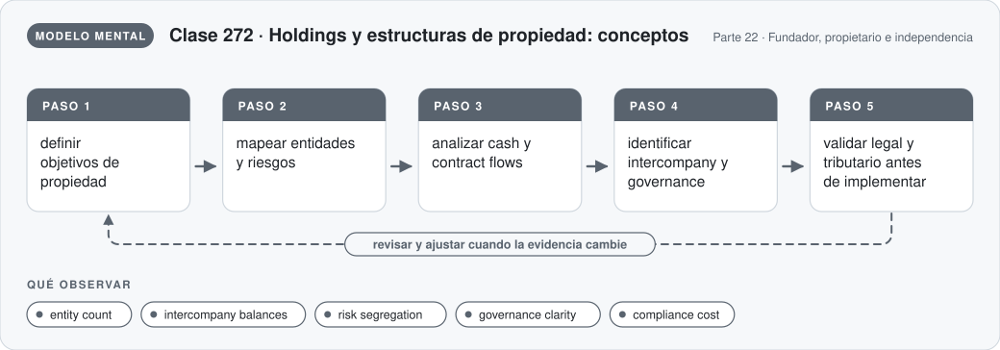

# Clase 272 — Holdings y estructuras de propiedad: conceptos

<!-- nav:inicio -->
> **Parte 22 · Escalamiento, propiedad y portafolio empresarial** — clase 8 de 12 · [índice de la parte](../../README.md) · [temario](../../../../SYLLABUS.md)
<!-- nav:fin -->

**Parte:** 22 — Escalamiento, propiedad y portafolio empresarial  
**Nivel:** Etapa 6 — Business Owner  
**Duración sugerida:** 150–180 minutos · **Estándar:** deep-class-v2

## 🎯 Propósito

Cuando una empresa crece, llega la tentación de «armar una estructura»: una sociedad para operar, otra para tener el inmueble, otra para la marca, una más para el nuevo negocio, y una **holding** (sociedad matriz) por encima de todas. Se escuchan razones como «proteger el patrimonio», «ordenar la propiedad», «preparar la venta», «optimizar impuestos». Algunas son legítimas; otras son copias de lo que hizo otro, sin análisis, y terminan generando más costos, más trámites, saldos cruzados que nadie concilia y una falsa sensación de seguridad. Una estructura de propiedad es una **herramienta de gestión**: puede separar riesgos, ordenar el gobierno, facilitar la entrada de socios o la venta de una unidad y aclarar flujos de caja. Pero no es un truco de optimización ni un escudo universal, y exige **sustancia real**: propósito, funciones, contratos, contabilidad y gobierno en cada entidad.

La clase presenta conceptos para pensar la estructura, sin dar asesoría legal ni tributaria: definir los objetivos de propiedad, mapear entidades y riesgos, analizar los flujos de caja y de contratos, identificar saldos entre entidades y gobierno, y validar con profesionales antes de implementar. **Las consecuencias legales y tributarias dependen de la jurisdicción, de los hechos y de la norma vigente, y no se interpretan aquí.** Las fuentes son los principios de gobierno corporativo de la OECD y el G20, Drucker, Gerber, Harnish, Hoffman y Yeh y Sutton y Rao. Al terminar sabrás formular objetivos de propiedad, dibujar el mapa de entidades, estimar costos y beneficios de una estructura con supuestos explícitos, controlar saldos entre entidades y preparar las preguntas para tus asesores.

## 📚 Resultados de aprendizaje

Al finalizar podrás:

1. **Distinguir** holding, sociedad operativa, sociedad patrimonial y otras entidades por su función.
2. **Formular** objetivos de propiedad antes de elegir una estructura.
3. **Mapear** entidades, flujos de caja, contratos y riesgos.
4. **Estimar** costos y beneficios de una estructura con supuestos explícitos.
5. **Controlar** saldos entre entidades y preparar la validación legal y tributaria.

## 🧭 Agenda

| Tramo | Qué se hace |
|---|---|
| 0–20 min | Recuperación: ¿qué quieres lograr con la propiedad de tu empresa en diez años? |
| 20–60 min | Objetivos, mapa de entidades, flujos, saldos entre entidades, gobierno y validación. |
| 60–105 min | Ejemplo trabajado: costo y beneficio de separar el inmueble y control de saldos. |
| 105–150 min | Caso ejecutivo y práctica. |
| 150–175 min | Límites y entregable. |

## 🧩 Conceptos centrales

| Concepto | Definición | Cómo se reconoce |
|---|---|---|
| **Holding** | Sociedad que posee participaciones en otras sociedades. | Controla entidades sin operar necesariamente. |
| **Sociedad operativa** | Entidad que realiza la actividad con clientes y trabajadores. | Contratos con terceros y operación diaria. |
| **Sociedad patrimonial** | Entidad que posee activos como inmuebles o propiedad intelectual. | Activos con contratos de uso. |
| **Transacción intragrupo** | Operación entre entidades del mismo grupo. | Arriendos, préstamos, servicios, regalías. |
| **Segregación de riesgo** | Separar activos y obligaciones para limitar el alcance de una contingencia. | Entidades con funciones distintas. |
| **Sustancia** | Realidad económica y de gestión detrás de cada entidad. | Funciones, personas, contratos y registros. |

## 🧠 Modelo mental

**Cómo leer el diagrama.** Dos paneles. **Estructura con propósito**: objetivos de propiedad claros (control, sucesión, riesgo y capital), flujos mapeados (caja, contratos y saldos entre entidades) y validación legal y tributaria antes de implementar, con sustancia real. **Estructura sin sustancia**: esquema copiado, entidades sin función y saldos entre entidades sin control. La nota afirma que las estructuras no son una herramienta genérica de optimización fiscal, que requieren análisis legal y tributario específico y sustancia real, y que se evitan los esquemas artificiales; el pie, que cada entidad tiene un propósito, un responsable y un costo conocido.

## 📖 Desarrollo

### 1. Para qué sirve una estructura de propiedad

Una estructura puede cumplir funciones **legítimas** y distintas: **ordenar el control** (quién decide en el grupo), **separar riesgos operativos de ciertos activos** cuando el marco legal lo permite, **facilitar la entrada o salida de socios** en una unidad sin afectar a las demás, **preparar la venta** de un negocio, **organizar la sucesión** familiar, **gestionar el uso de activos compartidos** (marca, tecnología, inmuebles) y **hacer más claro el gobierno** de varios negocios. Pero cada beneficio tiene condiciones y límites que dependen del derecho aplicable, de cómo se opere en la práctica y de los hechos. Drucker advierte que la estructura debe seguir a la estrategia y no al revés: **primero se define qué se quiere lograr; después, qué estructura lo apoya**.

### 2. Formular los objetivos de propiedad

Antes de dibujar cajas y flechas se escriben los objetivos, por orden de importancia: ¿quién debe **controlar** cada negocio?, ¿cómo se **reparten** las utilidades?, ¿qué pasará si un socio **sale, fallece o se enferma**?, ¿qué activos son **estratégicos** y deben quedar protegidos de las contingencias operativas?, ¿se prevé **vender** una unidad, **incorporar inversionistas** o **heredar**?, ¿qué nivel de **complejidad y costo** administrativo se puede sostener? Los objetivos se revisan con todos los propietarios, porque suelen diferir: uno quiere liquidez, otro quiere control, otro seguridad para la familia. Un objetivo vago («proteger el patrimonio») produce estructuras sin foco. Con objetivos claros, las alternativas se pueden comparar y descartar con criterio.

### 3. Mapear entidades, funciones y riesgos

El **mapa de entidades** muestra: cada entidad (o persona natural), su propietario, su función (operar, tener activos, financiar, contratar personal, licenciar marca), sus contratos con terceros y entre entidades, sus obligaciones y su exposición a riesgos. Se pregunta: ¿qué entidad firma con cada cliente y proveedor?, ¿quién emplea a las personas?, ¿a nombre de quién está cada activo y cada permiso?, ¿qué ocurre si una entidad tiene una contingencia grave? El mapa debe reflejar **cómo se opera realmente**, no solo el papel. Cuando las funciones están mezcladas (la sociedad que opera tiene los inmuebles, la marca y las deudas personales de los socios), el riesgo se concentra; cuando están separadas con sustancia, el análisis es más claro. Aun así, la **eficacia legal de la separación** depende de cada caso y se valida con un abogado.

### 4. Flujos de caja y contratos entre entidades

Separar entidades crea **transacciones intragrupo**: la operativa paga arriendo a la patrimonial, la holding presta o recibe dividendos, una entidad presta servicios administrativos a otra, se licencia la marca. Cada transacción debe tener **contrato, precio razonable, documentación y registro contable**, porque en caso contrario se pierden la claridad y, potencialmente, la protección y los beneficios que se buscaban; además, las autoridades pueden revisar las operaciones entre partes relacionadas, y la normativa aplicable se verifica con asesoría legal y tributaria. Se analiza el **flujo de caja del grupo**: de dónde sale el dinero, cómo llega a los propietarios, qué restricciones existen para repartirlo y qué costos tiene. Un grupo con caja atrapada en una entidad que no puede distribuirla es un problema frecuente.

### 5. Saldos entre entidades y gobierno

Los **saldos entre entidades** (préstamos, cuentas por cobrar y por pagar internas) se acumulan silenciosamente: una entidad presta a otra «mientras tanto», se pagan gastos cruzados, se compensan sin documentos. Con el tiempo nadie sabe qué debe a quién, y la separación de riesgos se debilita. Se controlan con: **conciliación mensual** de saldos intragrupo, contratos de préstamo con condiciones, límites a la acumulación de saldos, aprobación de nuevas transacciones y revisión por el contador. También se define el **gobierno del grupo**: quién administra cada entidad, qué decisiones se reservan a los propietarios (clase 270), cómo se registran los acuerdos, qué información recibe cada propietario. La OECD destaca la importancia de transparencia y de gestión de conflictos de interés en transacciones con partes relacionadas.

### 6. Costos, complejidad y sustancia

Cada entidad adicional implica **costos**: constitución, contabilidad, declaraciones, auditoría o revisión según corresponda, cuentas bancarias, firmas, actas, asesoría, tiempo del fundador. También implica **complejidad**: más contratos, más conciliaciones, más riesgo de errores. Y exige **sustancia**: personas que tomen decisiones, contratos reales, contabilidad al día, funciones económicas verdaderas. Una entidad sin función real, creada solo para «tener otra caja», suele ser un costo sin beneficio y, en algunos casos, un riesgo legal. Hoffman y Yeh muestran que la velocidad de crecimiento puede llevar a crear estructuras por oportunismo; una empresa más estable debe hacer la pregunta opuesta: **¿qué problema concreto resuelve esta entidad y a qué costo?** Si no hay respuesta, probablemente no hace falta.

### 7. Validar antes de implementar

Ninguna estructura se implementa sin **validación legal y tributaria** específica para el caso, en la jurisdicción correspondiente: tipos societarios disponibles, responsabilidad de socios y administradores, efectos tributarios de aportes, transferencias, dividendos y reorganizaciones, requisitos de documentación y registro, efectos laborales, financieros y contractuales (los bancos, arrendadores y clientes pueden exigir garantías o consentimientos). Se prepara un **memo de propósito** con los objetivos, el mapa propuesto, los flujos, los costos y las preguntas para los asesores; se piden **alternativas** (incluida la de no cambiar nada) y su comparación; se define un **plan de implementación** con responsables, plazos y documentos, y una **revisión posterior** para verificar que funciona como se esperaba. Los esquemas artificiales, sin propósito económico real, se evitan.

## 📚 Lectura comparada

| Obra | Qué aporta | Qué no resuelve | Pregunta para contrastar |
|---|---|---|---|
| OECD y G20 (principios de gobierno corporativo) | Transparencia y trato de partes relacionadas. | No describe estructuras específicas. | ¿Cómo gobierno las transacciones entre mis entidades? |
| Drucker | La estructura sigue a la estrategia. | No contiene normativa. | ¿Qué estrategia apoya esta estructura? |
| Gerber | Pensar la empresa como sistema. | No trata estructuras legales. | ¿Cuál es el sistema de propiedad que quiero? |
| Harnish | Orden y rutinas de gestión al crecer. | No es guía legal. | ¿Qué rutina de control necesito entre entidades? |
| Hoffman y Yeh | Riesgos del crecimiento rápido y la complejidad. | No es guía de estructuras. | ¿Estoy creando entidades por oportunismo? |

## 🧮 Ejemplo trabajado

**Situación (hipotética).** Una empresa de logística posee un galpón valorado en 600 millones de pesos dentro de la sociedad que opera la actividad; el resto de sus activos es de 400 millones. Los propietarios consideran separar el galpón en una sociedad patrimonial que se lo arriende a la operativa. Todos los números son **supuestos para el ejercicio**. **La eficacia legal de la separación y sus efectos tributarios son los que determinen los asesores con la norma vigente; aquí solo se ilustra la lógica de costo y beneficio.**

**Objetivo.** Limitar el alcance de una contingencia operativa sobre el galpón, preparar la futura venta de la operación por separado y clarificar el gobierno.

**Beneficio esperado (con supuestos).**

- Probabilidad anual de una contingencia operativa grave: 3 %.
- Pérdida en ese caso: 120 millones.
- Efectividad supuesta de la separación para proteger el galpón (a validar con un abogado): 70 %.
- Reducción de exposición esperada: 0,03 × 120 × 0,70 = **2,52 millones al año**.

**Costos adicionales anuales (supuestos).**

| Concepto | Millones |
|---|---|
| Contabilidad y declaraciones de la nueva entidad | 1,8 |
| Mantención legal y actas | 0,6 |
| **Total** | **2,4** |

**Costo único de implementación.** Asesoría legal y tributaria, contratos y trámites: 8 millones; amortizados en cinco años, 1,6 millones al año. **Costo anual total:** 2,4 + 1,6 = **4,0 millones**.

**Resultado.** Beneficio de 2,52 menos costo de 4,0 = **−1,48 millones al año**. **Con estos supuestos, solo por reducción de exposición esperada, la estructura no se paga.** Los otros objetivos (preparar la venta de la operación sin el galpón, claridad de gobierno, facilitar la entrada de un socio en la operación) pueden justificarla, pero deben **valorarse con evidencia**: si, por ejemplo, la venta de la operación por separado aumentara el precio en 20 millones con una probabilidad de 25 % en cinco años, su valor esperado sería 5 millones, es decir 1 millón al año; el balance seguiría siendo −0,48 millones anuales. Si la contingencia fuera de 200 millones con 4 % de probabilidad, el beneficio sería 0,04 × 200 × 0,70 = 5,6 millones y la estructura se pagaría (+1,6). **El resultado es sensible a la probabilidad y al tamaño de la contingencia.**

**Contrato intragrupo.** La operativa pagaría un arriendo por el galpón. Valor de mercado supuesto: 0,6 % mensual del valor, es decir 3,6 millones al mes (43,2 millones al año), respaldado por una tasación independiente. Al cuarto mes el control mensual muestra que la operativa no ha pagado: saldo acumulado de 4 × 3,6 = **14,4 millones**. Un saldo así debilita la separación y puede traer consecuencias; se establece un pago puntual y una conciliación mensual firmada por el contador.

**Indicadores de control.**

| Indicador | Valor |
|---|---|
| Número de entidades | 2 |
| Saldos intragrupo no conciliados | 14,4 millones |
| Porcentaje de activos en la entidad sin operación | 600 ÷ 1.000 = 60 % |
| Transacciones intragrupo con contrato | 1 de 1 |

**Decisión.** Antes de crear la sociedad patrimonial, los propietarios piden a un abogado y a un contador un memo con las alternativas (no cambiar nada, seguro de responsabilidad, separar el galpón, vender el galpón y arrendarlo) con sus costos y efectos; mientras tanto, contratan un seguro que cubra parte de la exposición y documentan por escrito sus objetivos de propiedad. Solo implementarían la separación si la validación muestra beneficio suficiente y existe capacidad de mantener la sustancia.

**Cuidados.** Las cifras son supuestos; las consecuencias jurídicas y tributarias dependen de la jurisdicción y de la norma vigente.

**Qué muestra.** (1) El análisis puede mostrar que una estructura no se paga por sí sola. (2) Los otros objetivos se valoran con evidencia. (3) Los saldos entre entidades se controlan desde el primer mes.

## 🔀 Comparación y límites

**Estructura con sustancia frente a esquema artificial.** La primera responde a un propósito económico y de gestión verificable, con funciones, contratos y registros reales; el segundo busca un efecto formal sin realidad operativa y puede ser costoso o ilegítimo.

**Límites.** Esta clase no es asesoría legal ni tributaria. Las estructuras no son herramientas genéricas de optimización fiscal; requieren análisis específico, sustancia real y evitan esquemas artificiales. Los efectos dependen de la jurisdicción y de la norma vigente. Los números del ejemplo son supuestos.

## 🪜 De profesional a owner

| Nivel | Cómo se relaciona con la estructura de propiedad |
|---|---|
| **Profesional** | Trabaja para la entidad que lo contrata y respeta sus contratos. |
| **Jefe / Team Lead** | Sabe qué entidad factura, paga y firma en su área. |
| **Gerente** | Administra una entidad y controla sus saldos intragrupo. |
| **CEO / Director** | Gobierna el grupo y supervisa transacciones entre partes relacionadas. |
| **Founder / Owner** | Define los objetivos de propiedad y decide la estructura con asesoría. |

## 🏢 Caso ejecutivo

Una familia propietaria de una cadena de tres farmacias (ventas de 2.100 millones de pesos) y de un edificio donde funciona la sede, todo dentro de una misma sociedad con deudas bancarias de 450 millones, piensa crear una holding con tres sociedades: operativa, inmobiliaria y una «sociedad de inversiones» para los dividendos. Un asesor informal les dijo que «así se protege todo y se pagan menos impuestos». El padre (65 años) quiere preparar la sucesión entre sus dos hijos, uno de los cuales trabaja en la empresa y el otro no. Hay un préstamo del padre a la empresa de 80 millones sin contrato. El edificio vale 900 millones y el banco tiene una hipoteca sobre él. Un competidor propone comprar una de las farmacias. Los costos anuales de cada nueva sociedad se estiman en 2,4 millones y el costo de implementación en 15 millones.

Entrega un **memo de decisión del fundador sobre estructura de propiedad** que contenga: (a) los objetivos de propiedad ordenados y las diferencias entre familiares; (b) el mapa actual y el propuesto con funciones y contratos; (c) el cálculo de costos y beneficios con supuestos explícitos y sensibilidad; (d) el tratamiento del préstamo del padre y de la hipoteca, y el control de saldos intragrupo; (e) la lista de preguntas para el abogado y el contador y las alternativas que pedirá; (f) los límites del análisis, qué no se hará sin validación y el criterio de sustancia.

## 🧪 Práctica

1. Escribe tus objetivos de propiedad en orden de prioridad.
2. Dibuja el mapa de tus entidades con función, propietario y contratos.
3. Estima costos y beneficios de una estructura alternativa con dos escenarios de contingencia.
4. Diseña un control mensual de saldos intragrupo.
5. Redacta diez preguntas para tus asesores y las alternativas que pedirás.

## ⚠️ Errores frecuentes

| Error | Por qué ocurre | Cómo corregirlo |
|---|---|---|
| Copiar una estructura | «A otros les funcionó» | Partir de objetivos propios. |
| Crear entidades sin función | Se busca «orden» aparente | Exigir propósito, responsable y costo. |
| Transacciones sin contrato | Informalidad familiar | Contrato, precio razonable y registro. |
| Saldos entre entidades sin control | Se supone que se arreglarán | Conciliación mensual y límites. |
| Buscar solo ahorro de impuestos | Mensaje de un asesor informal | Análisis legal y tributario específico, sin esquemas artificiales. |
| No pedir alternativas | Se quiere una respuesta rápida | Comparar con no cambiar y otras opciones. |

## ❓ Preguntas de comprobación

1. ¿Qué diferencia hay entre holding, sociedad operativa y patrimonial?
2. ¿Por qué se formulan objetivos antes de elegir una estructura?
3. ¿Qué es una transacción intragrupo y qué requiere?
4. ¿Qué riesgo tienen los saldos entre entidades sin control?
5. ¿Qué es la sustancia?
6. ¿Por qué una estructura puede no pagarse por sí sola?
7. ¿Qué límite tiene esta clase?

Claves de respuesta

1. La holding posee participaciones; la operativa realiza la actividad; la patrimonial posee activos como inmuebles o propiedad intelectual.
2. Porque la estructura debe seguir a la estrategia y los objetivos permiten comparar alternativas.
3. Una operación entre entidades del grupo; requiere contrato, precio razonable, documentación y registro.
4. Debilitan la separación de riesgos y generan confusión sobre quién debe a quién.
5. La realidad económica y de gestión de cada entidad: funciones, personas, contratos y registros.
6. Porque sus costos recurrentes pueden superar la reducción de exposición esperada.
7. No es asesoría legal ni tributaria; los efectos dependen de la jurisdicción y la norma vigente.

## 📥 Entregable

Guarda en `portfolio/272-holdings-y-estructuras-de-propiedad-conceptos/`:

- `founder-owner-decision-brief.md` (plantilla [Founder owner decision brief](../../../../templates/founder-owner-decision-brief.md)) con el memo del caso ejecutivo;
- `decision-journal.md` con los objetivos, el mapa de entidades y las preguntas a los asesores.

## 📗 Fuentes y verificación

- OECD — *G20/OECD Principles of Corporate Governance 2023*. **Uso en esta clase:** transparencia y trato de las transacciones con partes relacionadas. **Fuente primaria:** <https://www.oecd.org/en/publications/2023/09/g20-oecd-principles-of-corporate-governance-2023_60836fcb.html>.
- Peter F. Drucker — *Management: Tasks, Responsibilities, Practices* (Harper & Row, 1974). **Uso en esta clase:** la estructura sigue a la estrategia. Lectura selectiva sobre **holdings y estructuras de propiedad: conceptos**. **Localizador:** [ISBN-13 9780060110925](https://openlibrary.org/isbn/9780060110925).
- Michael E. Gerber — *The E-Myth Revisited* (HarperAudio, 1995). **Uso en esta clase:** pensar la empresa como un sistema. Lectura selectiva sobre **holdings y estructuras de propiedad: conceptos**. **Localizador:** [ISBN-13 9780060574901](https://openlibrary.org/isbn/9780060574901).
- Verne Harnish — *Scaling Up* (Gazelles, Inc., 2014). **Uso en esta clase:** orden y rutinas de gestión al crecer. Lectura selectiva sobre **holdings y estructuras de propiedad: conceptos**. **Localizador:** [ISBN-13 9780986019555](https://openlibrary.org/isbn/9780986019555).
- Reid Hoffman & Chris Yeh — *Blitzscaling* (HarperCollins Publishers Limited, 2018). **Uso en esta clase:** riesgos de la velocidad y la complejidad. Lectura selectiva sobre **holdings y estructuras de propiedad: conceptos**. **Localizador:** [ISBN-13 9780008303648](https://openlibrary.org/isbn/9780008303648).
- Robert I. Sutton & Huggy Rao — *Scaling Up Excellence* (Random House Canada, 2014). **Uso en esta clase:** qué replicar y qué adaptar al escalar. Lectura selectiva sobre **holdings y estructuras de propiedad: conceptos**. **Localizador:** [ISBN-13 9780307363428](https://openlibrary.org/isbn/9780307363428).

> **Regla de fuentes para Holdings y estructuras de propiedad:** las obras anteriores estructuran las perspectivas de esta materia; cualquier norma, ley o estándar vivo mencionado debe comprobarse nuevamente en su fuente primaria vigente, y este programa no reemplaza asesoría legal ni tributaria. Los ejemplos y casos son hipotéticos, con cifras ilustrativas. El desarrollo es original y no reproduce capítulos protegidos.

<!-- pie:inicio -->
---

| Anterior | Índice | Siguiente |
|---|---|---|
| [← 271 · Multiunidad y portafolio](../271-multiunidad-y-portafolio/README.md) | [Parte 22](../../README.md) · [Programa](../../../../SYLLABUS.md) | [273 · Adquisiciones como vía de crecimiento →](../273-adquisiciones-como-via-de-crecimiento/README.md) |
<!-- pie:fin -->
