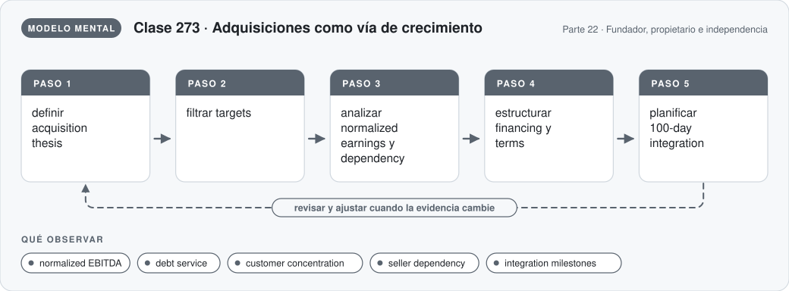

# Clase 273 — Adquisiciones como vía de crecimiento

<!-- nav:inicio -->
> **Parte 22 · Escalamiento, propiedad y portafolio empresarial** — clase 9 de 12 · [índice de la parte](../../README.md) · [temario](../../../../SYLLABUS.md)
<!-- nav:fin -->

**Parte:** 22 — Escalamiento, propiedad y portafolio empresarial  
**Nivel:** Etapa 6 — Business Owner  
**Duración sugerida:** 150–180 minutos · **Estándar:** deep-class-v2

## 🎯 Propósito

Crecer comprando otra empresa parece un atajo: se adquieren clientes, equipo, capacidades y flujo de caja ya existentes, en lugar de construirlos desde cero. Para una empresa mediana o un propietario con capital, es una de las rutas más importantes de crecimiento, y también una de las más peligrosas. La mayoría de las adquisiciones fracasa en destruir o no crear el valor esperado por razones previsibles: se compra sin una tesis clara, se paga por un flujo histórico que no sobrevive al cambio de dueño, se subestima la dependencia del vendedor o de pocos clientes, se financia con deuda que la empresa comprada no puede servir y se improvisa la integración. Haspeslagh y Jemison, que estudiaron cómo se crea valor en las adquisiciones, subrayan que el valor surge **después de la compra**, en cómo se integran y se gestionan las capacidades; el precio pagado solo fija cuánto valor hay que crear para que valga la pena.

La clase propone un método en cinco pasos: definir una tesis de adquisición, filtrar objetivos, analizar ganancias normalizadas y dependencias, estructurar financiamiento y condiciones, y planificar la integración de los primeros cien días antes de firmar. Se apoya en Haspeslagh y Jemison, Koller y colaboradores (valoración y retorno sobre el capital), Gil (integración y organización al crecer), Galbraith (diseño organizacional al combinar empresas), Harnish y Sutton y Rao. **No se enseña asesoría legal, tributaria ni de valoración profesional**: las condiciones contractuales, la debida diligencia legal, los efectos tributarios y la valoración formal los realizan asesores especializados. Al terminar sabrás construir una tesis, normalizar resultados, estimar un rango de precio, evaluar la capacidad de servicio de la deuda y diseñar condiciones que reduzcan el riesgo.

## 📚 Resultados de aprendizaje

Al finalizar podrás:

1. **Formular** una tesis de adquisición con la fuente de valor y sus límites.
2. **Filtrar** candidatos con criterios explícitos.
3. **Normalizar** los resultados del objetivo y detectar dependencias.
4. **Estimar** un rango de precio y la capacidad de servicio de la deuda con supuestos explícitos.
5. **Planificar** la integración y diseñar condiciones que transfieran riesgo.

## 🧭 Agenda

| Tramo | Qué se hace |
|---|---|
| 0–20 min | Recuperación: ¿qué obtendrías de comprar una empresa que no puedas construir tú? |
| 20–60 min | Tesis, filtro, normalización, dependencia, precio, financiamiento, condiciones e integración. |
| 60–105 min | Ejemplo trabajado: EBITDA normalizado, precio, servicio de deuda y condición por retención. |
| 105–150 min | Caso ejecutivo y práctica. |
| 150–175 min | Límites y entregable. |

## 🧩 Conceptos centrales

| Concepto | Definición | Cómo se reconoce |
|---|---|---|
| **Tesis de adquisición** | Razón estratégica y económica de la compra. | Fuente de valor y plan. |
| **EBITDA normalizado** | Resultado operativo ajustado por partidas no recurrentes y no de mercado. | Ajustes documentados. |
| **Concentración de clientes** | Peso de pocos clientes en las ventas. | Porcentaje de los mayores clientes. |
| **Servicio de la deuda** | Pago periódico de capital e intereses. | Cuota anual. |
| **Pago contingente** | Parte del precio que depende de resultados futuros. | Condición y plazo. |
| **Integración de 100 días** | Plan de los primeros cien días tras la compra. | Hitos, responsables y métricas. |

## 🧠 Modelo mental

**Cómo leer el diagrama.** Una cadena de cinco pasos. **Tesis**: qué se compra y para qué. **Filtro de objetivos**: candidatos que calzan con la tesis. **Ganancias y dependencia**: normalizar y revisar clientes y personas clave. **Financiamiento y términos**: precio, deuda y condiciones. **Integración de 100 días**: plan antes de firmar. La flecha de retorno indica que lo hallado ajusta el precio o lleva a abandonar. La nota advierte que comprar flujo histórico no garantiza que sobreviva al cambio de propietario y que se ajustan valoración y condiciones por dependencia del dueño, clientes y transición; el pie, que la integración se planifica antes de firmar y no después.

## 📖 Desarrollo

### 1. La tesis: qué valor se espera crear

Una **tesis** responde: ¿por qué esta compra crea más valor en nuestras manos que en las de otros?, ¿cuál es la **fuente de valor**?, ¿qué haremos distinto? Fuentes típicas: **acceso a nuevos clientes o mercados**, **capacidades o tecnología** difíciles de construir, **eliminación de costos duplicados**, **mayor escala en compras o producción**, **consolidación de un sector fragmentado**, **integración vertical**. Cada una tiene riesgos distintos y exige capacidades de integración distintas. Haspeslagh y Jemison distinguen según cuánta **interdependencia estratégica** se necesita y cuánta **autonomía** debe preservarse para no destruir lo que se compró. Una tesis sólida se puede escribir en una página y tiene **cifras**: cuánto valor se espera, cuándo, y qué condiciones deben cumplirse.

### 2. Filtrar objetivos con criterios

Con la tesis, se definen criterios de filtro: **tamaño** (ingresos, resultado), **sector y geografía**, **calidad de clientes**, **dependencia del dueño**, **cultura y valores**, **situación financiera**, **tipo de propiedad** y disposición a vender, **complejidad de integración**. Se hace una **lista larga** y se descarta con base en los criterios; se contacta a unos pocos con cuidado y confidencialidad. Se evalúa también el **costo de oportunidad**: ¿es mejor invertir en crecer orgánicamente? Gil advierte que las empresas que crecen rápido suelen subestimar la carga que representa integrar otra organización mientras se opera la propia. La disciplina de decir **no** a muchas oportunidades es parte de la estrategia: una adquisición mediocre cuesta caja, atención y reputación.

### 3. Normalizar las ganancias

Los estados financieros de empresas pequeñas y medianas suelen incluir **distorsiones**: el dueño se paga un sueldo inferior o superior al de mercado, hay gastos personales mezclados, ingresos o costos no recurrentes, partes relacionadas con precios fuera de mercado, inventarios mal valorados, contratos sin registrar. El **EBITDA normalizado** corrige esas distorsiones con **ajustes documentados** (por ejemplo, agregar el sueldo de mercado que habría que pagar a un gerente que reemplace al dueño y restar ingresos extraordinarios). Se revisan **varios años** y la **calidad de la caja** (¿las utilidades se convierten en caja?). La normalización requiere **debida diligencia** contable, legal y tributaria por profesionales; aquí se enseña la lógica para entender los informes y hacer las preguntas correctas, no para reemplazarlos.

### 4. Dependencias: clientes, personas y contratos

Comprar flujo histórico no garantiza que **sobreviva al cambio de propietario**. Se revisan: **concentración de clientes** (cuánto representan los mayores), **tipo de relación** (contrato, relación personal con el dueño), **personas clave** (técnicos, vendedores, gerentes) y sus condiciones de permanencia, **proveedores críticos**, **permisos y licencias** transferibles, **propiedad intelectual** y **contratos** con cláusulas de cambio de control. Se estima qué parte de las ganancias se perdería si se va un cliente grande o la persona clave. Una compra de una empresa cuyo valor depende del vendedor requiere un **periodo de transición** y pagos vinculados a resultados. Las condiciones legales (cesión de contratos, consentimientos, no competencia dentro de lo permitido) se revisan con asesoría especializada.

### 5. Precio, financiamiento y capacidad de servir la deuda

El **precio** suele expresarse como un múltiplo del resultado normalizado, pero el múltiplo es solo una referencia: lo que importa es el **valor de los flujos futuros** que la empresa generará en tus manos, descontados por su riesgo (Koller y coautores). Se estima un **rango** con escenarios (conservador, base, favorable) y se fija un **precio máximo** que no se supera aunque haya presión. El **financiamiento** combina capital propio y deuda: se calcula la **cuota anual** y se compara con la **caja disponible para servir la deuda** después de inversiones e impuestos. Una medida común es la **cobertura del servicio de la deuda**: caja disponible dividida por la cuota; bajo cierto umbral (por ejemplo, 1,3) el riesgo es alto. Se evalúan los escenarios adversos (pérdida de un cliente, baja de ventas) para ver si la deuda es sostenible.

### 6. Términos que reparten el riesgo

Los **términos** pueden reducir la brecha entre lo que el vendedor cree que vale la empresa y lo que el comprador se atreve a pagar: **pago contingente** (parte del precio sujeta a retención de clientes o a resultados), **pago diferido** o retención de una parte hasta confirmar declaraciones y garantías, **contratos de transición y de permanencia** del vendedor y de personas clave, **ajustes de precio** por capital de trabajo, **declaraciones y garantías** del vendedor, **cláusulas sobre cambio de control** y **no competencia** dentro de los límites legales. Se redactan y negocian con asesoría jurídica y tributaria. El fundador debe entender qué riesgo transfiere cada término y cuánto cuesta en la negociación. Un precio alto con buenos términos puede ser mejor que un precio bajo sin protección.

### 7. Integración de cien días y organización

La integración es donde se crea o se destruye el valor. Antes de firmar, se prepara un **plan de 100 días**: comunicación a clientes, empleados y proveedores; decisiones de liderazgo y estructura; qué se integra (sistemas, finanzas, compras) y qué se mantiene separado; retención de personas clave; revisión de contratos; primeras ganancias rápidas y métricas de seguimiento. Galbraith destaca que combinar organizaciones es un problema de diseño organizacional (estructura, procesos, incentivos, personas); Harnish, que una rutina de reuniones y metas claras ordena el cambio; Sutton y Rao, que se debe distinguir qué prácticas se replican exactamente y cuáles se adaptan. Se designa un **responsable de integración** y se mide: retención de clientes y personas, ingresos, costos, cumplimiento de hitos y caja. Si algo se desvía, se corrige rápido.

## 📚 Lectura comparada

| Obra | Qué aporta | Qué no resuelve | Pregunta para contrastar |
|---|---|---|---|
| Haspeslagh y Jemison | Cómo se crea valor en una adquisición mediante la integración. | No es guía de valoración ni legal. | ¿Cuánta interdependencia y cuánta autonomía necesito? |
| Koller y coautores | Valoración por flujos descontados y retorno sobre el capital. | No diseña la integración. | ¿Qué flujos y qué riesgo estoy comprando? |
| Gil | Qué se rompe al crecer y al integrar organizaciones. | Enfoque de empresas de crecimiento. | ¿Puedo integrar mientras opero la mía? |
| Galbraith | Diseño organizacional al combinar empresas. | No cuantifica el precio. | ¿Qué estructura y procesos adoptarán ambos? |
| Harnish y Sutton y Rao | Rutinas y replicación selectiva. | No tratan el financiamiento. | ¿Qué práctica copio y cuál adapto? |

## 🧮 Ejemplo trabajado

**Situación (hipotética).** Una empresa de servicios de mantención evalúa comprar una competidora más pequeña. Todas las cifras son **supuestos**; la debida diligencia, los efectos legales y tributarios y las condiciones contractuales los trabajan asesores especializados.

**Datos reportados por el vendedor (millones de pesos).**

| Concepto | Valor |
|---|---|
| Ingresos | 500 |
| EBITDA reportado | 90 |
| Cliente mayor | 38 % de los ingresos (190) |
| Contribución de ese cliente | 30 % (57) |

**Normalización del EBITDA.**

| Ajuste | Millones |
|---|---|
| EBITDA reportado | 90 |
| Sueldo de mercado de un gerente que reemplace al dueño (el dueño se paga poco) | −30 |
| Ingreso extraordinario no recurrente | −8 |
| Gastos personales del dueño cargados a la empresa | +12 |
| **EBITDA normalizado** | **64** |

El EBITDA normalizado es **29 % menor** que el reportado ((90 − 64) ÷ 90).

**Precio de referencia.** Con un múltiplo supuesto de 4,0 veces el EBITDA normalizado: 4,0 × 64 = **256 millones**. Con el reportado, 360: la normalización baja la referencia en 104 millones.

**Servicio de la deuda.** Financiamiento supuesto: 100 millones de deuda a 5 años con una tasa de 14 % anual y cuotas anuales iguales. Cuota = 100 × 0,14 ÷ (1 − 1,14⁻⁵). Como 1,14⁵ ≈ 1,9254, 1,14⁻⁵ ≈ 0,5194; 1 − 0,5194 = 0,4806; cuota = 14 ÷ 0,4806 ≈ **29,1 millones al año**. Caja disponible supuesta para servir la deuda (EBITDA normalizado menos impuestos y reposición de equipos, estimados en 15): 64 − 15 = **49 millones**. Cobertura: 49 ÷ 29,1 ≈ **1,68**.

**Escenario adverso: se pierde el cliente mayor.** La contribución perdida es 57 millones; el EBITDA normalizado baja a 64 − 57 = **7 millones**. Caja disponible: 7 − 15 = **−8 millones**; la cuota de 29,1 no se cubre. **La adquisición se vuelve inviable ante la pérdida de ese cliente.** Esto muestra por qué la concentración y la dependencia son críticas.

**Estructura propuesta.** Precio total 256 millones: **180 al cierre** y **76 contingentes** a la retención de al menos 90 % de los ingresos de los tres mayores clientes durante 24 meses; el vendedor permanece 12 meses como consultor remunerado y firma un acuerdo de transición. Si la probabilidad de retención se estima en 75 %, el precio esperado es 180 + 0,75 × 76 = **237 millones**, equivalente a 237 ÷ 64 = **3,7 veces** el EBITDA normalizado. Si el cliente mayor se pierde, el comprador paga 180 (2,8 veces el EBITDA normalizado) pero con el flujo reducido: el riesgo se reparte parcialmente.

**Reducción de la deuda.** Con 180 al cierre y 80 de capital propio, la deuda necesaria baja a 100; con más capital propio, a 70, y la cuota a 20,4 (70 × 0,14 ÷ 0,4806 = 20,4), cobertura de 49 ÷ 20,4 = 2,4. El comprador decide un nivel de deuda con cobertura superior a 1,5 en el caso base y capacidad de sobrevivir a un deterioro moderado.

**Plan de 100 días.** Día 0 a 10: comunicación a clientes y empleados, entrevistas con el cliente mayor y con las cinco personas clave; día 10 a 30: contratos de permanencia y revisión de contratos con cláusulas de cambio de control; día 30 a 60: integración de finanzas y compras, manteniendo separado el servicio a clientes; día 60 a 100: primeras sinergias medidas y revisión del pago contingente. Un responsable de integración reporta semanalmente.

**Decisión.** Avanzar con una oferta de 180 millones al cierre y 76 contingentes, sujeta a debida diligencia, a una reunión con el cliente mayor y a un contrato de transición con el vendedor; fijar un **precio máximo** de 256; no avanzar si la reunión con el cliente muestra riesgo alto de pérdida.

**Cuidados.** Los múltiplos, tasas y probabilidades son supuestos; la valoración formal, la debida diligencia y los contratos corresponden a asesores especializados.

**Qué muestra.** (1) La normalización redujo la base de precio. (2) La concentración de clientes hizo inviable la deuda en el escenario adverso. (3) El pago contingente repartió parte del riesgo.

## 🔀 Comparación y límites

**Crecer comprando frente a crecer construyendo.** Comprar acelera el acceso a clientes, equipos y capacidades, pero exige capital, integración y manejo de riesgos que se heredan; construir es más lento, pero conserva el control y la cultura.

**Límites.** Comprar flujo histórico no garantiza que sobreviva al cambio de propietario; las valoraciones por múltiplos son referencias, no verdades; la debida diligencia puede revelar problemas que cambian o frenan la operación. Las cifras del ejemplo son supuestos y no constituyen asesoría legal, tributaria ni de valoración.

## 🪜 De profesional a owner

| Nivel | Cómo se relaciona con las adquisiciones |
|---|---|
| **Profesional** | Participa en la integración desde su función. |
| **Jefe / Team Lead** | Gestiona equipos que se fusionan y mantiene la operación. |
| **Gerente** | Lidera la integración de un área y responde por métricas. |
| **CEO / Director** | Evalúa la tesis, estructura la oferta y gobierna la integración. |
| **Founder / Owner** | Decide el precio máximo, el financiamiento y el riesgo que asume. |

## 🏢 Caso ejecutivo

Una empresa de transporte escolar con 22 buses y ventas anuales de 720 millones de pesos evalúa comprar una empresa competidora que opera 14 buses en otra comuna, con ingresos de 410 millones y EBITDA reportado de 74 millones. Los contratos con tres colegios representan 58 % de sus ingresos y vencen en 14 meses; el dueño actual (62 años) conduce uno de los buses, gestiona personalmente las relaciones con los colegios y se paga 1,2 millones mensuales. Hay una deuda de 60 millones con vencimientos próximos, dos buses de más de 18 años y un conductor clave con contrato indefinido. El vendedor pide 340 millones. La empresa compradora tiene 90 millones en caja y puede obtener un crédito de hasta 150 millones a 13 % por 5 años. La integración requeriría reorganizar rutas y mantención.

Entrega un **memo estratégico de adquisición** que contenga: (a) la tesis y la fuente de valor, con sus riesgos; (b) la normalización del EBITDA con ajustes explícitos; (c) el análisis de concentración y de personas clave con su efecto en la caja; (d) el rango de precio, el precio máximo y la capacidad de servir la deuda con escenario adverso; (e) la estructura de términos (pago contingente, transición, deuda asumida) y las condiciones para avanzar; (f) el plan de 100 días, los límites del análisis y las verificaciones con asesores.

## 🧪 Práctica

1. Escribe en una página una tesis de adquisición con la fuente de valor y tres riesgos.
2. Normaliza el EBITDA de un caso con cinco ajustes explícitos.
3. Calcula la cuota de una deuda y la cobertura con escenario base y adverso.
4. Diseña una estructura con pago contingente y su efecto en el precio esperado.
5. Arma un plan de 100 días con responsables, hitos y métricas.

## ⚠️ Errores frecuentes

| Error | Por qué ocurre | Cómo corregirlo |
|---|---|---|
| Comprar sin tesis | Oportunismo | Escribir la fuente de valor y sus cifras. |
| Pagar sobre el resultado reportado | Se confía en el vendedor | Normalizar y verificar con diligencia. |
| Ignorar la concentración | Se mira el total | Estimar el efecto de perder el mayor cliente. |
| Financiar con deuda inviable | Se piensa en el caso base | Cobertura y escenario adverso. |
| Sin condiciones de transición | Se asume continuidad | Pago contingente y contratos de permanencia. |
| Planificar la integración después | Se celebra el cierre | Plan de 100 días antes de firmar. |

## ❓ Preguntas de comprobación

1. ¿Qué debe contener una tesis de adquisición?
2. ¿Qué es el EBITDA normalizado y por qué se calcula?
3. ¿Cómo se evalúa la capacidad de servir la deuda?
4. ¿Qué riesgo revela la concentración de clientes?
5. ¿Qué es un pago contingente?
6. ¿Por qué se planifica la integración antes de firmar?
7. ¿Qué límite tiene este análisis?

Claves de respuesta

1. La fuente de valor, qué se hará distinto, cuánto valor se espera, cuándo y qué condiciones deben cumplirse.
2. Resultado ajustado por partidas no recurrentes y no de mercado; sirve para estimar la capacidad real de generar caja.
3. Comparando la caja disponible con la cuota anual y probando escenarios adversos.
4. Que perder un cliente grande puede dejar el flujo por debajo de lo necesario para servir la deuda.
5. Parte del precio que depende de resultados futuros, como la retención de clientes.
6. Porque el valor se crea o destruye en la integración y esta exige preparación y responsables.
7. Los múltiplos y probabilidades son supuestos; la diligencia, la valoración y los contratos requieren asesores especializados.

## 📥 Entregable

Guarda en `portfolio/273-adquisiciones-como-via-de-crecimiento/`:

- `strategy-memo.md` (plantilla [Strategy memo](../../../../templates/strategy-memo.md)) con el memo estratégico del caso ejecutivo;
- `decision-journal.md` con la tesis, los supuestos, el precio máximo y el plan de 100 días.

## 📗 Fuentes y verificación

- Philippe C. Haspeslagh & David B. Jemison — *Managing Acquisitions: Creating Value Through Corporate Renewal* (Free Press, 1991). **Uso en esta clase:** cómo se crea valor en una adquisición mediante la integración. Lectura selectiva sobre **adquisiciones como vía de crecimiento**. **Localizador:** [ISBN-13 9780029141656](https://openlibrary.org/isbn/9780029141656).
- Tim Koller, Marc Goedhart & David Wessels — *Valuation: Measuring and Managing the Value of Companies* (Wiley, 2005). **Uso en esta clase:** valoración por flujos y retorno sobre el capital. Lectura selectiva sobre **adquisiciones como vía de crecimiento**. **Localizador:** [ISBN-13 9780471702191](https://openlibrary.org/isbn/9780471702191).
- Elad Gil — *High Growth Handbook* (Stripe Matter Inc, 2018). **Uso en esta clase:** qué se rompe al crecer e integrar organizaciones. Lectura selectiva sobre **adquisiciones como vía de crecimiento**. **Localizador:** [ISBN-13 9781953953377](https://openlibrary.org/isbn/9781953953377).
- Jay R. Galbraith — *Designing Organizations* (Jossey-Bass Publishers, 1995). **Uso en esta clase:** diseño organizacional al combinar empresas. Lectura selectiva sobre **adquisiciones como vía de crecimiento**. **Localizador:** [ISBN-13 9780787900915](https://openlibrary.org/isbn/9780787900915).
- Verne Harnish — *Scaling Up* (Gazelles, Inc., 2014). **Uso en esta clase:** rutinas y metas para ordenar el cambio. Lectura selectiva sobre **adquisiciones como vía de crecimiento**. **Localizador:** [ISBN-13 9780986019555](https://openlibrary.org/isbn/9780986019555).
- Robert I. Sutton & Huggy Rao — *Scaling Up Excellence* (Random House Canada, 2014). **Uso en esta clase:** qué replicar y qué adaptar al integrar. Lectura selectiva sobre **adquisiciones como vía de crecimiento**. **Localizador:** [ISBN-13 9780307363428](https://openlibrary.org/isbn/9780307363428).
- Michael E. Gerber — *The E-Myth Revisited* (HarperAudio, 1995). **Uso en esta clase:** el negocio como sistema que no depende del dueño. Lectura selectiva sobre **adquisiciones como vía de crecimiento**. **Localizador:** [ISBN-13 9780060574901](https://openlibrary.org/isbn/9780060574901).

> **Regla de fuentes para Adquisiciones como vía de crecimiento:** las obras anteriores estructuran las perspectivas de esta materia; cualquier norma, ley o estándar vivo mencionado debe comprobarse nuevamente en su fuente primaria vigente, y este programa no reemplaza asesoría legal, tributaria ni de valoración. Los ejemplos y casos son hipotéticos, con cifras ilustrativas. El desarrollo es original y no reproduce capítulos protegidos.

<!-- pie:inicio -->
---

| Anterior | Índice | Siguiente |
|---|---|---|
| [← 272 · Holdings y estructuras de propiedad: conceptos](../272-holdings-y-estructuras-de-propiedad-conceptos/README.md) | [Parte 22](../../README.md) · [Programa](../../../../SYLLABUS.md) | [274 · Delegar decisiones sin perder control →](../274-delegar-decisiones-sin-perder-control/README.md) |
<!-- pie:fin -->
