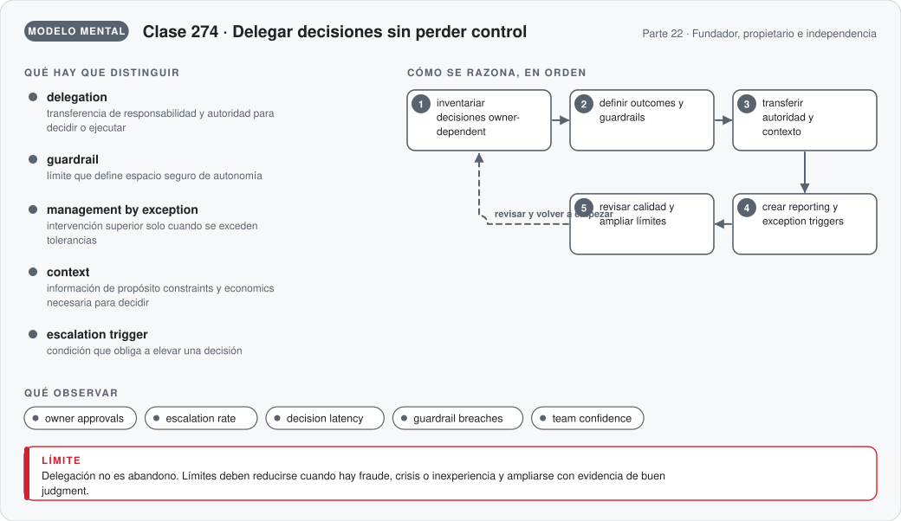

# Clase 274 — Delegar decisiones sin perder control

<!-- nav:inicio -->
> **Parte 22 · Escalamiento, propiedad y portafolio empresarial** — clase 10 de 12 · [índice de la parte](../../README.md) · [temario](../../../../SYLLABUS.md)
<!-- nav:fin -->

**Parte:** 22 — Escalamiento, propiedad y portafolio empresarial  
**Nivel:** Etapa 6 — Business Owner  
**Duración sugerida:** 150–180 minutos · **Estándar:** deep-class-v2

## 🎯 Propósito

Delegar es una de las habilidades más pedidas a un fundador y una de las que peor se practican. Hay dos fracasos opuestos. En el primero, el fundador **no delega**: todo pasa por él, las decisiones se acumulan, el equipo espera, aprende a no pensar y el negocio avanza a la velocidad de su agenda. En el segundo, **abdica**: entrega una responsabilidad sin contexto, sin límites y sin seguimiento, se entera de los problemas cuando ya son grandes y recupera el control de golpe, lo que desmoraliza a todos. Delegar bien significa **transferir la autoridad para decidir manteniendo la capacidad de saber lo que ocurre y de intervenir cuando corresponde**. No es soltar: es diseñar un sistema donde el equipo decide más y mejor, y el dueño ve lo que necesita ver. Horowitz insiste en que dirigir implica tomar decisiones difíciles con información incompleta y entrenar a otros para hacerlo.

La clase propone un método: inventariar las decisiones que dependen del dueño, definir para cada una el resultado esperado y los límites, transferir autoridad y contexto, crear reportes y gatillos de excepción, y revisar la calidad para ampliar gradualmente los límites. Se apoya en Horowitz, los principios de gobierno de la OECD (responsabilidades y rendición de cuentas), Sutton y Rao (transmitir prácticas esenciales), Harnish (rutinas de gestión), Hoffman y Yeh y Gerber. Al terminar sabrás clasificar decisiones por nivel de delegación, definir guardrails (límites), medir latencia, escalamiento y calidad, calcular el valor de delegar con supuestos explícitos y decidir cuándo ampliar o retirar autoridad.

## 📚 Resultados de aprendizaje

Al finalizar podrás:

1. **Inventariar** las decisiones que hoy dependen del dueño y clasificarlas por tipo y riesgo.
2. **Asignar** un nivel de delegación a cada decisión con resultado esperado y límites.
3. **Diseñar** reportes y gatillos de excepción que mantengan el control sin microgestión.
4. **Medir** latencia de decisión, tasa de escalamiento y calidad de lo delegado.
5. **Decidir** cuándo ampliar, mantener o retirar una autoridad delegada.

## 🧭 Agenda

| Tramo | Qué se hace |
|---|---|
| 0–20 min | Recuperación: ¿qué decisiones esperan tu firma y cuánto cuestan los días de espera? |
| 20–60 min | Inventario, niveles, límites, transferencia de contexto, reportes, revisión y ampliación. |
| 60–105 min | Ejemplo trabajado: valor de delegar con latencia, errores y revisión de calidad. |
| 105–150 min | Caso ejecutivo y práctica. |
| 150–175 min | Límites y entregable. |

## 🧩 Conceptos centrales

| Concepto | Definición | Cómo se reconoce |
|---|---|---|
| **Nivel de delegación** | Grado de autoridad que se transfiere para una decisión. | Decide el dueño, propone, decide y avisa, decide y reporta. |
| **Guardrail** | Límite dentro del cual se puede decidir. | Monto, tipo de cliente, riesgo. |
| **Gatillo de excepción** | Condición que obliga a escalar. | Umbral escrito. |
| **Latencia de decisión** | Tiempo entre la necesidad y la decisión. | Días promedio. |
| **Tasa de escalamiento** | Proporción de decisiones que suben al dueño. | Escaladas ÷ totales. |
| **Revisión de calidad** | Muestreo de decisiones para verificar su criterio. | Porcentaje alineado con el criterio. |

## 🧠 Modelo mental

**Cómo leer el diagrama.** Una escalera de cuatro niveles. **Decide el dueño**: decisiones reservadas por su impacto. **Propone y el dueño decide**: el equipo prepara y recomienda. **Decide y avisa**: con límites de monto y riesgo. **Decide y reporta**: autonomía con revisión periódica. La nota afirma que delegar no es abandonar: cada decisión transferida lleva resultado esperado, límites, alertas de excepción y revisión de calidad antes de ampliar la autoridad; el pie, que se asciende un nivel cuando la calidad de las decisiones lo respalda.

## 📖 Desarrollo

### 1. Inventariar las decisiones que dependen del dueño

El primer paso es **ver** esas decisiones. Durante dos a cuatro semanas, se registra cada consulta o aprobación que llega al dueño: qué se decidió, quién la pidió, cuánto tardó, qué información se usó, qué criterios se aplicaron, qué riesgo tenía y qué pasó después. Luego se agrupan por tipo: **precios y descuentos**, **gastos y compras**, **contratación y remuneración**, **clientes y reclamos**, **calidad y operación**, **estrategia y capital**. Muchas son rutinarias y siguen reglas que el dueño aplica sin darse cuenta. El inventario muestra qué decisiones son **de bajo riesgo y alta frecuencia** (candidatas a transferir primero), cuáles son **de alto riesgo** (se mantienen en el dueño o con límites estrictos) y cuáles dependen de **información que solo el dueño tiene**, lo que revela un problema de contexto más que de delegación.

### 2. Niveles de delegación

Una forma útil de distinguir grados de autoridad es una escala de cuatro niveles. **Nivel 1: decide el dueño** (decisiones reservadas por su impacto, como entrada de socios, deuda mayor o venta). **Nivel 2: el equipo propone y el dueño decide**: la persona prepara información, alternativas y una recomendación, y el dueño aprueba o ajusta. **Nivel 3: decide y avisa**: la persona decide dentro de límites y comunica de inmediato lo decidido. **Nivel 4: decide y reporta**: autonomía dentro de los límites con reporte periódico. Una decisión se asigna a un nivel según su **riesgo**, la **madurez** de quien decide y la **calidad de la información** disponible. El nivel no es permanente: se sube cuando la evidencia lo respalda y se baja si hay problemas. Esta escala evita el dilema «lo hago yo o lo suelto».

### 3. Resultados y límites (guardrails)

Para cada decisión delegada se define: el **resultado esperado** (qué debe lograrse), los **límites** (montos máximos, tipos de clientes, descuentos permitidos, riesgos aceptables, cumplimiento de normas), los **criterios** (cómo se decide, con ejemplos), la **información** a la que tiene acceso y **qué debe escalar** siempre. Los límites son un **contrato**: dentro de ellos, la persona decide y el dueño respalda incluso si él habría decidido distinto; fuera, se escala. Sin este respaldo, nadie decide. Sutton y Rao observan que escalar una organización exige transmitir con precisión las pocas prácticas que importan; en delegación, esas prácticas son el criterio y los límites. Un límite demasiado estrecho paraliza; uno demasiado amplio expone. Se calibra con el riesgo y se revisa.

### 4. Transferir contexto, no solo tareas

Una decisión sin contexto es una apuesta. Se comparte: **por qué** la empresa decide como decide, **qué** ha pasado en casos similares, **qué relaciones** están en juego, **qué prioridades** hay y **qué errores** se han cometido. Se usan **ejemplos reales** de decisiones pasadas y sus consecuencias, y se acompañan las primeras decisiones. La OECD, en sus principios de gobierno, subraya la importancia de que quienes toman decisiones tengan información suficiente y rindan cuentas; en la empresa, eso significa dar información, definir responsabilidad y evitar que el dueño decida «por detrás». Se acuerda además **cómo se desacuerda**: si el dueño discrepa de una decisión tomada dentro de los límites, la conversa en privado, explica el criterio y ajusta el límite si corresponde, sin desautorizar en público.

### 5. Reportes y gatillos de excepción

El control sin microgestión se logra con **información oportuna y alertas**. Se diseña un **reporte breve** (semanal o mensual) con las decisiones relevantes y sus efectos, y se definen **gatillos de excepción** que activan una comunicación inmediata: un gasto sobre el umbral, un cliente clave en riesgo, un incumplimiento, un error de impacto, una queja grave, una desviación de más de cierto porcentaje frente al presupuesto. Se evita pedir informes que nadie lee; se prefieren cifras clave y excepciones (clase 275). Harnish propone reuniones breves y regulares para revisar prioridades e indicadores; ese ritmo permite al dueño **saber** sin decidir. Un buen sistema logra que el dueño reciba **pocas** notificaciones, todas importantes, y que el equipo sepa cuándo hay que avisar.

### 6. Medir: latencia, escalamiento y calidad

Tres medidas ayudan a gestionar la delegación. **Latencia de decisión**: tiempo promedio entre que surge la necesidad y se decide; baja cuando la autoridad se acerca a quien tiene la información. **Tasa de escalamiento**: porcentaje de decisiones que suben al dueño; si es muy alta, los límites o el contexto son insuficientes; si es cero, puede que se esté decidiendo fuera de los límites sin avisar. **Calidad**: se revisa una muestra de decisiones (por ejemplo, 20 a 30 al mes) contra los criterios acordados, y se calcula el porcentaje alineado. No se castiga el error de buena fe dentro de los límites: se **aprende** y se ajusta el criterio. Se interpreta con cuidado: una mejora de latencia no prueba calidad, ni un error aislado prueba incapacidad.

### 7. Ampliar, mantener o retirar

Con la evidencia, se decide el paso siguiente. **Ampliar** (subir de nivel o ampliar límites) cuando la calidad se mantiene sobre un umbral acordado (por ejemplo, 90 %) durante dos períodos consecutivos y las excepciones están bien manejadas. **Mantener** cuando los resultados son aceptables pero aún hay aprendizaje. **Retirar o reducir** (volver a un nivel inferior) cuando hay errores repetidos, falta de reporte o decisiones fuera de los límites. Se conversa con la persona de forma clara y respetuosa, con ejemplos y plan. Horowitz advierte que evitar estas conversaciones daña a la persona y a la organización. Se registra la historia de cada delegación y se revisa cada trimestre. El dueño sigue teniendo **decisiones reservadas** (clase 270), cuya lista es corta y conocida.

## 📚 Lectura comparada

| Obra | Qué aporta | Qué no resuelve | Pregunta para contrastar |
|---|---|---|---|
| Horowitz | Decisiones difíciles y formación de líderes. | Enfoque de empresas tecnológicas. | ¿Qué conversación evito con quien decide mal? |
| OECD (principios de gobierno) | Rendición de cuentas e información. | No es guía de delegación diaria. | ¿Quién responde por esta decisión? |
| Sutton y Rao | Transmitir prácticas esenciales con precisión. | No define niveles. | ¿Qué criterio debo transmitir tal cual? |
| Harnish | Rutinas de reunión y revisión. | No trata la calidad de las decisiones. | ¿Qué reunión me informa sin que yo decida? |
| Gerber | Sistemas que no dependen del fundador. | No es guía de delegación por niveles. | ¿Qué decisión puede ser parte de un sistema? |

## 🧮 Ejemplo trabajado

**Situación (hipotética).** Una empresa de servicios técnicos para hospitales registra durante un mes 40 decisiones que pasaron por el fundador. Quiere delegar 28 de ellas (de bajo riesgo y alta frecuencia) al nivel 3 («decide y avisa»). Los valores son **supuestos**.

**Línea base del mes.**

| Dato | Valor |
|---|---|
| Decisiones que pasaron por el fundador | 40 |
| Latencia promedio | 3,2 días |
| Costo por día de demora (ventas perdidas, cuadrillas detenidas) | 40.000 pesos por decisión |
| Tasa de error del fundador en esas decisiones | 5 % |
| Costo promedio de un error | 150.000 pesos |

**Costo mensual de la demora en las 28 decisiones delegables.** 28 × 3,2 días × 40.000 = **3.584.000 pesos**.

**Después de delegar (supuestos del plan).** Latencia promedio de 0,6 días; tasa de error de quienes deciden: 16 %.

- Costo de demora: 28 × 0,6 × 40.000 = **672.000**.
- Ahorro por menor demora: 3.584.000 − 672.000 = **2.912.000**.
- Costo de errores antes: 28 × 0,05 × 150.000 = **210.000**.
- Costo de errores después: 28 × 0,16 × 150.000 = **672.000**.
- Aumento del costo por errores: 672.000 − 210.000 = **462.000**.
- **Beneficio neto mensual: 2.912.000 − 462.000 = 2.450.000 pesos.**

**Tiempo del fundador.** Si cada decisión le tomaba 25 minutos entre consultas, contexto y respuesta, las 28 decisiones consumían 28 × 25 = 700 minutos = **11,7 horas al mes**, que se redirigen a trabajo de mayor valor.

**Sensibilidad.** Si la tasa de error de los delegados fuera 30 %: costo de errores = 28 × 0,30 × 150.000 = 1.260.000; aumento = 1.050.000; beneficio neto = 2.912.000 − 1.050.000 = **1.862.000**: la delegación seguiría siendo ventajosa, pero con un error tan alto conviene mejorar el criterio y los límites. Si el costo de un error fuera 1.000.000 y la tasa de 16 %: costo de errores = 28 × 0,16 × 1.000.000 = 4.480.000, mucho mayor que el ahorro: **la delegación no sería conveniente sin límites estrictos** para decisiones con errores caros. Esto justifica dejar en nivel 2 las decisiones donde el error es costoso.

**Guardrails.** Gastos hasta 400.000 pesos por decisión (nivel 3); descuentos hasta 8 % en contratos existentes; reprogramaciones de visitas sin costo para el cliente; reclamos con compensación hasta 150.000. Fuera de esos límites o ante un cliente hospitalario crítico, se escala. Gatillos: cualquier reclamo con riesgo para pacientes, cualquier desviación de más de 10 % del presupuesto mensual, tres decisiones iguales en una semana.

**Revisión de calidad.** Se auditan 25 decisiones del primer mes: 20 estuvieron alineadas con el criterio (80 %), 3 fuera de límites por falta de información y 2 con error de criterio. La meta para ampliar a nivel 4 es 90 % durante dos meses consecutivos. Se ajustan los ejemplos y se amplía la información disponible para quienes deciden.

**Tasa de escalamiento.** De las 28 decisiones delegadas, 4 escalaron: 4 ÷ 28 = **14,3 %**. Se considera razonable al inicio; si baja a cero, se revisa si se decide fuera de los límites sin avisar.

**Decisión.** Mantener la delegación al nivel 3 para las 28 decisiones, con revisión mensual de calidad; subir al nivel 4 solo con 90 % de calidad durante dos meses; mantener en nivel 2 las decisiones donde un error cuesta más de 1.000.000 de pesos; el fundador deja de aprobar gastos menores y se concentra en clientes clave y estrategia.

**Cuidados.** Los costos y tasas son supuestos que se verifican con datos reales; la calidad se evalúa con criterios acordados y no con culpas.

**Qué muestra.** (1) El valor de delegar se calculó con demora y errores. (2) La sensibilidad indicó dónde conviene no delegar. (3) La revisión de calidad define cuándo ampliar la autoridad.

## 🔀 Comparación y límites

**Delegar frente a abdicar.** Delegar transfiere autoridad con contexto, límites, reportes y revisión; abdicar entrega la responsabilidad sin ellos. La primera mantiene el control sobre el resultado; la segunda lo pierde.

**Límites.** Las métricas no prueban causalidad: una menor latencia no demuestra mejor calidad. Algunas decisiones deben permanecer reservadas por su impacto. Los umbrales y tasas del ejemplo son supuestos. La delegación en materias reguladas (laboral, tributaria, de seguridad) debe respetar las obligaciones legales de la empresa, que se verifican con asesoría.

## 🪜 De profesional a owner

| Nivel | Cómo se relaciona con la delegación |
|---|---|
| **Profesional** | Decide dentro de sus límites y escala cuando corresponde. |
| **Jefe / Team Lead** | Recibe autoridad y la comparte con su equipo. |
| **Gerente** | Decide en su área y reporta excepciones. |
| **CEO / Director** | Diseña los niveles y límites, y revisa la calidad. |
| **Founder / Owner** | Retiene lo reservado, respalda lo delegado y amplía autoridad con evidencia. |

## 🏢 Caso ejecutivo

Una fundadora dirige una red de tres centros de estética con 40 personas y ventas de 1.500 millones de pesos. En un mes, 52 decisiones pasaron por ella: 18 descuentos a clientes, 14 compras de insumos de hasta 600.000 pesos, 9 reprogramaciones de tratamientos, 6 reclamos con compensación, 3 contrataciones y 2 cambios de precios. La latencia promedio es de 2,5 días; cada día de demora cuesta, en promedio, 25.000 pesos por decisión (clientes que se van, insumos que faltan). Ella calcula que un error en un descuento cuesta 30.000, en una compra 80.000, en una compensación 200.000 y en una contratación 4.000.000. Las tres administradoras de los centros piden más autonomía; una de ellas ha cometido errores de criterio en descuentos. La fundadora viaja un mes al año y no ha podido dejar de contestar mensajes. Desconfía de que «nadie decida como ella».

Entrega un **memo de decisión del fundador** que contenga: (a) el inventario clasificado por tipo y riesgo; (b) el nivel de delegación propuesto para cada tipo con guardrails y gatillos; (c) el cálculo del valor de delegar con latencia, errores y sensibilidad; (d) el plan de contexto y las primeras decisiones acompañadas; (e) las medidas de seguimiento (latencia, escalamiento y calidad) y los criterios para ampliar o retirar; (f) los límites del análisis y las decisiones que seguirán reservadas.

## 🧪 Práctica

1. Registra durante dos semanas las decisiones que llegan a ti y clasifícalas por tipo y riesgo.
2. Asigna un nivel de delegación a cinco de ellas con guardrails y gatillos.
3. Calcula el valor de delegar una familia de decisiones con latencia y errores.
4. Escribe tres ejemplos reales para transferir contexto a quien decidirá.
5. Define el umbral y el período para ampliar o retirar una autoridad.

## ⚠️ Errores frecuentes

| Error | Por qué ocurre | Cómo corregirlo |
|---|---|---|
| No delegar nada | Se desconfía de otros | Empezar con decisiones de bajo riesgo y alta frecuencia. |
| Abdicar | Se quiere soltar rápido | Límites, reportes y revisión de calidad. |
| Delegar sin contexto | Falta tiempo | Ejemplos reales y acompañamiento. |
| Desautorizar en público | Impulso | Conversar en privado y ajustar límites. |
| Medir solo la velocidad | Es lo más visible | Medir también calidad y escalamiento. |
| Nunca ampliar la autoridad | Se teme perder el control | Umbral y período acordados. |

## ❓ Preguntas de comprobación

1. ¿Qué diferencia hay entre delegar y abdicar?
2. ¿Cuáles son los cuatro niveles de delegación?
3. ¿Qué es un guardrail y qué es un gatillo de excepción?
4. ¿Qué miden la latencia, el escalamiento y la calidad?
5. ¿Cómo se calcula el valor de delegar?
6. ¿Cuándo se amplía o se retira una autoridad?
7. ¿Qué límite tienen estas métricas?

Claves de respuesta

1. Delegar transfiere autoridad con contexto, límites y revisión; abdicar la entrega sin ellos.
2. Decide el dueño; propone y el dueño decide; decide y avisa; decide y reporta.
3. El guardrail es el límite dentro del cual se decide; el gatillo es la condición que obliga a escalar.
4. El tiempo hasta decidir, la proporción que sube al dueño y el porcentaje alineado con los criterios.
5. Ahorro por menor demora menos aumento del costo por errores, con sensibilidad.
6. Se amplía cuando la calidad supera el umbral en períodos consecutivos; se retira ante errores repetidos o falta de reporte.
7. No prueban causalidad ni reemplazan el juicio; los costos y tasas del ejemplo son supuestos.

## 📥 Entregable

Guarda en `portfolio/274-delegar-decisiones-sin-perder-control/`:

- `founder-owner-decision-brief.md` (plantilla [Founder owner decision brief](../../../../templates/founder-owner-decision-brief.md)) con el memo del caso ejecutivo;
- `decision-journal.md` con el inventario, los niveles, los guardrails y la revisión de calidad.

## 📗 Fuentes y verificación

- Ben Horowitz — *The Hard Thing About Hard Things* (HarperCollins Publishers, 2014). **Uso en esta clase:** decisiones difíciles y formación de líderes. Lectura selectiva sobre **delegar decisiones sin perder control**. **Localizador:** [ISBN-13 9780062273215](https://openlibrary.org/isbn/9780062273215).
- OECD — *G20/OECD Principles of Corporate Governance 2023*. **Uso en esta clase:** responsabilidad, información y rendición de cuentas. **Fuente primaria:** <https://www.oecd.org/en/publications/2023/09/g20-oecd-principles-of-corporate-governance-2023_60836fcb.html>.
- Robert I. Sutton & Huggy Rao — *Scaling Up Excellence* (Random House Canada, 2014). **Uso en esta clase:** transmitir con precisión las prácticas esenciales. Lectura selectiva sobre **delegar decisiones sin perder control**. **Localizador:** [ISBN-13 9780307363428](https://openlibrary.org/isbn/9780307363428).
- Verne Harnish — *Scaling Up* (Gazelles, Inc., 2014). **Uso en esta clase:** rutinas de reunión y revisión de indicadores. Lectura selectiva sobre **delegar decisiones sin perder control**. **Localizador:** [ISBN-13 9780986019555](https://openlibrary.org/isbn/9780986019555).
- Reid Hoffman & Chris Yeh — *Blitzscaling* (HarperCollins Publishers Limited, 2018). **Uso en esta clase:** velocidad de decisión en el crecimiento acelerado. Lectura selectiva sobre **delegar decisiones sin perder control**. **Localizador:** [ISBN-13 9780008303648](https://openlibrary.org/isbn/9780008303648).
- Michael E. Gerber — *The E-Myth Revisited* (HarperAudio, 1995). **Uso en esta clase:** sistemas que no dependen del fundador. Lectura selectiva sobre **delegar decisiones sin perder control**. **Localizador:** [ISBN-13 9780060574901](https://openlibrary.org/isbn/9780060574901).

> **Regla de fuentes para Delegar decisiones sin perder control:** las obras anteriores estructuran las perspectivas de esta materia; cualquier norma, ley o estándar vivo mencionado debe comprobarse nuevamente en su fuente primaria vigente. Los ejemplos y casos son hipotéticos, con cifras ilustrativas. El desarrollo es original y no reproduce capítulos protegidos.

<!-- pie:inicio -->
---

| Anterior | Índice | Siguiente |
|---|---|---|
| [← 273 · Adquisiciones como vía de crecimiento](../273-adquisiciones-como-via-de-crecimiento/README.md) | [Parte 22](../../README.md) · [Programa](../../../../SYLLABUS.md) | [275 · Owner dashboard →](../275-owner-dashboard/README.md) |
<!-- pie:fin -->
