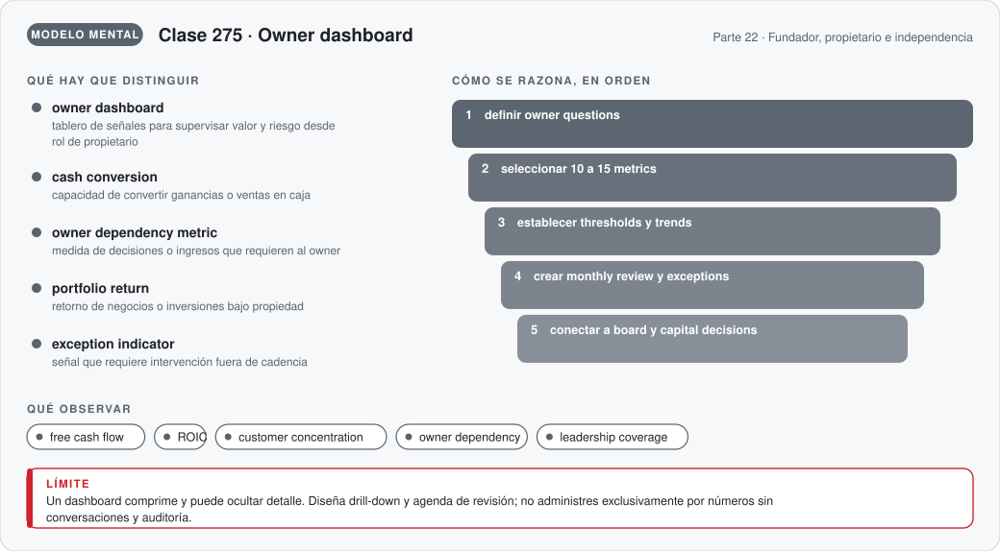

# Clase 275 — Owner dashboard

<!-- nav:inicio -->
> **Parte 22 · Escalamiento, propiedad y portafolio empresarial** — clase 11 de 12 · [índice de la parte](../../README.md) · [temario](../../../../SYLLABUS.md)
<!-- nav:fin -->

**Parte:** 22 — Escalamiento, propiedad y portafolio empresarial  
**Nivel:** Etapa 6 — Business Owner  
**Duración sugerida:** 150–180 minutos · **Estándar:** deep-class-v2

## 🎯 Propósito

Un propietario que ya no opera el negocio día a día necesita **ver** sin **estar**. Sin una forma ordenada de ver, caen dos tentaciones: volver a meterse en cada detalle («para estar tranquilo») o confiar ciegamente hasta que un problema grande aparece sin aviso. Un tablero del propietario (owner dashboard) es la solución: un conjunto **pequeño** de indicadores, con umbrales y tendencias, que responde las preguntas que el dueño realmente se hace sobre su empresa: ¿gano dinero y genero caja?, ¿mis clientes están satisfechos y diversificados?, ¿mi operación es confiable?, ¿cuánto riesgo tengo?, ¿qué decisiones de capital están pendientes? No es un informe extenso ni un panel con cuarenta gráficos: es **diez a quince métricas**, revisadas con una cadencia, con **excepciones** que obligan a actuar. Drucker sostiene que la gestión necesita medir lo que importa para los resultados, no todo lo que se puede medir.

La clase enseña a construir ese tablero a partir de las preguntas del dueño: seleccionar métricas, definir umbrales y tendencias, asignar fuentes y responsables, establecer una revisión mensual y conectar el tablero con las decisiones del gobierno y de capital. Se apoya en Drucker, Kaplan y Norton (el cuadro de mando integral: traducir estrategia en medidas), Koller y colaboradores (flujo de caja libre y retorno sobre el capital como fundamentos del valor), Harnish (cifras clave y rutinas), Hoffman y Yeh, Sutton y Rao y Gerber. Al terminar sabrás armar un tablero con métricas útiles, calcular flujo de caja libre y retorno sobre el capital con supuestos, definir umbrales y colores, leer un mes de datos e identificar excepciones.

## 📚 Resultados de aprendizaje

Al finalizar podrás:

1. **Formular** las preguntas del propietario y traducirlas a métricas.
2. **Seleccionar** diez a quince indicadores con definición, fuente y responsable.
3. **Calcular** flujo de caja libre, retorno sobre el capital y concentración de clientes.
4. **Definir** umbrales, tendencias y excepciones que activan acciones.
5. **Conectar** el tablero con una revisión mensual y con decisiones de capital.

## 🧭 Agenda

| Tramo | Qué se hace |
|---|---|
| 0–20 min | Recuperación: ¿qué cinco números querrías ver cada mes para dormir tranquilo? |
| 20–60 min | Preguntas del dueño, selección, definiciones, umbrales, tendencias, revisión y capital. |
| 60–105 min | Ejemplo trabajado: cálculo de métricas, semáforo y excepciones de un mes. |
| 105–150 min | Caso ejecutivo y práctica. |
| 150–175 min | Límites y entregable. |

## 🧩 Conceptos centrales

| Concepto | Definición | Cómo se reconoce |
|---|---|---|
| **Tablero del propietario** | Conjunto breve de indicadores para supervisar la empresa. | 10 a 15 métricas con umbrales. |
| **Flujo de caja libre** | Caja que queda tras operar e invertir. | Resultado operativo ajustado, menos inversión y capital de trabajo. |
| **Retorno sobre el capital invertido** | Resultado operativo neto de impuestos dividido por el capital empleado. | Porcentaje anual. |
| **Concentración de clientes** | Peso de los mayores clientes en las ventas. | Porcentaje de los tres mayores. |
| **Umbral** | Valor que separa lo normal de lo que requiere acción. | Verde, amarillo, rojo. |
| **Excepción** | Métrica fuera de umbral que activa una revisión. | Alerta con responsable. |

## 🧠 Modelo mental

**Cómo leer el diagrama.** Tres columnas. **Rentabilidad y caja**: flujo de caja libre, margen por unidad o línea y retorno sobre el capital invertido. **Clientes y operación**: concentración de clientes, calidad y continuidad del servicio, capacidad y plazos. **Riesgo y capital**: deuda y cobertura, dependencias clave y cumplimiento, y decisiones de capital pendientes. La nota afirma que un tablero de diez a quince métricas con umbrales y tendencia basta, y que cada métrica responde una pregunta del dueño; el pie, que las excepciones se revisan cada mes y alimentan las decisiones de capital.

## 📖 Desarrollo

### 1. Empezar por las preguntas, no por los datos

Un tablero útil nace de **preguntas**: ¿cuánto dinero genera la empresa y cuánto retorno da el capital que puse?, ¿estamos creciendo con rentabilidad o solo en ventas?, ¿qué tan sólida es la caja?, ¿qué tan dependiente soy de pocos clientes, personas o proveedores?, ¿está funcionando la operación sin mí?, ¿cuánto riesgo de deuda, cumplimiento o reputación tengo?, ¿qué decisiones de capital debo tomar (invertir, repartir, ahorrar, comprar, vender)? Kaplan y Norton proponen que las medidas se deriven de la **estrategia** y se equilibren entre perspectivas (financiera, clientes, procesos internos, aprendizaje y crecimiento) para evitar optimizar una a costa de las demás. Un tablero que no responde preguntas concretas del dueño se convierte en un informe que nadie lee.

### 2. Seleccionar diez a quince métricas

Se elige una métrica por pregunta, con **criterios**: que sea **relevante** para una decisión, **medible** de forma confiable, **oportuna** (disponible a tiempo), **comparable** (en el tiempo y con un objetivo), **difícil de manipular** y **entendible** para el dueño. Una selección típica incluye: **flujo de caja libre** y **caja disponible en semanas de gasto**; **margen de contribución** y **margen operativo**; **retorno sobre el capital invertido**; **crecimiento de ingresos** por segmento; **concentración de clientes**; **retención de clientes**; **calidad del servicio** (entregas a tiempo, reclamos); **días de cobro**; **deuda y cobertura del servicio de la deuda**; **rotación o dependencia de personas clave**; **cumplimiento** (calendario de obligaciones al día); y **decisiones de capital pendientes**. Se evita medir lo que no se usará. Más indicadores diluyen la atención: el criterio es **pocos y buenos**.

### 3. Definiciones, fuentes y responsables

Cada métrica tiene una **ficha**: nombre, **fórmula exacta**, fuente de datos, frecuencia, responsable de calcularla, responsable de explicarla, umbral y objetivo. Las discusiones sobre cifras suelen ser discusiones sobre definiciones: «¿qué es un cliente activo?, ¿cómo se calcula el margen?, ¿incluye costos compartidos?». Se acuerdan **una sola vez** y se documentan. Se registran también las **limitaciones** (qué no mide). Se automatiza lo que se pueda y se verifica la **calidad de los datos**: conciliación con la contabilidad, reglas de registro, auditoría de una muestra. Un tablero con datos dudosos produce decisiones dudosas; si una métrica no es confiable todavía, se marca como tal y se trabaja para mejorarla en lugar de usarla como si lo fuera.

### 4. Flujo de caja libre y retorno sobre el capital

Dos métricas resumen la salud económica. El **flujo de caja libre** es, en forma simplificada, el resultado operativo más depreciación, menos impuestos pagados, menos inversiones en activos (capex) y menos el aumento del capital de trabajo: lo que la empresa genera para sus propietarios y acreedores tras mantenerse y crecer. El **retorno sobre el capital invertido (ROIC)** es el resultado operativo después de impuestos dividido por el capital empleado. Koller y colaboradores los presentan como fundamentos del valor: una empresa crea valor cuando su ROIC supera el costo del capital y crece. Ambas se interpretan con cuidado: un flujo de caja libre bajo puede deberse a inversión de crecimiento (bueno) o a mala cobranza (malo); un ROIC alto puede reflejar activos subvaluados o falta de inversión. Se miran **tendencias** y **explicaciones**, no solo el número.

### 5. Umbrales, tendencias y semáforo

Cada métrica tiene **umbrales**: verde (dentro de lo esperado), amarillo (atención) y rojo (acción). Los umbrales se derivan del presupuesto, de la historia, de los compromisos con prestamistas y del apetito de riesgo del dueño; no se inventan para «ver más verde». Se muestran **tendencias** (últimos doce meses) porque un valor aislado puede engañar. Se define **qué hacer** cuando una métrica pasa de color: quién investiga, en qué plazo y qué decisión se evalúa. Harnish recomienda mantener pocas cifras clave con responsables y revisarlas en un ritmo regular; el semáforo facilita ver excepciones, pero se complementa con una **nota breve** de explicación y acciones. Un tablero que siempre está verde o siempre rojo ha perdido su función.

### 6. Revisión mensual y trimestral

El tablero se **revisa** en una reunión mensual de 60 a 90 minutos con el equipo directivo: se lee el tablero, se explican las excepciones, se acuerdan acciones y responsables, y se registran decisiones. Cada trimestre se profundiza: estrategia, asignación de capital, riesgos, gobierno (clase 270) y revisión del propio tablero (¿qué métricas dejaron de servir?). Se evita que la reunión se convierta en una cacería de culpables: se busca **entender y decidir**. Se acuerda el **paquete de información** que se envía antes, y se registra una **minuta** de una página. El dueño aprende a preguntar por **excepciones y tendencias** en vez de buscar los números de siempre, y a resistir la tentación de pedir más informes cuando algo le preocupa: primero se revisa si el tablero ya debería haberlo mostrado.

### 7. Conectar el tablero con las decisiones de capital

Un tablero es útil si **cambia decisiones**. Las decisiones de capital del propietario incluyen: **reinvertir** en la empresa (qué proyectos superan el costo del capital), **repartir utilidades**, **reducir deuda**, **mantener caja de seguridad**, **adquirir** o **vender** unidades (clases 271 y 273) y **cambiar la estructura** (clase 272). El tablero aporta la información: caja libre, retorno, riesgo y alternativas. Se define una **política de capital** simple: cuánta caja mantener (en semanas de gasto), qué proporción reinvertir, bajo qué condiciones repartir y qué retorno mínimo exigir a una inversión. Se registran las decisiones y sus resultados, y se evalúa a los 12 meses si se cumplieron los supuestos. Así, el propietario se convierte en asignador de capital, no solo en dueño de una operación.

## 📚 Lectura comparada

| Obra | Qué aporta | Qué no resuelve | Pregunta para contrastar |
|---|---|---|---|
| Drucker | Medir lo que importa para los resultados. | No define fórmulas. | ¿Qué resultado debo medir? |
| Kaplan y Norton | Medidas derivadas de la estrategia y equilibradas. | Puede generar demasiados indicadores. | ¿Qué estrategia mide cada indicador? |
| Koller y coautores | Flujo de caja libre y ROIC como base del valor. | No diseña el tablero. | ¿Mi ROIC supera el costo del capital? |
| Harnish | Cifras clave con responsables y ritmo de revisión. | No profundiza en valoración. | ¿Quién responde por cada cifra? |
| Hoffman y Yeh | Qué medir durante el crecimiento acelerado. | No es guía de tablero. | ¿Qué métrica me avisa antes de un problema grave? |

## 🧮 Ejemplo trabajado

**Situación (hipotética).** El propietario de una empresa de ingeniería lee el tablero del mes. Las cifras son **supuestos**; los impuestos efectivamente pagados y la tasa se verifican en los registros reales.

**Datos del mes (millones de pesos).**

| Concepto | Valor |
|---|---|
| Ingresos | 140,0 |
| Resultado operativo | 18,2 |
| Depreciación | 3,0 |
| Impuestos pagados | 3,0 |
| Inversión en activos (capex) | 4,0 |
| Aumento del capital de trabajo | 6,0 |

**Flujo de caja libre del mes.** 18,2 + 3,0 − 3,0 − 4,0 − 6,0 = **8,2 millones**. El margen operativo es 18,2 ÷ 140 = **13,0 %**. La conversión de resultado a caja libre es 8,2 ÷ 18,2 = **45 %**: parte del resultado se fue a capital de trabajo.

**ROIC de los últimos doce meses.** Resultado operativo de 190 millones; impuestos pagados de 38; resultado operativo neto de impuestos de 152. Capital invertido: 980. **ROIC = 152 ÷ 980 = 15,5 %**. Con un costo de capital supuesto de 11 %, el diferencial es **+4,5 puntos**; el valor económico agregado es 152 − 0,11 × 980 = 152 − 107,8 = **+44,2 millones**.

**Concentración de clientes.** Los tres mayores clientes representan 22 %, 16 % y 13 % de las ventas: **51 %**.

**Tablero de 12 métricas y semáforo.**

| Métrica | Valor | Umbral rojo | Estado |
|---|---|---|---|
| Flujo de caja libre del mes | 8,2 | < 5,0 | Verde |
| ROIC (12 meses) | 15,5 % | < 11 % | Verde |
| Margen operativo | 13,0 % | < 10 % | Verde |
| Crecimiento de ingresos (12 meses) | 9 % | < 3 % | Verde |
| Caja en semanas de gasto | 7 | < 5 | Verde |
| Concentración de los tres mayores clientes | 51 % | > 45 % | **Rojo** |
| Retención de clientes (12 meses) | 88 % | < 80 % | Verde |
| Entregas a tiempo | 91 % | < 88 % | Amarillo |
| Días de cobro (DSO) | 62 | > 65 | Amarillo |
| Cobertura del servicio de la deuda | 1,9 | < 1,3 | Verde |
| Dependencia de personas clave (puestos sin respaldo) | 3 | > 2 | **Rojo** |
| Cumplimiento del calendario de obligaciones | 96 % | < 90 % | Amarillo |

**Resumen del semáforo.** 7 verdes, 3 amarillos y 2 rojos (12 métricas). Los **rojos** (concentración y personas clave) son riesgos estructurales; los amarillos requieren vigilancia. El flujo de caja libre es positivo, pero **solo 45 %** del resultado se convirtió en caja: se investiga el aumento del capital de trabajo (DSO de 62 días y subiendo).

**Excepciones y acciones.** (1) Concentración 51 %: plan para desarrollar dos clientes medianos y segundo contacto en los tres mayores, responsable gerente comercial, revisión en 90 días. (2) Personas clave: tres puestos sin respaldo; plan de capacitación cruzada y contratación, responsable gerente de operaciones. (3) DSO en 62 y subiendo: cobranza a los cinco clientes con más antigüedad y revisión de condiciones.

**Conexión con capital.** El ROIC de 15,5 % supera el costo de capital de 11 %, y el flujo libre anual proyectado es de unos 60 a 80 millones. Política supuesta: mantener 7 semanas de gasto en caja, reinvertir hasta el 50 % del flujo libre en proyectos con retorno esperado superior a 15 % y repartir el resto. Una propuesta de inversión de 90 millones con retorno esperado de 12 % no pasaría el filtro (12 % < 15 %), aunque supere el costo de capital; se estudia ajustar el proyecto.

**Cuidados.** Las definiciones, los umbrales y los valores son supuestos del ejercicio; los datos deben conciliarse con la contabilidad y revisarse con profesionales.

**Qué muestra.** (1) El flujo libre y el ROIC se calcularon con fórmulas explícitas. (2) El semáforo identificó dos excepciones estructurales. (3) El tablero se conectó con una política de capital.

## 🔀 Comparación y límites

**Tablero frente a informe.** El tablero es breve, regular y centrado en excepciones; el informe es extenso y descriptivo. Ambos se complementan, pero el tablero guía la atención del dueño.

**Límites.** Las métricas no prueban causalidad; un indicador en verde no garantiza que todo esté bien. Los umbrales son criterios internos. Demasiadas métricas diluyen la atención y la manipulación de cifras es posible si los incentivos son malos. Las cifras del ejemplo son supuestos.

## 🪜 De profesional a owner

| Nivel | Cómo se relaciona con el tablero |
|---|---|
| **Profesional** | Registra los datos con calidad y entiende qué mide su trabajo. |
| **Jefe / Team Lead** | Responde por las métricas de su equipo. |
| **Gerente** | Explica las excepciones de su área y propone acciones. |
| **CEO / Director** | Presenta el tablero y conduce la revisión mensual. |
| **Founder / Owner** | Define las preguntas, fija los umbrales y decide el capital a partir del tablero. |

## 🏢 Caso ejecutivo

Un fundador es dueño de una distribuidora de repuestos automotrices con tres sucursales y ventas anuales de 3.600 millones de pesos. Recibe cada mes un informe de 40 páginas que no lee. Datos del último trimestre: resultado operativo de 63 millones (en el trimestre, ventas de 900); depreciación 9; impuestos pagados 12; inversión en activos 15; aumento del capital de trabajo 21 (inventario +14, cuentas por cobrar +9, cuentas por pagar +2); capital invertido de 1.400 millones; resultado operativo neto de impuestos de los últimos doce meses de 190; los tres mayores clientes (talleres y flotas) suman el 47 % de las ventas; un solo encargado de compras conoce a los proveedores clave; el gerente de una sucursal acumula 3 reclamos graves de entrega en el mes; el DSO es de 58 días; la deuda requiere una cobertura mínima de 1,3 y hoy es de 1,5; hay una propuesta para abrir una cuarta sucursal con una inversión de 260 millones y un retorno esperado de 13 %. Su costo de capital supuesto es 11 %.

Entrega un **memo ejecutivo con el tablero del propietario** que contenga: (a) las preguntas del dueño y las 12 métricas elegidas con definición y fuente; (b) el cálculo del flujo de caja libre del trimestre y el ROIC con los datos del caso; (c) los umbrales y el semáforo con las excepciones; (d) las acciones y responsables para las métricas en rojo; (e) la evaluación de la cuarta sucursal frente al costo de capital y a una política de retorno mínimo; (f) los límites del tablero y la cadencia de revisión.

## 🧪 Práctica

1. Escribe las diez preguntas que quieres que tu tablero responda.
2. Define las 12 métricas con fórmula, fuente, frecuencia y responsable.
3. Calcula el flujo de caja libre y el ROIC con tus datos o con supuestos.
4. Fija umbrales verde, amarillo y rojo y qué harás en cada caso.
5. Redacta una política de capital de media página.

## ⚠️ Errores frecuentes

| Error | Por qué ocurre | Cómo corregirlo |
|---|---|---|
| Demasiadas métricas | Se quiere ver todo | Pocas y buenas, ligadas a preguntas. |
| Métricas sin definición | Se supone que todos entienden lo mismo | Ficha con fórmula y fuente. |
| Umbrales inventados para ver verde | Se evita el conflicto | Derivarlos del presupuesto, la historia y el riesgo. |
| Mirar solo el valor del mes | Es lo visible | Mostrar tendencias de doce meses. |
| Tablero sin acción | Se informa sin decidir | Excepciones con responsable y plazo. |
| Datos dudosos | No se concilian | Calidad de datos y reconciliación con la contabilidad. |

## ❓ Preguntas de comprobación

1. ¿Por qué se parte de las preguntas del dueño?
2. ¿Qué incluye la ficha de una métrica?
3. ¿Cómo se calcula el flujo de caja libre?
4. ¿Qué mide el ROIC y cómo se compara?
5. ¿Para qué sirven los umbrales y el semáforo?
6. ¿Cómo se conecta el tablero con decisiones de capital?
7. ¿Qué límite tienen las métricas?

Claves de respuesta

1. Porque un tablero útil responde decisiones concretas y no acumula datos.
2. Fórmula, fuente, frecuencia, responsable, umbral, objetivo y limitaciones.
3. Resultado operativo más depreciación, menos impuestos, inversión en activos y aumento del capital de trabajo.
4. El resultado operativo neto de impuestos sobre el capital empleado, que se compara con el costo del capital.
5. Para identificar excepciones y activar acciones con responsable.
6. Con una política de capital: caja mínima, reinversión, reparto, deuda y retorno exigido.
7. No prueban causalidad, dependen de definiciones y datos de calidad, y pueden manipularse con malos incentivos.

## 📥 Entregable

Guarda en `portfolio/275-owner-dashboard/`:

- `board-or-executive-memo.md` (plantilla [Board or executive memo](../../../../templates/board-or-executive-memo.md)) con el memo ejecutivo del caso;
- `owner-dashboard.md` (plantilla [Owner dashboard](../../../../templates/owner-dashboard.md)) con las 12 métricas, umbrales y responsables;
- `decision-journal.md` con la política de capital y las excepciones del mes.

## 📗 Fuentes y verificación

- Peter F. Drucker — *Management: Tasks, Responsibilities, Practices* (Harper & Row, 1974). **Uso en esta clase:** medir lo que importa para los resultados. Lectura selectiva sobre **owner dashboard**. **Localizador:** [ISBN-13 9780060110925](https://openlibrary.org/isbn/9780060110925).
- Robert S. Kaplan & David P. Norton — *The Balanced Scorecard* (Harvard Business School Press, 1996). **Uso en esta clase:** medidas derivadas de la estrategia y equilibradas. Lectura selectiva sobre **owner dashboard**. **Localizador:** [ISBN-13 9780875846514](https://openlibrary.org/isbn/9780875846514).
- Tim Koller, Marc Goedhart & David Wessels — *Valuation: Measuring and Managing the Value of Companies* (Wiley, 2005). **Uso en esta clase:** flujo de caja libre y retorno sobre el capital como base del valor. Lectura selectiva sobre **owner dashboard**. **Localizador:** [ISBN-13 9780471702191](https://openlibrary.org/isbn/9780471702191).
- Verne Harnish — *Scaling Up* (Gazelles, Inc., 2014). **Uso en esta clase:** cifras clave con responsables y ritmo de revisión. Lectura selectiva sobre **owner dashboard**. **Localizador:** [ISBN-13 9780986019555](https://openlibrary.org/isbn/9780986019555).
- Reid Hoffman & Chris Yeh — *Blitzscaling* (HarperCollins Publishers Limited, 2018). **Uso en esta clase:** qué medir en el crecimiento acelerado. Lectura selectiva sobre **owner dashboard**. **Localizador:** [ISBN-13 9780008303648](https://openlibrary.org/isbn/9780008303648).
- Robert I. Sutton & Huggy Rao — *Scaling Up Excellence* (Random House Canada, 2014). **Uso en esta clase:** prácticas esenciales al escalar. Lectura selectiva sobre **owner dashboard**. **Localizador:** [ISBN-13 9780307363428](https://openlibrary.org/isbn/9780307363428).
- Michael E. Gerber — *The E-Myth Revisited* (HarperAudio, 1995). **Uso en esta clase:** sistemas que informan al dueño sin depender de él. Lectura selectiva sobre **owner dashboard**. **Localizador:** [ISBN-13 9780060574901](https://openlibrary.org/isbn/9780060574901).

> **Regla de fuentes para Owner dashboard:** las obras anteriores estructuran las perspectivas de esta materia; cualquier norma, ley o estándar vivo mencionado debe comprobarse nuevamente en su fuente primaria vigente. Los ejemplos y casos son hipotéticos, con cifras ilustrativas. El desarrollo es original y no reproduce capítulos protegidos.

<!-- pie:inicio -->
---

| Anterior | Índice | Siguiente |
|---|---|---|
| [← 274 · Delegar decisiones sin perder control](../274-delegar-decisiones-sin-perder-control/README.md) | [Parte 22](../../README.md) · [Programa](../../../../SYLLABUS.md) | [276 · Capstone: empresa menos dependiente del fundador →](../276-capstone-empresa-menos-dependiente-del-fundador/README.md) |
<!-- pie:fin -->
