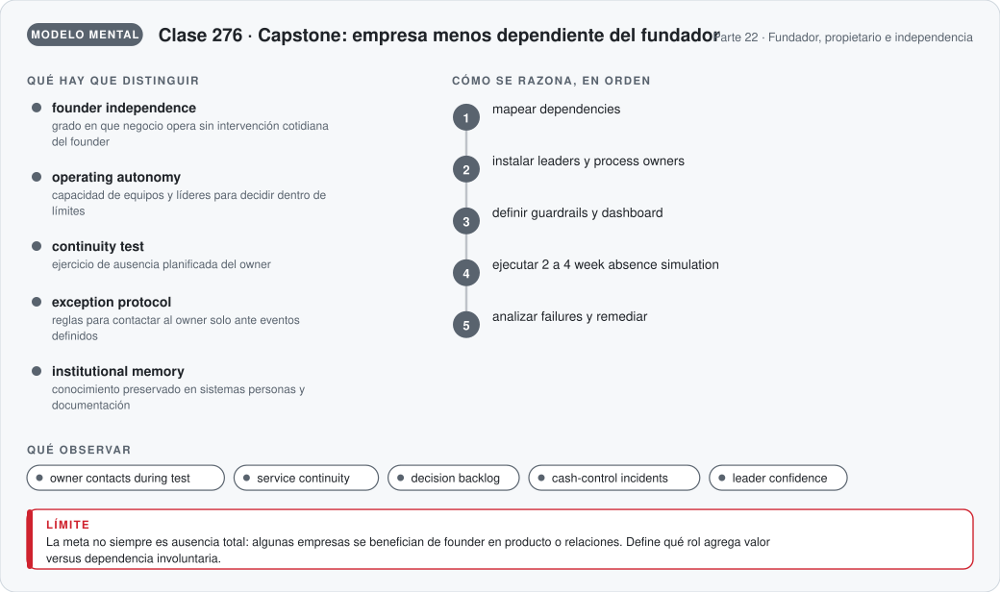

# Clase 276 — Capstone: empresa menos dependiente del fundador

<!-- nav:inicio -->
> **Parte 22 · Escalamiento, propiedad y portafolio empresarial** — clase 12 de 12 · [índice de la parte](../../README.md) · [temario](../../../../SYLLABUS.md)
<!-- nav:fin -->

**Parte:** 22 — Escalamiento, propiedad y portafolio empresarial  
**Nivel:** Etapa 6 — Business Owner  
**Duración sugerida:** 150–180 minutos · **Estándar:** deep-class-v2

## 🎯 Propósito

Las once clases anteriores de esta parte construyeron piezas: medir la dependencia del fundador, crear sistemas, contratar líderes, proteger el margen al crecer, controlar la caja, adaptar el gobierno, gestionar un portafolio, pensar estructuras de propiedad, evaluar adquisiciones, delegar decisiones y observar el negocio con un tablero. Falta la pregunta que las integra: **¿la empresa funciona de verdad sin el fundador?** No basta con haber nombrado gerentes, documentado procesos y delegado autoridad; hay que **probarlo**. La prueba más honesta es una **simulación de ausencia**: el fundador se aparta de la operación durante dos a cuatro semanas con reglas acordadas, y se observa qué ocurre con el servicio a los clientes, la caja, las decisiones pendientes y cada vez que el equipo necesita llamarlo. El resultado no es una nota sino **un mapa de fallas** que permite corregir el sistema antes de que la ausencia sea real (una enfermedad, una oportunidad, una venta).

El capstone propone ejecutar ese ciclo: mapear dependencias, instalar líderes y dueños de proceso, definir límites y tablero, simular una ausencia, analizar las fallas y remediar. Integra a Gerber (la empresa como sistema que no depende de su creador), Harnish (rutinas de gestión), Galbraith (diseño organizacional), Sutton y Rao (transmitir lo esencial), Gil (qué se rompe al crecer) y Hoffman y Yeh. Al terminar sabrás diseñar la simulación con reglas y métricas, interpretarla sin atribuir causalidad automática, priorizar remediaciones por severidad y decidir si la empresa está lista para operar sin su fundador o necesita otra ronda.

## 📚 Resultados de aprendizaje

Al finalizar podrás:

1. **Mapear** las dependencias del fundador con evidencia y priorizarlas.
2. **Verificar** que existan responsables, límites, tablero y reglas de contacto antes de la prueba.
3. **Diseñar** una simulación de ausencia con protecciones para clientes, caja y personas.
4. **Medir** contactos al fundador, continuidad del servicio y decisiones pendientes.
5. **Analizar** las fallas, remediarlas y decidir si repetir, ampliar o extender la prueba.

## 🧭 Agenda

| Tramo | Qué se hace |
|---|---|
| 0–20 min | Recuperación: ¿qué haría tu empresa si no estuvieras disponible tres semanas? |
| 20–60 min | Dependencias, responsables, límites y tablero, simulación, análisis y remediación. |
| 60–105 min | Ejemplo trabajado: resultados de una simulación de tres semanas y plan de remediación. |
| 105–150 min | Caso ejecutivo y práctica. |
| 150–175 min | Límites y entregable. |

## 🧩 Conceptos centrales

| Concepto | Definición | Cómo se reconoce |
|---|---|---|
| **Simulación de ausencia** | Prueba en la que el fundador se aparta bajo reglas acordadas. | Período, reglas y registro. |
| **Contacto evitable** | Consulta al fundador que una regla o límite ya cubría. | Había criterio o autoridad. |
| **Continuidad del servicio** | Mantención de la calidad y los plazos hacia el cliente. | Entregas, reclamos, satisfacción. |
| **Retraso de decisiones** | Decisiones pendientes que esperan al fundador. | Lista con antigüedad. |
| **Falla** | Evento en que la empresa necesitó al fundador o falló sin él. | Registro con severidad. |
| **Remediación** | Acción para eliminar la causa de una falla. | Responsable y fecha. |

## 🧠 Modelo mental

**Cómo leer el diagrama.** Una cadena de cinco pasos. **Mapear dependencias**: qué solo el fundador hace o decide. **Instalar responsables**: líderes y dueños de proceso. **Límites y tablero**: autoridad, alertas e información. **Simular ausencia**: dos a cuatro semanas con un acuerdo previo. **Analizar y remediar**: contactos, retrasos y fallas. La flecha de retorno indica que cada falla genera una acción. La nota afirma que la prueba busca aprender y no demostrar: se acuerdan reglas de contacto, se protege a clientes y caja y se registra cada vez que el equipo necesitó al fundador; el pie, que el resultado se mide por continuidad del servicio y decisiones pendientes.

## 📖 Desarrollo

### 1. Mapear dependencias con evidencia

El mapa de dependencias recoge, con datos de las clases 265 y 274: **horas del fundador por rol**, **decisiones y aprobaciones que dependen de él**, **clientes y relaciones** que solo él maneja, **conocimiento** que nadie más tiene, **accesos y firmas** (banco, sistemas, contratos), **procesos** que se detienen sin él y **riesgos de reputación**. Se prioriza con severidad y probabilidad: ¿qué pasaría si no estuviera una semana?, ¿un mes?, ¿qué se rompería primero? Gerber describe la empresa que funciona como un **sistema**, no como una extensión de su creador; el mapa muestra cuán lejos está. También se identifican dependencias de **otras personas clave** (gerentes, técnicos), porque reemplazar al fundador por otra persona imprescindible solo traslada el riesgo. Sin este mapa, la simulación no sabe qué probar.

### 2. Instalar líderes y dueños de proceso

Antes de probar, deben existir los responsables: un **líder o responsable** por área (comercial, operaciones, finanzas, personas), **dueños de proceso** para los procesos críticos (clase 266), **suplentes** para las personas clave y **autoridad delegada** con niveles y límites (clase 274). Se verifica que cada uno tenga: resultados esperados, información, límites de decisión, a quién reportar y qué escalar. Galbraith explica que el diseño organizacional debe asegurar que la autoridad, la información y la coordinación estén **alineadas**; si alguien tiene responsabilidad sin autoridad o sin información, la simulación fallará por diseño, no por mala voluntad. Se verifica también que el equipo **quiere** y **puede** asumir esos roles; la voluntad se conversa y se acompaña.

### 3. Definir guardrails, tablero y reglas de contacto

Se acuerdan por escrito: los **límites de decisión** de cada responsable (montos, descuentos, contrataciones, compensaciones), los **gatillos de excepción** que obligan a contactar al fundador, el **tablero** que recibirá semanalmente (clase 275), y las **reglas de contacto durante la prueba**: quién puede llamarlo, por qué motivos, por qué canal y cómo se registra cada contacto. Se define una **persona de respaldo** (un asesor, un socio, un consejero) para decisiones reservadas urgentes. Se acuerda qué **protecciones** existen para clientes, caja y personas: por ejemplo, no se firman contratos nuevos fuera de límites, no se hacen cambios de precio relevantes, y si ocurre una emergencia (seguridad, legal, financiera) el fundador es contactable de inmediato. Sutton y Rao recuerdan que transmitir las prácticas esenciales requiere precisión; las reglas de la prueba son parte de esa precisión.

### 4. Diseñar la simulación

La **simulación** dura de dos a cuatro semanas y se realiza en un período representativo (no en el más tranquilo ni en el más crítico). Se comunica al equipo y a los clientes clave de forma que no genere alarma ni excusas. Se define qué se medirá: **contactos al fundador** (cuántos, por qué, cuáles eran evitables), **continuidad del servicio** (entregas a tiempo, reclamos, satisfacción), **retraso de decisiones** (cuántas esperan y desde cuándo), **caja y ventas** frente al plan y **clima** del equipo. Se establecen **criterios de aprobación** previos (por ejemplo, menos de 5 contactos semanales en la tercera semana, continuidad de 90 % o más y menos de 8 decisiones pendientes). El fundador no «espía» ni interviene por la puerta trasera: su disciplina es parte del resultado. Harnish enfatiza que la rutina de reuniones y el seguimiento semanal ordenan la ejecución; se mantienen durante la prueba.

### 5. Registrar y analizar sin culpas

Durante la prueba, un **registro simple** anota cada contacto: fecha, quién, motivo, tipo (decisión, información, relación, urgencia), si era evitable, qué regla faltaba y cómo se resolvió. Al terminar, se analizan los datos con el equipo en una sesión sin culpas: ¿qué patrones aparecen?, ¿qué decisiones se repitieron?, ¿qué información faltaba?, ¿qué límites eran demasiado estrechos o demasiado amplios?, ¿qué cliente reclamó y por qué? Se **interpreta con cuidado**: un mes sin crisis no prueba que el sistema sea robusto, y una crisis puede ser azar. Se compara con la línea base de las clases anteriores (horas, aprobaciones, concentración). Gil advierte que lo que funcionaba con pocas personas se rompe con más; la simulación detecta esas rupturas antes de que cuesten caro.

### 6. Priorizar y remediar las fallas

Cada falla se registra con **severidad**, **causa** y **acción**. Se priorizan por impacto y recurrencia: las que ponen en riesgo a clientes, caja o cumplimiento van primero. Las acciones típicas son: **documentar una regla** (criterio de decisión), **ampliar o estrechar un límite**, **entrenar a una persona**, **instalar un suplente**, **mejorar el tablero**, **presentar al líder a un cliente clave** o **cambiar un acceso**. Cada acción tiene responsable y fecha, y se verifica su efecto en la siguiente ronda. Hoffman y Yeh describen que, al crecer rápido, las organizaciones aceptan imperfecciones a cambio de velocidad; aquí el objetivo es lo contrario: **reducir sorpresas** que ya se conocen. La remediación también incluye al fundador: ¿qué hábitos suyos generaron los contactos evitables?

### 7. Decidir: aprobar, repetir o extender

Con los resultados se decide: **aprobado** (se cumplen los criterios y las fallas restantes son menores; se planifica la siguiente prueba en 6 a 12 meses y se reduce la dependencia), **repetir** (se cumplen parte de los criterios; se remedian las fallas y se repite en 60 a 90 días), o **extender** (el fundador pasa a un rol más reducido con límites más claros y una prueba más larga). También se decide qué hacer con el **tiempo y la energía** del fundador: dedicarse a estrategia, capital, nuevas unidades, familia o salida (clase 270 y 271). Una empresa menos dependiente no significa un fundador irrelevante, sino uno que **elige** en qué participa. Y se documenta el aprendizaje en el diario de decisiones, porque la dependencia **vuelve** si no se la vigila: personas nuevas, clientes nuevos y crisis tienden a atraer de nuevo al fundador.

## 📚 Lectura comparada

| Obra | Qué aporta | Qué no resuelve | Pregunta para contrastar |
|---|---|---|---|
| Gerber | La empresa como sistema que no depende de su creador. | Enfoque general. | ¿Qué sistema sostiene esto sin mí? |
| Harnish | Rutinas de gestión y seguimiento. | No diseña la prueba. | ¿Qué reunión semanal sigue funcionando? |
| Galbraith | Alineación de autoridad, información y coordinación. | No cuantifica la dependencia. | ¿Quién tiene la autoridad y la información? |
| Sutton y Rao | Transmitir con precisión las prácticas esenciales. | No define la simulación. | ¿Qué práctica esencial se perdió? |
| Gil | Qué se rompe al crecer. | Basado en empresas de crecimiento rápido. | ¿Qué proceso no resistió la prueba? |

## 🧮 Ejemplo trabajado

**Situación (hipotética).** El fundador de la empresa de mantención industrial de la clase 265 realiza una simulación de ausencia de tres semanas, con reglas acordadas. Las cifras son **supuestos**.

**Línea base (antes de las mejoras de las clases anteriores).** Horas semanales del fundador: 55 (38 de operador). Aprobaciones: 44,3 % de las decisiones. Tres clientes con el 46 % de las ventas conocían solo al fundador.

**Estado antes de la prueba (después del plan de seis meses).** Horas semanales: 44 (18 de operador). Aprobaciones del fundador: 17 % (24 de 140 decisiones). Cada uno de los tres clientes tiene un segundo contacto presentado. Hay un gerente de operaciones, un gerente comercial, dueños de seis procesos críticos y un tablero de 12 métricas.

**Contactos al fundador durante la simulación.**

| Semana | Contactos | De ellos, evitables (había regla o autoridad) |
|---|---|---|
| 1 | 14 | 10 |
| 2 | 8 | 5 |
| 3 | 4 | 2 |
| **Total** | **26** | **17** |

Contactos evitables: 17 ÷ 26 = **65,4 %**. La tendencia (14, 8, 4) muestra aprendizaje: la reducción de la semana 1 a la 3 es (14 − 4) ÷ 14 = **71,4 %**. Motivos de los 26 contactos: decisiones de precio fuera de límite (7), información sobre contratos antiguos (6), relaciones con el cliente mayor (5), aprobaciones de compras (4), emergencias reales (2), otros (2).

**Continuidad del servicio.** Entregas a tiempo: 93 % durante la prueba frente a 95 % de línea base. Reclamos: 6 en tres semanas frente a un promedio de 4. Ventas facturadas: 98,5 % del plan. Satisfacción de los clientes consultados: sin cambio relevante.

**Decisiones pendientes.** Al día 21 había 11 decisiones esperando (frente a 6 habituales), siete de ellas reservadas al fundador por su monto o impacto y cuatro por falta de criterio.

**Criterios de aprobación previos.**

| Criterio | Meta | Resultado | ¿Cumple? |
|---|---|---|---|
| Contactos en la semana 3 | ≤ 5 | 4 | Sí |
| Continuidad del servicio (entregas a tiempo) | ≥ 90 % | 93 % | Sí |
| Decisiones pendientes al día 21 | ≤ 8 | 11 | **No** |

**Resultado:** 2 de 3 criterios cumplidos. **Decisión: repetir en 90 días** tras remediar.

**Análisis de fallas y remediación.**

| Falla | Severidad (1-5) | Frecuencia | Puntaje | Acción | Responsable |
|---|---|---|---|---|---|
| Descuentos fuera de límite sin criterio claro | 4 | 7 | 28 | Reglas y ejemplos; ampliar límite de 8 % a 12 % para clientes con contrato | Gerente comercial |
| Información de contratos antiguos solo en la memoria del fundador | 3 | 6 | 18 | Repositorio de contratos y resumen de cláusulas clave | Administración |
| Cliente mayor consulta directamente al fundador | 5 | 5 | 25 | Reunión de relación con el segundo contacto y acuerdo de comunicación | Gerente comercial y fundador |
| Aprobación de compras sobre un umbral muy bajo | 2 | 4 | 8 | Subir el umbral de 400.000 a 800.000 pesos | Gerente de operaciones |

Con puntaje total de 79, las dos primeras prioridades (28 y 25) concentran 67 % (53 ÷ 79); se atienden primero.

**Dependencia después de la prueba (estimación).** Horas del fundador: 38 por semana con 12 de operador; aprobaciones: 12 %; clientes mayores con relación diversificada: 2 de 3. La meta de la próxima prueba es 5 o menos contactos por semana desde la semana 2 y 6 o menos decisiones pendientes.

**Decisión.** Repetir la simulación en 90 días con las remediaciones implementadas; el fundador dedica las horas liberadas a estrategia y a evaluar una adquisición; se informa al socio y al consejo asesor del resultado y de los límites del análisis.

**Cuidados.** Los resultados de tres semanas no garantizan el desempeño en una crisis ni en períodos distintos; las cifras son supuestos.

**Qué muestra.** (1) La simulación convierte la dependencia en datos. (2) Criterios previos evitaron una lectura complaciente. (3) Las fallas se priorizaron y se asignaron a responsables.

## 🔀 Comparación y límites

**Simulación frente a ausencia real.** La simulación es acotada, avisada y con protecciones; la ausencia real puede ser prolongada, imprevista y emocional. La primera reduce, pero no elimina, el riesgo de la segunda.

**Límites.** Tres semanas pueden no capturar los ciclos anuales, las crisis ni las renovaciones de contratos. Los contactos pueden bajar porque el equipo teme molestar y no porque el sistema funcione. Algunas empresas dependen legítimamente de la reputación de su fundador. Las cifras del ejemplo son supuestos.

## 🪜 De profesional a owner

| Nivel | Cómo se relaciona con la independencia del fundador |
|---|---|
| **Profesional** | Cumple procedimientos y documenta lo que sabe. |
| **Jefe / Team Lead** | Decide dentro de sus límites y escala bien. |
| **Gerente** | Responde por los resultados de su área en ausencia del fundador. |
| **CEO / Director** | Conduce la simulación y la remediación. |
| **Founder / Owner** | Se aparta con reglas, observa con disciplina y decide con evidencia. |

## 🏢 Caso ejecutivo

Un fundador dirige una empresa de software a medida con 34 personas y ventas de 2.100 millones de pesos. En seis meses nombró un gerente de operaciones, un gerente comercial y tres líderes técnicos, documentó cuatro procesos y fijó límites de decisión. Hoy trabaja 48 horas semanales (frente a 62), pero su celular sigue sonando. Antes de un viaje de un mes que quiere hacer con su familia, decide simular su ausencia durante tres semanas. Datos conocidos: dos clientes representan el 41 % de las ventas y mantienen su relación con él; hay un proyecto de 380 millones en entrega durante el período; el gerente comercial tiene límite de descuento de 5 %; un cliente debe renovar un contrato de 240 millones; el responsable de finanzas es nuevo; un líder técnico clave está en proceso de renuncia. Durante la prueba: semana 1, 17 contactos (11 evitables); semana 2, 9 (4 evitables); semana 3, 7 (3 evitables); entregas a tiempo del 86 %; 12 decisiones pendientes al día 21; el proyecto grande se retrasó una semana; el cliente renovó con un descuento de 8 % aprobado por el gerente comercial fuera de su límite, sin consultar.

Entrega un **memo de decisión del fundador** que contenga: (a) el mapa de dependencias previo y las protecciones definidas para la prueba; (b) el análisis de los contactos, con porcentaje de evitables y tendencia; (c) la comparación con criterios de aprobación (que usted propondrá) y el resultado; (d) las fallas priorizadas por severidad y frecuencia con acciones y responsables, incluida la decisión del descuento; (e) la decisión de aprobar, repetir o extender y qué hará con el viaje; (f) los límites del análisis y los riesgos que la simulación no cubre.

## 🧪 Práctica

1. Haz el mapa de dependencias de tu empresa con severidad y probabilidad.
2. Define las reglas de contacto y las protecciones para una prueba de dos a cuatro semanas.
3. Escribe criterios de aprobación (contactos, continuidad y decisiones pendientes).
4. Diseña el registro de contactos y fallas.
5. Elabora el plan de remediación con responsables y fecha de repetición.

## ⚠️ Errores frecuentes

| Error | Por qué ocurre | Cómo corregirlo |
|---|---|---|
| Simular sin preparar responsables | Se quiere probar ya | Instalar líderes, límites y tablero antes. |
| Intervenir «por si acaso» | Ansiedad del fundador | Reglas de contacto y respaldo acordadas. |
| Criterios definidos después | Se interpreta a favor | Fijarlos antes de la prueba. |
| Culpar a personas por las fallas | Se busca un responsable | Analizar el diseño: reglas, límites e información. |
| Concluir con una sola prueba | Entusiasmo | Repetir y variar el período. |
| Reabsorber el control al terminar | Costumbre | Revisar hábitos y revisar la dependencia cada semestre. |

## ❓ Preguntas de comprobación

1. ¿Para qué sirve una simulación de ausencia?
2. ¿Qué debe existir antes de realizarla?
3. ¿Qué es un contacto evitable?
4. ¿Qué medidas permiten evaluar el resultado?
5. ¿Por qué se fijan criterios de aprobación antes?
6. ¿Cómo se priorizan las fallas?
7. ¿Qué límites tiene la simulación?

Claves de respuesta

1. Para convertir la dependencia del fundador en datos y corregir fallas antes de una ausencia real.
2. Responsables, límites de decisión, tablero, reglas de contacto y protecciones para clientes y caja.
3. Una consulta al fundador que una regla o límite ya cubría.
4. Contactos, continuidad del servicio, decisiones pendientes, caja y ventas, y clima.
5. Para evitar interpretar los resultados a favor de la expectativa.
6. Por severidad y frecuencia o recurrencia, empezando por riesgos a clientes, caja y cumplimiento.
7. Poca duración, posible silencio por temor y falta de cobertura de ciclos anuales o crisis.

## 📥 Entregable

Guarda en `portfolio/276-capstone-empresa-menos-dependiente-del-fundador/`:

- `founder-owner-decision-brief.md` (plantilla [Founder owner decision brief](../../../../templates/founder-owner-decision-brief.md)) con el memo del caso ejecutivo;
- `decision-journal.md` con el registro de contactos, las fallas y el plan de remediación y repetición.

## 📗 Fuentes y verificación

- Michael E. Gerber — *The E-Myth Revisited* (HarperAudio, 1995). **Uso en esta clase:** la empresa como sistema que no depende de su creador. Lectura selectiva sobre **capstone: empresa menos dependiente del fundador**. **Localizador:** [ISBN-13 9780060574901](https://openlibrary.org/isbn/9780060574901).
- Verne Harnish — *Scaling Up* (Gazelles, Inc., 2014). **Uso en esta clase:** rutinas de gestión y seguimiento semanal. Lectura selectiva sobre **capstone: empresa menos dependiente del fundador**. **Localizador:** [ISBN-13 9780986019555](https://openlibrary.org/isbn/9780986019555).
- Jay R. Galbraith — *Designing Organizations* (Jossey-Bass Publishers, 1995). **Uso en esta clase:** alineación de autoridad, información y coordinación. Lectura selectiva sobre **capstone: empresa menos dependiente del fundador**. **Localizador:** [ISBN-13 9780787900915](https://openlibrary.org/isbn/9780787900915).
- Robert I. Sutton & Huggy Rao — *Scaling Up Excellence* (Random House Canada, 2014). **Uso en esta clase:** transmitir con precisión las prácticas esenciales. Lectura selectiva sobre **capstone: empresa menos dependiente del fundador**. **Localizador:** [ISBN-13 9780307363428](https://openlibrary.org/isbn/9780307363428).
- Elad Gil — *High Growth Handbook* (Stripe Matter Inc, 2018). **Uso en esta clase:** qué se rompe al crecer. Lectura selectiva sobre **capstone: empresa menos dependiente del fundador**. **Localizador:** [ISBN-13 9781953953377](https://openlibrary.org/isbn/9781953953377).
- Reid Hoffman & Chris Yeh — *Blitzscaling* (HarperCollins Publishers Limited, 2018). **Uso en esta clase:** velocidad frente a consistencia al crecer. Lectura selectiva sobre **capstone: empresa menos dependiente del fundador**. **Localizador:** [ISBN-13 9780008303648](https://openlibrary.org/isbn/9780008303648).

> **Regla de fuentes para Capstone: empresa menos dependiente del fundador:** las obras anteriores estructuran las perspectivas de esta materia; cualquier norma, ley o estándar vivo mencionado debe comprobarse nuevamente en su fuente primaria vigente. Los ejemplos y casos son hipotéticos, con cifras ilustrativas. El desarrollo es original y no reproduce capítulos protegidos.

<!-- pie:inicio -->
---

| Anterior | Índice | Siguiente |
|---|---|---|
| [← 275 · Owner dashboard](../275-owner-dashboard/README.md) | [Parte 22](../../README.md) · [Programa](../../../../SYLLABUS.md) | [277 · Independencia: definición económica y profesional →](../../../23-independence-capstone/classes/277-independencia-definicion-economica-y-profesional/README.md) |
<!-- pie:fin -->
