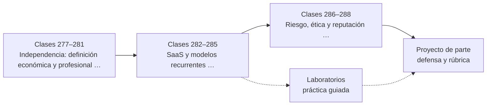

# Parte 23 — Independencia profesional y Business Owner Capstone

<!-- parte:inicio -->

> ← [Parte 22 — Escalamiento, propiedad y portafolio empresarial](../22-scaling-business-ownership/README.md) · [Temario](../../SYLLABUS.md) · Fin del programa →

*Integrar todo en una estrategia de independencia y defenderla como CEO, founder y owner*

**Etapa:** 6 — Fundador, propietario e independencia  
**Duración:** 12 clases · 30 horas  
**Resultado de salida:** Construir una estrategia de independencia con ingresos diversificados, disciplina comercial, protección de caja y un plan ejecutable.

⚫ [Ver las 6 etapas](../../SYLLABUS.md) · 12 clases (277–288) · 4 laboratorios · [proyecto de parte](project.md)

## 🎯 De qué trata esta parte

La parte final cierra el programa. Se construye una estrategia de independencia con ingresos diversificados, disciplina comercial, protección de caja y una defensa ante pares.

El eje es **independencia sostenible**: no depender de un único cliente, canal o persona, y sostener la integridad cuando la decisión sale cara. Incluye riesgo, ética y reputación.

## 🧱 Con qué hay que llegar

| Parte | Qué aporta |
|---|---|
| [22 — Escalamiento, propiedad y portafolio empresarial](../22-scaling-business-ownership/README.md) | Empresa que funciona con menos dependencia. |
| [20 — Founder y creación de empresas](../20-founder-venture-creation/README.md) | Validación. |
| [16 — Alta dirección y oficina del CEO](../16-executive-leadership-ceo-office/README.md) | Perspectiva de CEO. |

Cada clase supone la anterior: el orden importa, y saltarse una deja sin base a las que vienen después.

## 📚 Resultados de la parte

Al terminar esta parte podrás:

1. **Definir** independencia en términos económicos y profesionales.
2. **Inventariar** capacidades monetizables y elegir un modelo de ingresos.
3. **Diversificar** el portafolio y proteger la caja.
4. **Sostener** un sistema semanal de ventas.
5. **Defender** la integridad y la reputación bajo presión.

## 🗺️ Mapa de la parte

## 🧭 Cómo se encadenan las 12 clases

Las clases **277 a 281** definen la base: independencia, capacidades, consultoría, servicios productizados y producto digital.

Las clases **282 a 285** gestionan el sistema: modelos recurrentes, portafolio de ingresos, runway y ventas semanales.

Las clases **286 a 288** cierran: riesgo, ética y reputación, plan de 90 días y anual, y la defensa final.

## 📘 Las 12 clases

| # | Clase | Qué se trabaja | Entregable | Min |
|---:|---|---|---|---:|
| 277 | [Independencia: definición económica y profesional](classes/277-independencia-definicion-economica-y-profesional/README.md) | financial independence, professional independence, runway | [risk-governance-brief](../../templates/risk-governance-brief.md) | 150 |
| 278 | [Inventario de capacidades monetizables](classes/278-inventario-de-capacidades-monetizables/README.md) | skill, domain knowledge, proof | [operating-improvement-brief](../../templates/operating-improvement-brief.md) | 150 |
| 279 | [Consultoría y servicios profesionales](classes/279-consultoria-y-servicios-profesionales/README.md) | consulting engagement, scope, deliverable | [risk-governance-brief](../../templates/risk-governance-brief.md) | 150 |
| 280 | [Productized services](classes/280-productized-services/README.md) | productized service, service package, standard delivery | [founder-owner-decision-brief](../../templates/founder-owner-decision-brief.md) | 150 |
| 281 | [Producto digital y propiedad intelectual](classes/281-producto-digital-y-propiedad-intelectual/README.md) | digital product, IP, license | [product-evidence-brief](../../templates/product-evidence-brief.md) | 150 |
| 282 | [SaaS y modelos recurrentes](classes/282-saas-y-modelos-recurrentes/README.md) | MRR, ARR, logo churn | [founder-owner-decision-brief](../../templates/founder-owner-decision-brief.md) | 150 |
| 283 | [Portafolio de ingresos y concentración de riesgo](classes/283-portafolio-de-ingresos-y-concentracion-de-riesgo/README.md) | income portfolio, concentration risk, correlation | [strategy-memo](../../templates/strategy-memo.md) | 150 |
| 284 | [Runway personal y empresarial](classes/284-runway-personal-y-empresarial/README.md) | personal runway, business runway, burn rate | [risk-governance-brief](../../templates/risk-governance-brief.md) | 150 |
| 285 | [Sistema semanal de ventas](classes/285-sistema-semanal-de-ventas/README.md) | sales cadence, pipeline, prospecting | [commercial-decision-brief](../../templates/commercial-decision-brief.md) | 150 |
| 286 | [Riesgo, ética y reputación](classes/286-riesgo-etica-y-reputacion/README.md) | professional ethics, conflict of interest, confidentiality | [risk-governance-brief](../../templates/risk-governance-brief.md) | 150 |
| 287 | [Plan de 90 días y plan anual](classes/287-plan-de-90-dias-y-plan-anual/README.md) | 90-day sprint, annual plan, leading activity | [risk-governance-brief](../../templates/risk-governance-brief.md) | 150 |
| 288 | [Capstone final: defensa como CEO, founder y owner](classes/288-capstone-final-defensa-como-ceo-founder-y-owner/README.md) | executive thesis, operating system, founder plan | [board-or-executive-memo](../../templates/board-or-executive-memo.md) | 150 |

## ⚠️ Riesgos característicos

- Depender de un único cliente o canal.
- Confundir ingresos con caja protegida.
- Decidir bajo presión sin registro ni límites.
- Proteger la imagen antes que reparar el hecho.

## 🔤 Glosario de la parte

60 conceptos definidos en las clases, con la definición operacional que usa cada una.

| Concepto | Definición operacional |
|---|---|
| **90-day sprint** | periodo corto con outcomes verificables y learning goals. |
| **annual plan** | hipótesis de capacidad ingresos inversión y desarrollo para un año. |
| **ARR** | ingreso recurrente anualizado. |
| **attention cost** | tiempo y foco requerido para mantener una fuente. |
| **burn rate** | consumo neto de caja por periodo. |
| **business runway** | meses que la empresa puede operar al burn proyectado. |
| **CAC payback** | meses necesarios para recuperar costo de adquisición. |
| **capability stack** | combinación de habilidades cuyo conjunto es más valioso que cada pieza. |
| **cash floor** | nivel mínimo de liquidez que no se desea cruzar. |
| **checkpoint** | fecha para evaluar evidencia y ajustar. |
| **concentration risk** | exposición excesiva a una fuente cliente o mercado. |
| **confidentiality** | deber de proteger información no pública. |
| **conflict of interest** | interés que puede comprometer juicio profesional. |
| **consulting engagement** | acuerdo profesional para resolver un problema o producir una decisión o cambio. |
| **correlation** | grado en que fuentes se mueven juntas ante shocks. |
| **deliverable** | resultado tangible acordado. |
| **digital product** | activo digital reproducible vendido o licenciado. |
| **distribution** | canal para llegar de forma repetible a compradores. |
| **domain knowledge** | comprensión contextual de una industria o problema. |
| **downside scenario** | escenario adverso plausible para probar resiliencia. |
| **exception pricing** | regla para trabajo fuera de estándar. |
| **executive thesis** | argumento integrado de cómo crear dirigir y proteger valor. |
| **financial independence** | capacidad de cubrir necesidades con recursos e ingresos sin dependencia inmediata de un único empleador. |
| **follow-up** | secuencia deliberada después del primer contacto. |
| **founder plan** | hipótesis de creación y validación de negocio. |
| **income concentration** | proporción de ingreso atribuida a una sola fuente. |
| **income portfolio** | conjunto de fuentes de ingreso gestionadas como cartera. |
| **independence plan** | portafolio de capacidades ingresos runway y opciones profesionales. |
| **IP** | activos protegibles o controlables mediante derechos y contratos. |
| **kill criterion** | condición que justifica dejar una iniciativa. |
| **leading activity** | actividad controlable que precede resultados. |
| **license** | permiso para usar un activo bajo condiciones. |
| **logo churn** | pérdida de clientes en un periodo. |
| **maintenance burden** | costo continuo de actualización soporte y compatibilidad. |
| **MRR** | ingreso recurrente mensual normalizado. |
| **net revenue retention** | retención de ingresos incluyendo expansión y contracción. |
| **operating system** | conjunto de cadencias metrics y decision rights que gobiernan ejecución. |
| **optionality** | conjunto de alternativas reales disponibles sin compromiso inmediato. |
| **owner plan** | diseño para reducir dependencia y asignar capital. |
| **personal runway** | meses de gastos esenciales cubiertos por liquidez personal. |
| **pipeline** | candidatos y oportunidades por etapa. |
| **productized service** | servicio con alcance proceso y precio relativamente estandarizados. |
| **professional ethics** | principios y obligaciones que guían conducta responsable. |
| **professional independence** | capacidad de generar oportunidades por reputación y capacidades. |
| **proof** | evidencia verificable de resultados. |
| **prospecting** | búsqueda activa de clientes potenciales. |
| **recurring income** | ingreso que se repite bajo contratos o comportamiento sostenido. |
| **referral** | introducción desde una relación de confianza. |
| **reputation** | expectativa del mercado sobre calidad y fiabilidad. |
| **reputation risk** | posible pérdida de confianza por conducta o percepción. |
| **retainer** | fee recurrente por acceso o capacidad definida. |
| **runway** | meses que pueden financiarse con liquidez disponible. |
| **sales cadence** | ritmo recurrente de actividades comerciales. |
| **scope** | fronteras explícitas de trabajo y entregables. |
| **scope boundary** | límite que distingue incluido de adicional. |
| **scope competence** | límite de trabajos que puedes realizar responsablemente con tus capacidades. |
| **service package** | conjunto explícito de entregables y condiciones. |
| **skill** | capacidad ejecutable desarrollada por práctica. |
| **standard delivery** | workflow repetible para producir resultado. |
| **value pricing** | precio relacionado con valor y riesgo más que horas. |

## 📦 Qué queda como evidencia

- Un plan de independencia.
- Una simulación integrada de riesgo y reputación.
- Un plan de 90 días y anual.
- La defensa final como CEO, founder y owner.

## 🔗 Cómo se conecta

Es el cierre del programa. Sus artefactos forman el portafolio ejecutivo que puede usarse en entrevistas, promociones o consultoría.

## 🧪 Cómo se trabaja

Son **12 clases de 150 minutos** —30 horas— con **4 laboratorios** y un proyecto integrador. Cada clase trae su propósito, sus conceptos, un caso, práctica, errores frecuentes, preguntas de comprobación, entregable y fuentes, y se evalúa con su `assessment.md`. Los laboratorios se resuelven con datos propios o sintéticos, nunca con datos reales de terceros, y la parte se cierra con el proyecto y su defensa. Las reglas de recorrido están en [la guía de navegación](../../docs/NAVIGATION.md).

<!-- parte:fin -->

## Laboratorios

- [Lab 01 — Skill-to-offer map](labs/lab-01.md)
- [Lab 02 — Revenue portfolio](labs/lab-02.md)
- [Lab 03 — 90-day sales sprint](labs/lab-03.md)
- [Lab 04 — Final board defense](labs/lab-04.md)

## Proyecto de parte

Presentar un plan realista de independencia y defender un negocio ante un comité de inversión y directorio.

## Bibliografía rectora

- Bill Aulet — *Disciplined Entrepreneurship* (Emprendimiento)
- Michael E. Gerber — *The E-Myth Revisited* (Sistemas de negocio)
- Eric Ries — *The Lean Startup* (Emprendimiento)
- Peter F. Drucker — *The Effective Executive* (Ejecución y liderazgo personal)
- Nassim Nicholas Taleb — *Antifragile* (Riesgo e independencia)

## Criterio de aprobación

80/100 y entrega del proyecto integrador.
