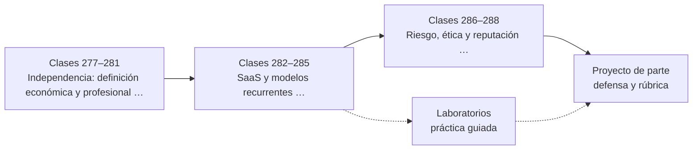

# Parte 23 — Independencia profesional y Business Owner Capstone

<!-- parte:inicio -->

> ← [Parte 22 — Escalamiento, propiedad y portafolio empresarial](../22-scaling-business-ownership/README.md) · [Temario](../../SYLLABUS.md) · Fin del programa →

*Integrar todo en una estrategia de independencia y defenderla como CEO, founder y owner*

**Etapa:** 6 — Fundador, propietario e independencia  
**Duración:** 12 clases · 30 horas  
**Resultado de salida:** Construir una estrategia de independencia con ingresos diversificados, disciplina comercial, protección de caja y un plan ejecutable.

⚫ [Ver las 6 etapas](../../SYLLABUS.md) · 12 clases (277–288) · 4 laboratorios · [proyecto de parte](project.md)

## 🎯 De qué trata esta parte

La parte final cierra el programa. Se construye una estrategia de independencia con ingresos diversificados, disciplina comercial, protección de caja y una defensa ante pares.

El eje es **independencia sostenible**: no depender de un único cliente, canal o persona, y sostener la integridad cuando la decisión sale cara. Incluye riesgo, ética y reputación.

## 🧱 Con qué hay que llegar

| Parte | Qué aporta |
|---|---|
| [22 — Escalamiento, propiedad y portafolio empresarial](../22-scaling-business-ownership/README.md) | Empresa que funciona con menos dependencia. |
| [20 — Founder y creación de empresas](../20-founder-venture-creation/README.md) | Validación. |
| [16 — Alta dirección y oficina del CEO](../16-executive-leadership-ceo-office/README.md) | Perspectiva de CEO. |

Cada clase supone la anterior: el orden importa, y saltarse una deja sin base a las que vienen después.

## 📚 Resultados de la parte

Al terminar esta parte podrás:

1. **Definir** independencia en términos económicos y profesionales.
2. **Inventariar** capacidades monetizables y elegir un modelo de ingresos.
3. **Diversificar** el portafolio y proteger la caja.
4. **Sostener** un sistema semanal de ventas.
5. **Defender** la integridad y la reputación bajo presión.

## 🗺️ Mapa de la parte

## 🧭 Cómo se encadenan las 12 clases

Las clases **277 a 281** definen la base: independencia, capacidades, consultoría, servicios productizados y producto digital.

Las clases **282 a 285** gestionan el sistema: modelos recurrentes, portafolio de ingresos, runway y ventas semanales.

Las clases **286 a 288** cierran: riesgo, ética y reputación, plan de 90 días y anual, y la defensa final.

## 📘 Las 12 clases

| # | Clase | Qué se trabaja | Entregable | Min |
|---:|---|---|---|---:|
| 277 | [Independencia: definición económica y profesional](classes/277-independencia-definicion-economica-y-profesional/README.md) | Independencia económica, Pista personal (runway), Participación de la mayor fuente | [risk-governance-brief](../../templates/risk-governance-brief.md) | 150 |
| 278 | [Inventario de capacidades monetizables](classes/278-inventario-de-capacidades-monetizables/README.md) | Capacidad monetizable, Activo de prueba, Solicitud espontánea | [operating-improvement-brief](../../templates/operating-improvement-brief.md) | 150 |
| 279 | [Consultoría y servicios profesionales](classes/279-consultoria-y-servicios-profesionales/README.md) | Utilización, Tarifa efectiva, Tasa de éxito de propuestas | [risk-governance-brief](../../templates/risk-governance-brief.md) | 150 |
| 280 | [Productized services](classes/280-productized-services/README.md) | Servicio productizado, Envolvente de aceptación, Excepción de alcance | [founder-owner-decision-brief](../../templates/founder-owner-decision-brief.md) | 150 |
| 281 | [Producto digital y propiedad intelectual](classes/281-producto-digital-y-propiedad-intelectual/README.md) | Activo mínimo de pago, Licencia, Titularidad | [product-evidence-brief](../../templates/product-evidence-brief.md) | 150 |
| 282 | [SaaS y modelos recurrentes](classes/282-saas-y-modelos-recurrentes/README.md) | MRR, Cancelación de clientes (logo churn), Retención neta de ingresos (NRR) | [founder-owner-decision-brief](../../templates/founder-owner-decision-brief.md) | 150 |
| 283 | [Portafolio de ingresos y concentración de riesgo](classes/283-portafolio-de-ingresos-y-concentracion-de-riesgo/README.md) | Portafolio de ingresos, Concentración, Factor común | [strategy-memo](../../templates/strategy-memo.md) | 150 |
| 284 | [Runway personal y empresarial](classes/284-runway-personal-y-empresarial/README.md) | Runway (pista), Burn neto, Piso de caja | [risk-governance-brief](../../templates/risk-governance-brief.md) | 150 |
| 285 | [Sistema semanal de ventas](classes/285-sistema-semanal-de-ventas/README.md) | Sistema semanal de ventas, Embudo, Conversación nueva | [commercial-decision-brief](../../templates/commercial-decision-brief.md) | 150 |
| 286 | [Riesgo, ética y reputación](classes/286-riesgo-etica-y-reputacion/README.md) | Parte interesada, Conflicto de interés, Límite de competencia | [risk-governance-brief](../../templates/risk-governance-brief.md) | 150 |
| 287 | [Plan de 90 días y plan anual](classes/287-plan-de-90-dias-y-plan-anual/README.md) | Resultado a 12 meses, Apuesta de 90 días, Actividad semanal | [risk-governance-brief](../../templates/risk-governance-brief.md) | 150 |
| 288 | [Capstone final: defensa como CEO, founder y owner](classes/288-capstone-final-defensa-como-ceo-founder-y-owner/README.md) | Defensa, Tesis personal, Impulsores de valor | [board-or-executive-memo](../../templates/board-or-executive-memo.md) | 150 |

## ⚠️ Riesgos característicos

- Depender de un único cliente o canal.
- Confundir ingresos con caja protegida.
- Decidir bajo presión sin registro ni límites.
- Proteger la imagen antes que reparar el hecho.

## 🔤 Glosario de la parte

72 conceptos definidos en las clases, con la definición operacional que usa cada una.

| Concepto | Definición operacional |
|---|---|
| **Acceso al canal** | Posibilidad de llegar a quien necesita la solución. |
| **Actividad semanal** | Tarea recurrente que sostiene una apuesta. |
| **Activo de prueba** | Evidencia de que sabes resolver el problema. |
| **Activo mínimo de pago** | Versión más pequeña del producto que alguien compra. |
| **Afirmación verificable** | Declaración sobre resultados que se puede respaldar. |
| **Alcance** | Qué se entrega, qué no y bajo qué supuestos. |
| **Antifragilidad** | Propiedad de mejorar con la volatilidad. |
| **Apuesta de 90 días** | Experimento acotado que prueba una hipótesis. |
| **Burn neto** | Salida de caja mensual después de ingresos. |
| **Calificación** | Filtro previo para aceptar o rechazar un cliente. |
| **Cancelación de clientes (logo churn)** | Proporción de clientes que se va en un período. |
| **Capacidad** | Número de paquetes que se pueden entregar con calidad. |
| **Capacidad monetizable** | Habilidad que resuelve un problema por el que alguien paga. |
| **Carga de mantención** | Tiempo y costo de actualizar, atender y defender el producto. |
| **Cobertura de liderazgo** | Proporción de roles críticos con responsable y sucesor. |
| **Cohorte** | Grupo de clientes que comenzó en el mismo período. |
| **Concentración** | Dependencia de pocas fuentes, clientes o sectores. |
| **Conflicto de interés** | Situación en que un interés propio puede sesgar el consejo. |
| **Contribución por hora** | Margen de una fuente dividido por las horas que consume. |
| **Conversación nueva** | Contacto relevante que recibe respuesta. |
| **Conversión a pago** | Proporción de visitantes que compra. |
| **Costo de adquisición (CAC)** | Costo de conseguir un cliente nuevo. |
| **Defensa** | Presentación sometida a preguntas para demostrar criterio. |
| **Diferenciación** | Razón por la que te elegirían a ti. |
| **Disparador** | Condición que activa una acción predefinida. |
| **Embudo** | Etapas desde el contacto hasta la venta. |
| **Envolvente de aceptación** | Condiciones que debe cumplir un caso para entrar al paquete. |
| **Escalamiento** | Paso a una instancia superior o a un especialista. |
| **Escenario adverso** | Proyección con ingresos menores y gastos mayores. |
| **Excepción de alcance** | Caso que requiere trabajo fuera del paquete. |
| **Factor común** | Variable que afecta a varias fuentes a la vez. |
| **Falacia de la planificación** | Tendencia a subestimar tiempo y costo de las tareas. |
| **Frecuencia del problema** | Cuántas veces ocurre el problema en el mercado. |
| **Impulsores de valor** | Variables que más mueven el valor de la empresa. |
| **Incidente** | Evento que afecta a un cliente, a datos o a la reputación. |
| **Independencia económica** | Capacidad de cubrir gastos sin depender de una sola fuente. |
| **Ingreso recurrente** | Ingreso que se repite con alta probabilidad. |
| **Licencia** | Permiso de uso que se otorga al comprador. |
| **Límite de competencia** | Frontera entre lo que se puede hacer con rigor y lo que requiere otro especialista. |
| **Motor de ingresos** | Fuente que sostiene el portafolio. |
| **MRR** | Ingreso recurrente mensual contratado. |
| **Opcionalidad** | Alternativas que permanecen abiertas ante un cambio. |
| **Oportunidad calificada** | Caso con problema, presupuesto, decisor y plazo. |
| **Parte interesada** | Persona u organización afectada por tu trabajo. |
| **Participación de la mayor fuente** | Porcentaje del ingreso que viene de la fuente principal. |
| **Perspectiva** | Observación nueva que cambia cómo el cliente ve su problema. |
| **Piso de caja** | Nivel mínimo que no se cruza. |
| **Pista de caja** | Meses de operación con la caja actual. |
| **Pista personal (runway)** | Meses que se sostiene el nivel de gasto sin ingresos. |
| **Portafolio de ingresos** | Conjunto de fuentes de ingreso de una persona o empresa. |
| **Precio por valor** | Honorarios ligados al valor del resultado para el cliente. |
| **Reasignación** | Cambio de esfuerzo entre apuestas según evidencia. |
| **Referencia** | Testimonio o contacto que respalda el trabajo. |
| **Rendimiento por hora** | Ingreso menos costos directos, dividido por horas dedicadas. |
| **Resultado a 12 meses** | Estado medible que se quiere alcanzar en un año. |
| **Retención neta de ingresos (NRR)** | Ingresos de clientes existentes tras bajas, reducciones y ampliaciones. |
| **Retiro de una fuente** | Decisión de abandonar una línea. |
| **Ritmo de ingresos (run rate)** | Ingreso mensual actual proyectado al año. |
| **Runway (pista)** | Meses que dura la caja al ritmo de consumo actual. |
| **Rúbrica** | Criterios y pesos con que se evalúa la defensa. |
| **Separación personal-empresa** | Cuentas y reglas distintas para cada ámbito. |
| **Servicio productizado** | Servicio con alcance, proceso y precio estandarizados. |
| **Sistema semanal de ventas** | Rutina constante de actividades comerciales medidas. |
| **Solicitud espontánea** | Petición que llega sin que se haya ofrecido el servicio. |
| **Tarifa efectiva** | Ingreso por hora total trabajada, incluidas ventas y administración. |
| **Tasa de devolución** | Proporción de ventas devueltas. |
| **Tasa de propuesta** | Proporción de oportunidades que llegan a propuesta. |
| **Tasa de éxito de propuestas** | Proporción de propuestas que se aceptan. |
| **Tesis personal** | Afirmación central sobre qué empresa eres y qué decides. |
| **Titularidad** | Quién es dueño de los derechos del producto. |
| **Utilización** | Proporción de horas disponibles que se factura. |
| **Valor de vida (LTV)** | Margen total esperable de un cliente. |

## 📦 Qué queda como evidencia

- Un plan de independencia.
- Una simulación integrada de riesgo y reputación.
- Un plan de 90 días y anual.
- La defensa final como CEO, founder y owner.

## 🔗 Cómo se conecta

Es el cierre del programa. Sus artefactos forman el portafolio ejecutivo que puede usarse en entrevistas, promociones o consultoría.

## 🧪 Cómo se trabaja

Son **12 clases de 150 minutos** —30 horas— con **4 laboratorios** y un proyecto integrador. Cada clase trae su propósito, sus conceptos, un caso, práctica, errores frecuentes, preguntas de comprobación, entregable y fuentes, y se evalúa con su `assessment.md`. Los laboratorios se resuelven con datos propios o sintéticos, nunca con datos reales de terceros, y la parte se cierra con el proyecto y su defensa. Las reglas de recorrido están en [la guía de navegación](../../docs/NAVIGATION.md).

<!-- parte:fin -->

## Laboratorios

- [Lab 01 — Skill-to-offer map](labs/lab-01.md)
- [Lab 02 — Revenue portfolio](labs/lab-02.md)
- [Lab 03 — 90-day sales sprint](labs/lab-03.md)
- [Lab 04 — Final board defense](labs/lab-04.md)

## Proyecto de parte

Presentar un plan realista de independencia y defender un negocio ante un comité de inversión y directorio.

## Bibliografía rectora

- Bill Aulet — *Disciplined Entrepreneurship* (Emprendimiento)
- Michael E. Gerber — *The E-Myth Revisited* (Sistemas de negocio)
- Eric Ries — *The Lean Startup* (Emprendimiento)
- Peter F. Drucker — *The Effective Executive* (Ejecución y liderazgo personal)
- Nassim Nicholas Taleb — *Antifragile* (Riesgo e independencia)

## Criterio de aprobación

80/100 y entrega del proyecto integrador.
