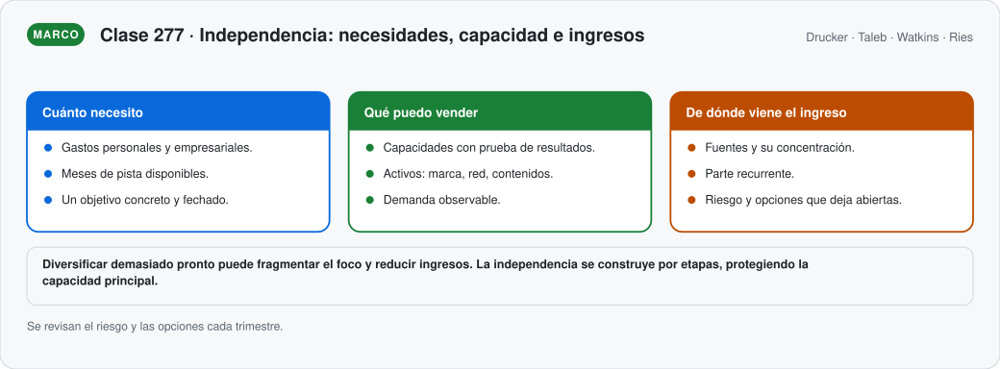

# Clase 277 — Independencia: definición económica y profesional

<!-- nav:inicio -->
> **Parte 23 · Independencia profesional y Business Owner Capstone** — clase 1 de 12 · [índice de la parte](../../README.md) · [temario](../../../../SYLLABUS.md)
<!-- nav:fin -->

**Parte:** 23 — Independencia profesional y Business Owner Capstone  
**Nivel:** Etapa 6 — Independencia  
**Duración sugerida:** 150–180 minutos · **Estándar:** deep-class-v2

## 🎯 Propósito

«Quiero ser independiente» es una frase que cada persona completa de manera distinta: para unos significa dejar un empleo y trabajar por cuenta propia; para otros, no depender de un único cliente; para otros, tener un negocio que funcione sin ellos; para otros, poder decir que no a un encargo o a un jefe. Sin una definición precisa, la independencia se convierte en un deseo vago que se persigue con decisiones impulsivas: renunciar sin caja, aceptar cualquier cliente para «llegar a fin de mes», lanzar tres negocios a la vez. Esta clase propone una definición **económica y profesional** que se puede medir: cuánto necesita la persona para vivir, cuántos meses puede sostenerse sin ingresos (su **pista** o runway personal), qué parte de sus ingresos depende de una sola fuente, qué capacidades y activos puede monetizar, y cuántas opciones le quedan abiertas si algo cambia.

El enfoque rechaza la fantasía de la libertad absoluta y la reemplaza por **opcionalidad**: la capacidad de elegir entre alternativas sin que una necesidad inmediata decida por uno. Se apoya en Drucker (el profesional del conocimiento se gestiona a sí mismo y administra su tiempo y sus fortalezas), Watkins (cómo se hacen transiciones de rol con planes de noventa días), Taleb (robustez y antifragilidad: estructuras que no se rompen o mejoran ante la volatilidad), Ries (experimentar en pequeño y aprender con evidencia) y Gerber (construir un negocio que funcione más allá de uno mismo). Al terminar sabrás definir tu objetivo de independencia con cifras, medir tu pista y tu concentración de ingresos, identificar brechas y planificar una transición por etapas con revisión trimestral.

## 📚 Resultados de aprendizaje

Al finalizar podrás:

1. **Distinguir** independencia económica, profesional y de tiempo.
2. **Definir** un objetivo de independencia con necesidades, pista y fuentes de ingreso.
3. **Calcular** pista personal, participación de la mayor fuente y cobertura de gastos con ingresos independientes.
4. **Identificar** brechas y secuenciar acciones sin fragmentar el foco.
5. **Revisar** riesgo y opciones cada trimestre con criterios de continuidad o ajuste.

## 🧭 Agenda

| Tramo | Qué se hace |
|---|---|
| 0–20 min | Recuperación: ¿qué significa para ti ser independiente y qué números lo demostrarían? |
| 20–60 min | Necesidades, pista, concentración, capacidades, vías de ingreso y revisión trimestral. |
| 60–105 min | Ejemplo trabajado: pista, concentración y cobertura con brecha y plazo. |
| 105–150 min | Caso ejecutivo y práctica. |
| 150–175 min | Límites y entregable. |

## 🧩 Conceptos centrales

| Concepto | Definición | Cómo se reconoce |
|---|---|---|
| **Independencia económica** | Capacidad de cubrir gastos sin depender de una sola fuente. | Cobertura con ingresos propios. |
| **Pista personal (runway)** | Meses que se sostiene el nivel de gasto sin ingresos. | Ahorros líquidos ÷ gasto mensual. |
| **Participación de la mayor fuente** | Porcentaje del ingreso que viene de la fuente principal. | Ingreso mayor ÷ ingreso total. |
| **Ingreso recurrente** | Ingreso que se repite con alta probabilidad. | Contratos, suscripciones, retainers. |
| **Opcionalidad** | Alternativas que permanecen abiertas ante un cambio. | Caja, reputación, red y capacidades. |
| **Antifragilidad** | Propiedad de mejorar con la volatilidad. | Pequeñas pérdidas, grandes ganancias posibles. |

## 🧠 Modelo mental

**Cómo leer el diagrama.** Tres columnas. **Cuánto necesito**: gastos personales y empresariales, meses de pista disponibles y un objetivo concreto con fecha. **Qué puedo vender**: capacidades con prueba de resultados, activos como marca, red y contenidos, y demanda observable. **De dónde viene el ingreso**: fuentes y su concentración, la parte recurrente, y el riesgo y las opciones que dejan abiertas. La nota advierte que diversificar demasiado pronto puede fragmentar el foco y reducir ingresos y que la independencia se construye por etapas; el pie, que el riesgo y las opciones se revisan cada trimestre.

## 📖 Desarrollo

### 1. Tres formas de independencia

La palabra cubre al menos tres cosas. **Independencia económica**: poder cubrir los gastos propios con ingresos que no dependen de una única persona u organización. **Independencia profesional**: decidir qué trabajos se aceptan, con quién y bajo qué condiciones, basándose en capacidades y reputación propias. **Independencia de tiempo**: controlar la agenda y la energía. Se pueden tener unas sin otras: un consultor muy bien pagado que depende de un solo cliente es profesionalmente solicitado pero económicamente frágil; alguien con ahorros altos y sin demanda profesional tiene tiempo pero poca capacidad de generar ingresos. Drucker sostiene que el profesional del conocimiento debe **gestionarse a sí mismo**: conocer sus fortalezas, su manera de trabajar y sus valores, y administrar su tiempo con rigor; la independencia comienza por esa claridad.

### 2. Cuánto se necesita: gastos y objetivo

El punto de partida es un número: **gasto mensual** personal y familiar (vivienda, alimentación, salud, educación, deudas, impuestos y cotizaciones aplicables, ahorro, imprevistos) separado, cuando corresponde, de los gastos del negocio. Se distingue entre **gastos esenciales** (los que no se pueden recortar sin daño) y **discrecionales**. De ahí se define el **objetivo de independencia**: por ejemplo, «cubrir el 100 % de los gastos esenciales con ingresos independientes durante seis meses consecutivos y tener nueve meses de pista». Los objetivos se redactan con **cifras, plazo y condición de verificación**, no con adjetivos. Las obligaciones tributarias, previsionales y de salud de quien trabaja por cuenta propia se verifican con asesoría y fuentes oficiales vigentes; no se suponen.

### 3. Pista personal y concentración del ingreso

La **pista personal** se calcula dividiendo los ahorros líquidos (dinero disponible en un plazo breve, sin vender activos con pérdida) por el gasto mensual. Con una pista de seis meses, la persona puede tolerar una caída de ingresos de ese tiempo sin tomar decisiones desesperadas. La **concentración** mide cuánto depende de una sola fuente: se calcula la participación de la mayor fuente y, si se quiere, un índice sumando los cuadrados de las participaciones. Una persona con 80 % de su ingreso en un solo empleador o cliente es vulnerable, aunque gane bien. Taleb sostiene que la fragilidad aparece cuando una estructura sufre más con la volatilidad de lo que gana con ella; una persona con un único ingreso, deudas fijas y pocos ahorros es frágil, y la medida de concentración la hace visible.

### 4. Capacidades, activos y demanda

La independencia sostenible requiere algo que **otras personas quieran pagar**: capacidades (resolver problemas con resultados), activos (reputación, red, contenidos, métodos, clientes, propiedad intelectual) y demanda observable. Se hace un inventario (clase 278) y se contrasta con evidencia: ¿quiénes pagan hoy por esto?, ¿qué solicitudes llegan sin que yo las busque?, ¿qué problema repetido sé resolver mejor que la mayoría? Ries propone aprender con experimentos pequeños y medibles: antes de dejar un empleo o invertir meses en un producto, se prueban ofertas con conversaciones y compras reales. Un error frecuente es **confundir interés con mercado**: lo que a una persona le gusta hacer puede no tener compradores accesibles.

### 5. Vías de ingreso compatibles

Hay varias vías: **consultoría o servicios** (clase 279), **servicios estandarizados** (280), **productos digitales** (281), **modelos recurrentes** (282) y **combinaciones** (283). Cada una tiene un perfil de **esfuerzo, riesgo, escalabilidad y recurrencia**. Una vía es compatible si se ajusta a las capacidades, la caja, el tiempo y la tolerancia al riesgo de la persona. Watkins, en sus planes de transición, recomienda definir prioridades y victorias tempranas en los primeros noventa días de un nuevo rol; el principio se aplica a la transición hacia la independencia: **empezar por la vía que genera ingresos y aprendizaje más rápido**, normalmente servicios a clientes que ya conocen a la persona, y luego construir activos más escalables. Lanzar varias vías a la vez con una caja limitada fragmenta el foco.

### 6. Fragilidad, robustez y opcionalidad

Taleb propone un criterio útil: buscar **asimetrías**, es decir, apuestas donde el costo de equivocarse es limitado y la ganancia posible es grande. Aplicado a la independencia: mantener ingresos estables que cubran lo esencial (robustez) y destinar una parte acotada de tiempo y dinero a apuestas con potencial (antifragilidad), sin comprometer la pista. Evitar la **deuda innecesaria**, **contratos de exclusividad** que cierran opciones, **gastos fijos altos** y **reputación asociada a una sola organización**. La opcionalidad también depende de la **red** y de la **reputación**: invertir en relaciones y resultados visibles amplía las alternativas futuras. Una persona con buena reputación, caja y varias conversaciones activas puede rechazar un encargo malo; una sin ellas, no.

### 7. Transición por etapas y revisión trimestral

La transición se planifica en **etapas con criterios**: por ejemplo, etapa 1, mantener el ingreso actual y construir ahorros y primeras ofertas; etapa 2, lograr que los ingresos independientes cubran un porcentaje del gasto esencial; etapa 3, reducir la dependencia de la fuente principal; etapa 4, consolidar la pista. En cada etapa se definen métricas y una fecha de revisión. Cada **trimestre** se revisa: pista, concentración, ingresos independientes, conversaciones y ofertas, aprendizaje, salud y energía, y se decide continuar, ajustar o pausar. Se dejan escritos los **disparadores de salida** (qué señales llevarían a volver al empleo, recortar gastos o cambiar de vía). Esta disciplina evita que la independencia sea una apuesta sin retorno y permite aprender de cada ciclo.

## 📚 Lectura comparada

| Obra | Qué aporta | Qué no resuelve | Pregunta para contrastar |
|---|---|---|---|
| Drucker (*The Effective Executive*, *Management*) | Gestionarse a sí mismo y administrar el tiempo y las fortalezas. | No fija cifras personales. | ¿Cuáles son mis fortalezas con evidencia? |
| Watkins | Transiciones con planes de noventa días y victorias tempranas. | Pensado para nuevos roles en organizaciones. | ¿Qué logro temprano valida mi dirección? |
| Taleb | Fragilidad, robustez y antifragilidad. | No es guía financiera personal. | ¿Qué me rompería si mi principal ingreso cayera? |
| Ries | Experimentos pequeños y aprendizaje validado. | Enfoque de productos y empresas nuevas. | ¿Qué prueba barata valida mi oferta? |
| Gerber | Construir un negocio que no depende de uno mismo. | No cubre la etapa previa de independencia. | ¿Qué parte de mi ingreso depende solo de mí? |

## 🧮 Ejemplo trabajado

**Situación (hipotética).** Una ingeniera de 38 años trabaja en una empresa y quiere definir su independencia. Todas las cifras son **supuestos**; los impuestos y las cotizaciones de quien trabaja por cuenta propia se verifican con fuentes oficiales y asesoría.

**Datos mensuales.**

| Concepto | Valor (pesos) |
|---|---|
| Gastos personales mensuales | 2.400.000 (de los cuales esenciales: 1.800.000) |
| Ahorros líquidos | 14.400.000 |
| Ingreso del empleo | 4.200.000 |
| Ingreso por consultoría ocasional | 1.200.000 |
| Ingreso por un curso en línea | 600.000 |
| **Ingreso total** | **6.000.000** |

**Pista personal.** 14.400.000 ÷ 2.400.000 = **6,0 meses** (con solo gastos esenciales: 8,0 meses).

**Concentración.** Participaciones: empleo 4,2 ÷ 6,0 = 70 %; consultoría 20 %; curso 10 %. **Participación de la mayor fuente: 70 %.** Índice de concentración: 0,70² + 0,20² + 0,10² = 0,49 + 0,04 + 0,01 = **0,54**; número efectivo de fuentes: 1 ÷ 0,54 = **1,85**.

**Cobertura con ingresos independientes.** Ingresos independientes: 1,2 + 0,6 = 1,8 millones; frente a gastos totales: 1,8 ÷ 2,4 = **75 %**; frente a gastos esenciales: 1,8 ÷ 1,8 = **100 %**. Se cubren los gastos esenciales, pero no el nivel de vida actual.

**Objetivo de independencia (definido por ella).** «Cubrir el 100 % de los gastos totales (2,4 millones) con ingresos independientes durante seis meses consecutivos y tener nueve meses de pista (21,6 millones)».

**Brechas.** Ingresos independientes adicionales: 2,4 − 1,8 = **0,6 millones al mes**. Pista adicional: 21,6 − 14,4 = **7,2 millones**.

**Plazo estimado.** Ahorra 0,8 millones al mes (el resto del empleo cubre gastos): 7,2 ÷ 0,8 = **9 meses** para la pista. Los ingresos independientes deben crecer en 0,6 millones: si agrega un servicio recurrente de 0,3 millones y una segunda consultoría de 0,3, podría lograrlo en 6 a 9 meses, **sujeto a validación con clientes**.

**Escenario adverso.** Si perdiera su empleo mañana y conservara sus ingresos independientes (1,8 millones) frente a gastos de 2,4, el déficit mensual sería de 0,6 millones y la pista efectiva sería 14,4 ÷ 0,6 = **24 meses**. Si además los ingresos independientes cayeran a cero, la pista volvería a **6 meses**. **La dependencia del empleo no es un riesgo de caja inmediato, pero sí de nivel de vida y de opciones.**

**Etapas y criterios.** Etapa 1 (meses 0 a 6): ahorrar 0,8 millones al mes, hacer cinco conversaciones con clientes potenciales al mes, y probar una oferta de servicio recurrente. Etapa 2 (meses 6 a 12): ingresos independientes de 2,4 millones durante tres meses. Etapa 3 (meses 12 a 18): decidir sobre reducir jornada o dejar el empleo si se cumplen los criterios. Revisión trimestral con pista, concentración, ingresos independientes y pipeline.

**Disparadores de salida.** Si en seis meses no se logran 2,1 millones de ingresos independientes, se revisa la oferta; si la pista baja de seis meses, se pausa cualquier inversión y se retoman ingresos estables.

**Cuidados.** Todas las cifras son supuestos; los efectos tributarios, previsionales y de salud de cambiar de situación laboral se verifican con asesoría y fuentes oficiales.

**Qué muestra.** (1) La independencia se definió con números, plazo y condiciones. (2) La concentración y la pista mostraron fortalezas y brechas. (3) El plan tiene etapas y disparadores.

## 🔀 Comparación y límites

**Independencia frente a aislamiento.** La independencia económica y profesional no excluye depender de relaciones, redes y colaboradores; al contrario, la reputación y la red son parte de las opciones. Aislarse reduce la opcionalidad.

**Límites.** Diversificar demasiado pronto puede fragmentar el foco y reducir ingresos; se construye por etapas. Los números dependen de supuestos de demanda que pueden fallar. Esta clase no es asesoría financiera, legal ni tributaria; las obligaciones y los efectos de cada decisión se verifican con fuentes oficiales y profesionales. Las cifras del ejemplo son supuestos.

## 🪜 De profesional a owner

| Nivel | Cómo se relaciona con la independencia |
|---|---|
| **Profesional** | Gestiona su carrera y construye capacidades y reputación propias. |
| **Jefe / Team Lead** | Desarrolla alternativas dentro y fuera de su empleador. |
| **Gerente** | Mide su opcionalidad y su dependencia de una organización. |
| **CEO / Director** | Se asegura de no confundir la identidad con el cargo. |
| **Founder / Owner** | Construye ingresos y activos que no dependen de su presencia diaria. |

## 🏢 Caso ejecutivo

Un gerente de operaciones de 45 años gana 7,5 millones de pesos mensuales en una empresa que ha anunciado una reestructuración. Sus gastos son de 4,6 millones mensuales (3,4 esenciales) con una cuota hipotecaria de 1,3 millones; tiene ahorros líquidos de 18 millones y un fondo de inversión de largo plazo de 40 millones (que perdería valor si lo vende antes de tres años). Ha hecho consultorías ocasionales por 1,5 millones al mes en promedio durante los últimos seis meses, todas para un mismo exjefe. Tiene una oferta para dirigir un proyecto de 12 meses a un valor mensual de 6 millones sin exclusividad, y un amigo le propone fundar una empresa de consultoría con aporte de 15 millones suyos. Su pareja trabaja y aporta 3,2 millones. Siente que «ya es hora de ser independiente».

Entrega un **informe de gobierno y riesgos de la independencia** que contenga: (a) la definición de independencia con objetivo numérico, plazo y condición de verificación; (b) el cálculo de pista (total y esencial), concentración de ingresos y cobertura con ingresos independientes; (c) las brechas y la secuencia de acciones por etapas; (d) la evaluación de la oferta de 12 meses y de la propuesta del amigo con riesgo, aporte y alternativas; (e) los disparadores de salida y las revisiones trimestrales; (f) los límites del análisis y las verificaciones tributarias, previsionales y legales pendientes.

## 🧪 Práctica

1. Escribe tu objetivo de independencia con cifras, plazo y condición de verificación.
2. Calcula tu pista (total y esencial) y la participación de tu mayor fuente de ingresos.
3. Estima la cobertura de tus gastos con ingresos independientes y la brecha.
4. Diseña tres etapas con criterios y una fecha de revisión trimestral.
5. Define dos disparadores de salida y qué harías en cada uno.

## ⚠️ Errores frecuentes

| Error | Por qué ocurre | Cómo corregirlo |
|---|---|---|
| Definir la independencia con adjetivos | Es más cómodo | Cifras, plazo y verificación. |
| Renunciar sin pista | Entusiasmo o cansancio | Calcular meses de pista y escenarios. |
| Depender de un solo cliente | Es el que paga hoy | Medir concentración y ampliar vías. |
| Lanzar varias vías a la vez | Se quiere acelerar | Etapas y foco con evidencia. |
| Confundir gusto con mercado | Se parte de la preferencia | Contrastar con demanda y pagos reales. |
| No tener disparadores de salida | Se evita pensar en el fracaso | Escribir qué harás si no hay tracción. |

## ❓ Preguntas de comprobación

1. ¿Qué diferencia hay entre independencia económica, profesional y de tiempo?
2. ¿Cómo se calcula la pista personal?
3. ¿Qué mide la participación de la mayor fuente?
4. ¿Qué es la opcionalidad y cómo se construye?
5. ¿Por qué se avanza por etapas?
6. ¿Qué debe tener un disparador de salida?
7. ¿Qué límite tiene este enfoque?

Claves de respuesta

1. La económica cubre gastos sin una única fuente; la profesional elige encargos y condiciones; la de tiempo controla la agenda.
2. Dividiendo los ahorros líquidos por el gasto mensual.
3. El grado de dependencia de una sola fuente de ingresos.
4. La capacidad de elegir entre alternativas; se construye con caja, reputación, red y capacidades.
5. Para proteger el foco y la pista, aprender con evidencia y evitar apuestas simultáneas sin tracción.
6. Una condición medible, una fecha y la acción que se tomará.
7. Depende de supuestos de demanda y no es asesoría financiera, legal ni tributaria.

## 📥 Entregable

Guarda en `portfolio/277-independencia-definicion-economica-y-profesional/`:

- `risk-governance-brief.md` (plantilla [Risk governance brief](../../../../templates/risk-governance-brief.md)) con el informe del caso ejecutivo;
- `decision-journal.md` con el objetivo, los números, las etapas y los disparadores.

## 📗 Fuentes y verificación

- Peter F. Drucker — *The Effective Executive* (Collins, 2002). **Uso en esta clase:** gestionarse a sí mismo, el tiempo y las fortalezas. Lectura selectiva sobre **independencia: definición económica y profesional**. **Localizador:** [ISBN-13 9780060516079](https://openlibrary.org/isbn/9780060516079).
- Peter F. Drucker — *Management: Tasks, Responsibilities, Practices* (Harper & Row, 1974). **Uso en esta clase:** gestión por resultados y responsabilidad. Lectura selectiva sobre **independencia: definición económica y profesional**. **Localizador:** [ISBN-13 9780060110925](https://openlibrary.org/isbn/9780060110925).
- Michael D. Watkins — *The First 90 Days* (Harvard Business School Press, 2003). **Uso en esta clase:** transiciones con planes de noventa días y victorias tempranas. Lectura selectiva sobre **independencia: definición económica y profesional**. **Localizador:** [ISBN-13 9781591391104](https://openlibrary.org/isbn/9781591391104).
- Nassim Nicholas Taleb — *Antifragile* (Random House, 2012). **Uso en esta clase:** fragilidad, robustez y antifragilidad. Lectura selectiva sobre **independencia: definición económica y profesional**. **Localizador:** [ISBN-13 9780679645276](https://openlibrary.org/isbn/9780679645276).
- Eric Ries — *The Lean Startup* (Crown Business, 2011). **Uso en esta clase:** experimentos pequeños y aprendizaje validado. Lectura selectiva sobre **independencia: definición económica y profesional**. **Localizador:** [ISBN-13 9780307887894](https://openlibrary.org/isbn/9780307887894).
- Michael E. Gerber — *The E-Myth Revisited* (HarperAudio, 1995). **Uso en esta clase:** un negocio que funciona más allá de uno mismo. Lectura selectiva sobre **independencia: definición económica y profesional**. **Localizador:** [ISBN-13 9780060574901](https://openlibrary.org/isbn/9780060574901).

> **Regla de fuentes para Independencia: definición económica y profesional:** las obras anteriores estructuran las perspectivas de esta materia; cualquier norma, ley o estándar vivo mencionado debe comprobarse nuevamente en su fuente primaria vigente, incluidas las obligaciones tributarias, previsionales y de salud, que se verifican con asesoría. Los ejemplos y casos son hipotéticos, con cifras ilustrativas. El desarrollo es original y no reproduce capítulos protegidos.

<!-- pie:inicio -->
---

| Anterior | Índice | Siguiente |
|---|---|---|
| [← 276 · Capstone: empresa menos dependiente del fundador](../../../22-scaling-business-ownership/classes/276-capstone-empresa-menos-dependiente-del-fundador/README.md) | [Parte 23](../../README.md) · [Programa](../../../../SYLLABUS.md) | [278 · Inventario de capacidades monetizables →](../278-inventario-de-capacidades-monetizables/README.md) |
<!-- pie:fin -->
