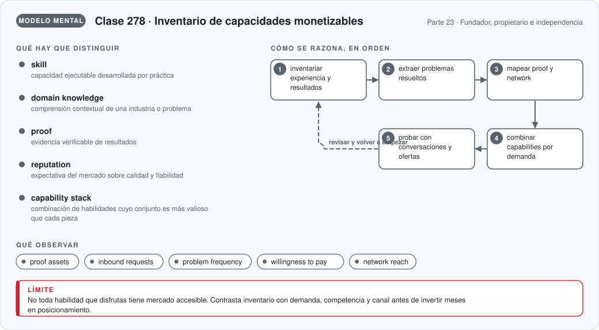

# Clase 278 — Inventario de capacidades monetizables

<!-- nav:inicio -->
> **Parte 23 · Independencia profesional y Business Owner Capstone** — clase 2 de 12 · [índice de la parte](../../README.md) · [temario](../../../../SYLLABUS.md)
<!-- nav:fin -->

**Parte:** 23 — Independencia profesional y Business Owner Capstone  
**Nivel:** Etapa 6 — Independencia  
**Duración sugerida:** 150–180 minutos · **Estándar:** deep-class-v2

## 🎯 Propósito

Quien decide trabajar de forma independiente suele partir de una pregunta mal planteada: «¿qué me gusta hacer?». Es una pregunta legítima, pero insuficiente. El mercado no paga por lo que a uno le gusta, sino por **problemas que se resuelven**, con **pruebas** de que uno puede resolverlos, ante personas que **tienen presupuesto y urgencia** y a las que se puede **llegar**. Un inventario de capacidades monetizables traduce una trayectoria profesional en un conjunto ordenado de **problemas resueltos, resultados demostrables, activos y demanda observable**. Su valor es doble: evita la parálisis de «puedo hacer muchas cosas» y evita el error de lanzarse con una oferta que nadie compra. Un buen inventario no es un currículum con adjetivos: es una **tabla de evidencia**.

La clase propone un método: inventariar experiencia y resultados, extraer los problemas resueltos, mapear pruebas y red, combinar capacidades según la demanda y probar con conversaciones y ofertas reales. Se apoya en Drucker (conocer las propias fortalezas con evidencia y no con deseos), Wasserman (los dilemas del fundador sobre rol, recursos y relaciones), Gerber (el negocio como sistema), Aulet (definir un cliente específico con evidencia) y Newport (el valor de las habilidades difíciles de reemplazar, desarrolladas con práctica deliberada). Al terminar sabrás construir una tabla de capacidades con puntajes y evidencia, identificar tus mejores combinaciones, diseñar pruebas de oferta y decidir en qué invertir meses de posicionamiento.

## 📚 Resultados de aprendizaje

Al finalizar podrás:

1. **Inventariar** experiencia, resultados y problemas resueltos con evidencia.
2. **Mapear** pruebas (casos, referencias, publicaciones) y red de contactos.
3. **Puntuar** capacidades por prueba, demanda, diferenciación y acceso al canal.
4. **Combinar** capacidades en ofertas con demanda y proponer pruebas con clientes reales.
5. **Decidir** en qué capacidades invertir y cuáles dejar como complemento o pasatiempo.

## 🧭 Agenda

| Tramo | Qué se hace |
|---|---|
| 0–20 min | Recuperación: ¿qué problemas te piden resolver otras personas sin que lo ofrezcas? |
| 20–60 min | Experiencia, problemas, pruebas, red, demanda, combinaciones y pruebas de oferta. |
| 60–105 min | Ejemplo trabajado: puntaje ponderado de seis capacidades y prueba de oferta. |
| 105–150 min | Caso ejecutivo y práctica. |
| 150–175 min | Límites y entregable. |

## 🧩 Conceptos centrales

| Concepto | Definición | Cómo se reconoce |
|---|---|---|
| **Capacidad monetizable** | Habilidad que resuelve un problema por el que alguien paga. | Resultados, cliente y precio. |
| **Activo de prueba** | Evidencia de que sabes resolver el problema. | Casos, cifras, referencias, publicaciones. |
| **Solicitud espontánea** | Petición que llega sin que se haya ofrecido el servicio. | Mensajes y consultas. |
| **Frecuencia del problema** | Cuántas veces ocurre el problema en el mercado. | Repetición entre clientes. |
| **Diferenciación** | Razón por la que te elegirían a ti. | Experiencia rara o combinación única. |
| **Acceso al canal** | Posibilidad de llegar a quien necesita la solución. | Red, comunidades, intermediarios. |

## 🧠 Modelo mental

**Cómo leer el diagrama.** Una tabla de tres columnas. **Parte del inventario**: experiencia y resultados, problemas resueltos, pruebas y red, combinaciones por demanda, y conversaciones y ofertas. **Qué se registra**: qué hiciste y qué lograste con cifras, qué problema repetido sabes resolver, casos, referencias, publicaciones y contactos, qué capacidades juntas valen más, y qué se probó con clientes reales. **Cómo se contrasta**: documentos y testimonios, frecuencia y quién paga, solicitudes que llegan solas, competencia y canal accesible, e interés, propuestas y pagos. La nota advierte que no toda habilidad que se disfruta tiene un mercado accesible; el pie, que una capacidad sin prueba ni demanda es solo una preferencia.

## 📖 Desarrollo

### 1. Del currículum a la evidencia

Un currículum lista cargos y responsabilidades; un inventario de capacidades lista **resultados y problemas resueltos**. Para cada etapa de la trayectoria se pregunta: ¿qué problema enfrentaba la organización?, ¿qué hice yo concretamente?, ¿qué cambió con cifras (ahorros, ingresos, tiempos, errores, satisfacción)?, ¿qué evidencia existe (documentos, métricas, testimonios, publicaciones)?, ¿quién pagaría hoy por ese resultado? Drucker insiste en que las fortalezas se descubren con **retroalimentación**: se anotan las decisiones y expectativas y, meses después, se comparan con los resultados. En el mismo espíritu, el inventario compara lo que uno cree que hace bien con lo que los hechos y las personas confirman. Las capacidades sin evidencia se marcan como **hipótesis**.

### 2. Extraer los problemas resueltos

Las capacidades se expresan mejor como **problemas** que como títulos: no «gestión de proyectos», sino «recuperar proyectos de implementación atrasados en empresas medianas»; no «análisis de datos», sino «construir tableros que reducen en 30 % el tiempo de cierre mensual». Se buscan los **patrones**: problemas que se repitieron en varias organizaciones, que otros no sabían resolver, que la persona resolvió con un método reconocible. Un buen enunciado incluye **a quién le ocurre**, **qué le cuesta** y **qué resultado se logra**. Aulet recomienda definir con claridad el cliente al que se sirve y su problema; el inventario aporta la materia prima, y la definición del cliente específico (clase 279) la completa. La frecuencia importa: un problema que ocurre en muchas empresas permite construir una oferta repetible.

### 3. Pruebas, reputación y red

Una capacidad vale en el mercado cuando se puede **demostrar**. Los activos de prueba incluyen: **casos documentados** con cifras (con permiso y respetando la confidencialidad), **referencias** de clientes o jefes, **publicaciones** o charlas, **certificaciones** pertinentes, **herramientas o métodos propios**, y **reconocimientos**. Además está la **red**: quiénes conocen tu trabajo y podrían recomendarte, qué comunidades frecuentas, qué intermediarios (asociaciones, plataformas, consultoras) podrían derivarte clientes. Wasserman describe cómo las decisiones sobre relaciones y recursos condicionan el camino del fundador; para un independiente, la red es un recurso estratégico. Se registra **cuántas solicitudes espontáneas** llegan al mes (por mensajes, referidos, invitaciones), porque son la señal más barata de demanda real.

### 4. Puntuar y comparar capacidades

Con la lista, se puntúa cada capacidad de 1 a 5 en cuatro criterios: **prueba** (qué tan fuerte es la evidencia), **demanda** (frecuencia del problema y solicitudes), **diferenciación** (por qué te elegirían) y **acceso al canal** (qué tan fácil es llegar a quienes pagan). Se asignan **pesos** según la estrategia (por ejemplo, 30 %, 30 %, 20 %, 20 %) y se calcula un puntaje ponderado. El puntaje no es una verdad: **ordena la conversación** y revela contradicciones (una capacidad que se disfruta mucho pero tiene puntajes bajos en demanda). Se complementa con una pregunta incómoda: ¿cuánto estarían dispuestos a pagar por esto y quiénes? Newport recuerda que el valor de mercado se asocia a habilidades escasas y valiosas; un puntaje alto en diferenciación suele reflejar práctica deliberada acumulada.

### 5. Combinar capacidades

Las ofertas más defendibles suelen surgir de **combinaciones**: una capacidad técnica más conocimiento de un sector, o dos habilidades que rara vez coinciden en una persona (por ejemplo, implementación de software y operaciones logísticas). Combinar aumenta la diferenciación y reduce la competencia directa. Se buscan combinaciones donde una capacidad tenga **prueba** y la otra **demanda** o **canal**. Se escriben tres o cuatro **enunciados de oferta** («Ayudo a [cliente] a [resultado] mediante [método] sin [objeción habitual]») y se priorizan según el puntaje y el interés propio. Gerber advierte que un negocio nace de un técnico que ama su oficio pero no piensa en el sistema; aquí, la combinación debe pensarse también en términos de **repetibilidad**: ¿se puede entregar de manera sistemática?

### 6. Probar con conversaciones y ofertas

Antes de invertir meses en un sitio web, un logotipo o contenido, se **prueba**: se conversa con diez a quince personas que encajan con el cliente ideal, se pregunta por sus problemas recientes (clase 243), se comparte el enunciado de oferta y se mide la reacción, y se hace una **propuesta** concreta a quienes muestren interés. Se registra: conversaciones realizadas, propuestas enviadas, propuestas aceptadas, ingresos y aprendizajes. Ries recomienda construir lo mínimo para aprender, y aquí lo mínimo es una oferta clara, una conversación y una propuesta. Si nadie compra, se revisa si el problema, el cliente, la oferta o el precio están equivocados. Si compran, se documenta el resultado como nuevo **activo de prueba**.

### 7. Decidir en qué invertir

El inventario termina en decisiones: **capacidades núcleo** (alta prueba, alta demanda: se invierte en posicionamiento y ventas), **complementos** (apoyan a las del núcleo: se mantienen), **apuestas** (potencial alto con poca prueba: se prueban en pequeño con un límite de tiempo y dinero) y **pasatiempos** (se disfrutan pero no se monetizan: se dejan fuera de la oferta). Se fija un horizonte de revisión (trimestral). También se decide qué **no hacer**: rechazar encargos fuera del núcleo evita dispersión. McKeown, en su defensa del esencialismo, sugiere elegir menos cosas y hacerlas mejor; aplicado al inventario, significa decidir qué capacidades definen la oferta. Las capacidades cambian: se actualiza el inventario con cada proyecto.

## 📚 Lectura comparada

| Obra | Qué aporta | Qué no resuelve | Pregunta para contrastar |
|---|---|---|---|
| Drucker | Conocer las fortalezas mediante retroalimentación. | No mide demanda. | ¿Qué confirman los resultados que obtuve? |
| Wasserman | Dilemas de roles, recursos y relaciones. | Enfoque de fundadores de empresas. | ¿Qué relación condiciona mis opciones? |
| Aulet | Definir al cliente específico con evidencia. | Proceso extenso para empresas nuevas. | ¿Quién exactamente paga por esto? |
| Gerber | Pensar el negocio como sistema. | No guía el inventario personal. | ¿Mi combinación se puede entregar de forma repetible? |
| Newport | Valor de las habilidades escasas con práctica deliberada. | No analiza mercados concretos. | ¿Qué habilidad mía es difícil de reemplazar? |

## 🧮 Ejemplo trabajado

**Situación (hipotética).** Una ingeniera industrial con 14 años de experiencia en logística y proyectos de implementación de sistemas arma su inventario. Todos los valores son **supuestos**.

**Puntajes (1 a 5) y pesos: prueba 30 %, demanda 30 %, diferenciación 20 %, acceso al canal 20 %.**

| Capacidad | Prueba | Demanda | Diferenciación | Canal | Puntaje ponderado | Solicitudes espontáneas (12 meses) |
|---|---|---|---|---|---|---|
| A. Optimización de procesos logísticos | 5 | 4 | 3 | 4 | **4,1** | 7 |
| B. Análisis de datos y tableros | 4 | 5 | 2 | 5 | **4,1** | 11 |
| C. Formación de equipos operativos | 4 | 3 | 4 | 3 | **3,5** | 3 |
| D. Negociación con proveedores | 3 | 3 | 3 | 3 | **3,0** | 2 |
| E. Gestión de implementaciones de software | 5 | 4 | 4 | 4 | **4,3** | 9 |
| F. Diseño gráfico | 1 | 2 | 2 | 2 | **1,7** | 4 |

**Cálculos de ejemplo.** E: 0,30 × 5 + 0,30 × 4 + 0,20 × 4 + 0,20 × 4 = 1,5 + 1,2 + 0,8 + 0,8 = **4,3**. B: 0,30 × 4 + 0,30 × 5 + 0,20 × 2 + 0,20 × 5 = 1,2 + 1,5 + 0,4 + 1,0 = **4,1**. F: 0,30 × 1 + 0,30 × 2 + 0,20 × 2 + 0,20 × 2 = 0,3 + 0,6 + 0,4 + 0,4 = **1,7**. Las solicitudes espontáneas suman 36 en doce meses; **E, A y B concentran 27 de 36 (75 %)**.

**Lectura.** Las capacidades E, A y B superan 4,0. B tiene la mayor demanda y acceso al canal, pero baja diferenciación (muchos ofrecen análisis de datos): sola, compite por precio. E y A tienen prueba fuerte y diferenciación media a alta. **La combinación E + A** («implementación de sistemas de gestión logística en empresas medianas») une prueba, demanda y diferenciación. B se mantiene como **complemento** (tableros para mostrar resultados), y F queda como **pasatiempo** (puntaje 1,7, aunque se disfruta).

**Enunciado de oferta.** «Ayudo a empresas medianas de distribución a implementar su sistema de gestión logística en 90 días, con trazabilidad y tableros, sin detener la operación.»

**Prueba de oferta (cuatro semanas).** Se conversa con 12 personas del perfil (gerentes de operaciones y logística). Resultados: 12 conversaciones, 6 con interés explícito, 4 propuestas enviadas, 2 aceptadas.

| Etapa | Cantidad | Conversión |
|---|---|---|
| Conversaciones | 12 | — |
| Con interés | 6 | 50 % |
| Propuestas | 4 | 33 % de las conversaciones |
| Aceptadas | 2 | 50 % de las propuestas; 16,7 % de las conversaciones |

Ingresos de las dos aceptaciones: diagnóstico de 3,2 millones cada uno: **6,4 millones**.

**Interpretación con cautela.** Con 12 conversaciones, la muestra es pequeña y mayormente de su red cercana; las tasas son una orientación, no una predicción. Se repite con personas fuera de la red.

**Decisión.** Posicionar la oferta E + A como núcleo durante el próximo trimestre; mantener B como complemento; no invertir en F; documentar los dos casos como nuevos activos de prueba (con permiso del cliente); repetir la prueba de oferta con 15 conversaciones fuera de su red y revisar el inventario al cierre del trimestre.

**Cuidados.** Los puntajes son subjetivos; se pide a dos personas de confianza que puntúen de forma independiente. Los precios, ingresos y tasas son supuestos.

**Qué muestra.** (1) El puntaje ponderado ordenó las capacidades. (2) Las solicitudes espontáneas confirmaron la demanda. (3) La prueba de oferta convirtió una hipótesis en datos.

## 🔀 Comparación y límites

**Inventario frente a currículum.** El currículum describe cargos para un empleador; el inventario describe problemas resueltos y pruebas para un cliente. Sirven para propósitos distintos.

**Límites.** No toda habilidad que se disfruta tiene un mercado accesible; hay que contrastar con demanda, competencia y canal antes de invertir meses. Los puntajes son subjetivos y las pruebas de oferta con la red cercana sobreestiman la demanda. La confidencialidad de los casos de clientes y empleadores anteriores debe respetarse. Las cifras del ejemplo son supuestos.

## 🪜 De profesional a owner

| Nivel | Cómo se relaciona con el inventario de capacidades |
|---|---|
| **Profesional** | Documenta resultados y reputación desde su trabajo. |
| **Jefe / Team Lead** | Reconoce las capacidades de su equipo y las suyas. |
| **Gerente** | Mapea capacidades de su unidad y brechas. |
| **CEO / Director** | Distingue capacidades de la empresa de las de la persona. |
| **Founder / Owner** | Combina capacidades en ofertas con demanda y las prueba. |

## 🏢 Caso ejecutivo

Un exdirector comercial de 52 años deja una empresa tras una reestructuración con una indemnización que le da 10 meses de pista. Tiene 25 años de experiencia: gestionó equipos de ventas de hasta 40 personas, negoció contratos con grandes clientes, lanzó dos líneas de producto, dictó clases de ventas en una universidad durante cuatro años, publicó artículos en una revista del sector y es conocido en su industria. Recibió en el último año 14 solicitudes espontáneas: 6 para «asesorar a un equipo de ventas», 4 para dar charlas, 3 para ser director de una pyme y 1 para «hacer una página web» (hobby). Está tentado de abrir una escuela de ventas en línea, un servicio de reclutamiento y una consultoría, todo a la vez. Algunos de sus casos están cubiertos por cláusulas de confidencialidad con su exempleador. Un conocido le ofrece un contrato de 12 meses como gerente interino.

Entrega un **informe de mejora operativa del inventario** que contenga: (a) la tabla de capacidades con puntajes ponderados y evidencia; (b) el análisis de las solicitudes espontáneas y la demanda; (c) las combinaciones propuestas con enunciados de oferta; (d) la prueba de oferta con conversaciones, métricas y cautelas sobre la muestra; (e) la decisión de núcleo, complementos, apuestas y pasatiempos, incluyendo la oferta de gerente interino; (f) el tratamiento de la confidencialidad y los límites del análisis.

## 🧪 Práctica

1. Lista diez resultados de tu trayectoria con cifras y evidencia.
2. Redacta cinco problemas que sabes resolver con el formato «A quién, qué le cuesta, qué resultado».
3. Puntúa tus capacidades con cuatro criterios y pesos y pídele a otra persona que haga lo mismo.
4. Escribe tres enunciados de oferta y elige uno para probar.
5. Diseña una prueba de cuatro semanas con diez conversaciones fuera de tu red cercana.

## ⚠️ Errores frecuentes

| Error | Por qué ocurre | Cómo corregirlo |
|---|---|---|
| Inventariar títulos | Se copia el currículum | Registrar problemas resueltos y resultados. |
| Partir de lo que gusta | Se confunde preferencia con mercado | Contrastar con demanda y pagos. |
| Puntuar sin evidencia | Autopercepción | Pedir una segunda opinión y revisar hechos. |
| Ofrecer todo | Miedo a perder oportunidades | Núcleo claro y rechazo de lo demás. |
| Probar solo con la red cercana | Es más fácil | Conversaciones fuera de la red. |
| Revelar información confidencial | Se quiere mostrar resultados | Respetar acuerdos y anonimizar con permiso. |

## ❓ Preguntas de comprobación

1. ¿Qué diferencia hay entre un currículum y un inventario de capacidades?
2. ¿Cómo se redacta un problema resuelto?
3. ¿Qué activos de prueba existen?
4. ¿Qué criterios se usan para puntuar capacidades?
5. ¿Por qué se combinan capacidades?
6. ¿Cómo se prueba una oferta?
7. ¿Qué límite tiene el puntaje?

Claves de respuesta

1. El currículum lista cargos; el inventario lista problemas resueltos, resultados y pruebas.
2. Indicando a quién le ocurre, qué le cuesta y qué resultado se logra.
3. Casos documentados, referencias, publicaciones, certificaciones, métodos y reconocimientos.
4. Prueba, demanda, diferenciación y acceso al canal, con pesos.
5. Para aumentar la diferenciación y reducir la competencia directa.
6. Con conversaciones con el cliente ideal y propuestas concretas, midiendo conversión y aprendizaje.
7. Es subjetivo y ordena la conversación; se contrasta con evidencia y con otras personas.

## 📥 Entregable

Guarda en `portfolio/278-inventario-de-capacidades-monetizables/`:

- `operating-improvement-brief.md` (plantilla [Operating improvement brief](../../../../templates/operating-improvement-brief.md)) con el informe del caso ejecutivo;
- `decision-journal.md` con el inventario, los puntajes y las pruebas de oferta.

## 📗 Fuentes y verificación

- Peter F. Drucker — *The Effective Executive* (Collins, 2002). **Uso en esta clase:** conocer las fortalezas mediante retroalimentación. Lectura selectiva sobre **inventario de capacidades monetizables**. **Localizador:** [ISBN-13 9780060516079](https://openlibrary.org/isbn/9780060516079).
- Peter F. Drucker — *Management: Tasks, Responsibilities, Practices* (Harper & Row, 1974). **Uso en esta clase:** gestión por resultados y responsabilidad. Lectura selectiva sobre **inventario de capacidades monetizables**. **Localizador:** [ISBN-13 9780060110925](https://openlibrary.org/isbn/9780060110925).
- Noam Wasserman — *The Founder's Dilemmas* (Princeton University Press, 2012). **Uso en esta clase:** dilemas de roles, recursos y relaciones del fundador. Lectura selectiva sobre **inventario de capacidades monetizables**. **Localizador:** [ISBN-13 9780691149134](https://openlibrary.org/isbn/9780691149134).
- Michael E. Gerber — *The E-Myth Revisited* (HarperAudio, 1995). **Uso en esta clase:** pensar el negocio como un sistema repetible. Lectura selectiva sobre **inventario de capacidades monetizables**. **Localizador:** [ISBN-13 9780060574901](https://openlibrary.org/isbn/9780060574901).
- Bill Aulet — *Disciplined Entrepreneurship* (John Wiley & Sons, Incorporated, 2013). **Uso en esta clase:** definir al cliente específico con evidencia. Lectura selectiva sobre **inventario de capacidades monetizables**. **Localizador:** [ISBN-13 9781299848641](https://openlibrary.org/isbn/9781299848641).
- Cal Newport — *Deep Work* (Grand Central Publishing, 2016). **Uso en esta clase:** valor de las habilidades escasas desarrolladas con práctica deliberada. Lectura selectiva sobre **inventario de capacidades monetizables**. **Localizador:** [ISBN-13 9781455586691](https://openlibrary.org/isbn/9781455586691).
- Greg McKeown — *Essentialism* (Virgin Books, 2014). **Uso en esta clase:** elegir menos cosas y hacerlas mejor. Lectura selectiva sobre **inventario de capacidades monetizables**. **Localizador:** [ISBN-13 9780753555163](https://openlibrary.org/isbn/9780753555163).

> **Regla de fuentes para Inventario de capacidades monetizables:** las obras anteriores estructuran las perspectivas de esta materia; cualquier norma, ley o estándar vivo mencionado debe comprobarse nuevamente en su fuente primaria vigente, incluidos los acuerdos de confidencialidad y las normas de propiedad intelectual. Los ejemplos y casos son hipotéticos, con cifras ilustrativas. El desarrollo es original y no reproduce capítulos protegidos.

<!-- pie:inicio -->
---

| Anterior | Índice | Siguiente |
|---|---|---|
| [← 277 · Independencia: definición económica y profesional](../277-independencia-definicion-economica-y-profesional/README.md) | [Parte 23](../../README.md) · [Programa](../../../../SYLLABUS.md) | [279 · Consultoría y servicios profesionales →](../279-consultoria-y-servicios-profesionales/README.md) |
<!-- pie:fin -->
